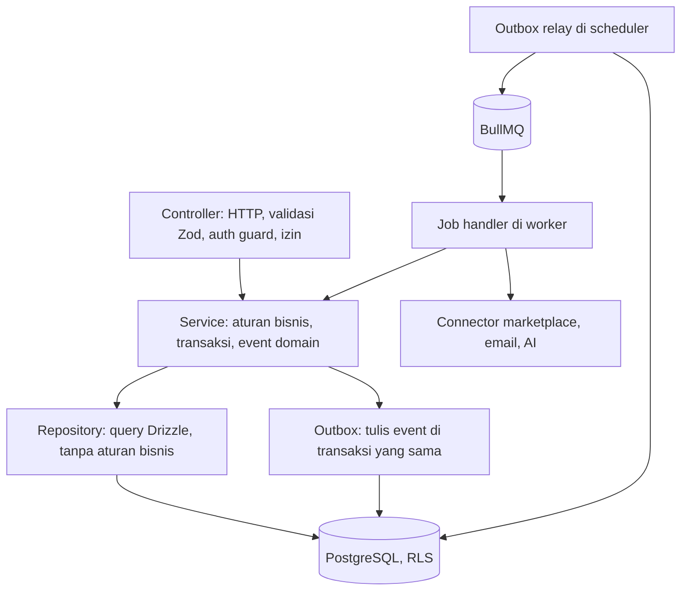
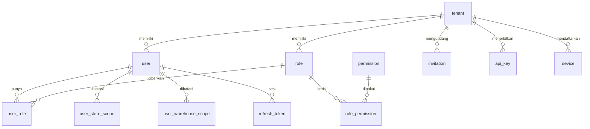
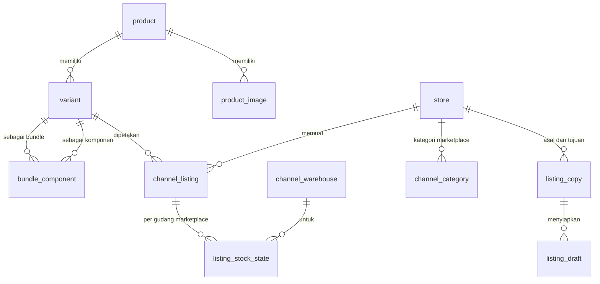
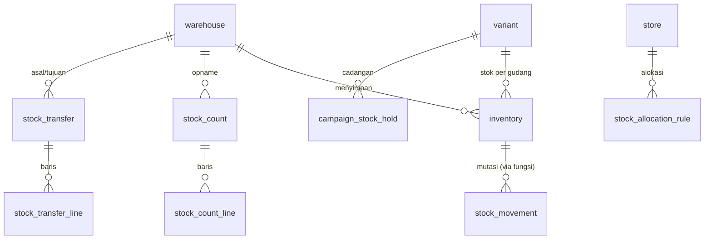
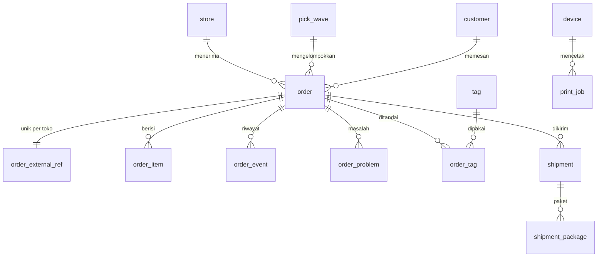

# OmniSeller — Dokumen Arsitektur dan Pengembangan Backend

| Item | Keterangan |
|---|---|
| Versi dokumen | 1.43 |
| Tanggal | 17 Oktober 2026 |
| Status | Keputusan final untuk implementasi; fondasi (bagian 4 sampai 9, 12, 13), identitas, autentikasi, dan audit (8.1, 8.10), koneksi toko Shopee dan Tokopedia & Shop (8.6, 8.11), katalog, listing, dan pemetaan SKU (7.8.3, 8.12), stok, penyesuaian, dan push stok ke marketplace (7.8.4, 8.13, 9.4), pesanan dari Shopee dan Tokopedia & Shop (7.8.6, 7.9, 8.14, 10.6), pengiriman, label, pick list, dan peringatan batas kirim (8.15), dasbor, notifikasi in-app, ekspor data penuh, dan audit aksi sensitif (8.16 sampai 8.18), migrasi dari aplikasi lain dengan mode paralel dan cutover (8.19), laporan penjualan, daftar perlu restock, ringkasan email harian, dan preferensi notifikasi (8.20), banyak gudang fisik, pesanan manual, alokasi gudang otomatis, dan tag pesanan (8.21), pelacakan paket, daftar kemas, dan template label kustom (8.22), putus toko dengan atau tanpa data, peringatan koneksi, riwayat produk, dan barcode (8.23), agen cetak, scan untuk cetak, kemas dengan scan, serah terima kurir dengan manifest, dan visibilitas HPP (8.24), salin listing antar toko sendiri (8.25), retur, refund, permintaan batal pembeli, dan paket kembali (8.26), stok opname dan transfer stok antar gudang (8.27), log audit yang terbaca (8.28), profil bisnis dan legalitas (8.29), verifikasi dua langkah dan sesi aktif (8.30), cut-off kurir dan jam operasional (8.31), langganan, tagihan lewat Xendit dengan PDF ber-NPWP, kuota paket, dan meteran pesanan (8.32), peran kustom dan fitur per paket (8.33), anonimisasi data pembeli (8.34), laporan kinerja tim (8.35), penutupan akun dan penghapusan data bisnis (8.36), serta aturan proses pesanan otomatis (8.37) sudah diimplementasikan di folder `backend/` |
| Pemilik dokumen | Candra Syahputra |
| Dokumen terkait | DOKUMEN-SPESIFIKASI-APLIKASI.md (PRD) versi 1.11, DOKUMEN-TEKNOLOGI.md versi 1.28; web app di `frontend/README.md` |
| Audiens | Engineer backend, tech lead, QA, dan **agen AI** yang mengerjakan basis kode |

> **Untuk agen AI yang membaca dokumen ini.** Bacalah bagian 2 terlebih dahulu. Bagian itu berisi kontrak kerja: invarian yang tidak boleh dilanggar, tempat setiap hal berada, dan urutan langkah untuk setiap jenis perubahan. Semua nama tabel, kolom, modul, antrean, dan perintah di dokumen ini adalah nama yang sebenarnya dipakai di repositori. Jangan menebak nama; cari di dokumen ini atau di kode.

---

## Daftar Isi

1. [Tujuan dan Cara Membaca](#1-tujuan-dan-cara-membaca)
2. [Kontrak untuk Agen AI dan Engineer](#2-kontrak-untuk-agen-ai-dan-engineer)
3. [Gambaran Arsitektur Backend](#3-gambaran-arsitektur-backend)
4. [Struktur Proyek Backend](#4-struktur-proyek-backend)
5. [Lingkungan dan Konfigurasi](#5-lingkungan-dan-konfigurasi)
6. [Identitas Rekaman: ULID](#6-identitas-rekaman-ulid)
7. [Desain Basis Data](#7-desain-basis-data)
8. [Lapisan Aplikasi](#8-lapisan-aplikasi)
9. [Pekerjaan Latar dan Penjadwalan](#9-pekerjaan-latar-dan-penjadwalan)
10. [Aturan API](#10-aturan-api)
11. [Peta Modul dan Kepemilikan Tabel](#11-peta-modul-dan-kepemilikan-tabel)
12. [Migrasi Basis Data](#12-migrasi-basis-data)
13. [Pengujian Backend](#13-pengujian-backend)
14. [Observabilitas dan Keamanan di Kode](#14-observabilitas-dan-keamanan-di-kode)
15. [Panduan Pengembangan Langkah demi Langkah](#15-panduan-pengembangan-langkah-demi-langkah)
16. [Runbook Operasional](#16-runbook-operasional)
17. [Lampiran Kode dan Berkas](#17-lampiran-kode-dan-berkas)
18. [Glosarium dan Riwayat](#18-glosarium-dan-riwayat)

---

## 1. Tujuan dan Cara Membaca

Dokumen ini menetapkan **bagaimana backend OmniSeller dibangun**: struktur proyek, lingkungan, skema basis data beserta relasi dan batasannya, lapisan aplikasi, pekerjaan latar, dan langkah pengembangan. Dokumen ini melengkapi PRD (apa yang dibangun) dan Dokumen Teknologi (teknologi apa yang dipakai).

Tiga sasaran yang membentuk setiap keputusan di sini:

1. **Kesalahan data tidak mungkin, bukan sekadar jarang.** Integritas ditegakkan oleh basis data: kunci asing komposit yang menyertakan tenant, batasan CHECK, trigger transisi status, dan fungsi tunggal untuk mengubah stok. Bug di kode aplikasi tidak boleh menghasilkan data yang rusak.
2. **Dapat dikerjakan oleh siapa pun, termasuk agen AI.** Setiap modul memiliki bentuk yang sama, setiap perubahan memiliki urutan langkah yang sama, dan setiap nama mengikuti konvensi yang sama. Tidak ada pengetahuan tersembunyi di kepala satu orang.
3. **Dapat diskalakan tanpa menulis ulang.** Batas modul, antrean, dan partisi sudah dirancang untuk volume sepuluh kali lipat dari target Fase 3.

Urutan baca yang disarankan:

| Pembaca | Urutan |
|---|---|
| Engineer baru | 2, 3, 4, 5, 15.1 sampai 15.3, lalu 7 dan 8 sambil membuka kode |
| Agen AI yang diberi tugas | 2, lalu bagian yang dirujuk tabel 2.3 sesuai jenis tugas |
| Peninjau kode | 2.2 (invarian), 7.1 sampai 7.7, 15.11 (checklist PR) |
| DevOps | 5, 12, 16 |

---

## 2. Kontrak untuk Agen AI dan Engineer

### 2.1 Aturan dasar

1. Jangan menebak. Nama tabel, kolom, modul, antrean, dan perintah ada di dokumen ini dan di kode. Bila tidak ditemukan di keduanya, berarti belum ada dan harus dibuat mengikuti konvensi bagian 4, 7, dan 8.
2. Setiap perubahan mengikuti urutan langkah di bagian 15 untuk jenisnya (modul baru, tabel baru, endpoint baru, job baru, connector baru).
3. Setiap perubahan disertai tes sesuai bagian 13. Perubahan tanpa tes tidak digabung.
4. Setiap keputusan yang menyimpang dari dokumen ini dicatat sebagai ADR di `docs/adr/` dan dokumen ini diperbarui pada PR yang sama.
5. Kode dan komentar dalam bahasa Inggris. Teks yang dilihat pengguna dalam bahasa Indonesia lewat berkas i18n.
6. Gunakan perintah `pnpm` yang terdaftar di 17.9. Jangan memanggil alat secara langsung dengan opsi yang berbeda dari skrip.

### 2.2 Invarian yang tidak boleh dilanggar

| # | Invarian | Cara ditegakkan | Yang harus dilakukan agen |
|---|---|---|---|
| I1 | Tidak ada query data tenant di luar `withTenantTx` | RLS mengembalikan nol baris tanpa `app.tenant_id`; lint Semgrep menolak `db.` di luar helper | Selalu bungkus akses data dengan `withTenantTx(handle, ctx, tx => ...)` |
| I2 | Stok hanya berubah lewat `apply_stock_movement()` | Role `omniseller_api` dan `omniseller_worker` tidak punya hak INSERT, DELETE, atau UPDATE kolom jumlah pada `inventory` dan `stock_movement`; fungsi `SECURITY DEFINER` memeriksa tenant; trigger `inventory_guard` sebagai lapis kedua | Panggil `InventoryService.applyMovement()`; jangan pernah `UPDATE inventory` untuk kolom jumlah |
| I3 | Status hanya berubah sesuai tabel transisi | Trigger `enforce_status_transition('<tabel>')` di `order`, `shipment`, `sync_job` (dan tabel berstatus lain saat dibuat) | Gunakan `<Modul>Service.transition(...)`; fakta dari marketplace di dalam `withStatusSource(tx, 'marketplace', ...)` |
| I4 | Setiap efek samping keluar (marketplace, email, WhatsApp, AI) lewat outbox dan BullMQ | Tidak ada klien HTTP keluar di proses `api`; lint menolak impor connector di `src/modules/*/controller.ts` | Tulis `outbox_event` di transaksi yang sama, biarkan relay dan worker mengeksekusi |
| I5 | Setiap tabel memiliki `id` ULID, `tenant_id`, `created_at`, `updated_at`, `row_version` (kecuali tabel global dan tabel hanya-tambah yang dicatat di `test/schema`) | Uji skema `pnpm test:schema` membaca katalog PostgreSQL | Tulis kolom standar di migrasi SQL; cermin Drizzle memakai `baseColumns()` |
| I6 | Kunci asing ke tabel milik tenant selalu komposit `(tenant_id, x_id)`, dan `ON DELETE SET NULL` selalu menyebut kolomnya: `SET NULL (x_id)` | Uji skema memeriksa setiap FK termasuk daftar kolom `SET NULL` | Tulis FK komposit di migrasi SQL (7.3, 7.4) |
| I7 | Uang selalu `bigint` rupiah utuh | Tipe kolom dan util `Money` | Jangan pernah memakai `numeric` atau `float` untuk uang |
| I8 | Data pribadi pembeli tidak masuk log, tidak masuk skema `research`, tidak dikirim ke AI tanpa disamarkan | Redaksi di logger, tidak ada FK dari `research` ke `order`, `PiiScrubber` sebelum panggilan AI | Gunakan `logger` dari `@omniseller/logging`, bukan `console` |
| I9 | Perubahan skema mengikuti expand and contract | Tinjauan migrasi wajib | Jangan `DROP`, `RENAME`, atau ubah tipe di rilis yang sama dengan perubahan kode yang bergantung |
| I10 | Setiap job BullMQ idempoten dan `jobId` deterministik | Helper `jobKey()` (pemisah `\|`, BullMQ menolak `:`) dan konvensi di 9.2 | Bangun `jobId` dari kunci bisnis; untuk aksi yang boleh berulang pada entitas yang sama, sertakan kunci kejadian (id outbox atau skor debounce) |
| I11 | Webhook receiver hanya verifikasi, simpan, enqueue, balas | Tidak ada modul bisnis dimuat di proses `webhook` | Jangan menambah logika di `src/webhook/` |
| I12 | Token marketplace hanya dapat dibaca dan ditulis proses `worker` dan `scheduler` | `omniseller_api` hanya punya SELECT kolom metadata `store_credential`, tanpa INSERT atau UPDATE; hak KMS hanya untuk worker dan scheduler | Penukaran kode OAuth dan enkripsi token dikerjakan job di worker (8.6); jangan memuat `CredentialService` di proses `api` |

### 2.3 Peta cepat: jenis tugas ke bagian dokumen

| Jenis tugas | Baca | Langkah |
|---|---|---|
| Menambah modul baru | 4, 8, 11 | 15.4 |
| Menambah atau mengubah tabel | 6, 7 | 15.5 |
| Menambah endpoint | 8, 10 | 15.6 |
| Menambah job atau jadwal | 9 | 15.7 |
| Menambah connector marketplace | 8.7, 9, DOKUMEN-TEKNOLOGI 8 | 15.8 |
| Menambah event domain dan consumer | 8.5, 8.6 | 15.9 |
| Memperbaiki bug data | 7, 16 | 16 |
| Menjalankan lokal | 5 | 15.2, 15.3 |

### 2.4 Tempat setiap hal berada

Seluruh kode backend berada di folder `backend/` di root repositori (ADR-032); root hanya berisi dokumen. **Semua path di dokumen ini relatif terhadap `backend/`**, dan semua perintah `pnpm` dijalankan dari sana.

| Hal | Lokasi |
|---|---|
| Migrasi SQL berversi (sumber kebenaran DDL dan batasan) | `drizzle/migrations/NNNN_nama.sql` |
| SQL repeatable: fungsi, trigger, kebijakan RLS, grant, seed | `drizzle/sql/NN_nama.sql` (dijalankan ulang setiap `db:migrate`, harus idempoten) |
| Cermin skema Drizzle (tipe query) | `src/db/schema/<domain>.ts`, dijaga sama dengan SQL oleh `pnpm test:schema` |
| Migrator dan bootstrap role | `src/db/migrate.ts`, `src/db/bootstrap.ts` |
| Modul bisnis | `src/modules/<nama>/` |
| Definisi job dan skema payload | `src/modules/<modul>/<modul>.jobs.ts`, didaftarkan di `src/jobs/registry.ts` |
| Jadwal | `src/scheduler/schedules.ts` |
| Connector | `packages/connectors/<marketplace>/` |
| Tipe domain dan skema Zod bersama | `packages/shared/src/` |
| Konfigurasi lingkungan | `src/config/` |
| Tes | Di samping kode (`*.spec.ts` unit, `*.int.spec.ts` integrasi), `test/` untuk e2e dan isolasi tenant |
| Dokumentasi modul | `src/modules/<nama>/README.md` |
| ADR | `docs/adr/NNNN-judul.md` |
| Runbook | `docs/runbooks/<topik>.md` |
| Kontrak untuk agen | `AGENTS.md` di root |
| Infrastruktur per proses (pool per role, Redis, antrean) | `src/infra/` |
| Runner worker dan scheduler | `src/worker/`, `src/scheduler/` |

---

## 3. Gambaran Arsitektur Backend

### 3.1 Proses

Satu aplikasi NestJS, satu image Docker, lima peran proses yang dipilih oleh `APP_ROLE`:

| Peran | Modul yang dimuat | Role basis data | Tugas |
|---|---|---|---|
| `api` | Semua modul bisnis (controller dan service), auth, realtime | `omniseller_api` (RLS aktif, tidak bisa membaca token) | Melayani REST dan Socket.IO |
| `webhook` | Hanya `webhook` dan `outbox` | `omniseller_api` | Verifikasi, simpan ke `webhook_inbox`, enqueue |
| `worker` | Modul bisnis (service saja), connectors, jobs | `omniseller_worker` (RLS aktif, bisa membaca token) | Menjalankan job BullMQ |
| `scheduler` | `scheduler`, `outbox-relay`, `partition-maintenance`, `retention` | `omniseller_system` untuk job lintas tenant (BYPASSRLS), `omniseller_worker` untuk job per tenant | Jadwal berulang, relay outbox, pemeliharaan |
| `research-collector` | `research` | `omniseller_worker` | Pengumpulan riset |

Setiap proses hanya menerima URL basis data untuk role yang boleh dipakainya (5.2): proses `api` dan `webhook` tidak pernah memegang koneksi `omniseller_worker` atau `omniseller_system`.

### 3.2 Lapisan dalam satu proses



Aturan lapisan:

- Controller tidak memanggil repository dan tidak berisi aturan bisnis.
- Service adalah satu-satunya tempat aturan bisnis dan satu-satunya yang membuka transaksi.
- Repository tidak membuka transaksi sendiri; menerima `tx` dari service.
- Job handler memanggil service, bukan repository, agar aturan bisnis tidak diduplikasi.
- Connector tidak tahu tentang basis data; menerima dan mengembalikan tipe ternormalisasi dari `packages/connectors/core`.

### 3.3 Aliran data tulis (contoh: batalkan pesanan)

1. `POST /v1/orders/:id/cancel {reason}` masuk ke `OrdersController.cancel`.
2. Guard memverifikasi sesi dan izin `order:cancel` (8.1); pipe memvalidasi parameter dan body.
3. `OrdersService.requestCancel(ctx, id, reason)` membuka `withTenantTx`, memuat pesanan dengan `FOR UPDATE`, memeriksa toko dan gudang pesanan terhadap cakupan pengguna, memeriksa alasan terhadap daftar marketplace, menulis `outbox_event{type:'order.cancel_requested'}` dan `order_event{type:'cancel_requested'}`, commit, lalu menjawab 202.
4. Relay outbox memindahkan event ke antrean `mp.outbound` dengan `jobId = order.cancel|<order_id>|<outbox_event_id>`.
5. Job di worker memanggil marketplace lewat `MarketplaceGateway` (`orders.cancelOrder`), lalu membaca ulang pesanan; `OrderIntakeService` memindahkan status ke `cancelled` dan melepas reservasi stok di transaksi yang sama (8.14). Pelepasan stok menulis `inventory.changed`, yang mendorong stok baru ke semua toko (9.4).
6. Socket.IO mengirim `order.updated` ke room tenant dari event yang sama (menyusul bersama frontend). Yang sudah berjalan: `print.job` ke room agen cetak (8.24).

---

## 4. Struktur Proyek Backend

```
backend/
├── src/
│   ├── main.ts                     # bootstrap; memilih modul berdasarkan APP_ROLE
│   ├── app.module.ts
│   ├── config/
│   │   ├── env.schema.ts           # skema Zod semua variabel lingkungan, per peran
│   │   ├── config.module.ts
│   │   └── config.service.ts       # AppConfig bertipe, tidak ada process.env di luar sini
│   ├── db/
│   │   ├── client.ts               # pool Drizzle per role basis data (api, worker, system)
│   │   ├── tenant-tx.ts            # withTenantTx, withSystemTx, withStatusSource
│   │   ├── columns.ts              # ulid, baseColumns(), money() untuk cermin Drizzle
│   │   ├── migrate.ts              # migrator (12.1), dipanggil migrate.cli.ts
│   │   ├── bootstrap.ts            # role dan database lokal/uji, dipanggil bootstrap.cli.ts
│   │   └── schema/
│   │       ├── index.ts
│   │       ├── identity.ts
│   │       ├── channel.ts
│   │       ├── catalog.ts
│   │       ├── inventory.ts
│   │       ├── purchasing.ts
│   │       ├── orders.ts
│   │       ├── returns.ts
│   │       ├── sync.ts
│   │       ├── finance.ts
│   │       ├── chat.ts
│   │       ├── promo.ts
│   │       ├── health.ts
│   │       ├── crm.ts
│   │       ├── research.ts
│   │       ├── migration.ts
│   │       ├── campaign.ts
│   │       ├── notification.ts
│   │       ├── billing.ts
│   │       ├── platform.ts         # feature_flag, ai_*, file_object
│   │       └── audit.ts
│   ├── common/
│   │   ├── context/                # RequestContext, RequestIdMiddleware, AsyncLocalStorage
│   │   ├── errors/                 # DomainError dan turunannya, ProblemDetailsFilter
│   │   ├── http/                   # dekorator (@Isolation, @RequirePermission, @Ctx), pipe validasi, paginasi, If-Match
│   │   ├── security/               # sandi, token rahasia, sesi Redis, rate limiter, KeyProvider dan TokenVault (8.6)
│   │   └── logging/
│   ├── modules/
│   │   ├── identity/               # tenant, user, role, invitation, api_key, device
│   │   ├── auth/                   # login, sesi, 2FA, refresh token
│   │   ├── channel/                # store, credential, store_authorization, channel_warehouse, connector registry
│   │   ├── catalog/                # product, variant, listing, mapping, bundle
│   │   ├── inventory/              # warehouse, inventory, movement, count, transfer, allocation
│   │   ├── purchasing/
│   │   ├── orders/
│   │   ├── fulfillment/            # shipment, label, pick list, agen cetak dan print job, kemas dengan scan, serah terima (8.24)
│   │   ├── returns/                # return_request, return_item: retur, refund, permintaan batal pembeli, paket kembali (8.26)
│   │   ├── sync/                   # sync_job (log sinkron), webhook_inbox, penerima dan pemroses webhook
│   │   ├── finance/
│   │   ├── chat/
│   │   ├── promo/
│   │   ├── health/
│   │   ├── affiliate/
│   │   ├── crm/
│   │   ├── research/
│   │   ├── migration/
│   │   ├── campaign/
│   │   ├── notification/
│   │   ├── billing/
│   │   ├── reporting/
│   │   ├── retention/              # menghapus data yang tidak disimpan (toko diputus tanpa data, 8.23)
│   │   ├── ai/
│   │   ├── files/
│   │   ├── exports/                # ekspor data penuh (8.18)
│   │   ├── audit/
│   │   └── platform/               # feature flag, health check, admin internal
│   ├── jobs/
│   │   ├── define.ts               # defineEvent, defineJob, JobDeps
│   │   ├── job-id.ts               # jobKey (pemisah |)
│   │   ├── queues.ts               # nama antrean, QueueRegistry
│   │   ├── registry.ts             # JOB_DEFINITIONS dari <modul>.jobs.ts
│   │   ├── webhook-consumers.ts    # konsumen event webhook per modul (8.11)
│   │   └── stock-dirty.ts
│   ├── scheduler/
│   │   ├── scheduler.runner.ts     # loop in-process: relay, stock flush, partisi, pemindaian toko
│   │   ├── outbox-relay.ts
│   │   ├── stock-flush.ts
│   │   ├── channel-scans.ts        # webhook.inbox_sweep, token.refresh_scan, mp.poll.orders, mp.poll.warehouses
│   │   ├── order-scans.ts          # order.sla_scan, order.new_scan, files.cleanup_scan
│   │   ├── digest-scan.ts          # digest.scan (8.20)
│   │   ├── report-scan.ts          # report.scan: laporan terjadwal (8.20)
│   │   ├── tracking-scan.ts        # shipment.tracking_scan (8.22)
│   │   ├── auto-arrange-scan.ts    # order.auto_arrange_scan (8.37)
│   │   └── retention.ts            # (menyusul)
│   ├── infra/                      # InfraModule: pool per role, Redis, antrean, outbox
│   ├── outbox/                     # Outbox.enqueue
│   ├── worker/                     # WorkerRunner: BullMQ Worker per antrean
│   ├── webhook/
│   │   └── webhook-app.ts          # body mentah untuk proses webhook (controller ada di modules/sync)
│   └── realtime/
│       ├── realtime.ts             # REALTIME: emitter Redis untuk semua proses, room device:<id> (8.24)
│       ├── realtime.gateway.ts     # Socket.IO di server HTTP api, adapter Redis, handshake token perangkat
│       └── realtime.module.ts      # hanya proses api
├── drizzle/
│   ├── migrations/                 # 0001_core.sql, 0002_...sql (berversi, sekali jalan)
│   └── sql/                        # 10_functions, 15_views, 20_triggers, 30_policies, 40_grants, 90_seeds (repeatable)
├── test/
│   ├── setup/                      # global-setup (Testcontainers atau URL lokal), handles, factories
│   ├── db/                         # invarian basis data: RLS, stok, status, audit, FK, migrator
│   ├── jobs/                       # outbox, relay, debounce stok, lookup pra-tenant
│   ├── schema/                     # pnpm test:schema
│   ├── tenant-isolation/           # generator uji isolasi dari OpenAPI
│   └── e2e/
├── packages/
│   ├── shared/                     # @omniseller/shared: ULID, uang, izin, status
│   ├── logging/                    # @omniseller/logging: logger JSON dengan redaksi
│   └── connectors/
│       ├── core/                   # @omniseller/connector-core: tipe, error, HTTP, redaksi
│       ├── shopee/                 # @omniseller/connector-shopee
│       └── tiktokshop/             # @omniseller/connector-tiktokshop (Tokopedia & Shop)
├── infra/docker/                   # compose.local.yml
├── patches/                        # tambalan pnpm untuk dependensi (nestjs-zod, 10.4)
├── tools/                          # dev.mjs (runner dev), scripts/native-infra.sh
├── .env.example
├── package.json                    # root workspace pnpm sekaligus paket aplikasi
├── pnpm-workspace.yaml             # anggota: packages/*, packages/connectors/*
├── biome.json, tsconfig.base.json, tsconfig.json, tsconfig.build.json, vitest.config.ts
└── .gitignore
```

Bentuk satu modul (wajib sama untuk semua modul):

```
modules/orders/
├── README.md                # tanggung jawab, tabel yang dimiliki, event, endpoint, job
├── orders.module.ts
├── orders.controller.ts     # hanya di proses api
├── orders.service.ts        # aturan bisnis
├── orders.repository.ts     # query
├── orders.events.ts         # konstanta nama event dan skema payload
├── orders.errors.ts         # kelas error domain
├── dto/
│   ├── accept-order.dto.ts  # skema Zod request dan response
│   └── ...
├── orders.service.spec.ts   # unit
├── orders.int.spec.ts       # integrasi dengan Testcontainers
└── orders.controller.e2e.spec.ts
```

---

## 5. Lingkungan dan Konfigurasi

### 5.1 Empat lingkungan

| Lingkungan | Tujuan | Basis data | Marketplace | Rahasia | Cara jalan |
|---|---|---|---|---|---|
| `local` | Pengembangan di mesin engineer | PostgreSQL di Docker Compose atau terpasang langsung (`pnpm infra:native`) | Server tiruan (Hono) di Compose, opsional sandbox nyata | `.env.local` (tidak di-commit) | `pnpm dev` |
| `test` | Uji otomatis di mesin dan CI | Database baru per run, di Testcontainers atau server dari `TEST_PG_ADMIN_URL` | Server tiruan | Diatur `test/setup/global-setup.ts`, tanpa berkas env | `pnpm test`, `pnpm test:int` |
| `staging` | Verifikasi sebelum produksi, UAT | RDS staging | Sandbox nyata dan toko uji | AWS Secrets Manager | Deploy otomatis dari `main` |
| `production` | Layanan nyata | RDS produksi | Produksi | AWS Secrets Manager | Deploy dari tag dengan persetujuan |

Aturan:

- Tidak ada berkas `.env` di staging dan produksi. Semua nilai disuntik ECS dari Secrets Manager dan parameter tugas.
- `.env.example` selalu lengkap dan diperbarui pada PR yang menambah variabel. CI gagal bila `env.schema.ts` memiliki kunci yang tidak ada di `.env.example`.
- Nilai yang sama di semua lingkungan (misalnya nama antrean) bukan variabel lingkungan; ditulis sebagai konstanta.

### 5.2 Skema konfigurasi

Semua konfigurasi dibaca sekali saat proses mulai lewat `src/config/env.schema.ts` (Zod, `parseEnv`) dan disuntikkan sebagai token `ENV`. `process.env` hanya dibaca di `main.ts`. Proses gagal cepat dengan pesan jelas bila ada nilai yang kurang atau salah tipe.

Skema dibagi per peran, dan setiap peran hanya mendeklarasikan kunci yang dipakainya:

| Peran | Basis data | Kunci khusus |
|---|---|---|
| `api` | `DATABASE_URL` (`omniseller_api`) | `PORT` (bawaan 3000), `PUBLIC_WEB_URL` (satu-satunya origin CORS yang diizinkan, dengan cookie), id publik marketplace untuk membangun tautan otorisasi (`SHOPEE_PARTNER_ID`, `SHOPEE_AUTH_BASE_URL`, `TIKTOKSHOP_SERVICE_ID`, `TIKTOKSHOP_AUTHORIZE_URL`); `TOTP_ENCRYPTION_KEY` (wajib, 32 byte acak base64: menyegel rahasia TOTP dan menjadi kunci HMAC kode cadangan, 8.30) dan `TOTP_ISSUER` (bawaan `OmniSeller`); `BILLING_PAYMENTS` (`xendit` atau bawaan `off`: apakah paket berbayar bisa dipilih, 8.32). Tidak pernah menerima kunci KMS token, rahasia marketplace, kunci Xendit, atau kredensial email |
| `webhook` | `DATABASE_URL` (`omniseller_api`) | `PORT` (bawaan 3001), `PUBLIC_WEBHOOK_URL` (Shopee menandatangani URL lengkapnya), rahasia verifikasi: `SHOPEE_PARTNER_ID` + `SHOPEE_PARTNER_KEY`, `TIKTOKSHOP_APP_KEY` + `TIKTOKSHOP_APP_SECRET`; `XENDIT_WEBHOOK_TOKEN` (Callback Verification Token Xendit, 8.32; kosong: callback dijawab 404) |
| `worker` | `DATABASE_URL_WORKER` (`omniseller_worker`) | `PUBLIC_WEB_URL` (tautan di email), `EMAIL_TRANSPORT` (`smtp`; `log` hanya boleh di `local`, `memory` hanya di `test`), `SMTP_URL` (wajib bila `smtp`: Mailpit lokal, SMTP Amazon SES di staging dan produksi), `EMAIL_FROM`; `PUBLIC_WEBHOOK_URL`; semua kunci marketplace di atas ditambah base URL API (`SHOPEE_API_BASE_URL`, `TIKTOKSHOP_API_BASE_URL`, `TIKTOKSHOP_AUTH_BASE_URL`); enkripsi token: `TOKEN_KEY_PROVIDER` (`aws_kms`, atau `local` yang hanya boleh di `local` dan `test`), `KMS_KEY_ID_TOKENS` + `AWS_REGION`, atau `TOKEN_LOCAL_MASTER_KEY` (32 byte base64); salin listing (8.25): `SHOPEE_VARIANT_DELAY_MS` (bawaan 5000, jeda Shopee antara `add_item` dan `init_tier_variation`; uji memakai 0) dan `PRODUCT_IMAGE_HOSTS` (host gambar tambahan dipisah koma; http polos hanya di `local` dan `test`); tagihan langganan (8.32): `XENDIT_SECRET_KEY` (kosong: tagihan ditandai gagal) dan `XENDIT_API_BASE_URL` (bawaan `https://api.xendit.co`; http polos hanya di `local` dan `test`). AI menyusul bersama modulnya |
| `scheduler` | `DATABASE_URL_WORKER` dan `DATABASE_URL_SYSTEM` (`omniseller_system`) | |
| `research-collector` | `DATABASE_URL_WORKER` | Kunci riset saat modulnya dibuat |

Kunci ditambahkan ke skema bersama kode yang memakainya, bukan lebih dulu; `.env.example` diperbarui pada PR yang sama (5.1). Kunci marketplace berpasangan (id dengan rahasianya) dan boleh kosong: marketplace tanpa kunci berstatus "belum dikonfigurasi", tampil tidak tersedia di `GET /v1/channels`, dan permintaan menghubungkan toko ditolak 422 `channel.not_configured`. Nilai kosong di berkas env dibaca sebagai tidak diisi.

### 5.3 Berkas lingkungan

| Berkas | Di-commit | Isi |
|---|---|---|
| `.env.example` | Ya | Semua kunci dengan nilai contoh atau kosong, dikelompokkan per peran, dengan komentar |
| `.env.local` | Tidak | Nilai lokal engineer, dimuat oleh `pnpm dev` dan `pnpm db:*` |
| `infra/docker/compose.local.yml` | Ya | Layanan lokal dengan Docker |
| `tools/scripts/native-infra.sh` | Ya | Layanan lokal tanpa Docker (PostgreSQL 15+ dan Redis terpasang), port sama dengan Compose |

### 5.4 Layanan lokal (Docker Compose)

| Layanan | Image | Port | Keterangan |
|---|---|---|---|
| `postgres` | `pgvector/pgvector:pg17` | 5433 | Superuser `postgres`; role dan database `omniseller` dibuat `pnpm db:bootstrap`. Port 5433 agar tidak bentrok dengan PostgreSQL lain di 5432 |
| `redis-queue` | `redis:7.2` | 6379 | AOF aktif |
| `redis-cache` | `redis:7.2` | 6380 | Tanpa persistensi |
| `meilisearch` | `getmeili/meilisearch` | 7700 | Menyusul bersama pencarian |
| `minio` (+ `minio-init`) | `minio/minio` | 9000, 9001 (konsol) | Pengganti R2 dengan API S3 untuk label dan dokumen: `FILE_STORAGE=r2`, `R2_ENDPOINT=http://127.0.0.1:9000`; `minio-init` membuat bucket `omniseller-documents`. Tanpa Docker pakai `FILE_STORAGE=local` (direktori `.local/files`) |
| `mailpit` | `axllent/mailpit` | 1025 (SMTP), 8025 (UI) | Menangkap semua email lokal (`SMTP_URL=smtp://127.0.0.1:1025`). Tanpa Docker, pakai `EMAIL_TRANSPORT=log`: isi email, termasuk tautan undangan, ditulis ke log worker |
| `mock-marketplace` | build lokal (Hono) | 4000 | Meniru Shopee, TikTok Shop, Lazada, Blibli, memutar ulang fixture webhook; menyusul bersama connector |

Layanan yang belum dipakai kode tidak dimasukkan ke Compose sampai kodenya ada.

### 5.5 Perbedaan perilaku per lingkungan

| Perilaku | local | test | staging | production |
|---|---|---|---|---|
| Migrasi otomatis saat mulai | Ya | Ya (basis data segar) | Tidak, tugas terpisah | Tidak, tugas terpisah |
| Seed data contoh | Ya (`pnpm db:seed`) | Fixture per tes | Data teranonimkan | Tidak |
| Connector nyata | Opsional lewat `MP_MODE=sandbox` | Tidak | Sandbox | Produksi |
| Kirim email dan WhatsApp | Mailpit, WhatsApp dimatikan | Dimatikan | Domain uji | Nyata |
| Panggilan AI | Dimatikan kecuali `AI_MODE=live` | Direkam (fixture) | Nyata dengan anggaran kecil | Nyata |
| Rate limit API | Longgar | Dimatikan | Sama dengan produksi | Produksi |
| Log | Pretty | Ringkas | JSON | JSON |

---

## 6. Identitas Rekaman: ULID

### 6.1 Keputusan

Semua kunci primer adalah **ULID**: 26 karakter Crockford base32 huruf besar, 48 bit waktu milidetik diikuti 80 bit acak, dibuat di aplikasi dengan generator monotonik.

| Aspek | Keputusan |
|---|---|
| Tipe kolom | Domain `ulid`: `CREATE DOMAIN ulid AS text COLLATE "C" CHECK (VALUE ~ '^[0-9A-HJKMNP-TV-Z]{26}$')`. Semua id dan kunci asing memakai domain ini, sehingga format diperiksa di satu tempat. `text`, bukan `char(26)`: panjang sudah dijamin regex, dan perbandingan dengan `current_setting()` (bertipe `text`) di predikat RLS tetap memakai indeks (terbukti oleh uji `tenant-isolation`) |
| Pembuatan | Di aplikasi lewat `newId()` dari `packages/shared/src/ulid.ts` (pustaka `ulid`, `monotonicFactory`). Tidak ada `DEFAULT` di basis data. Pengecualian yang dibuat di basis data dengan `gen_ulid()`: id seed tabel referensi global dan id baris `audit_log` (7.7) |
| Kolase | `"C"` wajib agar pengurutan byte sama dengan urutan waktu, sehingga `ORDER BY id` dan partisi range pada `id` benar |
| Di API | Dikirim apa adanya sebagai string 26 karakter. Skema Zod `ulidSchema` memvalidasi format di setiap batas |
| Di log | Boleh dicatat; ULID tidak mengandung data pribadi |

### 6.2 Alasan

- **Terurut waktu**: sisipan ke indeks B-tree selalu di ujung kanan, tanpa fragmentasi seperti UUID v4.
- **Dapat dibaca dan dibandingkan manusia**: mudah disalin dari log, disortir di spreadsheet, dan dibaca agen AI.
- **Memungkinkan partisi range pada `id`**: tabel besar dipartisi per bulan berdasarkan prefiks waktu ULID tanpa menambah kolom partisi ke kunci primer (bagian 7.6).
- **Tidak bocor informasi**: tidak mengungkap jumlah baris seperti serial.

### 6.3 Aturan pemakaian

- Kunci asing bertipe sama: domain `ulid`.
- Tidak ada kunci primer komposit. Tabel penghubung tetap memiliki `id` ULID ditambah batasan `UNIQUE` pada pasangan kolomnya.
- Jangan membuat ULID di SQL selain dua pengecualian di atas. Bila migrasi backfill membutuhkan id, tulis skrip TypeScript di `tools/scripts/`.
- `ulidSchema` (Zod) dipakai di semua DTO untuk parameter `:id`.
- Rekaman yang waktunya berasal dari luar memakai `newIdAt(waktu)`: id pesanan dibuat dari waktu pesanan dibuat di marketplace, sehingga urutan id sama dengan urutan waktu pesanan (daftar pesanan cukup diurutkan per id) dan pesanan hasil impor 90 hari masuk partisi bulan pesanannya. Rekaman lain tetap `newId()`.

---

## 7. Desain Basis Data

### 7.1 Prinsip

1. **Basis data adalah penjaga terakhir.** Setiap aturan yang dapat dinyatakan sebagai batasan dinyatakan sebagai batasan: `NOT NULL`, `CHECK`, `UNIQUE`, kunci asing, trigger transisi.
2. **Tenant ada di setiap baris dan setiap kunci asing.** Baris anak tidak mungkin merujuk induk milik tenant lain (7.3).
3. **Tidak ada penghapusan diam-diam.** Setiap `ON DELETE` dipilih sadar (7.4). Data historis tidak pernah dihapus, hanya diarsipkan, kecuali atas pilihan eksplisit penjual (putus toko tanpa menyimpan data, 8.23) atau kebijakan retensi (9.5); pergerakan stok dan log audit tetap ada.
4. **Nilai turunan dihitung, bukan disimpan ganda**, kecuali bila dibutuhkan untuk indeks; saat itu memakai generated column `STORED`.
5. **Satu jalur untuk setiap perubahan berbahaya.** Stok lewat satu fungsi, status lewat trigger transisi, token lewat satu service.
6. **Skema terbaca tanpa dokumentasi tambahan.** Nama tabel tunggal (`order`, bukan `orders`), kolom `snake_case`, kunci asing `<tabel>_id`, waktu `<peristiwa>_at`, boolean `is_<sifat>`, jumlah `<apa>_count`, uang `<apa>_amount` atau nama jelas seperti `unit_price`.

### 7.2 Konvensi kolom standar

Setiap tabel milik tenant memiliki kolom berikut, ditulis di migrasi SQL dan dicerminkan di Drizzle lewat `baseColumns()`:

| Kolom | Tipe | Batasan |
|---|---|---|
| `id` | `ulid` | `PRIMARY KEY` (format diperiksa domain) |
| `tenant_id` | `ulid` | `NOT NULL`, `REFERENCES tenant(id) ON DELETE RESTRICT` |
| `created_at` | `timestamptz` | `NOT NULL DEFAULT now()` |
| `updated_at` | `timestamptz` | `NOT NULL DEFAULT now()`, diperbarui trigger `touch_row` |
| `row_version` | `integer` | `NOT NULL DEFAULT 1`, dinaikkan trigger `touch_row`, dipakai optimistic locking |

Ditambah `UNIQUE (tenant_id, id)` pada setiap tabel yang menjadi induk kunci asing, agar 7.3 mungkin.

Kolom opsional yang dipakai bila relevan:

| Kolom | Tipe | Kapan |
|---|---|---|
| `deleted_at` | `timestamptz NULL` | Hanya tabel master yang boleh disembunyikan: `product`, `variant`, `warehouse`, `supplier`, `customer`, `chat_template`, `tag` |
| `created_by`, `updated_by` | `ulid NULL` | Tabel yang diubah pengguna langsung |
| `external_*` | `text` | Semua id dari marketplace disimpan sebagai `text`, tidak pernah `bigint`, karena format tiap marketplace berbeda |
| `*_snapshot` | `jsonb` | Salinan data pada saat kejadian (nama produk saat dipesan), tidak dijadikan sumber kebenaran |

Tabel global (tanpa `tenant_id`): `tenant`, `permission`, `plan`, `feature_flag`, `campaign` (baris sistem), `ai_route_config`, `research_source`, `order_status_transition` dan tabel transisi lain, `courier`.

### 7.3 Relasi lintas tenant yang mustahil

Setiap kunci asing ke tabel milik tenant adalah **komposit** dan menyertakan `tenant_id`:

```sql
-- pada tabel anak
tenant_id  ulid NOT NULL,
product_id ulid NOT NULL,
CONSTRAINT variant_product_fk
  FOREIGN KEY (tenant_id, product_id)
  REFERENCES product (tenant_id, id)
  ON DELETE RESTRICT
```

Akibatnya, bahkan bila kode aplikasi salah memasang `product_id`, basis data menolak baris yang merujuk produk tenant lain, termasuk untuk role `BYPASSRLS`. Batasan ditulis di migrasi SQL (ADR-027). Uji skema di CI (`pnpm test:schema`) membaca `pg_constraint` dan gagal bila ada kunci asing ke tabel milik tenant yang tidak diawali `tenant_id`.

Pengecualian yang dicatat: kunci asing ke tabel global (`tenant`, `permission`, `plan`, `research_source`) adalah kolom tunggal.

### 7.4 Kebijakan ON DELETE dan soft delete

| Jenis relasi | ON DELETE | Contoh |
|---|---|---|
| Komposisi: anak tidak bermakna tanpa induk | `CASCADE` | `order_item` ke `order`, `product_image` ke `product`, `purchase_order_line` ke `purchase_order`, `stock_count_line` ke `stock_count`, `role_permission` ke `role` |
| Referensi ke master yang mungkin masih dipakai | `RESTRICT` | `variant` ke `product`, `order_item` ke `variant`, `inventory` ke `warehouse`, `store` ke `tenant` |
| Referensi opsional ke konfigurasi | `SET NULL (x_id)` | `store.default_warehouse_id`, `order.warehouse_id`, `chat_thread.assigned_user_id`, `shipment.label_file_id` |
| Pemetaan yang menentukan ke mana stok didorong | `RESTRICT` | `channel_warehouse.warehouse_id`: gudang yang masih dipetakan harus dilepas pemetaannya lebih dulu (batasan `CHECK` memaksa `mapping_status` dan `warehouse_id` berubah bersama) |
| Ledger dan riwayat | `RESTRICT` dan tidak pernah dihapus | `stock_movement`, `order_event`, `audit_log`, `settlement_line`, `sync_job` |

**`SET NULL` pada FK komposit wajib menyebut kolomnya**: `ON DELETE SET NULL (warehouse_id)` (PostgreSQL 15+). Tanpa daftar kolom, PostgreSQL ikut meng-NULL-kan `tenant_id` yang `NOT NULL`, sehingga penghapusan induk gagal. Contoh nyata: job `files.cleanup_expired` menghapus `file_object` label yang kedaluwarsa, dan `shipment.label_file_id` harus menjadi NULL tanpa menyentuh `tenant_id`. Uji skema memeriksa daftar kolom setiap FK `SET NULL`.

Soft delete (`deleted_at`) hanya pada tabel master di 7.2. Aturan:

- Baris dengan `deleted_at` tidak muncul di daftar dan tidak boleh dipilih di formulir baru, tetapi tetap dapat dirujuk oleh data historis.
- Batasan unik pada tabel master memakai indeks parsial `WHERE deleted_at IS NULL` sehingga SKU yang dihapus dapat dipakai ulang.
- Hard delete tabel master hanya lewat purge tenant (8.36): job `tenant.purge` di worker memanggil fungsi `SECURITY DEFINER` (`purge_tenant_step`) yang menolak bisnis yang belum ditutup dan belum lewat tanggal hapusnya, dalam urutan dependensi dari katalog (`tenant_purge_order()`).

### 7.5 Row-Level Security

- Setiap tabel milik tenant: `ENABLE ROW LEVEL SECURITY` dan `FORCE ROW LEVEL SECURITY`, kebijakan `tenant_isolation` untuk `SELECT`, `INSERT`, `UPDATE`, `DELETE` dengan predikat `tenant_id = current_setting('app.tenant_id', true)`.
- Empat role basis data:

| Role | RLS | Hak | Dipakai oleh |
|---|---|---|---|
| `omniseller_api` | Ditegakkan | CRUD tabel tenant, dengan pengecualian di bawah. Pada `store_credential` hanya SELECT kolom metadata (kedaluwarsa, jumlah gagal), tanpa kolom token dan tanpa INSERT atau UPDATE | `api`, `webhook` |
| `omniseller_worker` | Ditegakkan | CRUD tabel tenant termasuk membaca dan menulis token, dengan pengecualian di bawah | `worker`, `research-collector`, job per tenant di `scheduler` |
| `omniseller_system` | `BYPASSRLS` | Hanya untuk job lintas tenant yang terdaftar: outbox relay, pemeliharaan partisi, retensi (`retention.run`), pemindaian penutupan akun, statistik platform. Penghapusan tenant tidak memakainya: worker memanggil fungsi `SECURITY DEFINER` yang memeriksa sendiri (8.36) | `scheduler` |
| `omniseller_migrator` | `BYPASSRLS` | Pemilik skema: DDL, fungsi, grant | Tugas migrasi |

Pengecualian hak yang berlaku untuk `omniseller_api` dan `omniseller_worker` (`drizzle/sql/40_grants.sql`):

| Tabel | Hak | Alasan |
|---|---|---|
| Tabel referensi global (`plan`, `permission`, `feature_flag`, `*_status_transition`) | SELECT saja | Diubah oleh seed dan migrasi |
| `inventory` | SELECT, dan UPDATE hanya kolom `bin_location` dan `min_stock` | Jumlah stok hanya lewat `apply_stock_movement()` (I2) |
| `stock_movement`, `audit_log` | SELECT saja | Ditulis fungsi `SECURITY DEFINER` dan trigger; tidak dapat dipalsukan dari aplikasi |
| `order_event`, `order_external_ref` | SELECT dan INSERT | Hanya tambah |
| `outbox_event` | INSERT saja | Relay (`omniseller_system`) yang membaca, menandai, dan menghapus |
| `webhook_inbox` | api: INSERT dan SELECT kolom `id`, `source`, `event_id`; worker: SELECT dan UPDATE | Tabel global tanpa RLS; proses webhook tidak perlu membaca payload tenant mana pun |
| Partisi (`order_p202609` dan seterusnya) | Tidak ada | Hanya terjangkau lewat tabel induk, tempat kebijakan RLS berlaku |

- `withTenantTx(handle, ctx, fn)` memanggil `set_config('app.tenant_id', $1, true)` (setara `SET LOCAL`, aman untuk parameter terikat), juga `app.actor_type`, `app.actor_id`, dan `app.request_id` untuk trigger audit, dalam satu pernyataan.
- `withSystemTx(handle, fn)` menolak dipanggil bila pool bukan milik role `omniseller_system`, dan hanya proses `scheduler` yang menerima URL role itu.
- Setelah transaksi selesai, `current_setting('app.tenant_id', true)` pada sesi yang sama bernilai string kosong, bukan NULL. Predikat `tenant_id = current_setting(...)` tetap mengembalikan nol baris untuk keduanya (diuji).

**Pembacaan sebelum tenant diketahui.** Beberapa alur harus menemukan tenant dari data yang tidak membawa tenant: webhook (`channel` dan id toko marketplace), login (email), refresh token, token perangkat, API key, dan tautan undangan. Di bawah RLS query biasa mengembalikan nol baris, sehingga alur ini memakai fungsi `SECURITY DEFINER` yang sempit, masing-masing mengembalikan `tenant_id` untuk dilanjutkan di dalam `withTenantTx`:

| Fungsi | Dipakai oleh | Boleh dieksekusi |
|---|---|---|
| `resolve_store(channel, external_shop_id)` | Proses webhook (merutekan notifikasi ke tenant), worker saat menghubungkan toko (mendeteksi toko yang sudah milik tenant lain, karena UNIQUE `(channel, external_shop_id)` berlaku lintas tenant) | api, worker |
| `auth_login_candidates(email)` | Login; email yang sama boleh ada di beberapa tenant, pengguna memilih | api |
| `auth_resolve_invitation(hash)`, `auth_resolve_password_reset(hash)` | Pratinjau dan penerimaan undangan, konfirmasi atur ulang sandi. Mengembalikan status token (`expires_at`, `accepted_at` atau `used_at`, `revoked_at`) agar service menolak dengan error yang tepat | api |
| `auth_resolve_device(hash)` | Guard token agen cetak: rute REST `@DeviceRoute` dan handshake Socket.IO (8.24). Sejak 0014 juga mengembalikan `last_seen_at` dan status bisnis, jadi satu pembacaan cukup | api |
| `auth_resolve_refresh_token(hash)`, `auth_resolve_api_key(hash)` | Guard token mobile dan API key; menyusul bersama klien itu | api |

Fungsi `SECURITY DEFINER` selalu menetapkan `search_path`, dicabut dari `PUBLIC`, dan hanya diberikan ke role yang disebut di atas. Di kode, fungsi ini hanya dipanggil lewat kelas `PreTenantLookup` (`modules/identity/identity.repository.ts`) dan `resolve_store` di modul `channel`; tidak ada jalur lain yang membaca data tenant sebelum `app.tenant_id` ditetapkan.

### 7.6 Partisi pada ULID

Tabel bervolume tinggi dipartisi **range pada kolom `id`**. Karena 10 karakter pertama ULID adalah waktu, batas partisi bulanan adalah ULID dari milidetik pertama bulan itu diikuti 16 karakter `0`.

| Tabel | Interval | Batas partisi dibuat di depan | Retensi |
|---|---|---|---|
| `order`, `order_item`, `order_event` | Bulanan | 3 bulan | 24 bulan aktif, lalu arsip |
| `stock_movement` | Bulanan | 3 bulan | 24 bulan |
| `sync_job` | Bulanan | 3 bulan | 3 bulan |
| `audit_log` | Bulanan | 3 bulan | 12 bulan aktif, ekspor ke R2 |
| `ai_call_log` | Bulanan | 3 bulan | 12 bulan |
| `research.research_snapshot` | Bulanan | 3 bulan | 90 hari mentah, ringkasan 24 bulan |

`webhook_inbox` dan `outbox_event` sengaja tidak dipartisi: batasan unik `(source, event_id)` dan indeks parsial relay harus berfungsi lintas waktu, sedangkan PostgreSQL menuntut kunci partisi ada di setiap batasan unik. Retensinya ditangani hapus batch harian (9.5).

Aturan:

- Kunci primer tabel terpartisi tetap `(id)`. Batasan unik lain harus menyertakan `id`; untuk `order` batasan unik bisnis `(tenant_id, store_id, external_order_id)` ditegakkan lewat tabel pembantu `order_external_ref` yang tidak dipartisi (7.8.6), karena PostgreSQL menuntut kunci partisi ada di setiap batasan unik.
- Kunci asing dari tabel lain ke tabel terpartisi merujuk `(tenant_id, id)`, yang valid karena `id` adalah kunci partisi.
- Daftar tabel terpartisi dan retensinya ada di fungsi SQL `partition_targets()`. Fungsi `maintain_partitions(now)` (`SECURITY DEFINER`, karena membuat partisi butuh hak pemilik tabel) membuat partisi bulan berjalan dan tiga bulan ke depan dengan nama `<tabel>_pYYYYMM`. Dijalankan setiap `db:migrate` dan setiap 6 jam oleh scheduler; idempoten. Uji skema memastikan setiap tabel terpartisi terdaftar di `partition_targets()`.
- Pelepasan (`DETACH`) partisi yang melewati retensi dan ekspor ke R2 menyusul bersama job arsip; partisi pertama baru kedaluwarsa tiga bulan setelah rilis (`sync_job`).
- Partisi `DEFAULT` selalu ada agar sisipan tidak pernah gagal; alarm bila partisi default berisi baris.
- `id` dibuat saat baris disisipkan, bukan saat pesanan terjadi. Impor 90 hari pesanan saat onboarding masuk ke partisi bulan impor. Query daftar berdasarkan `ordered_at` tidak dapat memangkas partisi; untuk layar yang hanya melihat pesanan aktif, tambahkan batas bawah `id >= ulid_lower_bound(...)`.

### 7.7 Trigger dan fungsi standar

| Nama | Jenis | Tabel | Tugas |
|---|---|---|---|
| `touch_row()` | `BEFORE UPDATE` | Semua tabel yang punya `updated_at` dan `row_version` | Mengisi `updated_at = now()` dan `row_version = OLD.row_version + 1` |
| `enforce_status_transition('<tabel>')` | `BEFORE UPDATE OF status` | `order`, `shipment`, `sync_job`, `document_job`, `data_export`, `migration_job`, `store_cutover`, `print_job`, `handover`, `listing_copy`, `listing_draft`, `return_request`, `stock_count`, `stock_transfer`; nanti `purchase_order` | Menolak transisi yang tidak ada di `<tabel>_status_transition`; mengisi `status_changed_at`. Nama tabel diberikan sebagai argumen trigger, karena pada tabel terpartisi `TG_TABLE_NAME` berisi nama partisi (`order_p202609`), bukan `order` |
| `inventory_guard()` | `BEFORE INSERT OR UPDATE OR DELETE` | `inventory` | Menolak perubahan kolom jumlah (`on_hand`, `reserved`, `buffer`, `damaged`) dan penghapusan bila `app.stock_write` bukan `'on'`; kolom lain (`bin_location`, `min_stock`) boleh diubah |
| `ensure_inventory(...)`, `apply_stock_movement(...)`, `confirm_stock(...)` | Fungsi `SECURITY DEFINER` | `inventory`, `stock_movement` | Satu-satunya jalur mengubah stok. Memeriksa bahwa tenant parameter sama dengan `app.tenant_id` (`TENANT_MISMATCH` bila tidak), mengunci baris, menolak hasil di bawah nol, dan mencatat saldo sesudahnya termasuk `buffer` (cadangan kampanye). Mutasi yang menetapkan jumlah (`adjustment`, `count_apply`, `migration_initial`) mengisi `inventory.stock_set_at`; `confirm_stock` mengisinya tanpa mutasi saat jumlah hasil hitung sama dengan catatan (9.4) |
| `audit_row()` | `AFTER INSERT OR UPDATE OR DELETE`, `SECURITY DEFINER` | `product` dan `variant` (setiap perubahan kolom selain `updated_at` dan `row_version`, untuk riwayat produk FR-PRD-11; migrasi 0013 dan 8.23), `channel_listing` (harga, status, pemetaan), `store` (status, mode sinkron, gudang default, nama), `role`, `role_permission`, `user_role`, `user_store_scope`, `user_warehouse_scope`, `channel_warehouse`, `stock_allocation_rule`; aksi sensitif PRD FR-USR-04 (migrasi 0008): `stock_movement` jenis `adjustment`, `count_apply`, `migration_initial` (stok yang ditetapkan orang), `order_event` jenis `cancel_requested` (permintaan batal oleh penjual), `data_export` (permintaan dan setiap unduhan, 8.18); `migration_job` (unggahan) dan `store_cutover` (cutover dan pembatalannya, 8.19); `device` (agen cetak dipasang, diubah, dicabut; tanpa `token_hash`) dan `handover` (manifest dibuka, diselesaikan, dibatalkan), 8.24; `listing_copy` dan `listing_draft` (salinan dibuat, draf diterbitkan atau dihapus, 8.25); `return_request` (siapa menanggapi dan menerima, 8.26); `stock_count` dan `stock_transfer` (dibuat, berubah status, opname disetujui, 8.27); nanti `fee_schedule` | Menulis `audit_log` dengan `before`, `after`, `app.actor_type`, `app.actor_id`, `app.request_id`. Argumen setelah nama tabel adalah kolom yang tidak ikut dicatat (`audit_row('device', 'token_hash')`, sejak 0014). Id baris dibuat `gen_ulid()` di basis data karena satu pernyataan dapat menyentuh banyak baris. Tabel yang sering disinkronkan memakai `WHEN` agar hanya perubahan kolom penting yang diaudit. Pada tabel terpartisi `TG_TABLE_NAME` adalah partisinya (`stock_movement_p202610`), jadi trigger-nya memberi nama tabel sebagai argumen (`audit_row('stock_movement')`) yang menjadi `entity_type` |
| `audit_log_immutable()` | `BEFORE UPDATE OR DELETE` | `audit_log` | Menolak semua perubahan |
| `outbox_notify()` | `AFTER INSERT FOR EACH STATEMENT` | `outbox_event` | `pg_notify('outbox', '')` agar relay bangun tanpa menunggu interval |
| `resolve_store`, `auth_*` | Fungsi `SECURITY DEFINER` | | Pembacaan sebelum tenant diketahui (7.5) |
| `gen_ulid()`, `ulid_lower_bound(ts)` | Fungsi | | Id seed dan audit; batas partisi |
| `partition_targets()`, `maintain_partitions(now)` | Fungsi | | Partisi (7.6) |

Fungsi, trigger, kebijakan, grant, dan seed ada di `drizzle/sql/` sebagai file repeatable yang dijalankan ulang setiap `db:migrate` (12.1). Fungsi memakai `CREATE OR REPLACE`. Trigger dan kebijakan dibuat hanya bila belum ada (`ensure_trigger`), karena membuat ulang trigger mengunci tabel; mengubah definisi trigger atau kebijakan yang sudah ada dilakukan di migrasi berversi.

### 7.8 Skema per domain

Notasi: setiap tabel memiliki kolom standar (7.2) kecuali ditandai **global** (tanpa `tenant_id`) atau **tanpa base**. Kunci asing ditulis `→ tabel` dan selalu komposit `(tenant_id, x_id)` bila tabel tujuan milik tenant; `SET NULL` berarti `SET NULL (x_id)` (7.4). Definisi yang berlaku ada di `drizzle/migrations/`; tabel di bawah yang belum ada di migrasi dibuat bersama modulnya. Nilai `CHECK` untuk kolom status merujuk mesin status di 7.9.

#### 7.8.1 Identitas dan akses



**tenant** (global)

| Kolom | Tipe | Batasan |
|---|---|---|
| `id` | `ulid` | PK ULID |
| `name` | `text` | NOT NULL |
| `slug` | `text` | NOT NULL, UNIQUE, `CHECK (slug ~ '^[a-z0-9-]{3,40}$')` |
| `timezone` | `text` | NOT NULL DEFAULT `'Asia/Jakarta'` |
| `status` | `text` | NOT NULL, CHECK IN (`active`, `suspended`, `closing`, `closed`) |
| `plan_id` | `ulid` | NOT NULL → `plan(id)` RESTRICT; paket yang berlaku, diatur modul `billing` lewat `TenantsService.setPlanIn` (8.32) |
| `legal` | `jsonb` | NOT NULL DEFAULT `{}`; tidak dipakai: profil dan dokumen legalitas ada di `business_profile` dan `business_document` (7.8.12, 8.29); dibuang di langkah contract kemudian |
| `settings` | `jsonb` | NOT NULL DEFAULT `{}` |
| `closing_at`, `closed_by`, `purge_after`, `purge_reminded_at`, `purged_at` | `timestamptz`, `ulid` | NULL; penutupan akun (8.36, migrasi 0027): `closing` mewajibkan `closing_at` dan `purge_after`, `active` mewajibkan semuanya NULL; `closed_by` tanpa FK karena penggunanya ikut terhapus |
| `created_at`, `updated_at`, `row_version` | | Standar |

**user**

| Kolom | Tipe | Batasan |
|---|---|---|
| `email` | `citext` | NOT NULL; UNIQUE `(tenant_id, email)` |
| `password_hash` | `text` | NOT NULL |
| `name` | `text` | NOT NULL |
| `status` | `text` | NOT NULL, CHECK IN (`invited`, `active`, `disabled`) |
| `totp_secret_enc` | `bytea` | NULL; disegel dengan kunci TOTP api (AES-256-GCM, terikat tenant dan pengguna), bukan DEK tenant: login berjalan di api yang tidak memegang KMS (8.30). Terisi dengan `totp_enabled` false selama penyiapan belum dikonfirmasi |
| `totp_enabled` | `boolean` | NOT NULL DEFAULT false |
| `totp_backup_codes` | `text[]` | NOT NULL DEFAULT `'{}'`, CHECK paling banyak 10; HMAC kode cadangan yang belum dipakai (migrasi 0020) |
| `totp_last_step` | `bigint` | NULL; langkah waktu kode terakhir yang diterima: kode dari langkah itu atau sebelumnya ditolak |
| `totp_enabled_at` | `timestamptz` | NULL; CHECK `totp_enabled` hanya dengan rahasia dan waktu ini terisi |
| `locale` | `text` | NOT NULL DEFAULT `'id'` |
| `last_login_at` | `timestamptz` | NULL |
| `failed_login_count` | `integer` | NOT NULL DEFAULT 0 |
| `locked_until` | `timestamptz` | NULL |

**role**: `name text NOT NULL` (CHECK 1 sampai 40 karakter setelah dipangkas), `is_system boolean NOT NULL DEFAULT false`, `description text`; UNIQUE `(tenant_id, name)` dan UNIQUE `(tenant_id, lower(name))` (migrasi 0024). Peran bawaan (Owner, Admin, Gudang, CS, Finance, Viewer) disalin ke setiap tenant saat tenant dibuat, sehingga `tenant_id` selalu terisi dan RLS seragam; peran kustom (`is_system` false) dibuat bisnis sendiri (8.33).

**permission** (global): `id`, `code text NOT NULL UNIQUE` (bentuk `modul:aksi`, contoh `order:accept`), `module text NOT NULL`, `description text`. Diisi seed dan diperbarui migrasi.

**role_permission**: `role_id → role` CASCADE, `permission_id → permission(id)` RESTRICT; UNIQUE `(role_id, permission_id)`.

**user_role**: `user_id → user` CASCADE, `role_id → role` RESTRICT; UNIQUE `(user_id, role_id)`.

**user_store_scope**: `user_id → user` CASCADE, `store_id → store` CASCADE; UNIQUE `(user_id, store_id)`. Tidak ada baris berarti semua toko.

**user_warehouse_scope**: `user_id → user` CASCADE, `warehouse_id → warehouse` CASCADE; UNIQUE `(user_id, warehouse_id)`.

**invitation**: `email citext NOT NULL`, `role_id → role` SET NULL (`role_id`; NULL hanya untuk undangan yang sudah diterima atau dibatalkan setelah peran kustomnya dihapus, migrasi 0024), `invited_by → user` SET NULL, `token_hash text UNIQUE`, `expires_at timestamptz NOT NULL`, `sent_at timestamptz`, `revoked_at timestamptz`, `accepted_at timestamptz`, `accepted_user_id → user` SET NULL. Indeks unik parsial `(tenant_id, email) WHERE accepted_at IS NULL AND revoked_at IS NULL`: satu undangan terbuka per email. `token_hash` NULL sampai job pengiriman membuat token; token mentah tidak pernah masuk basis data atau outbox, dan setiap kirim ulang membuat token baru sehingga tautan lama langsung tidak berlaku.

**password_reset_token**: `user_id → user` CASCADE, `token_hash text UNIQUE`, `expires_at timestamptz NOT NULL` (60 menit), `used_at timestamptz`. Dibuat oleh job `auth.password_reset_email`, bukan oleh request. Pemakaian menandai semua token pengguna itu terpakai dan mencabut semua sesinya.

**refresh_token** (untuk aplikasi mobile dan ekstensi; sesi web tidak memakai tabel ini, lihat 8.10): `user_id → user` CASCADE, `device_id → device` SET NULL, `token_hash text NOT NULL UNIQUE`, `expires_at NOT NULL`, `revoked_at`, `rotated_from_id → refresh_token` SET NULL, `user_agent text`, `ip inet`.

**api_key**: `name text NOT NULL`, `prefix text NOT NULL` (8 karakter pertama untuk identifikasi), `key_hash text NOT NULL UNIQUE`, `scopes text[] NOT NULL DEFAULT '{}'`, `last_used_at`, `revoked_at`, `created_by → user` SET NULL.

**device**: `kind text NOT NULL CHECK IN ('print_agent','mobile')`, `name text NOT NULL`, `token_hash text NOT NULL UNIQUE`, `warehouse_id → warehouse` SET NULL, `app_version text`, `last_seen_at`, `revoked_at`. Sejak migrasi 0014 (agen cetak, 8.24): `printers jsonb NOT NULL DEFAULT '[]'` (laporan terakhir agen, `[{name, isDefault}]`), `label_printer text` dan `document_printer text` (printer untuk label dan untuk A4 bila permintaan tidak menyebut printer). Dimiliki `identity` (`DevicesService`); aturan agen cetak di `fulfillment` (`PrintAgentsService`). Diaudit saat dibuat, diubah, dan dicabut, tanpa `token_hash` dan tanpa laporan agen.

#### 7.8.2 Kanal dan toko

**store**

| Kolom | Tipe | Batasan |
|---|---|---|
| `channel` | `text` | NOT NULL, CHECK IN (`shopee`, `tiktokshop`, `lazada`, `blibli`, `shopify`, `woocommerce`, `manual`) |
| `external_shop_id` | `text` | NOT NULL; UNIQUE parsial `(channel, external_shop_id) WHERE status <> 'disconnected'` **global lintas tenant** (indeks `store_channel_external_shop_uq`, migrasi 0013): satu toko marketplace hanya dipakai satu tenant; toko yang diputus tidak memegangnya lagi (8.23) |
| `name` | `text` | NOT NULL |
| `region` | `text` | NOT NULL DEFAULT `'ID'` |
| `status` | `text` | NOT NULL, CHECK IN (`connecting`, `active`, `token_expiring`, `reauth_required`, `disconnected`) |
| `sync_mode` | `text` | NOT NULL DEFAULT `'read_only'`, CHECK IN (`read_only`, `live`); `read_only` adalah mode paralel migrasi, push stok dan proses pesanan dimatikan |
| `sync_mode_changed_at` | `timestamptz` | NULL; terakhir `sync_mode` berubah, NULL bila belum berubah sejak terhubung. Mode paralel berjalan sejak itu (FR-MIG-05, migrasi 0009) |
| `default_warehouse_id` | `ulid` | → `warehouse` SET NULL |
| `connected_at`, `disconnected_at`, `last_order_sync_at`, `last_product_sync_at` | `timestamptz` | NULL |
| `settings` | `jsonb` | NOT NULL DEFAULT `{}`; bentuk terdokumentasi di `modules/channel/README.md` (sekarang `autoAllocate`, 8.21) |
| `authorization_expires_at` | `timestamptz` | NULL; akhir izin seller untuk OmniSeller (Shopee maksimal 365 hari, TikTok Shop sesuai masa refresh token) |
| `status_reason` | `text` | NULL; kode alasan status (`authorization_revoked`, `authorization_expired`, `authorization_expiring`, `refresh_failed`, `shop_banned`, `disconnected_by_user`) |
| `status_changed_at` | `timestamptz` | NOT NULL DEFAULT `now()` |
| `marketplace_info` | `jsonb` | NOT NULL DEFAULT `{}`; metadata non-rahasia dari marketplace (jenis seller, kode toko, logo, flag fulfillment) |
| `data_deletion_requested_at`, `data_deleted_at` | `timestamptz` | NULL; toko diputus tanpa menyimpan data dan penghapusannya selesai (migrasi 0013, 8.23). CHECK: diminta hanya bila `disconnected`, selesai hanya bila diminta. Barisnya tetap sebagai penanda |
| `failing_since` | `timestamptz` | NULL; panggilan ke marketplace gagal sementara sejak ini, dikosongkan panggilan berikutnya yang berhasil (FR-INT-08) |
| `connection_alert_at` | `timestamptz` | NULL; pengelola toko sudah diberi tahu koneksi terputus, dikosongkan saat pulih |

**Saluran pesanan manual** (`channel = 'manual'`, 8.21): toko tanpa marketplace untuk pesanan WhatsApp, Instagram, atau toko offline. `external_shop_id` sama dengan id toko, status `active`, selalu `live`, tanpa kredensial, listing, gudang marketplace, atau webhook; semua pemindaian dan aksi marketplace melewatinya.

Status toko: `active`; `token_expiring` bila izin seller berakhir dalam 14 hari (atau marketplace mengirim pemberitahuan kedaluwarsa); `reauth_required` bila izin dicabut, habis, toko dibekukan, atau refresh gagal tiga kali berturut (token dihapus saat itu juga); `disconnected` setelah diputus pengguna, dengan atau tanpa datanya (8.23). `connecting` tidak dipakai: baris toko baru dibuat setelah kode otorisasi ditukar, karena id toko eksternal baru diketahui saat itu (TikTok Shop) atau saat callback (Shopee).

**store_credential**

| Kolom | Tipe | Batasan |
|---|---|---|
| `store_id` | `ulid` | NOT NULL, UNIQUE, → `store` CASCADE |
| `access_token_enc` | `bytea` | NOT NULL; AES-256-GCM dengan DEK tenant, format gabungan `version(1)` + `nonce(12)` + `ciphertext` + `tag(16)` |
| `refresh_token_enc` | `bytea` | NULL |
| `dek_version` | `integer` | NOT NULL |
| `access_expires_at`, `refresh_expires_at` | `timestamptz` | NULL |
| `scopes` | `text[]` | NOT NULL DEFAULT `'{}'` |
| `last_refreshed_at` | `timestamptz` | NULL |
| `refresh_fail_count` | `integer` | NOT NULL DEFAULT 0 |
| `shop_cipher` | `text` | NULL; `shop_cipher` TikTok Shop, wajib di setiap panggilan level toko. Disimpan bersama token agar ikut terhapus saat toko diputus dan hanya terbaca worker |

Grant: `omniseller_api` hanya mendapat `SELECT` pada kolom metadata (`id`, `tenant_id`, `created_at`, `updated_at`, `row_version`, `store_id`, `dek_version`, `access_expires_at`, `refresh_expires_at`, `scopes`, `last_refreshed_at`, `refresh_fail_count`) dan `DELETE` (memutus toko menghapus token seketika tanpa perlu bisa membacanya). Tidak ada `INSERT` atau `UPDATE`: token hanya ditulis worker setelah menukar kode (ADR-029). `omniseller_worker` mendapat `SELECT`, `INSERT`, `UPDATE` penuh.

Token dienkripsi AES-256-GCM dengan DEK tenant dan data tambahan (AAD) `<tenant_id>:store:<store_id>:access` atau `:refresh`, sehingga ciphertext yang disalin ke baris toko lain gagal didekripsi.

**tenant_key** (DEK per tenant, DOKUMEN-TEKNOLOGI 19.3)

| Kolom | Tipe | Batasan |
|---|---|---|
| `version` | `integer` | NOT NULL, > 0; UNIQUE `(tenant_id, version)` |
| `provider` | `text` | NOT NULL, CHECK IN (`local`, `aws_kms`) |
| `key_ref` | `text` | NOT NULL; id kunci KMS, atau sidik jari kunci induk lokal |
| `wrapped_dek` | `bytea` | NOT NULL; DEK terbungkus KMS (encryption context `tenant_id`) atau kunci induk lokal (AAD `tenant_key:<tenant_id>`) |
| `retired_at` | `timestamptz` | NULL; indeks unik parsial: satu kunci aktif per tenant |

Dibuat otomatis oleh worker saat rahasia pertama tenant disimpan. `omniseller_api` tidak punya hak apa pun atas tabel ini; `omniseller_worker` tanpa `DELETE`.

**store_authorization** (satu baris per percobaan menghubungkan atau menghubungkan ulang toko)

| Kolom | Tipe | Batasan |
|---|---|---|
| `channel` | `text` | NOT NULL, CHECK sama dengan `store.channel` tanpa `manual` |
| `store_id` | `ulid` | → `store` SET NULL; diisi untuk hubungkan ulang, toko yang diotorisasi wajib toko ini |
| `requested_by` | `ulid` | → `user` SET NULL; job pertukaran kode berjalan sebagai aktor ini agar audit mencatat pengguna |
| `state_hash` | `text` | NOT NULL UNIQUE; SHA-256 dari `state` acak 256 bit, `state` mentah hanya ada di tautan |
| `status` | `text` | NOT NULL, CHECK IN (`pending`, `exchanging`, `succeeded`, `failed`, `expired`); `completed_at` terisi tepat saat status final |
| `expires_at` | `timestamptz` | NOT NULL; 30 menit (kode TikTok Shop berlaku 30 menit, Shopee 10 menit) |
| `callback_at`, `completed_at` | `timestamptz` | NULL |
| `result` | `jsonb` | NOT NULL DEFAULT `{}`; `stores`, `skipped` (region lain), `failed` per toko |
| `error_code`, `error_message` | `text` | NULL; kode kegagalan (`denied`, `expired`, `exchange_failed`, `no_supported_shop`, `shop_connected_elsewhere`, `store_mismatch`, `marketplace_error`) dan pesan untuk seller |

**channel_warehouse**

| Kolom | Tipe | Batasan |
|---|---|---|
| `store_id` | `ulid` | NOT NULL → `store` CASCADE |
| `external_warehouse_id` | `text` | NOT NULL; UNIQUE `(store_id, external_warehouse_id)` |
| `name` | `text` | NOT NULL |
| `address` | `jsonb` | NULL |
| `kind` | `text` | NOT NULL, CHECK IN (`seller`, `fulfillment`) |
| `warehouse_id` | `ulid` | → `warehouse` RESTRICT (7.4) |
| `mapping_status` | `text` | NOT NULL DEFAULT `'unmapped'`, CHECK IN (`unmapped`, `mapped`, `marketplace_managed`) |
| `is_default` | `boolean` | NOT NULL DEFAULT false |
| `active` | `boolean` | NOT NULL DEFAULT true |
| `last_seen_at` | `timestamptz` | NOT NULL |
| Batasan tabel | | `CHECK ((kind = 'fulfillment' AND warehouse_id IS NULL AND mapping_status = 'marketplace_managed') OR (kind = 'seller' AND (mapping_status = 'unmapped') = (warehouse_id IS NULL)))` |

`external_warehouse_id` per marketplace: Shopee multi-gudang memakai `location_id` (stok dikelola per lokasi; alamat berbagi lokasi digabung), toko Shopee di luar program multi-gudang memakai `default`, stok Dikelola Shopee memakai `shopee_fbs`; TikTok Shop memakai `id` gudang penjualan (`SALES_WAREHOUSE`; gudang retur tidak diimpor) dan `fbt_warehouse_id` untuk gudang Fulfilled by TikTok yang dilanggan. Gudang yang tidak lagi tercantum ditandai `active = false`, tidak pernah dihapus.

#### 7.8.3 Katalog

**listing_price_change** (0031, ADR-045): permintaan harga reguler per listing, FK `(tenant_id,listing_id,store_id)` ke listing/toko yang sama, target/awal/terkonfirmasi rupiah, `sent_at`, pemohon, status dan lease. Satu queued/processing per listing; riwayat, audit dan ekspor (8.12).



**product**: `name text NOT NULL`, `sku text NOT NULL`, `description text`, `brand text`, `category_path text`, `status text NOT NULL CHECK IN ('active','archived')`, `attribute_names text[] NOT NULL DEFAULT '{}'` (nama atribut varian, misalnya `{Warna,Ukuran}`, maksimal tiga, diuji di service), `deleted_at`. UNIQUE parsial `(tenant_id, sku) WHERE deleted_at IS NULL` dan `(tenant_id, lower(btrim(sku))) WHERE deleted_at IS NULL` (`product_tenant_sku_norm_uq`); INDEX GIN trigram pada `name` untuk saran pemetaan. Perubahan `name`, `sku`, `status`, dan `deleted_at` dicatat trigger audit.

**variant**

| Kolom | Tipe | Batasan |
|---|---|---|
| `product_id` | `ulid` | NOT NULL → `product` RESTRICT |
| `sku` | `text` | NOT NULL; UNIQUE parsial `(tenant_id, sku)` dan `(tenant_id, lower(btrim(sku)))` `WHERE deleted_at IS NULL`: SKU yang hanya beda huruf besar atau spasi tepi dianggap sama, karena pemetaan listing memakai aturan itu |
| `barcode` | `text` | NULL; UNIQUE parsial `(tenant_id, barcode) WHERE barcode IS NOT NULL AND deleted_at IS NULL` |
| `name` | `text` | NOT NULL (contoh `Hitam, L`) |
| `attributes` | `jsonb` | NOT NULL DEFAULT `{}`; kunci harus tepat sama dengan `product.attribute_names`, nilai tidak kosong, kombinasi unik per produk (diuji di service) |
| `cost_price` | `bigint` | NOT NULL DEFAULT 0, CHECK `>= 0`; HPP rata-rata tertimbang |
| `base_price` | `bigint` | NOT NULL, CHECK `>= 0` |
| `weight_g` | `integer` | NOT NULL, CHECK `> 0` |
| `length_mm`, `width_mm`, `height_mm` | `integer` | NULL, CHECK `> 0` |
| `is_bundle` | `boolean` | NOT NULL DEFAULT false |
| `status` | `text` | NOT NULL CHECK IN (`active`, `archived`) |
| `deleted_at` | `timestamptz` | NULL |

**product_image**: `product_id → product` CASCADE, `variant_id → variant` CASCADE (NULL berarti gambar produk), `file_object_id → file_object` RESTRICT (NULL selama gambar masih berupa URL), `source_url text` (URL asal, misalnya CDN marketplace), CHECK salah satunya terisi, `position smallint NOT NULL`; UNIQUE `(product_id, variant_id, position) NULLS NOT DISTINCT`. Pipeline berkas yang menyalin URL ke `file_object` menyusul bersama modul `files`.

**bundle_component**: `bundle_variant_id → variant` CASCADE, `component_variant_id → variant` RESTRICT, `qty integer NOT NULL CHECK (qty > 0)`; UNIQUE `(bundle_variant_id, component_variant_id)`; CHECK `bundle_variant_id <> component_variant_id`. Service memastikan `bundle_variant.is_bundle = true` dan komponen bukan bundle (tidak ada bundle bersarang).

**channel_listing**

| Kolom | Tipe | Batasan |
|---|---|---|
| `store_id` | `ulid` | NOT NULL → `store` CASCADE |
| `external_item_id` | `text` | NOT NULL |
| `external_variant_id` | `text` | NOT NULL DEFAULT `''` (listing tanpa varian memakai string kosong agar UNIQUE berlaku) |
| `external_sku` | `text` | NULL |
| `variant_id` | `ulid` | → `variant` RESTRICT; NULL berarti belum terpetakan |
| `mapping_source` | `text` | NULL; CHECK IN (`auto_sku`, `manual`, `created`, `copied`): cocok SKU, dipilih orang, dibuat dari listing, atau listing hasil salinan dari listing varian itu di toko lain (8.25) |
| `mapped_at` | `timestamptz` | NULL |
| `title` | `text` | NOT NULL |
| `price`, `original_price` | `bigint` | NULL, CHECK `>= 0` |
| `status` | `text` | NOT NULL CHECK IN (`active`, `inactive`, `banned`, `reviewing`, `deleted`, `unknown`) (8.12) |
| `stock_at_channel` | `bigint` | NULL; nilai terakhir yang dibaca dari marketplace |
| `link_fields` | `jsonb` | NOT NULL DEFAULT `{"title":false,"description":false,"price":true,"images":false,"weight":true}` |
| `overrides` | `jsonb` | NOT NULL DEFAULT `{}` |
| `channel_data` | `jsonb` | NOT NULL DEFAULT `{}`; data ternormalisasi terakhir dari connector |
| `last_pulled_at` | `timestamptz` | NULL |
| Batasan tabel | | UNIQUE `(store_id, external_item_id, external_variant_id)`; CHECK `variant_id`, `mapping_source`, dan `mapped_at` terisi bersama atau kosong bersama; INDEX `(tenant_id, variant_id)`, `(tenant_id, store_id, status)`, `(tenant_id, store_id, external_item_id)`, `(tenant_id, lower(btrim(external_sku)))`, GIN trigram pada `title` |

**listing_stock_state**: milik modul `inventory` sejak versi 1.6 dokumen ini; lihat 7.8.4.

**Salin listing** (modul `listing-copy`, 8.25, migrasi 0015):

- **channel_category**: pohon kategori marketplace per toko. Kolom: `store_id → store` CASCADE, `external_id`, `external_parent_id`, `name`, `path` (`Pakaian Pria > Kaos`), `is_leaf`, `permitted` (TikTok Shop mengizinkan kategori per toko), `rules jsonb` dan `rules_read_at` (atribut, batas, merek, tabel ukuran sebuah kategori akhir; terisi bersama atau kosong bersama), `seen_at` (penyegaran terakhir yang melihatnya). UNIQUE `(tenant_id, store_id, external_id)`; INDEX `(tenant_id, store_id, external_parent_id)` dan GIN trigram pada `path`. Ini data rujukan marketplace, jadi tidak ikut ekspor penuh.
- **category_mapping**: pilihan seller atas kategori tujuan untuk kategori asal: `source_channel`, `external_source_category_id`, `target_channel`, `external_target_category_id`, `target_category_path`, `uses`, `last_used_at`. UNIQUE `(tenant_id, source_channel, external_source_category_id, target_channel)`.
- **listing_copy**: satu permintaan salin ke satu toko tujuan. Kolom:
  - `source_store_id`, `target_store_id → store` CASCADE, CHECK berbeda;
  - `scope` (`items`: item terpilih di `external_item_ids`, `store`: seluruh toko asal), CHECK `external_item_ids` terisi hanya untuk `items`;
  - `options jsonb` (`priceChangePercent`, `skipListed`);
  - `status` (7.9), `status_changed_at`, `finished_at` (CHECK terisi tepat saat status bukan `preparing`);
  - `cursor` (item terakhir yang disiapkan), `items_total`, `items_drafted`, `items_skipped`, `items_failed`, `failures jsonb` (paling banyak 200: item, judul, alasan), `error`;
  - `created_by → user` SET NULL (`created_by`).
- **listing_draft**: satu item asal sebagaimana akan dibuat di toko tujuan. Kolom:
  - `copy_id → listing_copy` CASCADE, `source_store_id`, `target_store_id → store` CASCADE, `external_source_item_id`;
  - `status` (7.9), `status_changed_at`;
  - isi: `title`, `description`, `description_html` (HTML asal TikTok Shop, dipakai apa adanya ke TikTok Shop), `external_category_id`, `category_path`, `brand jsonb`, `attributes jsonb`, `images jsonb` (`sourceUrl`, `ref` setelah diunggah, `url`), `size_chart jsonb`, `weight_g`, `dimensions_mm jsonb`, `condition`, `pre_order_days`, `item_sku`, `variation_names text[]`, `variants jsonb` (`key`, varian asal, `variantId` OmniSeller, SKU, opsi, harga, gambar, GTIN);
  - `source jsonb`: produk asal saat dibaca (kanal, kategori, merek, atribut, pengaturan marketplace seperti logistik Shopee, catatan persiapan), untuk menyiapkan ulang di kategori lain;
  - `problems jsonb` (`code`, `field`, `message`, `blocking`), dihitung ulang setiap perubahan;
  - `publish_attempt`, `external_target_item_id` (item yang sudah dibuat marketplace, juga saat hanya item Shopee yang jadi), `publishing_started_at`, `published_at`, `published_by → user` SET NULL, `error`;
  - CHECK `published_at` terisi tepat saat `published`, dan `published` selalu punya `external_target_item_id`; UNIQUE parsial `(tenant_id, target_store_id, source_store_id, external_source_item_id) WHERE status <> 'published'`: salin ulang melewati item yang drafnya masih menunggu.

  Trigger audit mencatat status draf dan penghapusannya tanpa kolom isi produk (`audit_row('listing_draft', 'description', ...)`), serta pembuatan dan status salinan.

#### 7.8.4 Gudang dan stok



**warehouse**: `code text NOT NULL`, `name text NOT NULL`, `address jsonb NOT NULL` (`{contactName, phone, line1, district, city, province, postalCode}`: pengirim di label pesanan manual dan provinsi untuk alokasi, 8.21), `is_default boolean NOT NULL DEFAULT false`, `active boolean NOT NULL DEFAULT true`, `deleted_at`; UNIQUE `(tenant_id, code)`, termasuk gudang yang dihapus; UNIQUE parsial `(tenant_id) WHERE is_default AND deleted_at IS NULL` (tepat satu gudang default). Dihapus lunak (`deleted_at`, tidak aktif) hanya bila tidak dipakai apa pun (8.21); setiap perubahan diaudit (`audit_trg`).

**inventory** (dijaga trigger `inventory_guard`)

| Kolom | Tipe | Batasan |
|---|---|---|
| `variant_id` | `ulid` | NOT NULL → `variant` RESTRICT |
| `warehouse_id` | `ulid` | NOT NULL → `warehouse` RESTRICT |
| `on_hand` | `bigint` | NOT NULL DEFAULT 0, CHECK `>= 0` |
| `reserved` | `bigint` | NOT NULL DEFAULT 0, CHECK `>= 0` |
| `buffer` | `bigint` | NOT NULL DEFAULT 0, CHECK `>= 0` |
| `damaged` | `bigint` | NOT NULL DEFAULT 0, CHECK `>= 0` |
| `available` | `bigint` | `GENERATED ALWAYS AS (on_hand - reserved - buffer) STORED`; boleh negatif sebagai sinyal overselling, push ke marketplace memakai `GREATEST(available, 0)` |
| `bin_location` | `text` | NULL |
| `min_stock` | `bigint` | NULL, CHECK `>= 0` |
| `stock_set_at` | `timestamptz` | NULL; terakhir jumlahnya ditetapkan orang (penyesuaian, opname, stok awal, atau konfirmasi). Hanya ditulis fungsi stok; stok yang belum pernah ditetapkan tidak didorong ke marketplace (9.4) |
| `stock_alert` | `text` | NULL CHECK IN (`low`, `out`); peringatan stok kritis yang sudah dikirim untuk varian di gudang ini (FR-NTF-01, 8.17, migrasi 0008). Dikosongkan saat stok pulih, sehingga penurunan berikutnya diumumkan lagi. Role aplikasi boleh mengubah kolom ini, `bin_location`, dan `min_stock`, tidak jumlahnya |
| Batasan tabel | | UNIQUE `(tenant_id, variant_id, warehouse_id)` |

**stock_movement** (partisi bulanan pada `id`)

| Kolom | Tipe | Batasan |
|---|---|---|
| `variant_id`, `warehouse_id` | `ulid` | NOT NULL, komposit → `variant`, `warehouse` RESTRICT |
| `type` | `text` | NOT NULL, CHECK IN (`order_reserve`, `order_release`, `order_ship`, `return_restock`, `return_quarantine`, `adjustment`, `count_apply`, `transfer_out`, `transfer_in`, `purchase_receipt`, `quarantine_in`, `quarantine_out`, `campaign_hold`, `campaign_release`, `migration_initial`) |
| `on_hand_delta`, `reserved_delta`, `damaged_delta`, `buffer_delta` | `bigint` | NOT NULL DEFAULT 0; CHECK setidaknya satu tidak nol |
| `on_hand_after`, `reserved_after`, `damaged_after`, `buffer_after` | `bigint` | NOT NULL; nilai setelah mutasi, diisi fungsi. `buffer` ikut dicatat karena cadangan kampanye (`campaign_hold`, `campaign_release`) diwujudkan sebagai buffer |
| `reference_type` | `text` | NULL, CHECK IN (`order_item`, `return_item`, `stock_count_line`, `stock_transfer_line`, `goods_receipt_line`, `campaign_stock_hold`, `migration_job`, `manual`) |
| `reference_id` | `ulid` | NULL; tanpa FK karena polimorfik, tetapi dipasangkan dengan `reference_type` dan diuji di integrasi |
| `reason` | `text` | NULL; wajib untuk `adjustment` (ditegakkan fungsi) |
| `note` | `text` | NULL |
| `actor_user_id` | `ulid` | NULL |
| Indeks | | `(tenant_id, variant_id, warehouse_id, id DESC)`; `(tenant_id, reference_type, reference_id)` |

Tabel ini hanya ditulis oleh `apply_stock_movement()`. Role aplikasi hanya punya SELECT; `omniseller_system` punya DELETE untuk arsip dan penghapusan tenant.

**stock_allocation_rule**: `store_id → store` CASCADE, `channel_warehouse_id → channel_warehouse` CASCADE (NULL berarti semua), `variant_id → variant` CASCADE (NULL berarti semua), `mode text NOT NULL CHECK IN ('all','percent','fixed')`, `value bigint NOT NULL CHECK (value >= 0)`, `buffer bigint NOT NULL DEFAULT 0`, `priority integer NOT NULL DEFAULT 100`, `active boolean NOT NULL DEFAULT true`; UNIQUE `(store_id, channel_warehouse_id, variant_id) NULLS NOT DISTINCT`; CHECK `value <= 100` untuk `percent`. Aturan paling spesifik menang (gudang dan varian, lalu salah satunya, lalu seluruh toko); kesetaraan ditentukan `priority` terkecil, lalu aturan varian. `buffer` dikurangi dari stok siap jual sebelum mode diterapkan (9.4).

**listing_stock_state** (milik `inventory`): `listing_id → channel_listing` CASCADE, `channel_warehouse_id → channel_warehouse` CASCADE, `last_pushed_qty bigint` (nilai terakhir yang diterima marketplace; NULL berarti dorong lagi), `last_pushed_at`, `last_attempt_at timestamptz`, `last_error text`, `push_fail_count integer NOT NULL DEFAULT 0`; UNIQUE `(listing_id, channel_warehouse_id)`; INDEX parsial `(tenant_id, listing_id) WHERE last_error IS NOT NULL`. Dipakai stock pusher untuk melewati nilai yang tidak berubah, dan daftar stok untuk status push per toko.

**stock_count** (migrasi 0017, 8.27): `number text` (`OP-YYMM-NNNN`, UNIQUE `(tenant_id, number)`), `warehouse_id → warehouse` RESTRICT, `mode text CHECK IN ('full','partial')`, `blind boolean NOT NULL DEFAULT true` (layar hitung tidak menampilkan jumlah sistem sampai ditinjau), `status text` (7.9) dan `status_changed_at`, `note`, `created_by`, `submitted_at`, `submitted_by`, `apply_requested_at`, `apply_requested_by` (persetujuan), `zero_uncounted boolean NOT NULL DEFAULT false` (baris yang tidak dihitung dianggap 0), `applied_at`; semua kolom `*_by → user` SET NULL. CHECK `(status = 'applied') = (applied_at IS NOT NULL)` dan `applied` hanya setelah `apply_requested_at`; UNIQUE parsial `(tenant_id, warehouse_id) WHERE status IN ('counting','review')`: satu opname terbuka per gudang. Audit saat dibuat dan setiap perubahan `status` atau `apply_requested_at`.

**stock_count_line**: `stock_count_id → stock_count` CASCADE, `variant_id → variant` RESTRICT, `sku`, `product_name`, `variant_name` (`text NOT NULL`), `barcode`, `bin_location` (`text`): varian dan raknya saat baris didaftar atau ditemukan, agar daftar, pencarian, dan ekspor opname membaca satu tabel (8.27); `expected_qty bigint NOT NULL` (stok fisik saat baris dihitung; sampai saat itu, saat didaftar), `counted_qty bigint CHECK (>= 0)` NULL sampai dihitung, `diff bigint GENERATED ALWAYS AS (counted_qty - expected_qty) STORED`, `counted_at`, `counted_by → user` SET NULL, `added boolean NOT NULL DEFAULT false` (ditemukan di rak, tidak ada di daftar), `applied_delta bigint` (perubahan stok saat diterapkan; NULL sampai diterapkan); UNIQUE `(stock_count_id, variant_id)`; CHECK `(counted_qty IS NULL) = (counted_at IS NULL)`. Mutasi `count_apply` menunjuk baris ini lewat `reference_type = 'stock_count_line'` (tabel mutasi terpartisi, jadi tidak ada FK balik).

**stock_transfer** (migrasi 0017, 8.27): `number text` (`TF-YYMM-NNNN`, UNIQUE `(tenant_id, number)`), `from_warehouse_id`, `to_warehouse_id` → `warehouse` RESTRICT, CHECK `from_warehouse_id <> to_warehouse_id`, `status` (7.9) dan `status_changed_at`, `note`, `created_by`, `sent_at`, `sent_by`, `received_at`, `received_by`, `receipt_note`, `cancelled_at`, `cancelled_by` (`*_by → user` SET NULL); CHECK `sent`/`received` hanya dengan `sent_at`, `(status = 'received') = (received_at IS NOT NULL)`, `(status = 'cancelled') = (cancelled_at IS NOT NULL)`; indeks parsial transfer terbuka per gudang asal dan tujuan. Audit saat dibuat dan setiap perubahan `status`.

**stock_transfer_line**: `stock_transfer_id → stock_transfer` CASCADE, `variant_id → variant` RESTRICT, `qty bigint CHECK (qty > 0)`, `received_qty bigint` NULL sampai diterima, CHECK `received_qty BETWEEN 0 AND qty` (selisihnya hilang di jalan); UNIQUE `(stock_transfer_id, variant_id)`. Mutasi `transfer_out` dan `transfer_in` menunjuk baris ini lewat `reference_type = 'stock_transfer_line'`.

**campaign_stock_hold**: `variant_id`, `warehouse_id` RESTRICT, `campaign_id → campaign(id)` RESTRICT (NULL untuk cadangan manual), `qty bigint CHECK (qty > 0)`, `starts_at`, `ends_at` NOT NULL, CHECK `ends_at > starts_at`, `status text CHECK IN ('scheduled','active','released','cancelled')`, `hold_movement_id`, `release_movement_id → stock_movement` SET NULL. Cadangan diwujudkan sebagai `buffer` di `inventory` melalui `campaign_hold` dan `campaign_release`.

#### 7.8.5 Pembelian

| Tabel | Kolom penting | Batasan dan relasi |
|---|---|---|
| `supplier` | `name`, `contact jsonb`, `payment_terms_days integer`, `notes`, `deleted_at` | UNIQUE parsial `(tenant_id, name) WHERE deleted_at IS NULL` |
| `purchase_order` | `number text`, `supplier_id`, `warehouse_id`, `status`, `status_changed_at`, `expected_at`, `subtotal bigint`, `payment_status CHECK IN ('unpaid','partial','paid')`, `notes` | `supplier_id → supplier` RESTRICT; `warehouse_id → warehouse` RESTRICT; UNIQUE `(tenant_id, number)`; nomor dibuat `PO-YYYYMM-NNNN` dari sequence per tenant di tabel `document_sequence` |
| `purchase_order_line` | `purchase_order_id`, `variant_id`, `qty_ordered`, `qty_received`, `unit_cost bigint` | → `purchase_order` CASCADE; → `variant` RESTRICT; CHECK `qty_ordered > 0`, `qty_received BETWEEN 0 AND qty_ordered`, `unit_cost >= 0`; UNIQUE `(purchase_order_id, variant_id)` |
| `goods_receipt` | `purchase_order_id`, `received_at`, `received_by`, `note` | → `purchase_order` RESTRICT |
| `goods_receipt_line` | `goods_receipt_id`, `purchase_order_line_id`, `qty`, `unit_cost`, `movement_id` | → `goods_receipt` CASCADE; → `purchase_order_line` RESTRICT; CHECK `qty > 0`; `movement_id → stock_movement` SET NULL; penerimaan memperbarui `variant.cost_price` rata-rata tertimbang di service |
| `document_sequence` | `kind text CHECK (kind ~ '^[a-z_]+$')`, `period text CHECK (period ~ '^[0-9]{4,8}$')`, `next_value bigint CHECK (> 0)` (nomor berikutnya) | UNIQUE `(tenant_id, kind, period)`; migrasi 0011. Dipakai bersama lewat `nextDocumentNumber` (`common/document-number.ts`): `INSERT ... ON CONFLICT DO UPDATE ... RETURNING` di transaksi dokumen, sehingga nomor tidak pernah ganda dan nomor dokumen yang batal dibuat kembali. Sekarang `manual_order` per `YYMM` (8.21), `handover` (8.24), `stock_count` dan `stock_transfer` (8.27), nanti `purchase_order` |

#### 7.8.6 Pesanan dan pengiriman



**order** (partisi bulanan pada `id`)

| Kolom | Tipe | Batasan |
|---|---|---|
| `store_id` | `ulid` | NOT NULL → `store` RESTRICT |
| `channel` | `text` | NOT NULL; disalin dari `store.channel` untuk filter tanpa join |
| `external_order_id` | `text` | NOT NULL; keunikan ditegakkan `order_external_ref` |
| `external_status` | `text` | NULL |
| `status` | `text` | NOT NULL; nilai di 7.9; dijaga trigger |
| `status_changed_at` | `timestamptz` | NOT NULL |
| `fulfillment_mode` | `text` | NOT NULL CHECK IN (`seller`, `marketplace`) |
| `channel_warehouse_id` | `ulid` | → `channel_warehouse` SET NULL |
| `warehouse_id` | `ulid` | → `warehouse` SET NULL; wajib terisi sebelum `ready_to_pack` (ditegakkan service) |
| `pick_wave_id` | `ulid` | → `pick_wave` SET NULL |
| `customer_id` | `ulid` | → `customer` SET NULL |
| `is_cod`, `is_dropship` | `boolean` | NOT NULL DEFAULT false |
| `dropship_sender` | `jsonb` | NULL; `{name, phone}` |
| `buyer_username`, `buyer_name`, `buyer_phone` | `text` | NULL; data pribadi, dianonimkan oleh job retensi (8.34) |
| `shipping_address` | `jsonb` | NULL; data pribadi; setelah dianonimkan hanya `{city, province}` |
| `shipping_provider`, `shipping_service` | `text` | NULL |
| `shipping_service_type` | `text` | NULL CHECK IN (`regular`, `next_day`, `same_day`, `instant`) |
| `tracking_number` | `text` | NULL |
| `ship_by_at` | `timestamptz` | NULL; batas marketplace |
| `internal_ship_by_at` | `timestamptz` | NULL; batas internal: cut-off kurir pertama yang masih terkejar sejak pesanan menjadi urusan penjual (PRD FR-CMP-05, 8.31). Dihitung ulang setiap pesanan di-settle dan saat kalender kurir berubah; pesanan yang keluar antrean menyimpan batas terakhirnya |
| `ordered_at` | `timestamptz` | NOT NULL |
| `paid_at`, `shipped_at`, `delivered_at`, `completed_at`, `cancelled_at` | `timestamptz` | NULL |
| `cancel_reason` | `text` | NULL |
| `cancelled_by` | `text` | NULL CHECK IN (`buyer`, `seller`, `marketplace`, `system`) |
| `subtotal`, `discount_total`, `shipping_fee_buyer`, `voucher_seller`, `total` | `bigint` | NOT NULL DEFAULT 0, CHECK `>= 0`; `total` NOT NULL tanpa default |
| `currency` | `char(3)` | NOT NULL DEFAULT `'IDR'` |
| `buyer_note`, `internal_note` | `text` | NULL; `buyer_note` data pribadi (8.34) |
| `buyer_anonymized_at` | `timestamptz` | NULL; kapan data pribadi pembeli dianonimkan (8.34); indeks parsial `(tenant_id, ordered_at) WHERE buyer_anonymized_at IS NULL` (migrasi 0025) |
| `source` | `text` | NOT NULL CHECK IN (`webhook`, `poll`, `manual`, `link`, `distribution`, `migration`) |
| `risk_score` | `smallint` | NULL, CHECK `BETWEEN 0 AND 100` |
| `problem_count` | `integer` | NOT NULL DEFAULT 0; dipelihara service |
| `raw_payload_ref` | `text` | NULL; id `sync_job` atau `webhook_inbox` sebagai teks, tanpa FK karena retensinya lebih pendek |
| `external_updated_at` | `timestamptz` | NULL; waktu ubah marketplace dari snapshot yang tersimpan. Snapshot yang lebih tua (webhook terlambat, polling lambat) diabaikan (migrasi 0006) |
| `platform` | `text` | NULL; asal pesanan pada toko multi-platform: TikTok Shop `commerce_platform` (`TIKTOK_SHOP`, `TOKOPEDIA`) |
| `cancel_requested` | `boolean` | NOT NULL DEFAULT false; pembeli mengajukan pembatalan dan penjual harus menjawab (Shopee `IN_CANCEL`, TikTok Shop `is_buyer_request_cancel`) |
| `external_buyer_id` | `text` | NULL; id pembeli di marketplace untuk pemeriksaan pesanan ganda; data pribadi, dianonimkan bersama kolom pembeli lain |
| `sla_alert_level` | `text` | NULL CHECK IN (`warning`, `overdue`); peringatan batas kirim yang sudah dikirim untuk pesanan ini (FR-SHP-10, migrasi 0007) |
| `notify_new` | `boolean` | NOT NULL DEFAULT false; pesanan menunggu ringkasan notifikasi pesanan baru berikutnya (FR-NTF-01, 8.17, migrasi 0008) |
| `payment_method` | `text` | NULL CHECK IN (`transfer`, `cash`, `ewallet`, `cod`, `other`); cara bayar pesanan manual (`source = 'manual'`, 8.21), NULL untuk pesanan marketplace (migrasi 0011) |
| Indeks | | `(tenant_id, status, ship_by_at)`; `(tenant_id, store_id, ordered_at DESC)`; `(tenant_id, tracking_number)`; `(tenant_id, warehouse_id, status)`; `(tenant_id, customer_id)`; `(tenant_id, id DESC)`; `(tenant_id, status, id DESC)`; `(tenant_id, store_id, external_buyer_id)` parsial; `(tenant_id, ship_by_at)` parsial untuk status yang masih harus dikirim; `(tenant_id)` parsial `WHERE notify_new`; `(tenant_id, status, LEAST(internal_ship_by_at, ship_by_at))` (antrean menurut batas yang lebih dulu, 8.31; migrasi 0021) |

Id pesanan dibuat dengan `newIdAt(ordered_at)` (6.3).

**order_external_ref** (tidak dipartisi, tanpa `updated_at` dan `row_version`): `store_id → store` RESTRICT, `external_order_id text NOT NULL`, `order_id → order` CASCADE; UNIQUE `(store_id, external_order_id)` dan UNIQUE `(order_id)`. Ditulis dalam transaksi yang sama dengan `INSERT order`. Inilah yang membuat webhook duplikat tidak pernah menghasilkan pesanan ganda.

**order_item** (partisi bulanan pada `id`)

| Kolom | Tipe | Batasan |
|---|---|---|
| `order_id` | `ulid` | NOT NULL → `order` CASCADE |
| `external_item_id` | `text` | NOT NULL; keunikan `(order_id, external_item_id)` dijamin service dengan kunci baris `order` (`FOR UPDATE`) saat upsert, ditambah INDEX `(order_id, external_item_id)` |
| `listing_id` | `ulid` | → `channel_listing` SET NULL |
| `variant_id` | `ulid` | → `variant` RESTRICT; NULL berarti SKU belum terpetakan dan pesanan bermasalah |
| `sku_snapshot`, `title_snapshot` | `text` | NOT NULL |
| `variant_snapshot` | `jsonb` | NOT NULL DEFAULT `{}` |
| `qty` | `integer` | NOT NULL CHECK `> 0` |
| `unit_price`, `discount`, `line_total` | `bigint` | NOT NULL DEFAULT 0 CHECK `>= 0` |
| `warehouse_id` | `ulid` | → `warehouse` SET NULL |
| `reserved_qty` | `integer` | NOT NULL DEFAULT 0, CHECK `reserved_qty BETWEEN 0 AND qty` |
| `shipped_qty` | `integer` | NOT NULL DEFAULT 0, CHECK `shipped_qty BETWEEN 0 AND qty` |
| `returned_qty` | `integer` | NOT NULL DEFAULT 0, CHECK `returned_qty BETWEEN 0 AND shipped_qty` |
| `cancelled_qty` | `integer` | NOT NULL DEFAULT 0, CHECK `BETWEEN 0 AND qty`; unit yang dibatalkan sebagian di marketplace. CHECK `reserved_qty <= qty - cancelled_qty` |
| `external_product_id`, `external_sku_id` | `text` | NULL; listing yang terjual (Shopee item dan model, TikTok Shop product dan SKU), untuk memasang varian setelah listing dipetakan |
| Indeks | | `(tenant_id, variant_id, id DESC)`; `(tenant_id, external_product_id, external_sku_id)`; `(tenant_id, listing_id) WHERE variant_id IS NULL` |

`external_item_id` adalah id baris pesanan yang stabil: Shopee `line_item_id` (atau item, model, dan grup promosi), TikTok Shop `sku_id` (satu baris TikTok Shop per unit dikelompokkan per SKU).

**order_event** (partisi bulanan pada `id`, tanpa `updated_at` dan `row_version`): `order_id → order` CASCADE, `type text NOT NULL` (contoh `status_changed`, `problem_added`, `shipment_requested`, `label_printed`, `pick_list_printed`, `packing_list_printed`, `handed_over`), `from_status`, `to_status`, `actor_type text NOT NULL CHECK IN ('user','system','marketplace','device')`, `actor_id ulid`, `payload jsonb NOT NULL DEFAULT '{}'`; INDEX `(order_id, id)`; INDEX parsial `(tenant_id, created_at) WHERE actor_type = 'user'` untuk laporan kinerja tim (migrasi 0026, 8.35).

**order_problem**: `order_id → order` CASCADE, `code text NOT NULL CHECK IN ('unmapped_sku','insufficient_stock','unmapped_warehouse','address_incomplete','duplicate','watchlist','high_value','fulfillment_conflict')`, `detail jsonb`, `resolved_at`, `resolved_by → user` SET NULL, `resolution text`; UNIQUE parsial `(order_id, code) WHERE resolved_at IS NULL`.

**tag**: `name text NOT NULL` CHECK panjang `btrim(name)` 1 sampai 30, `color text` CHECK `^#[0-9A-F]{6}$`, `deleted_at`; UNIQUE parsial `(tenant_id, lower(btrim(name))) WHERE deleted_at IS NULL` (migrasi 0011). **order_tag**: `order_id → order` CASCADE, `tag_id → tag` RESTRICT; UNIQUE `(order_id, tag_id)`. Tag yang dihapus dilepas dari semua pesanan lebih dulu (8.21).

**pick_wave**: `warehouse_id → warehouse` RESTRICT, `status text CHECK IN ('open','picking','done','cancelled')`, `created_by → user` SET NULL, `order_count integer NOT NULL DEFAULT 0`, `note`.

**shipment**

| Kolom | Tipe | Batasan |
|---|---|---|
| `order_id` | `ulid` | NOT NULL → `order` RESTRICT; satu pesanan boleh punya beberapa pengiriman bila dipecah |
| `status` | `text` | NOT NULL; nilai di 7.9 |
| `status_changed_at` | `timestamptz` | NOT NULL |
| `provider`, `service` | `text` | NULL |
| `external_shipment_id` | `text` | NULL |
| `tracking_number` | `text` | NULL; INDEX `(tenant_id, tracking_number)` |
| `label_file_id` | `ulid` | → `file_object` SET NULL |
| `pickup_type` | `text` | NULL CHECK IN (`pickup`, `dropoff`) |
| `pickup_at`, `packed_at`, `handed_over_at`, `delivered_at`, `failed_at`, `rto_at`, `rto_received_at` | `timestamptz` | NULL |
| `packed_by`, `handed_over_by` | `ulid` | → `user` SET NULL |
| `failed_reason` | `text` | NULL; alasan gagal kirim dari kurir |
| `arranged_at` | `timestamptz` | NULL; marketplace menerima pickup atau drop-off (migrasi 0007) |
| `last_error` | `text` | NULL; kendala atur kirim atau label terakhir dalam bahasa penjual; pengiriman `pending` dengan kendala boleh diatur lagi |
| `insured` | `boolean` | NOT NULL DEFAULT false |
| `insured_value`, `shipping_cost_actual` | `bigint` | NULL CHECK `>= 0` |
| `weight_g` | `integer` | NULL CHECK `> 0` |
| `dims` | `jsonb` | NULL |
| `package_count` | `integer` | NOT NULL DEFAULT 1 CHECK `> 0` |
| `tracking_stage` | `text` | NULL CHECK IN (`waiting_pickup`, `in_transit`, `out_for_delivery`, `delivered`, `failed`, `returning`, `returned`, `lost`, `cancelled`); posisi paket menurut marketplace (migrasi 0012, 8.22), terpisah dari `status` |
| `tracking_events` | `jsonb` | NOT NULL DEFAULT `[]`; perjalanan paket, terbaru dulu, paling banyak 100: `{at, description, code, stage, packageId?, returnCode?}`. Deskripsi bisa menyebut penerima: data pribadi, dianonimkan bersama kolom pembeli |
| `tracking_event_at`, `tracking_synced_at` | `timestamptz` | NULL; waktu kejadian terbaru, dan pembacaan terakhir (berhasil atau gagal per pesanan) |
| `tracking_error` | `text` | NULL; alasan pembacaan terakhir gagal dalam kata-kata marketplace, dihapus oleh pembacaan berikutnya yang berhasil |
| `auto_print` | `jsonb` | NULL; instruksi cetak aturan otomatis `{deviceId, format, template, packingList, ruleId, until}` yang dibawa pengiriman sampai labelnya siap (migrasi 0029, 8.37); dikosongkan begitu diputuskan, dicetak atau tidak |
| Indeks | | `(tenant_id, order_id)`; `(tenant_id, tracking_number)`; `(tenant_id, status)`; UNIQUE parsial `(tenant_id, order_id) WHERE status <> 'cancelled'`: satu pengiriman hidup per pesanan |

**shipment_package**: `shipment_id → shipment` CASCADE, `external_package_id text` (Shopee `package_number`, TikTok Shop package id; NULL untuk pesanan Shopee tanpa nomor paket), `tracking_number text`, `items jsonb NOT NULL` (daftar `{orderItemId, qty}`), `label_file_id → file_object` SET NULL (label PDF paket ini, 8.15); UNIQUE parsial `(shipment_id, external_package_id) WHERE external_package_id IS NOT NULL`. `shipment.label_file_id` disiapkan untuk pengiriman tanpa paket marketplace; pesanan manual tidak memakai `shipment`, labelnya digambar saat dokumen diminta (8.21). Pesanan marketplace yang dikirim tanpa OmniSeller mengatur (Seller Center, mode paralel) mendapat `shipment` saat paketnya pertama kali dilacak (8.22).

**print_job** (8.24): `device_id → device` RESTRICT (agen tidak pernah dihapus, hanya dicabut), `kind text CHECK IN ('label','pick_list','packing_list','invoice','barcode','manifest','test')` (`test` sejak 0014), `document_id → document_job` SET NULL (sejak 0014; dokumen yang dicetak), `file_object_id → file_object` SET NULL, boleh NULL (sejak 0014: pekerjaan menunggu dokumennya, dan berkas yang kedaluwarsa dihapus pembersih per jam; sebelumnya RESTRICT dan NOT NULL), `title text NOT NULL` (yang tampil di antrean), `printer_name text` (NULL: printer bawaan komputer), `copies smallint NOT NULL DEFAULT 1 CHECK (copies BETWEEN 1 AND 10)`, `status text CHECK IN ('queued','sent','printed','failed','cancelled')` dijaga trigger (7.9), `status_changed_at`, `attempts integer NOT NULL DEFAULT 0` (berapa kali agen mengambil berkasnya), `sent_at`, `error text`, `requested_by → user` SET NULL, `printed_at`; INDEX `(tenant_id, device_id, status, id)`, `(tenant_id, id DESC)`, `(tenant_id, document_id)` parsial.

**document_job** (migrasi 0007, milik `fulfillment`): dokumen cetak yang dibuat worker atas permintaan.

| Kolom | Tipe | Batasan |
|---|---|---|
| `kind` | `text` | NOT NULL CHECK IN (`labels`, `pick_list`, `packing_list`, `barcode_labels`, `handover_manifest`, `test_page`) (`packing_list` sejak migrasi 0012, `barcode_labels` sejak 0013, `handover_manifest` dan `test_page` sejak 0014) |
| `status` | `text` | NOT NULL DEFAULT `queued`; mesin status 7.9, dijaga trigger |
| `status_changed_at` | `timestamptz` | NOT NULL |
| `params` | `jsonb` | NOT NULL; `{orderIds, format, template?, packingList?}`: `format` (`thermal` atau `a4`) untuk label dan daftar kemas; `template` (`standard` atau `custom`) dan `packingList` hanya label (8.22); label barcode: `orderIds` kosong, `items` `[{variantId, copies}]` dan `labelFormat`; manifest serah terima: `handoverId`; halaman uji agen: `device` `{name, printer}` (8.23) |
| `result` | `jsonb` | NOT NULL DEFAULT `{}`; `{orders, labels, missing: [{orderId atau variantId, code, message}], dense}` (`dense`: varian label barcode yang batangnya terlalu rapat) |
| `file_object_id` | `ulid` | → `file_object` SET NULL; PDF hasil, kedaluwarsa 7 hari |
| `page_count` | `integer` | NULL CHECK `>= 0` |
| `error` | `text` | NULL; alasan gagal dalam bahasa penjual |
| `requested_by` | `ulid` | → `user` SET NULL |
| `finished_at` | `timestamptz` | NULL |
| Indeks | | `(tenant_id, id DESC)` |

**label_template** (migrasi 0012, milik `fulfillment`): yang ditambahkan template kustom di bawah label marketplace (FR-SHP-16, 8.22), satu per bisnis (UNIQUE `(tenant_id)`). Kolom `show_sku`, `show_variant`, `show_bin`, `show_buyer_note` (boolean NOT NULL DEFAULT true) dan `show_tags` (DEFAULT false). Bisnis tanpa baris memakai nilai bawaan itu.

**handover** (migrasi 0014, milik `fulfillment`, 8.24): manifest serah terima kurir. `number text NOT NULL` (`MNF-YYMM-NNNN`, UNIQUE `(tenant_id, number)`), `warehouse_id → warehouse` RESTRICT (gudang diarsipkan, tidak pernah dihapus), `courier text NOT NULL` (1 sampai 80 karakter), `status text CHECK IN ('open','completed','cancelled')` dijaga trigger (7.9), `status_changed_at`, `received_by text` (nama kurir penerima, paling panjang 80), `created_by`, `completed_by → user` SET NULL, `completed_at` (CHECK: terisi tepat saat `completed`). Indeks unik parsial `(tenant_id, warehouse_id, lower(courier)) WHERE status = 'open'`: satu manifest terbuka per gudang dan kurir. Diaudit saat dibuat dan diubah.

**handover_item** (migrasi 0014): paket yang dipindai ke manifest. `handover_id → handover` CASCADE, `order_id → order` CASCADE (toko yang diputus tanpa data menghapus pesanannya dari manifest), `shipment_id → shipment` SET NULL, `tracking_number text NOT NULL` dan `order_number text NOT NULL` (yang dicetak di manifest), `scanned_by → user` SET NULL; UNIQUE `(tenant_id, handover_id, order_id)`, INDEX `(tenant_id, order_id)`. Pencarian kode: indeks `order (tenant_id, external_order_id)` dan `shipment_package (tenant_id, tracking_number)` parsial (migrasi 0014).

#### 7.8.7 Retur

Diimplementasikan di migrasi `0016_returns.sql` (8.26).

**return_request**: satu pengajuan pembeli dari marketplace, atau satu paket yang kembali.
- `store_id → store` CASCADE, `order_id → order` CASCADE, `warehouse_id → warehouse` SET NULL (gudang pesanan: tujuan bawaan barang kembali dan cakupan gudang yang melihatnya);
- `kind text NOT NULL CHECK IN ('return_refund','refund_only','replacement','exchange','cancellation','rto')`: empat pertama dan `cancellation` dari marketplace, `rto` dibuat OmniSeller untuk pesanan yang dibatalkan setelah dikirim;
- `external_return_id text` (Shopee `return_sn`, TikTok Shop `return_id` atau `cancel_id`; permintaan batal Shopee: `order_sn`), NULL hanya untuk `rto` (CHECK); UNIQUE parsial `(tenant_id, store_id, (kind = 'cancellation'), external_return_id)`; UNIQUE parsial satu `rto` per pesanan;
- `status text` (7.9), `status_changed_at`, `external_status`, `initiator` (`buyer`, `seller`, `marketplace`), `reason_code`, `reason` (teks pembeli, tidak pernah dicatat di log atau audit), `evidence jsonb` (URL foto dan video marketplace), `refund_amount bigint CHECK (>= 0)`, `currency char(3)`, `respond_by_at`, `seller_action`, `goods_return boolean` (barang kembali ke gudang penjual), `return_tracking_number`, `return_carrier`, `external_created_at`, `external_updated_at`;
- pilihan keputusan yang dibaca worker: `decisions jsonb` (`[{code, action, label, reasons: [{code, label, evidence: [{module, requirement, required}]}], needsEmail}]`), `decisions_for` (status marketplace yang dibacakan), `decisions_read_at`;
- foto penjual: `seller_evidence jsonb` (`[{fileId, contentType, size, uploadedAt, uploadedBy}]`, berkas `file_object` ber-`purpose` `evidence`);
- keputusan penjual: `decision`, `decision_action` (`accept`, `reject`), `decided_for`, `response_status` (`pending`, `sent`, `failed`), `response jsonb` (label, alasan, komentar, foto, email kontak yang dihapus setelah terkirim), `response_attempt`, `response_error`, `decided_at`, `decided_by → user` SET NULL; CHECK keempat kolom keputusan terisi bersama;
- penerimaan: `received_at`, `received_by → user` SET NULL, `received_warehouse_id → warehouse` SET NULL, `receipt_note`; CHECK `cancellation` tidak pernah membawa barang;
- notifikasi: `notify_new`, `due_alerted_at` (diset ulang saat tenggat berubah).

Indeks: daftar `(tenant_id, id DESC)`, per pesanan, tenggat (`respond_by_at` parsial untuk yang belum diperingatkan), `notify_new` parsial, dan barang yang akan diterima (`goods_return AND received_at IS NULL`).

**return_item**: `return_request_id → return_request` CASCADE, `order_item_id → order_item` CASCADE (NULL bila pesanan tidak punya baris untuk listing itu), `external_item_id`, `external_variant_id`, `sku`, `title`, `qty integer CHECK (qty > 0)`, `refund_amount`, `sellable_qty`, `damaged_qty`, `missing_qty`, `received_at`; CHECK jumlah penerimaan terisi bersama dan berjumlah `qty`; UNIQUE parsial `(return_request_id, order_item_id)`. Mutasi stok penerimaan merujuk `return_item` (`reference_type`), dan `order_item.returned_qty` naik sebesar unit yang diterima.

#### 7.8.8 Sinkronisasi, outbox, dan webhook

**webhook_inbox** (global, tidak dipartisi, retensi 30 hari dengan hapus batch)

| Kolom | Tipe | Batasan |
|---|---|---|
| `id` | `ulid` | PK |
| `source` | `text` | NOT NULL CHECK IN nilai `store.channel` selain `manual`, ditambah `xendit` (webhook penagihan) |
| `event_id` | `text` | NOT NULL; UNIQUE `(source, event_id)`, inilah idempotensi webhook |
| `event_type` | `text` | NULL |
| `external_shop_id` | `text` | NULL |
| `tenant_id`, `store_id` | `ulid` | NULL; diisi setelah dipetakan, tanpa FK agar baris tetap tersimpan walau toko belum dikenal |
| `received_at` | `timestamptz` | NOT NULL DEFAULT now() |
| `signature_valid` | `boolean` | NOT NULL |
| `headers` | `jsonb` | NOT NULL; tanpa header otorisasi |
| `payload` | `jsonb` | NOT NULL |
| `processed_at` | `timestamptz` | NULL |
| `attempts` | `integer` | NOT NULL DEFAULT 0 |
| `last_error` | `text` | NULL |
| Indeks | | Parsial `(id) WHERE processed_at IS NULL`; `(received_at)` untuk retensi; `(tenant_id, received_at)` untuk purge tenant (migrasi 0027) |

Kebijakan RLS pada tabel ini: `omniseller_api` boleh `INSERT` dan `SELECT`; `omniseller_worker` boleh `UPDATE` kolom pemrosesan. Tidak ada predikat tenant.

**sync_job** (partisi bulanan pada `id`): `store_id → store` RESTRICT (NULL untuk job tanpa toko), `kind text NOT NULL` (contoh `orders.list`, `stock.update`, `label.get`), `direction text CHECK IN ('pull','push')`, `status text` (7.9), `status_changed_at`, `attempts integer`, `request_summary jsonb`, `response_summary jsonb` (keduanya sudah disamarkan), `error_code text`, `error_message text`, `started_at`, `finished_at`, `duration_ms integer`, `queue_job_id text`, `trace_id text`; INDEX `(tenant_id, store_id, kind, id DESC)`.

**sync_cursor**: `store_id → store` CASCADE, `resource text NOT NULL`, `cursor text NOT NULL`, `advanced_at timestamptz NOT NULL`; UNIQUE `(store_id, resource)`.

**outbox_event** (tanpa `updated_at` dan `row_version`)

| Kolom | Tipe | Batasan |
|---|---|---|
| `aggregate_type` | `text` | NOT NULL (contoh `order`, `inventory`, `listing`) |
| `aggregate_id` | `ulid` | NOT NULL |
| `event_type` | `text` | NOT NULL (contoh `order.accept_requested`, `inventory.changed`) |
| `payload` | `jsonb` | NOT NULL; divalidasi skema Zod event sebelum ditulis |
| `queue` | `text` | NOT NULL; nama antrean BullMQ tujuan |
| `job_name` | `text` | NOT NULL; nama job di antrean itu |
| `job_id` | `text` | NOT NULL; kunci idempoten BullMQ (9.2) |
| `job_options` | `jsonb` | NOT NULL DEFAULT `{}` (delay, priority) |
| `published_at` | `timestamptz` | NULL |
| `attempts` | `integer` | NOT NULL DEFAULT 0 |
| `last_error` | `text` | NULL |
| Indeks | | Parsial `(id) WHERE published_at IS NULL`; retensi 7 hari setelah `published_at` |

Satu event menghasilkan satu baris per job konsumen (`Outbox.enqueue`), masing-masing dengan `job_id` sendiri. Relay (scheduler) mengambil batch 500 dengan `FOR UPDATE SKIP LOCKED`, menambahkan ke BullMQ, lalu menandai `published_at`. Relay mendengarkan `NOTIFY outbox` lewat koneksi langsung ke PostgreSQL, bukan lewat RDS Proxy (sesi `LISTEN` tidak cocok dengan pooling transaksi). Konsumen tetap idempoten karena pengiriman minimal sekali.

#### 7.8.9 Keuangan

| Tabel | Kolom penting | Batasan dan relasi |
|---|---|---|
| `fee_schedule` | `channel`, `category_key text`, `admin_pct numeric(6,4)`, `service_pct`, `program_pct`, `fixed_fee bigint`, `effective_from date`, `effective_to date` | UNIQUE `(tenant_id, channel, category_key, effective_from)`; persentase memakai `numeric` karena bukan uang; CHECK `effective_to IS NULL OR effective_to > effective_from` |
| `settlement` | `store_id`, `external_batch_id text`, `period_start`, `period_end`, `total_amount bigint`, `source CHECK IN ('api','file')`, `file_object_id`, `imported_at`, `imported_by` | → `store` RESTRICT; UNIQUE parsial `(store_id, external_batch_id) WHERE external_batch_id IS NOT NULL` |
| `settlement_line` | `settlement_id`, `order_id`, `external_order_id text`, `expected_amount bigint`, `paid_amount bigint`, `fees jsonb`, `tax_withheld bigint`, `status CHECK IN ('pending','matched','mismatch','unmatched')`, `diff bigint GENERATED (paid_amount - expected_amount) STORED`, `reviewed_at`, `reviewed_by`, `note` | → `settlement` CASCADE; `order_id → order` SET NULL; INDEX `(tenant_id, status)` |
| `order_cost` | `order_id`, `cogs`, `packing_cost`, `shipping_cost_seller`, `marketplace_fees`, `affiliate_commission`, `rto_cost`, `claim_compensation` (nilai negatif mengurangi biaya), `tax_withheld`, `net_profit`, `computed_at`, `basis CHECK IN ('estimated','settled')` | `order_id → order` CASCADE, UNIQUE `(order_id)`; semua `bigint`; `net_profit` dihitung service dari kolom lain dan diverifikasi uji |
| `tax_document` | `store_id`, `kind CHECK IN ('omzet_statement','skb','withholding_proof','other')`, `period text`, `file_object_id`, `status CHECK IN ('missing','uploaded','expired')`, `valid_until date` | → `store` CASCADE; UNIQUE `(store_id, kind, period)` |
| `expense` | `category text`, `amount bigint`, `incurred_on date`, `allocation CHECK IN ('none','per_order','per_item')`, `note`, `created_by` | CHECK `amount > 0` |
| `receivable` | `customer_id`, `credit_limit bigint`, `terms_days integer`, `balance bigint` (dipelihara service, diverifikasi uji), `deposit bigint` | `customer_id → customer` RESTRICT, UNIQUE `(customer_id)` |
| `receivable_entry` | `receivable_id`, `type CHECK IN ('order','payment','refund','adjustment','deposit')`, `amount bigint`, `reference_type`, `reference_id`, `due_at`, `note` | → `receivable` CASCADE; INDEX `(receivable_id, id)` |

#### 7.8.10 Chat, promosi, kesehatan toko, affiliate, dan pelanggan

**affiliate_product_query** (0032, ADR-046, 8.38): store/user FK komposit, query JSON, maksimal 100 hasil produk yang dinormalisasi, total/cursor, queued/running/succeeded/failed, lease, galat dan waktu selesai/kedaluwarsa. Satu query aktif per toko. RLS, audit, ekspor dan penghapusan saat putus toko berlaku. Snapshot berlaku 24 jam; pembersihan query lama saat permintaan berikutnya.

| Tabel | Kolom penting | Batasan dan relasi |
|---|---|---|
| `chat_thread` | `store_id`, `external_thread_id text`, `buyer_username text`, `status CHECK IN ('open','assigned','resolved')`, `assigned_user_id`, `last_message_at`, `unread_count integer` | → `store` CASCADE; UNIQUE `(store_id, external_thread_id)`; `assigned_user_id → user` SET NULL |
| `chat_message` | `thread_id`, `external_message_id text`, `direction CHECK IN ('in','out')`, `kind CHECK IN ('text','image','product','order','sticker','other')`, `body text`, `attachments jsonb`, `sent_at`, `sent_by`, `ai_generated boolean`, `ai_call_log_id` | → `chat_thread` CASCADE; UNIQUE parsial `(thread_id, external_message_id) WHERE external_message_id IS NOT NULL`; INDEX `(thread_id, id)` |
| `chat_template` | `name`, `body`, `variables text[]`, `category`, `deleted_at` | UNIQUE parsial `(tenant_id, name) WHERE deleted_at IS NULL` |
| `promotion` | `store_id`, `external_promo_id text`, `kind CHECK IN ('discount','voucher','flash_sale','bundle','addon','free_shipping','other')`, `name`, `starts_at`, `ends_at`, `status CHECK IN ('draft','scheduled','active','ended','cancelled','failed')`, `auto_renew boolean`, `renew_count integer`, `max_renew integer`, `params jsonb` | → `store` CASCADE; UNIQUE parsial `(store_id, external_promo_id) WHERE external_promo_id IS NOT NULL`; CHECK `ends_at > starts_at` |
| `promotion_item` | `promotion_id`, `listing_id`, `promo_price bigint`, `stock_limit bigint`, `margin_check jsonb` | → `promotion` CASCADE; `listing_id → channel_listing` CASCADE; UNIQUE `(promotion_id, listing_id)` |
| `boost_schedule` | `store_id`, `active boolean`, `batch_size smallint`, `interval_minutes integer` | → `store` CASCADE; UNIQUE `(store_id)` |
| `boost_schedule_item` | `boost_schedule_id`, `listing_id`, `position integer`, `last_boosted_at` | → `boost_schedule` CASCADE; → `channel_listing` CASCADE; UNIQUE `(boost_schedule_id, listing_id)` |
| `shop_health_snapshot` | `store_id`, `captured_at`, `late_shipment_rate numeric(6,4)`, `non_fulfillment_rate`, `cancel_rate`, `return_rate`, `chat_response_rate`, `penalty_points integer`, `source CHECK IN ('api','computed')`, `raw jsonb` | → `store` CASCADE; UNIQUE `(store_id, captured_at, source)` |
| `affiliate_order` | `order_id`, `creator_external_id text`, `creator_name text`, `commission_amount bigint`, `content_type text`, `source_data jsonb` | → `order` CASCADE; UNIQUE `(order_id)` |
| `customer` | `channel`, `external_buyer_id text`, `display_name text`, `phone_masked text`, `total_orders integer`, `total_spent bigint`, `first_order_at`, `last_order_at`, `watchlist boolean`, `watchlist_reason text`, `watchlist_until timestamptz`, `deleted_at` | UNIQUE `(tenant_id, channel, external_buyer_id)`; CHECK `watchlist = false OR watchlist_until IS NOT NULL` (retensi daftar pantau wajib berbatas waktu) |

#### 7.8.11 Riset (skema `research`)

Semua tabel di skema `research`. `research_source` global. Tidak ada kunci asing ke `order`, `order_item`, `customer`, atau kolom pembeli mana pun (invarian I8). Satu-satunya hubungan ke data operasional adalah `tracked_competitor.variant_id`.

| Tabel | Kolom penting | Batasan dan relasi |
|---|---|---|
| `research_source` (global) | `code text UNIQUE`, `kind CHECK IN ('marketplace','supplier')`, `domain text`, `parser_version text`, `status CHECK IN ('healthy','degraded','paused')`, `last_check_at`, `robots_cached jsonb` | |
| `research_item` | `source_id`, `url text`, `external_id text`, `title`, `shop_name`, `shop_location`, `category_path`, `thumbnail_url`, `first_seen_at`, `last_captured_at` | `source_id → research_source(id)` RESTRICT; UNIQUE `(tenant_id, source_id, url)` |
| `research_snapshot` (partisi bulanan, tanpa `updated_at` dan `row_version`, tidak pernah diubah) | `research_item_id`, `captured_at`, `price bigint`, `price_before bigint`, `sold_count bigint`, `rating numeric(3,2)`, `review_count integer`, `stock_status CHECK IN ('in_stock','out_of_stock','unknown')`, `position_keyword text`, `position_rank integer`, `method CHECK IN ('extension','link','collector')`, `parser_version text` | → `research_item` CASCADE; INDEX `(research_item_id, id DESC)` |
| `research_daily` | `research_item_id`, `day date`, `price_min`, `price_median`, `price_max`, `sold_delta bigint`, `snapshot_count integer` | UNIQUE `(research_item_id, day)` |
| `tracked_competitor` | `research_item_id`, `variant_id`, `channel`, `active boolean`, `alert_rules jsonb` | → `research_item` CASCADE; `variant_id → public.variant` RESTRICT (satu-satunya FK ke skema operasional); UNIQUE `(research_item_id, variant_id)` |
| `research_alert` | `tracked_competitor_id`, `kind CHECK IN ('price_below','out_of_stock','promo_started','we_are_highest')`, `payload jsonb`, `read_at` | → `tracked_competitor` CASCADE |
| `keyword_insight` | `keyword text`, `source_id`, `period_start date`, `estimated_sales bigint`, `estimated_revenue bigint`, `avg_price bigint`, `seller_count integer`, `competition_score numeric(5,2)`, `method text` | UNIQUE `(tenant_id, source_id, keyword, period_start)` |
| `review_insight` | `research_item_id`, `period_start date`, `star_distribution jsonb`, `complaint_themes jsonb`, `praise_themes jsonb`, `sample_size integer` | → `research_item` CASCADE; UNIQUE `(research_item_id, period_start)` |
| `research_consent` | `user_id`, `text_version text`, `accepted_at` | `user_id → public.user` RESTRICT; UNIQUE `(tenant_id, user_id, text_version)` |

#### 7.8.12 Migrasi, kampanye, notifikasi, profil bisnis, billing, platform, berkas, dan audit

| Tabel | Kolom penting | Batasan dan relasi |
|---|---|---|
| `migration_job` | `source_app CHECK IN ('omniseller','bigseller','ginee','jubelio','spreadsheet','other')`, `kind CHECK IN ('products','costs','mappings','stock')` (sekarang `products`), `status` (7.9), `status_changed_at`, `file_object_id`, `file_name`, `file_type CHECK IN ('xlsx','csv')`, `columns jsonb` (judul kolom berkas), `preview jsonb` (lima baris pertama), `column_mapping jsonb` (`{headerRow, fields: {field: indeks kolom}, weightUnit, dimensionUnit}`), `stats jsonb`, `error`, `started_at`, `finished_at`, `created_by` | `file_object_id → file_object` SET NULL (`file_object_id`): berkas dihapus setelah 30 hari, hasil job tetap; `created_by → user` SET NULL; INDEX `(tenant_id, id DESC)`; audit saat dibuat; migrasi 0009 (8.19) |
| `migration_row_error` (hanya tambah, tanpa `updated_at` dan `row_version`) | `migration_job_id`, `row_number integer` (baris spreadsheet), `field text` (field OmniSeller, NULL untuk seluruh baris), `message text`, `raw jsonb` (sel baris seperti di berkas) | → `migration_job` CASCADE; INDEX `(tenant_id, migration_job_id, row_number)`; diganti setiap validasi |
| `migration_preset` | `name`, `source_app`, `mapping jsonb` (`{fields: {field: judul kolom}, weightUnit, dimensionUnit}`), `created_by` | UNIQUE `(tenant_id, lower(btrim(name)))`; `created_by → user` SET NULL (8.19) |
| `store_cutover` | `store_id`, `status` (7.9), `status_changed_at`, `checklist jsonb` (pemeriksaan saat lolos, konfirmasi, angka stok), `undo_until`, `performed_by`, `undone_at`, `undone_by` | `store_id → store` CASCADE; `performed_by`, `undone_by → user` SET NULL; CHECK `(status = 'undone') = (undone_at IS NOT NULL)`; INDEX `(tenant_id, store_id, id DESC)`, `(tenant_id, id DESC)`; audit saat dibuat dan dibatalkan; migrasi 0009 (8.19) |
| `campaign` (global untuk baris sistem, atau milik tenant) | `tenant_id` NULL untuk sistem, `name`, `kind CHECK IN ('double_date','harbolnas','payday','ramadan','lebaran','holiday','custom','marketplace')`, `channel text` NULL, `starts_at`, `ends_at`, `is_system boolean` | CHECK `ends_at > starts_at`; CHECK `(is_system AND tenant_id IS NULL) OR (NOT is_system AND tenant_id IS NOT NULL)`; kebijakan RLS: baris sistem terbaca semua tenant |
| `campaign_plan` | `campaign_id`, `forecast jsonb`, `buffer_plan jsonb`, `staffing jsonb`, `status CHECK IN ('draft','ready','running','evaluated')`, `evaluation jsonb` | `campaign_id → campaign(id)` RESTRICT; UNIQUE `(tenant_id, campaign_id)` |
| `courier_cutoff` | `warehouse_id`, `courier text` (nama seperti dikirim marketplace, 1 sampai 60 karakter), `cutoff_time time`, `days_of_week smallint[] DEFAULT '{1,2,3,4,5,6}'`, `active boolean DEFAULT true` | `(tenant_id, warehouse_id) → warehouse` CASCADE; UNIQUE `(tenant_id, warehouse_id, lower(btrim(courier)))`; CHECK 1 sampai 7 hari dan `days_of_week <@ '{0..6}'`; diaudit (kolom yang dinyatakan penjual); migrasi 0021 (8.31) |
| `courier_holiday` | `holiday_date date`, `courier text` NULL (NULL berarti semua kurir), `note text` (paling panjang 120) | UNIQUE `(tenant_id, holiday_date, lower(btrim(coalesce(courier, ''))))`; diaudit; migrasi 0021 (8.31) |
| `operating_hours` | `name`, `schedule jsonb` (tujuh hari dari Minggu; `null` berarti tutup, selain itu `{open, close}` "HH:MM"), `valid_from date`, `valid_to date`, `is_default boolean` | UNIQUE parsial `(tenant_id) WHERE is_default`; CHECK `schedule` array 7 elemen; CHECK minggu biasa tanpa tanggal, periode khusus dengan kedua tanggal dan `valid_to >= valid_from`; diaudit; migrasi 0021 (8.31) |
| `notification` | `user_id` (satu baris per penerima; NULL berarti semua pengguna, belum dipakai), `kind text` (`order.new`, `order.sla`, `stock.critical`, `store.reauth_required`, `store.authorization_expiring`, `sync.stock_push_failed`, `export.ready`, `export.failed`, `migration.validated`, `migration.invalid`, `migration.imported`, `migration.failed`, `store.warehouses_changed`, `store.connection_lost`, `store.connection_restored`, `legal.reminder`, `billing.reminder`; 8.17, 8.23, 8.29, 8.32), `severity CHECK IN ('info','warning','critical')`, `title`, `body`, `data jsonb`, `channels_sent jsonb` (`{in_app: true}`, ditambah `email` berisi waktu kirim bila juga dikirim lewat email), `read_at` | `user_id → user` CASCADE; INDEX `(tenant_id, user_id, read_at, id DESC)`; migrasi 0007. Hanya penerimanya yang membaca dan menandai (8.15) |
| `notification_preference` | `user_id`, `kind text CHECK (kind ~ '^[a-z_]+(\.[a-z_]+)+$')` (sekarang `digest.daily`), `in_app boolean DEFAULT true`, `email boolean DEFAULT false`, `whatsapp boolean DEFAULT false`. Tanpa baris berarti bawaan jenis itu (`PREFERENCE_KINDS`) | `user_id → user` CASCADE; UNIQUE `(tenant_id, user_id, kind)`; migrasi 0010. Hanya pemiliknya yang membaca dan mengubah (8.20) |
| `daily_digest` | `digest_date date` (tanggal lokal bisnis saat email dikirim), `recipients integer CHECK (>= 0)` | UNIQUE `(tenant_id, digest_date)`: klaim satu putaran ringkasan harian per bisnis dan tanggal, sehingga job yang diulang tidak mengirim dua kali; migrasi 0010 (8.20) |
| `idempotency_record` | `scope text` (`order.manual`), `key text CHECK (panjang 8 sampai 100)`, `request_hash text` (SHA-256 body yang sudah divalidasi; body sendiri tidak disimpan), `resource_id ulid`, `created_by` | UNIQUE `(tenant_id, scope, key)`; `created_by → user` SET NULL; migrasi 0011. Ditulis `claimIdempotencyKey` (`common/idempotency.ts`) di transaksi yang membuat rekamannya (10.2) |
| `business_profile` | `address jsonb` (`{line1, district, city, province, postalCode}`), `phone CHECK (~ '^\+?[0-9]{8,15}$')`, `logo_file_id`, `nib CHECK (13 angka)`, `nib_in_process_since date`, `nib_reminded_stage CHECK IN ('30d','7d','passed')`, `npwp CHECK (15 atau 16 angka)`, `pkp boolean DEFAULT false`, `buyer_data_retention_months smallint NOT NULL DEFAULT 24 CHECK (BETWEEN 3 AND 24)` (migrasi 0025, 8.34) | UNIQUE `(tenant_id)`: satu per bisnis, dibuat saat pertama disimpan; CHECK NIB atau tanggal mulai diurus, tidak keduanya; `logo_file_id → file_object` SET NULL (`logo_file_id`); diaudit tanpa tahap pengingat; migrasi 0019 (8.29) |
| `business_document` | `kind CHECK IN ('nib','npwp','sppkp','deed','business_license','other')`, `title` (1 sampai 120 karakter), `number` NULL, `issued_on date`, `valid_until date` (NULL: berlaku seterusnya), `file_object_id`, `file_name`, `reminded_stage CHECK IN ('30d','7d','expired')`, `created_by` | `file_object_id → file_object` RESTRICT; CHECK `valid_until >= issued_on`; INDEX `(tenant_id, id DESC)` dan `(valid_until) WHERE valid_until IS NOT NULL AND reminded_stage IS DISTINCT FROM 'expired'` (pemindai pengingat lintas tenant, jadi tanpa `tenant_id` di depan); diaudit tanpa tahap pengingat; migrasi 0019 (8.29) |
| `plan` (global) | `code text UNIQUE`, `name`, `limits jsonb` (`stores`, `warehouses`, `orders_per_month`, `users`; `null` tidak dibatasi), `features text[]`, `price_monthly bigint`, `active boolean` | Diisi `90_seeds.sql` (`ON CONFLICT (code) DO UPDATE`, jadi kuota dan harga berubah lewat seed): Starter Rp 0, Growth Rp 899.000, Business Rp 2.499.000 (sementara sampai harga pilot, PRD 14); dibaca lewat `TenantsService` (8.32) |
| `subscription` | `plan_id`, `status CHECK IN ('trialing','active','past_due','expired','cancelled')` (7.9), `status_changed_at`, `current_period_start`, `current_period_end` (NULL untuk paket gratis), `next_plan_id` (paket saat periode berakhir; NULL: diperpanjang), `reminded_stage CHECK IN ('ending','due','past_due')`, `ended_at` | `plan_id`, `next_plan_id → plan(id)` RESTRICT; UNIQUE parsial `(tenant_id) WHERE status IN ('trialing','active','past_due')`; CHECK uji coba punya akhir, `ended_at` terisi tepat pada `expired` dan `cancelled`, `next_plan_id <> plan_id`; INDEX parsial `(current_period_end)` untuk pemindai lintas tenant; diaudit tanpa tahap pengingat; migrasi 0022 (8.32) |
| `invoice` | `subscription_id`, `plan_id`, `number` (`INV-YYMM-NNNN`, `document_sequence` jenis `invoice`), `kind CHECK IN ('renewal','upgrade')`, `status CHECK IN ('pending','paid','expired','failed','void')` (7.9), `status_changed_at`, `amount bigint CHECK > 0` (yang dibayar), `credit_amount bigint` (potongan sisa periode), `period_start`, `period_end`, `due_at`, `paid_at`, `paid_amount`, `payment_method`, `payment_channel`, `external_invoice_id` (id Xendit), `invoice_url`, `invoice_expires_at`, `error`, `requested_by`, `bill_to jsonb` (nama, alamat, dan NPWP bisnis yang disalin saat dibayar; NULL selama belum lunas) | `(tenant_id, subscription_id) → subscription` RESTRICT; `requested_by → user` SET NULL (`requested_by`); UNIQUE `(tenant_id, number)` dan parsial `(external_invoice_id)`; CHECK `(status = 'paid') = (paid_at IS NOT NULL)`, `period_end > period_start`, `bill_to` objek dengan `name`; diaudit (dibuat, status) tanpa URL, id Xendit, pesan galat, dan `bill_to`; migrasi 0022, `bill_to` migrasi 0023 (8.32) |
| `usage_counter` | `metric text` (`orders`), `period text` (`YYYY-MM` zona waktu bisnis), `value bigint`, `warned_pct CHECK IN (0, 80, 100)` | UNIQUE `(tenant_id, metric, period)`; dinaikkan dengan upsert atomik di transaksi pesanan; baris per bulan, jadi tidak ada yang perlu ditutup; migrasi 0022 (8.32) |
| `feature_flag` (global) | `key text UNIQUE`, `description`, `enabled_default boolean`, `rollout_pct smallint CHECK (BETWEEN 0 AND 100)` | |
| `feature_flag_override` | `flag_id`, `enabled boolean` | `flag_id → feature_flag(id)` CASCADE; UNIQUE `(tenant_id, flag_id)` |
| `ai_route_config` (global) | `route text UNIQUE`, `model text`, `effort text`, `prompt_version text`, `max_tokens integer`, `enabled boolean` | |
| `ai_call_log` (partisi bulanan, tanpa `updated_at` dan `row_version`) | `route`, `model`, `prompt_version`, `input_tokens`, `output_tokens`, `cache_read_tokens`, `cost_micro_usd bigint`, `stop_reason text`, `latency_ms integer`, `reference_type`, `reference_id` | INDEX `(tenant_id, route, id DESC)` |
| `ai_budget` | `period text`, `token_limit bigint`, `tokens_used bigint` | UNIQUE `(tenant_id, period)` |
| `data_export` | `status` (7.9), `status_changed_at`, `file_object_id`, `size_bytes bigint CHECK (>= 0)`, `result jsonb` (`{files: [{name, rows}]}`), `error text`, `requested_by`, `finished_at`, `expires_at`, `download_count integer NOT NULL DEFAULT 0 CHECK (>= 0)`, `last_downloaded_at` | `file_object_id → file_object` SET NULL (`file_object_id`), `requested_by → user` SET NULL (`requested_by`); INDEX `(tenant_id, id DESC)`; UNIQUE parsial `(tenant_id) WHERE status IN ('queued','running')` (satu ekspor berjalan per bisnis); audit saat dibuat dan setiap `download_count` berubah; migrasi 0008 (8.18) |
| `file_object` | `tenant_id` NULL untuk berkas sistem, `bucket text`, `object_key text`, `mime text`, `size_bytes bigint`, `sha256 text`, `purpose CHECK IN ('product_image','label','pick_list','export','import','settlement','tax_document','evidence','other','legal_document','logo')` (dua terakhir sejak migrasi 0019), `expires_at`, `created_by` | UNIQUE `(bucket, object_key)`; CHECK `size_bytes > 0` |
| `audit_log` (partisi bulanan, hanya tambah, tanpa `updated_at` dan `row_version`) | `actor_type CHECK IN ('user','system','api_key','device')`, `actor_id text`, `request_id text`, `action text`, `entity_type text`, `entity_id ulid`, `before jsonb`, `after jsonb`, `ip inet` | INDEX `(tenant_id, entity_type, entity_id, id DESC)`, `(tenant_id, id DESC)`, dan `(tenant_id, actor_id, id DESC) WHERE actor_id IS NOT NULL` (0018); trigger `audit_log_immutable`; id dari `gen_ulid()` (7.7); hanya ditulis trigger `audit_row` |

### 7.9 Mesin status

Setiap tabel berstatus memiliki tabel transisi `<tabel>_status_transition (from_status, to_status)` yang diisi seed dan dijaga trigger `enforce_status_transition`. Perubahan ke status yang sama diabaikan trigger. Mengubah daftar transisi adalah migrasi data yang ditinjau.

**affiliate_product_query**: queued → running/failed; running → queued/succeeded/failed. Retry boleh kembali queued. **listing_price_change**: queued → processing/cancelled/failed; processing → queued/succeeded/failed. Status terminal tidak dibuka kembali.

**order**

| Dari | Ke yang diizinkan | Efek stok (dilakukan service dalam transaksi yang sama) |
|---|---|---|
| `unpaid` | `new`, `cancelled` | Masuk `unpaid`: `order_reserve` per item dengan `variant_id` dan `warehouse_id` terisi. Marketplace sudah menahan stok untuk pesanan yang belum dibayar, jadi OmniSeller ikut menahan agar kanal lain tidak menjual unit yang sama |
| `new` | `problem`, `ready_to_pack`, `cancelled`, `marketplace_fulfilled` | Masuk `new`: reservasi item yang belum direservasi |
| `problem` | `new`, `ready_to_pack`, `cancelled` | Masuk `new` kembali: reservasi item yang belum direservasi |
| `ready_to_pack` | `packed`, `problem`, `cancelled` | Tidak ada |
| `packed` | `ready_to_ship`, `ready_to_pack`, `cancelled` | Tidak ada |
| `ready_to_ship` | `shipped`, `cancelled` | Masuk `shipped`: `order_ship` (`on_hand -qty`, `reserved -qty`), `shipped_qty` diisi |
| `shipped` | `delivered`, `return_in_progress`, `cancelled` | Tidak ada |
| `delivered` | `completed`, `return_in_progress` | Tidak ada |
| `completed` | `return_in_progress` | Tidak ada |
| `return_in_progress` | `returned`, `completed` | Masuk `returned`: `return_restock` atau `return_quarantine` per `return_item` sesuai kondisi |
| `marketplace_fulfilled` | `completed`, `cancelled`, `return_in_progress` | Tidak ada; stok dikelola marketplace |
| `cancelled` | Tidak ada | Masuk `cancelled` dari status dengan reservasi: `order_release` untuk `reserved_qty` yang tersisa |

`order.status` awal ditentukan dari status marketplace lewat pemetaan connector (8.14). Pesanan dengan `fulfillment_mode = 'marketplace'` masuk sebagai `marketplace_fulfilled` dan tidak pernah menyentuh stok.

Efek stok dihitung ulang dari status setiap kali pesanan berubah (`itemStockPlan`): status tertahan (`unpaid` sampai `ready_to_ship`) mereservasi unit yang belum dibatalkan, dan pembatalan sebagian melepas sisanya; status terkirim mengeluarkan **hanya unit yang direservasi** (`order_ship`); `cancelled` melepas reservasi. Unit yang tidak pernah direservasi tidak menyentuh stok, termasuk pesanan yang pertama kali terlihat sudah dikirim (impor 90 hari): penjualan itu sudah tercermin di stok yang dihitung kemudian. Pengiriman yang lebih besar dari stok fisik tercatat mengeluarkan yang ada saja dan mencatat kekurangannya (`order_event` `stock_shortfall`, catatan mutasi).

**Transisi yang dilaporkan marketplace.** Tabel transisi punya kolom `via`: `any` untuk langkah di sisi penjual, `marketplace` untuk fakta yang dilaporkan marketplace dan boleh melompati langkah penjual. Baris `marketplace` hanya berlaku bila transaksi berada di dalam `withStatusSource(tx, 'marketplace', ...)`. Ini diperlukan karena status internal tidak selalu berjalan lewat langkah kemas dan serah terima: di mode paralel migrasi (`store.sync_mode = 'read_only'`) semua pesanan diproses di aplikasi lama, dan pedagang solo boleh mencetak label tanpa scan (DOKUMEN-UI-UX 15.2). Tanpa lompatan ini, kabar "sudah dikirim" dari marketplace ditolak trigger dan `order_ship` tidak pernah terjadi, sehingga stok tertahan sebagai reservasi.

| Dari | Boleh ke (via `marketplace`) |
|---|---|
| `new`, `problem`, `ready_to_pack`, `packed` | `shipped`, `delivered`, `completed` |
| `ready_to_ship` | `delivered`, `completed` |
| `shipped` | `completed` |

Aturan pemetaan status marketplace ke status internal:

- Status yang menggambarkan kemajuan di sisi penjual (Shopee `PROCESSED`, TikTok Shop `AWAITING_COLLECTION`) hanya memperbarui `external_status`, tidak mengubah `status` internal.
- Fakta (dikirim atau dalam perjalanan, diterima, selesai, dibatalkan, retur) mengubah `status` internal, bila perlu dengan lompatan `marketplace`.
- Efek stok lompatan ke `shipped` sama dengan jalur biasa: `order_ship` untuk `reserved_qty` setiap item. Item yang belum pernah direservasi (SKU belum terpetakan) tidak menyentuh stok dan masalahnya tetap terbuka di `order_problem`.

**shipment**: `pending → arranged → label_ready → packed → handed_over → in_transit → delivered`; dari `in_transit` boleh ke `failed`; `failed → rto_in_transit → rto_received`; `cancelled` dari `pending`, `arranged`, `label_ready`, `packed`. Via `marketplace`: `pending → label_ready`; `arranged`, `label_ready`, `packed` ke `in_transit` atau `delivered`; `handed_over` ke `delivered` atau `failed`; `in_transit → rto_in_transit`; `failed` ke `in_transit` atau `delivered` (pengiriman ulang); `pending` ke `in_transit` atau `delivered` (diatur di Seller Center, atau atur kirim yang belum terkonfirmasi di sini). Paket pesanan yang dibatalkan setelah dikirim ditunggu sebagai `return_request` berjenis `rto` (8.26), dibuat dari event pesanan `order.cancelled_after_shipping`; `rto_in_transit` dan `rto_received` belum dipakai. Pengiriman mengikuti pesanannya lewat `shipmentStepFor` (8.15).

**document_job**: `queued → running → ready | failed`; `queued → failed`; `running → queued` (worker berhenti di tengah); `failed → queued`.

**print_job** (8.24): `queued → sent → printed | failed`; `queued → failed` (dokumennya gagal); `cancelled` dari `queued`, `sent`, `failed`; `sent → queued` dan `failed → queued` (cetak ulang). `printed` final: mencetak lagi membuat pekerjaan baru.

**handover** (8.24): `open → completed | cancelled`, sekali.

**listing_copy** (8.25): `preparing → ready | failed | cancelled`, sekali.

**listing_draft** (8.25): `draft → publishing → published | failed`; `draft → preparing → draft` (kategori diganti, worker menyiapkan ulang); dari `failed`: `draft` (diedit), `preparing`, `publishing` (terbitkan lagi). `published` final: draf yang sama tidak diterbitkan dua kali.

**data_export**: `queued → running → ready | failed`; `queued → failed`. Tidak pernah diantrekan ulang: permintaan berikutnya membuat ekspor baru. Ekspor `queued` atau `running` yang tidak bergerak lebih dari 1 jam ditandai `failed` saat ada permintaan baru (8.18); job yang diserahkan BullMQ ke worker lain setelah worker pertama berhenti melanjutkan ekspor yang masih `running`.

**return_request** (8.26): status terbuka `requested`, `negotiating`, `accepted`, `in_transit`, `rejected`, `disputed` saling berpindah ke arah mana pun (`any`), karena status mengikuti marketplace (webhook terlambat, arbitrase) dan setiap status terbuka boleh berakhir di `refunded`, `cancelled`, atau `closed`. Status akhir hanya kembali ke `requested` lewat `marketplace` (marketplace membuka pengajuan lagi). `rto`: `in_transit → closed` saat diterima. Penerimaan barang bukan status: `received_at` dan jumlah per barang.

**purchase_order**: `draft → sent → partially_received → received`; `sent → received`; `cancelled` dari `draft`, `sent`.

**stock_count** (8.27): `counting → review → applied`; `review → counting` (hitung ulang); `cancelled` dari `counting` dan `review`, selama persetujuan belum diminta (`apply_requested_at`). Opname dimulai langsung di `counting`. Masuk `applied` dilakukan worker setelah semua baris diterapkan: `count_apply` per baris yang selisihnya bukan 0 (dihitung terhadap stok saat baris dihitung) dan `confirm_stock` untuk yang sama.

**stock_transfer** (8.27): `draft → sent → received`; `cancelled` dari `draft` dan `sent`. Masuk `sent`: `transfer_out` di gudang asal, hanya bila tiap baris tersedia di sana; masuk `received`: `transfer_in` di gudang tujuan sebesar `received_qty`. Unit yang tidak tiba (`qty - received_qty`) sudah keluar dari gudang asal, jadi tidak ada mutasi lain: selisihnya tercatat di baris. `sent → cancelled`: `transfer_in` kembali di gudang asal.

**sync_job**: `queued → running → succeeded | failed | skipped`; `queued → skipped`; `failed → queued` (ulang).

**migration_job**: `uploaded → validating → validated | invalid | failed`; `validated → importing → imported | failed`; validasi bisa diulang dari `validated`, `invalid`, dan `failed`; pemetaan baru mengembalikan `validated`, `invalid`, dan `failed` ke `uploaded`. `imported` final: impor berikutnya memakai unggahan baru.

**store_cutover**: `done → undone` (dalam 24 jam, sekali).

**subscription** (8.32): `trialing → active` (bulan setelah uji coba dibayar), `expired` (berakhir tanpa memilih), `cancelled` (pindah paket atau Starter), `past_due` (bulan setelahnya dipilih tetapi belum dibayar); `active → past_due` (periode berakhir belum dibayar), `expired`, `cancelled`; `past_due → active` (dibayar dalam tenggang), `expired` (tenggang habis), `cancelled`. `expired` dan `cancelled` final: baris baru dibuat untuk paket berikutnya.

**invoice** (8.32): `pending → paid | expired | failed | void`; `failed → pending` (diminta lagi ke Xendit) atau `void`; `expired → paid` dan `void → paid`: uang yang tetap tiba (transfer yang sedang berjalan) selalu dicatat, tanpa mengubah paket.

**store.status** dan **store.sync_mode** tidak memakai trigger transisi; diubah service dengan aturan di `modules/channel/README.md`.

### 7.10 Indeks dan aturan query

- Setiap indeks pada tabel milik tenant diawali `tenant_id`, kecuali indeks unik global yang disebut eksplisit (`store(channel, external_shop_id)`, `webhook_inbox(source, event_id)`).
- Paginasi cursor memakai `id` (ULID) sebagai kursor: `WHERE id < $cursor ORDER BY id DESC LIMIT $n`. Untuk urutan lain (misalnya `ship_by_at`), kursor gabungan `(ship_by_at, id)`.
- Tidak ada `SELECT *` di repository. Kolom dipilih eksplisit; kolom pribadi pembeli hanya dipilih oleh endpoint yang memerlukannya.
- Kunci baris untuk perubahan status: `SELECT ... FOR UPDATE` pada baris `order` sebelum mengubah item, reservasi, atau status. Urutan kunci tetap: `order` lalu `inventory` (urut `variant_id`, `warehouse_id`) untuk mencegah deadlock.
- `EXPLAIN ANALYZE` wajib dilampirkan di PR untuk query baru pada tabel terpartisi.

---

## 8. Lapisan Aplikasi

### 8.1 Siklus satu permintaan HTTP

Urutan komponen NestJS di proses `api`. NestJS selalu menjalankan middleware, lalu guard, lalu interceptor, lalu pipe, sehingga semua pemeriksaan identitas dan izin terjadi sebelum body divalidasi:

1. `RequestIdMiddleware` (`common/context`): membaca `X-Request-Id` dari Cloudflare atau membuat ULID baru, menaruhnya di `AsyncLocalStorage` bersama `trace_id`. Setiap log di permintaan ini membawa `request_id`, lalu `tenant_id` dan aktor setelah langkah 2.
2. `AuthGuard` (`modules/auth/auth.guard.ts`, guard global): route `@Public()` dilewati. Selain itu: membaca cookie `os_session`, memuat sesi dari Redis, memuat ulang pengguna, izin, dan cakupan dari basis data (perubahan peran berlaku di permintaan berikutnya, tanpa menunggu sesi habis), mencabut sesi bila pengguna tidak lagi `active`, menolak tenant `suspended` atau `closed` (403 `tenant.inactive`); pada tenant `closing` (8.36) menolak pengguna tanpa `settings:billing` (403 `tenant.closing`) dan metode tulis kecuali route `@AllowWhileClosing()` (403 `tenant.read_only`), mengambil token dari bucket per tenant (600 per menit, header `X-RateLimit-Remaining`), lalu membentuk `RequestContext`. `Authorization: Bearer` untuk mobile, API key, dan perangkat menyusul di guard yang sama.
3. `PermissionGuard` (guard global): memeriksa `@RequirePermission('order:accept')` terhadap izin di `RequestContext`. Cakupan toko dan gudang diperiksa di service terhadap `ctx.storeScope` dan `ctx.warehouseScope` saat sumber daya dimuat, karena id toko atau gudang sering baru diketahui dari baris itu; `ScopeGuard` generik ditambahkan bila pola ini berulang di modul pesanan dan stok.
4. `AppValidationPipe` (`common/http/validation.ts`, pipe global): memvalidasi `params`, `query`, dan `body` dengan DTO `createZodDto`. Setiap parameter tervalidasi wajib bertipe DTO Zod (`strictSchemaDeclaration`); gagal validasi berarti 422 `validation.failed` dengan `errors[]`. Parameter dekorator kustom seperti `@Ctx()` dilewati karena isinya dibangun server.
5. Controller memanggil service dengan `ctx` sebagai argumen pertama.
6. `ZodSerializerInterceptor` (nestjs-zod): memvalidasi dan memangkas keluaran terhadap `@ZodResponse`, sehingga kolom yang tidak dideklarasikan (misalnya `password_hash`) tidak pernah terkirim. Saat ini gagal keras (500) di semua lingkungan; mode catat-saja untuk produksi diputuskan sebelum rilis.
7. `ProblemDetailsFilter`: mengubah setiap error menjadi RFC 9457 (8.7), termasuk `Retry-After` untuk `rate.limited`.

### 8.2 Konteks permintaan

```ts
export interface RequestContext {
  requestId: string;          // ULID
  traceId: string;            // dari OpenTelemetry
  tenantId: string;           // ULID
  actor: { type: "user" | "api_key" | "device" | "system"; id: string };
  permissions: ReadonlySet<string>;
  storeScope: ReadonlySet<string> | null;      // null berarti semua toko
  warehouseScope: ReadonlySet<string> | null;
  locale: "id" | "en";
}
```

Diakses lewat `ctx()` dari `common/context`. Service menerima `ctx` sebagai parameter pertama secara eksplisit, tidak membaca `AsyncLocalStorage` sendiri, agar mudah diuji dan dipakai dari job.

### 8.3 Transaksi tenant

- `withTenantTx(handle, ctx, async (tx) => { ... })` adalah satu-satunya cara membaca dan menulis data tenant. `handle` adalah pool role `api` atau `worker` (pool `system` ditolak). Ia membuka transaksi, menetapkan `app.tenant_id`, `app.actor_type`, `app.actor_id`, dan `app.request_id` dalam satu pernyataan, lalu menjalankan fungsi.
- Transaksi bersarang untuk tenant yang sama memakai savepoint dari transaksi luar (dilacak dengan `AsyncLocalStorage`), walaupun pemanggil dalam mengoper pool, bukan `tx`. Transaksi untuk tenant berbeda dalam satu alur dilarang dan dideteksi helper (melempar `CrossTenantTxError`).
- `statement_timeout` 5 detik dan `idle_in_transaction_session_timeout` 10 detik ditetapkan pada role `omniseller_api` dan `omniseller_worker` (60 detik untuk `omniseller_system`). Pekerjaan panjang (impor, laporan) memecah pekerjaan menjadi banyak transaksi kecil.
- `withSystemTx(handle, fn)` menolak pool selain `omniseller_system` dan menolak dipanggil di dalam transaksi tenant.
- `withStatusSource(tx, 'marketplace', fn)` menandai perubahan status di dalam `fn` sebagai fakta dari marketplace (7.9) dan mengembalikannya ke `'app'` sesudahnya.
- Kueri di dalam satu transaksi dijalankan satu per satu (`await` berurutan), tidak dengan `Promise.all`. Satu koneksi pg memang menjalankan satu kueri pada satu waktu. pg 8.23 sudah menandai kueri yang bertumpuk sebagai usang (DeprecationWarning), dan pg 9 akan menolaknya. Tempat terakhir yang masih bertumpuk dihapus di 8.24.
- `tx.execute(sql...)` mentah mengembalikan `timestamptz` sebagai string (Drizzle menyerahkan tanggal ke pemeta kolomnya). Repository memakai query builder Drizzle agar tanggal menjadi `Date`; `int8` (uang, jumlah) selalu menjadi `number` lewat parser global yang menolak nilai di luar batas aman.

### 8.4 Repository

- Satu kelas repository per agregat, menerima `tx` di setiap metode: `findById(tx, id)`, `lockById(tx, id)` (`FOR UPDATE`), `insert(tx, row)`, `update(tx, id, patch, expectedRowVersion)`, `list(tx, filter, cursor)`.
- Tidak ada aturan bisnis, tidak ada pemanggilan service lain, tidak ada transaksi sendiri.
- Kolom dipilih eksplisit. Metode yang mengembalikan data pribadi pembeli diberi akhiran `WithBuyer` agar terlihat di tinjauan.
- Hasil selalu dipetakan ke tipe domain dari `packages/shared`, bukan tipe baris Drizzle mentah, agar perubahan skema tidak merembet ke service.

### 8.5 Event domain dan outbox

| Jenis | Pola nama | Contoh | Tujuan |
|---|---|---|---|
| Fakta (sudah terjadi) | `<agregat>.<kata_kerja_lampau>` | `order.created`, `order.status_changed`, `inventory.changed`, `listing.mapped` | Konsumen dalam sistem: pusher stok, notifikasi, indeks pencarian, laporan |
| Permintaan ke luar | `<agregat>.<aksi>_requested` | `order.accept_requested`, `shipment.arrange_requested`, `listing.price_push_requested` | Job yang memanggil connector |

Aturan:

- Skema payload setiap event didefinisikan Zod di `<modul>.events.ts` dan diekspor ke `packages/shared` bila dikonsumsi modul lain.
- Event ditulis dengan `outbox.enqueue(tx, event)` dalam transaksi yang sama dengan perubahan data. Tidak ada `queue.add()` langsung dari service.
- Untuk job yang menjalankan permintaan seseorang (`actsForRequester`, 9.1), outbox menambahkan `requestedBy {type, id}` ke payload job bila pemintanya bukan sistem. Skema job tidak mendeklarasikannya, jadi handler tidak melihatnya; worker memakainya sebagai pelaku (8.28).
- Payload berisi id dan data minimum yang diperlukan konsumen. Konsumen memuat ulang keadaan terkini dari basis data; tidak pernah mengandalkan payload sebagai kebenaran.
- Konsumen idempoten: memeriksa keadaan sebelum bertindak (misalnya tidak memanggil `accept` bila `order.status` sudah melewati `ready_to_pack`).
- Pemanggilan lintas modul yang sinkron dilakukan lewat service publik modul pemilik (`InventoryService.reserve`), bukan lewat repository modul lain dan bukan lewat event.

### 8.6 Connector dan kredensial

- **Batas cakupan Tokopedia & Shop.** Audit `AUDIT-INTEGRASI-TIKTOKSHOP.md` di root memakai navigasi dan isi dokumentasi publik resmi, metadata scope serta dropdown versi yang diambil 16 Oktober 2026 UTC. Sebanyak 317 operasi API Reference tidak berarti seluruh operasi tersedia di aplikasi. Artefak memisahkan method/path, versi, scope dan referensi connector dari alur backend/UI. Fitur inti seller parsial; Finance, Promotion, Analytics marketplace, Customer Service/Engagement dan Affiliate belum memiliki integrasi. Jalur App Store tanpa state belum didukung; tenant-bound state tidak boleh dihilangkan untuk melewatinya. Audit juga mencatat perubahan Imported Goods, Horizon+, event/mapping Tokopedia dan rate limit adaptif. Izin market/principal, sandbox serta review tetap harus diverifikasi sebelum klaim fitur selesai.
- **Batas cakupan Shopee dan AMS (ADR-044).** Connector tidak berarti seluruh fitur Shopee tersedia. Inventaris di root `AUDIT-INTEGRASI-SHOPEE.md` beserta CSV memetakan 428 endpoint dan 48 panduan dari snapshot sekunder 15 Mei 2026; portal resmi menolak akses lingkungan audit dengan HTTP 403. Sebanyak 46 endpoint memiliki referensi literal kode, bukan bukti 46 fitur lengkap atau lolos sandbox. `MarketplaceConnector.affiliate?` baru menyediakan adapter baca `listOpenCampaignProducts` untuk GET `v2.ams.get_open_campaign_added_product`, dengan pencarian, cursor, ID int64 string dan komisi basis point. Modul `affiliate` kini memakai adapter ini melalui worker/outbox, API, cache satu halaman dan UI `/affiliate` dengan izin/cakupan tenant/toko (8.38, ADR-046). Kontrak resmi terbaru, izin aplikasi AMS, aktivasi seller dan sandbox nyata tetap menjadi gerbang rilis. Jangan memanggil adapter dari proses API.
- **Paket connector** (`packages/connectors/<marketplace>`) tidak tahu tentang basis data. Masing-masing mengekspor `create<Marketplace>Connector(config)` yang mengimplementasikan `MarketplaceConnector` dari `@omniseller/connector-core` (DOKUMEN-TEKNOLOGI 26.4): `auth` (tautan otorisasi, tautan pencabutan, tukar kode, refresh), `shops.describe`, `warehouses.list`, `catalog` (8.12: `listListings`, `getListings`, `setListingStatus`), `products` (8.25: `get`, `categories`, `recommendCategory`, `categoryRules`, `brands`, `uploadImage`, `prerequisites`, `create`), `orders` (8.14: `listOrders`, `getOrders`, `cancelReasons`, `cancelOrder`), `fulfillment` (8.15: `arrange`, `labels`; 8.22: `tracking`), `returns` (8.26: `listReturns`, `getReturns`, `cancellations`, `details`, `uploadEvidence`, `respond`), `inventory` (9.4: `updateStock`), `webhooks` (verifikasi, parse, dan `subscribe` bila marketplace berlangganan per toko). Bagian lain (harga, promosi, chat) ditambahkan bersama modulnya. Respons JSON diurai dengan `parseJsonSafe`, yang mempertahankan bilangan bulat di luar `Number.MAX_SAFE_INTEGER` sebagai string persis (id produk TikTok Shop 19 digit); jangan memakai `JSON.parse` biasa untuk data marketplace.
- **`ConnectorRegistry`** (`modules/channel/connector-registry.ts`) dibangun per proses dari env-nya: `api` hanya bisa membangun tautan (id publik), `webhook` hanya memverifikasi tanda tangan, `worker` memanggil API. Marketplace tanpa kunci tidak terdaftar ("belum dikonfigurasi").
- **`MarketplaceGateway.call(ctx, storeId, entri log, fn)`** adalah satu-satunya jalan worker memanggil marketplace untuk sebuah toko: membatasi **setiap permintaan HTTP** connector dengan bucket per toko (`manifest.shopRateLimit`, Redis; `sync/connector-calls.ts`: `withRequestGate` dan `HttpConfig.beforeRequest`), karena satu operasi bisa ratusan panggilan (tarik katalog); permintaan menunggu token maksimal 30 detik total lalu gagal `transient` agar BullMQ mengulang nanti. Pekerjaan latar (`call(..., { background: true })`, sekarang pelacakan paket 8.22) juga mengambil token dari bucket `...:background` sebesar 30% laju toko (`BACKGROUND_SHARE`, paling sedikit satu panggilan per detik) dan boleh menunggu sampai 2 menit, sehingga push stok dan pekerjaan pesanan selalu punya sisa kuota. Gateway juga mencatat gangguan koneksi: `store.failing_since` diisi pada kegagalan sementara pertama ke marketplace dan dikosongkan pada panggilan berikutnya yang berhasil (FR-INT-08, 8.23). Gateway juga mencatat operasi ke log sinkron, me-refresh lalu mengulang sekali bila marketplace menjawab token kedaluwarsa, dan memindahkan toko ke `reauth_required` bila izinnya hilang.
- **`CredentialService`** (hanya worker): `save` menyegel token dengan `TokenVault`; `forShop` mengembalikan kredensial toko dan me-refresh lebih dulu bila sisa masa hidup token akses kurang dari 20%; `refresh` menukar refresh token.
- **Refresh dikunci per toko dengan advisory lock PostgreSQL**, bukan `SELECT ... FOR UPDATE`. Kunci ini memegang satu koneksi pool selama dipegang, jadi hanya untuk bagian singkat; pekerjaan panjang yang berjalan serentak memakai klaim di baris (8.25). Kunci baris akan menahan transaksi terbuka selama panggilan HTTP ke marketplace, sedangkan role worker memutus sesi yang diam di dalam transaksi lebih dari 10 detik. `withAdvisoryLock` (`db/advisory-lock.ts`) memegang kunci sesi pada koneksi khusus di luar transaksi, lalu memeriksa ulang masa berlaku sesudah kunci didapat (refresh token Shopee hanya bisa dipakai sekali per toko; job dan `token.refresh_scan` bisa bertemu di toko yang sama). Diuji: tiga refresh bersamaan menghasilkan satu panggilan ke marketplace.
- **Kegagalan refresh**: refresh token yang ditolak marketplace (`auth_revoked`) langsung membuat toko `reauth_required` dan menghapus token; kegagalan lain dihitung di `refresh_fail_count`, dan yang ketiga berturut melakukan hal yang sama (`refresh_failed`).
- **Otorisasi toko (OAuth) selesai di worker** (8.11). Proses `api` tidak pernah melakukan panggilan keluar (I4), tidak memegang hak KMS, dan tidak dapat menulis maupun membaca token (I12). Kode otorisasi tidak berguna setelah ditukar.
- **Enkripsi** (`common/security`): `KeyProvider` membungkus DEK per tenant (`AwsKmsKeyProvider` dengan encryption context `tenant_id`; `LocalKeyProvider` untuk local dan test). `TokenVault` membuat DEK pertama secara otomatis. Penyegelan dan rotasi mengambil advisory lock transaksi per tenant (`lockTenantKeys`) sebelum baris kredensial; setiap penyegelan membaca versi aktif, sementara hasil unwrap DEK disimpan 10 menit berdasarkan tenant, versi, dan sidik jari ciphertext (transaksi yang dibatalkan dapat memakai ulang nomor versi). `KeyRotationService` mengonsumsi `tenant.dek_rotation_requested` lewat job `tenant.dek_rotate` (antrean `import`), id per `rotationId`; id yang sama menjadi id baris `tenant_key` agar retry melanjutkan alih-alih membuat kunci lagi. DEK baru diaktifkan dan yang lama dipensiunkan, lalu kredensial versi lebih lama disegel ulang per 50 baris di transaksi pendek, dengan lock yang sama. Retry lama tidak menurunkan versi baru. Kunci lama tetap disimpan untuk pembaca yang sedang berjalan dan cadangan. CLI hanya menulis outbox, tanpa akses KMS (16).
- **Log sinkron** (FR-INT-06): `SyncLogService.run` menulis satu baris `sync_job` per operasi (`auth.refresh`, `warehouses.pull`, `webhooks.subscribe`, ...) di transaksi pendek sebelum dan sesudahnya, beserta panggilan HTTP yang sudah disamarkan connector (token, tanda tangan, kode, dan data pribadi diganti `[redacted]`), durasi, dan pesan galat berbahasa Indonesia yang bisa ditindaklanjuti seller.
- **Error connector** punya empat jenis: `transient` (jaringan, 5xx, batas laju; diulang BullMQ, dengan `retryAfterMs` bila ada), `auth_expired` (refresh lalu ulang sekali), `auth_revoked` (izin habis atau dicabut; toko ke `reauth_required`), `permanent` (permintaan salah; tidak diulang). Kode marketplace dipetakan di paket connector: Shopee memakai `error` dan pesannya (`error_auth` dipakai untuk beberapa hal berbeda), TikTok Shop memakai `code` dan, untuk `36009004`, kata kunci pesannya.

### 8.7 Error

Hierarki di `common/errors`:

| Kelas | HTTP | Kode contoh | Kapan |
|---|---|---|---|
| `ValidationError` | 422 | `validation.failed` | Input tidak lolos Zod atau aturan bisnis bentuk data |
| `UnauthorizedError` | 401 | `auth.required`, `auth.invalid_token` | Tidak ada atau salah identitas |
| `ForbiddenError` | 403 | `auth.permission_denied`, `auth.scope_denied` | Izin atau cakupan kurang |
| `NotFoundError` | 404 | `order.not_found` | Tidak ditemukan, termasuk milik tenant lain (RLS) |
| `ConflictError` | 409 | `row.stale`, `stock.insufficient`, `order.invalid_transition`, `listing.already_mapped` | Keadaan bertentangan |
| `PreconditionError` | 412 | `warehouse.unmapped`, `store.read_only` | Prasyarat belum terpenuhi |
| `RateLimitedError` | 429 | `rate.limited` | Batas laju |
| `ExternalServiceError` | 502 | `marketplace.unavailable` | Marketplace atau layanan luar gagal |
| `InternalError` | 500 | `internal` | Bug; selalu dikirim ke Sentry |

Pemetaan error PostgreSQL ada di `common/errors/problem.ts` (`toDomainError`), dipakai `ProblemDetailsFilter`:

| Sumber | Hasil |
|---|---|
| Pesan dari fungsi SQL (`STOCK_INSUFFICIENT`, `INVALID_STATUS_TRANSITION`, `STOCK_REASON_REQUIRED`, `STOCK_INVENTORY_MISSING`) | Kode khusus: `stock.insufficient` (409), `status.invalid_transition` (409), `validation.failed` (422), `stock.inventory_missing` (404) |
| Pesan pelanggaran invarian (`TENANT_MISMATCH`, `INVENTORY_DIRECT_WRITE_FORBIDDEN`, `AUDIT_LOG_IMMUTABLE`) | 500 `internal.*`, karena itu bug di kode aplikasi |
| `23505` (unik) | 409; batasan yang bermakna bisnis dipetakan ke kode khusus (`store_channel_external_shop_uq` menjadi `store.already_connected`), sisanya `row.duplicate` |
| `23503` (kunci asing) | Saat menyisipkan: 412 `row.reference_missing`. Saat menghapus induk yang masih dirujuk: 409 `row.in_use` |
| `23514`, `23502` | 409 `row.constraint_failed` |
| `40001`, `40P01` | 409 `tx.conflict` |
| Lainnya | 500; rincian hanya ke log dan Sentry, tidak pernah ke respons |

Pesan fungsi dan trigger memakai kode huruf besar dengan garis bawah sebagai `MESSAGE` agar dapat dipetakan. Drizzle membungkus error driver, sehingga pemetaan menelusuri rantai `cause`.

### 8.8 Penguncian optimistik

- Setiap `PATCH` dan `PUT` menerima header `If-Match: "<row_version>"` opsional. Bila ada, `update` memakai `WHERE id = $1 AND row_version = $2`; nol baris berarti `ConflictError('row.stale')`.
- UI selalu mengirim `If-Match` untuk formulir edit. API publik boleh mengabaikannya.
- Untuk pesanan dan stok, penguncian pesimistik (`FOR UPDATE`) tetap dipakai di dalam service karena beberapa proses menulis bersamaan.

### 8.9 Serialisasi

- Tanggal dan waktu dalam ISO 8601 dengan zona UTC (`2026-09-30T04:15:00Z`). Klien mengonversi ke zona tenant.
- Uang sebagai integer rupiah. Tidak ada string berformat.
- Id sebagai string ULID.
- Kolom internal (`*_enc`, `*_hash`, `row_version` kecuali di header `ETag`, `raw_payload_ref`) tidak pernah keluar.
- `ETag: "<row_version>"` disertakan pada respons satu sumber daya.

### 8.10 Sesi, sandi, dan batas laju

Implementasi di `common/security/` dan modul `auth`. Nilai di bawah adalah konstanta di kode, bukan variabel lingkungan.

| Hal | Keputusan |
|---|---|
| Sesi web | Token acak 256 bit di cookie `os_session` (`HttpOnly`, `SameSite=Lax`, `Path=/`, `Secure` di luar `local` dan `test`). Redis `redis-cache` menyimpan `sess:<sha256 token>`, bukan token mentah. Masa berlaku 30 hari bergeser (diperpanjang paling sering sekali per jam), maksimal 10 sesi per pengguna (sesi terlama dicabut) |
| Pencabutan sesi | Semua sesi pengguna dicabut saat dinonaktifkan dan saat sandi diatur ulang. Ganti sandi sendiri dan menyalakan verifikasi dua langkah mencabut semua sesi lain dan mempertahankan sesi saat ini. Logout mencabut satu sesi; pengguna dapat mengeluarkan perangkat lain dan Owner dapat mengeluarkan anggota dari semua perangkat (8.30) |
| Sandi | Argon2id (m=65536 KiB, t=3, p=4), 10 sampai 128 karakter. Hash lama dengan parameter lebih lemah diperbarui saat login berhasil |
| Penguncian | 5 kali gagal berturut-turut mengunci akun 15 menit. Akun terkunci ditolak **sebelum** sandi diperiksa, sehingga respons tidak membocorkan benar atau salahnya sandi selama terkunci. Email yang tidak terdaftar tetap menjalankan verifikasi tiruan agar waktu respons sama |
| Login multi-tenant | Email yang sama di beberapa tenant: bila sandi cocok di lebih dari satu tenant aktif, respons 409 `auth.tenant_choice_required` berisi daftar tenant, lalu klien mengulang dengan `tenant` (slug) |
| Batas laju (token bucket Lua di Redis) | Login 20 per menit per IP dan 10 per 15 menit per email; daftar 5 per jam per IP; permintaan atur ulang sandi 5 per 15 menit per IP dan 3 per jam per email (batas per email diam: tetap 202); API 600 per menit per tenant. IP dibaca dari `CF-Connecting-IP` |
| Token undangan dan atur ulang | 256 bit, hanya hash SHA-256 disimpan, dibuat oleh job di worker (bukan oleh request), sehingga token mentah hanya pernah ada di email. Undangan berlaku 72 jam, atur ulang sandi 60 menit, sekali pakai |
| Permintaan atur ulang sandi | Selalu 202 tanpa membedakan email terdaftar atau tidak |
| Verifikasi dua langkah | TOTP dan kode cadangan sebagai langkah kedua setelah kata sandi (8.30). Kode salah dihitung ke penguncian yang sama |

### 8.11 Menghubungkan toko dan menerima webhook

Alur menghubungkan toko (PRD 6.1, 7.1), diverifikasi terhadap dokumentasi resmi Shopee Open Platform v2 dan TikTok Shop Partner API per Oktober 2026:

1. `POST /v1/store-authorizations {channel, storeId?}` (api) membuat `store_authorization` dengan `state` acak dan mengembalikan `authorizeUrl`. Shopee: `https://open.shopee.com/auth?partner_id&auth_type=seller&redirect_uri&response_type=code&state` (tautan baru tanpa tanda tangan). TikTok Shop: `https://services.tiktokshop.com/open/authorize?service_id&state`; redirect URL ditetapkan di Partner Center.
2. Marketplace mengembalikan seller ke web app di `/integrasi/callback/{channel}` dengan `code` dan `state` (Shopee juga `shop_id` atau `main_account_id`; TikTok Shop `error=auth_denied` bila seller menolak). Web app meneruskannya ke `POST /v1/store-authorizations/callback`. State harus milik tenant pemanggil (RLS), `pending`, dan belum kedaluwarsa; kode masuk outbox sebagai `store.authorization_received`, jawabannya 202 `exchanging`.
3. Job `store.authorize` (worker) menukar kode, mengambil profil toko, lalu per toko di region yang didukung (`ID`) membuat atau menghubungkan ulang `store` dengan kredensial tersegel dalam satu transaksi. Toko yang sedang dipakai tenant lain gagal `shop_connected_elsewhere`; toko yang diputus tidak memegang tokonya lagi, dan toko yang diputus dengan data dihubungkan ulang ke baris yang sama (8.23); akun utama Shopee bisa memberi beberapa toko sekaligus, toko region lain dicatat sebagai `skipped`. Kegagalan sementara saat menukar kode diulang BullMQ; setelah kode tertukar, profil toko dicoba ulang di tempat (kode tidak bisa ditukar dua kali).
4. Event `store.connected` memicu `store.warehouses_sync` (impor gudang marketplace, pemetaan otomatis bila toko hanya punya satu gudang penjual atau bisnis hanya punya satu gudang), impor pesanan 90 hari (8.14), tarikan pengajuan retur 30 hari (8.26), dan `store.webhooks_subscribe` (TikTok Shop berlangganan per toko lewat `PUT /event/202309/webhooks`; push Shopee diatur sekali per aplikasi di konsol atau `v2.push.set_app_push_config`).
5. Web app memantau `GET /v1/store-authorizations/{id}` sampai `succeeded` atau `failed`.

Toko baru selalu mulai dengan `sync_mode = 'read_only'`. Mengubahnya ke `live` mensyaratkan toko berstatus aktif dan semua gudang penjual aktif sudah dipetakan (FR-WHS-04); melepas pemetaan gudang toko yang `live` ditolak. Web app memindahkan toko ke `live` lewat cutover dengan checklist (8.19); `PATCH /v1/stores/{id} {syncMode}` tetap ada untuk klien API dan untuk kembali ke `read_only`. Setiap perubahan mencatat `sync_mode_changed_at` dan menulis `store.sync_mode_changed` (`StoresService.setSyncModeIn`).

**Tokopedia & Shop.** Di Indonesia toko TikTok Shop dan Tokopedia adalah satu toko dengan satu set API (TikTok Shop API); pesanan membawa atribut platform asalnya. Seller lokal punya satu toko per otorisasi (`seller_type = LOCAL`). Pedoman platform untuk pasar Indonesia melarang merek "TikTok" di antarmuka pihak ketiga, sehingga kanal `tiktokshop` ditampilkan sebagai "Tokopedia & Shop" (`manifest.displayName`).

**Webhook.** `POST /webhooks/{channel}` di proses `webhook` membaca body mentah (`webhook/webhook-app.ts`), memverifikasi tanda tangan (Shopee: `Authorization` = HMAC-SHA256(partner_key, URL callback + "|" + body); TikTok Shop: HMAC-SHA256(app_secret, app_key + body)), lalu menyimpan satu baris `webhook_inbox` per (notifikasi, toko) dengan tenant hasil `resolve_store`, dan menambahkan job `webhook.process`. Jawaban selalu 200 dengan body kosong (Shopee mensyaratkannya dalam 3 detik; penambahan job dibatasi 1,5 detik). Tanda tangan salah dijawab 401 dan tidak disimpan. Id event: `tts_notification_id` untuk TikTok Shop, SHA-256 body untuk Shopee (pengulangan Shopee mengirim body yang sama).

Job `webhook.process` menormalkan notifikasi dengan connector-nya lalu memanggil konsumen per jenis (`jobs/webhook-consumers.ts`): modul `channel` menangani `authorization.revoked` (Shopee kode 2, TikTok Shop `SELLER_DEAUTHORIZATION`) dan `authorization.expiring` (Shopee kode 12, TikTok Shop `UPCOMING_AUTHORIZATION_EXPIRATION`); modul `catalog` menangani `listing.changed` (8.12); modul `orders` menangani `order.status_changed` dan `order.tracking_updated` dengan membaca ulang pesanan (8.14): Shopee kode 3 dan 4, TikTok Shop tipe 1 (status), 3 (alamat diubah), 4 (paket digabung atau dipecah; semua pesanan di `package_list[].order_id_list`), dan 11 (status pembatalan; permintaan batal pembeli lalu dibaca modul `returns` lewat `order.cancel_request_changed`); modul `returns` menangani `return.changed` (TikTok Shop tipe 12, status retur) dengan membaca pengajuan itu, dan modul `orders` ikut membaca ulang pesanannya (8.26); modul `fulfillment` menangani `order.tracking_updated` dan `shipment.document_ready` (Shopee kode 4 dan 15) dengan meminta label pengiriman yang sudah diatur (8.15). Penerima webhook menyimpan body dengan `parseJsonSafe` agar id 19 digit tidak berubah.

### 8.12 Katalog, listing, dan pemetaan SKU

**Perubahan harga marketplace (17 Oktober 2026, ADR-045).** `ListingPriceService` menerima permintaan per listing dengan `price:write`, cakupan toko, harga reguler terakhir dan `Idempotency-Key`; hanya toko live. `listing_price_change` menyimpan target, harga awal/terkonfirmasi, pemohon, lease, status dan galat. Statusnya queued → processing → succeeded/failed; processing dapat kembali queued untuk retry; queued yang belum diterima marketplace dapat cancelled. Transisi ditegakkan tabel/trigger SQL. FK listing mempunyai pengaman tambahan toko `(tenant_id, listing_id, store_id)`; pengecualian ini diverifikasi secara eksplisit, bukan melemahkan pemeriksaan tenant. Riwayat masuk audit dan ekspor penuh.

API `POST /v1/listings/{id}/price-changes` (202), `GET` path yang sama dan `POST /v1/listings/{id}/price-changes/cancel` (204) tidak memanggil marketplace. Event `listing.price_requested` menjalankan `listing.price_push` pada mp.outbound. Worker memeriksa pemohon aktif, izin terbaru dan scope toko; membaca harga sebelum menulis; harga dari Seller Center yang lebih baru ditolak. Sesudah penulisan diterima, retry hanya memeriksa konfirmasi. `canCancel` tidak diberikan untuk penulisan yang sudah diterima. Backoff `marketplace` di WorkerRunner menghormati retry hint dan batas lease supaya proses yang restart dapat mengambil alih tanpa kehilangan pekerjaan. Semua panggilan melalui MarketplaceGateway, di luar transaksi DB.

Shopee memakai `v2.product.update_price`, 50 model per panggilan dengan hasil parsial dan int64 tepat; Tokopedia & Shop memakai Update Price 202309 dengan IDR, membedakan harga tampilan seller cross-border dari harga sebelum pajak. Harga promo tidak diubah. Modal web berformat Rupiah menampilkan antrean/hasil/riwayat dan memperbarui status otomatis. Ini belum aturan harga otomatis per kanal, seluruh CRUD produk, atau bukti sandbox nyata.


Implementasi: modul `catalog` (PRD FR-PRD-01 sampai 04, 09, 10, dan bagian produk FR-INT-04), bagian `catalog` connector, diverifikasi terhadap dokumentasi resmi Shopee Open Platform v2 dan TikTok Shop Partner API per Oktober 2026.

**Produk master** (`ProductsService`). Produk punya SKU sendiri, maksimal tiga nama atribut (`attribute_names`), dan satu atau lebih varian. Setiap varian mengisi tepat semua atribut produk dengan nilai tidak kosong; kombinasi nilai unik per produk; nama varian dibentuk dari nilai atribut bila kosong. SKU produk dan SKU varian unik per bisnis tanpa membedakan huruf besar dan spasi tepi (`catalog.sku_taken`, 409); barcode unik persis (`catalog.barcode_taken`). Service memeriksa lebih dulu agar galatnya menunjuk field, dan indeks unik 7.8.3 menutup balapan dua permintaan. Gambar disimpan sebagai URL (`product_image.source_url`). Menghapus produk ditolak selama listing masih terpetakan ke variannya (`product.has_listings`); arsipkan saja.

**Tarik listing** (`ListingSyncService.pull`, job `listing.pull` di antrean `mp.poll`):

| Mode | Pemicu | Perilaku |
|---|---|---|
| Penuh | `store.connected` (impor awal FR-INT-04), `POST /v1/listings/sync {full: true}` | Membaca semua item. Di halaman terakhir, listing toko itu yang tidak terlihat sejak tarikan dimulai ditutup `deleted` |
| Inkremental | Jadwal 6 jam (9.5), `POST /v1/listings/sync` | Membaca item yang berubah sejak awal tarikan terakhir dikurangi 10 menit (`sync_cursor` resource `listings`, milik `channel`, dibaca dan dimajukan lewat `StoresService.syncCursor` dan `recordPull`). Tanpa cursor menjadi penuh |

- Maksimal 10 halaman per job (`PAGES_PER_JOB`). Sisanya dilanjutkan event `listing.pull_requested` yang membawa cursor, mode, dan waktu mulai, sehingga restart hanya mengulang satu batch dan katalog besar tidak memonopoli worker.
- Satu baris `channel_listing` per varian marketplace (`external_variant_id = ''` untuk item tanpa varian). Upsert tidak pernah menyentuh pemetaan. Varian yang hilang dari item dan item yang dihapus ditutup `deleted`. Data ternormalisasi (atribut, gambar, deskripsi, merek, kategori, berat dalam gram, dimensi dalam milimeter, stok per gudang marketplace, status asli) disimpan di `channel_data`.
- Shopee: `v2.product.get_item_list` (100 per halaman dengan offset; `item_status` dikirim berulang per nilai; `update_time_from` dan `update_time_to` untuk inkremental), `get_item_base_info` (50 item per panggilan), `get_model_list` per item bervarian (atribut dari `tier_variation` dan `tier_index`, stok per `location_id`, stok yang dipegang Shopee ke gudang FBS).
- Tokopedia & Shop: Search Products `POST /product/202502/products/search` (`status: ALL`, `update_time_ge`, 100 per halaman, `page_token`), lalu Get Product `GET /product/202309/products/{id}` per produk yang belum terhapus. Produk yang dijawab "tidak ada" dianggap terhapus. Harga dari `tax_exclusive_price`, atau `sale_price` bila kosong.

**Status listing.** `active`, `inactive`, `banned`, `reviewing`, `deleted`, `unknown`; status asli marketplace ada di `channel_data.statusDetail`.

| Marketplace | Pemetaan |
|---|---|
| Shopee | `NORMAL` → `active` (model `MODEL_UNAVAILABLE` → `inactive`); `UNLIST` → `inactive`; `BANNED` → `banned`; `REVIEWING` → `reviewing`; `SELLER_DELETE`, `SHOPEE_DELETE` → `deleted` |
| Tokopedia & Shop | Satu produk bisa dijual di TikTok Shop (`status`), Tokopedia (`integrated_platform_statuses`), atau keduanya. Tiap status dipetakan (`ACTIVATE` → `active`; `PENDING` → `reviewing`; `SELLER_DEACTIVATED`, `DRAFT` → `inactive`; `FAILED`, `PLATFORM_DEACTIVATED`, `FREEZE` → `banned`; `DELETED` → `deleted`) lalu dipilih dengan urutan `active` > `reviewing` > `inactive` > `banned` > `deleted` > `unknown`: listing aktif bila laku di salah satu platform. SKU `DEACTIVATED` menurunkan `active` menjadi `banned` (oleh platform) atau `inactive` (oleh seller) |

**Pemetaan SKU** (`ListingsService`):
- **Otomatis**: listing belum terpetakan yang SKU-nya, tanpa membedakan huruf besar dan spasi tepi, cocok dengan tepat satu varian aktif dipetakan (`mapping_source = 'auto_sku'`). Berjalan sesudah setiap tarikan, sesudah refresh item dari webhook, dan lewat `POST /v1/listings/auto-map`. Dibaca satu tabel sekali jalan: listing yang belum terpetakan, lalu varian per 1.000 SKU lewat indeks unik `(tenant_id, lower(btrim(sku)))`, lalu `UPDATE ... FROM (VALUES ...)` yang hanya memetakan listing yang masih kosong. Sebelumnya satu `UPDATE` dengan join listing dan varian; tepat setelah tarikan katalog besar, sebelum autovacuum menganalisis listing baru, planner memilih pemindaian semua varian per listing dan pernyataan itu melewati `statement_timeout` (ditemukan uji tarikan 1.050 item, 8.27).
- **Manual**: `PUT /v1/listings/{id}/mapping {variantId}` (`manual`); `variantId: null` melepas. Varian arsip atau tidak ada ditolak 422.
- **Saran** (`GET /v1/listings/unmapped`, FR-PRD-03): varian ber-SKU sama lebih dulu, lalu sampai tiga varian yang nama produknya mirip judul listing (`pg_trgm`, `similarity`).
- **Progres pemetaan** (`GET /v1/listings/summary?storeId`, layar L15): jumlah listing yang belum dihapus di marketplace dan yang sudah terpetakan ke varian, dalam cakupan toko pengguna; satu hitungan pada `channel_listing` saja, dengan definisi yang sama seperti penghitung dasbor.
- **Buat dari listing** (`POST /v1/listings/create-products`): satu produk master per item marketplace, satu varian per listing. SKU produk dari SKU induk item, atau `SP-<item_id>` (Shopee) dan `TTS-<item_id>` (Tokopedia & Shop) bila kosong atau sudah dipakai; SKU varian dari SKU listing, atau SKU produk dengan nomor urut. Atribut dipakai bila semua listing item punya kunci yang sama dan kombinasinya unik; berat 100 g bila marketplace tidak mengisinya. Listing yang SKU-nya sudah milik varian aktif dipetakan ke varian itu (`auto_sku`). Tiap item dibuat dalam savepoint sendiri; item yang gagal dilaporkan di `failed` tanpa membatalkan item lain.
- Setiap perubahan pemetaan menerbitkan `listing.mapped` atau `listing.unmapped` di transaksi yang sama, untuk stock push dan pencocokan pesanan.

**Aktif dan nonaktif di marketplace** (FR-PRD-10). `POST /v1/listings/status {listingIds, active}` (202) mensyaratkan toko aktif, mengelompokkan listing per toko dan item, lalu menulis `listing.status_push_requested` per toko (maksimal 500 item per event). Job `listing.status_push` (antrean `mp.outbound`) memanggil Shopee `v2.product.unlist_item` (50 item per panggilan, daftar sukses dan gagal) atau TikTok Shop Activate/Deactivate Products `POST /product/202309/products/activate|deactivate` (20 per panggilan, tanpa `listing_platforms` sehingga berlaku untuk TikTok Shop dan Tokopedia; kegagalan sebagian ada di `data.errors` walaupun `code = 0`). Kegagalan per item dicatat di log sinkron. Item yang berhasil dibaca ulang, sehingga status di OmniSeller selalu jawaban marketplace, bukan asumsi.

**Notifikasi listing.** Webhook `listing.changed` membaca ulang item itu (`listings.refresh`): Shopee kode 6 (item dibanned), 16 (item melanggar), 22 (harga item berubah); TikTok Shop `PRODUCT_STATUS_CHANGE` (tipe 5) dan `PRODUCT_AUDIT_STATUS_CHANGE` (tipe 37). Kode Shopee harus diaktifkan di push aplikasi (`SHOPEE_SUBSCRIBED_PUSH_CODES`); topik TikTok Shop dipasang per toko oleh `store.webhooks_subscribe`, yang juga dijalankan ulang tiap 6 jam agar toko lama mendapat topik baru.

**Impor dan ekspor CSV** (`ProductTransferService`, FR-PRD-04). `GET /v1/products/export` dan `POST /v1/products/import {content, dryRun}` memakai kolom yang sama: `sku_produk`, `nama_produk`, `deskripsi`, `merek`, `kategori`, `sku_varian`, `nama_varian`, `atribut` (`Warna=Hitam; Ukuran=M`), `barcode`, `harga_jual`, `hpp`, `berat_gram`, `panjang_mm`, `lebar_mm`, `tinggi_mm`, `status` (`aktif` atau `arsip`), `gambar` (URL dipisah ` | `). Satu baris per varian; baris ber-`sku_produk` sama menjadi satu produk. Ekspor memakai pemisah `;`, UTF-8 dengan BOM, dan CRLF agar Excel berbahasa Indonesia membukanya per kolom; impor mendeteksi `;` atau `,` dari sepuluh baris pertama (di luar tanda kutip). Produk dan varian yang SKU-nya sudah ada diperbarui, sisanya dibuat. Impor bersifat semua atau tidak sama sekali: maksimal 10.000 baris, kesalahan dilaporkan per baris dan kolom (`rows.<baris>.<kolom>`, 422), dan `dryRun` menjalankan semuanya lalu membatalkan transaksi. Body JSON api dibatasi 12 MB (`common/http/api-app.ts`).

### 8.13 Stok dan gudang

Implementasi: modul `inventory` (`InventoryService`, `StockOverviewService`, `InitialStockService`, `AllocationRulesService`; push di 9.4). PRD FR-STK-01, 02, 04, 05, 06, FR-WHS-05, 09. Menambah, mengubah, dan menghapus gudang fisik ada di 8.21; stok opname dan transfer stok antar gudang di 8.27.

- **Jumlah.** `available = on_hand - reserved - buffer` (kolom generated; negatif berarti kelebihan jual). Hanya `apply_stock_movement()` dan `confirm_stock()` yang mengubah jumlah dan `stock_set_at` (7.7). Setiap perubahan atau konfirmasi menulis `inventory.changed {pairs}` di transaksi yang sama, yang membawanya ke marketplace (9.4).
- **Penyesuaian** (`POST /v1/inventory/adjustments`, FR-STK-05): 1 sampai 500 baris, semua atau tidak sama sekali. Mode `set` (jumlah hasil hitung) atau `delta` (tambah atau kurang). Alasan wajib dari `STOCK_ADJUSTMENT_REASONS` (`damaged` Rusak, `lost` Hilang, `correction` Koreksi, `sample` Sampel, `other` Lainnya dengan catatan wajib). Baris inventory dikunci dulu (`SELECT ... FOR UPDATE`, diizinkan oleh hak kolom `bin_location`/`min_stock`); stok fisik di bawah nol ditolak 422 dengan path baris yang salah. `set` yang sama dengan catatan tidak membuat mutasi, hanya `confirm_stock`, sehingga stok itu sah didorong. Varian yang tidak ada dan gudang di luar cakupan pengguna ditolak 422 (FR-WHS-09).
- **Kartu stok** (`GET /v1/inventory/movements`, FR-STK-06): mutasi terbaru dulu dengan perubahan, saldo sesudahnya, siap jual sesudahnya, alasan dan labelnya, catatan, referensi, dan pengguna; terbatas pada gudang dalam cakupan pengguna.
  - `document {type, id, number}` menyebut dokumen asal mutasi. Referensinya menunjuk baris (`order_item`, `return_item`, `stock_count_line`, `stock_transfer_line`), sedangkan penjual mengenal dokumennya. `StockHistoryService` (`InventoryStockModule`) mencarinya per halaman dalam satu transaksi:
    - pesanan dan retur lewat `OrdersService.ordersOfItemsIn` dan `ReturnsService.requestsOfItemsIn`, bernomor pesanan marketplace;
    - stok opname dan transfer lewat `StockOpsRepository`, bernomor dokumennya (`OP-…`, `TF-…`).
  - Pesanan dan retur hanya untuk pemegang `order:read`, dan hanya yang toko dan gudangnya dalam cakupan pengguna, sama seperti layar pesanan dan retur. Selain itu `document` bernilai `null`; mutasi tetap tampil. Mutasi lain (penyesuaian, stok awal, impor) juga tanpa dokumen.
- **Daftar stok** (`GET /v1/inventory`, L19): per varian, stok per gudang dalam cakupan pengguna, total siap jual, apakah stok sudah ditetapkan, dan status push per toko: `synced`, `pending` (belum terkirim atau stok belum ditetapkan), `failed` (jumlah gagal, pesan dan waktu percobaan terakhir), `paused` (toko baca saja atau ada gudang belum dipetakan). Filter `q` (SKU, nama, barcode), `warehouseId`, `stock` (`low` di bawah stok minimum dan belum habis, `out` siap jual 0 atau kurang termasuk yang belum pernah berstok, `negative`, `unset`), `includeArchived`. `GET /v1/inventory/summary` memberi angka KPI: varian aktif, menipis, habis, kelebihan jual, belum ditetapkan, dan nilai persediaan (stok fisik × HPP).
- **Stok awal dari toko** (`POST /v1/inventory/initial-stock {storeId, dryRun}`, langkah onboarding "periksa stok awal"): stok penjual yang dilaporkan marketplace pada tarikan listing terakhir menjadi `on_hand` gudang yang dipetakan, sebagai mutasi `migration_initial` dengan catatan "Stok awal dari <toko>". Lokasi satu listing dijumlah; bila beberapa listing menunjuk varian yang sama, diambil yang terbesar. Hanya stok yang belum pernah ditetapkan yang diubah (`already_set` untuk sisanya), jadi menjalankannya lagi tidak menimpa hitungan. `on_hand` diisi stok marketplace + `reserved` + `buffer`, agar siap jual sama dengan yang bisa dibeli di marketplace.
- **Aturan alokasi** (`/v1/stock-allocation-rules`, izin `settings:store`, FR-STK-04, FR-WHS-05): per toko, opsional per gudang marketplace penjual dan per varian; mode `all`, `percent` (0 sampai 100), `fixed`; `buffer` dikurangi lebih dulu. Satu aturan per (toko, gudang marketplace, varian) (409 `stock_rule.duplicate`); ubah dengan `If-Match`. Setiap perubahan menulis `stock.resync_requested` untuk varian yang tercakup. Aturan untuk satu varian membawa `variant {sku, productName, variantName}` dari `catalog_variant_v`, agar daftar aturan bisa menyebut barangnya tanpa memuat katalog.
- **Lokasi rak dan stok minimum** (`PUT /v1/inventory/{variantId}/warehouses/{warehouseId}`, FR-STK-07, 12): dua kolom yang boleh ditulis role aplikasi langsung; baris nol dibuat lebih dulu dengan `ensure_inventory`.
- **Data varian.** Modul `inventory` membaca varian lewat view `catalog_variant_v` (`drizzle/sql/15_views.sql`) yang diekspor modul `catalog`: varian hidup beserta produk, kategori (`category_path`), HPP, harga dasar dan berat (pesanan manual, 8.21), dan gambar. View memakai `security_invoker`, sehingga RLS pemanggil berlaku pada tabel di bawahnya; daftar stok bisa difilter dan dipaginasi dalam satu query tanpa menyentuh tabel `variant` dan `product`.

### 8.14 Pesanan

Implementasi: modul `orders` (`OrderIntakeService`, `OrderSyncService`, `OrdersService`; keputusan murni di `order-plan.ts` dengan uji unit) dan bagian `orders` connector, diverifikasi terhadap dokumentasi resmi Shopee (`v2.order.get_order_list`, `get_order_detail`, `cancel_order`) dan TikTok Shop (Get Order List 202309, Get Order Detail 202507, Cancel Order 202602, Cancel reasons) per Oktober 2026. PRD FR-ORD-01, 02, 03, 05, 06, 07, 08, 10, 13, 14, 15, FR-INT-04, 05, FR-WHS-06, 09, 10, FR-RET-04, FR-MFS-03, FR-MIG-04, 05.

**Masuknya pesanan.**

| Jalur | Pemicu | Perilaku |
|---|---|---|
| Webhook | Shopee kode 3 dan 4; TikTok Shop tipe 1, 3, 11 | `webhook.process` membaca ulang pesanan itu (`getOrders`); diukur dengan proses sungguhan: pesanan terlihat 0,3 detik setelah notifikasi |
| Polling | Jadwal `mp.poll.orders` setiap 5 menit, `POST /v1/orders/sync` | `order.pull` inkremental: pesanan yang berubah sejak awal tarikan terakhir dikurangi 10 menit (`sync_cursor` resource `orders`) |
| Impor awal | `store.connected` | `order.pull` awal: pesanan yang dibuat 90 hari terakhir. Toko yang terhubung ulang melanjutkan dari cursor-nya |

Tarikan berjalan paling banyak 5 halaman per job lalu dilanjutkan event `order.pull_requested`; selesai, `store.last_order_sync_at` diisi. Shopee dibaca per jendela 15 hari (batas `get_order_list`) dengan `request_order_status_pending`, detail 50 pesanan per panggilan. TikTok Shop dibaca dengan Search Orders yang langsung mengembalikan pesanan lengkap. Setiap pesanan diterapkan dalam transaksinya sendiri; pesanan baru yang bertabrakan (dua webhook bersamaan) gagal di `order_external_ref` lalu diulang sebagai pembaruan. Item yang belum punya listing (produk baru sejak tarikan listing terakhir) langsung dibaca lewat `ListingSyncService.refreshItems`, agar SKU-nya bisa dipetakan.

**Status.** Connector memetakan status marketplace ke fakta (`OrderState`), lalu `order-plan.ts` menentukan status internal:

| Fakta | Shopee | TikTok Shop | Status internal |
|---|---|---|---|
| `unpaid` | `UNPAID` | `UNPAID` | `unpaid` |
| `to_ship` | `READY_TO_SHIP`, `PENDING`, `RETRY_SHIP`, `IN_CANCEL` | `ON_HOLD`, `AWAITING_SHIPMENT` | `new` (pesanan baru); pesanan lama tidak berubah |
| `seller_processing` | `PROCESSED` | `AWAITING_COLLECTION`, `PARTIALLY_SHIPPING` | hanya `external_status` |
| `shipped` | `SHIPPED` | `IN_TRANSIT` | `shipped` |
| `delivered` | `TO_CONFIRM_RECEIVE` | `DELIVERED` | `delivered` |
| `completed` | `COMPLETED` | `COMPLETED` | `completed` |
| `cancelled` | `CANCELLED` | `CANCELLED` (webhook: `CANCEL`) | `cancelled` |
| `returning` | `TO_RETURN` | (modul retur) | `return_in_progress` |

Status hanya bergerak maju: snapshot yang lebih tua dari `external_updated_at` diabaikan, dan fakta yang tertinggal dari status tersimpan tidak menghasilkan langkah. Fakta yang melompati langkah penjual berjalan di `withStatusSource(tx, 'marketplace')` (7.9). Pesanan Dikelola Shopee, FBT, dan Dilayani Tokopedia (`fulfillment_mode = 'marketplace'`) menjadi `marketplace_fulfilled` tanpa efek stok (FR-MFS-03).

**Gudang** (FR-WHS-06, 10). Gudang tiap baris berasal dari marketplace: Shopee `product_location_id` (toko multi-gudang), TikTok Shop `warehouse_id` pesanan. Gudang marketplace dipetakan ke gudang OmniSeller lewat `channel_warehouse`; toko dengan satu gudang penjual memakai gudang itu. Gudang yang belum dipetakan atau belum dikenal membuat masalah `unmapped_warehouse` dan tidak ada reservasi sampai dipetakan. Toko tanpa multi-gudang bisa mengaktifkan alokasi otomatis, dan pesanan yang gudangnya tidak ditetapkan marketplace bisa dipindah sebelum dikemas (8.21).

**Masalah** (FR-ORD-06): `unmapped_sku` (baris tanpa varian; tetap terbuka setelah dikirim karena penjualannya tidak keluar dari stok), `unmapped_warehouse`, `insufficient_stock` (siap jual negatif setelah reservasi, hanya untuk stok yang sudah ditetapkan), `address_incomplete` (nama, telepon, atau alamat kosong, kecuali saat marketplace menyembunyikannya: TikTok Shop `UNPAID` dan `ON_HOLD`), `duplicate` (pembeli yang sama dengan isi pesanan yang sama dalam 24 jam), `high_value` (total Rp10.000.000 atau lebih). Masalah dibuka dan ditutup otomatis setiap kali pesanan dibaca, listing dipetakan (`order.listing_mapped`), atau stok berubah (`order.stock_recheck`); masalah yang ditutup penjual tidak dibuka lagi. Pesanan `new` dengan masalah terbuka menjadi `problem`, dan kembali `new` saat semuanya selesai.

**Aksi penjual.** `POST /v1/orders/accept` (`new → ready_to_pack`) dan `POST /v1/orders/pack` (`ready_to_pack → packed`) memproses banyak pesanan dengan hasil per pesanan; ditolak untuk toko `read_only` (mode paralel: pesanan diproses di aplikasi lama, FR-MIG-05), pesanan bermasalah, pesanan marketplace, dan pesanan tanpa gudang. Id yang tidak ditemukan menggagalkan seluruh permintaan (404), seperti endpoint massal lain. Shopee dan TikTok Shop tidak punya API "terima pesanan"; mengatur pengiriman dan label menyusul di modul pengiriman. Pembatalan (`POST /v1/orders/{id}/cancel`, FR-ORD-13) memakai alasan yang berlaku untuk status marketplace saat itu (`GET /v1/orders/{id}/cancel-reasons`): Shopee `OUT_OF_STOCK` (dengan daftar item), `CUSTOMER_REQUEST`, `COD_NOT_SUPPORTED`; TikTok Shop Indonesia `seller_cancel_unpaid_reason_*` untuk `UNPAID` serta `seller_cancel_reason_out_of_stock` dan `seller_cancel_reason_wrong_price` untuk `ON_HOLD` dan `AWAITING_SHIPMENT` ("tidak dapat dikirim ke alamat" dicabut untuk Indonesia sejak 31 Agustus 2025, dan "stok habis" dihitung kesalahan penjual). Job `order.cancel` memanggil marketplace lalu membaca ulang pesanan; penolakan marketplace dicatat sebagai `order_event` `cancel_failed`.

**Daftar dan detail.** `GET /v1/orders` menyaring per toko, kanal, kurir (`courier`, nama persis pada pesanan), status (beberapa sekaligus), tanggal (`from` inklusif, `to` eksklusif pada `ordered_at`), gudang, masalah, COD, batas kirim (`due=overdue|soon`), cut-off kurir hari ini (`due=cutoff`, 8.31), dan tag (`tagId`, 8.21), mencari nomor pesanan, resi, nama pembeli, SKU, atau nama produk, dan mengurutkan terbaru dulu atau `sort=ship_by` (yang paling mendesak dulu, cursor komposit). SLA (FR-ORD-07) dihitung saat dibaca dari `ship_by_at`: `overdue` (lewat), `warning` (6 jam atau kurang), `ok`. `GET /v1/orders/summary` memberi jumlah per status, `overdue`, `dueSoon`, dan COD yang belum diterima (FR-ORD-15). Detail memuat item dengan reservasi dan pengirimannya, jumlah uang, masalah, dan riwayat aktivitas (FR-ORD-14: `created`, `status_changed`, `problem_added`, `problem_resolved`, `cancel_requested`, `cancel_failed`, `note_changed`, `stock_shortfall`, `tags_changed`, `warehouse_changed`, `details_changed`, dengan jenis dan id aktor). Telepon dan alamat pembeli hanya tampil untuk peran yang memproses pesanan (`order:accept`, `shipment:print`, atau `order:write`); peran lain melihat `addressHidden`. Pengguna dengan cakupan gudang hanya melihat pesanan gudangnya (FR-WHS-09).

**Stok awal.** `POST /v1/inventory/initial-stock` menunggu impor pesanan toko selesai (`store.orders_importing`, 409), karena pesanan terbuka yang diimpor menahan stok dan `on_hand` dihitung dari stok marketplace ditambah reservasi itu (8.13).

### 8.15 Pengiriman, label, dan dokumen

Implementasi: modul `fulfillment` (`FulfillmentService` di api; `FulfillmentWorkerService` dan `DocumentRenderService` di worker; keputusan murni di `shipping-plan.ts` dengan uji unit, PDF di `pdf.ts`, pick list di `pick-list.builder.ts`), modul `files` (`FilesService`), notifikasi in-app di modul `notification`, dan bagian `fulfillment` connector. Diverifikasi terhadap dokumentasi resmi Shopee (Order Management 8 "Shipment API Call Flow", `v2.logistics.*`, `v2.order.get_package_detail`, Push Mechanism kode 4 dan 15) dan TikTok Shop (Fulfillment API overview "Schedule shipping" untuk SEA, Get Package Handover Time Slots, Ship Package, Get Package Shipping Document 202309, webhook Package update) per Oktober 2026. PRD FR-SHP-01, 02, 06, 10, FR-ORD-08, FR-WHS-08, FR-NTF-01 (peringatan batas kirim).

**Atur pengiriman** (FR-SHP-06). `POST /v1/shipments/arrange {orderIds, method: pickup | dropoff}`:

- pesanan `new` diterima dulu (sama dengan `POST /v1/orders/accept`), sehingga "Proses semua yang baru" cukup satu panggilan;
- setiap pesanan diperiksa `arrangeRefusal`: bukan pesanan manual (`order.manual`; dikirim sendiri, 8.21), toko `live` dan bisa dipakai, bukan pesanan marketplace, bukan `problem`, status `new`, `ready_to_pack`, atau `packed`, gudang diketahui, tanpa pengajuan batal pembeli, status marketplace siap (Shopee `READY_TO_SHIP`, `RETRY_SHIP`, `PROCESSED`; TikTok Shop `AWAITING_SHIPMENT`, `AWAITING_COLLECTION`), dan belum ada pengiriman yang sedang atau sudah diatur. Yang ditolak mendapat kode dan alasan per pesanan;
- per toko satu transaksi: baris `shipment` (`pending`, `pickup_type`), `order_event` `shipment_requested`, dan event `shipment.arrange_requested`. Indeks unik pengiriman hidup per pesanan menolak permintaan ganda.

Job `shipment.arrange` (antrean `mp.outbound`) memanggil `connector.fulfillment.arrange`:

| | Shopee | TikTok Shop |
|---|---|---|
| Paket | `get_order_detail` dengan `package_list` | Get Order Detail 202507: `packages`, `package_id` dan `package_status` per baris |
| Pilihan | `get_mass_shipping_parameter` per kanal logistik dan gudang (`logistics_channel_id`, `product_location_id`), paling banyak 50 paket. Pickup ke alamat bertanda `current_address` (multi-gudang; alamat lain bisa lebih mahal), lalu `pickup_address`, lalu `default_address`, pada slot `recommended` atau yang paling awal. Drop-off tanpa isian | Get Package Handover Time Slots: `can_pickup`, `can_drop_off`, slot terbuka paling awal |
| Atur | `mass_ship_order`, hasil per paket. Pesanan tanpa nomor paket lewat `get_shipping_parameter` + `ship_order`; pickup gagal (`LOGISTICS_PICKUP_RETRY`) dipesan ulang dengan `update_shipping_order` | Ship Package `{handover_method: PICKUP, pickup_slot}` atau `{handover_method: DROP_OFF}` per paket |
| Diserahkan ke Seller Center | kanal yang minta cabang drop-off, nama asli pengirim, atau resi dari penjual (non-integrated) | `shipping_type = SELLER` (kurir sendiri, butuh resi penjual) |

Paket yang sudah diatur di Seller Center dihitung diatur (`alreadyArranged`). Sesudahnya pesanan dibaca ulang (paket, item per paket, status `PROCESSED` atau `AWAITING_COLLECTION`), `shipment_package` diisi, dan pengiriman menjadi `arranged` dengan `pickup_at` dari slot yang dipesan. Penolakan marketplace disimpan di `shipment.last_error` dengan `order_event` `shipment_failed`; pengiriman tetap `pending` dan boleh diatur lagi, misalnya dengan metode lain. Shopee menyarankan mengatur kirim satu jam setelah pesanan dibuat (pembeli masih boleh membatalkan tanpa persetujuan); itu pilihan penjual, OmniSeller mengatur saat diminta.

**Label.** Job `label.fetch` (antrean `mp.outbound`), dipicu setelah atur kirim:

- Shopee: `get_mass_tracking_number` (resi dari kurir bisa terlambat), lalu `get_shipping_document_parameter` (memilih `THERMAL_AIR_WAYBILL` bila tersedia), `get_shipping_document_result`, `create_shipping_document` dengan resi bila belum dibuat, dan `download_shipping_document` (PDF). Label hanya bisa dicetak setelah diatur dan sebelum paket dijemput;
- TikTok Shop: Get Package Shipping Document (`SHIPPING_LABEL`, A6, PDF) memberi URL yang berlaku 24 jam beserta resi; berkas diunduh tanpa token toko.

Label disimpan lewat `FilesService` di `shipment_package.label_file_id` (purpose `label`, kedaluwarsa 30 hari karena memuat nama, telepon, dan alamat pembeli). Setelah semua paket berlabel, pengiriman menjadi `label_ready`, resi dan kurir ditulis ke pesanan (`OrderIntakeService.setShippingIn`, sehingga pesanan bisa dicari dengan resi), dan pesanan yang sudah `packed` menjadi `ready_to_ship` (pengiriman `packed`). Label yang belum ada membuat job gagal dengan sengaja (`LabelsPendingError`), sehingga BullMQ mengulang 8 kali dengan backoff mulai 15 detik (sekitar 30 menit); kendalanya terlihat di `last_error` ("Menunggu nomor resi dari kurir."). Push Shopee kode 4 (resi) dan 15 (dokumen siap) langsung meminta label; `POST /v1/shipments/labels` memintanya lagi secara manual. Pengiriman yang membawa instruksi cetak aturan otomatis (`shipment.auto_print`, diisi `FulfillmentService.arrange(ctx, ids, method, { autoPrint })`) menulis event `shipment.print_due` dalam transaksi yang sama dengan `label_ready`; job `shipment.auto_print` mencetaknya (8.37).

**Pengiriman mengikuti pesanan.** Setiap langkah status pesanan menulis event `order.status_changed` (`OrderIntakeService.stepIn`), dan job `shipment.follow_order` menerapkan `shipmentStepFor`: batal sebelum serah terima membatalkan pengiriman; `shipped` membuat `in_transit` (lompatan `marketplace` dari `pending` sampai `packed`); `delivered` dan `completed` membuat `delivered`; `packed` dengan label siap membuat pengiriman `packed` dan pesanan `ready_to_ship`.

**Dokumen** (FR-SHP-01, 02). `POST /v1/documents {kind, orderIds, format}` membuat `document_job` (`queued`) dan event `document.requested`; job `document.render` (antrean `pdf`) membuat PDF dan menyimpannya sebagai `file_object` (kedaluwarsa 7 hari). `GET /v1/documents/{id}` memberi status, jumlah halaman, pesanan yang tertinggal beserta alasannya (`missing`), dan `downloadUrl` (`/v1/files/{id}/download`: tautan R2 bertanda tangan 10 menit, atau berkasnya langsung untuk penyimpanan lokal). Pengguna dengan cakupan toko atau gudang hanya melihat dokumen yang dimintanya sendiri. Dokumen yang tidak berisi apa pun gagal dengan alasan, bukan menghasilkan PDF kosong.

- `labels`: label marketplace dari penyimpanan, dan label pesanan manual yang digambar saat itu (8.21), diurutkan seperti pick list (`labelSequence`: gudang, rak pertama yang dibutuhkan pesanan, SKU, batas kirim), lalu digabung dengan pdf-lib: satu label per halaman thermal 100 x 150 mm, atau empat per lembar A4 dengan garis potong. Isi label tidak diubah, hanya diskalakan dengan proporsi tetap. Pesanan yang labelnya tercetak mendapat `order_event` `label_printed`.
- `pick_list`: tabel per gudang, setiap gudang mulai di halaman baru: kotak centang, rak (`inventory.bin_location`, diisi lewat `PUT /v1/inventory/{variantId}/warehouses/{warehouseId}`), SKU, produk dan varian, jumlah, dan banyaknya pesanan; diurutkan rak dengan angka dibandingkan sebagai angka (A-2 sebelum A-10). Digambar dengan pdf-lib dan Noto Sans yang dibundel (`assets/fonts`, ADR-038 di DOKUMEN-TEKNOLOGI); karakter di luar font, seperti emoji, dibuang.

`POST /v1/pick-lists` memberi pick list yang sama sebagai data untuk layar L05. Pesanan `problem`, terkirim, batal, belum dibayar, dan pesanan marketplace tidak diambil dan tercantum di `missing`. Baris yang SKU-nya belum terpetakan tetap tampil dengan SKU dan judul marketplace, tanpa rak.

**Peringatan batas kirim** (FR-SHP-10). Scheduler `order.sla_scan` setiap 5 menit memilih tenant yang punya pesanan penjual yang masih harus dikirim dengan batas 6 jam lagi atau sudah lewat. Job `order.sla_alert` (antrean `notify`) mengunci pesanan itu (`FOR UPDATE SKIP LOCKED`, 500 per pemindaian), mencatat `order.sla_alert_level` (`warning`, kemudian `overdue`: setiap pesanan diperingatkan sekali per tingkat), dan menulis satu notifikasi in-app per penerima: pengguna aktif dengan izin `shipment:arrange` yang cakupan toko dan gudangnya mencakup pesanan itu (`UsersService.recipientsIn`). Toko mode baca saja tidak diperingatkan karena pesanannya diproses di aplikasi lama. Notifikasi dibaca lewat `GET /v1/notifications`, `GET /v1/notifications/unread-count`, dan `POST /v1/notifications/read`; setiap pengguna hanya melihat dan menandai miliknya.

**Berkas.** `FilesService.save` mengunggah dulu, lalu menulis `file_object` dalam transaksi pendek; transaksi tidak pernah terbuka selama unggahan. Kunci objek `t/<tenant>/<purpose>/<id>.<ext>`, tanpa data pembeli. Penyimpanan: `FILE_STORAGE=r2` (Cloudflare R2; MinIO lokal dengan `R2_ENDPOINT`, `forcePathStyle`), atau `local` (direktori yang dibaca api, hanya `local` dan `test`). `files.cleanup_scan` setiap jam memberi job `files.cleanup_expired` per tenant yang menghapus objek lalu barisnya; baris yang menunjuk berkas itu kehilangan tautannya (`SET NULL`).

Diukur dengan proses sungguhan (api, webhook, worker, scheduler) terhadap Shopee tiruan: label tersimpan 0,24 detik setelah `POST /v1/shipments/arrange`, PDF label A4 siap 0,24 detik setelah diminta, tanpa data pembeli di log.

### 8.16 Dasbor utama

Implementasi: modul `reporting` (`DashboardService`; keputusan murni di `dashboard-plan.ts` dengan uji unit, zona waktu di `common/time-zone.ts`). Modul ini tidak memiliki tabel: semua angka dibaca dalam satu transaksi lewat service modul pemiliknya, di dalam cakupan toko dan gudang pemanggil: `OrdersService` (`summaryIn`, `urgentIn`, `salesIn`, `salesByDayIn`, `topProductsIn`, `grossProfitIn`), `InventoryService` (`criticalIn`, `variantsIn`), `ListingsService.unmappedCountIn`, `StoresService.list`, dan `TenantsService.timezone`.

`GET /v1/dashboard?range=today|7d|30d&storeId=` (`order:read`, layar L01, PRD FR-RPT-01):

- **Periode** dihitung di zona waktu bisnis (`tenant.timezone`, `Asia/Jakarta` bila tidak diubah): `today` adalah hari ini sampai sekarang dibanding kemarin sampai jam yang sama; `7d` dan `30d` mencakup hari ini dan dibanding jumlah hari yang sama sebelumnya. Respons menyebut keempat batasnya (`period`).
- **Penjualan** (`report:read`): pesanan yang bukan `unpaid` dan bukan `cancelled`, menurut `ordered_at`, jumlah `order.total`; perubahan persen satu desimal, `null` bila periode sebelumnya nol.
- **Grafik** (`report:read`): penjualan harian 30 hari terakhir per marketplace (`to_char(ordered_at AT TIME ZONE tz)`; `GROUP BY` memakai posisi kolom karena zona waktu adalah parameter, dan setiap penyebutan parameter menjadi ekspresi lain bagi PostgreSQL).
- **Produk terlaris** (`report:read`): 7 hari terakhir menurut unit (`qty - cancelled_qty`) per varian, baris yang belum terpetakan per SKU marketplace; nama dari `catalog_variant_v`.
- **Laba kotor** (`finance:read`): total baris dikurangi `cost_price × unit` untuk baris yang variannya punya HPP; `costCoveragePct` adalah bagian penjualan yang HPP-nya diketahui. Biaya marketplace dan ongkir menyusul bersama modul keuangan.
- **Pesanan**: jumlah per status (semua status, nol ikut), terlambat, jatuh tempo dalam 6 jam, COD yang belum cair, dan 5 pesanan paling mendesak beserta SLA. Web menampilkan kartu jumlah/total rupiah `codOutstanding` untuk semua periode dalam cakupan toko/gudang pengguna, termasuk peran tanpa `finance:read`. COD belum diterima adalah status `new`, `problem`, `ready_to_pack`, `packed`, `ready_to_ship`, `shipped`, dan `delivered`; selesai, belum dibayar, pembatalan dan retur tidak dihitung. Angka operasional ini mengikuti status pesanan, bukan rekonsiliasi settlement.
- **Stok kritis** (`inventory:read`): stok yang sudah ditetapkan (`stock_set_at`) dengan `available <= 0` atau `<= min_stock`, varian aktif; jumlah (`count(*) OVER ()`) dan 5 teratas.
- **Toko**: kesehatan setiap toko yang tidak diputus (`storeHealth`): `problem` bila harus dihubungkan ulang; `attention` bila izin segera berakhir, impor 90 hari masih berjalan, pesanan terakhir tersinkron lebih dari 30 menit lalu, ada gudang marketplace yang belum dipetakan, atau mode baca saja; selain itu `healthy`.
- **Perlu tindakan** (`tasksFrom`): pesanan yang harus dikirim sebelum pickup kurir hari ini (`orders_cutoff`, kritis bila ada yang sudah lewat cut-off, 8.31), pesanan jatuh tempo (kritis bila ada yang terlambat), toko yang harus dihubungkan ulang, pesanan bermasalah, stok kritis, pesanan baru, listing yang belum terpetakan (`catalog:read`), serta NIB, dokumen legalitas, dan langganan (`settings:billing`, 8.29 dan 8.32: `billing_due`); urut dari yang paling mendesak (`bySeverity`: kritis, peringatan, info, dengan urutan asal di tingkat yang sama).

Bagian yang izinnya tidak dimiliki pengguna bernilai `null`. `storeId` di luar cakupan pemanggil memberi 404. Belum di-cache; DOKUMEN-TEKNOLOGI 7.2 menyiapkan cache 30 detik per pengguna bila beban menuntut. Diukur dengan proses sungguhan: 26 ms.

### 8.17 Notifikasi in-app

Notifikasi ditulis di transaksi modul yang memutuskan, lewat `NotificationInboxService` (modul `notification`, tabel `notification`, satu baris per penerima; API baca di 8.15). `notifyScopedIn(tx, ctx, izin, items, build)` memilih pengguna aktif yang memegang izin itu (`UsersService.recipientsIn`), lalu membuat satu notifikasi per pengguna dari item yang masuk cakupan toko dan gudangnya (aturan yang sama dengan daftar pesanan, `inScope`). Pengguna yang tidak melihat satu item pun tidak menerima apa-apa.

| Jenis (`kind`) | Kapan | Penerima | Ditulis oleh |
|---|---|---|---|
| `order.new` | Ringkasan setiap 5 menit: pesanan penjual yang baru perlu diproses, per toko | `order:accept` | Scheduler `order.new_scan`, job `order.new_notice` (antrean `notify`, `OrderAlertsService.notifyNewOrders`) |
| `order.sla` | Batas kirim 6 jam lagi, lalu lewat (8.15) | `shipment:arrange` | Job `order.sla_alert` |
| `stock.critical` | Stok varian di sebuah gudang memburuk ke menipis (`available <= min_stock`) atau habis (`available <= 0`), sekali per tingkat | `inventory:adjust`, cakupan gudang | Job `inventory.stock_alert` dari event `inventory.changed` (`StockAlertsService`) |
| `store.reauth_required` | Toko harus dihubungkan ulang | `settings:store`, cakupan toko | Job `store.reauth_notice` dari event `store.reauth_required` (`ChannelAlertsService`) |
| `store.authorization_expiring` | Toko masuk `token_expiring` (izin berakhir dalam 14 hari) | `settings:store`, cakupan toko | Job `store.expiry_notice` dari event `store.authorization_expiring` |
| `sync.stock_push_failed` | Marketplace menolak stok listing dengan galat yang tidak diulang (misalnya stok di bawah cadangan promo), sekali per rangkaian penolakan | `settings:store`, cakupan toko | Job `stock.push` (`StockPushService.announceRefusals`) |
| `export.ready`, `export.failed` | Ekspor data penuh selesai atau gagal (8.18) | Peminta | Job `export.render` |
| `store.warehouses_changed` | Marketplace menambah atau menghapus gudang toko dan ada gudang penjual yang belum dipetakan, atau ada yang hilang (FR-WHS-10, 8.21) | `settings:store`, cakupan toko | Job `store.warehouses_notice` dari event `channel_warehouse.changed` (`ChannelAlertsService`) |
| `migration.validated`, `migration.invalid`, `migration.imported`, `migration.failed` | Validasi atau impor berkas dari aplikasi lain selesai, bermasalah, atau gagal (8.19) | Peminta | Job `migration.validate`, `migration.import` (`ImportRunnerService`) |
| `return.new` | Ringkasan setiap 5 menit: pengajuan retur atau permintaan batal baru yang menunggu keputusan, toko `live` saja (8.26) | `return:respond` | Scheduler `return.new_scan`, job `return.new_notice` (`ReturnAlertsService.notifyNew`) |
| `return.parcel_back` | Paket pesanan yang dibatalkan setelah dikirim akan kembali (RTO) | `return:receive` | Job yang sama |
| `return.due_soon` | Pengajuan menunggu keputusan dengan tenggat marketplace dalam 12 jam, sekali per tenggat (FR-RET-07) | `return:respond` | Scheduler `return.due_scan` (15 menit), job `return.due_alert` (`ReturnAlertsService.alertDue`) |
| `stock_count.review` | Stok opname selesai dihitung dan menunggu persetujuan (8.27) | `inventory:adjust`, cakupan gudang | `StockCountService.submit` (api) |
| `stock_transfer.sent` | Transfer stok dikirim ke gudang tujuan; penerimaannya perlu dicatat (8.27) | `inventory:transfer`, cakupan gudang tujuan | `StockTransferService.send` (api) |
| `legal.reminder` | Batas 6 bulan NIB dalam proses atau dokumen legalitas yang akan habis berlaku: 30 hari dan 7 hari sebelumnya, lalu setelah lewat, sekali per tahap (8.29) | `settings:billing`, juga lewat email | Scheduler `business.legal_scan` (setiap jam), job `business.legal_alert` (`BusinessProfileService.alertLegal`) |
| `billing.reminder` | Langganan (8.32), alasannya di `data.reason`: uji coba berakhir 3 hari lagi atau sudah berakhir, tagihan perpanjangan dibuat, pembayaran diterima, uang untuk tagihan yang sudah dibatalkan, tertunggak, berakhir, turun ke Starter, paket berganti, pesanan bulan ini 80% atau 100% kuota | `settings:billing`, juga lewat email | Job `billing.renew`, `billing.invoice_callback`, dan transaksi pesanan (`UsageMeterService`) |

Aturannya:

- **Pesanan baru.** `order.notify_new` diisi saat pesanan pertama kali perlu penjual: pesanan penjual yang masuk berstatus `new` setelah impor 90 hari tokonya selesai (`store.last_order_sync_at` terisi), atau pesanan `unpaid` yang menjadi `new`. Job mengunci pesanan bertanda (`FOR UPDATE SKIP LOCKED`, 500 per job), mengosongkan tandanya, lalu memberi tahu hanya pesanan toko `live` yang masih `new` atau `problem`: di mode paralel penjual masih bekerja di aplikasi lama.
- **Stok kritis.** `inventory.stock_alert` menyimpan tingkat yang sudah diumumkan. Notifikasi hanya saat tingkatnya memburuk (tidak ada, menipis, habis); membaik ke menipis tidak diumumkan, dan pulih di atas minimum mengosongkan tanda sehingga penurunan berikutnya diumumkan lagi. Stok yang belum pernah ditetapkan tidak diumumkan (ADR-036).
- **Penolakan stok.** `recordPush` mengembalikan baris yang baru ditolak (`push_fail_count` menjadi 1, galat tidak diulang); penolakan berikutnya untuk listing yang sama tidak diumumkan lagi sampai pernah berhasil.
- Notifikasi toko tidak dikirim bila toko sudah dihubungkan ulang sebelum job berjalan.

Preferensi per pengguna (`notification_preference`) dimulai dengan email ringkasan harian (8.20). Email dan WhatsApp untuk jenis lain menyusul bersama layar pengaturan notifikasi (L44).

### 8.18 Ekspor data penuh

Implementasi: modul `exports` (`ExportsService` di api, `ExportRenderService` di worker), `common/csv.ts` (penulis CSV), `common/export-sheet.ts` (`ExportSheet`), dan `exportSheets()` di service setiap modul pemilik data. PRD FR-MIG-09: ekspor seluruh data bisnis kapan saja, tanpa biaya.

- `POST /v1/exports` (202) membuat `data_export` (`queued`) dan event `export.requested`. Satu ekspor berjalan per bisnis (indeks unik parsial): permintaan kedua mendapat ekspor yang sama. Ekspor yang tidak bergerak lebih dari 1 jam ditandai `failed` dan diganti ekspor baru. `GET /v1/exports` (20 terakhir), `GET /v1/exports/{id}`, `GET /v1/exports/{id}/download` (`attachment; filename="omniseller-ekspor-<tanggal lokal>.zip"`: redirect ke tautan R2 10 menit, atau berkasnya untuk penyimpanan lokal; 409 `export.not_ready`, 404 `export.expired`).
- Izin `data:export` (Owner; Admin tidak secara bawaan) dan tanpa batasan toko atau gudang (403 `export.scope_limited`), karena ZIP berisi data semua toko dan gudang. Permintaan dan setiap unduhan tercatat di `audit_log` beserta pelakunya (`download_count`).
- Job `export.render` (antrean `export`, satu job per worker) mengambil semua sheet, membacanya dalam **satu transaksi `REPEATABLE READ READ ONLY`** (`withTenantTx(..., { snapshot: true })`) sehingga semua berkas menggambarkan saat yang sama, per halaman 2.000 baris dengan keyset `id` (setiap query pendek, di bawah `statement_timeout` 5 detik), dan menulis setiap sheet ke berkas CSV di direktori sementara (`writeCsvFile`). Berkas digabung menjadi ZIP dengan yazl (streaming, ZIP64), `README.txt` di depan (isi, format, arti kode status), lalu diunggah dengan `FilesService.saveFile` (`FileStorage.putFile` mengalirkan berkas dari disk; tidak ada transaksi terbuka selama unggahan) sebagai `file_object` purpose `export` yang kedaluwarsa 7 hari. Peminta mendapat notifikasi `export.ready`. Tidak ada yang ditahan di memori selain satu halaman baris.

| Berkas | Pemilik sheet | Isi |
|---|---|---|
| `profil_bisnis.csv` | `business` (`BusinessProfileService`) | Alamat, telepon, NIB atau NIB dalam proses, NPWP, PKP (8.29) |
| `dokumen_legalitas.csv` | `business` | Jenis, judul, nomor, tanggal terbit, berlaku sampai, dan nama berkas dokumen legalitas; berkasnya tidak ikut |
| `toko.csv` | `channel` (`StoresService`) | Toko, termasuk yang sudah diputus |
| `gudang.csv` | `inventory` (`WarehousesService`) | Gudang, termasuk yang sudah dihapus, dengan alamat, kontak, dan telepon per kolom |
| `produk.csv` | `catalog` (`ProductTransferService`) | Kolom templat impor produk (8.12), jadi bisa diimpor ulang |
| `listing.csv` | `catalog` (`ListingsService`) | Listing marketplace beserta varian yang dipetakan |
| `stok.csv` | `inventory` (`InventoryService`) | Stok per varian dan gudang |
| `mutasi_stok.csv` | `inventory` | Kartu stok, urut waktu, dengan nama pelaku |
| `pesanan.csv` | `orders` (`OrdersService`) | Nilai, pembeli, alamat kirim, kurir, waktu tiap tahap, cara bayar pesanan manual, tag |
| `item_pesanan.csv` | `orders` | Baris barang per pesanan |
| `pengiriman.csv` | `fulfillment` (`FulfillmentService`) | Kurir, resi, cara serah, waktu tiap tahap |

Keuangan (penarikan dana, biaya marketplace) dan pelanggan masuk saat modulnya ada. **Tabel baru yang berisi data bisnis tenant mendapat `ExportSheet` di service pemiliknya dan didaftarkan di `ExportRenderService.sheets()`**; tanpa itu ekspor diam-diam tidak memuatnya. Sheet hanya membaca tabel modulnya sendiri dan view yang diekspor; nama toko, kode gudang, dan nama pengguna datang dari `ExportLookups` yang dibaca sekali.

**Format CSV** (`common/csv.ts`, juga dipakai ekspor produk): pemisah `;`, UTF-8 dengan BOM, CRLF, kutip RFC 4180; waktu ISO 8601 di zona waktu bisnis beserta selisihnya (`2026-10-03T14:15:00+07:00`); uang rupiah bilangan bulat; ya/tidak sebagai `ya` dan `tidak`. Teks yang diawali `=`, `+`, `-`, `@`, tab, atau CR diberi awalan `'` agar spreadsheet tidak menjalankannya sebagai rumus (nama dan catatan pembeli datang dari luar); impor produk membuang awalan itu lagi.

Diukur dengan proses sungguhan (antrean `export` BullMQ): ekspor bisnis kecil siap 0,28 detik setelah diminta.

### 8.19 Migrasi dari aplikasi lain, mode paralel, dan cutover

Implementasi: modul `migration` (`ImportsService`, `ParallelModeService`, `CutoverService` di api; `ImportRunnerService` di worker; keputusan murni di `import-plan.ts`, pembaca berkas di `sheet.ts` dan `xlsx.ts`, semuanya dengan uji unit), `StockComparisonService` (modul `inventory`), `ProductTransferService.importRecordsIn` (modul `catalog`), dan `StoresService.setSyncModeIn` (modul `channel`). PRD 6.20: FR-MIG-01, 05, 06; layar L46.

**Impor produk dari aplikasi lain** (FR-MIG-01, L46 langkah 1 sampai 3):

1. `POST /v1/migration/imports {sourceApp, fileName, content (base64), presetId?}`: berkas Excel (.xlsx) atau CSV, paling besar 8 MB dan 10.000 baris. Jenisnya dikenali dari isi, bukan nama (`.xls` lama ditolak dengan pesan untuk menyimpan ulang). Excel dibaca `readXlsx` di atas fflate: lembar pertama yang terlihat, string bersama dan teks kaya, nilai formula, dan batas keras 96 MB hasil ekstraksi sehingga ZIP kecil yang mengembang besar ditolak. CSV dibaca sebagai UTF-8, atau Windows-1252 seperti CSV dari Excel di banyak PC, dengan pemisah `;` atau `,` yang paling banyak memisahkan kolom di sepuluh baris pertama (di luar tanda kutip), karena ekspor aplikasi lain sering diawali baris judul tanpa pemisah di atas judul kolom; baris kosong tetap dihitung agar nomor baris sama dengan spreadsheet. Berkas disimpan privat (`file_object` purpose `import`, 30 hari) sebelum barisnya ditulis.
2. Server menebak baris judul (baris di antara sepuluh baris pertama yang paling banyak menyebut field) dan pemetaannya: sinonim judul kolom per aplikasi (BigSeller, Ginee, Jubelio, templat OmniSeller PRD 18.2, CSV produk 8.12) lalu sinonim umum, dibandingkan setelah huruf dan angka saja (`*Berat (gram)` menjadi `beratgram`), lalu tanpa catatan dalam kurung. Satuan berat (`g`, `kg`) dan ukuran (`cm`, `mm`) dibaca dari judulnya. Sinonim aplikasi lain berasal dari pusat bantuan masing-masing per Oktober 2026 dan hanya tebakan awal: penjual memeriksanya di layar, dan pemetaan yang benar disimpan sebagai preset per bisnis (`migration_preset`, menurut nama judul kolom sehingga cocok untuk berkas berikutnya meski urutannya berbeda). `GET /v1/migration/fields` memberi daftar field dan yang wajib: nama produk, SKU varian, harga jual, berat.
3. `PUT /v1/migration/imports/{id}/mapping {headerRow, fields, weightUnit, dimensionUnit, savePresetAs?}` mengganti pemetaan (baris judul lain membaca berkas lagi); job kembali `uploaded`.
4. `POST .../validate` (202): job `migration.validate` (antrean `import`) membaca berkas, mengubah setiap baris (`convertRow`) menjadi baris templat produk 8.12 dan stok awal, lalu menjalankan impor sungguhan di transaksi yang di-rollback. Hasilnya `validated` beserta perkiraan (produk dan varian baru atau diperbarui, stok awal), atau `invalid` dengan masalah per baris dan field di `migration_row_error` (`GET .../errors`; `GET .../errors/export` memberi CSV berisi masalah dan baris aslinya). Penjual memperbaiki berkas dan mengunggah ulang, atau mengganti pemetaan.
5. `POST .../import` (202, hanya dari `validated`): job `migration.import` menjalankan hal yang sama dan commit, bersama status `imported`, hanya bila tidak ada satu baris pun bermasalah (semua atau tidak sama sekali). Perubahan dicatat atas nama peminta (audit, kartu stok), dan peminta mendapat notifikasi `migration.validated`, `migration.invalid`, `migration.imported`, atau `migration.failed`.

Aturan konversi: harga dan HPP rupiah bulat dari `65000`, `65.000`, `Rp 65.000,00`; desimal selain nol ditolak. Berat dan ukuran menerima koma atau titik desimal, lalu diubah ke gram dan milimeter. Tanpa SKU induk, setiap varian menjadi produk sendiri. Pasangan atribut (`atribut_1_nama`, `atribut_1_nilai`, sampai 3) atau satu kolom `Warna=Hitam; Ukuran=L`; varian-varian satu produk tanpa kolom atribut mendapat atribut `Varian` dari nama variannya agar tetap berbeda (aturan atribut 7.8.3). Status aplikasi lain (`On Sale`, `Nonaktif`) menjadi `aktif` atau `arsip`. Gambar dari satu kolom (dipisah `|`, `;`, baris baru) atau `url_gambar_1` sampai 8, paling banyak 9. Produk dan varian yang SKU-nya sudah ada diperbarui (HPP, harga, berat), seperti impor CSV 8.12.

Stok awal (`stok_awal`, `gudang` berupa kode atau nama gudang, kosong berarti gudang utama) hanya mengisi stok yang belum pernah ditetapkan (`InventoryService.importInitialIn`, mutasi `migration_initial` dengan referensi `migration_job`), aturan yang sama dengan stok awal dari toko: impor tidak pernah menimpa hitungan. Butuh `inventory:adjust`; impor produk butuh `catalog:write`; layar migrasi butuh `settings:store`.

**Mode paralel** (FR-MIG-05, L46 langkah 4). Toko baru selalu `read_only`: OmniSeller membaca pesanan dan menahan stok, tetapi tidak mengirim stok dan tidak memproses pesanan, sementara penjual masih memakai aplikasi lama. `GET /v1/migration/parallel` memberi per toko: sejak kapan mode paralel (`sync_mode_changed_at` atau waktu terhubung), pesanan yang diterima per status sejak itu (untuk dibandingkan dengan aplikasi lama), perbandingan stok, dan checklist. `GET /v1/migration/stores/{id}/stock-comparison?status=` memberi per listing stok di marketplace (tarikan listing terakhir, per lokasi) dan stok yang akan dikirim OmniSeller begitu toko `live`, dihitung oleh rencana pusher sendiri (`planStockPush`, toko dianggap `live`, belum ada yang pernah dikirim), tanpa mengirim apa pun: `match`, `differ`, `unset` (stok OmniSeller belum ditetapkan, tidak akan dikirim), `unknown` (lokasi tanpa angka marketplace atau belum dikenal), `managed` (gudang marketplace), `inactive`.

**Cutover** (FR-MIG-06, L46 langkah 5). `GET /v1/migration/cutover-check?storeId=` dan `POST /v1/migration/cutover {storeIds?, oldAppRevoked}`. Checklist per toko, yang wajib:

| Kunci | Lolos bila |
|---|---|
| `store_connected` | Toko `active` atau `token_expiring` |
| `orders_imported` | Impor pesanan 90 hari selesai (`last_order_sync_at`) |
| `warehouses_mapped` | Semua gudang penjual aktif dipetakan |
| `listings_mapped` | Tidak ada listing (selain yang dihapus) tanpa varian |
| `stock_fresh` | Listing toko ditarik dalam 1 jam terakhir (`POST /v1/listings/sync {full: true}`) |
| `stock_match` | Tidak ada listing `differ`, dan tidak ada listing yang akan dikirim tanpa angka marketplace untuk dibandingkan |
| `old_app_revoked` | Penjual mengonfirmasi otorisasi aplikasi lama sudah dicabut di setiap Seller Center (`oldAppRevoked: true`); marketplace tidak menyediakan API untuk memeriksanya |

Saran yang tidak menghalangi: mode paralel minimal 3 hari (PRD 18.3) dan listing dengan stok yang belum ditetapkan. Semua toko yang diminta (atau semua toko `read_only`) dipindahkan dalam satu transaksi dengan baris toko terkunci; satu toko gagal berarti tidak ada yang pindah (409 `cutover.checklist_failed` dengan daftar per toko). Toko yang pindah menjadi `live` (push ulang semua stok yang sudah ditetapkan, pesanan bisa diproses) dan mendapat `store_cutover` dengan `undo_until` 24 jam. `POST /v1/migration/cutovers/{id}/undo` mengembalikannya ke `read_only` dalam 24 jam, sekali (`cutover.undo_expired`, `cutover.already_undone`). Cutover dan pembatalannya masuk `audit_log`.

Kriteria penerimaan PRD 13.2 diuji di `test/e2e/migration.e2e.int.spec.ts`: selama mode paralel tidak ada satu pun permintaan `update_stock` ke Shopee tiruan, dan cutover ditolak selama ada listing belum terpetakan. Diukur dengan proses sungguhan (antrean `import`): berkas BigSeller 2.000 baris divalidasi dalam 5,3 detik dan diimpor dalam 5,1 detik; cutover 18 ms.

### 8.20 Laporan penjualan, perlu restock, ringkasan email harian, dan laporan terjadwal

Implementasi: modul `reporting` (`SalesReportService` di api; `DigestService` dan `DigestRepository` di worker lewat `ReportingWorkerModule`; keputusan murni di `sales-report-plan.ts` dengan uji unit; pemindaian di `scheduler/digest-scan.ts`; untuk laporan terjadwal `ScheduledReportService`, `ScheduledReportRepository`, dan `ReportAttachments` di worker, keputusan murni di `scheduled-report-plan.ts`, pemindaian di `scheduler/report-scan.ts`, migrasi `0030_report_schedule_run.sql`), `common/xlsx.ts` (penulis .xlsx, DOKUMEN-TEKNOLOGI 13), `RestockService` di modul `inventory` (keputusan murni di `restock-plan.ts` dengan uji unit), `NotificationPreferencesService` di modul `notification`, dan fungsi penjualan di `OrdersService` (`salesBucketsIn`, `salesByIn`, `salesByHourIn`, `itemSalesIn`, `unitsSoldIn`, `cancellationsIn`, `shippedIn`, `unitsByStockIn`). PRD FR-RPT-02, FR-STK-07, FR-NTF-02; layar L30, L24, L44.

**Laporan penjualan** (FR-RPT-02, L30). `GET /v1/reports/sales?from=&to=&granularity=day|week|month&storeId=&channel=&compare=` (`report:read`):

- **Penjualan** dihitung sama dengan dasbor dan PRD 13.2. Yang dihitung adalah pesanan yang bukan `unpaid` dan bukan `cancelled`, menurut `ordered_at` di zona waktu bisnis, dengan nilai `order.total`. Pesanan yang diserahkan ke kurir pada periode itu (`shipped_at`, tidak dibatalkan) tampil sebagai angka terpisah (`shippedOrders`, `shippedRevenue`).
- **Periode.** `from` dan `to` adalah tanggal lokal: keduanya diisi atau keduanya kosong, paling panjang 366 hari. Tanpa keduanya, periodenya bulan ini sampai sekarang.
- **Pembanding** (`compare`, bawaan `true`):
  - Bila periode tepat bulan kalender penuh (tanggal 1 sampai akhir bulan), pembandingnya bulan kalender yang sama banyaknya, misalnya Maret dibanding Februari. Selain itu, pembandingnya jumlah hari yang sama tepat sebelumnya.
  - Periode yang masih berjalan berhenti di saat ini, dan pembandingnya berhenti di titik yang sama dari awal periodenya. Contoh: bulan ini sampai tanggal 4 pukul 10.00 dibanding bulan lalu sampai tanggal 4 pukul 10.00.
  - Respons menyebut tanggal dan batas waktu keduanya (`range`, `period`, `previousRange`, `previousPeriod`).
- **Ringkasan** berisi omzet, pesanan, unit (`qty - cancelled_qty`), dan nilai rata-rata pesanan (dibulatkan ke rupiah). Perubahan dibanding pembanding ditulis dalam persen, dan bernilai `null` bila pembandingnya nol.
- **Tingkat pembatalan** adalah pesanan yang dibayar pada periode itu (`paid_at` terisi, menurut `ordered_at`) lalu dibatalkan, dibagi semua pesanan yang dibayar. Nilainya persen satu desimal, dan perubahannya ditulis dalam poin persen. Pesanan yang batal sebelum dibayar tidak dihitung.
- **Grafik** (`series`) berisi setiap hari, minggu (mulai Senin), atau bulan dalam periode, termasuk yang nol. Angka pembanding dijajarkan menurut urutan: hari pertama dengan hari pertama.
- **Rincian:**
  - per marketplace dan per toko, dengan porsi omzet;
  - per produk (per varian; baris yang belum terpetakan per SKU marketplace): 50 teratas menurut unit, sedangkan CSV memuat semuanya;
  - per kategori (`product.category_path` lewat `catalog_variant_v`);
  - per provinsi pembeli (`shipping_address->>'province'`, tanpa membedakan huruf besar dan kecil);
  - per hari dalam minggu dan jam, sebagai peta waktu ramai.
- Semua angka dihitung dalam satu transaksi, di dalam cakupan toko dan gudang pemanggil. `storeId` di luar cakupan pemanggil memberi 404.
- `GET /v1/reports/sales/export?section=series|channels|stores|products|categories|regions|hours` memberi satu bagian sebagai CSV (`common/csv.ts`, 8.18) dengan nama `penjualan-<bagian>-<dari>-<sampai>.csv`. Dengan `format=xlsx` seluruh laporan menjadi satu buku kerja Excel `penjualan-<dari>-<sampai>.xlsx` (`common/xlsx.ts`): lembar "Ringkasan" (periode dan angka utama dengan pembandingnya, berkata-kata seperti layar), lalu satu lembar per bagian ("Per periode" sampai "Per jam") dengan baris yang sama persis dengan CSV bagian itu (`salesSectionRows`, semua produk); `section` diabaikan. Provinsi pembeli ditulis dengan nama provinsi yang dikenal OmniSeller (`regionRows` lewat `common/region.ts`): teks alamat yang bukan nama provinsi dilipat menjadi "Lainnya" dan tidak pernah keluar apa adanya, karena laporan ini juga dikirim lewat email; tanpa provinsi tetap "Tidak diketahui".

Kriteria PRD 13.2 diuji di `test/e2e/reports.e2e.int.spec.ts`. Diukur dengan proses sungguhan: laporan bulan berjalan atas 300 pesanan selesai dalam 37 ms.

**Perlu restock** (FR-STK-07, L24). `GET /v1/inventory/restock?window=7|14|30&coverDays=&targetDays=&warehouseId=&q=&all=&limit=` (`inventory:read`):

- **Baris** adalah stok yang sudah ditetapkan (ADR-036) dari varian dan produk aktif, per gudang dalam cakupan pemanggil.
- **Terjual** adalah unit pesanan yang dipenuhi penjual sendiri (bukan gudang marketplace) dalam `window` hari terakhir (N × 24 jam, bawaan 30). Unit dihitung per gudang baris pesanan (`coalesce(order_item.warehouse_id, order.warehouse_id)`).
- **Angka per baris:**
  - `dailyRate`: terjual dibagi jumlah hari.
  - `daysOfCover`: stok tersedia (paling kecil 0) dibagi `dailyRate`, satu desimal; `null` bila barang tidak terjual.
  - `suggested`: target dikurangi stok tersedia, dengan target `max(ceil(dailyRate × targetDays), min_stock + 1)` (`targetDays` bawaan 30).
- **Alasan** (`reason`):
  - `out`: tersedia ≤ 0, dan barangnya terjual atau punya stok minimum.
  - `below_min`: tersedia ≤ `min_stock`.
  - `low_cover`: stok cukup untuk kurang dari `coverDays` hari (bawaan 14).
- **Urutan:** alasan, lalu yang paling cepat habis, lalu yang paling laku, lalu SKU.
- **Hasil:** secara bawaan hanya baris yang perlu restock (`all=true` untuk semua), paling banyak `limit` baris (bawaan 200, maksimal 1.000). `total` dan `needed` dihitung dari semua baris. `GET /v1/inventory/restock/export` memberi semua baris sebagai CSV. Dengan `format=xlsx` baris yang sama menjadi buku kerja `perlu-restock.xlsx` (satu lembar "Perlu restock").

Purchase order dari daftar ini menyusul bersama modul pembelian (FR-STK-16).

**Ringkasan operasional harian** (FR-NTF-02, L44):

- **Penjadwalan.** Scheduler `digest.scan` (setiap 15 menit) memberi job `digest.daily` kepada bisnis yang memenuhi semua syarat ini:
  - aktif dan berumur lebih dari sehari;
  - waktu lokalnya sudah pukul 07.00 atau lebih;
  - belum punya `daily_digest` untuk tanggal lokalnya.

  Akibatnya bisnis di WIB, WITA, dan WIT menerima email pukul 07.00 waktunya sendiri, dan scheduler yang sempat mati mengejar saat hidup lagi.
- **Tidak terkirim dua kali.** Job `digest.daily` mengklaim baris `daily_digest (tenant_id, digest_date)` dengan `INSERT ... ON CONFLICT DO NOTHING`; klaim kedua tidak melakukan apa-apa. Dalam transaksi yang sama, job menulis satu event `digest.email_requested` per penerima. Setiap email dikirim job `digest.email` sendiri dan diulang sendiri, sehingga satu kegagalan SMTP tidak mengulang email yang lain.
- **Penerima** adalah pengguna aktif dengan `order:read` yang memilih email untuk `digest.daily`. Pengguna yang belum memilih menerimanya bila memegang `report:read` (Owner, Admin, dan peran lain yang melihat penjualan). Pilihan dan status pengguna diperiksa lagi saat mengirim.
- **Isi** dihitung per penerima saat direncanakan, dengan izin dan cakupan toko dan gudang penerima itu:
  - penjualan kemarin dibanding hari sebelumnya, dan 3 varian terlaris (`report:read`);
  - pesanan yang harus dikirim, yang lewat batas kirim, yang jatuh tempo dalam 6 jam, yang baru, dan yang bermasalah (`order:read`);
  - stok habis atau menipis, 5 teratas (`inventory:read`);
  - toko yang perlu perhatian, menurut aturan `storeHealth` 8.16 (`settings:store`).

  Bagian tanpa izin tidak tampil. Email berupa teks dan HTML (`dailyDigestEmail`) dengan tautan ke dasbor.
- **Preferensi.** `GET /v1/notifications/preferences` dan `PUT /v1/notifications/preferences/{kind} {email}` membaca dan menyimpan pilihan pengguna sendiri di `notification_preference`. Tanpa baris berarti bawaan jenis itu. Jenis yang tidak dikenal memberi 404 `notification_preference.unknown_kind`. Setiap jenis menyebut `inApp` (`always`, atau `with_email` untuk laporan terjadwal, yang hanya ada bersama emailnya) dan `feature` (fitur paket yang diperlukan, atau null). Jenis yang punya `audience` hanya tampil dan bisa dipilih oleh pemegang izinnya; bagi orang lain jenis itu tidak dikenal (404 yang sama). Menyalakan email jenis yang butuh fitur paket ditolak 422 `billing.feature_unavailable` selagi paket tidak punya fitur itu; pilihan yang sudah ada tetap tersimpan untuk naik paket lagi, dan selama itu job melewatinya.

**Laporan terjadwal lewat email** (FR-RPT-05, L30 "Jadwalkan email", L44). Laporan penjualan dan laporan kinerja tim (8.35) dikirim sebagai buku kerja Excel, mingguan dan bulanan, kepada setiap pengguna yang memilihnya sendiri di L44:
- **Jenis** (`PREFERENCE_KINDS`, semua mati sampai dipilih): `report.sales_weekly` dan `report.sales_monthly` untuk pemegang `report:read`; `report.staff_weekly` dan `report.staff_monthly` untuk pemegang `settings:user`, dengan fitur paket `staff_report`. Tidak ada jenis harian: ringkasan harian (di atas) sudah membawa penjualan kemarin. Perlu restock bisa diunduh sebagai Excel tetapi tidak dikirim terjadwal; peringatan stok (8.17) sudah ada.
- **Periode** (`scheduled-report-plan.ts`): mingguan adalah Senin sampai Minggu sebelum minggu yang sedang berjalan, dikirim mulai Senin pukul 07.00 waktu bisnis; bulanan adalah bulan kalender sebelumnya, dikirim mulai tanggal 1 pukul 07.00. Judulnya "Laporan penjualan minggu 6–12 Okt 2026" atau "Laporan kinerja tim bulan September 2026".
- **Pemindaian.** `report.scan` (setiap 15 menit, `scheduler/report-scan.ts`) membaca bisnis aktif berumur lebih dari sehari beserta tanggal, jam, dan tanggal berdirinya di zona waktunya, menghitung periode yang jatuh tempo dengan `dueReports` (aturan yang sama dengan `periodBefore` dan `sendsFrom`, bukan SQL kedua), membuang periode yang berakhir sebelum bisnis ada, lalu dengan satu kueri menyingkirkan periode yang sudah punya baris `report_schedule_run`. Sisanya menjadi job `report.scheduled` (antrean `notify`) dengan id `report.scheduled|<tenant>|<cadence>|<period_start>|h<slot jam>` dan tunda 0 sampai 45 menit yang tetap per bisnis (`scanDelayMs`), sehingga Senin pagi satu zona waktu tersebar, bukan serentak dengan ringkasan harian. Id per jam membuat job yang habis percobaannya diantre lagi jam berikutnya, sementara baris klaim menjaga setiap periode sekali; periode tetap jatuh tempo sampai minggu atau bulannya habis (scheduler yang mati pada hari Senin mengirim hari Selasa), dan periode yang terlewat seluruhnya tidak dikejar.
- **Job.** `ScheduledReportService.run` mengklaim `report_schedule_run (tenant_id, cadence, period_start)` dengan `INSERT ... ON CONFLICT DO NOTHING` (klaim kedua tidak melakukan apa-apa), lalu untuk setiap jenis kadens itu, kecuali yang fiturnya tidak ada di paket yang berlaku, mengambil pengguna aktif pemegang izinnya yang memilih email jenis itu (`emailChoicesIn`) dan menulis satu notifikasi per orang lewat `notifyIn(..., { email: true })`: judul periode, isi yang menyebut berkas Excel di email dan layar laporannya, `data {report, cadence, from, to}`; jumlah penerima dicatat pada baris klaim. Emailnya dikirim job `notification.email` seperti notifikasi beremail lain (8.23), jadi satu kegagalan SMTP mengulang satu email saja.
- **Lampiran.** `ReportAttachments` (worker, terdaftar di `EmailAttachments`) menggambar buku kerja saat email dikirim, untuk penerima itu: `loadPrincipal` (harus masih aktif dan masih memegang izin laporannya), konteks pembaca lewat `userContext` (izin dan cakupan toko dan gudang orang itu, bukan konteks sistem), lalu `SalesReportService.workbook` (periode penuh, per hari, dengan pembanding) atau `StaffReportService.workbook`; paling banyak dua buku kerja digambar bersamaan per proses. Berkas tidak pernah disimpan; transport `log` mencatat nama dan ukurannya saja. Bila orangnya kehilangan izin atau paket kehilangan fiturnya di antara perencanaan dan pengiriman (hitungan detik), email tetap terkirim tanpa lampiran dan tanpa baris "Terlampir".
- **Yang tidak termasuk:** jam kirim pilihan, filter toko per jadwal, penerima di luar pengguna OmniSeller, dan laporan perlu restock terjadwal.

Diukur dengan proses sungguhan (api, webhook, worker, scheduler) terhadap Shopee tiruan: dari pemindaian sampai dua email berlampiran tercatat di log worker dalam hitungan detik; buku kerja penjualan satu bulan dengan dua pesanan 7 KB, buku kerja kinerja tim 4,5 KB, dan notifikasinya membuka laporan pada periode yang dikirim. Tabel `report_schedule_run` (base columns, `cadence`, `period_start`, `period_end`, `recipients`; UNIQUE `(tenant_id, cadence, period_start)`) tidak diaudit dan tidak diekspor, seperti `daily_digest`.

### 8.21 Banyak gudang fisik, pesanan manual, alokasi gudang, dan tag pesanan

Implementasi:
- modul `inventory`: `WarehouseAdminService`, `WarehousesService`, dan `InventoryService.allocateIn` dengan keputusan murni di `allocation-plan.ts`;
- modul `orders`: `ManualOrdersService`, `TagsService`, `OrderIntakeService.createIn` dan `moveWarehouseIn`, serta `OrdersService.changeWarehouse`;
- modul `channel`: saluran manual di `StoresService`, dan `ChannelAlertsService.warehousesChanged`;
- modul `fulfillment`: label pesanan manual di `pdf.ts`;
- `common/region.ts` (provinsi Indonesia), `common/document-number.ts`, dan `common/idempotency.ts`.

PRD: MVP-2 "lebih dari satu gudang fisik", FR-STK-01, FR-WHS-08, 10, FR-ORD-04, 09, 12; layar L03, L04, L20.

**Gudang** (L20, izin `settings:warehouse`):
- **Menambah.** `POST /v1/warehouses {code, name, address, isDefault?}`. Kode berisi 2 sampai 20 huruf besar, angka, atau tanda hubung, dan diubah ke huruf besar. Kode unik per bisnis, termasuk gudang yang sudah dihapus (409 `warehouse.code_taken`), karena ekspor dan kartu stok tetap menyebut kode lama.
- **Alamat** `{contactName, phone, line1, district, city, province, postalCode}` menjadi pengirim di label pesanan manual (FR-WHS-08), dan provinsinya dipakai alokasi. Nama provinsi yang dikenal disimpan dalam bentuk baku (`common/region.ts`: 38 provinsi beserta sebutan lain seperti "DKI JAKARTA", "Jatim", atau "NAD").
- **Mengubah.** `PATCH /v1/warehouses/{id}` mengubah kode, nama, atau alamat (alamat diganti seluruhnya) dengan `If-Match`. `POST /v1/warehouses/{id}/default` menjadikannya gudang utama (selalu tepat satu). `GET /v1/warehouses/{id}` (`inventory:read`) memberi `ETag`.
- **Menghapus.** `DELETE /v1/warehouses/{id}` menghapus lunak (`deleted_at`, tidak aktif), hanya bila gudang tidak dipakai apa pun. Selain itu ditolak 409 dengan alasannya:
  - `warehouse.is_default`: gudang utama;
  - `warehouse.in_use`: masih dipakai toko sebagai gudang bawaan atau lewat pemetaan gudang marketplace (nama tokonya disebut);
  - `warehouse.has_orders`: masih ada pesanan yang belum dikirim dari gudang itu;
  - `warehouse.has_stock`: masih ada baris stok yang berisi.

  Cakupan gudang pengguna tidak diubah, karena cakupan yang kosong berarti semua gudang.
- **Audit.** Setiap perubahan tercatat di `audit_log` (trigger `audit_trg` pada `warehouse`).

**Notifikasi gudang marketplace** (FR-WHS-10). Event `channel_warehouse.changed` dari impor gudang kini juga menjalankan job `store.warehouses_notice` (antrean `notify`). Pengguna dengan `settings:store` yang melihat toko itu mendapat notifikasi `store.warehouses_changed`:
- **peringatan** bila ada gudang penjual aktif yang belum dipetakan, dengan nama gudangnya. Selama itu sinkron stok toko berhenti dan pesanannya menjadi bermasalah.
- **info** bila ada gudang yang tidak lagi tercantum.

Gudang baru yang langsung terpetakan otomatis tidak diumumkan.

**Saluran pesanan manual** (FR-ORD-09). Pesanan di luar marketplace (WhatsApp, Instagram, toko offline) disimpan di toko berkanal `manual`, sesuai rancangan `store.channel` (7.8.2).
- `POST /v1/stores/manual {name, defaultWarehouseId?}` (`settings:store`) membuat saluran. Pesanan manual pertama tanpa `storeId` membuat saluran "Pesanan Manual" sendiri; advisory lock mencegah saluran ganda.
- Saluran manual dilewati oleh pemindaian marketplace (`mp.poll.orders`, `mp.poll.warehouses`), kesehatan toko di dasbor dan email harian, serta mode paralel dan cutover.
- Aksi yang khusus marketplace ditolak 422 `store.manual`: impor gudang, baca ulang pesanan, tarik listing, stok awal dari toko, aturan alokasi stok, dorong ulang stok, `syncMode`, dan `autoAllocate`.
- Di daftar toko dan laporan penjualan, saluran ini tampil sebagai kanal "Manual".

**Pesanan manual** (`POST /v1/orders/manual`, izin `order:write`):
- **Isi pesanan.**
  - Pembeli `{name, phone}`.
  - Alamat kirim. Kosong berarti barang diambil pembeli atau dijual di tempat. Bila diisi, telepon penerima wajib, dari alamat atau dari pembeli.
  - Baris `{variantId, qty, unitPrice?}`, satu baris per varian. Harga bawaannya `base_price` varian dari `catalog_variant_v`.
  - Ongkir dan diskon pesanan.
  - Cara bayar: `transfer`, `cash`, `ewallet`, `cod`, atau `other` (kolom `order.payment_method`), dan apakah sudah dibayar.
  - Kurir dan layanan, catatan pembeli dan catatan internal.
  - Waktu pesanan, paling lama 90 hari ke belakang.
- **Uang.** Total baris adalah harga satuan dikali jumlah. Subtotal menjumlah semua baris, lalu diskon dikurangi (tidak boleh melebihi subtotal) dan ongkir ditambah. Artinya sama dengan total pesanan marketplace, jadi laporan tidak perlu membedakan.
- **Status awal.** Pesanan COD dan pesanan yang sudah dibayar menjadi `new`; tunai dianggap sudah dibayar. Lainnya `unpaid`, yang juga menahan stok. Penjualan (PRD 13.2) menghitungnya begitu statusnya bukan `unpaid`, sama seperti pesanan marketplace.
- **Nomor** `MN-<YYMM>-<NNNN>`, berurut per bulan lokal bisnis, dari `document_sequence` (`nextDocumentNumber`).
- **Idempotency-Key** (10.2). Kunci dicatat di `idempotency_record` dalam transaksi yang sama dengan pesanan.
  - Permintaan ulang dengan kunci dan body yang sama mendapat pesanan yang sama: 201 dengan header `Idempotent-Replayed: true`.
  - Kunci sama dengan body lain ditolak 422 `idempotency.key_reused`.
  - Permintaan bersamaan dengan kunci sama menunggu yang pertama selesai (indeks unik).
- **Penulisan** lewat `OrderIntakeService.createIn`: pesanan, `order_external_ref`, baris, dan riwayat `created` (berisi cara alokasinya). Lalu `settleIn` menahan stok dan menilai masalah seperti pesanan lain. Tidak ada notifikasi "pesanan baru", karena timnya sendiri yang mengetik pesanan itu.
- **Aksi.** Hanya untuk pesanan manual; pesanan lain ditolak 422 `order.not_manual`.
  - `POST /v1/orders/{id}/pay {paidAt?}` (`order:write`): `unpaid` menjadi `new`.
  - Terima dan kemas memakai aksi massal biasa (`/v1/orders/accept`, `/pack`).
  - `POST /v1/orders/{id}/ship {shippingProvider?, trackingNumber?}` (`shipment:handover`): dari `new` sampai `ready_to_ship` ke `shipped`, melewati setiap langkah penjual (`pathTo`, tanpa lompatan `marketplace`). Unit yang ditahan keluar dari gudang. Ditolak untuk pesanan yang belum dibayar (`order.unpaid`), bermasalah, atau tanpa alamat (`order.no_address`).
  - `POST /v1/orders/{id}/complete` (`order:write`): dari `shipped` atau `delivered`. Pesanan tanpa alamat (diambil pembeli) boleh langsung selesai dari langkah sebelum kirim. Pesanan COD dianggap lunas saat selesai.
  - `PATCH /v1/orders/{id}` (`order:write`): pembeli dan alamat bisa diubah sampai pesanan dikirim; kurir, layanan, resi, dan catatan pembeli sampai pesanan selesai. Riwayat `details_changed` hanya mencatat nama kolom, karena isinya data pribadi.
  - `POST /v1/orders/{id}/cancel {reason}` (`order:cancel`): langsung dibatalkan di api, tanpa worker. Alasan dipilih dari daftar OmniSeller (`MANUAL_CANCEL_REASONS`: `buyer_request`, `out_of_stock`, `unpaid`, `duplicate`, `other`). Riwayat `cancel_requested` tetap ditulis, jadi pembatalan ini diaudit seperti pembatalan marketplace. Lalu stoknya dilepas.
- **Pengiriman.** `POST /v1/shipments/arrange` menolak pesanan manual (`order.manual`), dan pesanan manual tidak punya baris `shipment`.
- **Label** digambar OmniSeller saat dokumen label diminta (`renderManualLabel`, 100 x 150 mm). Label ini bisa digabung dengan label marketplace dalam satu PDF dan mengikuti urutan pick list. Isinya:
  - nomor pesanan, kurir, dan resi;
  - kotak COD dengan nominal tagihan;
  - penerima;
  - pengirim dari gudang pesanan: kontak, telepon, dan alamat (FR-WHS-08);
  - isi paket, berat dari `weight_g` varian, dan catatan pembeli.

**Alokasi gudang otomatis** (FR-ORD-12, `allocation-plan.ts`):
- **Aturan.** Kandidatnya gudang aktif yang memegang semua barang pesanan dari stok yang sudah ditetapkan (ADR-036). Pesanan tidak dipecah ke beberapa gudang.
  - Yang terdekat dengan pembeli didahulukan: provinsi yang sama, lalu kelompok pulau yang sama (Sumatera, Jawa, Bali dan Nusa Tenggara, Kalimantan, Sulawesi, Maluku, Papua).
  - Bila masih seri: gudang pilihan (`home`), lalu gudang utama, lalu yang stoknya terbanyak, lalu nama.
  - Bila tidak ada gudang yang memegang semuanya, pesanan masuk ke gudang pilihan atau gudang utama, dan masalah `insufficient_stock` muncul di sana.
- **Pesanan manual** tanpa `warehouseId` selalu dialokasikan, dalam cakupan gudang pembuatnya. `home` adalah gudang bawaan salurannya.
- **Pesanan marketplace** hanya dialokasikan untuk toko tanpa multi-gudang (paling banyak satu gudang penjual aktif) yang mengaktifkan `PATCH /v1/stores/{id} {autoAllocate: true}` (`store.settings.autoAllocate`). `home` adalah gudang yang dipetakan.
  - Alokasi dihitung sekali, saat pesanan pertama kali masuk. Riwayat `created` mencatat cara dan gudangnya.
  - Alamat pengirim di label marketplace tetap alamat toko di marketplace. Untuk pesanan dari gudang lain, penjual memakai drop-off, atau alamat pickup lain di Seller Center.
- **Pindah gudang.** `PUT /v1/orders/{id}/warehouse {warehouseId}` (`order:accept`, 204), untuk pesanan yang belum dikemas (`unpaid`, `new`, `problem`, `ready_to_pack`).
  - Reservasi di gudang lama dilepas, baris pesanan dipindah, lalu stok direservasi di gudang baru dan masalah stok dinilai ulang. Riwayat mencatat `warehouse_changed`.
  - Pesanan toko multi-gudang ditolak 409 `order.warehouse_fixed`, karena gudangnya ditetapkan marketplace (FR-WHS-07). Detail pesanan menunjukkannya lewat `warehouseFixed`.

**Tag pesanan** (FR-ORD-04, L03 "Beri tag"):
- **Daftar tag.** `GET /v1/tags` (`order:read`) memberi jumlah pesanan per tag. `POST /v1/tags {name, color?}`, `PATCH /v1/tags/{id}`, dan `DELETE /v1/tags/{id}` butuh `order:tag`.
- **Aturan tag.**
  - Nama 1 sampai 30 karakter, unik tanpa membedakan huruf besar dan spasi di tepi (409 `tag.duplicate`).
  - Warna heksadesimal, disimpan dalam huruf besar.
  - Paling banyak 100 tag per bisnis.
  - Tag yang dihapus dilepas dari semua pesanan, dan namanya bisa dipakai lagi.
- **Memasang tag.** `POST /v1/orders/tags {orderIds (paling banyak 500), add, remove}` (`order:tag`). Semua pesanan harus dalam cakupan pemanggil dan semua tag harus ada; bila tidak, tidak ada yang berubah. Responsnya berisi tag setiap pesanan. Riwayat `tags_changed` hanya ditulis untuk pesanan yang benar-benar berubah.
- **Membaca tag.** `GET /v1/orders?tagId=` menyaring antrean per tag. Daftar dan detail pesanan memuat `tags`. Di ekspor data, `pesanan.csv` mendapat kolom `metode_bayar` dan `tag`.

Diukur dengan proses sungguhan:
- 200 pesanan manual dengan alokasi: median 8 ms (p95 13 ms) per pesanan;
- label 50 pesanan (A4) dari worker: 2,3 detik;
- tag pada 200 pesanan: 64 ms;
- antrean yang difilter per tag: 14 ms.

Transfer stok antar gudang dengan status dikirim dan diterima (FR-STK-09) ada di 8.27; gudang dengan stok opname atau transfer yang belum selesai tidak bisa dihapus (`warehouse.has_open_documents`).

### 8.22 Pelacakan paket, daftar kemas, dan template label kustom

Implementasi:
- connector: `fulfillment.tracking` (tipe `TrackingStage`, `TrackingResult`, dan `trackingStageOf` di `connector-core`); Shopee di `logistics.ts`, TikTok Shop di `fulfillment.ts`;
- modul `fulfillment`:
  - pelacakan: `FulfillmentWorkerService.pullTracking`, `FulfillmentService.tracking` dan `requestTracking`;
  - template: `LabelTemplateService`;
  - daftar kemas dan template pada label: `DocumentRenderService`;
  - keputusan murni di `shipping-plan.ts` (`combineParcels`, `manualTrackingStage`, `templateStrip`), PDF di `pdf.ts` (`composeLabels` dengan strip, `renderPackingList`);
- scheduler: `scheduler/tracking-scan.ts`;
- modul `orders`: `OrdersService.tagsIn`;
- migrasi `0012_shipping_tracking_labels.sql`.

Diverifikasi terhadap dokumentasi resmi per Oktober 2026:
- **Shopee:** `v2.logistics.get_tracking_info` (`package_number` untuk pesanan yang dipecah, error `logistics.package_number_not_exist`, `return_code`), Data Definition `TrackingLogisticsStatus` dan `LogisticsStatus`, dan Push Mechanism (tidak ada push pelacakan; kode 15 untuk dokumen pengiriman).
- **TikTok Shop:** Fulfillment API Get Tracking 202309 (`tracking[]` berisi `description`, `update_time_millis`, `action_code`) dan tabel Action_Code_Name. Get Logistics Tracking 202604 hanya untuk pesanan lintas negara.

PRD: FR-SHP-03, 07, 16; layar L04 (detail pesanan), L07 (pengaturan cetak), L42 (template label).

**Tahap paket** (`TrackingStage`, label Indonesia di `TRACKING_STAGE_LABELS`):

| Tahap | Label | Arti |
|---|---|---|
| `waiting_pickup` | Menunggu kurir | diatur dan berlabel, belum di tangan kurir |
| `in_transit` | Dalam perjalanan | di tangan kurir, antar fasilitas |
| `out_for_delivery` | Sedang diantar | menuju pembeli, atau menunggu di titik ambil |
| `delivered` | Terkirim | |
| `failed` | Ada kendala | penjemputan atau pengantaran gagal, atau terlambat; paket masih bisa sampai |
| `returning` | Dikembalikan ke penjual | |
| `returned` | Sudah kembali ke penjual | |
| `lost` | Hilang atau rusak | hilang, rusak, atau dimusnahkan kurir |
| `cancelled` | Pengiriman dibatalkan | |

**Membaca dari marketplace** (FR-SHP-07). `connector.fulfillment.tracking(shop, orders)` memberi hasil per pesanan: paket-paketnya beserta kejadian (terbaru dulu), atau alasan marketplace menolak. Penolakan untuk satu pesanan tidak menggagalkan yang lain. Gangguan sementara mengakhiri pembacaan dan mengembalikan yang sudah terbaca (lihat job di bawah); kegagalan otorisasi selalu dilempar.
- **Shopee:**
  - `get_tracking_info` per pesanan. Paket yang sudah dikenal (`shipment_package.external_package_id`) dibaca satu per satu dengan `package_number`.
  - Pesanan yang dipecah menjawab `logistics.package_number_not_exist`. Nomor paketnya lalu diambil dari `get_order_detail` (`package_list`) dan setiap paket dibaca sendiri.
  - Tahap kejadian dari `TrackingLogisticsStatus`: `PICKED_UP` dalam perjalanan, `DELIVERED`, `FAILED_*` ada kendala, `RETURN_*` dikembalikan, `LOST`, dan seterusnya (`SHOPEE_TRACKING_STAGES`).
  - Tanpa kejadian yang dikenal, tahap diambil dari `logistics_status` pesanan, misalnya `LOGISTICS_PICKUP_DONE` atau `LOGISTICS_DELIVERY_DONE`.
  - `return_code` (OTP retur Shopee ID untuk SPX Instant dan Sameday, diberikan penjual ke kurir) disimpan bersama kejadiannya.
- **TikTok Shop:** Get Tracking (`GET /fulfillment/202309/orders/{order_id}/tracking`), satu paket per pesanan. `action_code` dipetakan menurut tabel Action_Code_Name (`TIKTOK_TRACKING_STAGES`): misalnya 30901 dijemput (dalam perjalanan), 40501 diantar, 50101 terkirim, 80101 kembali ke penjual.
- **Kode yang tidak dikenal** menjadi kejadian tanpa tahap. Tahap paket adalah tahap kejadian terbaru yang dikenal.

**Menggabungkan paket** (`combineParcels`).
- **Tahap pesanan.** Bila ada paket di tahap yang perlu perhatian, tahap pesanan adalah yang paling serius di antaranya (`lost`, `failed`, `returning`, `returned`, `cancelled`, berurutan). Bila tidak ada, tahap pesanan adalah tahap paket yang paling tertinggal.
- **Kejadian** semua paket digabung, terbaru dulu, paling banyak 100. Bila pesanan punya beberapa paket, setiap kejadian ditandai `packageId`.

**Penyimpanan.**
- **Tempat.** Kolom `tracking_*` di `shipment` yang hidup (7.8.6).
- **Status tidak berubah.** Pelacakan hanya untuk dilihat. Status pesanan dan pengiriman tetap mengikuti status pesanan dari marketplace (8.14, 8.15). Penanganan gagal kirim dan RTO (FR-SHP-13) menyusul.
- **Pengiriman adopsi.** Pesanan marketplace yang dikirim tanpa OmniSeller mengatur (Seller Center, mode paralel) mendapat `shipment` saat pertama kali dilacak: `in_transit`, atau `delivered` untuk pesanan `delivered` dan `completed`. Pengiriman itu lalu mengikuti pesanan seperti biasa.

**Yang dilacak.** Pesanan marketplace yang dikirim penjual dengan status `shipped`, `delivered`, `completed`, `return_in_progress`, atau `returned`, dari toko yang terhubung (`active` atau `token_expiring`), termasuk toko baca saja, karena pelacakan hanya membaca. Saluran manual dan pesanan yang dikirim marketplace (`fulfillment_mode = 'marketplace'`) tidak dilacak.

**Job `shipment.tracking_pull`** (antrean `mp.track`, konkurensi 2, 3 percobaan), dipicu event `shipment.tracking_requested` atau pemindaian. Antreannya terpisah supaya bacaan latar yang lambat tidak menahan tarik pesanan di `mp.poll`. Langkahnya:
1. **Memilih** (satu transaksi): pesanan yang dilacak, pengiriman adopsi untuk yang belum punya, dan nomor paket. Paket yang dibaca job lain dalam 10 menit terakhir, sesudah status pesanannya terakhir berubah, dilewati. Pesanan yang sama bisa ada di dua job: job yang lambat dan pemindaian berikutnya, atau pemindaian dan "Perbarui".
2. **Membaca**: satu panggilan `MarketplaceGateway.call` per toko (jenis `tracking.pull`), di luar transaksi, sebagai pekerjaan latar: paling banyak 30% laju toko, menunggu sampai 2 menit (8.6). Log sinkron hanya mencatat `orders`, `failed` (ditolak marketplace), dan `left` (belum terbaca).
   - Penolakan marketplace untuk satu pesanan (misalnya pesanan tidak dikenal) menjadi hasil pesanan itu.
   - Gangguan sementara (sibuk, batas laju, jaringan) menghentikan pembacaan toko itu. Yang sudah terbaca disimpan; sisanya tidak diubah dan ikut pemindaian berikutnya. Bila belum ada yang terbaca, panggilan tercatat gagal di log sinkron.
   - Toko yang gagal (token, gangguan) dicatat di log dan dilewati; toko lain tetap dibaca.
3. **Menyimpan** (satu transaksi): pesanan yang ditolak marketplace mendapat `tracking_error` dan `tracking_synced_at`, sehingga dibaca lagi setelah 3 jam.

**Pemindaian `shipment.tracking_scan`** (setiap 30 menit, `scheduler/tracking-scan.ts`) memilih:
- pesanan `shipped` atau `return_in_progress` yang statusnya berubah dalam 30 hari terakhir, dan paketnya belum pernah dibaca atau terakhir dibaca lebih dari 3 jam lalu;
- pesanan `delivered` atau `completed` dalam 3 hari terakhir yang punya pengiriman dan belum dibaca sejak statusnya berubah, untuk kejadian terakhirnya.

Paling banyak 2.000 pesanan per pemindaian, yang paling lama tidak dibaca lebih dulu. Satu job per 50 pesanan per tenant, dengan id job per slot 30 menit.

**Endpoint pelacakan.**
- `GET /v1/orders/{id}/tracking` (`order:read`) memberi `source`, `trackingNumber`, `provider`, `stage`, `stageLabel`, `events` (`at`, `description`, `stage`, `stageLabel`, `code`, `packageId`, `returnCode`), `syncedAt`, `error`, dan `refreshable`.
- **Pesanan manual** (`source: manual`) mendapat tahap dari statusnya: `shipped` dalam perjalanan, `delivered` dan `completed` terkirim. Pesanan manual tidak punya kejadian, karena integrasi API ekspedisi belum ada.
- `POST /v1/orders/{id}/tracking/refresh` (`order:read`, 202), tombol "Perbarui": memberi `{queued}`.
  - `queued` bernilai `false` bila paket sudah dibaca dalam 10 menit terakhir.
  - Pesanan manual ditolak 422 `tracking.manual`.
  - Pesanan yang belum dikirim, atau dikirim marketplace, ditolak 409 `tracking.not_shipped`.
- `GET /v1/orders/{id}/shipments` kini memuat `trackingStage`, `trackingStageLabel`, `trackingEventAt`, dan `trackingSyncedAt`.

**Push Shopee kode 15.** Parser webhook sudah membaca kode 15 (dokumen pengiriman siap) sejak 8.15, tetapi kode itu tidak ada di `SHOPEE_SUBSCRIBED_PUSH_CODES`, sehingga Shopee tidak pernah mengirimnya. Kini kode 15 ditambahkan, dan uji connector memeriksa bahwa setiap kode yang dibaca `SHOPEE_PUSH_KINDS` juga dilanggan. Konsol aplikasi Shopee yang sudah diatur perlu diatur ulang (README modul channel). Tidak ada push pelacakan dari Shopee, jadi pelacakan selalu dibaca lewat pemindaian.

**Daftar kemas** (FR-SHP-03). Satu daftar per pesanan, untuk mencocokkan isi paket. Isinya:
- nomor pesanan, kanal dan toko, waktu pesan, kurir dan resi;
- nama pembeli dan kota tujuan, tanpa alamat lengkap;
- tabel barang: kotak centang, jumlah, SKU, produk dan varian, dan rak gudang pesanan;
- catatan pembeli, dan tag pesanan bila template menampilkan tag;
- garis tanda tangan "Dikemas" dan "Dicek".

Halamannya 100 x 150 mm; pesanan dengan banyak barang berlanjut ke halaman berikutnya. Daftar kemas bisa dicetak dengan dua cara:
- bersama label (`POST /v1/documents {kind: "labels", packingList: true}`, sakelar "Sertakan daftar kemas" di L07): daftar setiap pesanan langsung setelah labelnya;
- sendiri (`{kind: "packing_list", orderIds, format}`), untuk pesanan yang masih harus dikemas dan dikirim, dengan aturan yang sama dengan pick list. Pesanan lain tercantum di `missing`.

Keduanya mengikuti urutan pick list (`labelSequence`), dan format A4 menaruh empat halaman per lembar. Pada dokumen label, `result.labels` hanya menghitung halaman label.

**Template label kustom** (FR-SHP-16):
- **Isi template.** `label_template` menentukan apa yang ditambahkan di bawah label marketplace: SKU (tanpa SKU, nama produk), varian, rak, catatan pembeli, dan tag.
  - `GET /v1/label-template` (`shipment:print`) memberi template bisnis, atau nilai bawaan bila belum disimpan: semuanya tampil kecuali tag.
  - `PUT /v1/label-template` (`settings:warehouse`) mengubah sebagian kolom (upsert).
  - `GET /v1/label-template/preview?format=thermal|a4` (`shipment:print`) memberi PDF contoh dengan label tiruan dan data contoh, untuk pratinjau di L42.
- **Pemakaian.** `POST /v1/documents {kind: "labels", template: "custom"}` (bawaan `standard`). Strip setinggi 30 mm (paling banyak 30% ruang) ditambahkan di bawah setiap label marketplace. Isinya nomor pesanan, jumlah barang, satu baris per barang dengan rak di kanan (yang tidak muat diringkas "+N barang lainnya"), catatan, dan tag.
- **Label marketplace tidak pernah ditimpa.** Label diskalakan dengan proporsi tetap ke ruang di atas strip, sehingga bagian wajibnya tetap utuh.
- **Pesanan manual** tidak mendapat strip, karena label OmniSeller sudah memuat isi paket.

Diukur dengan proses sungguhan (api, webhook, worker, scheduler) terhadap Shopee tiruan:
- 120 pesanan yang dikirim lewat Seller Center: satu pemindaian (27 ms) membuat 3 job, dan semuanya terlacak 41 detik kemudian, sesuai jatah 3 panggilan per detik;
- push stok yang dibuat di tengah pelacakan itu sampai di Shopee 6,5 detik kemudian, termasuk debounce 5 detik;
- pemindaian kedua sesudahnya tidak memilih pesanan apa pun;
- label 10 pesanan dengan template kustom dan daftar kemas (20 halaman): 0,6 detik;
- daftar kemas A4 untuk 15 pesanan (10 tercetak, 5 tertinggal karena sudah dikirim): 0,4 detik;
- tanpa data pembeli atau isi pelacakan di log.

Sebelum pelacakan menjadi pekerjaan latar, pengukuran yang sama menunjukkan 120 pembacaan memakai seluruh kuota toko selama 13 detik. Pada toko besar, ini akan menunda push stok dan membuat pesanan yang kebagian tunggu lebih dari 30 detik gagal dengan error yang tersimpan.


### 8.23 Putus toko, peringatan koneksi, riwayat produk, dan barcode

Implementasi:
- modul `channel`: `StoresService.disconnect` dengan pilihan `keepData`, `finishDataDeletionIn`, `noteCallFailed` dan `noteCallWorked`; `ChannelAlertsService.checkConnections`; `MarketplaceGateway` (gangguan koneksi); pencarian toko per id marketplace (`resolve_store`, `storeByExternalId`, `shopOwner`);
- modul baru `retention`: `StoreDataDeletionService` (job `store.data_delete`);
- modul `orders`: `OrderIntakeService.releaseForDisconnectIn`, `OrdersService.releaseDisconnectedStore` dan `deleteOrdersIn`, antrean kerja tanpa pesanan terbuka toko yang diputus;
- modul `fulfillment`: `FulfillmentService.deleteForOrdersIn`, dokumen `barcode_labels` (`renderBarcodeLabels` di `pdf.ts`, geometri di `shipping-plan.ts`);
- modul `catalog`: `ProductsService.history`, `generateBarcodes`, dan `lookup`, keputusan murni di `product-history.ts`;
- modul `notification`: email untuk notifikasi (`notifyScopedIn(..., { email: true })`, job `notification.email`) dan jenis preferensi terkunci;
- `common/barcode.ts`: check digit GS1, EAN-13, EAN-8, dan Code 128;
- migrasi `0013_store_removal_alerts_barcodes.sql`, trigger audit produk dan varian (`20_triggers.sql`), `resolve_store` (`10_functions.sql`).

PRD: FR-INT-07, 08, FR-PRD-11, 12, dan FR-USR-04 (memutus toko diaudit); layar L14 (tab Riwayat perubahan), L40 (Koneksi: putus), L44 (Toko terputus, selalu dikirim).

**Memutus toko** (FR-INT-07). `POST /v1/stores/{id}/disconnect {keepData}` (`settings:store`, bawaan `keepData: true`):
- **Selalu.** Token dihapus seketika, status menjadi `disconnected` dan `read_only`, gangguan koneksi yang tercatat dilupakan. Saluran pesanan manual diputus dengan cara yang sama untuk diarsipkan (tanpa `revokeUrl`). Perubahan status masuk `audit_log` lewat trigger toko (FR-USR-04).
- **Stok pesanan terbuka.** Job `order.store_disconnected` (antrean `order.ingest`, 200 pesanan per transaksi) melepas `reserved_qty` setiap baris dengan pergerakan `order_release` dan menulis riwayat `store_disconnected`. Status pesanan tidak berubah, karena OmniSeller tidak tahu kelanjutannya. Stok yang dilepas didorong ke toko lain seperti biasa (`inventory.changed`). Pemetaan listing (`attachListingIn`) dan cek ulang stok (`recheckStockIn`) melewati toko yang diputus, jadi pesanannya tidak menahan stok lagi.
- **Antrean kerja.** Pesanan terbuka toko yang diputus tidak muncul di `GET /v1/orders`, penghitung tab, dan daftar mendesak dasbor, kecuali difilter `storeId` toko itu. Pesanan yang selesai tetap ada, dan laporan penjualan tetap menghitungnya.
- **Toko di marketplace bebas lagi.** Keunikan `(channel, external_shop_id)` kini indeks unik parsial `WHERE status <> 'disconnected'`; namanya tetap, jadi duplikat tetap dijawab `store.already_connected`.
  - Bisnis lain boleh menghubungkan toko itu. `resolve_store` mendahulukan toko yang dipakai, lalu yang terakhir diputus, sehingga webhook sampai ke toko yang aktif.
  - Bisnis yang sama yang menghubungkan ulang memakai lagi tokonya yang diputus dengan data: riwayat tersambung lagi, tarikan pesanan lanjut dari cursor.
  - Selama toko itu dipakai bisnis lain, otorisasi bisnis pertama gagal `shop_connected_elsewhere`.
- **Shopee.** `revokeUrl` (cancel_auth) dikembalikan agar penjual juga mencabut izin OmniSeller di Shopee.

**Tanpa menyimpan data** (`keepData: false`). `store.data_deletion_requested_at` diisi, dan event `store.data_deletion_requested` menjalankan job `store.data_delete` (modul `retention`, antrean `import`). Setiap langkah berjalan dalam transaksi pendek:
1. **Pesanan**, 200 sekaligus. Pengiriman dan paketnya dihapus (`FulfillmentService.deleteForOrdersIn`). Berkas label dan PDF dokumen yang mencetak pesanan itu kedaluwarsa saat itu juga, karena memuat data pembeli; job berkas per jam menghapusnya. Stok yang masih ditahan dilepas, lalu pesanan dihapus bersama baris, riwayat, masalah, referensi, dan tagnya (ON DELETE CASCADE).
2. **Listing**, 500 sekaligus, beserta status push stoknya.
3. **Log sinkron**, 1.000 sekaligus.
4. **Sisanya.** Aturan alokasi stok, gudang marketplace, dan cursor sinkron, lalu `data_deleted_at` diisi.

Satu job bekerja paling lama 20 detik, lalu menulis event yang sama untuk melanjutkan. Pergerakan stok dan log audit tetap ada, karena mencatat apa yang terjadi pada stok dan siapa melakukan apa.

Baris toko tetap ada sebagai penanda. Alasannya: `user_store_scope` merujuk toko dengan CASCADE, sehingga pengguna yang cakupannya hanya toko itu akan kehilangan semua baris cakupan, padahal cakupan kosong berarti semua toko. Toko penanda tidak muncul di daftar toko, laporan, dan pemindaian, tetapi tetap ada di ekspor `toko.csv` dan di peta nama toko untuk modul lain. Menghubungkan toko yang sama lagi membuat toko baru dengan impor baru.

**Peringatan koneksi** (FR-INT-08):
- **Gangguan.** `MarketplaceGateway.call` mengisi `store.failing_since` pada kegagalan sementara pertama ke marketplace (`isOutage`: jenis `transient` selain `local_rate_limit`) dan mengosongkannya pada panggilan berikutnya yang berhasil. Hanya perubahan keadaan yang menulis: gateway memutuskan dari baris toko yang dibaca panggilan itu.
- **Pemindaian `store.connection_scan`** (5 menit, `scheduler/channel-scans.ts`) melewati saluran manual dan toko yang diputus. Yang dipilih:
  - tenant dengan toko yang koneksinya terputus lebih dari 15 menit dan belum diumumkan (`connection_alert_at` kosong): `reauth_required` sejak `status_changed_at`, atau `active` dan `token_expiring` sejak `failing_since`;
  - tenant dengan toko yang gangguannya sudah diumumkan dan kini pulih.

  Satu job `store.connection_check` per tenant per slot.
- **Job** (antrean `notify`, `ChannelAlertsService.checkConnections`) mengunci baris toko, lalu:
  - **terputus:** notifikasi kritis `store.connection_lost` untuk pengguna `settings:store` yang melihat toko itu, juga lewat email. Penyebabnya izin hilang ("Hubungkan ulang toko") atau marketplace tidak bisa dihubungi ("OmniSeller terus mencoba"). `connection_alert_at` diisi, jadi sekali per gangguan;
  - **pulih:** notifikasi `store.connection_restored` (info), dan `connection_alert_at` dikosongkan.
- **Email notifikasi.** `NotificationInboxService.notifyScopedIn(..., { email: true })` menulis event `notification.email_requested` per notifikasi. Job `notification.email` (antrean `notify`) mengirimnya ke penerima yang masih aktif dan mencatat `channels_sent.email`, sehingga ulangan job tidak mengirim dua kali.
- **Lampiran email.** `EmailAttachments` (diekspor `NotificationInboxModule`, satu per proses) menanyai setiap sumber yang didaftarkan modul lain saat modul worker-nya mulai, sehingga notifikasi tidak mengimpor modul itu. Berkas digambar saat email dikirim, tidak pernah disimpan bersama notifikasi; sumber yang gagal menggagalkan job sebelum apa pun terkirim, dan BullMQ mengulangnya. Email menyebut "Terlampir: <nama berkas>". Transport `log` hanya mencatat nama dan ukuran berkas, tidak pernah isinya. Sumber: billing (8.32, PDF tagihan) dan reporting (8.20, buku kerja laporan terjadwal); `AttachingNotification` menyebut `userId` penerimanya, sehingga sumber yang menggambar berkas per orang membacanya dengan izin dan cakupan orang itu (`userContext`).
- **Preferensi.** `store.connection_lost` tampil terkunci (`locked`, L44 "Selalu dikirim") bagi pengguna yang menerimanya; mengubahnya ditolak 422 `notification_preference.locked`.
- Notifikasi seketika `store.reauth_required` (8.17) tetap ada; peringatan 15 menit adalah eskalasinya, dengan email.

**Riwayat produk** (FR-PRD-11). Trigger audit `product` dan `variant` kini mencatat setiap perubahan kolom; sebelumnya hanya harga, status, nama, SKU, dan hapus. Penulisan yang hanya mengubah `updated_at` dan `row_version` tidak dicatat.

`GET /v1/products/{id}/history?cursor&limit` (`catalog:read`) membaca `audit_log` produk dan semua variannya, termasuk yang dihapus, lewat `AuditService.entriesIn`. Setiap entri memuat:
- pelaku, dengan nama pengguna;
- aksi: `created`, `updated`, `deleted`, atau `restored`;
- target: produk atau varian, dengan SKU dan nama;
- kolom yang berubah, dengan label Indonesia serta nilai sebelum dan sesudah, dalam urutan formulir produk.

Entri yang tidak mengubah apa pun yang terlihat dilewati, jadi satu halaman bisa lebih pendek dari `limit`. Entri dari satu transaksi (misalnya produk dan variannya saat dibuat) punya waktu yang sama dan urutan bebas.

**Barcode** (FR-PRD-12):
- **Validasi** (`common/barcode.ts`, `barcodeProblem`):
  - ASCII yang bisa dicetak tanpa spasi, paling banyak 48 karakter;
  - angka sepanjang EAN-8, UPC-A, EAN-13, atau GTIN-14 harus punya check digit GS1 yang benar, karena digit terakhir yang salah hampir selalu salah ketik.

  Berlaku untuk API produk, impor CSV, dan impor migrasi (galat per baris). Barcode yang sudah tersimpan tidak diubah.
- **Barcode internal.** `POST /v1/products/barcodes {variantIds}` (`catalog:write`) memberi varian tanpa barcode sebuah EAN-13 berawalan GS1 `20` ("restricted circulation", untuk dipakai di dalam satu perusahaan): `20`, nomor 10 digit dari `document_sequence` (jenis `barcode`), dan check digit. Nomor yang sudah dipakai dilewati; varian yang sudah punya barcode tidak diubah.
- **Pindai.** `GET /v1/products/lookup?code=` (`catalog:read`) mencari varian lewat barcode yang persis sama, lalu lewat SKU tanpa membedakan huruf besar, termasuk varian arsip. Tidak ada: 404 `variant.not_found`. Ini dasar verifikasi kemas dan stock opname dengan pemindai (FR-SHP-04, FR-STK-08).
- **Label barcode internal.** `POST /v1/documents/barcode-labels {items: [{variantId, copies}], format}` (`shipment:print`, 202, paling banyak 2.000 label) membuat dokumen `barcode_labels`, dirender worker seperti dokumen lain. Isi setiap label: nama produk, varian (dan SKU bila batang memuat barcode), batang, dan teks di bawahnya.
  - **Simbol.** EAN-13 untuk EAN-13 dan UPC-A, EAN-8 untuk EAN-8, dan Code 128 (set B; deret angka lewat set C) untuk barcode lain serta SKU varian tanpa barcode. Tabel simbol dicocokkan dengan tabel terbitan per Oktober 2026.
  - **Format.** `label_50x30` dan `label_40x30` (satu label per halaman, untuk printer barcode), atau `a4_3x10` (30 label 70 x 29,7 mm per lembar A4).
  - **Ketajaman.** Lebar modul kelipatan titik printer 203 dpi. Varian yang batangnya lebih sempit dari dua titik tercantum di `result.dense` (misalnya SKU panjang dalam Code 128): pakai EAN, buat barcode internal, atau pilih label yang lebih lebar.
  - **Tertinggal.** Kode yang tidak bisa dijadikan simbol (huruf di luar ASCII) dan varian yang sudah dihapus tercantum di `missing` dengan `variantId`.

Diukur dengan proses sungguhan (api, webhook, worker, scheduler) terhadap Shopee tiruan:
- 300 label barcode di 10 lembar A4: 0,55 detik; 100 label thermal 50 x 30: 0,53 detik;
- riwayat produk dengan 8 entri: 15 ms;
- gangguan Shopee: notifikasi dan email "terputus" setelah lewat 15 menit; notifikasi "tersambung lagi" dikirim oleh pemindaian scheduler sendiri pada slot berikutnya;
- toko dengan 620 pesanan (20 di antaranya menahan stok), listing, dan log sinkronnya dihapus dalam 0,54 detik, dan stok yang ditahan kembali nol;
- tanpa data pembeli di log.

### 8.24 Agen cetak, scan untuk cetak, kemas dengan scan, serah terima kurir, dan visibilitas HPP

Implementasi:
- `src/realtime/`: `RealtimeGateway` (Socket.IO di proses api dengan adapter Redis) dan `REALTIME` (`Realtime`, emitter Redis yang dipakai semua proses);
- modul `identity`: `DevicesService` dan `DevicesRepository` (baris `device`, token perangkat, `authenticate`), `PreTenantLookup.device`; `AuthGuard` menerima token perangkat di rute `@DeviceRoute`;
- modul `fulfillment`: `PrintService` (pekerjaan cetak dan rute agen), `PrintAgentsService` (pasang, ubah, cabut, cetak percobaan), `ScanService` (pesanan dari kode yang dipindai, scan untuk cetak), `PackingService`, `HandoverService`; keputusan murni di `scan-plan.ts`; `renderManifest` dan `renderTestPage` di `pdf.ts`;
- modul `orders`: `OrdersService.byCodeIn`, `packRefusalIn`, `packIn`, `lockIn`; `ManualOrdersService.shipIn` (kini di `OrdersModule`, dipakai api dan worker);
- `common/cost-visibility.ts` (`seesCost`);
- migrasi `0014_print_agent_packing_handover.sql`, `auth_resolve_device` dan `audit_row` (`10_functions.sql`), trigger audit `device` dan `handover`, transisi `print_job` dan `handover` (`90_seeds.sql`).

PRD: FR-SHP-17, FR-SHP-04, FR-SHP-05; layar L06 (kemas dengan scan), L07 (printer tujuan dan antrean cetak), L08 (serah terima kurir), L41 ("Peran Gudang tidak bisa melihat harga dan laba"), L42 (daftar agen cetak dan cetak percobaan).

**Agen cetak** (FR-SHP-17, DOKUMEN-TEKNOLOGI 12):
- **Memasang.** `POST /v1/print-agents {name, warehouseId?}` (`settings:warehouse`) membuat baris `device` jenis `print_agent` dan mengembalikan token 256 bit satu kali; yang disimpan hanya hash-nya. Token ditempel di aplikasi agen. Komputer yang dipasang ulang mendapat agen baru, dan agen lamanya dicabut; tidak ada rotasi token.
- **Masuk.** Agen mengirim `Authorization: Bearer <token>` ke rute `/v1/agent/*` (`@DeviceRoute("print_agent")`), dan `auth.token` saat handshake Socket.IO. Guard memakai `auth_resolve_device`:
  - token tidak dikenal atau dicabut: 401 `auth.device_invalid`;
  - status bisnis dan batas laju per tenant diperiksa seperti sesi;
  - konteksnya pelaku `device`, tanpa izin dan tanpa cakupan; rute agen hanya menyentuh pekerjaan agen itu.

  Rute sesi tidak membaca token perangkat, dan rute agen tidak membaca cookie sesi.
- **Laporan agen.** `PUT /v1/agent/status {appVersion, printers, name?, labelPrinter?, documentPrinter?}` dikirim saat agen mulai, setiap menit, dan saat printernya berubah. `last_seen_at` ditulis paling sering 30 detik sekali. Agen dianggap terhubung (`connected`) bila melapor dalam 2 menit terakhir. Nama dan printer pilihan opsional hanya mengubah perangkat pemanggil; pilihan harus ada dalam daftar printer laporan itu. Heartbeat yang menghilangkan pilihan tidak menimpa pengaturan web.
- **Printer.** `PATCH /v1/print-agents/{id} {labelPrinter, documentPrinter}` (`settings:warehouse`) memilih printer untuk label (thermal dan label barcode) dan untuk dokumen A4. Printer sebuah pekerjaan:
  1. printer yang disebut permintaan;
  2. bila tidak ada, printer agen untuk kertas dokumennya (`paperOf`);
  3. bila kosong juga, printer bawaan komputer (`printer_name` NULL).
- **Gudang.** Agen boleh terikat ke satu gudang. Pengguna dengan cakupan gudang hanya melihat dan memakai agen gudangnya dan agen tanpa gudang.
- **Mencabut.** `DELETE /v1/print-agents/{id}` mengisi `revoked_at`, membatalkan pekerjaan yang belum tercetak, dan menutup koneksinya. Barisnya tetap untuk riwayat cetak. Pasang, ubah, dan cabut tercatat di `audit_log` tanpa hash token (`audit_row('device', 'token_hash')`: argumen setelah nama tabel adalah kolom yang tidak dicatat); laporan agen tidak tercatat.
- **Cetak percobaan.** `POST /v1/print-agents/{id}/test-print {printer?}` (`shipment:print`), atau `POST /v1/agent/test-print {printer?}` dengan token perangkat (hanya perangkat itu), mencetak halaman 100 x 150 mm berisi:
  - bingkai 3 mm dari tepi, untuk memeriksa margin;
  - nama agen, printer, dan waktunya;
  - barcode untuk mencoba pemindai.

**Pekerjaan cetak.** Satu `print_job` mencetak satu dokumen (`document_job`). Mesin statusnya di 7.9. Alurnya:
1. **Permintaan.** Dokumen dan pekerjaannya dibuat dalam satu transaksi. Sumber permintaan:
   - `POST /v1/documents` dan `/v1/documents/barcode-labels` dengan `print: {deviceId, printer?, copies}`;
   - `POST /v1/print-jobs {documentId, deviceId, ...}` (mencetak dokumen yang sudah ada);
   - scan untuk cetak, kemas, dan manifest (di bawah).

   Pekerjaan menunggu (`waitingForDocument`) sampai worker merender dokumennya.
2. **Dokumen siap.** Worker (`DocumentRenderService`) memasang berkas ke pekerjaan yang menunggu, dalam transaksi yang sama dengan dokumen siap. Setelah commit, worker mengirim `print.job` ke room `device:<id>`. Dokumen yang gagal menggagalkan pekerjaannya dengan alasan yang sama.
3. **Unduh.** Agen mengunduh `GET /v1/agent/print-jobs/{id}/file?attempt=N`: redirect 302 ke tautan R2 bertanda tangan 10 menit, atau berkasnya untuk penyimpanan lokal.
   - Mengambil berkas membuat pekerjaan `sent`, dan `attempts` bertambah sekali per pengiriman.
   - Mengambil ulang setelah agen dimulai ulang tidak mengubah apa pun.
   - Pekerjaan yang dibatalkan atau sudah dilaporkan dijawab 409 `print_job.not_pending`; yang dokumennya belum jadi, 409 `print_job.not_ready`.
4. **Laporan.** Agen melapor `POST /v1/agent/print-jobs/{id}/result {status: printed | failed, attempt?, error?}`. Laporan yang sama dua kali tidak mengubah apa pun. `attempt` yang diberikan harus sama dengan percobaan terkirim; laporan lama setelah cetak ulang (termasuk saat masih queued) ditolak 409 `print_job.stale_attempt`. Parameter unduhan/laporan tetap opsional bagi klien lama, tetapi agen desktop selalu mengirimnya.

Yang perlu diperhatikan:
- **Yang terlewat.** Socket.IO tidak menjamin pengiriman. Agen membaca `GET /v1/agent/print-jobs` setelah tersambung dan setiap menit: pekerjaan `queued` yang berberkas dan pekerjaan `sent`, terlama dulu, paling banyak 50. Daftar dan push membawa `attempt` (queued: `attempts + 1`, sent: `attempts`), tetap saat berkas diambil lagi. Agen desktop di `print-agent/` menjurnal `(origin, perangkat, id, attempt)` sebelum memanggil spooler; hasil yang belum dilaporkan dikirim ulang tanpa mencetak lagi. Pekerjaan yang berhenti di `printing` menjadi `uncertain` setelah restart dan memerlukan keputusan orang yang memeriksa kertas. PDF sementara dibersihkan setiap hasil dan saat start; judul dan data pembeli tidak masuk SQLite. `printed` berarti spooler menerima pekerjaan, bukan kepastian kertas keluar.
- **Antrean** (L07, `shipment:print`):
  - `GET /v1/print-jobs?deviceId&status`;
  - `POST /v1/print-jobs/{id}/retry` untuk pekerjaan yang gagal atau macet di `sent`; agen sendiri memakai `POST /v1/agent/print-jobs/{id}/retry` (token perangkat, pemeriksaan pemilik perangkat, hanya setelah tindakan pengguna);
  - `POST /v1/print-jobs/{id}/cancel`; agen menerima `print.cancelled`.

  Pengguna dengan cakupan toko atau gudang melihat permintaannya sendiri dan pekerjaan sistem (cetak otomatis aturan, 8.37) di agen yang melayani gudang dalam cakupannya (agen tanpa gudang melayani semua gudang; `visibleTo` di `PrintRepository.page`), juga untuk `GET /{id}`, ulang, dan batal; dokumen sistem terlihat bila semua pesanannya dalam cakupan (`documentVisibleIn`). Dokumen menampilkan pekerjaan terbarunya (`printJob`).
- **Berkas kedaluwarsa.** `print_job.file_object_id` kini SET NULL saat berkas kedaluwarsa dihapus. RESTRICT yang lama akan memblok pembersihan per jam. Pekerjaan yang berkasnya hilang tidak bisa diulang (409 `print_job.file_expired`); buat dokumennya lagi.

**Realtime** (DOKUMEN-TEKNOLOGI 7.3):
- **Server.** `RealtimeGateway` memasang Socket.IO 4.8 ke server HTTP api (path `/socket.io`), dengan `@socket.io/redis-adapter` di Redis cache.
- **Mendorong.** Semua proses mendorong lewat `REALTIME` (`@socket.io/redis-emitter`), jadi event dari worker sampai ke instans api mana pun yang memegang koneksi. Kirim hanya setelah commit (`PrintService.push`): agen bisa mengunduh sebelum baris yang belum di-commit terlihat. Gagal publish ke Redis hanya dicatat; agen menyusul lewat daftar REST.
- **Transport.** Agen memakai WebSocket saja, karena polling HTTP butuh sticky session antarinstans.
- **Berhenti.** Gateway menutup koneksi dan adapternya, bukan server HTTP. `io.close()` milik Socket.IO menutup server HTTP lebih dulu, padahal Nest menutupnya setelah hook shutdown.
- Sesi browser bergabung bersama aplikasi web.

**Scan untuk cetak** (FR-SHP-17). `POST /v1/print-jobs/scan {code, deviceId, printer?, copies?, format?, template?, packingList?}` (`shipment:print`, 201):
- **Kode.** Yang dicari (`ScanService.orderIn`): nomor pesanan marketplace atau manual, resi pesanan, resi pengiriman, atau resi paket. Kode dicocokkan persis atau dalam huruf besar, dalam cakupan pengguna.
  - Tidak ada: 404 `scan.not_found`.
  - Lebih dari satu: 409 `scan.ambiguous`.
- **Label.** Pesanan marketplace butuh pengiriman yang sudah diatur dan label setiap paketnya; label pesanan manual digambar OmniSeller. Penolakannya 409 dengan kode yang sama seperti dokumen label: `shipment.not_arranged`, `label.not_ready`, `shipment.shipped`, `order.cancelled`, `order.unpaid`.
- **Hasil.** Dokumen `labels` untuk satu pesanan beserta pekerjaannya. Label sampai ke agen begitu worker merendernya.

**Kemas dengan scan** (FR-SHP-04, L06; `shipment:pack`):
- **Membuka pesanan.** `GET /v1/packing/lookup?code=` memberi:
  - pesanan dan catatan pembeli;
  - baris yang harus masuk paket, satu per varian: SKU, barcode, nama, gambar, jumlah;
  - alasan bila pesanan belum bisa dikemas (`packRefusal`, aturan "Tandai dikemas") atau labelnya belum bisa dicetak (`labelRefusal`).
- **Memindai.** Stasiun menghitung setiap pindaian. Satu kode cocok dengan sebuah baris lewat barcode, SKU tanpa membedakan huruf besar, SKU di pesanan, atau `key` baris. `key` dipakai untuk menghitung manual barang tanpa kode.
- **Selesai.** `POST /v1/packing/orders/{id}/complete {scans: [{code, qty}], print?}` memeriksa ulang di server (`checkPacking`):
  - jumlah setiap baris harus sama persis, dan tidak boleh ada kode asing;
  - bila tidak cocok: 422 `packing.mismatch` dengan baris yang berbeda dan kode asingnya;
  - bila cocok: pesanan dikemas lewat `OrdersService.packIn`, dengan riwayat `{verified: "scan", units, seconds}`. Toko baca saja, pesanan bermasalah, dan status lain ditolak seperti "Tandai dikemas".
  - `seconds` (0 sampai 86.400, opsional): detik sejak pesanan dipindai sampai selesai, diukur stasiun dengan jamnya sendiri (`performance.now()`), untuk menit kemas per pesanan di laporan kinerja tim (8.35).
- **Cetak label dan lanjut.** Dengan `print`, label dikirim ke agen. Label yang belum bisa dicetak tidak membatalkan pengemasan; jawabannya membawa `printRefusal`.

**Serah terima kurir** (FR-SHP-05, L08; `shipment:handover`):
- **Manifest.** Satu manifest terbuka per gudang dan kurir (indeks unik parsial pada `lower(courier)`), jadi dua stasiun mengisi manifest yang sama. Nomornya `MNF-YYMM-NNNN` dari `document_sequence` per bulan, menurut zona waktu bisnis. `POST /v1/handovers {warehouseId, courier}` mengembalikan manifest yang terbuka, atau membukanya.
- **Pilihan kurir.** `GET /v1/handovers/couriers?warehouseId=` menghitung paket yang menunggu kurir: pengiriman `packed` dan pesanan manual yang sudah dikemas, paling banyak 2.000 per jenis.
- **Memindai.** `POST /v1/handovers/{id}/scan {code}` menerima resi atau nomor pesanan (`handoverRefusal`):
  - paket harus dari gudang manifest dan untuk kurir yang sama. Nama kurir dibandingkan tanpa huruf besar, spasi, dan tanda baca, dan boleh berupa awalan: "JNE" menerima "JNE Reguler", "J&T Express" tidak menerima "J&T Cargo";
  - pesanan marketplace harus dikemas dengan labelnya (pengiriman `packed`); pesanan manual dikemas atau siap kirim, dengan alamat;
  - ditolak: dibatalkan, belum dikemas, sudah diserahkan, dikirim marketplace, atau sudah ada di manifest terbuka lain (`handover.scanned_elsewhere`).

  Memindai ulang paket yang sama tidak menambah apa pun (`duplicate: true`). Kunci baris pesanan mencegah satu paket masuk ke dua manifest bersamaan. Pesanan dengan beberapa paket tercatat sekali, dengan resi yang dipindai pertama.
- **Koreksi.** `DELETE /v1/handovers/{id}/items/{itemId}` mengeluarkan paket yang salah pindai. `POST /v1/handovers/{id}/cancel` membatalkan manifest terbuka; paketnya boleh dipindai ke manifest lain.
- **Menyelesaikan.** `POST /v1/handovers/{id}/complete {receivedBy?, print?}` memeriksa ulang setiap paket. Pesanan yang dibatalkan setelah dipindai tidak boleh pergi: 409 `handover.items_invalid` mendaftar paketnya sampai dikeluarkan. Bila semua lolos, dalam satu transaksi:
  - pengiriman marketplace menjadi `handed_over` (`handed_over_at`, `handed_over_by`) dengan riwayat pesanan `handed_over`. Pesanan tetap Siap Dikirim sampai marketplace melaporkan pickup kurir; saat itu pengiriman menjadi `in_transit`;
  - pesanan manual dikirim (`ManualOrdersService.shipIn`): kurir manifest bila pesanan belum punya kurir, resi yang dipindai, dan stok yang ditahan keluar gudang.

  Kunci diambil untuk pengiriman dulu, lalu pesanan. Urutannya sama dengan worker saat pengiriman mengikuti pesanannya, jadi keduanya tidak saling menunggu.
- **Manifest PDF** (`handover_manifest`, A4, dirender worker), tanpa data pembeli:
  - nomor, bisnis, gudang dan alamatnya, kurir, waktu selesai, dan jumlah paket;
  - satu baris per paket: resi, nomor pesanan, toko, dan waktu pindai;
  - kotak tanda tangan "Diserahkan oleh (gudang)" berisi pengguna yang menyelesaikan, dan "Diterima oleh (kurir)" berisi `receivedBy`.

  Dicetak di agen dengan `print`, atau dibuat lagi lewat `POST /v1/handovers/{id}/manifest`.
- **Riwayat.** `GET /v1/handovers?status&warehouseId` dan `GET /v1/handovers/{id}` (dengan paket). Ekspor data penuh memuat `serah_terima.csv`, satu baris per paket. Agen cetak dan pekerjaan cetak tidak ikut diekspor: keduanya data operasional berumur pendek, seperti `document_job`.

**Visibilitas HPP** (L41). HPP, dan angka yang mengungkapkannya, hanya terlihat oleh pemegang `finance:read` (`seesCost`), izin yang sudah membuka laba kotor di dasbor. Tanpa izin itu:
- `costPrice` produk bernilai `null` di daftar, detail, dan jawaban perubahan;
- perubahan HPP di riwayat produk tampil tanpa nilai (`hidden: true`);
- kolom `hpp` ekspor CSV produk kosong; mengimpor ulang berkas itu tidak mengubah HPP;
- `value` ringkasan stok bernilai `null`.

Mengisi HPP tetap dengan `catalog:write`. Ekspor data penuh (`data:export`) dan log audit (`audit:read`) tetap utuh. Harga jual tetap terlihat, karena ada di pesanan dan di marketplace.

Ini perubahan kontrak API: `costPrice` (produk) dan `value` (ringkasan stok) kini bisa `null`, dan `oasdiff` menandainya memutus kompatibilitas. Belum ada klien yang memakainya, jadi PR-nya diberi label `api-breaking` saat digabung (10.4).

Diukur dengan proses sungguhan (api, worker, scheduler) dan agen tiruan yang tersambung lewat Socket.IO, 100 pesanan manual:
- stasiun kemas, buka pesanan lalu selesai: p50 11 ms, p95 13 ms per pesanan;
- label sampai di agen setelah pesanan dikemas (relay outbox, render worker, Redis, Socket.IO): p50 46 ms, p95 55 ms, paling lama 103 ms; PDF label sekitar 17 KB;
- pindai serah terima: p50 4 ms, p95 6 ms;
- menyelesaikan 100 paket (100 pesanan manual dikirim, stok keluar gudang): 0,42 detik; manifest 3 halaman A4 (30 KB) sampai di agen 0,25 detik kemudian;
- pencarian kode dengan 300.000 pesanan di satu bisnis: 0,37 ms (BitmapOr atas indeks nomor pesanan dan resi);
- tanpa data pembeli, token, atau DeprecationWarning pg di log.

### 8.25 Salin listing antar toko sendiri

Implementasi:
- connector: bagian `products` di `@omniseller/connector-core` (tipe `SourceProduct`, `ProductToCreate`, `CategoryRules`, `CategoryAttribute`, `MarketplaceBrand`; `fileForm` untuk body multipart yang di log sinkron hanya tercatat ukuran dan jenis berkasnya; `ConnectorError.externalItemId`);
  - Shopee `products.ts`: `get_item_base_info` dan `get_model_list`, `get_category`, `category_recommend`, `get_attribute_tree` (20 kategori per panggilan), `get_item_limit`, `get_brand_list`, `media_space.upload_image`, `logistics.get_channel_list`, `add_item`, `init_tier_variation`; `ShopeeClient.shopUpload`;
  - TikTok Shop `products.ts`: Get Product, Get Categories, Recommend Category, Get Attributes, Get Category Rules, Get Brands, Upload Product Image, Check Listing Prerequisites (202312), Create Product; `TiktokShopClient.upload` (body multipart tidak ikut tanda tangan);
- modul baru `listing-copy`:
  - `ListingCopyService` (api dan worker): salinan, draf, ganti kategori, atribut massal, terbit, ekspor, hapus data toko;
  - `CategoriesService` (cache kategori, permintaan baca ulang) dan `CategorySyncService` (worker: pohon dan aturan dari marketplace);
  - `CopyWorkerService` (worker): persiapan, persiapan ulang, terbit;
  - keputusan murni di `copy-plan.ts`; unduhan gambar di `image-fetch.ts`;
- modul `catalog`: `ListingsService.itemListingsIn`, `storeItemIdsIn`, `storeItemCountIn`, `listedVariantsIn`, `mapCopiedIn`; `ListingSyncService.refreshCopiedItem`; sumber pemetaan `copied`;
- modul `inventory`: `StockComparisonService.initialStockIn`;
- migrasi `0015_listing_copy.sql`, transisi (`90_seeds.sql`), trigger status dan audit (`20_triggers.sql`);
- env worker `SHOPEE_VARIANT_DELAY_MS` dan `PRODUCT_IMAGE_HOSTS` (5.2).

PRD: FR-PRD-13 (paritas BigSeller "salin toko"); layar L13 "Tambah produk > Salin dari toko".

**Alur.**
1. **Salin.** `POST /v1/listing-copies {sourceStoreId, listingIds?, targetStoreIds, priceChangePercent, skipListed}` (`catalog:write`, 202):
   - satu `listing_copy` per toko tujuan, paling banyak 10;
   - tanpa `listingIds` seluruh toko asal disalin (item yang belum dihapus di marketplace, dari listing yang sudah ditarik);
   - toko asal dan tujuan harus toko marketplace yang terhubung, berbeda, dan dalam cakupan pengguna; saluran manual ditolak 422 `store.manual`;
   - listing dari toko lain 422 di `listingIds`;
   - `Idempotency-Key` mengembalikan salinan permintaan pertama (`Idempotent-Replayed`).
2. **Persiapan** (worker, job `listing_copy.prepare`, antrean `mp.poll`). Sepuluh item per job; sisanya dilanjutkan event yang sama. Per item:
   - produk asal dibaca lengkap (`products.get`): deskripsi, atribut, merek, gambar, paket, variasi, harga asli (bukan harga promo), GTIN, tabel ukuran, dan logistik Shopee;
   - **kategori**: marketplace yang sama memakai kategori yang sama; marketplace lain memakai pilihan seller sebelumnya (`category_mapping`), lalu rekomendasi marketplace tujuan. TikTok Shop diberi tahu kategori dan merek asal (`origin_platform_category`, `origin_platform_vendor`). Kategori yang dipakai harus kategori akhir yang diizinkan untuk toko itu;
   - **aturan kategori** dibaca dan disimpan (`channel_category.rules`, berlaku 7 hari): atribut wajib dan wajib bersyarat (TikTok Shop `requirement_conditions`), cara isi (pilih, ketik, keduanya), satuan, batas judul, deskripsi, foto, variasi, SKU, dan harga;
   - **atribut**: marketplace yang sama per id; marketplace lain per nama, dengan beberapa sinonim (Negara Asal, Bahan, Garansi, Barang Impor). Nilai dicocokkan per nama dengan daftar tujuan; nilai ketik hanya untuk atribut yang menerima teks, dengan satuan bila perlu (`180 g`);
   - **merek**: marketplace yang sama memakai id merek; marketplace lain mencari merek bernama sama yang bisa dipilih di kategori tujuan (TikTok Shop menolak merek T1 tanpa otorisasi). Tidak ketemu: produk dibuat tanpa merek, dengan catatan;
   - **harga** berubah `priceChangePercent` persen, dibulatkan ke ratusan rupiah;
   - setiap varian membawa varian OmniSeller yang dipetakan listing asalnya;
   - **dilewati**: item yang drafnya masih menunggu di toko tujuan (indeks unik parsial), dan dengan `skipListed` item yang semua variannya sudah punya listing di toko tujuan;
   - **gagal per item** (produk hilang, ditolak marketplace) dicatat di `failures`, dan item lain jalan terus. Gangguan sementara diulang BullMQ; setelah percobaan terakhir salinan `failed` dengan alasannya, draf yang sudah jadi tetap.
3. **Tinjau.** Draf menyimpan masalah per bagian (`problems`):
   - **penghalang**: kategori kosong, bukan kategori akhir, tidak diizinkan, atau aturannya belum terbaca; panjang judul dan deskripsi; foto; berat; ukuran paket dan merek bila kategori mewajibkan; tabel ukuran wajib; sertifikat wajib (tidak disalin: pilih kategori lain atau unggah lewat Seller Center); atribut wajib; nilai di luar daftar; angka dan satuan; jumlah variasi dan varian; panjang nama variasi dan nilai; kombinasi ganda; harga; SKU (TikTok Shop tanpa spasi, 50 karakter);
   - **untuk diketahui**: varian tanpa produk OmniSeller (stoknya 0 dan tidak disinkronkan), pre-order yang tidak disalin ke TikTok Shop, toko tujuan masih mode paralel, merek tidak ketemu, item yang sudah pernah diterbitkan atau variannya sudah punya listing di toko tujuan.

   Seller bisa:
   - mengubah draf (`PATCH`, `If-Match`): judul, deskripsi, merek, atribut, urutan dan penghapusan foto, paket, kondisi, pre-order, SKU induk, nama variasi, harga, SKU, dan nilai varian, serta menghapus varian;
   - mengisi satu atribut di banyak draf (`POST /v1/listing-drafts/attributes`, misalnya "Barang Impor");
   - memindahkan banyak draf satu toko tujuan ke kategori lain (`POST /v1/listing-drafts/category`). Draf menjadi `preparing`, worker membaca aturan kategori itu dan memetakan ulang atribut dan merek dari produk asal (`listing_draft.recheck`), dan pilihannya diingat untuk salinan berikutnya.
4. **Terbit.** `POST /v1/listing-drafts/publish {draftIds}` (`catalog:publish`, 202) menerima draf tanpa masalah penghalang, dari toko tujuan yang terhubung. Job `listing_draft.publish` (antrean `mp.outbound`):
   - **satu run per draf**: run mengklaim draf di barisnya (`publishing_started_at`), memperbaruinya di setiap langkah (setiap gambar, sebelum produk dibuat), dan mengembalikannya sebelum BullMQ mengulang gangguan sementara. Run kedua untuk draf yang sama mendapati klaim baru dan diulang BullMQ belakangan; klaim yang tidak diperbarui 3 menit milik run yang berhenti (proses mati) dan boleh diambil alih. Bukan advisory lock: kunci itu memegang satu koneksi pool selama terbit, dan sepuluh job serentak di `mp.outbound` menghabiskan pool worker (10 koneksi) sehingga kueri di dalamnya menunggu selamanya;
   - TikTok Shop: Check Listing Prerequisites lebih dulu; alasan gagalnya menjadi galat draf;
   - **gambar**: diunduh dari host gambar marketplace asal lalu diunggah ke marketplace tujuan (multipart: Shopee `image` dengan `scene`, TikTok Shop `data` dengan `use_case`). Referensinya disimpan begitu jadi, jadi terbit ulang tidak mengunggah dua kali. Foto galeri yang ditolak menggagalkan draf dengan alasannya; foto varian dan tabel ukuran yang ditolak ditinggalkan dengan catatan (kecuali tabel ukuran wajib);
   - **stok awal** adalah yang akan didorong OmniSeller ke toko itu (`initialStockIn`, dari `planStockPush` di gudang penjual utama toko). Stok yang belum ditetapkan, toko mode paralel, dan gudang belum dipetakan memberi 0; TikTok Shop menerima jumlah 1 sampai 99.999, jadi 0 dikirim tanpa `quantity`;
   - **Shopee**: `add_item` (logistik asal yang aktif di toko tujuan bila sama-sama Shopee, selain itu saluran checkout berbiaya tetap atau berdasarkan ukuran bila paket berukuran), jeda `SHOPEE_VARIANT_DELAY_MS`, lalu `init_tier_variation` dengan `standardise_tier_variation` (struktur `tier_variation` lama usang sejak 12 September 2025), paling banyak 2 variasi dan 50 varian, gambar opsi di variasi pertama;
   - **TikTok Shop**: satu Create Product dengan `idempotency_key` `<draft_id>-<publish_attempt>`, `category_version` v2, `save_mode` LISTING, `package_weight` dalam kilogram, inventori di gudang penjual, dan gambar SKU di variasi pertama hanya bila semua nilainya bergambar;
   - id item disimpan begitu marketplace membuatnya (`hooks.itemCreated`). Bila Shopee membuat item tetapi menolak variasinya, galatnya membawa `externalItemId`, dan terbit ulang melanjutkan item itu tanpa `add_item` baru; variasi yang ternyata sudah jadi dibaca dari `get_model_list`. TikTok Shop yang dilanjutkan membaca produknya;
   - setelah berhasil: draf `published`; item baru dibaca ulang (`refreshCopiedItem`), lalu listingnya disimpan dan dipetakan ke varian OmniSeller listing asal dengan sumber `copied` dalam satu transaksi, sehingga pencocokan SKU job lain tidak melihat listing itu sebelum dipetakan; `listing.mapped` memicu push stok; pilihan kategori diingat. Gagal membaca ulang tidak membatalkan terbit: tarikan listing berikutnya memetakannya lewat SKU;
   - **galat**: penolakan marketplace menjadi `failed` dengan kata-kata marketplace; gangguan sementara diulang BullMQ, lalu `failed` setelah percobaan terakhir. Draf yang gagal bisa diedit dan diterbitkan lagi sebagai percobaan baru.

**Unduhan gambar** (`image-fetch.ts`). URL gambar datang dari jawaban marketplace, jadi worker hanya mengambil dari host gambar Shopee dan TikTok Shop atau Tokopedia (`susercontent.com`, `ibyteimg.com`, `tiktokcdn.com`, dan lainnya, beserta subdomainnya) ditambah `PRODUCT_IMAGE_HOSTS`. Aturannya:
- hanya https dengan port bawaan, tanpa kredensial di URL;
- paling banyak tiga redirect, dan setiap tujuannya diperiksa lagi;
- paling besar 10 MB (batas unggah kedua marketplace), dibaca sebagai stream dan dihentikan bila lewat;
- jenis dan ukuran piksel dibaca dari isi berkas (JPEG, PNG, WebP, GIF, BMP, HEIC), bukan dari header;
- Shopee hanya JPG dan PNG; TikTok Shop meminta foto utama 300 sampai 4.000 px per sisi, tabel ukuran minimal 1.024 px di sisi terpendek, dan semua gambar minimal 100 px.

Gambar tidak disimpan di OmniSeller.

**Kategori** (`GET /v1/stores/{id}/categories`): cache per toko yang diisi worker, karena proses api tidak memanggil marketplace.
- Pohon dibaca saat salinan pertama memakainya, bila lebih tua dari 7 hari, atau lewat `POST .../categories/refresh` (paling sering sekali per 10 menit). Kategori yang tidak lagi disebut marketplace dihapus.
- Aturan sebuah kategori akhir dibaca saat dipakai draf, atau saat dibuka lewat `GET .../categories/{categoryId}` (`rulesPending`).
- Shopee dibaca dalam bahasa Indonesia (`language=id`), TikTok Shop dengan `locale=id-ID` dan `category_version=v2`.
- Di Indonesia TikTok Shop mewajibkan atribut "Barang Impor" (id 102254) sejak 27 Oktober 2026, kecuali kategori digital. OmniSeller mengikuti `is_requried` dari Get Attributes (ejaan dokumentasi; ejaan benar juga dibaca), sehingga atribut wajib baru muncul sebagai masalah tanpa perubahan kode.

**Ekspor dan hapus data.** Ekspor data penuh memuat `draf_listing.csv` dan `pemetaan_kategori.csv`. Toko yang diputus tanpa menyimpan data kehilangan salinan dari dan ke toko itu beserta drafnya, dan cache kategorinya (8.23).

Belum termasuk: `listing_platforms` Tokopedia untuk seller pindahan Tokopedia (bawaan TikTok Shop), video produk, sertifikat, harga grosir, tabel ukuran templat Shopee, gambar di dalam deskripsi, dan Lazada serta Blibli (connector belum ada).

Diukur dengan proses sungguhan (api, worker, scheduler) terhadap Shopee dan TikTok Shop tiruan: salin seluruh toko Shopee berisi 100 produk (300 varian, 2 foto galeri dan 2 foto varian per produk) ke toko Tokopedia & Shop yang live:
- persiapan 100 draf: 21,6 detik (dua panggilan Shopee dan satu rekomendasi kategori per produk; aturan kategori dan merek dibaca sekali per batch);
- daftar draf satu halaman 8 ms, detail 5 ms, isi "Barang Impor" di 100 draf sekaligus 71 ms, ubah satu draf 4 ms;
- terbit 100 produk: 79,3 detik. Batasnya adalah laju toko TikTok Shop (10 permintaan per detik) untuk sekitar 7 panggilan per produk (prasyarat, 4 unggah gambar, Create Product, baca ulang). Membuat produk, membacanya ulang, dan memetakannya: p50 1,0 detik, p95 2,0 detik per produk;
- 400 gambar masing-masing diunduh dan diunggah sekali; 300 listing baru dipetakan `copied` ke varian asalnya; stok awal 40 per varian sesuai stok OmniSeller; push stok menyusul lewat `listing.mapped`;
- tanpa data pembeli atau DeprecationWarning pg di log.

Dua masalah ditemukan oleh pengukuran ini dan diperbaiki, masing-masing dengan uji regresi:
- **Pool habis.** Advisory lock yang dipegang selama terbit menghabiskan pool worker, sehingga terbit macet. Kini klaim di baris draf (lihat langkah 4); uji menerbitkan 12 draf sekaligus.
- **Balapan pemetaan.** Pencocokan SKU dari job lain sempat memetakan listing baru sebagai `auto_sku` sebelum dipetakan `copied`. Kini disimpan dan dipetakan dalam satu transaksi.


### 8.26 Retur, refund, permintaan batal pembeli, dan paket kembali

Implementasi:
- connector: bagian `returns` di `@omniseller/connector-core` (tipe `NormalizedReturn`, `ReturnKind`, `ReturnState`, `ReturnDecision`, `ReturnRejectReason`, `ReturnEvidence`, `UploadedEvidence`, `ReturnResponse`; jenis webhook `return.changed`);
  - Shopee `returns.ts`: `v2.returns.get_return_list` (jendela 15 hari, 100 per halaman), `get_return_detail`, `get_return_dispute_reason`, `convert_image`, `confirm`, `dispute`; permintaan batal pembeli dari `get_order_detail` (pesanan IN_CANCEL) dan `v2.order.handle_buyer_cancellation`;
  - TikTok Shop `returns.ts`: Search Returns dan Search Cancellations (202602), Get Return Records (202309), Get Decision Eligibility (202601), Approve Return (202309), Reject Return (202606), Approve dan Reject Cancellation (202309), Upload Product Image untuk foto bukti; webhook tipe 12 `RETURN_STATUS_CHANGE` menjadi `return.changed`;
- modul baru `returns`: `ReturnsService` (api dan worker), `ReturnSyncService` dan `ReturnAlertsService` (worker), keputusan murni di `return-plan.ts`;
- modul `orders`: event `order.cancel_request_changed`, `order.return_started`, `order.cancelled_after_shipping`; `OrderIntakeService.returnReceivedIn`; `OrdersService.idMapByExternalIn`; `returnedQty` di baris pesanan;
- modul `inventory`: `InventoryService.returnMovementsIn`; modul `channel`: `StoresService.saveSyncCursor`;
- migrasi `0016_returns.sql` (7.8.7), transisi dan izin peran bawaan (`90_seeds.sql`), trigger status dan audit (`20_triggers.sql`); izin `return:respond` dan `return:receive` (10.5); pemindaian `mp.poll.returns`, `return.new_scan`, `return.due_scan` (9.5).

PRD: FR-RET-01, 02, 03, 06, 07 (FR-RET-04 sudah dipenuhi modul orders: pembatalan melepas reservasi); layar L09 "Retur & Batal".

**Status.** Satu status OmniSeller untuk semua marketplace (`ReturnState` connector, 7.9):

| Status | Shopee | TikTok Shop |
|---|---|---|
| `requested` | REQUESTED; permintaan batal: pesanan IN_CANCEL | `*_REQUEST_PENDING`; `CANCELLATION_REQUEST_PENDING` |
| `negotiating` | REQUESTED dengan `negotiation_status` PENDING_BUYER_RESPOND | AWAITING_BUYER_RESPONSE |
| `accepted` | ACCEPTED atau PROCESSING tanpa resi retur | AWAITING_BUYER_SHIP; `CANCELLATION_REQUEST_SUCCESS` |
| `in_transit` | ACCEPTED atau PROCESSING dengan resi retur | BUYER_SHIPPED_ITEM |
| `rejected` | | REFUND_OR_RETURN_REQUEST_REJECT, REJECT_RECEIVE_PACKAGE, REPLACEMENT_REQUEST_REJECT |
| `disputed` | SELLER_DISPUTE, JUDGING | arbitrase IN_PROGRESS |
| `refunded` | ACCEPTED tanpa barang kembali | `*_SUCCESS`, `*_COMPLETE` (refund), `CANCELLATION_REQUEST_COMPLETE` |
| `cancelled` | CANCELLED | `*_CANCEL`, `CANCELLATION_REQUEST_CANCEL(LED)` |
| `closed` | CLOSED; permintaan batal yang pesanannya berjalan lagi | REPLACEMENT/EXCHANGE `*_COMPLETE`; penolakan yang dikuatkan arbitrase (SUPPORT_SELLER) |

Status marketplace asli disimpan di `external_status` dan ditampilkan di samping status OmniSeller. Status tidak dikenal jatuh ke kata kuncinya (CANCEL, REJECT, SUCCESS, COMPLETE).

**Alur.**
1. **Pengajuan masuk** (FR-RET-01). Job `return.pull` membaca pengajuan yang berubah sejak tarikan terakhir (tarikan pertama 30 hari, tumpang 10 menit, 5 halaman per job lalu dilanjutkan event): saat toko terhubung, setiap 10 menit, dan segera setelah pesanan Shopee berpindah ke TO_RETURN (`order.return_started`; Shopee tidak punya push retur). TikTok Shop mengirim webhook tipe 12; pengajuan itu dibaca per id, dan pesanannya ikut dibaca ulang. Per snapshot, dalam transaksi sendiri:
   - pesanan yang belum pernah dibaca OmniSeller (lebih tua dari impor 90 hari) dibaca lebih dulu (`OrderSyncService.refresh`);
   - snapshot yang lebih tua dari `external_updated_at` diabaikan; status mengikuti marketplace di antara status terbuka, status akhir hanya terbuka lagi (`requested`);
   - barang dicocokkan ke baris pesanan per varian listing (dan item bila marketplace menyebutnya; TikTok Shop hanya menyebut SKU), unit yang tersebar di beberapa baris grup promosi Shopee mengisi baris berurutan, refund dibagi sebanding, sisanya tanpa baris;
   - `goods_return`: barang kembali ke gudang penjual (retur dan refund, penggantian, penukaran tanpa `can_buyer_keep_item`), tidak untuk pesanan yang dipenuhi gudang marketplace;
   - foto dan video pembeli: Shopee dari daftar dan detail, TikTok Shop dari Get Return Records;
   - email, nama, dan alamat penjemputan pembeli yang ikut dalam jawaban Shopee tidak pernah dibaca connector.
2. **Permintaan batal pembeli.** Pesanan yang tanda `cancel_requested`-nya berubah (Shopee IN_CANCEL, TikTok Shop `is_buyer_request_cancel`) menulis `order.cancel_request_changed`; job `return.cancellation_follow` membaca permintaannya: TikTok Shop lewat Search Cancellations (hanya `BUYER_CANCEL`), Shopee dari pesanan itu sendiri (id permintaan = nomor pesanan, tanpa tenggat). Baris baru hanya dibuat selagi menunggu penjual. Setiap tarikan juga membaca ulang permintaan batal yang masih terbuka, karena pembeli bisa menariknya tanpa notifikasi.
3. **Pilihan keputusan.** Proses api tidak memanggil marketplace, jadi worker membaca pilihan keputusan setiap kali status marketplace sebuah pengajuan berubah (paling banyak 20 per tarikan, sisanya tarikan berikutnya) dan menyimpannya bersama status yang dibacakan (`decisions_for`):
   - TikTok Shop: Get Decision Eligibility, hanya keputusan yang `eligible`, dengan `available_reject_reasons` (pasar SEA wajib memakai alasan dari sini); tawaran refund sebagian tidak ditawarkan;
   - Shopee: `confirm` di REQUESTED dan PROCESSING; `dispute` di REQUESTED, PROCESSING, dan ACCEPTED dengan alasan `get_return_dispute_reason` (label Indonesia dari Data Definition) dan modul bukti tiap alasan, serta email kontak; permintaan batal: ACCEPT dan REJECT selama IN_CANCEL;
   - marketplace yang menolak menjelaskan pengajuan memberi daftar kosong untuk status itu; gangguan sementara menunggu tarikan berikutnya.
4. **Menanggapi** (FR-RET-02). `POST /v1/returns/{id}/accept` atau `/reject` (`return:respond`) diperiksa terhadap pilihan yang tersimpan: keputusan harus ada (bila hanya satu, boleh tidak disebut), penolakan dengan daftar alasan butuh alasan dari daftar, setiap modul bukti wajib (Shopee) butuh foto, foto harus unggahan pengajuan itu, sanggahan Shopee butuh email, paling banyak 9 foto. Ditolak bila tokonya mode paralel (`store.read_only`), pilihan sedang dibaca ulang (`return.decisions_stale`), tidak ada yang bisa diputuskan, atau keputusan sebelumnya masih dikirim. Keputusan menjadi `response_status = pending` dengan `response_attempt` baru dan `return.respond_requested`. Job `return.respond` (antrean `mp.outbound`):
   - mengunggah foto (Shopee `convert_image` per pengajuan; TikTok Shop Upload Product Image `use_case` DESCRIPTION_IMAGE, URI, ukuran, dan jenisnya ikut keputusan);
   - mengirim keputusan: TikTok Shop dengan `idempotency_key` `<id>-<attempt>` di jalur setuju atau tolak retur atau pembatalan; Shopee `confirm`, `dispute` (`image_list` per modul dengan teks persyaratan yang dibaca ulang saat itu), atau `handle_buyer_cancellation`;
   - lalu membaca ulang pengajuan beserta pilihannya. Penolakan marketplace menjadi `failed` dengan kata-katanya; gangguan sementara diulang BullMQ, lalu `failed` setelah percobaan kelima. Email kontak dihapus begitu terkirim atau gagal;
   - keputusan menjawab status marketplace saat diambil (`decided_for`); bila status berikutnya menunggu keputusan lagi (TikTok Shop BUYER_SHIPPED_ITEM menunggu pemeriksaan paket), pengajuan kembali "menunggu keputusan".
5. **Penerimaan barang** (FR-RET-03). `POST /v1/returns/{id}/receive` (`return:receive`) sekali per pengajuan yang barangnya kembali ke gudang penjual, di gudang pilihan dalam cakupan pengguna (bawaan gudang pesanan). Per barang `sellable + damaged + missing = qty`; SKU yang belum dipetakan hanya bisa `missing`. Satu transaksi: pesanan dikunci lebih dulu (urutan kunci yang sama dengan perubahan pesanan), `InventoryService.returnMovementsIn` menulis `return_restock` (stok di tangan naik, `inventory.changed` mendorongnya ke marketplace) dan `return_quarantine` (stok rusak naik, tidak dijual) yang merujuk `return_item`, baris pesanan menambah `returned_qty`, riwayat pesanan mencatat `return_received`, pesanan `return_in_progress` yang semua unit terkirimnya kembali menjadi `returned`, dan `rto` ditutup.
6. **Paket kembali** (FR-RET-06, FR-SHP-13). Pesanan penjual yang dibatalkan dari `shipped` (gagal antar, COD ditolak) menulis `order.cancelled_after_shipping`; job `return.rto_open` membuat satu `rto` per pesanan berstatus `in_transit` dengan unit yang terkirim dan belum kembali. Tidak ada keputusan untuk RTO, hanya penerimaan; tidak ada refund ke pembeli.
7. **Pemberitahuan dan tenggat** (FR-RET-07). Pengajuan baru yang menunggu penjual memberi tahu pemegang `return:respond`, paket kembali memberi tahu pemegang `return:receive`, masing-masing hanya tentang toko dan gudang dalam cakupannya, dan hanya untuk toko `live` (8.17). Tarikan pertama sebuah toko tidak diumumkan. Pengajuan dengan tenggat dalam 12 jam diperingatkan sekali per tenggat. Layar menampilkan hitung mundur dari `respondByAt`; `GET /v1/returns/summary` memberi penghitung tab.

**Menunggu keputusan.** Satu definisi dipakai tampilan (`awaitingDecision`), tab dan penghitung, serta peringatan tenggat: pengajuan marketplace yang terbuka, menunggu keputusan (`requested`) atau tenggatnya berjalan (misalnya TikTok Shop BUYER_SHIPPED_ITEM menunggu pemeriksaan paket), belum dijawab untuk status marketplace saat ini (`decided_for`) atau jawabannya gagal, dan tidak sedang dikirim. Keputusan yang terkirim tetapi belum diproses marketplace tidak lagi menunggu.

**Pesanan.** Pengajuan tidak mengubah status pesanan, kecuali pesanan `return_in_progress` yang semua unitnya kembali. Shopee sendiri memindahkan pesanan ke TO_RETURN (`return_in_progress`); TikTok Shop tidak punya status retur untuk pesanan, sehingga untuk Tokopedia & Shop daftar retur adalah tempatnya, dan unit yang kembali tetap tercatat di `returned_qty`.

**Cakupan dan privasi.** Pengajuan terlihat bila tokonya dalam cakupan toko pengguna dan gudangnya dalam cakupan gudang pengguna; toko yang diputus disembunyikan. Alasan pembeli dan foto tidak masuk log maupun audit; audit mencatat siapa menanggapi dan menerima (perubahan `response_status` dan `received_at`). Foto penjual disimpan privat 180 hari (`file_object.purpose` `evidence`).

**Ekspor dan hapus data.** Ekspor data penuh memuat `retur.csv` dan `retur_barang.csv`. Toko yang diputus tanpa menyimpan data kehilangan pengajuannya lebih dulu, sebelum pesanannya (8.23).

Diukur dengan proses sungguhan (api, worker, scheduler) terhadap Shopee tiruan: toko `live` dengan 300 pesanan selesai yang semuanya berpindah ke TO_RETURN dalam satu tarikan pesanan:
- 300 pengajuan tampil 11,0 detik setelah tarikan pesanan diminta (job tarik retur ditunda 10 detik agar lonjakan berbagi satu tarikan), dengan 3 panggilan `get_return_list` untuk 300 event `order.return_started`;
- pilihan keputusan semua pengajuan terbaca dalam 72,5 detik: tepat satu `get_return_detail` dan satu `get_return_dispute_reason` per pengajuan, dibatasi laju toko Shopee;
- daftar 100 per halaman p50 11 ms, detail 4 ms;
- 150 persetujuan: API p50 3 ms, p95 5 ms; semua terkirim dalam 59,3 detik dan terbaca ulang dalam 61,4 detik (empat panggilan per keputusan: `confirm`, detail, detail dan alasan untuk pilihan berikutnya);
- 150 penerimaan: API p50 7 ms, p95 10 ms; stok di tangan 1.000 menjadi 1.150 dan didorong ke Shopee; 150 pesanan menjadi `returned`;
- tanpa data pembeli (email, nama, alamat, alasan) atau DeprecationWarning pg di log.

Dua masalah ditemukan oleh pengukuran ini dan diperbaiki, masing-masing dengan uji:
- **Baca ganda.** Tarikan dan lanjutannya yang berjalan bersamaan membaca pengajuan yang sama: 1.183 pembacaan detail untuk 300 pengajuan dan 244 detik. Kini baris diklaim dulu (`decisions_claimed_at`, `SKIP LOCKED`, diambil alih setelah 5 menit) dan pembacaan berlanjut 50 per job lewat `return.details`.
- **Lonjakan tarikan.** Setiap pesanan TO_RETURN meminta tarikan sendiri (26 tarikan untuk satu lonjakan). Kini id job tarikan dari waktu event per 10 detik, job menunggu 10 detik, dan tarikan yang cursornya lebih baru dari event berhenti.

Belum termasuk: tawaran refund sebagian (Shopee `offer` dan `accept_offer`, TikTok Shop `OFFER_PARTIAL_REFUND`), unggah bukti kirim untuk retur yang diatur penjual (Shopee TW dan BR), kompensasi Shopee, Batch Return TikTok Shop (RMA, webhook 64 dan 65), laporan tingkat retur dan pembatalan (FR-RET-05), dan pencatatan refund di keuangan (modul finance).

### 8.27 Stok opname dan transfer stok antar gudang

Implementasi:
- modul `inventory`:
  - `StockCountService` dan `StockTransferService` (api dan worker, di `InventoryStockModule`), tabelnya lewat `StockOpsRepository`, keputusan murni di `stock-ops-plan.ts` dengan uji unit;
  - `InventoryService.countMovementsIn` dan `transferMovementsIn`: satu-satunya jalan dokumen ini mengubah stok;
  - `StockCountsController` dan `StockTransfersController` (`stock-ops.controllers.ts`); job `stock_count.apply` (antrean `import`);
  - `WarehouseAdminService.remove` menolak gudang yang masih punya opname atau transfer terbuka (`warehouse.has_open_documents`);
- migrasi `0017_stock_count_transfer.sql` (7.8.4), transisi (7.9) dan izin `inventory:transfer` untuk peran Gudang yang sudah ada (`90_seeds.sql`), trigger status dan audit (`20_triggers.sql`).

PRD: FR-STK-08, FR-STK-09; layar L22 Stock Opname dan L23 Transfer Stok (DOKUMEN-UI-UX), G07 Opname di aplikasi gudang (DOKUMEN-UI-UX-MOBILE).

**Stok opname.**
1. **Mulai** (`POST /v1/stock-counts`, `inventory:count`). Satu opname terbuka per gudang (indeks unik parsial; 409 `stock_count.open_exists` dengan nomornya). Mode `full`: semua baris stok gudang itu untuk varian hidup, ditambah varian arsip yang masih punya stok. Mode `partial`: varian pilihan (`variantIds`, juga yang belum punya baris di gudang itu) dan rak yang lokasinya diawali `binPrefix` (tanpa membedakan huruf besar). Paling banyak 20.000 baris (`stock_count.too_large`: hitung per rak); pilihan parsial yang tidak menemukan apa pun ditolak (`stock_count.empty`). Baris disusun urutan jalan di gudang (rak, lalu SKU; tanpa rak di akhir) dan id-nya dibuat menurut urutan itu, jadi `GET /v1/stock-counts/{id}/lines` dengan kursor setelah baris terakhir mengikuti jalur penghitung. Nomor `OP-YYMM-NNNN` dari `document_sequence`, menurut zona waktu bisnis.
2. **Menghitung** (`inventory:count`). `PUT /v1/stock-counts/{id}/lines` (sampai 500 baris): `set` mencatat jumlah di rak, `add` menambahkan unit yang dipindai. Layar hitung mengunduh daftar baris (SKU dan barcode ada di setiap baris), mencocokkan pindaian di perangkat, dan mengirimnya berkelompok sebagai `add` (misalnya setiap 50 pindaian atau 2 detik): satu permintaan per unit akan menghabiskan batas 600 permintaan per menit per tenant (DOKUMEN-TEKNOLOGI 5.2) begitu beberapa penghitung bekerja bersama, dan pengguna lain di bisnis itu ikut tertahan. `POST /v1/stock-counts/{id}/scan {code, qty}` mencari varian dengan aturan pencarian katalog (barcode persis, lalu SKU tanpa membedakan huruf besar dan spasi di ujung, 8.23) dan menambahkan `qty` unit (bawaan 1); kode yang tidak dikenal 422 pada `code`. Varian yang tidak ada di daftar ikut masuk sebagai baris `added` (ditemukan di rak). Satu pernyataan `INSERT ... ON CONFLICT DO UPDATE` per baris, sehingga dua penghitung yang memindai rak yang sama saling menambah, tidak saling menimpa; baris ditulis menurut urutan varian, dan opname dikunci `FOR SHARE` selama itu sehingga tidak bisa dikirim untuk ditinjau di tengah penulisan.
3. **Jumlah sistem pembanding.** Setiap baris menyimpan stok fisik saat baris itu dihitung (`expected_qty`): `set` mengambil stok saat itu, `add` mengambil stok saat baris pertama kali dihitung; sebelum dihitung, stok saat didaftar. Opname buta (bawaan) tidak menampilkan `expectedQty`, `diff`, unit pesanan terbuka, maupun jumlah selisih selama status `counting`, dan filter `differences` ditolak; setelah dikirim untuk ditinjau semuanya terlihat.
4. **Tinjau** (`POST .../submit`, `inventory:count`): `counting → review`, mencatat `submitted_at` dan `submitted_by`, dan memberi tahu pemegang `inventory:adjust` yang gudangnya dalam cakupan (`stock_count.review`). `GET /v1/stock-counts/{id}` menampilkan jumlah baris, yang dihitung, yang berselisih, dan yang ditemukan, serta unit lebih dan kurang beserta nilainya pada HPP (`value` null tanpa `finance:read`, 8.24). Baris memberi unit pesanan terbuka di gudang itu (`reserved`): paket yang sudah dikemas tetapi belum diserahkan masih stok fisik, jadi penghitung menghitungnya atau opname dilakukan sebelum mengemas. `POST .../reopen` (`inventory:adjust`) mengembalikannya ke `counting` untuk dihitung ulang.
5. **Setujui** (`POST .../apply {zeroUncounted}`, `inventory:adjust`, 202): mencatat `apply_requested_at`, `apply_requested_by`, dan pilihan `zero_uncounted`, lalu menulis `stock_count.apply_requested`. Sejak itu opname tidak bisa dihitung, dibuka ulang, atau dibatalkan (`stock_count.apply_requested`). Meminta lagi setelah kegagalan menulis event lagi dengan pilihan pertama, dan job melanjutkan dari baris yang belum diterapkan.
6. **Terapkan** (job `stock_count.apply`, worker). Per transaksi 500 baris dalam urutan varian, opname dikunci `FOR UPDATE` lebih dulu: baris yang dihitung, dan dengan `zero_uncounted` juga yang tidak dihitung (dianggap 0 terhadap stok saat diterapkan). `InventoryService.countMovementsIn` mengunci baris stok dan menggerakkan stok fisik sebesar `max(counted - expected, -stok_sekarang)`: selisih yang ditemukan penghitung saat menghitung, sehingga barang yang terkirim atau masuk sesudahnya tetap tercatat, dan tidak pernah di bawah nol. Selisih bukan 0 menjadi mutasi `count_apply` (referensi `stock_count_line`, catatan "Stok opname OP-...", pengguna penyetuju); selisih 0 memanggil `confirm_stock`. Keduanya menetapkan stok (ADR-036) dan menulis `inventory.changed`, jadi hasilnya didorong ke marketplace. Baris menyimpan `applied_delta`; transaksi yang membaca kurang dari 500 baris menandai opname `applied`. Setelah 20 transaksi (10.000 baris) job berikutnya melanjutkan lewat event yang sama; baris yang sudah diterapkan dilewati, jadi job yang berhenti di tengah cukup dijalankan lagi.
7. **Batal** (`POST .../cancel`, `inventory:adjust`): dari `counting` atau `review` sebelum disetujui; stok tidak berubah.

**Transfer stok.**
1. **Draf** (`POST /v1/stock-transfers`, `inventory:transfer`, `Idempotency-Key` opsional): gudang asal dalam cakupan pengguna, gudang tujuan gudang aktif mana pun selain asal (`GET /v1/stock-transfers/destinations` memberi semua gudang aktif, juga yang di luar cakupan), 1 sampai 500 baris dengan varian berbeda. Nomor `TF-YYMM-NNNN`. `PATCH /v1/stock-transfers/{id}` dengan `If-Match` mengubah tujuan, catatan, atau baris (diganti seluruhnya) selama masih draf.
2. **Kirim** (`POST .../send`): baris stok gudang asal dikunci menurut urutan varian; setiap baris harus tersedia di sana (stok fisik dikurangi unit pesanan dan cadangan). Bila satu saja kurang, tidak ada yang bergerak dan 422 menyebut baris dan jumlah tersedianya. Lalu `transfer_out` per baris (referensi `stock_transfer_line`, catatan "Transfer TF-..."), `inventory.changed`, status `sent`, dan pemegang `inventory:transfer` dengan gudang tujuan dalam cakupan diberi tahu (`stock_transfer.sent`).
3. **Terima** (`POST .../receive {lines, note}`): hanya pengguna dengan gudang tujuan dalam cakupan (403 `stock_transfer.destination_only`). Baris yang tidak disebut diterima penuh; `receivedQty` 0 sampai jumlah kirim. `transfer_in` di gudang tujuan sebesar yang tiba. Unit yang tidak tiba sudah keluar dari gudang asal, jadi tidak ada mutasi lain: `missingQty` di baris dan ekspor menunjukkannya (rancangan awal mencatatnya sebagai penyesuaian `transfer_shortage`, yang akan mengurangi stok dua kali).
4. **Batal** (`POST .../cancel`): draf begitu saja; transfer yang sudah dikirim mengembalikan unitnya ke gudang asal (`transfer_in`, catatan "Transfer TF-... dibatalkan"). Transfer yang sudah diterima tidak bisa dibatalkan.
5. **Penetapan stok.** `transfer_out` dan `transfer_in` tidak menetapkan stok (ADR-036): gudang tujuan yang stoknya belum pernah dihitung tetap tidak didorong ke marketplace sampai ada opname atau penyesuaian, karena unit yang tiba belum tentu semua yang ada di sana.
6. **Cakupan.** Transfer terlihat oleh pengguna yang memegang salah satu gudangnya. Sisi asal mengubah, mengirim, dan membatalkan (403 `stock_transfer.origin_only` untuk yang lain); sisi tujuan menerima. Daftar memfilter `status`, `warehouseId`, dan `direction` (`out` keluar, `in` masuk).

**Izin dan audit.** Membaca `inventory:read`; memulai, menghitung, dan mengirim untuk ditinjau `inventory:count` (Gudang); hitung ulang, persetujuan, dan pembatalan opname `inventory:adjust` (Admin dan Owner); semua aksi transfer `inventory:transfer` (Admin, Owner, dan Gudang sejak migrasi 0017). Audit mencatat pembuatan dan setiap perubahan status keduanya serta persetujuan opname; jumlahnya ada di mutasi `count_apply` yang juga diaudit.

**Ekspor.** Ekspor data penuh memuat `stok_opname.csv`, `stok_opname_baris.csv`, `transfer_stok.csv`, dan `transfer_stok_baris.csv`.

**Rencana query.** Setiap query `StockOpsRepository` membaca satu tabel, dan tabel lain lewat kuncinya (daftar id `IN`, per 1.000): tidak ada join `inventory` atau baris opname dengan view `catalog_variant_v`. Pengukuran menemukan alasannya: tepat setelah 12.000 varian baru dibuat, sebelum autovacuum menganalisis tabelnya, planner menaksir satu baris untuk tenant itu dan memilih nested loop yang memindai semua baris stok gudang per varian (72 juta baris dibuang, 7,3 detik), sehingga membuat opname gagal oleh `statement_timeout` 5 detik. Karena itu baris opname menyimpan SKU, nama, barcode, dan raknya sendiri; nilai selisih pada HPP dan nama di ekspor transfer dibaca per id.

Diukur dengan proses sungguhan (api, worker, scheduler) dan autovacuum dimatikan pada `variant`, `product`, `inventory`, dan `stock_count_line` (statistik basi seperti tepat setelah impor besar), gudang 12.000 SKU:
- opname penuh dibuat dalam 778 ms; halaman baris 200 p50 5 ms; mencatat 500 baris per permintaan p50 128 ms;
- 2.922 pindaian oleh empat penghitung, dikirim per 50 pindaian (59 permintaan): p50 17 ms; pindaian tunggal p50 7 ms; dua penghitung pada rak yang sama (100 pindaian dan 100 kelompok bersamaan) tepat menjumlah;
- kirim untuk ditinjau 24 ms, ringkasan 21 ms; penerapan 12.000 baris (dua job) 16,4 detik: total stok persis sesuai perhitungan, termasuk 50 penjualan setelah dihitung, 1.440 mutasi `count_apply` untuk 1.440 baris berselisih, semua baris ditetapkan ulang;
- 50 transfer 10 SKU: buat p50 9 ms, kirim p50 22 ms, terima p50 13 ms; 20 kiriman serentak masing-masing 3 unit dari stok 10: tepat 3 terkirim, 17 ditolak, sisa 1;
- tanpa error, DeprecationWarning, atau nama pembeli di log.

Belum termasuk: opname offline di aplikasi gudang (DOKUMEN-UI-UX-MOBILE G07), jadwal opname berkala per rak, batas selisih yang butuh persetujuan berlapis, dokumen jalan dan pelacakan kiriman antar gudang, serta penerimaan transfer bertahap (satu transfer diterima sekali).

---

### 8.28 Log audit yang terbaca

Implementasi:
- modul `audit`:
  - `audit-view.ts` (murni, uji unit): per tabel yang diaudit, field yang dikenali penjual beserta nama API-nya, rujukan ke data lain, dan apa yang menamai entri; `auditDiff` memutuskan perubahan apa yang terlihat, `auditEntryView` menyusun entri;
  - `AuditLogService` dan `AuditController` di `audit-http.module.ts`: berkas sendiri, karena katalog mengimpor `audit.module.ts` untuk riwayat produk (8.23), sehingga modul yang menamai rujukan tidak boleh diimpor dari berkas itu;
  - `AuditService.rowsIn` membaca baris dengan filter di transaksi pemanggil; `entriesIn` tetap untuk riwayat produk;
- nama dari service modul pemiliknya, di transaksi yang sama: `UsersService.namesIn`, `RolesService.namesIn` dan `permissionNamesIn`, `DevicesService.namesIn`, `StoresService.namesIn` dan `channelWarehouseNamesIn`, `WarehousesService.namesIn`, `ProductsService.variantSkusIn`, `OrdersService.numbersIn`;
- migrasi `0018_audit_log_reading.sql`: indeks `(tenant_id, id DESC)` dan `(tenant_id, actor_id, id DESC)`.

PRD: FR-USR-04; layar L41a Log Audit (DOKUMEN-UI-UX).

**Endpoint.** `GET /v1/audit-logs` (`audit:read`) menerima `entity_type` (satu jenis atau beberapa dipisah koma), `entity_id`, `actor_id` (pengguna atau agen cetak), `from` dan `to` (waktu ISO, `to` tidak termasuk), serta kursor. Setiap entri tetap membawa kolom lamanya (`actorType`, `actorId`, `requestId`, `action`, `entityType`, `entityId`, `before`, `after`), ditambah:
- `actor {type, id, name}`: nama pengguna (juga yang dinonaktifkan) atau agen cetak; `null` untuk sistem;
- `change`: `created`, `updated`, `deleted`, atau `restored`. Mengarsipkan dan memulihkan produk, varian, atau gudang (`deleted_at`) juga `deleted` dan `restored`;
- `label`: yang diubah, yaitu SKU varian, nama produk, toko, gudang, atau peran, nomor pesanan atau dokumen (`MNF-`, `OP-`, `TF-`), atau nama pengguna untuk peran dan aksesnya; `null` bila tidak ada;
- `changes [{field, before, after, hidden?}]`: field yang dikenali penjual dengan nama API-nya (`basePrice`; rujukan tanpa `Id`, misalnya `warehouse`). Untuk baris yang diubah, field yang berubah; untuk yang dibuat atau dihapus, isinya yang tidak kosong. Rujukan berisi namanya, bukan id, dan `null` bila datanya sudah tidak ada (peran yang dihapus).

`GET /v1/audit-logs/people` (`audit:read`) memberi semua pengguna bisnis, juga yang dinonaktifkan, untuk pilihan filter pelaku.

**Siapa melihat apa.** Pembaca log (`audit:read`: Owner dan Admin) melihat semua entri, tanpa batas toko atau gudang, seperti sebelumnya. Admin tidak memegang `settings:user`, jadi tidak bisa membaca `/v1/users`; nama pelaku, pengguna, dan peran di entri membuat lognya tetap terbaca. HPP hanya untuk `finance:read` (8.24): perubahannya `hidden: true` tanpa nilai, dan kolom `cost_price` dibuang dari `before` dan `after`. Sebelumnya baris varian mentah membawa HPP ke setiap pembaca log.

**Baris yang tidak terlihat.** Trigger beberapa tabel menulis pada setiap perubahan baris, misalnya gudang marketplace yang terlihat lagi oleh sinkron (`last_seen_at`) atau gudang yang disimpan tanpa perubahan. Baris yang field-nya tidak berubah dilewati, dan halaman diisi terus dari baris berikutnya (200 per query, paling banyak 2.000 per halaman). Bila batas itu tercapai, halaman berakhir lebih pendek dan `next_cursor` melanjutkan dari baris terakhir yang dibaca, sehingga halaman bisa kosong dengan kursor lanjutan. Tabel yang belum dikenal `audit-view.ts` tetap tampil tanpa field, agar tidak ada yang hilang diam-diam.

**Trigger dan tampilan harus sepakat.** Trigger yang hanya aktif pada kolom tertentu (`UPDATE OF ...`, `WHEN (OLD.x ...)`) berarti setiap barisnya penting, jadi kolom itu wajib menjadi field. Persetujuan opname hanya mengisi `apply_requested_at`; tanpa field itu barisnya terbuang sebagai baris tanpa perubahan. Ini ditemukan uji integrasi opname. `audit-view.spec.ts` membaca `drizzle/sql/20_triggers.sql` dan gagal bila ada tabel beraudit yang tidak dikenal atau kolom pemicu yang bukan field. Field yang nol pada baris baru dan hanya berarti "tidak bergerak" (stok rusak dan cadangan pada penyesuaian) tidak dicantumkan.

**Rencana query.** Daftar seluruh bisnis memakai `audit_log_tenant_idx` dan filter pelaku memakai `audit_log_tenant_actor_idx`, keduanya dengan `tenant_id` dari RLS sebagai kondisi indeks dan merge append antarpartisi (0,1 ms untuk 200 baris di 23.840 baris smoke). Sebelumnya daftar tanpa `entity_type` membaca kunci primer mundur melewati baris semua tenant. Indeks dibuat di migrasi karena belum ada data produksi; setelah peluncuran, indeks tabel besar mengikuti 12.2.

**Atas nama siapa pekerjaan worker dicatat.** Job worker berjalan sebagai sistem, jadi perubahan yang ditulisnya tercatat atas nama Sistem. Itu benar untuk data yang datang dari marketplace (tarikan listing, pesanan, retur). Tetapi beberapa job hanya menjalankan permintaan seorang penjual, dan baris yang ditulisnya adalah akibat permintaan itu. Job seperti itu bertanda `actsForRequester: true`: outbox menyimpan siapa yang meminta (`requestedBy`), dan `jobContext` menjalankan job sebagai orang itu dengan izin dan cakupan sistem (ia sudah diizinkan saat meminta), sehingga trigger audit mencatat namanya. Job lanjutan yang ditulis job itu membawanya lewat outbox dengan cara yang sama. Saat ini:
- `listing.status_push`: listing yang diaktifkan atau dinonaktifkan, setelah marketplace mengonfirmasi;
- `listing_draft.publish`: draf salinan yang diterbitkan;
- `return.respond`: jawaban retur yang dikirim ke marketplace;
- `stock_count.apply`: stok dan status opname yang diterapkan atas persetujuan penyetuju;
- `store.data_delete`: data toko yang dihapus karena penjual memutus toko tanpa menyimpan datanya.

Sebelumnya, misalnya, listing yang dinonaktifkan penjual tercatat "Sistem: Status Aktif → Nonaktif". Diperiksa dengan smoke lewat relay, BullMQ, dan worker sungguhan.

Belum termasuk: ekspor bulanan ke R2 (`audit.export_monthly`) dan pencarian teks.

### 8.29 Profil bisnis dan legalitas

Implementasi:
- modul `business`:
  - `business-plan.ts` (murni, uji unit): status NIB (`registered`, `in_process`, `missing`), batas 6 bulan NIB dalam proses (`nibDeadline`; hari terakhir bulan bila bulannya lebih pendek, misalnya 31 Agustus menjadi 28 atau 29 Februari), status dokumen, tahap pengingat yang jatuh tempo, dan tugas dasbor;
  - `BusinessProfileService` dengan `BusinessRepository`; `BusinessHttpModule` memasang controller di api, `BusinessModule` dipakai worker, dasbor, dan ekspor;
- nama bisnis dan zona waktu tetap di `tenant` dan diubah lewat `TenantsService.updateProfileIn` di transaksi profil. Kolom `tenant.legal` tidak pernah dipakai dan dibiarkan untuk langkah contract kemudian;
- berkas lewat `FilesService` dengan tujuan baru `legal_document` dan `logo`. Jenis berkas dibaca dari isinya (`common/file-type.ts`, `sniffFileType`), bukan dari nama atau MIME kiriman klien;
- `common/http/send-download.ts` (`sendDownload`): satu cara mengirim berkas, yaitu redirect ke tautan R2 10 menit atau berkasnya (penyimpanan lokal); dipakai juga `GET /v1/files/{id}/download`;
- migrasi `0019_business_profile.sql`.

PRD: 6.13 dan 12 (Permendag 19/2026); layar L47 Profil Bisnis & Legalitas (DOKUMEN-UI-UX).

**Profil.** Satu baris `business_profile` per bisnis, dibuat saat pertama kali disimpan; sebelum itu `GET` memberi profil kosong dengan `rowVersion` 0. Isinya alamat (`line1`, `district`, `city`, `province` dengan ejaan baku seperti gudang, `postalCode` 5 angka), telepon, logo, NIB 13 angka atau tanggal NIB mulai diurus, NPWP 15 atau 16 angka, dan PKP. Penjual boleh berjualan sambil mengurus NIB paling lama 6 bulan (Permendag 19/2026), jadi NIB dan tanggal mulai diurus tidak boleh terisi bersamaan (CHECK, dan 422 di api).

- `GET /v1/business-profile` mengembalikan `ETag`. Respons membawa `nibStatus`, `nibDeadline`, `nibDaysLeft`, dokumen dengan `status` dan `daysLeft`, dan `today`: tanggal hari ini di zona waktu bisnis, dasar semua hitungan hari.
- `PATCH /v1/business-profile` menerima `If-Match` seperti endpoint lain (8.8), dengan `"0"` sebelum disimpan pertama kali. Hanya field yang dikirim yang berubah. Nomor boleh diketik dengan titik, strip, garis miring, atau spasi; yang disimpan hanya angkanya. Mengisi NIB mengakhiri proses. Tanggal mulai diurus tidak boleh setelah hari ini. Mengganti nama atau zona waktu (WIB, WITA, WIT) juga menaikkan versi profil, sehingga satu ETag mencakup semuanya. Tanggal mulai diurus yang baru memulai pengingat NIB lagi.
- `GET`, `PUT`, `DELETE /v1/business-profile/logo`: PNG, JPG, atau WebP base64 paling besar 1 MB. Logo lama kedaluwarsa dan dihapus pembersih berkas per jam (`files.cleanup_scan`). `GET` tanpa logo memberi 404 `business_profile.no_logo`.

**Dokumen.** `business_document`: jenis (`nib`, `npwp`, `sppkp`, `deed`, `business_license`, `other`), judul (bawaan nama jenisnya), nomor, tanggal terbit, berlaku sampai (kosong berarti berlaku seterusnya), dan berkasnya. Statusnya `no_expiry`, `valid`, `expiring` (habis dalam 30 hari), atau `expired`; dokumen berlaku sampai akhir tanggal `valid_until`.

- `POST /v1/business-documents` (201): PDF, JPG, atau PNG base64 paling besar 5 MB; berkas lain ditolak 422 pada `content`. Berkas disimpan dulu, lalu barisnya ditulis.
- `PATCH /v1/business-documents/{id}`: judul, nomor, dan tanggal. Tanggal berlaku yang baru (dokumen diperpanjang) memulai pengingatnya lagi. Tanggal berlaku sebelum tanggal terbit memberi 422 `business_document.dates`.
- `DELETE /v1/business-documents/{id}` (204): barisnya dihapus dan berkasnya kedaluwarsa.
- `GET /v1/business-documents/{id}/file`: berkasnya (`inline`, dengan nama berkas aslinya), atau redirect ke tautan R2 10 menit.

Semua endpoint ini `settings:billing` (Owner secara bawaan): NIB, NPWP, dan PKP adalah pernyataan bisnis, dan Admin tidak memegangnya. Dokumen di luar bisnis pemanggil memberi 404 (uji isolasi `business_document`).

**Pengingat.** Scheduler `business.legal_scan` (setiap jam, `scheduler/legal-scan.ts`) memilih bisnis yang tahap pengingatnya mungkin sudah tiba menurut tanggal UTC (kelonggaran satu hari), lalu meng-enqueue `business.legal_alert` (antrean `notify`) per bisnis dan jam. Job memutuskan dengan tanggal bisnis sendiri dan mengklaim tahapnya di baris yang sama: 30 hari sebelum, 7 hari sebelum, dan sekali setelah lewat (`expired` untuk dokumen, `passed` untuk NIB). Tahap yang terlewati tidak dikirim satu per satu; hanya tahap terbaru yang dikirim, jadi dokumen yang diunggah 5 hari sebelum habis langsung mendapat pengingat 7 hari. Setiap pengingat dikirim ke semua pemegang `settings:billing`, di aplikasi dan lewat email (`legal.reminder`; di preferensi tampil terkunci, "Selalu dikirim"). Pemindaian setiap jam karena tengah malam setiap zona Indonesia jatuh pada jam UTC yang berbeda.

**Dasbor, ekspor, dan audit.**
- "Perlu tindakan" (8.16), hanya untuk `settings:billing`: `legal_nib` untuk NIB yang belum diisi (peringatan), batas proses tinggal 30 hari atau kurang (peringatan), atau sudah lewat (kritis); `legal_documents` untuk dokumen yang habis dalam 30 hari (peringatan) atau sudah habis (kritis). Tugas diurutkan menurut tingkat dengan urutan stabil (`bySeverity`), jadi tugas kritis dari mana pun selalu masuk lima teratas.
- Ekspor data (8.18) menambah `profil_bisnis.csv` dan `dokumen_legalitas.csv`; berkas dokumennya tidak ikut.
- Trigger audit memantau kolom yang dinyatakan penjual: profil (alamat, telepon, logo, NIB, tanggal mulai diurus, NPWP, PKP) dan dokumen (jenis, judul, nomor, tanggal, berkas). Tahap pengingat tidak diaudit. Di log audit (8.28), logo dan berkas tampil sebagai ditambahkan, diganti, atau dihapus, bukan sebagai id berkas.

**Respons api tidak pernah disimpan atau dijawab 304.** Express memeriksa setiap respons GET: bila `If-None-Match` permintaan sama dengan `ETag` respons, ia menjawab 304 tanpa isi. `ETag` di api adalah versi baris untuk `If-Match`, bukan penanda cache. Browser yang menyimpan profil bisnis dengan ETag `"3"` mengirim `If-None-Match: "3"` saat membacanya lagi. Dokumen yang ditambahkan sejak itu adalah baris sendiri dan tidak menaikkan versi profil, jadi jawabannya 304 dan daftar dokumen di layar tetap yang lama. Sekarang `configureApiApp` (`common/http/api-app.ts`) mematikan ETag bawaan Express, membuang `If-None-Match`, dan memberi `Cache-Control: no-store` pada setiap respons api, karena isinya data bisnis dan pembelinya. Masalah ini ditemukan lewat smoke. Uji integrasi memastikan GET dengan `If-None-Match` tetap 200 dengan `no-store`, dan uji mutasi memastikan uji itu gagal tanpa perbaikan ini.

Belum termasuk: memeriksa NIB atau NPWP ke OSS atau DJP, dan menaruh NPWP atau logo di dokumen yang dicetak.

### 8.30 Verifikasi dua langkah dan sesi aktif

Implementasi:
- `common/security/two-factor.ts`:
  - TOTP lewat otplib 13 (RFC 6238: SHA-1, 6 angka, langkah 30 detik), dengan toleransi satu langkah sebelum dan sesudah; `afterTimeStep` menolak kode dari langkah yang sudah dipakai;
  - kode cadangan: 10 kode `xxxxx-xxxxx` dari 31 huruf dan angka tanpa i, l, o, 0, dan 1, masing-masing sekitar 49 bit;
  - `TwoFactorKeys`: dua kunci turunan HKDF dari `TOTP_ENCRYPTION_KEY`. Yang pertama menyegel rahasia (AES-256-GCM, terikat tenant dan pengguna, jadi rahasia yang disalin ke baris pengguna lain tidak terbuka). Yang kedua menjadi kunci HMAC kode cadangan, terikat pengguna;
- `common/security/login-challenges.ts` (`LoginChallenges`, Redis cache): tantangan langkah kedua login;
- `common/http/user-agent.ts`: nama peramban dan sistem dari User-Agent;
- `SessionStore.list` dan `revokeById`: sesi seorang pengguna dengan id publik turunan hash token (`sessionIdOf`), bukan token atau kunci Redis-nya;
- modul `auth`:
  - `TwoFactorService` dan `UserSessionsService` hanya ada di api (`AuthHttpModule`), karena hanya api memegang `TOTP_ENCRYPTION_KEY`; `AuthService` juga dibangun di worker untuk email atur ulang sandi;
  - `TwoFactorController` (`/v1/me/two-factor`) dan `SessionsController` (`/v1/me/sessions`);
- modul `identity`: kolom 2FA tetap milik tabel `user` dan ditulis lewat `UsersService` (`twoFactorIn`, `setTwoFactorIn`, `useBackupCodeIn`, `revokeSessions`, `resetTwoFactor`);
- migrasi `0020_two_factor.sql`.

PRD: FR-USR-05, FR-USR-06; DOKUMEN-TEKNOLOGI 5.3; layar L49, L41, dan L41b (DOKUMEN-UI-UX).

**Kunci rahasia TOTP.** Rahasia TOTP disegel dengan kunci milik api (`TOTP_ENCRYPTION_KEY`, 32 byte acak), bukan DEK tenant seperti rencana awal di 7.8.1. Alasannya, login dan pemeriksaan kode berjalan di api, dan api tidak pernah memegang KMS (ADR-029). Kode cadangan disimpan sebagai HMAC dengan kunci turunan yang sama, jadi isi basis data saja tidak cukup untuk menebak kode. Bila kuncinya diganti, kode semua pengguna yang memakai 2FA tidak cocok lagi; rotasi dengan penyegelan ulang belum ada.

**Menyalakan.** Lewat Akun saya:
1. `POST /v1/me/two-factor/setup` dengan kata sandi: membuat rahasia baru 160 bit, menyimpannya tersegel dengan `totp_enabled` tetap false, dan mengembalikannya sebagai teks base32, tautan `otpauth://`, dan kode QR SVG (`qrcode`). Mengulang langkah ini mengganti rahasia yang belum dikonfirmasi.
2. `POST /v1/me/two-factor/enable` dengan kode dari aplikasi: membuktikan aplikasi sudah memindai, lalu menyalakan 2FA, mencatat langkah kode itu, dan mengembalikan 10 kode cadangan (hanya sekali). Semua sesi lain pengguna itu dicabut karena masuk hanya dengan kata sandi; sesi saat ini tetap.

`POST /v1/me/two-factor/backup-codes` (dengan kata sandi) membuat 10 kode cadangan baru dan membatalkan yang lama. `POST /v1/me/two-factor/disable` butuh kata sandi dan kode dari aplikasi atau kode cadangan, sehingga sesi yang tertinggal di komputer bersama tidak cukup untuk mematikannya. Pemeriksaan kata sandi di endpoint ini dibatasi 10 per 15 menit per pengguna (`reauthPerUser`). `GET /v1/me/two-factor` memberi status, sejak kapan aktif, sisa kode cadangan, dan `recommended` untuk Owner dan Admin. Kewajiban 2FA bagi Owner dan Admin menyusul di Fase 2 (DOKUMEN-TEKNOLOGI 5.3).

**Masuk dengan dua langkah.** Bila kata sandi benar dan 2FA menyala, `POST /v1/auth/login` belum membuka sesi. Ia menjawab 401 `auth.two_factor_required` dengan `challenge` (256 bit; Redis hanya menyimpan hash-nya) dan `expires_in` 300. Klien lalu mengirim `POST /v1/auth/login/two-factor` dengan `challenge` dan `code` atau `backupCode`:
- Kode diperiksa di bawah kunci baris pengguna. Kode dari aplikasi memajukan `totp_last_step`, sehingga kode yang sama, termasuk kode yang dipakai saat menyalakan, tidak bisa dipakai lagi. Kode cadangan dihapus dari daftar dengan satu `UPDATE ... array_remove`, jadi hanya berlaku sekali.
- Kode salah dihitung sebagai login gagal (5 berturut-turut mengunci akun 15 menit, 8.10) dan sebagai salah satu dari 5 percobaan tantangan. Kata sandi yang benar tidak mengosongkan hitungan itu sebelum langkah kedua lolos, agar kode tidak bisa ditebak dengan memasukkan kata sandi lagi di sela-selanya. Batas laju langkah kedua 20 per menit per IP.
- Tantangan yang habis (lima menit lewat, lima kode salah, atau sudah dipakai) memberi 401 `auth.two_factor_expired`, dan klien kembali ke langkah kata sandi. Begitu pula bila pengguna dinonaktifkan atau 2FA-nya dimatikan setelah langkah pertama. Akun yang terkunci di antara dua langkah mendapat 403 `auth.locked`.
- Hanya permintaan yang berhasil mengakhiri tantangan (`DEL`) yang membuka sesi. Hash sandi yang lebih kuat (8.10) dihitung di langkah pertama, dibawa oleh tantangan, dan disimpan setelah langkah kedua lolos.

Atur ulang sandi lewat email tidak mematikan 2FA, jadi email yang dibobol saja tidak cukup untuk masuk.

**Perangkat yang masuk.** `GET /v1/me/sessions` memberi sesi web pengguna: perangkat ini lebih dulu, lalu yang terakhir dipakai. Setiap sesi membawa waktu masuk, waktu terakhir dipakai (diperbarui paling sering sekali per jam, 8.10), IP, serta nama peramban dan sistem dari User-Agent. `DELETE /v1/me/sessions/{id}` mengeluarkan satu perangkat lain. Untuk sesi yang sedang dipakai jawabannya 409 `session.current`, karena keluar dari perangkat ini memakai logout. `POST /v1/me/sessions/revoke-others` mengeluarkan semua perangkat kecuali yang ini.

**Owner atas anggota.** Dua aksi dengan `settings:user`:
- `POST /v1/users/{id}/sessions/revoke` mengeluarkan anggota dari semua perangkat. Bila dipakai untuk diri sendiri, sesi saat ini tetap.
- `POST /v1/users/{id}/two-factor/reset` mematikan 2FA anggota yang kehilangan ponsel dan kode cadangannya, lalu mengeluarkannya dari semua perangkat. Aksi ini ditolak untuk akun sendiri (409 `user.two_factor_reset_self`; pakai Akun saya), untuk anggota yang 2FA-nya tidak aktif (409 `two_factor.not_enabled`), dan untuk anggota yang memegang izin yang tidak dimiliki pemanggil (403 `user.two_factor_reset_forbidden`).

Owner tunggal yang kehilangan ponsel dan kode cadangan menghubungi tim OmniSeller; alatnya menyusul bersama UI admin internal.

**Audit.** Trigger baru pada `user` mencatat perubahan `status` dan `totp_enabled`. Hash sandi, rahasia, kode cadangan, dan kolom catatan login tidak ikut tercatat. Menonaktifkan dan mengaktifkan kembali akun sebelumnya tidak diaudit sama sekali. Di log audit (8.28), entrinya berbunyi "Mengaktifkan verifikasi dua langkah akun ...", "Mematikan verifikasi dua langkah akun ...", atau "Menonaktifkan akun ...". Mengeluarkan sesi tidak mengubah basis data, jadi belum tercatat.

**Lingkungan.** `TOTP_ENCRYPTION_KEY` wajib untuk api (proses gagal mulai tanpanya) dan tidak diberikan ke proses lain. `TOTP_ISSUER` (bawaan `OmniSeller`) adalah nama yang tampil di aplikasi autentikator.

Belum termasuk: kewajiban 2FA (Fase 2), passkey (Fase 4), email pemberitahuan saat 2FA dimatikan atau kode cadangan dipakai, dan rotasi `TOTP_ENCRYPTION_KEY`.

### 8.31 Cut-off kurir, hari libur kurir, dan jam operasional

Implementasi:
- modul `campaign` (bagian pertamanya; kampanye sendiri menyusul):
  - `cutoff-plan.ts` (murni, uji unit): pencocokan nama kurir (`sameCourier`, seperti serah terima: huruf dan angka saja, satu nama boleh mengawali yang lain), cut-off yang berlaku (`cutoffFor`: nama terpanjang yang cocok), jam buka pada suatu tanggal (`hoursOn`), batas internal pesanan (`internalDeadline`), dan status SLA internal (`internalSlaOf`);
  - `CourierCalendarService` dengan `CampaignRepository`; `CampaignHttpModule` memasang controller di api, `CampaignModule` dipakai modul orders, worker, dan ekspor;
  - event `courier_calendar.changed`, ditulis pada setiap perubahan cut-off, hari libur, atau jam operasional;
- modul `orders`: `OrderDeadlinesService` (`refreshIn` di transaksi pemanggil, `refreshAll` untuk job `order.internal_deadlines`), kolom `order.internal_ship_by_at` (ada sejak 0001, kini terisi), `internalSla` di respons, filter `due=cutoff`, dan `GET /v1/orders/couriers`;
- migrasi `0021_courier_cutoffs.sql`.

PRD: FR-CMP-05, FR-CMP-06; layar L43 Kurir & Jam Operasional, L03, L04, dan L01 (DOKUMEN-UI-UX).

**Kalender kurir.** Tiga tabel, semuanya milik pengelola gudang (`settings:warehouse`):
- `courier_cutoff`: jam pickup atau drop-off terakhir satu kurir di satu gudang, pada hari-hari kurir datang (0 = Minggu). Nama kurir ditulis seperti dikirim marketplace (`order.shipping_provider`, "J&T Express"); nama yang lebih pendek ikut berlaku untuk yang lebih panjang ("J&T" untuk "J&T Express", bukan untuk "J&T Cargo"), dan bila beberapa cocok, nama terpanjang yang menang ("JNE YES" di atas "JNE"). Satu cut-off per gudang dan kurir, bagaimanapun namanya diketik (indeks unik pada `lower(btrim(courier))`; 409 `courier_cutoff.duplicate`). Cut-off nonaktif tidak dipakai. `PATCH` menerima `If-Match`.
- `courier_holiday`: tanggal kurir tidak menjemput; `courier` kosong berarti semua kurir. Daftar memberi tanggal dari 30 hari lalu (`from` untuk tanggal lain); pada tanggal yang sama, libur semua kurir tampil lebih dulu.
- `operating_hours`: satu minggu biasa (`is_default`; `PUT /v1/operating-hours/week`) dan periode khusus (Ramadan, Lebaran) yang menggantikan minggu biasa pada tanggalnya. Jadwalnya tujuh hari dari Minggu; `null` berarti tutup. Periode khusus tidak boleh bertabrakan tanggalnya (409 `operating_hours.overlap`, diperiksa di bawah `pg_advisory_xact_lock` per bisnis). Tanpa minggu biasa, jam operasional tidak membatasi apa pun.

**Batas internal pesanan** (`internalDeadline`, zona waktu bisnis). Untuk pesanan penjual yang masih harus dikirim (`TO_SHIP_STATUSES`), cut-off pertama kurirnya di gudangnya, pada atau setelah saat pesanan menjadi urusan penjual (`paid_at`, atau `ordered_at` bila belum dibayar), dengan syarat: hari itu termasuk hari kurir datang, bukan hari libur kurir itu atau semua kurir, dan bisnis buka. Bila bisnis tutup lebih awal dari cut-off, batasnya jam tutup, karena tidak ada yang menyerahkan paket setelah itu. Dicari paling jauh 31 hari ke depan; tanpa cut-off yang cocok (kurir belum diketahui, gudang belum dipilih, atau kurir tanpa cut-off) batasnya kosong, dan pesanan hanya memakai batas marketplace. Sebuah pesanan dihitung lagi setiap di-settle (`OrderIntakeService.settleIn`: pesanan masuk, dibayar, pindah gudang, dibatalkan), dan semua pesanan yang masih harus dikirim dihitung lagi oleh job `order.internal_deadlines` (antrean `order.ingest`, 500 pesanan per transaksi) setiap kalender berubah. Pesanan yang sudah keluar antrean menyimpan batas terakhirnya, agar nanti bisa dinilai apakah pickup-nya terkejar. Kalender dibaca sekali per transaksi (`WeakMap` per `tx`), sehingga satu halaman pesanan masuk hanya membacanya sekali, dan bisnis tanpa cut-off aktif hanya membayar satu query kecil.

**Di api.** Daftar pesanan membawa `internalShipByAt` dan `internalSla` (`ok`; `warning` bila 2 jam atau kurang ke cut-off; `missed` setelah lewat). `sort=ship_by` mengurutkan menurut batas yang lebih dulu, `LEAST(internal_ship_by_at, ship_by_at)`, dengan kursor gabungan `(batas, id)` dan indeks `(tenant_id, status, LEAST(...))`; pesanan tanpa batas di akhir. `due=cutoff` memberi pesanan yang cut-off-nya hari ini (sampai pergantian hari di zona waktu bisnis) atau sudah lewat. `GET /v1/orders/couriers` (`order:read`) memberi kurir pesanan 90 hari terakhir, paling banyak dipakai lebih dulu, di satu gudang atau semua gudang dalam cakupan, untuk filter antrean pesanan dan formulir cut-off. Web mempertahankan nama kurir dari URL yang tidak lagi muncul dalam daftar 90 hari. Dasbor (8.16) menambah tugas `orders_cutoff`: "7 pesanan harus dikirim sebelum pickup 15.00", kritis dengan "(3 sudah lewat cut-off)" bila ada yang terlewat, dari `OrdersService.cutoffTodayIn`.

**Ekspor dan audit.** Ekspor data (8.18) menambah `cutoff_kurir.csv`, `libur_kurir.csv`, dan `jam_operasional.csv`. Trigger audit memantau kolom yang dinyatakan penjual pada ketiga tabel; `touch_row` sendiri tidak memicunya. Di log audit (8.28) hari kurir tampil sebagai nama hari dan jadwal minggu sebagai "Sen 08.00–17.00, ..., Min tutup".

Belum termasuk: kampanye dan kalender kampanye (FR-CMP-01 sampai 04, 07 sampai 09), peringatan khusus menjelang cut-off (peringatan batas kirim 8.15 tetap memakai batas marketplace), jam operasional untuk auto-reply chat (aturan proses otomatis sudah memakainya, 8.37), dan hari libur nasional otomatis.

### 8.32 Langganan, tagihan, kuota paket, dan meteran pesanan

Implementasi:
- modul `billing`:
  - `billing-plan.ts` (murni, uji unit): pilihan paket (`planChoice`), potongan naik paket (`upgradeCredit`, `upgradeStart`), langkah job perpanjangan (`subscriptionStep`), tugas dasbor (`billingTask`), peringatan pemakaian (`usageWarning`), dan nomor tagihan;
  - `BillingService` (semua keputusan, di dalam transaksi), `UsageMeterService` (meteran pemakaian), `BillingOverviewService` (api: L45 dengan hitungan dari modul pemilik), `InvoicePdfService` (api dan worker: PDF tagihan), `ReceiptAttachments` (worker: PDF tagihan di email pembayaran), `BillingWorkerService` (worker: membuat dan menutup halaman bayar di Xendit), `XenditWebhookService` (proses webhook), dan `XenditClient` (`fetch` sendiri dengan batas waktu 15 detik, bukan SDK `xendit-node`);
  - `invoice-document.ts` (murni, uji unit): isi PDF tagihan; `invoice-pdf.ts`: menggambarnya dengan pdf-lib;
  - `BillingModule` (inti: api, worker, pesanan, dasbor, ekspor; mengimpor identity, notifikasi, dan profil bisnis saja), `BillingHttpModule` (api), `BillingWorkerModule` (worker), `BillingWebhookModule` (proses webhook);
- `common/plan-limits.ts`: `limitReached` dan `planLimitReached` (422 `billing.limit_reached` dengan `metric`, `limit`, `plan`), dipakai modul pemilik tabel;
- `common/pdf-text.ts`: Noto Sans dan penyesuaian teks yang dipakai semua PDF (fulfillment dan tagihan); modul `business`: `BusinessProfileService.billToIn`, `formatNpwp`, `addressLines`;
- modul `identity`: `TenantsService.planIn | listPlansIn | planNamesIn | setPlanIn` (`tenant.plan_id` adalah paket yang berlaku), event `tenant.created` saat daftar, `UsersService.countSeatsIn | billingContactIn`;
- `scheduler/billing-scan.ts` (`billing.renewal_scan`), fungsi `billing_resolve_invoice` (SECURITY DEFINER, hanya `omniseller_api`);
- migrasi `0022_billing.sql` dan `0023_invoice_bill_to.sql`.

PRD: 14 (model paket), 15.1 (uji coba gratis 14 hari dengan fitur Growth, lalu turun otomatis ke Starter); DOKUMEN-TEKNOLOGI ADR-020; layar L45 Langganan & Tagihan dan L01 (DOKUMEN-UI-UX).

**Paket.** `plan` diisi seed: kuota toko marketplace, gudang, pesanan per bulan, dan pengguna (`null` tidak dibatasi), daftar fitur, dan harga bulanan. Paket yang berlaku ada di `tenant.plan_id`; hanya `BillingService` yang mengubahnya, selalu bersama baris langganan yang hidup. Fitur paket diperiksa modul pemiliknya lewat `TenantsService.requireFeatureIn` (8.33); yang dibatasi sekarang `auto_process` (8.37) dan `staff_report` (8.35); peran kustom tersedia di semua paket (8.33, ADR-043); fitur lain (chat terpadu, perpanjang promo otomatis) menyusul bersama fiturnya.

**Uji coba.** Daftar menulis `tenant.plan_id = growth` dan event `tenant.created`; job `billing.trial_start` menulis langganan `trialing` dari waktu daftar sampai 14 hari setelahnya. Bisnis yang ada sebelum modul ini (tanpa baris langganan) didapati pemindai dan mendapat baris Starter tanpa pemberitahuan. Tiga hari sebelum uji coba berakhir pemegang `settings:billing` diingatkan sekali. Saat berakhir: masuk ke bulan yang sudah dibayar, `past_due` bila bulan setelahnya sudah dipilih tetapi belum dibayar (7 hari tenggang, Growth tetap berlaku), atau Starter (`expired`).

**Memilih paket** (`POST /v1/billing/subscription {planCode}`; `planChoice`). Aturannya adil tanpa pengembalian dana:
- Naik paket (lebih mahal, atau dari uji coba, Starter, atau periode yang belum dibayar): tagihan `upgrade` yang berlaku 24 jam. Paket berganti saat dibayar, untuk satu bulan sejak dibayar (`upgradeStart`: waktu bayar menurut Xendit, tidak sebelum tagihan dibuat dan tidak setelah sekarang). Dari periode yang sudah dibayar, sisanya dipotong (`upgradeCredit`: harga yang dibayar untuk periode itu × sisa waktu ÷ panjang periode, dibulatkan ke bawah, menyisakan paling sedikit Rp 10.000 untuk Xendit), dihitung saat tagihan dibuat dan disimpan di `credit_amount`.
- Turun paket dari periode yang sudah dibayar (paket lebih murah atau Starter): `next_plan_id`. Periode yang dibayar berjalan sampai habis; paket berbayar yang lebih murah ditagih 7 hari sebelumnya (langsung bila sudah di jendela itu), Starter tanpa tagihan.
- Paket uji coba itu sendiri, selama uji coba: tagihan `renewal` untuk bulan setelah uji coba (mulai saat uji coba berakhir), bisa dibayar kapan saja.
- Paket yang berlaku saat `past_due` tanpa tagihan yang menunggu: tagihan baru untuk periode yang tertunggak. Paket yang berlaku saat ada perubahan terjadwal: membatalkannya.
- Starter dari uji coba atau periode yang belum dibayar: langsung.
Memilih yang sudah berlaku atau sudah dijadwalkan memberi 409 `billing.same_plan`; memilih paket yang tagihannya sedang menunggu menjawab tagihan yang sama. Selama periode berikutnya sudah dibayar, perubahan ditolak 409 `billing.next_period_paid`. Paket berbayar di lingkungan tanpa Xendit (`BILLING_PAYMENTS=off`) memberi 422 `billing.payments_unavailable`. Setiap perubahan membatalkan tagihan yang masih menunggu.

**Tagihan dan Xendit.** Baris tagihan ditulis lebih dulu bersama event `billing.invoice_requested`; job `billing.invoice_create` (antrean `billing`) memanggil `POST /v2/invoices` dengan Basic auth kunci rahasia: `external_id` = id tagihan, `amount`, `currency: IDR`, `locale: id`, `invoice_duration` sampai `invoice_expires_at` (24 jam untuk naik paket; sampai 7 hari setelah jatuh tempo untuk perpanjangan), `payer_email` dan `customer` dari pengguna aktif tertua yang memegang `settings:billing`, satu item seharga yang dibayar (potongan disebut di deskripsi, karena Xendit tidak menerima item negatif), tautan kembali `/langganan?bayar=sukses|gagal`, dan `metadata`. Lalu menyimpan `external_invoice_id`, `invoice_url`, dan `invoice_expires_at`. Penolakan 4xx menandai tagihan `failed` dengan pesannya; 5xx dan batas waktu diulang BullMQ (8 kali). Tagihan perpanjangan yang ditolak diminta lagi oleh job perpanjangan setelah 6 jam, dengan nomor yang sama. Tagihan yang dibatalkan (`void`) menulis `billing.invoice_voided`, dan job `billing.invoice_expire` menutup halamannya (`POST /invoices/{id}/expire!`); halaman yang baru jadi setelah tagihannya dibatalkan langsung ditutup juga. Xendit tidak pernah dipanggil di dalam transaksi.

**Callback.** `POST /webhooks/xendit` di proses webhook, didaftarkan sebelum rute marketplace. Xendit tidak menandatangani body: header `x-callback-token` dibandingkan waktu-konstan dengan `XENDIT_WEBHOOK_TOKEN` (401 bila salah, 404 bila tidak dikonfigurasi). Tenant dicari lewat `billing_resolve_invoice(external_id)`; tagihan yang bukan milik OmniSeller dijawab 200 tanpa job. Job `billing.invoice_callback` ber-id `billing.invoice_callback|<invoice_id>|<webhook-id>` (cadangan: hash body), jadi kiriman ulang Xendit menjadi satu job; gagal menambah job (Redis) menjawab 5xx agar Xendit mengulang (sampai 6 kali dalam 24 jam). `BillingService.applyCallback`: `PAID` dan `SETTLED` berarti lunas, `EXPIRED` menutup tagihan yang masih menunggu. Naik paket yang lunas mengakhiri baris langganan lama (`cancelled`) dan memulai baris baru; tagihannya dipindah ke baris itu. Perpanjangan yang lunas berlaku langsung bila periodenya sudah mulai (dalam tenggang); bila dibayar lebih awal, periodenya menunggu sampai mulai (`prepaidInvoice` di respons) dan job perpanjangan memindahkan langganan ke sana (`roll`). Uang untuk tagihan yang sudah dibatalkan atau kedaluwarsa dicatat lunas dan diumumkan (`late_payment`) tanpa mengubah paket; dukungan yang menanganinya. Callback yang sama dua kali tidak mengubah apa pun lagi.

**PDF tagihan** (`GET /v1/billing/invoices/{id}/pdf`, `application/pdf`, lampiran `<nomor>.pdf`). Api membuatnya saat diminta, seperti contoh template label (8.22): satu halaman A4 tanpa data dari luar, jadi tidak ada job, berkas, atau masa berlaku. Isinya (`invoiceDocument`): penerbit dari env api `BILLING_ISSUER_NAME` (bawaan "OmniSeller"), `BILLING_ISSUER_ADDRESS`, `BILLING_ISSUER_NPWP`, dan `BILLING_ISSUER_EMAIL` (yang kosong tidak dicetak); judul "TAGIHAN", nomor, dan status; "Ditagihkan kepada" dengan nama bisnis, alamat (`addressLines`), dan NPWP (15 digit seperti di kartu, 16 digit apa adanya); tanggal terbit, periode, jatuh tempo (menunggu atau gagal), tanggal dan metode bayar (lunas), semuanya di zona waktu bisnis; baris paket seharga harga penuh dan baris potongan sisa periode bila ada; total, dan jumlah dibayar bila lunas. Periode tagihan naik paket yang belum lunas ditulis "1 bulan sejak dibayar", karena tanggal di barisnya baru perkiraan. Tagihan yang menunggu menyebut halaman Xendit-nya; yang lunas berlaku sebagai bukti pembayaran. Email "Pembayaran ... diterima" (`billing.reminder` dengan alasan `paid` atau `late_payment` dan `data.invoiceId`) membawa PDF tagihan itu sebagai lampiran: `ReceiptAttachments` di worker menggambarnya lewat `InvoicePdfService` saat job `notification.email` berjalan (8.17), jadi worker juga membaca env penerbit. Yang ditagih: tagihan yang lunas memuat `bill_to`, salinan profil bisnis (`BusinessProfileService.billToIn`) yang ditulis `applyCallback` di transaksi yang mencatat pembayaran, termasuk pembayaran terlambat, sehingga bukti bayar tidak berubah saat profil diubah. Tagihan lain, dan yang lunas sebelum migrasi 0023, memuat profil saat ini. `bill_to` tidak masuk log audit karena profil asalnya sudah diaudit (migrasi 0023 menghapus trigger audit lama dan `20_triggers.sql` membuatnya lagi tanpa kolom itu, sebab `ensure_trigger` tidak mengganti trigger yang sudah ada). PDF ini bukan Faktur Pajak dan tidak memuat PPN.

**Job perpanjangan.** Scheduler `billing.renewal_scan` setiap jam memilih langganan hidup yang periodenya berakhir dalam 7 hari atau sudah lewat (`billing.renew` per bisnis dan jam) dan bisnis tanpa baris langganan (`billing.trial_start`). `subscriptionStep` memutuskan menurut tanggal langganan itu sendiri, satu langkah per putaran sampai tidak ada lagi (paling banyak 4): pengingat uji coba, tagihan periode berikutnya (untuk paket yang dijadwalkan bila ada), meminta ulang tagihan yang ditolak, masuk ke periode yang sudah dibayar, `past_due` saat periode berakhir belum dibayar (paket tetap berlaku 7 hari), Starter setelah tenggang (`expired`), atau Starter yang dipilih (`cancelled`). Meteran pemakaian per bulan tidak perlu ditutup: setiap bulan barisnya sendiri.

**Kuota.** Diperiksa modul pemilik terhadap paket yang berlaku, di transaksi yang menulis: toko marketplace yang terhubung (bukan saluran manual, bukan yang diputus) saat memulai koneksi toko baru (`StoreAuthorizationService.start`; menghubungkan ulang tidak dihitung); gudang aktif saat menambah gudang (`WarehouseAdminService.create`); pengguna yang tidak dinonaktifkan ditambah undangan terbuka saat mengundang (`InvitationsService.invite`). Yang sudah melebihi kuota setelah turun paket tidak dihapus, hanya tidak bisa ditambah.

**Meteran pesanan.** `OrderIntakeService` (pesanan marketplace dan manual) memanggil `UsageMeterService.countIn` di transaksi yang sama: `usage_counter` bulan `ordered_at` di zona waktu bisnis naik satu lewat upsert. Pada 80% dan 100% kuota bulan itu pemegang `settings:billing` diberi tahu sekali per tingkat (`warned_pct`). Pesanan tidak pernah ditolak karena kuota: pesanan yang masuk tetap harus dikirim.

**Pemberitahuan dan dasbor.** Satu jenis `billing.reminder`, terkunci di preferensi dan selalu juga lewat email; alasannya di `data.reason` (`trial_ending`, `trial_ended`, `invoice_due`, `paid`, `late_payment`, `past_due`, `expired`, `downgraded`, `plan_changed`, `usage`). Dasbor (8.16), hanya untuk `settings:billing`: tugas `billing_due` untuk paket tertunggak (kritis, dengan sisa hari tenggang), uji coba yang berakhir dalam 3 hari tanpa bulan berikutnya dibayar, dan tagihan yang jatuh tempo dalam 7 hari.

**API** (`settings:billing`): `GET /v1/billing/subscription` (paket, status, periode, `nextPlan`, `lapsesAt`, pemakaian dan kuota, daftar paket, `pendingInvoice`, `prepaidInvoice`, tagihan, `paymentsAvailable`), `POST /v1/billing/subscription` (200 dengan keadaan baru), `GET /v1/billing/invoices`, `GET /v1/billing/invoices/{id}`, `GET /v1/billing/invoices/{id}/pdf`, dan `POST /v1/billing/invoices/{id}/void` (naik paket, atau bulan setelah uji coba; perpanjangan paket berbayar 409 `invoice.renewal`). Tagihan di luar bisnis pemanggil memberi 404 (uji isolasi `invoice`). Api tidak pernah memanggil Xendit.

**Ekspor dan audit.** Ekspor data (8.18) menambah `langganan.csv` dan `tagihan.csv`. Audit: `subscription` (dibuat; status, paket, paket berikutnya, akhir periode) dan `invoice` (dibuat; status) tanpa tahap pengingat, URL, id Xendit, pesan galat, dan `bill_to`; nama paket lewat rujukan `plan` (`TenantsService.planNamesIn`).

**Lingkungan.** api: `BILLING_PAYMENTS`; api dan worker: `BILLING_ISSUER_NAME`, `BILLING_ISSUER_ADDRESS`, `BILLING_ISSUER_NPWP`, `BILLING_ISSUER_EMAIL`; worker: `XENDIT_SECRET_KEY`, `XENDIT_API_BASE_URL`; webhook: `XENDIT_WEBHOOK_TOKEN`. URL callback yang didaftarkan di dashboard Xendit: `${PUBLIC_WEBHOOK_URL}/webhooks/xendit`. Uji memakai Xendit tiruan (`test/setup/mock-xendit.ts`) yang menjalankan Invoice API sesuai dokumentasinya. `pnpm mock:xendit` (`mock-xendit.cli.ts`) menjalankannya sebagai proses dengan halaman bayar: tombol "Bayar (simulasi)" menandai tagihan lunas, mengirim callback lunas ke proses webhook dengan Callback Verification Token, lalu mengembalikan browser ke `success_redirect_url`, seperti mode uji Xendit. Uji end-to-end di CI membayar lewat halaman itu. Langkah menguji dengan akun Xendit mode uji ada di README modul.

Belum termasuk: pengembalian dana, pembayaran berulang otomatis (Xendit Recurring API dengan kartu atau e-wallet tersimpan), kuota token AI dan tautan riset, kode promo dan referral (PRD 15.1), serta PPN di tagihan dan Faktur Pajak (e-Faktur lewat Coretax).


### 8.33 Peran kustom dan fitur per paket

Implementasi:
- `common/plan-features.ts`: `PLAN_FEATURES` (sekarang `auto_process`, 8.37, dan `staff_report`, 8.35), `hasFeature`, `cheapestWith` (paket termurah yang masih ditawarkan dan punya fitur itu), `planFeatureUnavailable` (422 `billing.feature_unavailable` dengan `feature`, `plan`, `requiredPlan`);
- modul `identity`: `TenantsService.requireFeatureIn`, `RolesService.create | update | remove | exportSheets`, pemeriksaan di `UsersService.setRoles` dan `InvitationsService.invite`; `Principal.plan` (paket yang berlaku, dari `loadPrincipal`) di `GET /v1/me`;
- migrasi `0024_custom_roles.sql`.

PRD: FR-USR-01 (peran kustom dengan hak akses per fitur), 14 (peran kustom di semua paket sesuai ADR-043); layar L41 (DOKUMEN-UI-UX).

**Fitur paket.** Seperti kuota, fitur diperiksa modul pemiliknya terhadap paket yang berlaku (`TenantsService.requireFeatureIn`), di transaksi yang menulis. Perilaku setelah turun paket mengikuti modul: aturan otomatis tetap tersimpan, tetapi berhenti berjalan dan tidak bisa diubah sampai paket kembali mendukungnya. Peran kustom adalah fitur inti sehingga tidak melewati pemeriksaan paket. Web app membaca `plan.features` dari `GET /v1/me` dan menyembunyikan yang tidak termasuk paket.

**Peran kustom.** Peran dengan `is_system = false`, dibuat dari izin katalog (`POST /v1/roles {name, description, permissions}`):
- Nama 1 sampai 40 karakter, unik dalam bisnis tanpa membedakan huruf besar dan kecil (termasuk terhadap peran bawaan); minimal satu izin dari katalog.
- Tidak ada yang memberi izin yang tidak dimilikinya: semua izin peran baru harus dimiliki pembuatnya; mengubah peran butuh semua izin lamanya dan semua izin barunya, sehingga peran yang memberi lebih dari yang dimiliki pemanggil tidak bisa diganti nama, dipersempit, atau dihapus olehnya.
- Perubahan izin tersimpan sebagai selisih (`setRolePermissions` hanya menghapus dan menambah yang berubah), sehingga log audit `role_permission` menunjukkan apa yang berubah. Pemegangnya merasakannya pada permintaan berikutnya, karena izin dibaca dari basis data di setiap permintaan (8.1).
- Peran bawaan tidak bisa diubah atau dihapus (409 `role.system`).
- Menghapus butuh peran yang tidak dipegang siapa pun dan tidak ditawarkan undangan terbuka (409 `role.in_use` dengan `users` dan `invitations`); di paket apa pun. Izinnya ikut terhapus (CASCADE), dan undangan yang sudah diterima atau dibatalkan kehilangan perannya (`role_id` SET NULL); log audit tetap menyimpan namanya.
- CRUD dan pemberian peran kustom (undangan, `PUT /v1/users/{id}/roles`) tersedia di semua paket untuk semua tenant, termasuk yang sudah ada. Tidak ada pemeriksaan `custom_roles`: kemampuan ini bukan fitur berbayar. Kuota pengguna tetap diperiksa saat mengundang. Seed berulang membersihkan metadata fitur lama pada paket bawaan; akses role tidak bergantung pada perubahan metadata atau backfill tenant.
- Web app memperbarui sesi setelah pengelola mengubah peran/pemberiannya, saat kembali fokus, dan setiap 60 detik selama aktif; sidebar mengikuti izin sesi. API tetap memutuskan izin dari basis data pada setiap permintaan.

**Ekspor dan audit.** Ekspor data (8.18) menambah `peran.csv` (nama, jenis, keterangan, izin, jumlah pemegang). Audit sudah ada untuk `role`, `role_permission`, dan `user_role` (8.28).

Belum termasuk: fitur paket lain (perpanjang promo otomatis, naikkan produk otomatis, rekonsiliasi pelanggan, chat terpadu), karena fiturnya belum dibangun; masing-masing memeriksa `requireFeatureIn` saat dibangun. Laporan kinerja staf (8.35) dan aturan proses otomatis (8.37) sudah. Aturan otomatis berhenti berjalan setelah turun ke Starter; peran kustom tersedia untuk semua paket: aturan yang tetap berjalan akan memberi fitur Growth gratis setelah masa uji coba.


### 8.34 Anonimisasi data pembeli

Implementasi:
- modul `retention`: `BuyerDataRetentionService.run` (worker, job `retention.buyer_anonymize`), `retention-plan.ts` (murni: `retentionCutoff`, ukuran batch 500, anggaran 20 detik per job);
- `scheduler/retention-scan.ts` (`retention.buyer_scan`, setiap jam);
- modul pemilik: `OrdersService.buyerDataDueIn | anonymizeBuyersIn`, `FulfillmentService.anonymizeIn`, `ReturnsService.anonymizeIn`, `BusinessProfileService.buyerDataRetentionIn`; `order-plan.ts` `withoutBuyerData`;
- migrasi `0025_buyer_data_retention.sql`.

PRD: 12.1 (data pembeli dianonimkan sesuai kebijakan retensi, bawaan 2 tahun, dapat diatur); Kebijakan Privasi situs publik (`website/`); layar L47 dan L04 (DOKUMEN-UI-UX).

**Masa simpan.** `business_profile.buyer_data_retention_months`, 3 sampai 24 bulan, bawaan 24: janji terpanjang Kebijakan Privasi. Diubah lewat `PATCH /v1/business-profile {buyerDataRetentionMonths}` (`settings:billing`) dan diaudit. Bisnis tanpa baris profil memakai 24.

**Yang dianonimkan.** Pesanan yang `ordered_at`-nya lebih tua dari masa simpan dan tidak lagi berstatus tahan kirim (`HOLD_STATUSES`: penjual masih butuh alamatnya sampai dikirim atau dibatalkan). Per pesanan, di satu transaksi per batch dan lewat modul pemiliknya:
- pengiriman: keterangan setiap event pelacakan dikosongkan (bisa memuat nama penerima), waktu, kode, dan tahapnya tetap; label dan dokumen pesanan itu kedaluwarsa (dihapus pembersihan berkas);
- retur: alasan dan foto pembeli, serta foto bukti penjual (berkasnya kedaluwarsa); catatan penerimaan dan tanggapan penjual tetap;
- pesanan: `buyer_name`, `buyer_username`, `buyer_phone`, `buyer_note`, `external_buyer_id`, `customer_id`, dan `dropship_sender` menjadi NULL; `shipping_address` tinggal `{city, province}`; `buyer_anonymized_at` diisi.
Nilai, barang, status, tanggal, catatan internal, dan riwayat pesanan tetap, sehingga laporan penjualan, stok, dan ekspor tidak berubah. Log audit tidak memuat data pembeli (pesanan hanya diaudit lewat event pembatalan, retur tanpa alasan dan foto). Log aplikasi job hanya mencatat jumlah.

**Tidak kembali.** Snapshot marketplace yang datang kemudian untuk pesanan yang sudah dianonimkan tidak menulis data pembeli lagi (`OrderIntakeService.applyIn` memakai `withoutBuyerData`), dan mengubah pembeli atau catatan pembeli pesanan manual yang sudah dianonimkan ditolak (409 `order.buyer_anonymized`).

**Jadwal.** `retention.buyer_scan` setiap jam memilih bisnis (semua status bisnis: janji kepada pembeli tidak gugur saat langganan berhenti) yang punya pesanan jatuh tempo, lalu `retention.buyer_anonymize` per bisnis dan jam memproses 500 pesanan per transaksi selama paling lama 20 detik; sisanya diteruskan pemindaian berikutnya. Mempersingkat masa simpan berlaku pada pemindaian berikutnya dan tidak bisa dibatalkan.

**API dan ekspor.** `GET /v1/orders/{id}` membawa `buyerAnonymizedAt`; `pesanan.csv` menambah `data_pembeli_dianonimkan_pada`, dan `profil_bisnis.csv` menambah `masa_simpan_data_pembeli_bulan`.

Belum termasuk: permintaan hak subjek data per pembeli lewat aplikasi. Penutupan akun dan penghapusan data bisnis ada di 8.36, penghapusan `webhook_inbox` dan `outbox_event` lama di 9.5 (`retention.run`).


### 8.35 Laporan kinerja tim

Implementasi:
- modul `reporting`: `StaffReportService` (api), `staff-report-plan.ts` (murni: angka per kelompok, urutan anggota, baris CSV);
- modul `orders`: `OrdersService.staffActionsIn` (satu kueri `GROUPING SETS` atas `order_event`), `order-plan.ts` (`PROCESSING_STATUSES`, `PROCESSING_EVENTS`, `PACK_TIME_LIMIT_SECONDS`), `OrderIntakeService.recordManyIn`, nama pelaku di `GET /v1/orders/{id}`;
- modul `fulfillment`: riwayat `pick_list_printed` dan `packing_list_printed` saat dokumen selesai dibuat, `seconds` di kemas dengan scan;
- migrasi `0026_staff_report.sql`.

PRD: FR-RPT-10 (laporan kinerja staf: per pengguna dan per hari, perbandingan antar staf, rata-rata waktu per pesanan, hanya aksi di dalam sistem), 14 (mulai paket Growth); layar L33 Kinerja Tim (DOKUMEN-UI-UX).

**Sumbernya riwayat pesanan.** Setiap aksi penjual sudah tercatat di `order_event` dengan pelakunya (`actor_type = 'user'`, `actor_id`), jadi laporan tidak punya tabel sendiri dan tidak menghitung yang dikerjakan di Seller Center. Yang dihitung, per pengguna:
- **Pesanan diproses**: pesanan yang ia gerakkan maju, sekali per pesanan per kelompok: langkah status penjual setelah `new` (`ready_to_pack` sampai `completed`; mencatat bayar pesanan manual tidak termasuk), atur kirim (`shipment_requested`), atau serah terima (`handed_over`);
- **Dikemas**: langkah ke `packed`; **dengan scan** bila `payload.verified = 'scan'`;
- **Label**: `label_printed` (termasuk cetak ulang); **Pick list**: `pick_list_printed`, pesanan dalam pick list yang ia cetak; **Daftar kemas**: `packing_list_printed`, sendiri atau bersama label;
- **Ke kurir**: `handed_over`, ditambah pesanan manual yang dikirim oleh serah terima (langkah `shipped` dengan `payload.handoverId`);
- **Menit kemas per pesanan**: rata-rata `payload.seconds` kemas dengan scan (8.24) yang tidak lebih dari 30 menit (`PACK_TIME_LIMIT_SECONDS`; yang lebih lama dianggap terputus), dibulatkan ke detik.
Riwayat `pick_list_printed` dan `packing_list_printed` ditulis worker saat dokumen selesai dibuat, untuk pelaku yang memintanya, bersama `label_printed` (`recordManyIn`: satu INSERT per 1.000 pesanan). Pesanan yang labelnya tidak ada tidak mendapat daftar kemas di dokumen label.

**Kueri.** `OrdersRepository.staffActions` membaca `order_event` pengguna dalam periode (indeks parsial `(tenant_id, created_at) WHERE actor_type = 'user'`) yang pesanannya dalam cakupan toko dan gudang pemanggil, lalu mengelompokkan per pengguna dan hari zona waktu bisnis dengan `GROUPING SETS ((1, 2), (1), (2), ())`: per anggota per hari, per anggota, per hari untuk seluruh tim, dan total. Pesanan diproses dihitung `count(DISTINCT order_id)` di setiap kelompok, jadi pesanan yang dikerjakan dua orang dihitung sekali untuk tim. Zona waktu muncul sekali di SELECT dan pengelompokan memakai posisi kolom (jebakan 42803 di AGENTS.md).

**API.** `GET /v1/reports/staff?from=&to=` (`settings:user`, fitur paket `staff_report`; 422 `billing.feature_unavailable` di Starter), periode seperti laporan penjualan (bulan berjalan bila kosong, paling panjang 366 hari): `total`, `users` (diurutkan pesanan diproses, lalu dikemas, lalu nama; `name` null untuk pengguna yang sudah tidak ada), `days` (tim per hari), `userDays`, dan `packTimeLimitSeconds`. `GET /v1/reports/staff/export?section=users|days` memberi CSV `kinerja-tim-per-anggota-<dari>-<sampai>.csv` atau `kinerja-tim-per-hari-...` (`common/csv.ts`). Dengan `format=xlsx` angka tim dan ketiga tabelnya menjadi satu buku kerja `kinerja-tim-<dari>-<sampai>.xlsx` (lembar "Ringkasan", "Per anggota", "Per anggota per hari", "Per hari").

**Riwayat pesanan.** `GET /v1/orders/{id}` membawa `events[].actorName`: nama pengguna untuk aksi pengguna, null untuk marketplace dan sistem (L04 "siapa").

Belum termasuk: picking lewat aplikasi gudang (menunggu aplikasi Android, ADR-032) dan rencana kapasitas dari menit per pesanan (FR-CMP-03). Laporan terjadwal lewat email dan Excel ada di 8.20.


### 8.36 Penutupan akun dan penghapusan data bisnis

Implementasi:
- modul `closure`: `AccountClosureService` (api: `get`, `close`, `reopen`; worker: `remind`), `closure-plan.ts` (murni: `PURGE_AFTER_DAYS` 30, `PURGE_REMINDER_DAYS` 7, `confirmsName`), job `account.purge_reminder`;
- modul `retention`: `TenantPurgeService` (job `tenant.purge`), `retention-plan.ts` (`PURGE_BATCH`, `PURGE_BUDGET_MS`, batas `retention.run`);
- `drizzle/sql/16_tenant_purge.sql`: `tenant_kept_tables()`, `tenant_purge_order()`, `begin_tenant_purge`, `purge_tenant_step`, `finish_tenant_purge`; `audit_row`, `audit_log_immutable`, dan `audit_tenant` mengenali `app.purge_tenant`;
- `scheduler/closure-scan.ts` (`account.closure_scan`), `scheduler/retention-run.ts` (`retention.run`), `scheduler/active-tenants.ts`;
- modul pemilik: `TenantsService.closureIn | markClosingIn | reopenIn`, `StoresService.disconnectAllIn | revokeLinks`, `BillingService.closeIn`, `InvitationsService.revokeOpenIn`, `UsersService.idsIn | endSessions`, `FilesService.deleteAllObjects` (`FileStorage.deletePrefix`);
- migrasi `0027_account_closure.sql`.

PRD: 12.1 (penghapusan data tenant secara menyeluruh saat berhenti berlangganan); Syarat Layanan dan Kebijakan Privasi situs publik (dihapus dalam 30 hari setelah akun ditutup, kecuali yang wajib disimpan menurut hukum); layar L47 dan L54 (DOKUMEN-UI-UX).

**Menutup.** `POST /v1/account-closure {businessName, password}` oleh pemegang `settings:billing`: nama bisnis diketik ulang (huruf besar dan spasi tidak berpengaruh) dan kata sandi pengguna itu sendiri (dibatasi seperti pemeriksaan ulang lain, `reauth:user`). Dalam satu transaksi:
- `tenant.status = 'closing'`, `closing_at`, `closed_by`, `purge_after` = 30 hari kemudian; tercatat di log audit bisnis (`audit_tenant`);
- semua toko marketplace diputus dengan data disimpan (`statusReason = 'account_closing'`, event `store.disconnected` seperti putus toko biasa): stok tidak lagi didorong, pesanan tidak lagi dibaca, stok pesanan terbuka dilepas. Saluran manual tetap;
- langganan: tagihan yang menunggu dibatalkan (dan ditutup di Xendit), paket turun ke Starter seperti memilihnya di L45 (seketika dari uji coba atau periode yang belum dibayar, di akhir periode yang sudah dibayar); tanpa pengembalian dana;
- undangan yang belum diterima dicabut; pengelola langganan mendapat notifikasi dalam aplikasi dan email (`account.closing`, selalu dikirim).
Setelah commit, sesi semua pengguna lain berakhir; sesi pemegang `settings:billing` tetap.

**Selama 30 hari.** Hanya pemegang `settings:billing` yang bisa masuk (login dan `AuthGuard` menolak yang lain dengan 403 `tenant.closing`). Mereka membaca semuanya, tetapi menulis hanya lewat route `@AllowWhileClosing()`: ekspor data (`POST /v1/exports`), buka kembali (`DELETE /v1/account-closure`), dan keluar. Pemindaian peringatan (legalitas, batas kirim, pesanan dan retur baru, tenggat retur) melewati bisnis yang tidak `active`. Web app menampilkan L54 menggantikan aplikasi.

**Membuka kembali.** `DELETE /v1/account-closure` sebelum purge dimulai: status `active`, kolom penutupan dikosongkan. Toko tetap terputus (dihubungkan lagi di L40), paket tetap seperti setelah penutupan, undangan yang dicabut tidak kembali.

**Pengingat.** `account.closure_scan` (setiap 10 menit) mengantrekan `account.purge_reminder` saat tinggal 7 hari; job mengirim sekali (`purge_reminded_at`), dan tidak mengirim bila akun sudah dibuka kembali.

**Purge.** Setelah `purge_after`, `account.closure_scan` mengantrekan `tenant.purge` per bisnis dan slot. Job berjalan di worker sebagai role worker; semua hapus lewat fungsi `SECURITY DEFINER` yang menolak bisnis yang belum ditutup dan belum lewat tanggalnya:
1. `begin_tenant_purge`: `status = 'closed'` (tidak ada lagi yang bisa masuk) dan event outbox bisnis itu yang belum terkirim dihapus; sesi semua penggunanya diakhiri;
2. berkas tersimpan di `t/<tenant_id>/` dihapus (`FileStorage.deletePrefix`), sebelum barisnya;
3. setiap tabel `tenant_purge_order()` dihapus 1.000 baris per pernyataan (`purge_tenant_step`), tabel yang mereferensikan lebih dulu, sehingga RESTRICT tidak pernah menahan. Urutannya dihitung dari katalog: tabel baru ikut sendiri, dan uji skema memeriksa cakupan, urutan, dan indeks `tenant_id` setiap tabel. Selama purge, `audit_row` dan `audit_tenant` tidak mencatat apa pun tentang bisnis itu, `audit_log_immutable` mengizinkan hapus log bisnis itu saja, dan `inventory_guard` mengizinkan hapus stok (`app.stock_write`);
4. berkas dihapus sekali lagi (job lain mungkin menyimpan berkas di tengah jalan), lalu `finish_tenant_purge` memeriksa tidak ada baris tersisa dan menandai `purged_at`: baris `tenant` tetap sebagai pemilik tagihan dengan nama "Bisnis dihapus", slug `dihapus-<id>` (slug lama bebas lagi), `legal` dan `settings` kosong.
Yang tetap: `invoice` dan `subscription` (`tenant_kept_tables()`), catatan pajak. Event outbox yang sudah terkirim hilang lewat `retention.run` paling lama 7 hari kemudian. Job berhenti setelah 45 detik dan pemindaian berikutnya melanjutkan. Log hanya berisi jumlah baris dan berkas.

**Indeks.** Purge mencari baris per tabel lewat `tenant_id`: migrasi 0027 menambah indeks untuk `order_event`, `order_external_ref`, `order_problem`, `store_credential`, `sync_cursor`, dan `webhook_inbox`.

Belum termasuk: penutupan akun oleh tim OmniSeller tanpa pemiliknya (CLI ops), dan ekspor otomatis yang dikirim ke pemilik saat ditutup (pemilik mengunduhnya sendiri di L54).


### 8.37 Aturan proses pesanan otomatis

Implementasi:
- modul `automation`: `OrderRulesService` (api: daftar, buat, ubah, urutan, hapus; `activeIn` dan `allIn` untuk mesin; lembar ekspor `aturan_otomatis.csv`), `AutoProcessService` (worker: job `order.auto_process`), `AutoArrangeService` (worker: job `order.auto_arrange`, atur kirim pada jamnya), `ScheduleRepository` (tabel `order_rule_schedule`), `automation-plan.ts` (murni: `ruleMatches`, `firstMatch`, `openAt`, `normalizeConditions`, `normalizeActions`, `actionsProblem`, `actionPermissions`, `scheduledArrange`, `printIntent`, `MAX_ORDER_RULES` 50), `OrderRulesController`; `scheduler/auto-arrange-scan.ts` (`order.auto_arrange_scan`);
- modul `fulfillment`: `AutoPrintService` (worker: job `shipment.auto_print`), kolom `shipment.auto_print`, event `shipment.print_due`, `FulfillmentService.arrange(ctx, ids, method, { autoPrint })`, `PrintService.agentIn`, antrean cetak yang juga memperlihatkan pekerjaan sistem kepada pengguna bercakupan (8.24);
- modul `orders`: event `order.new_arrived` dari `OrderIntakeService` (saat yang sama dengan `notify_new`), `OrdersService.autoCandidateIn`, `recordAutoRunIn` (riwayat `auto_processed`, dan `auto_arrange` dengan `type`), `labelPrintedSinceIn`, `labelPrintedAt` di daftar pesanan, `actorOf(ctx)` untuk pelaku riwayat, `TagsService` kini juga di worker (`liveIn`);
- modul `campaign`: `CourierCalendarService.businessHoursIn` (jam operasional 8.31); modul `identity`: `DevicesService.getIn` (agen cetak aturan), `TenantsService.profileIn` (zona waktu);
- fitur paket `auto_process` di `PLAN_FEATURES`;
- migrasi `0028_order_rules.sql` (tabel `order_rule`, diaudit) dan `0029_auto_print_schedule.sql` (kolom `shipment.auto_print`, tabel `order_rule_schedule`).

PRD: FR-ORD-19 (aturan proses pesanan otomatis, paritas BigSeller: kondisi toko, kurir, gudang asal, jenis paket, SKU tertentu, jam operasional, dan nilai pesanan; aksi terima, atur pengiriman, pilih gudang, beri tag; banyak aturan aktif dengan urutan prioritas; pesanan bermasalah dan daftar pantau dikecualikan; di bawah 1 menit), FR-CMP-06 (jam operasional untuk aturan otomatis), FR-SHP-18 (cetak label otomatis ke printer gudang), 14 (mulai paket Growth); layar L55 Aturan Otomatis, riwayat L04, antrean cetak L07, dan agen cetak L42 (DOKUMEN-UI-UX).

**Aturan.** Satu baris `order_rule` per aturan: `name` (unik tanpa huruf besar), `priority` (1 diperiksa lebih dulu; sama berarti yang lebih tua), `active`, `conditions` dan `actions` (JSON). Kondisi, semua harus terpenuhi, kosong berarti apa saja:
- `storeIds`: toko marketplace (bukan saluran manual); `warehouseIds`: gudang pesanan saat masuk (alokasi 8.21 atau gudang toko);
- `couriers`: nama kurir dibandingkan seperti cut-off (`sameCourier`: "J&T" mencakup "J&T Express");
- `skus`: pesanan memuat salah satu SKU, SKU produk bila listing terpetakan atau SKU marketplace, tanpa huruf besar;
- `items` (jenis paket): `single` tepat satu unit terbuka, `multiple` dua atau lebih;
- `minTotal`, `maxTotal`: total pesanan dalam rupiah, kedua ujung termasuk;
- `withinOperatingHours`: hanya selama jam operasional bisnis (minggu biasa atau periode khusus, zona waktu bisnis; tanpa jam yang diatur berarti selalu buka).
Tindakan, dijalankan berurutan: `warehouseId` (pindah gudang), `tagIds`, `accept`, `arrange` (`pickup` atau `dropoff`; menerima sekaligus), `arrangeAt` ("JJ:MM" dalam zona waktu bisnis: permintaan atur kirim dikirim pada jam itu, bukan segera; hanya bersama `arrange`), dan `print` (`{deviceId, format, template, packingList}`: label dicetak ke agen cetak begitu siap; hanya bersama `arrange`, karena label baru ada setelah pengiriman diatur). Disimpan dengan semua kunci terisi (`normalizeConditions`, `normalizeActions`).

**Kapan berjalan.** `OrderIntakeService` menulis `order.new_arrived` saat pesanan marketplace yang dikirim penjual menjadi baru: masuk berstatus `new` setelah impor 90 hari, atau `unpaid` menjadi `new`. Pesanan impor awal, pesanan manual, dan pesanan yang dikirim marketplace tidak memicunya. Job `order.auto_process` (antrean `order.ingest`, id per pesanan) berjalan sesudah transaksi itu commit, biasanya dalam hitungan detik:
1. aturan aktif dibaca; tanpa aturan selesai di sini (satu kueri berindeks per pesanan);
2. paket yang berlaku harus punya `auto_process`; di Starter aturan berhenti tetapi tetap tersimpan;
3. `autoCandidateIn`: pesanan masih `new` (pesanan dengan masalah terbuka, termasuk `watchlist`, berstatus `problem`), dikirim penjual, bukan saluran manual, tokonya `live` dan bisa dipakai (mode uji dilewati: aplikasi lama yang memproses), dan belum pernah diproses aturan (`auto_processed` di riwayat);
4. aturan pertama yang cocok (`firstMatch`) dijalankan; jam operasional dibaca hanya bila ada aturan yang memakainya.
Pesanan yang masuk dengan masalah tidak diproses aturan meskipun masalahnya selesai kemudian; tim memprosesnya seperti biasa.

**Bertindak seperti tombol.** Setiap tindakan memakai layanan yang sama dengan tombolnya, dengan konteks sistem: `OrdersService.changeWarehouse` (hanya bila gudangnya berbeda), `TagsService.assign` (hanya tag yang masih ada), `FulfillmentService.arrange` (menerima pesanan baru lalu mengatur kirim) atau `OrdersService.accept`. Penolakan (`DomainError` atau hasil per pesanan) tidak menghentikan tindakan berikutnya; error lain menggagalkan job agar BullMQ mengulang, dan ulangan membaca pesanan apa adanya. Riwayat pesanan mendapat langkah-langkahnya sendiri (`warehouse_changed`, `tags_changed`, perubahan status, `shipment_requested`) dengan pelaku `system`, lalu satu entri `auto_processed` dengan `{ruleId, rule, done, refused: [{action, code, message}]}`. Karena pelakunya sistem, laporan kinerja tim (8.35) tidak menghitungnya. Log berisi id pesanan, id aturan, dan kode penolakan saja.

**Satu transaksi per pesanan.** `order.auto_process` berjalan dalam satu transaksi: `pg_advisory_xact_lock` atas id pesanan membuat pengiriman ganda job yang sama antre lalu menemukan pesanan sudah diproses, layanan tombol yang dipanggil di dalamnya menjadi savepoint (penolakan satu langkah hanya membatalkan langkah itu), dan error lain membatalkan seluruh run untuk ulangan BullMQ, yang menemukan pesanan apa adanya. Tidak ada panggilan marketplace di dalamnya: atur kirim hanya menulis event outbox.

**Atur kirim pada jam tertentu** (`arrangeAt`). Pesanan diterima segera agar tim bisa mengemas, dan permintaan atur kirim menunggu jamnya: satu permintaan ke marketplace untuk semua pesanan yang menunggu, sehingga slot pickup kurir yang dipesan marketplace sama untuk satu gelombang (jadwal pickup tetap ditentukan marketplace; pengiriman menampilkan `pickup_at` dari slot yang dipesan). Jamnya ditentukan `scheduledArrange` (murni): jam itu pada hari ini atau hari berikutnya yang buka pada jam itu bila jam operasional diatur (8.31), paling jauh `SEARCH_DAYS` (31 hari); pesanan yang masuk sampai 60 detik sesudah jamnya masih ikut gelombang hari itu (`SCHEDULE_GRACE_MS`). Bila jam itu jatuh kurang dari 90 menit (`SCHEDULE_MARGIN_MS`) sebelum batas kirim pesanan (batas marketplace atau batas internal kurir 8.31, yang lebih dulu; dibaca setelah langkah pindah gudang) atau tidak ada hari yang cocok, pengiriman diatur segera dan `auto_processed` mencatat `arrangeNow: "deadline" | "no_slot"`. Pesanan yang menunggu disimpan di `order_rule_schedule` (`order_id` unik per tenant, `rule_id` SET NULL, `method`, `due_at`, `print`, `attempts`, `claimed_at`; indeks `(due_at)` untuk pemindaian lintas tenant dan `(tenant_id, due_at)`); `auto_processed` memuat `done: ["accept", "schedule"]` dan `arrangeAt`. Tabel ini tidak diaudit dan tidak ikut ekspor, seperti `print_job`: baris operasional sesaat yang hilang bersama pesanannya (CASCADE) dan dipurge sendiri (8.36).

Scheduler `order.auto_arrange_scan` setiap menit memilih bisnis aktif (`OF_ACTIVE_TENANT`) yang punya baris jatuh tempo dan belum diklaim (atau klaimnya lebih dari 2 menit, `SCHEDULE_LEASE_MS`) dan mengantrekan `order.auto_arrange` per bisnis per menit dengan `until` saat pemindaian. `AutoArrangeService.arrangeDue` mengklaim paling banyak 100 baris per putaran (`FOR UPDATE SKIP LOCKED`, `attempts` bertambah; transaksi sendiri yang commit lebih dulu), lalu dalam transaksi kedua memutuskan per pesanan, mengatur kirim lewat `FulfillmentService.arrange` per metode dan instruksi cetak (per toko satu permintaan marketplace), mencatat riwayat `auto_arrange` `{status: arranged | skipped | refused, code, message, method, ruleId}`, dan menghapus barisnya. Dilewati (`skipped`) dengan alasannya: pesanan tidak ditemukan; sudah ada pengiriman yang diatur orang sebelum jamnya (`shipment.in_progress`, `shipment.already_arranged`; termasuk percobaan orang yang gagal, yang boleh diulang); status bukan lagi `new`, `ready_to_pack`, atau `packed` (`order.status_invalid`: dibatalkan atau dikirim marketplace); paket tanpa `auto_process` (`billing.feature_unavailable`); aturan dihapus (`auto_arrange.rule_deleted`) atau dimatikan (`auto_arrange.rule_inactive`): mematikan aturan menghentikan gelombangnya. Penolakan marketplace atau `arrangeRefusal` tercatat `refused` dengan kodenya, seperti tombolnya. Batch yang gagal karena error lain tetap terklaim sampai masa klaimnya habis, lalu dicoba lagi; setelah 3 percobaan (`SCHEDULE_MAX_ATTEMPTS`) barisnya dicatat `refused` `auto_arrange.failed` dan dihapus, jadi satu bug paling banyak menyentuh 100 baris dan berhenti sendiri. `GET /v1/order-rules` menyebut jumlah pesanan yang menunggu per aturan (`pending`), dan L04 menampilkan jamnya.

**Cetak label otomatis** (`print`, FR-SHP-18). Saat aturan dijalankan, agennya diperiksa dulu (`DevicesService.getIn`: agen cetak yang belum dicabut; agen yang terikat satu gudang hanya untuk pesanan gudang itu, dilihat setelah langkah pindah gudang), dan penolakan tercatat `refused {action: "print"}` tanpa menghentikan atur kirim. Instruksi cetak (`printIntent`: `{deviceId, format, template, packingList, ruleId, until}`, `until` 12 jam dari saat itu, `AUTO_PRINT_VALID_MS`) ikut `FulfillmentService.arrange` dan disimpan di `shipment.auto_print`, atau di `order_rule_schedule.print` sampai jamnya. Ketika semua label pengiriman itu tersimpan (`completeLabelsIn`, 8.15), worker menulis event `shipment.print_due`; job `shipment.auto_print` (antrean `order.ingest`, id per pengiriman, tunda 20 detik) lalu mengunci semua pengiriman `label_ready` atau `packed` yang masih membawa instruksi (`FOR UPDATE SKIP LOCKED`, 200 per run), sehingga label yang siap berdekatan, misalnya satu gelombang atur kirim, tercetak dalam satu dokumen per agen dan tata letak (format, templat, daftar kemas), urut seperti pick list (`labelSequence`), lewat dokumen `labels` dan pekerjaan cetak yang sama dengan scan untuk cetak (`PrintService.queueIn`, judul "Label N pesanan (otomatis)", printer label atau A4 agen); job berikutnya dari gelombang yang sama tidak menemukan apa-apa lagi. Yang tidak dicetak tercatat di riwayat pesanan sebagai `auto_print` `{status: skipped | refused, code, message}`: label sudah dicetak orang sejak pengiriman diatur (`auto_print.already_printed`: riwayat `label_printed` atau dokumen label yang memuat pesanan itu), label siap lebih dari 12 jam setelah diatur (`auto_print.expired`), paket tanpa `auto_process`, agen dicabut (`print_agent.invalid`) atau gudang lain (`print_agent.other_warehouse`), dan alasan label biasa (`labelRefusalIn`). Yang dicetak tercatat `auto_print {status: "queued", agent}`; `label_printed` ditulis saat dokumennya jadi, dengan pelaku sistem, sehingga laporan kinerja tim tidak menghitungnya. Instruksi selalu dikosongkan setelah diputuskan, jadi setiap pengiriman dicetak otomatis paling banyak sekali; mencetak ulang lewat L07 seperti biasa. Pengguna dengan cakupan toko atau gudang melihat pekerjaan cetak sistem di agen yang melayani gudangnya (8.24), dan daftar pesanan menyebut `labelPrintedAt` (L07 "Label sudah dicetak").

**Mengelola.** Endpoint `v1/order-rules` butuh `order:accept`:
- `GET` (daftar, urut seperti diperiksa, dengan `pending`: pesanan yang menunggu jam aturan itu), `POST` (201; `priority` = terakhir + 1; paling banyak 50 aturan, 422 `order_rule.limit`), `PATCH /{id}` (`If-Match` opsional, 409 `row.stale`), `PUT /priority {ids}` (semua aturan yang dikelola pemanggil, yang pertama diperiksa lebih dulu), `DELETE /{id}` (204);
- buat, ubah, dan urutkan hanya selagi paket punya `auto_process` (422 `billing.feature_unavailable`); daftar dan hapus di paket apa pun;
- yang menyimpan harus memegang izin tombol yang ditekan aturan (`actionPermissions`: `order:accept`, ditambah `order:tag` untuk tag dan `shipment:arrange` untuk atur kirim, dan `shipment:print` untuk cetak otomatis), baik untuk tindakan lama maupun baru (403 `order_rule.permission_not_held`), termasuk mematikan dan memindah urutan;
- pengguna dengan cakupan toko atau gudang (8.13) hanya mengelola aturan yang menyebut toko dan gudangnya saja: saat menyimpan ia wajib memilih toko (dan gudang bila cakupan gudangnya terbatas), aturan lain tidak terlihat (404), dan mengurutkan hanya menukar tempat aturannya sendiri di antara yang lain;
- rujukan diperiksa saat disimpan: toko (marketplace, dalam cakupan), gudang aktif, tag yang ada, dan agen cetak (`PrintService.agentIn`: agen cetak yang belum dicabut dan, bagi pengguna bercakupan gudang, agen gudangnya atau tanpa gudang; agen yang terikat satu gudang hanya untuk aturan yang menjaga pesanan di gudang itu, yaitu kondisi gudang tepat gudang itu atau tindakan pindah ke sana, 422 `actions.print.deviceId`); nama ganda 409 `order_rule.duplicate`; tanpa tindakan, total terbalik, jam bukan "JJ:MM" atau tanpa atur kirim (`actions.arrangeAt`), atau cetak tanpa atur kirim (`actions.print`) 422 dengan `errors[].path`.
Aturan tidak ikut terhapus bersama tag atau gudangnya: tag yang sudah dihapus dilewati (dicatat `tag.not_found` di riwayat), gudang yang dihapus membuat pindah gudang ditolak seperti tombolnya. Agen cetak yang dicabut juga tidak mengubah aturan: cetak otomatisnya ditolak (`print_agent.invalid`) sampai aturannya diubah, dan L42 menyebut berapa aturan yang mencetak ke agen itu sebelum mencabut. Perubahan aturan tercatat di log audit (`order_rule`), dan aturan ikut ekspor data penuh (`aturan_otomatis.csv` dengan `jam_atur`, `cetak_ke_agen`, `cetak_format`, `cetak_daftar_kemas`).

Diukur dengan proses sungguhan (api, webhook, worker, scheduler) terhadap Shopee tiruan: label pesanan yang cocok aturan cetak tersimpan dan masuk antrean agen dalam hitungan detik setelah pesanan masuk, dan pesanan yang menunggu jam aturannya diatur paling lambat semenit setelah jamnya.

Belum termasuk: set aturan bertanda kampanye (FR-CMP-07) dan pembekuan perubahan aturan menjelang kampanye (FR-CMP-09).

---

### 8.38 Pembacaan produk dan komisi AMS Shopee

Modul `affiliate` melayani seller Shopee Indonesia dengan izin dinamis `affiliate:read` (Owner/Admin
bawaan termasuk tenant yang sudah ada). POST `/v1/stores/{id}/affiliate/products` menerima filter nama
atau maksimal 50 ID, sorting komisi, pageSize 1–100 dan cursor opak, serta Idempotency-Key wajib.
Permintaan 202 menulis `affiliate_product_query` dan `affiliate.products_requested` dalam satu transaksi.
GET pada path yang sama mengambil hasil terakhir atau `requestId` milik toko itu, dengan cakupan toko.

Job `affiliate.products_read` membaca satu halaman melalui MarketplaceGateway, di luar transaksi.
Izin dan status pemohon diperiksa ulang, lease lima menit menangani proses terhenti, serta retry
mengikuti backoff marketplace. Entitlement/terms/app permission gagal permanen dengan pesan aman;
toko tidak diputus hanya karena AMS belum aktif. Toko read_only boleh dibaca. Hasil memakai string ID,
komisi basis point dan waktu ISO UTC; null tanggal akhir berarti tanpa batas, bukan tanggal tebakan.

Snapshot 24 jam masuk ekspor; query lama dibersihkan saat permintaan baru setelah tujuh hari melewati
kedaluwarsa. Retention putus toko menghapus query secara bertahap. Query/status masuk audit. Layar
`/affiliate` berada dalam kategori Pemasaran, select dapat dicari, hasil dipaginasi, detail komisi dan
periode memakai modal bertab. Sumber resmi masih ditolak; kontrak terbaru, scope/aktivasi, serta sandbox
nyata belum tervalidasi (ADR-044/046). Ini bukan seluruh AMS atau otorisasi creator/partner TikTok.

---

## 9. Pekerjaan Latar dan Penjadwalan

### 9.1 Definisi job

Job milik modul didefinisikan di `modules/<modul>/<modul>.jobs.ts` dengan `defineJob`, diekspor sebagai larik (misalnya `IDENTITY_JOBS`), dan didaftarkan di `jobs/registry.ts`:

```ts
export const orderAcceptRequested = defineEvent({
  type: "order.accept_requested",
  aggregate: "order",
  schema: z.object({ orderId: ulidSchema }),
});

export const acceptOrderJob = defineJob({
  queue: "mp.outbound",
  name: "order.accept",
  schema: z.object({ orderId: ulidSchema }),          // tenantId ditambahkan kerangka
  triggeredBy: [orderAcceptRequested],
  options: { attempts: 5, backoff: { type: "exponential", delay: 2_000 } },
  jobId: (p) => jobKey("order.accept", p.orderId),    // sekali per pesanan
  handler: async (p, run) => {
    await run.deps.resolve(OrdersService).processAccept(run.ctx, p.orderId);   // run.ctx: aktor system di tenant p.tenantId
  },
});
```

Service menulis event dengan `outbox.enqueue(tx, ctx, orderAcceptRequested, { orderId }, orderId)`; setiap job yang mencantumkan event itu di `triggeredBy` mendapat baris outbox sendiri. Job berjalan dengan konteks sistem (`jobContext` di `jobs/job-context.ts`), kecuali job bertanda `actsForRequester: true`, yang berjalan atas nama orang yang memintanya (8.28). `jobs/registry.ts` (`JOB_DEFINITIONS`) memuat semua job. Worker membuat satu BullMQ Worker per antrean yang punya job terdaftar; payload divalidasi skema job sebelum handler dipanggil. Handler mengambil service lewat `run.deps.resolve(KelasService)`, yang meminta instance dari container NestJS proses worker; modul pemilik service cukup diimpor di peran `worker` pada `app.module.ts`.

### 9.2 Kunci idempoten

Id dibuat dengan `jobKey(...bagian)` yang menggabungkan bagian dengan `|`. BullMQ 5 menolak id kustom yang mengandung `:` (kecuali tepat tiga bagian, format lama untuk repeatable job), sehingga format `order.accept:<order_id>` di versi 1.0 dokumen ini akan gagal saat runtime.

BullMQ menolak job dengan `jobId` yang masih ada di antrean **atau yang sudah selesai tetapi masih disimpan** (`removeOnComplete: { age: 3600 }`). Karena itu ada dua jenis id:

- **Sekali per entitas**: aksi yang paling banyak terjadi sekali, cukup kunci bisnis. Permintaan ganda (klik dua kali, relay ulang) otomatis diabaikan.
- **Per kejadian**: aksi yang sah berulang untuk entitas yang sama dalam satu jam. Id menyertakan kunci kejadian (id baris outbox atau skor debounce). Dengan kunci bisnis saja, dorongan kedua dalam satu jam akan dibuang diam-diam oleh BullMQ.

| Job | Jenis | `jobId` |
|---|---|---|
| `tenant.dek_rotate` | Per kejadian | `tenant.dek_rotate\|<tenant_id>\|<rotationId>`; retry memakai id kunci yang sama |
| `stock.force_push` | Per kejadian | `stock.force_push\|<tenant_id>\|<variant_id>\|<outbox_event_id>` |
| `webhook.process` (replay CLI) | Per kejadian | `webhook.process\|<inbox_id>\|replay\|<replayId>`; penerimaan dan sapuan tetap id biasa |
| `order.pull` | Per kejadian | `order.pull\|<store_id>\|<outbox_event_id>` (impor awal, lanjutan, permintaan) atau `...\|o<slot 5 menit>` (jadwal) |
| `order.cancel` | Per kejadian | `order.cancel\|<order_id>\|<outbox_event_id>` |
| `order.listing_mapped` | Per kejadian | `order.listing_mapped\|<listing_id>\|<outbox_event_id>` |
| `order.stock_recheck` | Per kejadian | `order.stock_recheck\|<tenant_id>\|<outbox_event_id>` |
| `order.internal_deadlines` | Per kejadian | `order.internal_deadlines\|<tenant_id>\|<outbox_event_id>` (kalender kurir berubah, 8.31) |
| `order.sla_alert` | Per slot | `order.sla_alert\|<tenant_id>\|a<slot 5 menit>` |
| `order.new_notice` | Per slot | `order.new_notice\|<tenant_id>\|n<slot 5 menit>` |
| `order.auto_process` | Sekali per pesanan | `order.auto_process\|<order_id>`; entri riwayat `auto_processed` menjaga setelah id dilepas (8.37) |
| `order.auto_arrange` | Per slot | `order.auto_arrange\|<tenant_id>\|m<slot 1 menit>`; payload `until` saat pemindaian; baris `order_rule_schedule` diklaim dengan masa 2 menit (8.37) |
| `shipment.auto_print` | Sekali per pengiriman | `shipment.auto_print\|<shipment_id>`; tunda 20 detik, lalu mencetak semua pengiriman yang instruksi cetaknya siap (8.37) |
| `inventory.stock_alert` | Per kejadian | `inventory.stock_alert\|<tenant_id>\|<outbox_event_id>` |
| `store.reauth_notice`, `store.expiry_notice`, `store.warehouses_notice` | Per kejadian | `store.reauth_notice\|<store_id>\|<outbox_event_id>` |
| `export.render` | Sekali per ekspor | `export.render\|<data_export_id>` |
| `digest.daily` | Sekali per tanggal lokal | `digest.daily\|<tenant_id>\|<YYYY-MM-DD>`; klaim `daily_digest` menjaga setelah id dilepas (8.20) |
| `digest.email` | Per kejadian | `digest.email\|<user_id>\|<outbox_event_id>` |
| `report.scheduled` | Per periode dan slot jam | `report.scheduled\|<tenant_id>\|<weekly|monthly>\|<period_start>\|h<slot 1 jam>`; klaim `report_schedule_run` menjaga setiap periode sekali, slot jam mengantre lagi job yang gagal (8.20) |
| `migration.validate`, `migration.import` | Per kejadian | `migration.validate\|<migration_job_id>\|<outbox_event_id>` (validasi boleh diulang) |
| `shipment.arrange` | Per kejadian | `shipment.arrange\|<store_id>\|<outbox_event_id>` |
| `label.fetch` | Per kejadian | `label.fetch\|<shipment_id pertama>\|<outbox_event_id>` |
| `document.render` | Sekali per dokumen | `document.render\|<document_job_id>` |
| `shipment.follow_order` | Per kejadian | `shipment.follow_order\|<order_id>\|<outbox_event_id>` |
| `shipment.tracking_pull` | Per kejadian atau per slot | `shipment.tracking_pull\|<order_id pertama>\|<outbox_event_id>` ("Perbarui") atau `shipment.tracking_pull\|<tenant_id>\|t<slot 30 menit>\|<urutan batch>` (pemindaian, 8.22) |
| `order.store_disconnected` | Per kejadian | `order.store_disconnected\|<store_id>\|<outbox_event_id>` (8.23) |
| `store.data_delete` | Per kejadian, termasuk lanjutan | `store.data_delete\|<store_id>\|<outbox_event_id>` |
| `store.connection_check` | Per slot | `store.connection_check\|<tenant_id>\|k<slot 5 menit>` |
| `notification.email` | Sekali per notifikasi | `notification.email\|<notification_id>` |
| `files.cleanup_expired` | Per slot | `files.cleanup_expired\|<tenant_id>\|f<slot 1 jam>` |
| `business.legal_alert` | Per slot | `business.legal_alert\|<tenant_id>\|h<slot 1 jam>`; tahap yang diklaim menjaga setiap pengingat tetap sekali (8.29) |
| `billing.trial_start` | Per kejadian | `billing.trial_start\|<tenant_id>\|<outbox_event_id>` (daftar) atau `...\|h<slot 1 jam>` (pemindai); job memeriksa barisnya sendiri, jadi tetap sekali (8.32) |
| `billing.invoice_create`, `billing.invoice_expire` | Per kejadian | `billing.invoice_create\|<invoice_id>\|<outbox_event_id>`: tagihan yang diminta lagi setelah ditolak adalah kejadian baru |
| `billing.invoice_callback` | Sekali per kiriman Xendit | `billing.invoice_callback\|<invoice_id>\|<webhook-id>` (cadangan: hash body) |
| `billing.renew` | Per slot | `billing.renew\|<tenant_id>\|h<slot 1 jam>` |
| `stock.push` | Per batch kejadian | `stock.push\|<tenant_id>\|<24 hex SHA-256 dari pasangan dan skor debounce batch>` (9.4) |
| `stock.mark_dirty` | Sekali per event | `stock.mark_dirty\|<tenant_id>\|<outbox_event_id>` |
| `stock.listing_mapped`, `stock.listing_unmapped` | Per kejadian | `stock.listing_mapped\|<listing_id>\|<outbox_event_id>` |
| `stock.store_resync` | Per kejadian | `stock.store_resync\|<store_id>\|<outbox_event_id>` |
| `stock_count.apply` | Per persetujuan dan lanjutannya | `stock_count.apply\|<stock_count_id>\|<outbox_event_id>`: meminta lagi atau melanjutkan 10.000 baris berikutnya adalah kejadian baru; baris yang sudah diterapkan dilewati (8.27) |
| `listing.price_push` | Sekali per permintaan | `listing.price_push\|<change_id>` |
| `affiliate.products_read` | Sekali per halaman diminta | `affiliate.products_read\|<request_id>` |
| `settlement.import` | Sekali per periode | `settlement.import\|<store_id>\|<period_start>` |
| `store.authorize` | Sekali per percobaan | `store.authorize\|<store_authorization_id>` |
| `store.warehouses_sync` | Per kejadian | `store.warehouses_sync\|<store_id>\|<outbox_event_id>` (event) atau `...\|p<slot 6 jam>` (jadwal) |
| `store.webhooks_subscribe` | Per kejadian | `store.webhooks_subscribe\|<store_id>\|<outbox_event_id>` (event) atau `...\|p<slot 6 jam>` (jadwal) |
| `store.token_refresh` | Per slot | `store.token_refresh\|<store_id>\|s<slot 15 menit>` |
| `listing.pull` | Per kejadian | `listing.pull\|<store_id>\|<outbox_event_id>` (event, termasuk lanjutan halaman) atau `...\|p<slot 6 jam>` (jadwal) |
| `listing.status_push` | Per kejadian | `listing.status_push\|<store_id>\|<outbox_event_id>` |
| `listing_copy.prepare` | Per kejadian, termasuk lanjutan | `listing_copy.prepare\|<listing_copy_id>\|<outbox_event_id>` (8.25) |
| `listing_draft.recheck` | Per kejadian | `listing_draft.recheck\|<listing_draft_id pertama>\|<outbox_event_id>` |
| `listing_draft.publish` | Sekali per terbit | `listing_draft.publish\|<listing_draft_id>\|<publish_attempt>`: terbit lagi setelah gagal adalah kejadian baru |
| `channel_category.refresh` | Per kejadian | `channel_category.refresh\|<store_id>\|<outbox_event_id>` |
| `channel_category.rules` | Per kejadian | `channel_category.rules\|<store_id>\|<category_id>\|<outbox_event_id>` |
| `return.pull` | Per kejadian; dari scheduler sekali per slot 10 menit | `return.pull\|<store_id>\|<outbox_event_id>`, `return.pull\|<store_id>\|r<slot>` |
| `return.refresh` | Per kejadian | `return.refresh\|<return_request_id>\|<outbox_event_id>` |
| `return.respond` | Sekali per keputusan | `return.respond\|<return_request_id>\|<response_attempt>`: keputusan berikutnya (status marketplace baru, atau setelah gagal) adalah kejadian baru |
| `return.cancellation_follow` | Per kejadian | `return.cancellation_follow\|<order_id>\|<outbox_event_id>` |
| `return.rto_open` | Sekali per pesanan | `return.rto_open\|<order_id>` |
| `return.new_notice`, `return.due_alert` | Sekali per tenant per slot | `return.new_notice\|<tenant_id>\|n<slot>`, `return.due_alert\|<tenant_id>\|d<slot>` |
| `webhook.process` | Sekali per baris inbox | `webhook.process\|<webhook_inbox_id>` |
| `notify.send` | Sekali per notifikasi dan kanal | `notify.send\|<notification_id>\|<channel>` |
| `ai.chat_suggest` | Sekali per pesan | `ai.chat_suggest\|<message_id>` |
| `research.capture` | Sekali per jam | `research.capture\|<research_item_id>\|<yyyy-mm-dd-hh>` |

Handler tetap memeriksa keadaan bisnis sebelum bertindak dan memuat ulang nilai terkini dari basis data, sehingga dua job untuk entitas yang sama selalu mengirim nilai terbaru.

### 9.3 Payload dan handler

- Payload hanya berisi id dan parameter, tidak pernah objek lengkap.
- Handler memanggil service dengan `helpers.systemCtx(tenantId)` yang membuat `RequestContext` bertipe aktor `system` dan izin penuh dalam tenant itu.
- Handler menulis `sync_job` untuk setiap panggilan connector lewat interceptor, bukan manual.
- Handler memanggil marketplace hanya lewat `MarketplaceGateway.call` (8.6), yang membatasi setiap permintaan HTTP dengan bucket per toko. Permintaan yang menunggu lebih dari 30 detik gagal `transient`, sehingga job diulang BullMQ dengan backoff, bukan dianggap gagal permanen.

### 9.4 Pusher stok

Implementasi: `jobs/stock-dirty.ts` (`StockDirtySet`), `scheduler/stock-flush.ts`, dan modul `inventory`: `stock-plan.ts` (keputusan, fungsi murni yang diuji unit), `stock-push.service.ts`, `stock-triggers.service.ts`. PRD FR-STK-02, 03, 04, FR-WHS-04, 05, FR-MFS-02, FR-MIG-05.

1. **Tandai.** Setiap perubahan atau konfirmasi stok menulis `inventory.changed {pairs}` di transaksinya. Job `stock.mark_dirty` menulis kunci `tenant_id:variant_id:warehouse_id` ke sorted set Redis `stock:dirty` dengan skor waktu (ms). Menandai ulang memajukan skor, sehingga kunci baru siap setelah diam 5 detik.
2. **Flush.** Scheduler setiap 2 detik membaca kunci yang diam paling sedikit 5 detik, mengelompokkannya per tenant dalam batch 50 kunci (diurutkan, sehingga varian satu produk biasanya satu batch dan satu panggilan per item), menambahkan job `stock.push` dengan id dari isi batch beserta skornya, lalu **mengakui** tiap kunci dengan skrip Lua yang menghapusnya hanya bila skornya belum berubah. Perubahan yang datang di antara baca dan akui tidak hilang (kunci tetap ada dengan skor baru), dan scheduler yang mati sebelum mengakui menambahkan id yang sama lagi, yang dibuang BullMQ.
3. **Kunci per varian.** Job mengambil kunci Redis per varian (`SET NX PX`, 10 menit, dilepas hanya oleh pemiliknya). Varian yang kuncinya sedang dipegang job lain ditandai ulang lalu dilewati, sehingga dua dorongan untuk varian yang sama tidak pernah berjalan bersamaan dan nilai lama tidak menimpa nilai baru.
4. **Hitung** dalam satu transaksi pendek (`planStockPush`), untuk setiap listing terpetakan dari varian-varian itu di semua toko:
   - toko dilewati bila tidak aktif, `read_only` (mode paralel: tidak ada satu pun permintaan ke marketplace), atau masih punya gudang penjual aktif yang belum dipetakan (FR-WHS-04);
   - listing `banned`, `deleted`, dan `unknown` dilewati;
   - lokasi stok listing diambil dari tarikan terakhir (`channel_data.stockByWarehouse`) dan dipetakan ke gudang marketplace lewat id-nya, atau ke satu-satunya gudang penjual toko. Lokasi milik gudang yang dikelola marketplace (Dikelola Shopee, FBT, Dilayani Tokopedia) tidak pernah dikirim (FR-MFS-02); listing yang seluruh stoknya di sana dilewati. Lokasi yang belum dikenal menunda listing sampai sinkron gudang menambahkannya;
   - stok yang **belum pernah ditetapkan** (`inventory.stock_set_at` kosong) tidak didorong, agar marketplace tidak menerima 0 yang hanya berarti "belum diisi" (ADR-036 di DOKUMEN-TEKNOLOGI);
   - jumlah = `allocate(available, aturan)`: tidak pernah negatif; aturan alokasi paling spesifik (7.8.4) mengurangi buffer lebih dulu, lalu persentase dibulatkan ke bawah atau jumlah tetap dibatasi stok; dibatasi `manifest.maxStockQuantity` (TikTok Shop 99.999);
   - beberapa lokasi satu listing yang mengambil dari gudang fisik yang sama: lokasi utama (default marketplace, lalu id tertua) mendapat jumlahnya dan lainnya 0, agar pembeli tidak melihat stok yang sama dua kali. Toko yang berbeda masing-masing mendapat jumlah penuh, seperti aplikasi multikanal lain; latensi push menjaga risikonya;
   - listing yang semua nilainya sama dengan `listing_stock_state.last_pushed_qty` dan tanpa galat tidak dikirim.
5. **Kirim.** Satu `MarketplaceGateway.call` per toko (antar toko paralel), di luar transaksi, nilai absolut. Setiap listing dikirim utuh dengan semua lokasinya: Shopee `v2.product.update_stock` per item (1 sampai 50 model; `location_id` mengikuti struktur stok item, stok tanpa lokasi dikirim tanpa `location_id`), TikTok Shop `POST /product/202309/products/{product_id}/inventory/update` per produk dengan semua gudang setiap SKU.
6. **Catat.** `listing_stock_state` per (listing, gudang marketplace): sukses mengisi `last_pushed_qty` dan `last_pushed_at` serta menghapus galat; gagal menyimpan `last_error`, menaikkan `push_fail_count`, dan mempertahankan nilai terakhir yang diterima. Kegagalan sementara (marketplace sibuk, batas laju, jaringan) membuat job gagal sehingga BullMQ mengulang (8 kali, backoff eksponensial mulai 5 detik); pada ulangan hanya listing yang gagal yang dikirim lagi. Penolakan (stok di bawah cadangan promosi, item terhapus, gudang tidak lengkap) dicatat dan baru dicoba lagi saat stoknya berubah. Galat yang bukan dari marketplace (bug) menggagalkan job apa adanya.

**Pemicu selain perubahan stok** (antrean `stock.push`):

| Event | Job | Efek |
|---|---|---|
| `listing.mapped` | `stock.listing_mapped` | Nilai yang pernah didorong untuk listing itu dilupakan (`last_pushed_qty = NULL`); varian ditandai bila toko `live` |
| `listing.unmapped` | `stock.listing_unmapped` | `listing_stock_state` listing itu dihapus |
| `store.sync_mode_changed` ke `live`, `channel_warehouse.changed`, `channel_warehouse.mapping_changed`, `stock.resync_requested {force: true}` (`POST /v1/inventory/resync`) | `stock.store_resync` | Semua nilai toko dilupakan lalu didorong lagi |
| `stock.resync_requested {force: false}` (aturan alokasi berubah) | `stock.store_resync` | Varian yang tercakup dihitung ulang; hanya nilai yang berubah yang dikirim |

Diukur dengan proses sungguhan (api, worker, scheduler) terhadap Shopee tiruan: dorongan pertama 6,8 detik setelah toko diubah ke `live` dan 6,0 detik setelah penyesuaian stok (sasaran PRD di bawah 60 detik); selama mode baca saja tidak ada permintaan ke marketplace.

### 9.5 Jadwal berulang

| Nama | Jadwal | Role basis data | Tugas |
|---|---|---|---|
| `outbox.relay` | Setiap 1 detik dan saat `NOTIFY outbox` | `system` | Relay `outbox_event` ke BullMQ |
| `stock.dirty_flush` | Setiap 2 detik | tidak ada (hanya Redis) | Enqueue `stock.push` per batch (maksimal 50 kunci satu tenant) untuk kunci yang diam 5 detik (9.4) |
| `webhook.inbox_sweep` | Setiap 30 detik | `system` | Enqueue ulang baris `webhook_inbox` yang belum diproses (maksimal 3 kali, 24 jam terakhir) untuk webhook yang diterima saat Redis mati; merutekan notifikasi yang tiba sebelum tokonya terhubung; menutup notifikasi toko tak dikenal setelah 15 menit (`unknown_shop`) |
| `token.refresh_scan` | Setiap 15 menit | `system` untuk memilih, `worker` per toko | Job `store.token_refresh` untuk toko yang token aksesnya melewati 80% masa hidup atau izinnya berakhir dalam 14 hari |
| `mp.poll.orders` | Setiap 5 menit | `system` untuk memilih, `worker` per toko | Job `order.pull` inkremental untuk setiap toko aktif selain saluran manual (8.21), termasuk toko baca saja (mode paralel tetap menerima pesanan dan menahan stok); menangkap pesanan yang webhook-nya terlewat (FR-INT-05) |
| `mp.poll.returns` | Setiap 10 menit | `system` untuk memilih, `worker` per toko | Job `return.pull` inkremental untuk setiap toko aktif selain saluran manual, termasuk toko baca saja (pengajuannya ditampilkan; menanggapi ditolak). Shopee tidak mengirim push retur, jadi inilah jalan pengajuannya masuk; untuk TikTok Shop penangkap webhook yang terlewat (8.26; `scheduler/return-scans.ts`) |
| `mp.poll.products` | Setiap 6 jam, bersama `mp.poll.warehouses` | `system` untuk memilih, `worker` per toko | Job `listing.pull` inkremental untuk setiap toko aktif (8.12) |
| `mp.poll.warehouses` | Setiap 6 jam | `system` untuk memilih, `worker` per toko | Job `store.warehouses_sync` untuk setiap toko aktif selain saluran manual: gudang baru, gudang hilang (FR-WHS-10); juga `store.webhooks_subscribe` (topik baru untuk toko lama) dan `listing.pull` inkremental. Satu pemindaian (`scheduler/channel-scans.ts`), id job per slot 6 jam |
| `settlement.pull` | Harian 03.00 WIB | `worker` | Tarik settlement |
| `health.snapshot` | Harian 05.00 WIB | `worker` | Metrik performa toko |
| `boost.tick` | Setiap 5 menit | `worker` | Naikkan produk sesuai jadwal |
| `promo.auto_renew` | Setiap jam | `worker` | Perpanjang promo yang berakhir |
| `campaign.tick` | Setiap 10 menit | `system` | Aktifkan mode kampanye, cadangan stok |
| `order.sla_scan` | Setiap 5 menit | `system` untuk memilih, `worker` per tenant | Job `order.sla_alert` untuk tenant yang punya pesanan dengan batas kirim 6 jam lagi atau lewat dan belum diperingatkan pada tingkat itu (FR-SHP-10, 8.15; `scheduler/order-scans.ts`). Status SLA di layar dihitung saat dibaca dari `ship_by_at`, tidak disimpan |
| `order.new_scan` | Setiap 5 menit | `system` untuk memilih, `worker` per tenant | Job `order.new_notice` untuk tenant yang punya pesanan menunggu notifikasi pesanan baru (`order.notify_new`, 8.17) |
| `return.new_scan` | Setiap 5 menit | `system` untuk memilih, `worker` per tenant | Job `return.new_notice` untuk tenant dengan pengajuan atau paket kembali yang belum diumumkan (`return_request.notify_new`, 8.26) |
| `return.due_scan` | Setiap 15 menit | `system` untuk memilih, `worker` per tenant | Job `return.due_alert` untuk tenant dengan pengajuan terbuka yang tenggatnya dalam 12 jam dan belum diperingatkan (FR-RET-07, 8.26) |
| `digest.scan` | Setiap 15 menit | `system` untuk memilih, `worker` per tenant | Job `digest.daily` untuk bisnis aktif berumur lebih dari sehari yang waktu lokalnya sudah lewat 07.00 dan belum punya `daily_digest` untuk tanggal lokalnya (FR-NTF-02, 8.20; `scheduler/digest-scan.ts`) |
| `report.scan` | Setiap 15 menit | `system` untuk memilih, `worker` per tenant | Job `report.scheduled` per bisnis aktif dan periode laporan terjadwal yang jatuh tempo (minggu lalu mulai Senin 07.00 lokal, bulan lalu mulai tanggal 1 07.00) tanpa baris `report_schedule_run`, ditunda 0 sampai 45 menit per bisnis (FR-RPT-05, 8.20; `scheduler/report-scan.ts`) |
| `files.cleanup_scan` | Setiap jam | `system` untuk memilih, `worker` per tenant | Job `files.cleanup_expired` untuk tenant dengan label, dokumen, atau ekspor kedaluwarsa (8.15, 8.18) |
| `business.legal_scan` | Setiap jam | `system` untuk memilih, `worker` per tenant | Job `business.legal_alert` untuk bisnis dengan dokumen legalitas atau batas proses NIB yang tahap pengingatnya mungkin sudah tiba: 30 hari, 7 hari, atau lewat (8.29; `scheduler/legal-scan.ts`) |
| `shipment.tracking_scan` | Setiap 30 menit | `system` untuk memilih, `worker` per tenant | Job `shipment.tracking_pull` per 50 pesanan yang paketnya perlu dibaca lagi: dalam perjalanan dan lebih dari 3 jam tidak dibaca, atau baru terkirim (FR-SHP-07, 8.22; `scheduler/tracking-scan.ts`) |
| `order.auto_arrange_scan` | Setiap 1 menit | `system` untuk memilih, `worker` per tenant | Job `order.auto_arrange` per bisnis aktif yang punya pesanan menunggu jam atur kirim aturannya: `order_rule_schedule.due_at` sudah lewat dan belum diklaim, atau klaimnya lebih dari 2 menit (8.37; `scheduler/auto-arrange-scan.ts`) |
| `store.connection_scan` | Setiap 5 menit | `system` untuk memilih, `worker` per tenant | Job `store.connection_check` untuk tenant dengan toko yang koneksinya terputus lebih dari 15 menit dan belum diumumkan, atau yang sudah pulih (FR-INT-08, 8.23; `scheduler/channel-scans.ts`) |
| `partition.maintain` | Saat scheduler mulai dan setiap 6 jam | `system` | `maintain_partitions(now())`; pelepasan partisi kedaluwarsa menyusul bersama job arsip |
| `retention.buyer_scan` | Setiap jam | `system` untuk memilih, `worker` per tenant | Job `retention.buyer_anonymize` (antrean `import`, id per bisnis dan jam) untuk bisnis yang punya pesanan melewati masa simpan data pembelinya, belum dianonimkan, dan tidak lagi ditahan untuk dikirim; semua status bisnis (8.34; `scheduler/retention-scan.ts`) |
| `retention.run` | Setiap jam | `system` | Hapus `webhook_inbox` yang diterima lebih dari 30 hari lalu (indeks `received_at`) dan `outbox_event` yang terkirim lebih dari 7 hari lalu (rentang id ULID), 5.000 baris per pernyataan selama paling lama 20 detik; event yang belum terkirim tidak pernah dihapus (`scheduler/retention-run.ts`). Ringkas `research_snapshot` menyusul bersama modul riset; anonimisasi pembeli lewat `retention.buyer_scan` |
| `account.closure_scan` | Setiap 10 menit | `system` | Bisnis yang ditutup dan lewat `purge_after` (atau purge-nya terhenti): `tenant.purge` per bisnis dan slot; yang tinggal 7 hari: `account.purge_reminder` sekali per tanggal hapus (`scheduler/closure-scan.ts`, 8.36) |
| `research.collect` | Setiap 6 jam per tautan pantauan | `worker` | Pengumpulan riset |
| `billing.renewal_scan` | Setiap jam | `system` untuk memilih, `worker` per tenant | Job `billing.renew` untuk langganan yang periodenya berakhir dalam 7 hari atau sudah lewat, dan `billing.trial_start` untuk bisnis tanpa baris langganan (8.32; `scheduler/billing-scan.ts`). `usage_counter` tidak perlu ditutup (satu baris per bulan); reset `ai_budget` menyusul bersama modul AI |
| `dlq.alert` | Setiap 5 menit | `system` (hanya Redis) | Alarm bila DLQ melewati ambang |

Semua jadwal memakai zona `Asia/Jakarta` secara eksplisit di definisi cron. Loop cepat (`outbox.relay`, `stock.dirty_flush`, `partition.maintain`) berjalan di dalam proses scheduler (`scheduler/scheduler.runner.ts`); jadwal per toko dan jadwal harian memakai BullMQ job scheduler dan ditambahkan bersama modulnya. Semua loop idempoten, sehingga dua scheduler yang tumpang tindih sebentar saat deploy blue/green tetap aman.

### 9.6 Job gagal dan pengulangan operasional

- Job gagal disimpan di daftar `failed` antrean asal BullMQ dengan `removeOnFail` tujuh hari (pembersihan mengikuti aktivitas BullMQ). Tidak ada antrean `<nama>.dlq` terpisah (ADR-042, `docs/adr/0042-failed-jobs-ops.md`).
- `pnpm jobs:dlq --queue mp.outbound` menampilkan metadata dan jumlah saja, tanpa payload, pesan error, hasil, atau stack trace. `--limit` 1 sampai 1.000, bawaan 100; `more` menyebut sisa di luar batch.
- `pnpm jobs:retry --queue mp.outbound --id '<jobId>'` atau `--all` (batch terbatas) memindahkan job yang saat itu `failed` ke antrean asal melalui `Job.retry`, dengan id/payload/pilihan tetap dan jumlah percobaan direset. Nama job, skema payload, dan tenant ULID diperiksa; job tidak sah tetap disimpan (`skipped`). Tidak menghapus job atau mengulang job yang sudah selesai/aktif. `--dry-run` tidak mengubah antrean; mutasi produksi memerlukan `OPS_CONFIRM=1`.
- UI admin dan `order_problem` otomatis saat percobaan habis masih menyusul; CLI tidak menambahkan keduanya.

---

## 10. Aturan API

### 10.1 Bentuk endpoint

| Aturan | Contoh |
|---|---|
| Prefix versi | `/v1/...` |
| Kata benda jamak, kebab-case | `/v1/orders`, `/v1/channel-listings`, `/v1/stock-counts` |
| Satu sumber daya | `GET /v1/orders/{id}` |
| Aksi pada sumber daya | `POST /v1/orders/{id}/accept`, `POST /v1/orders/{id}/cancel` |
| Aksi massal | `POST /v1/orders/batch/accept` dengan `{ ids: [...] }`, mengembalikan `202` dan `{ job_id }`; progres di `GET /v1/jobs/{job_id}` |
| Sub-sumber daya | `GET /v1/orders/{id}/events` |
| Filter | `?status=new,problem&store_id=...&ship_by_before=2026-10-01T00:00:00Z` |
| Urutan | `?sort=-ship_by_at,id` (awalan `-` untuk menurun); default `-id` |
| Paginasi | `?cursor=...&limit=50`; respons `{ items: [], next_cursor }` dengan `next_cursor` berupa string atau null |
| Pencarian teks | `?q=` diteruskan ke Meilisearch, hasil id lalu dimuat dari basis data |
| Webhook masuk | `POST /webhooks/{channel}` tanpa prefix versi, ditangani proses `webhook` |
| Kesehatan | `GET /healthz` (proses hidup), `GET /readyz` (basis data dan Redis terjangkau) |

### 10.2 Header

| Header | Arah | Keterangan |
|---|---|---|
| `Authorization: Bearer` | Masuk | Token mobile, ekstensi, API key, perangkat (menyusul) |
| Cookie `os_session` | Masuk | Sesi web (8.10). CORS hanya untuk origin `PUBLIC_WEB_URL` dengan `credentials` |
| `Idempotency-Key` | Masuk | Wajib untuk `POST` yang memicu efek luar; disimpan 24 jam di Redis bersama hash body; body berbeda dengan kunci sama berarti 422. Untuk `POST` yang membuat rekaman di basis data (sekarang `POST /v1/orders/manual`) kunci dan hash body dicatat di `idempotency_record` dalam transaksi yang sama (`claimIdempotencyKey`): permintaan ulang mendapat rekaman yang sama dengan header `Idempotent-Replayed: true`, tanpa menyimpan body berisi data pembeli |
| `If-Match` | Masuk | Penguncian optimistik (8.8); versi basi berarti 409 `row.stale` |
| `X-Request-Id` | Keduanya | Diteruskan dan dikembalikan |
| `ETag` | Keluar | `row_version` |
| `Cache-Control: no-store` | Keluar | Setiap respons api. Tidak ada GET bersyarat: `If-None-Match` dibuang dan ETag bawaan Express dimatikan, karena `ETag` di sini versi baris untuk `If-Match`, bukan penanda cache (8.29) |
| `X-RateLimit-Remaining`, `Retry-After` | Keluar | Batas laju |

### 10.3 Kontrak respons

- Satu sumber daya: objek langsung, tanpa pembungkus.
- Daftar: `{ items, next_cursor }`.
- Aksi asinkron: `202 Accepted` dengan `{ job_id, status_url }`.
- Error: `application/problem+json` dengan `type` (URL dokumentasi kode), `title`, `status`, `detail`, `instance` (request id), `code`, `errors[]` opsional berisi `{ path, message }`.

### 10.4 OpenAPI dan klien

- `pnpm openapi:emit` membangun aplikasi lalu menulis `openapi.json` (OpenAPI 3.1) dari dekorator dan skema Zod (`nestjs-zod` mengubah skema menjadi JSON Schema, `@ZodResponse` mendeklarasikan respons). Berkas ini di-commit. Di luar produksi, Swagger UI tersedia di `/docs`.
- Setiap operasi membawa ekstensi `x-isolation` (dari `@Isolation(...)` atau `@Public()`), yang dibaca uji isolasi tenant (13.3).
- Klien: web app (`frontend/`) menghasilkan tipe dari berkas ini dengan `pnpm api:types` (openapi-typescript) dan memanggil api lewat openapi-fetch (ADR-039 di DOKUMEN-TEKNOLOGI.md). Tidak ada paket klien di backend. Setelah mengubah kontrak: `pnpm openapi:emit` di sini, lalu `pnpm api:types` di `frontend/`.
- Dua koreksi agar klien bertipe membaca dokumen dengan benar, keduanya diperiksa `test/tenant-isolation/isolation.int.spec.ts`. Pertama, `nestjs-zod@5.5.0` ditambal (`patches/nestjs-zod@5.5.0.patch`, `patchedDependencies` di `pnpm-workspace.yaml`): field nullable yang ditulisnya sebagai `type: ["string", "null"]` dengan kata kunci satu tipe kini menjadi `anyOf` per tipe. Kedua, respons yang dideklarasikan tanpa status (`@ZodResponse` tanpa `status`) keluar dari `@nestjs/swagger` sebagai `default`, yang dibaca openapi-fetch sebagai error sehingga datanya bertipe `never`; `buildOpenApiDocument` memberinya status sukses handler yang sebenarnya (`successStatuses`, `nameSuccessStatuses`: `@HttpCode`, selain itu 201 untuk POST dan 200 lainnya). Handler yang menjawab status lain wajib menyatakannya dengan `@HttpCode`.
- CI membandingkan `openapi.json` dengan cabang utama memakai `oasdiff`; perubahan yang memutus kompatibilitas pada `/v1` menggagalkan CI kecuali PR diberi label `api-breaking` dan menaikkan versi.

### 10.5 Izin

Kode izin berbentuk `modul:aksi`. Daftar lengkap ada di `permission` (seed) dan `packages/shared/src/permissions.ts`. Contoh:

| Izin | Endpoint |
|---|---|
| `order:read` | `GET /v1/orders*` (termasuk kurir pesanan terakhir untuk formulir cut-off, 8.31); daftar, ringkasan, dan detail retur `GET /v1/returns*` (8.26) |
| `order:accept`, `order:cancel`, `order:tag` | Aksi pesanan; `order:accept` juga memindah gudang pesanan, `order:tag` juga tag dan catatan internal (8.21) |
| `order:write` | Pesanan manual: buat, ubah, tandai dibayar, selesai (8.21) |
| `shipment:arrange`, `shipment:print`, `shipment:pack`, `shipment:handover` | Pengiriman; `shipment:print` juga daftar agen cetak, antrean cetak, cetak percobaan, dan scan untuk cetak; `shipment:pack` kemas dengan scan; `shipment:handover` serah terima kurir dan menandai pesanan manual dikirim (8.21, 8.24) |
| `return:respond` | Menanggapi retur dan permintaan batal pembeli: setujui, tolak atau sanggah, foto bukti, baca ulang dari marketplace (8.26). Peran bawaan Admin dan CS |
| `return:receive` | Mencatat penerimaan barang retur dan paket kembali ke stok atau karantina (8.26). Peran bawaan Admin dan Gudang; peran bawaan bisnis yang sudah ada mendapat kedua izin ini dari seed, karena peran bawaan tidak berubah setelah daftar |
| `inventory:read`, `inventory:adjust`, `inventory:count`, `inventory:transfer` | Stok. `inventory:count` memulai stok opname, menghitung, dan mengirimnya untuk ditinjau; `inventory:adjust` juga menghitung ulang, menyetujui, dan membatalkan opname; `inventory:transfer` semua aksi transfer stok (8.27). Peran bawaan Gudang memegang `inventory:count` dan, sejak migrasi 0017 (juga untuk bisnis yang sudah ada, lewat seed), `inventory:transfer` |
| `catalog:write`, `catalog:publish`, `catalog:map` | Katalog |
| `price:write`, `promo:write` | Harga dan promosi |
| `affiliate:read` | Produk dan komisi affiliate |
| `finance:read`, `finance:reconcile`, `finance:export` | Keuangan; `finance:read` juga membuka laba kotor di dasbor (8.16), HPP produk dan riwayatnya, kolom HPP ekspor produk, dan nilai persediaan (8.24) |
| `report:read` | Penjualan, grafik, dan produk terlaris di `GET /v1/dashboard` (8.16); laporan penjualan `GET /v1/reports/sales*` (8.20); menerima ringkasan email harian secara bawaan |
| `data:export` | `/v1/exports*`: ekspor seluruh data bisnis (8.18). Hanya Owner secara bawaan; peran bawaan Owner selalu memegang semua izin, termasuk yang ditambahkan kemudian (seed) |
| `audit:read` | `GET /v1/audit-logs`, `GET /v1/audit-logs/people` |
| `chat:read`, `chat:write`, `chat:assign` | Chat |
| `settings:store`, `settings:warehouse`, `settings:user`, `settings:billing` | Pengaturan; `settings:user` juga laporan kinerja tim (8.35); `settings:store` juga saluran pesanan manual, `settings:warehouse` menambah, mengubah, dan menghapus gudang (8.21) serta memasang, mengubah, dan mencabut agen cetak (8.24), cut-off kurir, hari libur kurir, dan jam operasional (8.31); `settings:billing` juga profil bisnis dan legalitas, tugas legalitas di dasbor, dan pengingatnya (8.29), serta langganan, paket, tagihan, tugas `billing_due`, dan pemberitahuan langganan (8.32); `settings:user` juga mengeluarkan anggota dari semua perangkat dan mematikan verifikasi dua langkah anggota (8.30) |
| `research:read`, `research:write` | Riset |
| `admin:internal` | UI admin internal OmniSeller (bukan tenant) |

### 10.6 Endpoint yang sudah ada

| Endpoint | Izin | Keterangan |
|---|---|---|
| `POST /v1/auth/signup` | Publik | Membuat tenant (paket starter, slug unik), enam peran bawaan, Owner, dan gudang `UTAMA`; 201 dengan sesi |
| `POST /v1/auth/login`, `POST /v1/auth/logout` | Publik; sesi | 8.10. Logout 204 |
| `POST /v1/auth/login/two-factor` | Publik | 8.30. Langkah kedua dengan `challenge` dari 401 `auth.two_factor_required`, ditambah `code` dari aplikasi atau `backupCode`; 200 dengan sesi |
| `POST /v1/auth/password-reset`, `POST /v1/auth/password-reset/confirm` | Publik | 202 lalu email; konfirmasi 204 dan mencabut semua sesi |
| `POST /v1/auth/invitations/inspect`, `POST /v1/auth/invitations/accept` | Publik | Token di body, bukan di URL, agar tidak tercatat di log akses. Terima membuat pengguna dengan peran undangan dan langsung masuk (201) |
| `GET /v1/me`, `POST /v1/me/password` | Sesi | Profil (dengan `twoFactorEnabled`), tenant, paket yang berlaku (`plan`: kode, nama, fitur; 8.33), izin (enum kode izin di OpenAPI, sehingga klien bertipe mengenalnya), cakupan; ganti sandi sendiri |
| `GET /v1/me/two-factor`, `POST /v1/me/two-factor/setup`, `POST /v1/me/two-factor/enable`, `POST /v1/me/two-factor/backup-codes`, `POST /v1/me/two-factor/disable` | Sesi (milik sendiri) | 8.30. Status; rahasia dan QR setelah kata sandi; nyalakan dengan kode (10 kode cadangan sekali tampil, sesi lain dicabut); kode cadangan baru; matikan dengan kata sandi dan kode (204) |
| `GET /v1/me/sessions`, `DELETE /v1/me/sessions/{id}`, `POST /v1/me/sessions/revoke-others` | Sesi (milik sendiri) | 8.30. Perangkat yang masuk; keluarkan satu perangkat lain (204; 409 `session.current`); keluarkan semua kecuali perangkat ini |
| `GET /v1/users`, `GET/PATCH /v1/users/{id}`, `PUT /v1/users/{id}/roles`, `PUT /v1/users/{id}/scopes` | `settings:user` | `GET` satu pengguna mengembalikan `ETag`, `PATCH` menerima `If-Match` (8.8). Ditolak: menonaktifkan diri sendiri, menghapus Owner aktif terakhir, memberi peran yang izinnya tidak dimiliki pemberi (403 `role.privilege_escalation`). Menonaktifkan pengguna mencabut semua sesinya |
| `POST /v1/users/{id}/sessions/revoke`, `POST /v1/users/{id}/two-factor/reset` | `settings:user` | 8.30. Keluarkan anggota dari semua perangkat (`revoked`); matikan 2FA anggota yang kehilangan ponsel dan kode cadangannya, lalu keluarkan (bukan diri sendiri, bukan anggota dengan izin lebih luas) |
| `GET /v1/roles`, `GET /v1/permissions` | `settings:user` | Peran membawa `isSystem` dan `userCount` (pemegangnya) |
| `POST /v1/roles`, `PATCH /v1/roles/{id}`, `DELETE /v1/roles/{id}` | `settings:user` | 8.33. Peran kustom: buat (201) dan ubah tersedia di semua paket, dengan izin yang dimiliki pemanggil (403 `role.privilege_escalation`); nama unik tanpa membedakan huruf (409 `role.name_taken`); peran bawaan 409 `role.system`; hapus (204) bila tidak dipegang siapa pun dan tidak ditawarkan undangan terbuka (409 `role.in_use`) |
| `GET/POST /v1/invitations`, `POST /v1/invitations/{id}/resend`, `DELETE /v1/invitations/{id}` | `settings:user` | Satu undangan terbuka per email; kirim ulang membatalkan tautan lama |
| `GET /v1/audit-logs` | `audit:read` | Filter `entity_type` (beberapa dipisah koma), `entity_id`, `actor_id`, `from`, `to`; entri dengan nama pelaku, label, dan perubahan yang terbaca (8.28) |
| `GET /v1/audit-logs/people` | `audit:read` | Pengguna bisnis untuk filter pelaku (8.28) |
| `GET /v1/account-closure`, `POST /v1/account-closure`, `DELETE /v1/account-closure` | `settings:billing` | 8.36. Status penutupan, tanggal hapus, siapa yang menutup, tautan pencabutan izin di marketplace. `POST {businessName, password}` menutup akun (422 nama atau kata sandi salah); `DELETE` membuka kembali sebelum purge (409 `account.not_closing`), satu-satunya tulis selain ekspor dan keluar yang boleh saat akun ditutup |
| `GET /v1/business-profile`, `PATCH /v1/business-profile` | `settings:billing` | 8.29. Nama dan zona waktu bisnis, alamat, telepon, NIB atau NIB dalam proses (paling lama 6 bulan), NPWP, PKP, masa simpan data pembeli (`buyerDataRetentionMonths`, 3 sampai 24, 8.34), dan dokumen dengan status berlakunya; `ETag`, `PATCH` dengan `If-Match` (`"0"` sebelum pertama disimpan) |
| `GET /v1/business-profile/logo`, `PUT /v1/business-profile/logo`, `DELETE /v1/business-profile/logo` | `settings:billing` | Logo PNG, JPG, atau WebP paling besar 1 MB (base64); `GET` memberi berkasnya atau redirect R2 10 menit |
| `POST /v1/business-documents`, `PATCH /v1/business-documents/{id}`, `DELETE /v1/business-documents/{id}`, `GET /v1/business-documents/{id}/file` | `settings:billing` | Dokumen legalitas: unggah PDF, JPG, atau PNG paling besar 5 MB (201); ubah judul, nomor, dan tanggal (tanggal berlaku baru memulai pengingat lagi); hapus (204); berkasnya |
| `GET /v1/billing/subscription`, `POST /v1/billing/subscription` | `settings:billing` | 8.32. Paket yang berlaku, pemakaian dan kuota, paket yang ditawarkan, tagihan; memilih paket (200 dengan keadaan baru; 409 `billing.same_plan`, `billing.next_period_paid`; 422 `billing.payments_unavailable`) |
| `GET /v1/billing/invoices`, `GET /v1/billing/invoices/{id}`, `POST /v1/billing/invoices/{id}/void` | `settings:billing` | Tagihan langganan; membatalkan tagihan naik paket atau bulan setelah uji coba (409 `invoice.renewal`, `invoice.not_pending`) |
| `GET /v1/billing/invoices/{id}/pdf` | `settings:billing` | Tagihan sebagai PDF A4 (`attachment; filename="<nomor>.pdf"`) dengan NPWP bisnis; yang lunas memuat data saat dibayar (8.32) |
| `GET /v1/warehouses`, `GET /v1/warehouses/{id}` | `inventory:read` | Gudang OmniSeller dalam cakupan gudang pengguna; satu gudang dengan `ETag` |
| `POST /v1/warehouses`, `PATCH /v1/warehouses/{id}`, `POST /v1/warehouses/{id}/default`, `DELETE /v1/warehouses/{id}` | `settings:warehouse` | 8.21. Tambah (201), ubah dengan `If-Match`, jadikan gudang utama, hapus lunak bila tidak dipakai (409 dengan alasan) |
| `GET /v1/channels` | `settings:store` | Marketplace yang didukung, nama tampilannya, dan apakah sudah dikonfigurasi |
| `POST /v1/store-authorizations`, `POST /v1/store-authorizations/callback`, `GET /v1/store-authorizations/{id}` | `settings:store` | 8.11. Mulai (201 dengan `authorizeUrl`), callback (202), status |
| `GET /v1/stores`, `GET /v1/stores/{id}` | Sesi | Toko dalam cakupan toko pengguna; status, alasan dan pesannya, masa izin, masa token, jumlah gudang belum terpetakan, waktu tarikan listing dan pesanan terakhir (`lastOrderSyncAt` kosong selama impor 90 hari berjalan) |
| `PATCH /v1/stores/{id}` | `settings:store` | Nama, gudang default, `syncMode`, `autoAllocate` (8.21); `If-Match` |
| `POST /v1/stores/manual` | `settings:store` | Saluran pesanan manual (8.21, 201) |
| `POST /v1/stores/{id}/disconnect` | `settings:store` | 8.23. `{keepData}`: hapus token, `read_only`, `disconnected`, stok pesanan terbuka dilepas; tanpa `keepData` pesanan, listing, dan log sinkronnya dihapus di latar. Mengembalikan `revokeUrl` (Shopee `cancel_auth`) |
| `POST /v1/stores/{id}/warehouses/sync`, `GET /v1/stores/{id}/channel-warehouses`, `PUT /v1/stores/{id}/channel-warehouses/{channelWarehouseId}` | `settings:store` | Impor ulang gudang marketplace (202), daftar, pemetaan ke gudang OmniSeller (FR-WHS-02) |
| `GET /v1/stores/{id}/sync-jobs` | `settings:store` | Log sinkron toko (FR-INT-06) dengan panggilan HTTP tersamarkan; `?status=failed` (atau status lain) hanya mengambil hasil itu |
| `GET /v1/products`, `GET /v1/products/{id}` | `catalog:read` | Filter `q` (nama, SKU produk, SKU varian) dan `status`; satu produk mengembalikan `ETag` dan jumlah listing per varian |
| `POST /v1/products`, `PATCH /v1/products/{id}`, `DELETE /v1/products/{id}` | `catalog:write` | 8.12. `PATCH` dengan `If-Match`; `DELETE` ditolak 409 bila masih ada listing terpetakan |
| `POST /v1/products/{id}/variants`, `PATCH /v1/products/{id}/variants/{variantId}` | `catalog:write` | Tambah dan ubah varian; atribut dan SKU diuji seperti saat membuat produk |
| `GET /v1/products/export`, `POST /v1/products/import` | `catalog:read`; `catalog:write` | CSV `;` (8.12); impor semua atau tidak sama sekali, `dryRun` untuk pratinjau |
| `GET /v1/products/{id}/history` | `catalog:read` | 8.23. Riwayat perubahan produk dan variannya: pelaku, aksi, kolom sebelum dan sesudah |
| `POST /v1/products/barcodes` | `catalog:write` | EAN-13 internal (awalan 20) untuk varian tanpa barcode |
| `GET /v1/products/lookup?code=` | `catalog:read` | Varian dari kode yang dipindai: barcode, lalu SKU |
| `GET /v1/listings`, `GET /v1/listings/{id}` | `catalog:read` | Filter `storeId`, `status`, `mapped`, `variantId`, `q`; toko di luar cakupan pengguna tidak tampil |
| `GET /v1/listings/summary` | `catalog:read` | 8.12. `{total, mapped, unmapped}` listing yang belum dihapus, per toko dengan `storeId` (404 di luar cakupan) |
| `GET /v1/listings/unmapped`, `POST /v1/listings/auto-map`, `PUT /v1/listings/{id}/mapping` | `catalog:map` | Listing belum terpetakan dengan saran; pemetaan otomatis per SKU; pemetaan manual atau lepas |
| `POST /v1/listings/create-products` | `catalog:write` | Produk master dari listing (8.12); hasil `created`, `mappedToExisting`, `failed` |
| `GET, POST /v1/stores/{id}/affiliate/products` | `affiliate:read` | Snapshot satu halaman AMS; POST 202 memakai Idempotency-Key |
| `GET /v1/listings/{id}/price-changes` | `catalog:read` | Riwayat permintaan harga |
| `POST /v1/listings/{id}/price-changes`, `/cancel` | `price:write` | Permintaan 202 dan pembatalan antrean 204 |
| `POST /v1/listings/status` | `catalog:publish` | Aktifkan atau nonaktifkan di marketplace (202) |
| `GET /v1/stores/{id}/categories`, `GET /v1/stores/{id}/categories/{categoryId}` | `catalog:read` | 8.25. Kategori marketplace toko dari cache (teratas, anak `parentId`, atau cari `q`); satu kategori dengan aturannya, atau `rulesPending` dan pembacaannya diantrekan |
| `POST /v1/stores/{id}/categories/refresh` | `catalog:write` | Baca ulang kategori dari marketplace (202; paling sering sekali per 10 menit) |
| `POST /v1/listing-copies` | `catalog:write` | Salin listing terpilih (`listingIds`) atau seluruh toko asal ke satu atau beberapa toko tujuan (202, satu salinan per toko tujuan); `Idempotency-Key` |
| `GET /v1/listing-copies`, `GET /v1/listing-copies/{id}`, `POST /v1/listing-copies/{id}/cancel` | `catalog:read`; batal `catalog:write` | Kemajuan salinan (disiapkan, dilewati, gagal beserta alasannya, draf per status); hentikan salinan yang masih disiapkan |
| `GET /v1/listing-drafts`, `GET /v1/listing-drafts/{id}` | `catalog:read` | Draf dengan filter salinan, toko tujuan, status, `blocking`; satu draf dengan `ETag` |
| `PATCH /v1/listing-drafts/{id}`, `DELETE /v1/listing-drafts/{id}` | `catalog:write` | Ubah isi draf (`If-Match`) dan hitung ulang masalahnya; hapus draf yang tidak sedang diproses (204) |
| `POST /v1/listing-drafts/category`, `POST /v1/listing-drafts/attributes` | `catalog:write` | Ganti kategori banyak draf satu toko tujuan (202, disiapkan ulang worker); isi satu atribut di banyak draf (misalnya "Barang Impor") |
| `POST /v1/listing-drafts/publish` | `catalog:publish` | Terbitkan draf tanpa masalah penghalang (202); yang lain dikembalikan dengan alasannya |
| `GET /v1/returns`, `GET /v1/returns/summary`, `GET /v1/returns/{id}` | `order:read` | Retur, refund, permintaan batal pembeli, dan paket kembali (8.26): tab `group` (`returns`, `cancellations`, `rto`), `awaitingDecision`, `toReceive`, filter toko, gudang, pesanan; penghitung tab; detail dengan pilihan keputusan, foto, dan barangnya |
| `POST /v1/returns/{id}/accept`, `POST /v1/returns/{id}/reject` | `return:respond` | Keputusan penjual (`decision` dari `decisions`; tolak dengan `reason`, `comment`, `evidence`, dan `email` untuk sanggahan Shopee), dikirim worker; 409 `return.response_pending`, `return.decisions_stale`, `return.nothing_to_decide`, `store.read_only` |
| `POST /v1/returns/{id}/evidence`, `POST /v1/returns/{id}/refresh` | `return:respond` | Foto bukti (JPEG atau PNG base64, paling besar 5 MB, 201); baca ulang pengajuan dari marketplace (202) |
| `POST /v1/returns/{id}/receive` | `return:receive` | Penerimaan barang: per barang layak jual, rusak, tidak diterima, ke gudang pilihan (bawaan gudang pesanan); sekali per pengajuan, 409 `return.already_received`, 422 `return.no_goods` |
| `POST /v1/listings/sync` | `catalog:write` | Tarik ulang listing toko (202); `full` untuk tarikan penuh |
| `GET /v1/inventory`, `GET /v1/inventory/summary` | `inventory:read` | 8.13. Stok per varian dan gudang dengan status push per toko; angka KPI |
| `GET /v1/inventory/movements` | `inventory:read` | Kartu stok; filter `variantId`, `warehouseId`, `type`; `document` menyebut pesanan, retur, opname, atau transfer asal mutasi (8.13) |
| `POST /v1/inventory/adjustments` | `inventory:adjust` | Penyesuaian dengan alasan, semua baris atau tidak sama sekali |
| `PUT /v1/inventory/{variantId}/warehouses/{warehouseId}` | `inventory:adjust` | Stok minimum dan lokasi rak |
| `GET /v1/inventory/restock`, `GET /v1/inventory/restock/export` | `inventory:read` | 8.20. Perlu restock: kecepatan jual 7, 14, atau 30 hari, cukup untuk berapa hari, saran jumlah pesan, alasan; CSV atau Excel (`format`) semua baris |
| `POST /v1/inventory/initial-stock` | `inventory:adjust` | Stok awal dari tarikan listing toko; `dryRun` untuk pratinjau |
| `POST /v1/inventory/resync` | `settings:store` | Dorong ulang semua stok toko `live` (202); toko baca saja 409 `store.not_live` |
| `GET/POST /v1/stock-allocation-rules`, `GET/PATCH/DELETE /v1/stock-allocation-rules/{id}` | `settings:store` | Aturan alokasi stok per toko (8.13); `PATCH` dengan `If-Match` |
| `GET /v1/stock-counts`, `GET /v1/stock-counts/{id}`, `GET /v1/stock-counts/{id}/lines` | `inventory:read` | 8.27. Stok opname dalam cakupan gudang (filter `status`, `warehouseId`); ringkasan dan selisih (nilai pada HPP dengan `finance:read`); baris urutan jalan dengan `filter` (`all`, `uncounted`, `counted`, `differences`) dan `q`. Jumlah sistem dan selisih tersembunyi selama opname buta dihitung |
| `POST /v1/stock-counts`, `PUT /v1/stock-counts/{id}/lines`, `POST /v1/stock-counts/{id}/scan`, `POST /v1/stock-counts/{id}/submit` | `inventory:count` | Mulai opname penuh atau parsial (201; 409 `stock_count.open_exists`); catat jumlah `set` atau `add`; scan barcode atau SKU; kirim untuk ditinjau |
| `POST /v1/stock-counts/{id}/reopen`, `POST /v1/stock-counts/{id}/apply`, `POST /v1/stock-counts/{id}/cancel` | `inventory:adjust` | Hitung ulang; setujui (202, diterapkan worker; `zeroUncounted`); batal sebelum disetujui |
| `GET /v1/stock-transfers`, `GET /v1/stock-transfers/{id}` | `inventory:read` | 8.27. Transfer yang keluar dari atau masuk ke gudang dalam cakupan; filter `status`, `warehouseId`, `direction` |
| `GET /v1/stock-transfers/destinations`, `POST /v1/stock-transfers`, `PATCH /v1/stock-transfers/{id}` | `inventory:transfer` | Gudang tujuan (semua yang aktif); draf (201, `Idempotency-Key`); ubah draf (`If-Match`) |
| `POST /v1/stock-transfers/{id}/send`, `POST /v1/stock-transfers/{id}/receive`, `POST /v1/stock-transfers/{id}/cancel` | `inventory:transfer` | Kirim (hanya stok tersedia; 422 per baris); terima (yang tidak disebut diterima penuh); batal (yang sudah dikirim kembali ke asal) |
| `GET /v1/orders`, `GET /v1/orders/summary`, `GET /v1/orders/{id}` | `order:read` | 8.14. Antrean dengan filter, SLA, dan COD (`sort=ship_by` menurut batas yang lebih dulu, marketplace atau cut-off kurir; `due=cutoff`, 8.31); penghitung tab; detail dengan riwayat |
| `GET /v1/orders/couriers` | `order:read` | 8.31. Kurir pesanan 90 hari terakhir dengan jumlahnya, `warehouseId` opsional |
| `GET/POST /v1/courier-cutoffs`, `PATCH/DELETE /v1/courier-cutoffs/{id}` | `settings:warehouse` | 8.31. Cut-off per gudang dan kurir (201; `PATCH` dengan `If-Match`; 409 `courier_cutoff.duplicate`) |
| `GET/POST /v1/courier-holidays`, `DELETE /v1/courier-holidays/{id}` | `settings:warehouse` | Hari libur kurir, semua kurir atau satu (`from` untuk tanggal awal daftar) |
| `GET /v1/operating-hours`, `PUT/DELETE /v1/operating-hours/week`, `POST /v1/operating-hours/periods`, `PATCH/DELETE /v1/operating-hours/periods/{id}` | `settings:warehouse` | Minggu biasa dan periode khusus (409 `operating_hours.overlap`) |
| `POST /v1/orders/accept` | `order:accept` | Terima banyak pesanan; hasil per pesanan |
| `POST /v1/orders/pack` | `shipment:pack` | Tandai dikemas; hasil per pesanan |
| `GET /v1/orders/{id}/cancel-reasons`, `POST /v1/orders/{id}/cancel` | `order:cancel` | Alasan dari marketplace; pembatalan lewat worker (202) |
| `PUT /v1/orders/{id}/note` | `order:tag` | Catatan internal (204) |
| `POST /v1/orders/{id}/problems/{problemId}/resolve` | `order:accept` | Tutup masalah; tidak dibuka lagi untuk pesanan itu |
| `POST /v1/orders/sync` | `settings:store` | Baca ulang pesanan toko (202) |
| `POST /v1/orders/manual` | `order:write` | 8.21. Pesanan manual (201), stok langsung ditahan, gudang dipilih atau dialokasikan; `Idempotency-Key` |
| `PATCH /v1/orders/{id}`, `POST /v1/orders/{id}/pay`, `POST /v1/orders/{id}/complete` | `order:write` | Pesanan manual: ubah pembeli, alamat, kurir, resi; tandai dibayar; selesai |
| `POST /v1/orders/{id}/ship` | `shipment:handover` | Pesanan manual dikirim dengan kurir dan resi |
| `PUT /v1/orders/{id}/warehouse` | `order:accept` | Pindah gudang sebelum dikemas (204); 409 `order.warehouse_fixed` untuk toko multi-gudang |
| `POST /v1/orders/tags` | `order:tag` | Pasang dan lepas tag di banyak pesanan |
| `GET /v1/tags`, `POST /v1/tags`, `PATCH /v1/tags/{id}`, `DELETE /v1/tags/{id}` | `order:read`; tulis `order:tag` | Tag pesanan dengan jumlah pemakaian (FR-ORD-04) |
| `GET /v1/order-rules`, `POST /v1/order-rules`, `PATCH /v1/order-rules/{id}`, `PUT /v1/order-rules/priority`, `DELETE /v1/order-rules/{id}` | `order:accept`; menyimpan butuh izin tindakannya (`order:tag`, `shipment:arrange`) | 8.37. Aturan proses otomatis dari paket Growth: daftar urut diperiksa, buat (201), ubah (`If-Match`), urutan, hapus (204) |
| `POST /v1/shipments/arrange` | `shipment:arrange` | 8.15. Pickup atau drop-off untuk banyak pesanan (pesanan Baru diterima sekalian); hasil per pesanan |
| `POST /v1/shipments/labels` | `shipment:print` | Ambil ulang label pengiriman yang sudah diatur (202) |
| `GET /v1/orders/{id}/shipments` | `order:read` | Pengiriman pesanan: status, metode, slot pickup, resi, paket, label, tahap pelacakan |
| `GET /v1/orders/{id}/tracking`, `POST /v1/orders/{id}/tracking/refresh` | `order:read` | 8.22. Perjalanan paket dari marketplace; "Perbarui" (202, paling sering sekali per 10 menit) |
| `POST /v1/documents`, `GET /v1/documents/{id}` | `shipment:print` | Label dalam satu PDF (thermal atau A4, template standar atau kustom, dengan atau tanpa daftar kemas), pick list, atau daftar kemas, dibuat worker (202); status dan `downloadUrl` |
| `POST /v1/documents/barcode-labels` | `shipment:print` | 8.23. Label barcode internal varian (202): label 50 x 30, 40 x 30, atau A4 3 x 10 |
| `GET /v1/label-template`, `GET /v1/label-template/preview` | `shipment:print` | 8.22. Template label kustom, dan pratinjaunya sebagai PDF |
| `PUT /v1/label-template` | `settings:warehouse` | Ubah template label kustom (sebagian kolom) |
| `POST /v1/pick-lists` | `shipment:print` | Pick list sebagai data: per gudang, urut rak |
| `GET /v1/files/{id}/download` | `shipment:print` | PDF label atau dokumen: redirect ke tautan R2 10 menit, atau berkasnya (penyimpanan lokal) |
| `GET /v1/print-agents`, `GET /v1/print-agents/{id}` | `shipment:print` | 8.24. Agen cetak dengan printer yang dilaporkan dan status terhubung |
| `POST /v1/print-agents`, `PATCH /v1/print-agents/{id}`, `DELETE /v1/print-agents/{id}` | `settings:warehouse` | Pasang agen (201, token sekali tampil), printer label dan A4, cabut (204) |
| `POST /v1/print-agents/{id}/test-print` | `shipment:print` | Halaman uji 100 x 150 mm ke agen (201) |
| `GET /v1/print-jobs`, `GET /v1/print-jobs/{id}`, `POST /v1/print-jobs`, `POST /v1/print-jobs/{id}/retry`, `POST /v1/print-jobs/{id}/cancel` | `shipment:print` | Antrean cetak; cetak dokumen yang ada ke agen (201); ulang dan batal |
| `POST /v1/print-jobs/scan` | `shipment:print` | Scan untuk cetak: label pesanan dari nomor pesanan atau resi ke agen (201) |
| `PUT /v1/agent/status`, `GET /v1/agent/print-jobs`, `GET /v1/agent/print-jobs/{id}/file`, `POST /v1/agent/print-jobs/{id}/result`, `POST /v1/agent/print-jobs/{id}/retry`, `POST /v1/agent/test-print` | Token agen cetak (`Bearer`) | Rute aplikasi agen: laporan printer, pekerjaan tertunda, berkas (302 ke R2 atau berkasnya), hasil cetak; push lewat Socket.IO `/socket.io` |
| `GET /v1/packing/lookup?code=`, `POST /v1/packing/orders/{id}/complete` | `shipment:pack` | Kemas dengan scan: isi paket dari kode, lalu periksa dan kemas (422 `packing.mismatch`), label ke agen bila diminta |
| `GET /v1/handovers`, `POST /v1/handovers`, `GET /v1/handovers/couriers`, `GET /v1/handovers/{id}` | `shipment:handover` | Manifest serah terima: riwayat, buka per gudang dan kurir, kurir yang ditunggu paket, isi manifest |
| `POST /v1/handovers/{id}/scan`, `DELETE /v1/handovers/{id}/items/{itemId}`, `POST /v1/handovers/{id}/complete`, `POST /v1/handovers/{id}/cancel`, `POST /v1/handovers/{id}/manifest` | `shipment:handover` | Pindai paket, keluarkan, selesaikan (serahkan dan kirim, manifest PDF), batal, buat manifest lagi (202) |
| `GET /v1/notifications`, `GET /v1/notifications/unread-count`, `POST /v1/notifications/read` | Masuk saja (milik sendiri) | Notifikasi in-app pengguna (FR-NTF-01, 8.17) |
| `GET /v1/notifications/preferences`, `PUT /v1/notifications/preferences/{kind}` | Masuk saja (milik sendiri) | Preferensi notifikasi: email ringkasan harian `digest.daily` dan laporan terjadwal `report.*` dengan `inApp` dan `feature` (8.20) |
| `GET /v1/dashboard` | `order:read` | 8.16. `range` `today`, `7d`, `30d`; `storeId`; bagian tanpa izin bernilai `null` |
| `GET /v1/reports/sales`, `GET /v1/reports/sales/export` | `report:read` | 8.20. Penjualan per periode, marketplace, toko, produk, kategori, provinsi, dan jam, dengan pembanding; CSV per bagian (`section`) atau Excel seluruh laporan (`format=xlsx`) |
| `GET /v1/reports/staff`, `GET /v1/reports/staff/export` | `settings:user` | 8.35. Kinerja tim per anggota dan per hari dari riwayat pesanan, dalam cakupan pemanggil, CSV atau Excel (`format`); fitur paket `staff_report` (422 `billing.feature_unavailable`); CSV per anggota atau per anggota per hari (`section`) |
| `POST /v1/exports`, `GET /v1/exports`, `GET /v1/exports/{id}` | `data:export`, tanpa batasan toko atau gudang | 8.18. Ekspor seluruh data ke ZIP berisi CSV, dibuat worker (202); satu yang berjalan per bisnis |
| `GET /v1/exports/{id}/download` | `data:export` | ZIP: redirect ke tautan R2 10 menit, atau berkasnya (penyimpanan lokal); setiap unduhan diaudit |
| `GET /v1/migration/fields`, `POST/GET /v1/migration/imports`, `GET /v1/migration/imports/{id}`, `PUT .../mapping`, `POST .../validate`, `POST .../import`, `GET .../errors`, `GET .../errors/export` | `settings:store`; impor juga `catalog:write`, dan `inventory:adjust` bila memuat stok awal | 8.19. Unggah Excel atau CSV (base64, 8 MB), pemetaan kolom, validasi dan impor oleh worker (202), masalah per baris dan CSV-nya |
| `GET/POST /v1/migration/presets`, `DELETE /v1/migration/presets/{id}` | `settings:store` | Pemetaan tersimpan per bisnis, menurut judul kolom |
| `GET /v1/migration/parallel`, `GET /v1/migration/stores/{id}/stock-comparison`, `GET /v1/migration/cutover-check` | `settings:store` | Mode paralel: pesanan sejak awal, stok kedua sistem per listing, checklist |
| `POST /v1/migration/cutover`, `GET /v1/migration/cutovers`, `POST /v1/migration/cutovers/{id}/undo` | `settings:store` | Cutover semua atau tidak sama sekali (409 dengan alasan per toko); batal dalam 24 jam |
| `POST /webhooks/shopee`, `POST /webhooks/tiktokshop` | Tanda tangan marketplace | Proses `webhook`, di luar OpenAPI (8.11) |
| `POST /webhooks/xendit` | `x-callback-token` Xendit | Proses `webhook`, di luar OpenAPI: callback tagihan langganan (8.32) |

---

## 11. Peta Modul dan Kepemilikan Tabel

| Modul | Tabel yang dimiliki (hanya modul ini yang menulis) | Event diterbitkan | Event dikonsumsi | Job utama |
|---|---|---|---|---|
| `identity` | `tenant`, `user`, `role`, `permission`, `role_permission`, `user_role`, `user_store_scope`, `user_warehouse_scope`, `invitation`, `api_key`, `device` (peran kustom dan fitur paket lewat `RolesService` dan `TenantsService.requireFeatureIn`, 8.33) (lewat `DevicesService`: token perangkat dan `authenticate`, dipakai `AuthGuard` dan `RealtimeGateway`; aturan agen cetak di `fulfillment`); membuat gudang `UTAMA` saat daftar lewat repository-nya sendiri sampai modul `inventory` ada; `plan` (global) dan paket yang berlaku (`tenant.plan_id`) lewat `TenantsService`, diubah modul `billing` (8.32) | `invitation.send_requested`, `tenant.created`; menyusul `user.role_changed` | | `identity.invite_email` (antrean `notify`) |
| `auth` | `password_reset_token`, `refresh_token` (menyusul bersama mobile), sesi dan tantangan login di Redis. `TwoFactorService` dan `UserSessionsService` (api saja) untuk verifikasi dua langkah dan perangkat yang masuk; kolom 2FA `user` lewat `UsersService` (8.30) | `password_reset.requested` | | `auth.password_reset_email` (antrean `notify`) |
| `channel` | `store`, `store_credential`, `store_authorization`, `channel_warehouse`, `sync_cursor`; `tenant_key` lewat `TokenVault` (dipakai bersama rahasia tenant lain) | `store.authorization_received`, `store.connected`, `store.disconnected`, `store.data_deletion_requested`, `store.reauth_required`, `store.warehouses_sync_requested`, `channel_warehouse.changed`, `channel_warehouse.mapping_changed`, `store.sync_mode_changed` | Notifikasi otorisasi dari webhook; `channel_warehouse.changed` (notifikasi) | `store.authorize`, `store.warehouses_sync`, `store.webhooks_subscribe`, `store.token_refresh`, `store.warehouses_notice`, `store.connection_check` (FR-INT-08). Gangguan koneksi dicatat `MarketplaceGateway` di `store.failing_since` (8.23). Impor awal produk dijalankan `catalog` dari `store.connected`; impor pesanan 90 hari oleh `orders`. Saluran pesanan manual (`channel = 'manual'`, 8.21) dibuat di sini dan dilewati semua pekerjaan marketplace |
| `catalog` | `product`, `variant`, `product_image`, `bundle_component`, `channel_listing`, `listing_price_change`; mengekspor view `catalog_variant_v`. Membaca toko dan `sync_cursor` lewat `StoresService` (milik `channel`) | `listing.pull_requested`, `listing.status_push_requested`, `listing.mapped`, `listing.unmapped`, `listing.price_requested`; menyusul `variant.price_changed`, `variant.cost_changed` | `store.connected`; webhook `listing.changed` | `listing.pull`, `listing.status_push`, `listing.price_push`. Salin listing ada di modul `listing-copy`. Riwayat produk dibaca lewat `AuditService.entriesIn`, nama pelaku lewat `UsersService` (8.23) |
| `listing-copy` | `channel_category`, `category_mapping`, `listing_copy`, `listing_draft` (8.25). Listing asal dan tujuan lewat `ListingsService` (`itemListingsIn`, `storeItemIdsIn`, `listedVariantsIn`, `mapCopiedIn`) dan `ListingSyncService.refreshCopiedItem`, toko lewat `StoresService`, stok awal lewat `StockComparisonService.initialStockIn`, marketplace lewat `MarketplaceGateway` | `listing_copy.requested`, `listing_draft.recheck_requested`, `listing_draft.publish_requested`, `channel_category.refresh_requested`, `channel_category.rules_requested`; `listing.mapped` (lewat `ListingsService.mapCopiedIn`) | Event miliknya sendiri | `listing_copy.prepare`, `listing_draft.recheck` (antrean `mp.poll`), `listing_draft.publish` (antrean `mp.outbound`), `channel_category.refresh`, `channel_category.rules` |
| `inventory` | `warehouse` (ditulis `WarehouseAdminService`, kecuali gudang pertama saat daftar), `inventory`, `stock_movement`, `stock_allocation_rule`, `listing_stock_state`, `stock_count`, `stock_count_line`, `stock_transfer`, `stock_transfer_line`, `campaign_stock_hold`. Membaca listing lewat `ListingsService`, toko dan gudang marketplace lewat `StoresService`, varian lewat view `catalog_variant_v`, penjualan per varian dan gudang untuk perlu restock lewat `OrdersService.unitsByStockIn` (`InventoryStockModule`, 8.20), dokumen kartu stok lewat `OrdersService.ordersOfItemsIn` dan `ReturnsService.requestsOfItemsIn` (`StockHistoryService`, 8.13). `InventoryModule` (berkas `inventory-core.module.ts`) tidak mengimpor modul lain, karena `channel` bergantung padanya. Stok opname dan transfer (`StockCountService`, `StockTransferService`, `StockOpsRepository`, 8.27) ada di `InventoryStockModule`, yang juga dimuat worker untuk menerapkan opname; zona waktu nomor dokumen lewat `TenantsService`, notifikasi lewat `NotificationInboxService` | `inventory.changed`, `stock.resync_requested`, `stock_count.apply_requested`; menyusul `inventory.low_stock` | `listing.mapped`, `listing.unmapped`, `store.sync_mode_changed`, `channel_warehouse.changed`, `channel_warehouse.mapping_changed`, `stock_count.apply_requested`; menyusul `goods.received`, `campaign.started`, `campaign.ended`. Barang retur diterima lewat panggilan langsung `returnMovementsIn` di transaksi penerimaan (8.26) | `stock.mark_dirty`, `stock.push`, `stock.listing_mapped`, `stock.listing_unmapped`, `stock.store_resync`, `stock_count.apply` (antrean `import`) |
| `purchasing` | `supplier`, `purchase_order`, `purchase_order_line`, `goods_receipt`, `goods_receipt_line`, `document_sequence` | `goods.received`, `purchase_order.status_changed` | `inventory.low_stock` | |
| `orders` | `order`, `order_external_ref`, `order_item`, `order_event`, `order_problem`, `tag`, `order_tag`, `pick_wave`. Stok lewat `InventoryService.orderMovementsIn` dan `allocateIn` (alokasi, 8.21), listing lewat `ListingsService`, toko dan saluran manual lewat `StoresService` (`manualStoreIn`), zona waktu lewat `TenantsService`, kalender kurir lewat `CourierCalendarService.calendarIn` (batas internal, 8.31), penerima peringatan lewat `UsersService`, notifikasi lewat `NotificationInboxService`. Pesanan manual dan tag hanya di api (`ManualOrdersService`, `TagsService`) | `order.pull_requested`, `order.cancel_requested`, `order.status_changed`, `order.cancel_request_changed`, `order.return_started`, `order.cancelled_after_shipping` (untuk modul returns), `order.new_arrived` (untuk modul automation); menyusul `order.created` | `store.connected`, `store.disconnected`, `listing.mapped`, `inventory.changed`; webhook `order.status_changed`, `order.tracking_updated`, `return.changed` | `order.pull`, `order.cancel`, `order.listing_mapped`, `order.stock_recheck`, `order.sla_alert`, `order.store_disconnected` |
| `fulfillment` | `shipment`, `shipment_package`, `document_job`, `label_template`, `print_job`, `handover`, `handover_item`. Pesanan lewat `OrdersService` dan `OrderIntakeService` (langkah status, riwayat, resi, tag untuk label dan daftar kemas; `byCodeIn`, `packIn`, `lockIn` untuk pindai, kemas, dan serah terima), pesanan manual dikirim lewat `ManualOrdersService.shipIn`, lokasi rak lewat `InventoryService.pickInfoIn`, alamat gudang lewat `WarehousesService`, nama bisnis untuk label pesanan manual lewat `TenantsService`, toko (nama, bisa dipakai) lewat `StoresService`, berkas lewat `FilesService`, baris agen cetak lewat `DevicesService`, push ke agen lewat `REALTIME` (8.24) | `shipment.arrange_requested`, `shipment.label_requested`, `shipment.tracking_requested`, `document.requested`, `shipment.print_due` (cetak otomatis aturan, 8.37); menyusul `shipment.status_changed`, `print.requested` | `order.status_changed`; webhook `order.tracking_updated`, `shipment.document_ready` | `shipment.arrange`, `label.fetch`, `shipment.auto_print`, `document.render`, `shipment.follow_order`, `shipment.tracking_pull` |
| `returns` | `return_request`, `return_item` (8.26). Pesanan lewat `OrdersService` (`readIn`, `idMapByExternalIn`, `refsIn`, `lockIn`) dan `OrderIntakeService.returnReceivedIn`, pesanan yang belum terbaca lewat `OrderSyncService.refresh`, stok lewat `InventoryService.returnMovementsIn` dan `warehousesIn`, toko dan cursor lewat `StoresService` (`saveSyncCursor`), foto lewat `FilesService`, marketplace lewat `MarketplaceGateway`, notifikasi lewat `NotificationInboxService` | `return.pull_requested`, `return.refresh_requested`, `return.respond_requested`; menyusul `return.status_changed` untuk modul finance | `store.connected`, `order.return_started`, `order.cancel_request_changed`, `order.cancelled_after_shipping`; webhook `return.changed` | `return.pull`, `return.refresh`, `return.cancellation_follow` (antrean `mp.poll`), `return.respond` (`mp.outbound`), `return.rto_open` (`order.ingest`), `return.new_notice`, `return.due_alert` (`notify`) |
| `sync` | `webhook_inbox`, `sync_job`, `outbox_event` | | | `webhook.process` (antrean `webhook`); di scheduler: `outbox.relay`, `webhook.inbox_sweep` |
| `finance` | `fee_schedule`, `settlement`, `settlement_line`, `order_cost`, `tax_document`, `expense`, `receivable`, `receivable_entry` | `settlement.imported`, `order_cost.computed`, `tax.threshold_reached` | `order.status_changed`, `return.status_changed`, `affiliate.recorded` | `settlement.pull`, `settlement.import`, `order_cost.compute` |
| `chat` | `chat_thread`, `chat_message`, `chat_template` | `chat.message_received` | `webhook.received` | `chat.pull`, `chat.send`, `ai.chat_suggest` |
| `promo` | `promotion`, `promotion_item`, `boost_schedule`, `boost_schedule_item` | `promo.created`, `promo.renewed` | | `promo.push`, `promo.auto_renew`, `boost.tick` |
| `health` | `shop_health_snapshot` | `health.threshold_crossed` | | `health.snapshot` |
| `affiliate` | `affiliate_order` | `affiliate.recorded` | `order.created` | `affiliate.pull` |
| `crm` | `customer` | `customer.watchlisted` | `order.created`, `return.status_changed`, `shipment.status_changed` | |
| `research` | Semua tabel skema `research` | `research.alert` | | `research.capture`, `research.summarize`, `research.parser_check` |
| `migration` | `migration_job`, `migration_row_error`, `migration_preset`, `store_cutover`. Produk lewat `ProductTransferService.importRecordsIn`, stok awal lewat `InventoryService.importInitialIn`, perbandingan stok lewat `StockComparisonService`, mode toko lewat `StoresService.setSyncModeIn`, pesanan lewat `OrdersService.statusCountsIn` (8.19) | `migration.validate_requested`, `migration.import_requested` | | `migration.validate`, `migration.import` (antrean `import`) |
| `affiliate` | `affiliate_product_query` (8.38) | `affiliate.products_requested` | | `affiliate.products_read` |
| `campaign` | `courier_cutoff`, `courier_holiday`, `operating_hours` (8.31; `CourierCalendarService`, gudang lewat `InventoryService.warehousesIn`, zona waktu lewat `TenantsService`); menyusul `campaign`, `campaign_plan` | `courier_calendar.changed`; menyusul `campaign.started`, `campaign.ended` | | menyusul `campaign.tick`, `campaign.evaluate` |
| `notification` | `notification`, `notification_preference`. `NotificationInboxService` (`notifyIn`, `notifyScopedIn`; api dan worker) menulis notifikasi in-app di transaksi modul yang memutuskan (8.17); `NotificationPreferencesService` (`list`, `set`, `emailChoicesIn`) menyimpan pilihan pengguna (8.20); `EmailSender` (`smtp`, `log`, `memory`) dan templat email hanya di worker | `notification.email_requested` | Tidak langsung: job modul pemilik keputusan (`order.new_notice`, `order.sla_alert`, `inventory.stock_alert`, `store.reauth_notice`, `store.expiry_notice`, `store.connection_check`, `export.render`) | `notification.email` (notifikasi yang juga dikirim lewat email, 8.23); menyusul `notify.send` |
| `business` | `business_profile`, `business_document` (8.29). Nama dan zona waktu bisnis lewat `TenantsService` (`profileIn`, `updateProfileIn`), berkas lewat `FilesService`, pengingat lewat `NotificationInboxService.notifyScopedIn`; `legalTasksIn` untuk dasbor dan `exportSheets` untuk ekspor | | | `business.legal_alert` (antrean `notify`); di scheduler: `business.legal_scan` |
| `billing` | `subscription`, `invoice`, `usage_counter` (8.32). Paket lewat `TenantsService`; yang ditagih lewat `BusinessProfileService.billToIn`; PDF tagihan di api (`InvoicePdfService`); kuota diperiksa modul pemilik tabel lewat `common/plan-limits.ts`; `UsageMeterService.countIn` dipanggil `OrderIntakeService`; `taskIn` untuk dasbor, `exportSheets` untuk ekspor; Xendit hanya di worker (`BillingWorkerService`) dan callback di proses webhook | `billing.invoice_requested`, `billing.invoice_voided` | `tenant.created` | `billing.trial_start`, `billing.invoice_create`, `billing.invoice_expire`, `billing.invoice_callback`, `billing.renew` (antrean `billing`); di scheduler: `billing.renewal_scan` |
| `reporting` | `daily_digest`, `report_schedule_run`. `DashboardService` (8.16), `SalesReportService` (8.20), dan `StaffReportService` (8.35) tidak menulis apa pun: angkanya dibaca lewat service modul pemilik dan view yang diekspornya. `DigestService` (worker) mengklaim `daily_digest` dan mengirim email lewat `EmailSender`; `ScheduledReportService` (worker) mengklaim `report_schedule_run` dan menulis notifikasi beremail lewat `NotificationInboxService.notifyIn`, `ReportAttachments` menggambar buku kerjanya lewat `SalesReportService` dan `StaffReportService` dengan `userContext` penerima | `digest.email_requested` | `digest.email_requested` | `digest.daily`, `digest.email`, `report.scheduled` (antrean `notify`); jadwal `digest.scan`, `report.scan` |
| `exports` | `data_export`. `ExportsService` (api) dan `ExportRenderService` (worker) membaca data lewat `exportSheets()` setiap modul pemilik dan menyimpan ZIP lewat `FilesService` (8.18) | `export.requested` | `export.requested` | `export.render` (antrean `export`) |
| `automation` | `order_rule`, `order_rule_schedule` (8.37). Bertindak atas pesanan hanya lewat `OrdersService` (`autoCandidateIn`, `changeWarehouse`, `accept`, `readIn`, `recordAutoRunIn`), `TagsService` (`liveIn`, `assign`), dan `FulfillmentService` (`arrange` dengan instruksi cetak, `shipmentsOf`); jam operasional lewat `CourierCalendarService.businessHoursIn`; paket dan zona waktu lewat `TenantsService`; rujukan toko dan gudang lewat `StoresService` dan `InventoryService`; agen cetak lewat `PrintService.agentIn` dan `DevicesService.getIn` | | `order.new_arrived` | `order.auto_process`, `order.auto_arrange` (antrean `order.ingest`); jadwal `order.auto_arrange_scan` |
| `closure` | Tidak punya tabel; penutupan dicatat di baris `tenant` lewat `TenantsService` (8.36). `AccountClosureService` (api: tutup, buka kembali; worker: pengingat) memakai `StoresService.disconnectAllIn`, `BillingService.closeIn`, `InvitationsService.revokeOpenIn`, `UsersService` (sesi), `NotificationInboxService` | | | `account.purge_reminder` (antrean `notify`) |
| `retention` | Tidak punya tabel. Menghapus bisnis yang ditutup setelah `purge_after` (8.36: `TenantPurgeService`, fungsi SQL `tenant_purge_order`, `begin_tenant_purge`, `purge_tenant_step`, `finish_tenant_purge`, berkas lewat `FilesService.deleteAllObjects`). Menganonimkan data pembeli yang melewati masa simpan bisnis (8.34: `BuyerDataRetentionService` lewat `BusinessProfileService.buyerDataRetentionIn`, `OrdersService.buyerDataDueIn | anonymizeBuyersIn`, `FulfillmentService.anonymizeIn`, `ReturnsService.anonymizeIn`). Menghapus data toko yang diputus tanpa menyimpan data (8.23) lewat service modul pemilik: `OrdersService` (`storeOrderIdsIn`, `deleteOrdersIn`), `FulfillmentService.deleteForOrdersIn`, `ListingsService.deleteStoreListingsIn`, `InventoryService.deleteStoreRulesIn`, `SyncLogService.deleteStoreLogIn`, `ListingCopyService.deleteStoreCopiesIn` dan `CategoriesService.deleteStoreCategoriesIn` (8.25), `StoresService.finishDataDeletionIn`. Hanya worker | | `store.data_deletion_requested` | `store.data_delete`, `retention.buyer_anonymize`, `tenant.purge` (antrean `import`); di scheduler: `retention.buyer_scan`, `retention.run`, `account.closure_scan` (9.5) |
| `ai` | `ai_route_config`, `ai_call_log`, `ai_budget` | `ai.budget_exhausted` | | `ai.*` |
| `files` | `file_object`. `FilesService` (simpan, baca, unduh, hapus kedaluwarsa) di atas `FileStorage` (`r2` atau `local`) | | | `files.cleanup_expired` |
| `audit` | `audit_log` (ditulis trigger `audit_row()`). `AuditService` (inti, diimpor katalog); `AuditLogService` di `audit-http.module.ts` membaca log untuk `GET /v1/audit-logs` dan menamai rujukannya lewat service modul pemilik (8.28) | | | `audit.export_monthly` |
| `platform` | `feature_flag`, `feature_flag_override` | | | |

Tabel bersama: `document_sequence` (nomor dokumen) dan `idempotency_record` (Idempotency-Key) tidak dimiliki satu modul; keduanya hanya ditulis lewat `nextDocumentNumber` dan `claimIdempotencyKey` di `common/`, di transaksi dokumen yang dibuat (8.21).

Aturan: modul lain membaca tabel modul pemilik hanya lewat service publik atau view yang diekspor pemilik. Uji lint `no-cross-module-table-write` memeriksa impor skema Drizzle: `orders.repository.ts` boleh mengimpor `schema/orders.ts` dan tabel referensi, tidak boleh mengimpor `schema/inventory.ts` untuk menulis.

---

## 12. Migrasi Basis Data

### 12.1 Alur

Migrasi ditulis sebagai SQL dan dijalankan migrator sendiri (`src/db/migrate.ts`, ADR-027). Alasannya: sebagian besar DDL yang menjaga integritas di sini (partisi range pada ULID, FK komposit dengan `SET NULL (kolom)`, RLS, grant per role, trigger, fungsi `SECURITY DEFINER`) tidak dapat dinyatakan di skema Drizzle, sehingga SQL yang ditinjau di PR adalah sumber kebenaran dan skema Drizzle menjadi cerminnya.

`pnpm db:migrate` (sebagai `omniseller_migrator`, dengan advisory lock agar dua deploy tidak bermigrasi bersamaan):

1. **Berversi**: setiap `drizzle/migrations/NNNN_nama.sql` yang belum tercatat di `schema_migration` dijalankan sekali, satu transaksi per file, dicatat bersama checksum. File yang sudah diterapkan lalu diubah membuat migrasi berhenti dengan pesan jelas.
2. **Repeatable**: semua `drizzle/sql/*.sql` dijalankan ulang, urut nama file, dalam satu transaksi: `10_functions` (`CREATE OR REPLACE`), `15_views` (view yang diekspor modul, dibuat ulang setiap kali, selalu `security_invoker`), `20_triggers` (buat bila belum ada), `30_policies` (RLS), `40_grants` (hak persis per role), `90_seeds`. Harus idempoten.
3. **Partisi**: `maintain_partitions(now())`.

Alur mengubah skema:

1. Tulis migrasi berversi baru `drizzle/migrations/NNNN_<kata_kerja>_<objek>.sql` (nomor berikutnya). Bila perlu fungsi, trigger, kebijakan, atau grant baru, tambahkan ke file repeatable yang sesuai.
2. Perbarui cermin Drizzle di `src/db/schema/<domain>.ts`.
3. `pnpm db:migrate` di lokal, lalu `pnpm test:schema` (kolom Drizzle sama dengan SQL, kolom standar, FK komposit dan daftar kolom `SET NULL`, RLS aktif dan dipaksa, trigger status, tabel terpartisi terdaftar, izin seed sama dengan `packages/shared`).
4. Jalankan uji integrasi.
5. PR dengan checklist 15.11 bagian migrasi.
6. Staging menjalankan migrasi otomatis sebelum deploy. Produksi menjalankan migrasi sebagai tugas ECS satu kali; gagal berarti deploy dibatalkan.

Role dan database dibuat di luar migrasi, karena role berlaku untuk seluruh klaster dan atribut `BYPASSRLS` butuh hak admin: Terraform di AWS, `pnpm db:bootstrap` di lokal dan uji (`src/db/bootstrap.ts`).

### 12.2 Aturan

- Pola expand and contract. Kolom baru selalu `NULL` atau punya `DEFAULT` yang murah; `NOT NULL` ditambahkan di migrasi berikutnya setelah backfill.
- Backfill lewat skrip `tools/scripts/backfill-<nama>.ts` dalam batch 5.000 baris per transaksi, bukan di dalam migrasi.
- Indeks pada tabel besar dibuat `CONCURRENTLY` lewat `tools/scripts/create-index.ts` di luar migrasi (karena tidak bisa dalam transaksi), dan dicatat di tabel `schema_manual_change` agar lingkungan lain tahu.
- Tidak ada `DROP COLUMN` sebelum dua rilis setelah kode berhenti membacanya.
- Migrasi tidak pernah diubah setelah digabung ke `main`. Perbaikan adalah migrasi baru.
- Seed idempoten (`INSERT ... ON CONFLICT`) di `drizzle/sql/90_seeds.sql` untuk `permission`, tabel transisi status, `plan`, dan nanti `research_source`, `ai_route_config`, `campaign` sistem, `feature_flag`. Dijalankan setiap `db:migrate`. Menghapus baris dari daftar seed tidak menghapus barisnya; penghapusan adalah migrasi berversi.

### 12.3 Checklist tinjauan migrasi

- [ ] Setiap tabel baru punya kolom standar 7.2 (atau dicatat sebagai pengecualian di `test/schema`) dan cermin Drizzle-nya.
- [ ] Setiap FK ke tabel tenant komposit `(tenant_id, x_id)` dengan `ON DELETE` yang dipilih sadar; `SET NULL` selalu dengan daftar kolom.
- [ ] RLS dan kebijakan `tenant_isolation` terpasang otomatis oleh `30_policies.sql` untuk tabel yang punya `tenant_id`; pengecualian ditulis eksplisit.
- [ ] Hak baku (CRUD untuk api dan worker) dipasang otomatis oleh `40_grants.sql`; tabel yang butuh hak lebih sempit ditambahkan ke daftar pengecualian di file itu.
- [ ] Trigger `touch_row` terpasang otomatis; trigger status dan audit ditambahkan di `20_triggers.sql` bila perlu.
- [ ] Indeks diawali `tenant_id`.
- [ ] Untuk tabel terpartisi: `PARTITION BY RANGE (id)`, partisi `DEFAULT` di migrasi, dan tabelnya ditambahkan ke `partition_targets()`.
- [ ] Tidak ada operasi destruktif pada rilis yang sama dengan kode yang bergantung.

---

## 13. Pengujian Backend

### 13.1 Jenis dan letak

| Jenis | Berkas | Basis data | Menjalankan |
|---|---|---|---|
| Unit | `*.spec.ts` di samping kode | Tidak ada (repository di-mock) | `pnpm test` |
| Integrasi | `*.int.spec.ts` (di samping kode atau di `test/`) | Database baru per run (Testcontainers atau `TEST_PG_ADMIN_URL`), role `omniseller_api`, `omniseller_worker`, atau `omniseller_system` sesuai proses yang diuji, **bukan superuser**, agar RLS dan grant ikut teruji | `pnpm test:int` |
| Skema | `test/schema/*.int.spec.ts` | Sama dengan integrasi | `pnpm test:schema` |
| Isolasi tenant | `test/tenant-isolation/isolation.int.spec.ts`, digerakkan dokumen OpenAPI yang dibangun dari aplikasi | Sama dengan integrasi | `pnpm test:isolation` |
| E2E API | `test/e2e/*.e2e.int.spec.ts` | Sama dengan integrasi, ditambah server tiruan saat connector ada | `pnpm test:int` (skrip `test:e2e` terpisah menyusul) |
| Kontrak connector | `packages/connectors/<mp>/test/` | Tidak ada; fixture | `pnpm test:contract` dan job harian sandbox |
| Beban | `tools/load/*.js` (k6) | Staging | `pnpm load:run` |

### 13.2 Perlengkapan uji

- `test/setup/global-setup.ts`: memakai server dari `TEST_PG_ADMIN_URL` dan `TEST_REDIS_URL` bila diset (mesin tanpa Docker), atau Testcontainers `postgres:17` dan `redis:7.2` bila tidak. Setiap run membuat database baru `omniseller_test_<run>`, membuat role, menjalankan migrator sebagai `omniseller_migrator`, dan menghapus database di akhir (`KEEP_TEST_DB=1` untuk menyimpan). File uji integrasi berjalan berurutan dalam satu proses.
- `test/setup/handles.ts`: `testHandles()` membuka pool `api`, `worker`, `system`, koneksi Redis, dan `raw(role)` untuk memeriksa hak akses di luar `withTenantTx`; semuanya ditutup otomatis di akhir file.
- `test/setup/factories.ts`: `userCtx()`, `createTenant()`, `createWarehouse()`, `createProductWithVariant()`, `createStore()`, `createOrder()`, `applyMovement()`. Semua berjalan sebagai `omniseller_api` di dalam `withTenantTx`, sehingga factory sendiri membuktikan jalur normal lolos RLS. Factory lain (`createUser`, `createListing`) ditambahkan bersama modulnya.
- `test/setup/app.ts`: `startApi(infra)` menjalankan aplikasi api penuh (guard, pipe, filter) di port acak; `startWorker(infra, system)` membangun container worker dengan email `memory`, dan `runOutbox(tenantId)` menjalankan handler job untuk baris outbox tenant itu secara langsung, tanpa relay dan tanpa menunggu. `client(app, ip)` memberi agen supertest dengan cookie dan IP sendiri; `signup()`, `uniqueEmail()`, `tokenFrom()` membantu alur e2e.
- `test/setup/mock-marketplace.ts`: server `node:http` yang meniru Shopee Open Platform dan TikTok Shop Partner API sesuai dokumentasinya: memeriksa tanda tangan, jendela cap waktu, kode sekali pakai, refresh token Shopee sekali pakai per toko, refresh token TikTok Shop yang berotasi, dan `shop_cipher`. Katalog ikut ditiru: Shopee `get_item_list` (filter status berulang, jendela waktu), `get_item_base_info`, `get_model_list`, `unlist_item` (item terkunci menghasilkan kegagalan sebagian), dan TikTok Shop search 202502 (token halaman), detail produk, aktifkan dan nonaktifkan (mengubah status TikTok Shop dan Tokopedia). Stok juga ditiru sesuai aturan resminya: Shopee `update_stock` menjaga struktur lokasi item (`stockByLocation`, `""` untuk stok tanpa lokasi) dan menolak stok di bawah `reservedStock`; TikTok Shop Update Inventory mensyaratkan semua gudang SKU (12019028), membatasi 0 sampai 99.999, dan menolak gudang FBT per SKU. `startWorker` menyediakan `flushStock(tenantId)` yang menjalankan flush scheduler dan job `stock.push` di tempat tanpa masa tenang. Pesanan ditiru juga: Shopee `get_order_list` (jendela 15 hari ditegakkan, cursor), `get_order_detail` (paling banyak 50), `cancel_order` (status dan alasan diperiksa); TikTok Shop Search Orders 202309, Get Order Detail 202507, dan Cancel Order 202602 dengan alasan yang harus cocok dengan status (25001021). Uji menambah pesanan ke `orders` toko tiruan dan mengubah statusnya, lalu mengirim notifikasi bertanda tangan. Pengiriman ditiru (8.15): Shopee satu paket `OFG<order_sn>` per pesanan di `get_order_detail`, `get_mass_shipping_parameter` dan `mass_ship_order` (paling banyak 50, kanal dan gudang diperiksa, alamat dan slot pickup harus dari daftar), `get_shipping_parameter`, `ship_order`, `update_shipping_order`, resi yang terlambat sebanyak `shopeeTrackingDelay` panggilan, dokumen (parameter, buat dengan resi yang cocok, hasil, unduh PDF), dan penolakan paket lewat `shopeeRefuse`; TikTok Shop paket `PKG<id>` di Get Order Detail, slot serah terima, Ship Package (slot harus terbuka, `SELLER` butuh resi), dan URL label `/tts-docs/<id>.pdf` tanpa tanda tangan. Uji membangun toko lewat `addShopeeShop`/`addTiktokSeller` (dengan `items`/`products`), mendapatkan kode dari `shopeeCode`/`tiktokCode`, memaksa galat dengan `failNext`, dan menandatangani push dengan `signShopeePush`/`signTiktokWebhook`. `test/setup/app.ts` menyediakan `startApi`, `startWorker` (dengan `runOutbox` dan `runJob`), dan `startWebhook` yang diarahkan ke server ini, dengan prefix antrean BullMQ per run (`infra.keyPrefix`) agar job uji tidak pernah terlihat proses lain. Api dan worker uji memakai `FILE_STORAGE=local` di `.local/test-files/<prefix>`. Server uji mendengarkan di `127.0.0.1` (`listenOnLoopback`) sebelum supertest memakainya: bila dibiarkan, server terikat ke `::` di port acak, dan di macOS program lain (misalnya helper editor) bisa memegang port yang sama di `127.0.0.1`, sehingga permintaan uji sesekali sampai ke program itu. `runOutbox(tenantId, { failures })` mengumpulkan job yang gagal dengan sengaja (label belum siap) dan melanjutkan, seperti BullMQ yang mengulangnya nanti. Rentang id toko marketplace per file uji tidak boleh tumpang tindih, karena `store (channel, external_shop_id)` unik global.
- `test/setup/mock-xendit.ts`: Xendit Invoice API tiruan (8.32) dengan halaman bayarnya; `mock-xendit.cli.ts` (`pnpm mock:xendit`) menjalankannya sebagai proses untuk end-to-end di CI dan uji asap: tombol "Bayar (simulasi)" mengirim callback lunas ke proses webhook.
- Fixture webhook nyata teranonimkan di `packages/connectors/<mp>/test/fixtures/webhooks/*.json`.
- Berkas ZIP (ekspor data) dibaca di uji dengan `fflate` (dependensi dev); `TextDecoder` membuang BOM kecuali diberi `ignoreBOM: true`.

### 13.3 Aturan menulis tes

- Setiap service publik memiliki uji integrasi untuk jalur sukses dan setiap error domain yang dapat dilemparnya.
- Setiap transisi status di 7.9 memiliki uji: transisi sah lulus, transisi tidak sah ditolak trigger, efek stok benar.
- Setiap job memiliki uji handler yang memanggil `handler(payload, helpers)` langsung, dengan connector di-mock.
- Uji isolasi tenant dibuat otomatis dari dokumen OpenAPI. Setiap operasi wajib membawa `x-isolation`: `public` (tanpa sesi), `self` (hanya data pemanggil), `global` (katalog bersama seperti daftar izin), atau `{ fixture: <jenis> }`. Untuk jenis fixture, uji membuat sumber daya di tenant A lalu memanggil sebagai Owner tenant B: operasi dengan `{id}` harus 404, daftar tidak boleh memuat id milik A, pembuatan tidak boleh menyentuh A (404, 412, atau 422), dan data A diperiksa utuh di akhir. Operasi tanpa `x-isolation`, jenis fixture tanpa pembuat, atau operasi tulis tanpa contoh body di `BODIES` menggagalkan uji. Rute agen cetak memakai `{ fixture: <jenis>, actor: "device" }`: uji memanggilnya dengan token agen milik tenant B, bukan sesi (8.24).
- Uji tidak memakai `sleep`. Pekerjaan asinkron diuji dengan memanggil relay dan handler secara eksplisit.
- Data pribadi di fixture selalu palsu (nama dan nomor telepon buatan).

---

## 14. Observabilitas dan Keamanan di Kode

### 14.1 Logging

- `import { logger } from "@omniseller/logging"`; `console.*` dilarang lint.
- Field wajib otomatis: `ts`, `level`, `msg`, `request_id`, `trace_id`, `tenant_id`, `actor`, `module`.
- Redaksi otomatis untuk kunci `buyer_name`, `buyer_phone`, `shipping_address`, `email`, `password`, `token`, `authorization`, `*_enc`, `*_hash`.
- Tingkat: `info` untuk peristiwa bisnis (`order.created`), `warn` untuk kondisi yang pulih sendiri (retry), `error` untuk yang butuh tindakan.

### 14.2 Trace dan metrik

- Setiap handler job membuka span `job.<antrean>.<nama>` dengan atribut `tenant_id`, `store_id`, `job_id`.
- Setiap panggilan connector membuka span `mp.<channel>.<metode>` dengan atribut `store_id`, `http.status_code`, `mp.error_code`.
- Metrik bernama `omniseller_<subjek>_<satuan>`: `omniseller_webhook_to_order_seconds` (histogram), `omniseller_stock_push_seconds`, `omniseller_stock_push_total{result}`, `omniseller_mp_call_total{channel,method,result}`, `omniseller_queue_depth{queue}`, `omniseller_outbox_unpublished`, `omniseller_partition_default_rows{table}`, `omniseller_ai_tokens_total{route,kind}`.

### 14.3 Keamanan di kode

- Semua input melewati Zod di controller dan di batas job (payload).
- Tidak ada SQL dari string. `sql` tag Drizzle hanya dengan parameter terikat; lint menolak interpolasi template di dalam `sql`.
- `CredentialService`, `KmsService`, dan `PiiScrubber` berada di `common/security`. Modul lain tidak memanggil KMS langsung.
- Unggahan diperiksa `file-type` dari isi, dibatasi ukuran, disimpan dengan nama acak di R2, dan dicatat di `file_object`.
- Endpoint admin internal (`/internal/*`) hanya dapat diakses dari jaringan internal (SG) dan izin `admin:internal`.

---

## 15. Panduan Pengembangan Langkah demi Langkah

### 15.1 Prasyarat

| Alat | Versi | Cek |
|---|---|---|
| Node.js | 24 LTS | `node -v` |
| pnpm | 10 | `corepack enable && pnpm -v` |
| Docker dan Docker Compose | Terbaru | `docker compose version` |
| Git | Terbaru | |
| AWS CLI dan SSM plugin | Untuk staging dan produksi saja | |

### 15.2 Menyiapkan lingkungan lokal

```bash
git clone git@github.com:<org>/omniseller.git && cd omniseller
pnpm install --frozen-lockfile
cd backend
cp .env.example .env.local                        # isi nilai lokal seperlunya
pnpm infra:up                                     # docker compose: postgres (5433), redis x2
# atau tanpa Docker: pnpm infra:native start      # PostgreSQL 15+ dan Redis terpasang, port yang sama
pnpm db:bootstrap                                 # role basis data dan database omniseller
pnpm db:migrate                                   # migrasi, fungsi, trigger, RLS, grant, seed, partisi
pnpm test:schema                                  # memastikan skema sesuai konvensi
```

`pnpm db:seed:demo` (tenant demo, 2 toko, 300 SKU, 500 pesanan) menyusul bersama modul katalog dan pesanan.

### 15.3 Menjalankan proses

```bash
pnpm dev:api          # http://localhost:3000, dokumentasi di /docs
pnpm dev:webhook      # http://localhost:3001/webhooks/*
pnpm dev:worker
pnpm dev:scheduler
pnpm dev              # keempatnya sekaligus lewat tools/dev.mjs, log berwarna per proses
pnpm mock:webhook shopee order_created --store <store_id>   # kirim fixture webhook ke proses webhook lokal
```

### 15.4 Menambah modul baru

1. Buat folder `src/modules/<nama>/` dengan bentuk di bagian 4.
2. Tulis `README.md` modul dari templat 17.11: tanggung jawab, tabel yang dimiliki, event, endpoint, job. README ditulis sebelum kode.
3. Tambahkan skema tabel di `src/db/schema/<domain>.ts` mengikuti 7.2 sampai 7.7 dan langkah 15.5.
4. Tambahkan izin baru ke `packages/shared/src/permissions.ts` dan seed `permission`.
5. Tulis `<nama>.errors.ts` untuk error domain yang dapat dilempar modul.
6. Tulis `<nama>.events.ts`: nama event dan skema payload Zod.
7. Tulis repository: hanya query, menerima `tx`.
8. Tulis service: aturan bisnis, `withTenantTx`, `outbox.enqueue`, uji unit dan integrasi.
9. Tulis DTO Zod di `dto/` dan controller dengan `@RequirePermission`. Tambahkan dekorator OpenAPI.
10. Tambahkan job di `<nama>.jobs.ts` bila ada pekerjaan asinkron dan daftarkan di `jobs/registry.ts`.
11. Daftarkan modul di `app.module.ts` pada peran proses yang tepat (`api`, `worker`, atau keduanya).
12. Beri setiap endpoint `@Isolation(...)` atau `@Public()`, tambahkan fixture dan contoh body di `test/tenant-isolation` bila perlu, jalankan `pnpm test:isolation` lalu `pnpm openapi:emit`. Tambahkan controller baru ke `src/common/http/dto-metadata.spec.ts`.
13. Perbarui bagian 11 dokumen ini (peta modul) di PR yang sama.

### 15.5 Menambah tabel atau kolom

1. Tulis tabel di migrasi berversi baru (`drizzle/migrations/NNNN_add_<tabel>.sql`) dengan kolom standar 7.2, domain `ulid`, dan FK komposit 7.3.
2. Tentukan `ON DELETE` setiap FK menurut 7.4 dan tulis alasannya di komentar SQL; `SET NULL` selalu dengan daftar kolom.
3. Tambahkan `CHECK` untuk setiap domain nilai (status, jumlah, rentang) dan `UNIQUE` untuk setiap identitas bisnis.
4. Bila tabel berstatus: buat tabel `<tabel>_status_transition` (dengan kolom `via`) di migrasi, seed transisinya di `90_seeds.sql`, pasang trigger `enforce_status_transition('<tabel>')` di `20_triggers.sql`, dan tambahkan ke 7.9.
5. Bila tabel besar: `PARTITION BY RANGE (id)` dengan partisi `DEFAULT`, dan tambahkan ke `partition_targets()` (7.6).
6. Bila tabel sensitif: pasang trigger `audit_row` di `20_triggers.sql` (pada tabel terpartisi dengan nama tabel sebagai argumen, `audit_row('<tabel>')`). Bila butuh hak lebih sempit dari CRUD baku: tambahkan pengecualian di `40_grants.sql`.
7. Bila tabel berisi data bisnis tenant: tambahkan `ExportSheet` di service pemiliknya dan daftarkan di `ExportRenderService.sheets()` (8.18).
8. Tulis cermin Drizzle di `src/db/schema/<domain>.ts` dengan `baseColumns()`, `ulid()`, `money()`.
9. `pnpm db:migrate && pnpm test:schema`.
10. Tambahkan factory di `test/setup/factories.ts`.
11. Perbarui 7.8 dokumen ini.

### 15.6 Menambah endpoint

1. Tentukan izin dan cakupan (toko atau gudang) yang diperlukan.
2. Tulis skema DTO request dan response di `dto/`.
3. Tambahkan metode controller dengan `@RequirePermission`, `@ApiOperation`, dan `Idempotency-Key` bila memicu efek luar.
4. Implementasikan di service; controller hanya memetakan DTO ke pemanggilan service.
5. Tambahkan uji e2e untuk 200, 401, 403, 404 lintas tenant, 422.
6. `@Isolation(...)`, `@ZodResponse(...)`, `pnpm test:isolation`, `pnpm openapi:emit`, lalu `pnpm openapi:client` bila klien sudah ada. DTO diimpor sebagai nilai, bukan `import type` (lihat `AGENTS.md`).
7. Bila mengubah kontrak yang sudah ada: pastikan `oasdiff` tidak melaporkan perubahan yang memutus, atau naikkan versi.

### 15.7 Menambah job atau jadwal

1. Tambahkan definisi di `src/modules/<modul>/<modul>.jobs.ts` dengan `defineJob` (9.1): antrean, skema payload, `jobId` deterministik dari `jobKey()` (sekali per entitas atau per kejadian, 9.2), opsi retry.
2. Handler memanggil service, bukan repository. Pastikan idempoten dengan memeriksa keadaan.
3. Daftarkan di `jobs/registry.ts`. Bila berulang, tambahkan ke `scheduler/schedules.ts` dengan zona `Asia/Jakarta` dan role basis data yang benar.
4. Tulis uji handler dengan connector di-mock dan uji `jobId` untuk payload yang sama menghasilkan kunci sama.
5. Tambahkan metrik dan span sesuai 14.2.
6. Perbarui 9.2 dan 9.5 dokumen ini.

### 15.8 Menambah connector marketplace

1. Buat paket `packages/connectors/<marketplace>/` dengan bentuk yang sama dengan `shopee` dan `tiktokshop`: `client.ts` (transport, tanda tangan, klasifikasi error ke empat jenis 8.6), `connector.ts` (`create<Marketplace>Connector`, manifest), `webhooks.ts` (verifikasi tanda tangan dan parser ke `NormalizedWebhookEvent`), dan uji unit. Uji tanda tangan memakai contoh resmi dari dokumentasi marketplace bila tersedia.
2. Implementasikan `MarketplaceConnector` dari `@omniseller/connector-core`, termasuk `catalog` (8.12: status listing dipetakan ke enam nilai, satu `NormalizedListing` per varian, id item yang hilang dikembalikan sebagai `deletedItemIds`). Uraikan JSON dengan `parseJsonSafe`. Implementasikan `inventory.updateStock` (9.4: hasil per listing, `retryable` untuk kegagalan sementara, galat otorisasi dilempar) dan isi `maxStockQuantity` di manifest. Implementasikan `orders` (8.14): status dipetakan ke `OrderState`, kuantitas per baris (unit dipesan dan yang dibatalkan), gudang per baris atau pesanan, alasan batal per status, dan paket per pesanan (`packages`, status paket ke `PackageState`). Implementasikan `fulfillment` (8.15): `arrange` (pickup atau drop-off per paket, hasil per pesanan dan paket, paket yang sudah diatur dihitung diatur) dan `labels` (PDF per paket, `pending` selama resi atau label belum ada). Unduhan berkas memakai `requestFile` (isi berkas tidak pernah masuk log). Bagian yang belum dipakai modul mana pun tidak ditulis.
3. Isi manifest: nama tampilan untuk seller Indonesia, batas laju per toko, masa hidup token akses, region yang didukung.
4. Daftarkan di `ConnectorRegistry.fromEnv` dan `MANIFESTS`, tambahkan kunci env per peran (5.2) dan `.env.example`, dan nilai `channel` ke CHECK lewat migrasi bila belum ada.
5. Perluas `test/setup/mock-marketplace.ts` untuk marketplace baru dan tambahkan skenario e2e koneksi (tukar kode, refresh, webhook).
6. Pemetaan status pesanan (`status-map.ts`, seed `connector_status_map`) dan uji kontrak terhadap fixture sandbox menyusul bersama modul pesanan.
7. Perbarui DOKUMEN-TEKNOLOGI 8.1 dan PRD 11.1.

### 15.9 Menambah event dan consumer

1. Definisikan nama dan skema payload di `<modul>.events.ts` pemilik agregat.
2. Terbitkan lewat `outbox.enqueue(tx, ...)` di service pemilik, dalam transaksi yang sama dengan perubahan data.
3. Buat job consumer di modul yang berkepentingan (15.7). Satu event boleh punya banyak consumer; masing-masing job terpisah dengan `jobId` sendiri.
4. Uji: terbitkan event di uji integrasi, jalankan relay, pastikan job masuk antrean dengan `jobId` yang diharapkan.
5. Perbarui kolom event di bagian 11.

### 15.10 Menulis dan menjalankan tes

```bash
pnpm test                 # unit, cepat
pnpm test:int             # integrasi (Testcontainers)
pnpm test:schema          # konvensi skema
pnpm test:isolation       # isolasi tenant dari OpenAPI
pnpm test:e2e             # API end-to-end
pnpm test:contract        # connector terhadap fixture
pnpm test:all             # semuanya, sama dengan CI
```

### 15.11 Checklist pull request

- [ ] Judul mengikuti Conventional Commits, deskripsi menyebut bagian PRD yang dipenuhi.
- [ ] Semua invarian di 2.2 dipatuhi.
- [ ] Tes ditambahkan sesuai 13.3; `pnpm test:all` hijau.
- [ ] Migrasi (bila ada) memenuhi checklist 12.3 dan `EXPLAIN ANALYZE` dilampirkan untuk query baru pada tabel besar.
- [ ] `openapi.json` diperbarui dan `oasdiff` tidak melaporkan perubahan yang memutus.
- [ ] README modul dan bagian terkait dokumen ini diperbarui.
- [ ] Tidak ada rahasia, tidak ada `console.*`, tidak ada data pribadi di fixture.
- [ ] Fitur berisiko di balik feature flag.
- [ ] Satu peninjau menyetujui; tech lead untuk perubahan skema, auth, stok, atau connector.

### 15.12 Rilis

1. Merge ke `main` memicu build dan deploy staging otomatis, lalu e2e dan uji kontrak sandbox.
2. Buat tag `vX.Y.Z` dengan `pnpm release` (menghasilkan catatan rilis dari commit).
3. Persetujuan manual di GitHub Actions; migrasi produksi berjalan sebagai tugas ECS; CodeDeploy blue/green 10% selama 10 menit lalu 100%.
4. Aktifkan feature flag bertahap dari UI admin internal: 5% tenant, 25%, 100%, dengan jeda minimal 24 jam.
5. Pantau dasbor rilis (error rate, p95, DLQ, `outbox_unpublished`) selama 1 jam.

---

## 16. Runbook Operasional

CLI di `src/ops/ops.cli.ts`; [panduan dan contoh](backend/src/ops/README.md). Dibaca dari `backend/`, memakai `.env.local`: `NODE_ENV` wajib, semua mutasi mendukung `--dry-run`, dan produksi membutuhkan `OPS_CONFIRM=1`. Perintah tenant selalu menyebut `--tenant` dan login `omniseller_worker`; hanya pemeliharaan partisi memakai `omniseller_system`. CLI menolak login lain (termasuk superuser). Replay, push stok, rotasi, dan purge menulis outbox: scheduler dan worker harus berjalan; exit code 0 berarti permintaan tersimpan. Daftar/retry job hanya membuka Redis. Output JSON berisi jumlah/metadata, tanpa data pribadi atau rahasia.

| Gejala | Langkah |
|---|---|
| Pesanan tidak masuk dari satu marketplace | 1) Cek halaman status dan `omniseller_mp_call_total{result=error}` untuk marketplace itu. 2) Cek `webhook_inbox` 15 menit terakhir: bila ada baris `processed_at IS NULL` dengan `last_error`, lihat error. 3) Bila tidak ada baris masuk sama sekali, verifikasi URL webhook di partner center dan `signature_valid`. 4) Polling cadangan seharusnya menutup celah dalam 5 menit; cek `sync_job kind='orders.list'`. 5) Untuk memutar ulang: `pnpm ops:webhook:replay --tenant <id> --source shopee --since 2026-09-30T00:00Z` (batch `--limit`, `--dry-run` untuk pratinjau) |
| Stok di marketplace tidak sesuai OmniSeller | 1) Cek `store.sync_mode` (harus `live`) dan `channel_warehouse.mapping_status`. 2) Cek `listing_stock_state` untuk listing itu: `last_error`, `push_fail_count`. 3) Cek `stock:dirty` di Redis dan panjang antrean `stock.push`. 4) Paksa push: `pnpm ops:stock:push --tenant <id> --variant <id> --warehouse <id>` (outbox → worker → perencana push biasa; tidak mengubah jumlah stok). 5) Bila marketplace menampilkan nilai yang tidak pernah dikirim OmniSeller, curigai aplikasi lain masih terotorisasi (FR-MIG-07) |
| DLQ membesar | 1) `pnpm jobs:dlq --queue <nama>` untuk melihat error terbanyak. 2) Bila penyebabnya marketplace (5xx, 429), tunggu pulih lalu `pnpm jobs:retry --queue <nama> --all`. 3) Bila bug, perbaiki, deploy, lalu ulang. 4) Jangan buang job pesanan tanpa membuat `order_problem` |
| Toko `reauth_required` | 1) Cek `store_credential.refresh_fail_count` dan `sync_job kind='auth.refresh'`. 2) Bila token dicabut seller, pengguna harus otorisasi ulang dari UI; tidak ada jalan pintas. 3) Setelah otorisasi ulang, `store.initial_import` tidak dijalankan ulang; polling menutup celah |
| Partisi `DEFAULT` berisi baris | 1) Alarm `omniseller_partition_default_rows`. 2) Jalankan `pnpm ops:partition:maintain` untuk membuat partisi yang hilang. 3) Pemindahan baris DEFAULT (`tools/scripts/repartition.ts`) dan metrik tersebut masih menyusul; `ops:partition:maintain` hanya memanggil fungsi pemeliharaan yang sama dengan scheduler |
| Perlu memutar ulang satu webhook | `pnpm ops:webhook:replay --tenant <id> --id <webhook_inbox.id>` menulis `webhook.replay_requested`; untuk inbox yang sudah diproses tambahkan `--force`. Hanya notifikasi terverifikasi milik tenant itu. Reset inbox dan outbox satu transaksi; suffix `replayId` membuat job baru tanpa menghapus yang lama |
| Rollback rilis | 1) CodeDeploy: pilih revisi sebelumnya, atau otomatis oleh alarm. 2) Matikan feature flag terkait. 3) Migrasi tidak dibalik (expand and contract); bila migrasi menyebabkan masalah, tulis migrasi perbaikan |
| Rotasi DEK tenant | `pnpm ops:crypto:rotate-dek --tenant <id>` menulis permintaan outbox untuk `tenant.dek_rotate`; worker menyegel ulang token akses dan refresh di `store_credential` per 50 baris (8.6). Retry memakai `rotationId` yang sama; kunci lama disimpan, token tidak dicetak |
| Hapus tenant (permintaan resmi) | Pemilik menutup akun sendiri di Profil bisnis (8.36); bila ia tidak bisa masuk, pulihkan aksesnya dulu (atur ulang kata sandi). Selama 30 hari akun baca saja untuk pengelola langganan, yang masih bisa mengunduh ekspor penuh atau membuka kembali akun. Setelah itu `account.closure_scan` menjalankan `tenant.purge` sendiri. Jika perlu mengantrekan ulang, `pnpm ops:tenant:purge --tenant <id>` menulis outbox hanya sesudah `purge_after`; tidak menutup akun atau memotong masa simpan. Worker dan SQL memvalidasi ulang ketika job berjalan. Memeriksa hasilnya: `tenant.purged_at` terisi dan `SELECT table_name FROM tenant_purge_order()` tidak menyisakan baris tenant itu |
| Basis data lambat | 1) `pg_stat_statements` 10 query teratas. 2) Cek partisi: query tanpa filter `id` pada tabel terpartisi memindai semua partisi. 3) Cek `idle in transaction`. 4) Bila laporan, pindahkan ke read replica |

---

## 17. Lampiran Kode dan Berkas

Versi 1.0 dokumen ini memuat cuplikan kode sebagai rancangan. Sejak fondasi diimplementasikan, kode di repositori adalah sumber kebenaran; cuplikan yang diduplikasi di dokumen pasti melenceng. Tabel berikut menunjuk ke berkasnya.

| Bagian lama | Berkas | Isi |
|---|---|---|
| 17.1 | `packages/shared/src/ulid.ts` | `newId()`, `ulidSchema`, `assertUlid`, `ulidTime`, `ulidLowerBound` |
| 17.2 | `src/db/columns.ts`, `drizzle/migrations/0001_core.sql` | Kolom standar dan tipe `ulid` untuk cermin Drizzle; DDL dengan FK komposit (menggantikan helper `tenantFk()`, ADR-027) |
| 17.3 | `src/db/tenant-tx.ts` | `withTenantTx`, `withSystemTx`, `withStatusSource` |
| 17.4 | `drizzle/sql/10_functions.sql` | `touch_row`, `enforce_status_transition`, `inventory_guard`, `ensure_inventory`, `apply_stock_movement`, `confirm_stock`, `audit_row`, `audit_log_immutable`, `outbox_notify`, lookup pra-tenant, `gen_ulid`, fungsi partisi |
| 17.4 (lanjutan) | `drizzle/sql/15_views.sql`, `20_triggers.sql`, `30_policies.sql`, `40_grants.sql`, `90_seeds.sql` | View yang diekspor modul, pemasangan trigger, kebijakan RLS, hak per role, seed |
| 17.5 | `partition_targets()` dan `maintain_partitions()` di `10_functions.sql`; `src/scheduler/scheduler.runner.ts` | Partisi dibuat di SQL (butuh hak pemilik tabel); scheduler memanggilnya |
| 17.6 | `src/scheduler/outbox-relay.ts`, `src/outbox/outbox.ts` | Relay dan penulisan outbox |
| 17.7 | `infra/docker/compose.local.yml`, `tools/scripts/native-infra.sh` | Layanan lokal dengan dan tanpa Docker |
| 17.8 | `src/common/errors/` | Hierarki error, `toProblem`, `ProblemDetailsFilter` |
| (baru) | `src/jobs/` | `defineEvent`, `defineJob`, `jobKey`, `JobRegistry`, `QueueRegistry`, `StockDirtySet` |
| (baru) | `src/db/migrate.ts`, `src/db/bootstrap.ts` | Migrator (12.1) dan pembuatan role |
| (baru) | `test/` | Uji integrasi invarian (13) |

### 17.9 Skrip pnpm (root `package.json`)

| Skrip | Fungsi | Status |
|---|---|---|
| `pnpm dev`, `pnpm dev:api`, `pnpm dev:webhook`, `pnpm dev:worker`, `pnpm dev:scheduler` | Menjalankan proses lokal (`tsc --watch` dan `node --watch` per peran, `tools/dev.mjs`) | Ada |
| `pnpm infra:up`, `pnpm infra:down`, `pnpm infra:reset` | Docker Compose lokal | Ada |
| `pnpm infra:native start\|stop\|status` | Layanan lokal tanpa Docker | Ada |
| `pnpm db:bootstrap`, `pnpm db:migrate` | Role dan database; migrasi (12.1) | Ada |
| `pnpm db:seed:demo`, `pnpm db:reset` | Data demo; reset basis data lokal | Menyusul |
| `pnpm test`, `test:int`, `test:schema`, `test:all` | Pengujian | Ada |
| `pnpm test:isolation` | Isolasi tenant dari OpenAPI | Ada |
| `pnpm test:e2e`, `test:contract` | e2e API (saat ini bagian dari `test:int`), kontrak connector | Menyusul bersama connector |
| `pnpm lint`, `pnpm typecheck`, `pnpm format` | Biome dan tsc | Ada |
| `pnpm openapi:emit` | Menulis `openapi.json` | Ada |
| `pnpm openapi:client`, `pnpm openapi:diff` | Klien TypeScript untuk frontend, pemeriksaan perubahan pemutus | Menyusul bersama frontend dan CI |
| `pnpm jobs:dlq --queue`, `pnpm jobs:retry --queue --id <id>` atau `--all` | Daftar failed BullMQ asal; metadata saja, batch terbatas, `--dry-run` | Ada (16, ADR-042) |
| `pnpm ops:webhook:replay`, `ops:stock:push`, `ops:partition:maintain`, `ops:crypto:rotate-dek`, `ops:tenant:purge` | Operasional (mutasi memerlukan `OPS_CONFIRM=1` di produksi); tenant eksplisit, `--dry-run`, 16 | Ada |
| `pnpm mock:webhook <channel> <event> --store <id>` | Kirim fixture ke proses webhook lokal | Menyusul |
| `pnpm release` | Tag dan catatan rilis | Menyusul |

### 17.10 `AGENTS.md` (root repositori)

Berkas `AGENTS.md` di root repositori adalah versi yang berlaku (invarian, perintah, tempat berkas, cara menambah, definisi selesai).

### 17.11 Templat README modul

```markdown
# Modul <nama>

## Tanggung jawab
Satu paragraf.

## Tabel yang dimiliki
- `<tabel>`: ...

## Service publik
- `<Nama>Service.<metode>(ctx, ...)`: kapan dipakai, error yang dilempar.

## Event
- Diterbitkan: `<agregat>.<...>` (skema di `<nama>.events.ts`)
- Dikonsumsi: ...

## Endpoint
| Metode | Path | Izin |

## Job
| Antrean | Nama | jobId |

## Keputusan khusus modul
Tautan ke ADR bila ada.
```

### 17.12 `.env.example`

Berkas `.env.example` adalah versi yang berlaku. Kunci dikelompokkan per peran proses (5.2); URL basis data per role memakai port lokal 5433.

---

## 18. Glosarium dan Riwayat

| Istilah | Arti |
|---|---|
| ULID | Universally Unique Lexicographically Sortable Identifier, id 26 karakter terurut waktu |
| RLS | Row-Level Security, kebijakan baris di PostgreSQL |
| FK komposit tenant | Kunci asing `(tenant_id, x_id)` yang mencegah relasi lintas tenant |
| Outbox | Tabel event yang ditulis dalam transaksi bisnis dan dipublikasikan relay ke antrean |
| Expand and contract | Pola migrasi: tambah dulu, pindahkan pembaca, hapus kemudian |
| Partisi range ULID | Partisi tabel berdasarkan rentang `id` yang mewakili rentang waktu |
| `withTenantTx` | Helper transaksi yang menetapkan tenant untuk RLS |
| `apply_stock_movement` | Fungsi SQL tunggal untuk mengubah stok |
| Mesin status | Daftar transisi sah yang dijaga trigger |
| DLQ | Dead letter queue, antrean job yang gagal setelah semua percobaan |

| Versi | Tanggal | Perubahan | Penulis |
|---|---|---|---|
| 1.0 | 30 September 2026 | Dokumen awal: kontrak agen, struktur proyek, lingkungan, ULID, skema lengkap dengan relasi dan batasan, mesin status, lapisan aplikasi, job, API, peta modul, migrasi, pengujian, langkah pengembangan, runbook, lampiran kode | Candra Syahputra |
| 1.1 | 30 September 2026 | Implementasi fondasi dan perbaikan desain yang ditemukan saat implementasi, masing-masing dengan uji: (1) `jobId` memakai pemisah `\|` karena BullMQ menolak `:`, dan aksi berulang memakai id per kejadian agar dorongan stok atau harga kedua tidak dibuang (9.2, 9.4); (2) trigger status menerima nama tabel sebagai argumen karena `TG_TABLE_NAME` berisi nama partisi (7.7); (3) `ON DELETE SET NULL (kolom)` pada FK komposit (7.4); (4) fungsi `SECURITY DEFINER` untuk menemukan tenant dari webhook, login, token, dan undangan (7.5); (5) transisi status via `marketplace` untuk mode paralel dan alur tanpa scan (7.9); (6) id audit dibuat di basis data (7.7); (7) penukaran kode OAuth dan enkripsi token di worker, `api` tanpa akses token dan KMS (8.6); (8) refresh token dikunci per toko (8.6); (9) jumlah stok hanya lewat fungsi karena role aplikasi tidak punya hak tulis, `buffer` masuk ledger (7.8.4). Perubahan lain: domain `ulid` di atas `text`, migrasi SQL tulisan tangan dengan migrator sendiri (12, ADR-027), partisi `sync_job` bulanan, env per peran, layanan lokal tanpa Docker, lampiran kode diganti penunjuk ke berkas | Candra Syahputra |
| 1.2 | 30 September 2026 | Kode backend dipindah ke folder `backend/` (ADR-032): semua path di dokumen ini relatif terhadap `backend/`; struktur bagian 4 dan langkah 15.2 disesuaikan; runner dev tanpa Turborepo | Candra Syahputra |
| 1.3 | 1 Oktober 2026 | Identitas, autentikasi, dan audit diimplementasikan: urutan 8.1 disesuaikan dengan urutan NestJS (guard sebelum pipe; `AuthGuard` menggabungkan sesi, status tenant, dan batas laju; cakupan diperiksa di service); 8.10 baru (sesi Redis, Argon2id, penguncian tanpa oracle, batas laju, token dibuat di worker); `invitation` mendapat `sent_at`, `revoked_at`, token nullable, dan satu undangan terbuka per email; tabel `password_reset_token` dan fungsi `auth_resolve_password_reset` (migrasi 0002); env email dan `PUBLIC_WEB_URL` (5.2), Mailpit (5.4); daftar endpoint 10.6; uji isolasi tenant memakai `x-isolation` (13.3); job didefinisikan di modul (9.1) | Candra Syahputra |
| 1.4 | 1 Oktober 2026 | Koneksi toko Shopee dan Tokopedia & Shop (TikTok Shop API) diimplementasikan sesuai dokumentasi resmi per Oktober 2026: paket `packages/connectors` (core, shopee, tiktokshop); alur 8.11 (state, callback lewat web app, penukaran kode di worker, akun utama Shopee, toko milik tenant lain, hubungkan ulang); `tenant_key`, `store_authorization`, kolom baru `store` dan `store_credential.shop_cipher` (migrasi 0003); grant `store_credential` dikoreksi (api tanpa INSERT/UPDATE, dengan DELETE); 8.6 ditulis ulang (gateway, advisory lock menggantikan kunci baris karena batas idle transaksi, empat jenis error, log sinkron); proses webhook dengan body mentah; job dan jadwal 9.2 dan 9.5; endpoint 10.6; peta modul 11; perlengkapan uji 13.2; langkah 15.8 | Candra Syahputra |
| 1.5 | 1 Oktober 2026 | Katalog dan pemetaan SKU diimplementasikan sesuai dokumentasi resmi Shopee dan TikTok Shop per Oktober 2026 (8.12 baru): produk master dengan atribut, tarik listing penuh dan inkremental dengan lanjutan per 10 halaman, status `reviewing`, pemetaan otomatis per SKU, saran trigram, produk dari listing, aktif dan nonaktif di marketplace, impor dan ekspor CSV. Migrasi 0004: `pg_trgm`, `channel_listing.mapping_source` dan `mapped_at`, `product_image.source_url`, SKU unik tanpa membedakan huruf besar, indeks katalog, audit `product` (7.8.3). Batas laju per toko kini per permintaan HTTP, bukan per operasi; `parseJsonSafe` untuk id 19 digit (8.6, 8.11); job dan jadwal 9.2, 9.3, 9.5; endpoint 10.6; peta modul 11; mock katalog 13.2; langkah 15.8 | Candra Syahputra |
| 1.6 | 3 Oktober 2026 | Stok dan push stok diimplementasikan sesuai dokumentasi resmi Shopee (`v2.product.update_stock`) dan TikTok Shop (Update Inventory 202309) per Oktober 2026: 8.13 baru (penyesuaian dengan alasan, kartu stok, daftar dan ringkasan stok dengan status push per toko, stok awal dari toko, aturan alokasi, lokasi rak); 9.4 ditulis ulang (batch per tenant, kunci per varian, stok yang belum ditetapkan tidak didorong, lokasi dari tarikan listing, satu gudang fisik tidak ditampilkan dua kali dalam satu listing, ulangan hanya untuk kegagalan sementara, pemicu pemetaan dan mode `live`). Migrasi 0005: `inventory.stock_set_at`, `listing_stock_state.last_attempt_at`; fungsi `confirm_stock`; view `catalog_variant_v` (`drizzle/sql/15_views.sql`). `listing_stock_state` pindah ke modul `inventory`; event `channel_warehouse.mapping_changed`. Job 9.2, jadwal 9.5, endpoint 10.6, peta modul 11, mock stok 13.2, langkah 15.8 | Candra Syahputra |
| 1.7 | 3 Oktober 2026 | Pesanan diimplementasikan sesuai dokumentasi resmi Shopee dan TikTok Shop per Oktober 2026 (8.14 baru): webhook, polling 5 menit, impor 90 hari dengan lanjutan per 5 halaman, pemetaan status per marketplace, status hanya maju (snapshot lama diabaikan), gudang per baris dari marketplace (FR-WHS-06), masalah otomatis, terima dan kemas massal, pembatalan dengan alasan marketplace, catatan internal, riwayat aktivitas, SLA, ringkasan COD, alamat pembeli hanya untuk peran yang memproses pesanan. 7.9: pesanan `unpaid` ikut mereservasi stok; pengiriman hanya mengeluarkan unit yang direservasi; pembatalan sebagian melepas sisanya. Migrasi 0006: kolom `external_updated_at`, `platform`, `cancel_requested`, `external_buyer_id` di `order` dan `cancelled_qty`, `external_product_id`, `external_sku_id` di `order_item`. Id pesanan dari waktu pesanan (`newIdAt`, 6.3). Contoh 3.3 diganti pembatalan pesanan. Stok awal menunggu impor pesanan. Job 9.2, jadwal 9.5, endpoint 10.6, peta modul 11, mock pesanan 13.2, langkah 15.8 | Candra Syahputra |
| 1.8 | 3 Oktober 2026 | Pengiriman diimplementasikan sesuai dokumentasi resmi Shopee dan TikTok Shop per Oktober 2026 (8.15 baru): atur pickup atau drop-off massal (Shopee `mass_ship_order` per kanal dan gudang, TikTok Shop Ship Package dengan slot), label per paket disimpan privat 30 hari, label dalam satu PDF thermal 100 x 150 mm atau A4 isi empat mengikuti urutan pick list, pick list per gudang urut rak, pengiriman mengikuti status pesanan (`order.status_changed`), peringatan batas kirim sebagai notifikasi in-app. Migrasi 0007: kolom `shipment.arranged_at`, `last_error`, indeks unik pengiriman hidup per pesanan, `order.sla_alert_level`, tabel `document_job` (mesin status baru) dan `notification`. Transisi pengiriman `pending → in_transit, delivered` via marketplace. Modul `files` (R2, MinIO, atau direktori lokal), endpoint 10.6, job 9.2, jadwal 9.5 (`order.sla_scan` menggantikan `sla.refresh`), peta modul 11, perlengkapan uji 13.2 (server uji di 127.0.0.1), 5.4 MinIO |
| 1.9 | 4 Oktober 2026 | Sisa MVP-1 diimplementasikan: dasbor utama (8.16 baru, `GET /v1/dashboard`: penjualan hari ini, 7, atau 30 hari dibanding periode sebelumnya di zona waktu bisnis, pesanan per status dan yang mendesak, grafik 30 hari per marketplace, produk terlaris, laba kotor dari HPP, stok kritis, kesehatan toko, daftar "Perlu tindakan"; bagian mengikuti izin); notifikasi in-app (8.17 baru: pesanan baru per ringkasan 5 menit, stok kritis sekali per tingkat, toko perlu dihubungkan ulang atau izin segera berakhir, stok ditolak marketplace, ekspor selesai; penerima per izin dan cakupan toko dan gudang lewat `notifyScopedIn`); ekspor data penuh (8.18 baru: sembilan CSV dalam ZIP dari satu snapshot `REPEATABLE READ READ ONLY`, sheet milik modul pemilik data, yazl, unggahan berkas dari disk, kedaluwarsa 7 hari, izin `data:export` untuk Owner); audit aksi sensitif PRD FR-USR-04 (penyesuaian stok, permintaan batal, ekspor dan unduhannya). Migrasi 0008: `inventory.stock_alert`, `order.notify_new`, tabel `data_export` dengan mesin status (7.9). `audit_row()` menerima nama tabel untuk tabel terpartisi; penulis CSV bersama dengan pengaman rumus (`common/csv.ts`); `withTenantTx` dengan opsi snapshot; antrean `export` dan konkurensi per antrean; job dan jadwal 9.2, 9.5; izin 10.5; endpoint 10.6; peta modul 11; langkah 15.5 | Candra Syahputra |
| 1.10 | 4 Oktober 2026 | Migrasi dari aplikasi lain diimplementasikan (8.19 baru, PRD FR-MIG-01, 05, 06): unggah Excel atau CSV dengan pembaca XLSX sendiri (batas ekstraksi melawan ZIP bomb), tebakan baris judul dan pemetaan kolom dengan sinonim per aplikasi (BigSeller, Ginee, Jubelio, templat OmniSeller), preset tersimpan, validasi sebagai impor yang di-rollback dan impor semua atau tidak sama sekali di antrean `import`, masalah per baris dengan CSV-nya, stok awal hanya untuk stok yang belum ditetapkan; mode paralel dengan perbandingan stok kedua sistem dari rencana pusher sendiri; cutover dengan checklist (listing terpetakan, stok sama, data stok segar, aplikasi lama dicabut) dan pembatalan dalam 24 jam. Migrasi 0009: `store.sync_mode_changed_at`, `migration_job` (kolom berkas, pratinjau, pemetaan, `file_object_id` kini `SET NULL`), `migration_row_error`, `migration_preset`, `store_cutover`, mesin status 7.9; job 9.2; endpoint 10.6; peta modul 11 | Candra Syahputra |
| 1.11 | 4 Oktober 2026 | Laporan penjualan, perlu restock, dan ringkasan email harian diimplementasikan (8.20 baru, PRD FR-RPT-02, FR-STK-07, FR-NTF-02). Laporan penjualan: periode bebas sampai 366 hari, grafik per hari, minggu, atau bulan, pembanding bulan kalender atau hari yang sama dan dipotong di titik yang sama bila periode masih berjalan, rincian per marketplace, toko, produk, kategori, provinsi, dan jam, tingkat pembatalan, pesanan yang diserahkan ke kurir, CSV per bagian. Perlu restock: kecepatan jual 7, 14, atau 30 hari per varian dan gudang, cukup untuk berapa hari, saran jumlah pesan, CSV. Ringkasan email pukul 07.00 waktu lokal bisnis, satu putaran per tanggal (`daily_digest`) dan satu job per penerima, isi mengikuti izin dan cakupan penerima. Preferensi notifikasi per pengguna. Migrasi 0010: `notification_preference` (bentuk final), `daily_digest`; view `catalog_variant_v` mendapat `category_path`; job 9.2; jadwal `digest.scan` 9.5; izin 10.5; endpoint 10.6; peta modul 11. Angka penjualan PRD 13.2 diselaraskan: dibayar dan tidak dibatalkan, menurut waktu pesan. Jenis notifikasi `migration.*` (sejak 1.10) dicatat di 7.8.12 dan 8.17 | Candra Syahputra |
| 1.12 | 4 Oktober 2026 | Banyak gudang fisik, pesanan manual, alokasi gudang otomatis, dan tag pesanan diimplementasikan (8.21 baru, PRD MVP-2: FR-STK-01, FR-WHS-08, 10, FR-ORD-04, 09, 12). Gudang: tambah, ubah dengan `If-Match`, gudang utama, hapus lunak hanya bila tidak dipakai (stok, pesanan terbuka, toko, pemetaan), alamat sebagai pengirim label dan provinsi baku untuk alokasi, audit. Notifikasi `store.warehouses_changed` saat gudang marketplace berubah (FR-WHS-10). Pesanan manual di saluran berkanal `manual`: pembeli, alamat, baris dengan harga, ongkir, diskon, cara bayar, nomor `MN-YYMM-NNNN`, Idempotency-Key di basis data, bayar, kirim dengan resi, selesai, ubah detail, batal langsung; label 100 x 150 mm digambar OmniSeller dengan pengirim dari gudang (FR-WHS-08). Alokasi: gudang terdekat (provinsi, lalu pulau) yang memegang semua barang, untuk pesanan manual dan, bila diaktifkan, toko tanpa multi-gudang; pindah gudang sebelum dikemas kecuali toko multi-gudang. Tag: daftar tag, pasang dan lepas massal, filter, kolom ekspor. Migrasi 0011: `order.payment_method`, `document_sequence`, `idempotency_record`, batasan `tag`; view `catalog_variant_v` mendapat `base_price` dan `weight_g`; trigger audit `warehouse`; job 9.2; pemindaian 9.5 melewati saluran manual; header 10.2; izin 10.5; endpoint 10.6; peta modul 11 | Candra Syahputra |
| 1.13 | 4 Oktober 2026 | Pelacakan paket, daftar kemas, dan template label kustom diimplementasikan (8.22 baru, PRD FR-SHP-03, 07, 16). Pelacakan: connector `fulfillment.tracking` (Shopee `get_tracking_info` per pesanan atau per paket untuk pesanan yang dipecah, TikTok Shop Get Tracking 202309 dengan tabel Action_Code_Name), sembilan tahap paket, gabungan paket, kejadian disimpan di `shipment`, pengiriman adopsi untuk pesanan yang dikirim lewat Seller Center, pemindaian 30 menit, "Perbarui" sekali per 10 menit, tahap dari status untuk pesanan manual. Pelacakan adalah pekerjaan latar di antrean `mp.track`: paling banyak 30% batas laju toko (bucket `...:background`, 8.6), gangguan sementara menunda sisa pesanan ke pemindaian berikutnya, dan pesanan yang baru dibaca job lain dilewati. Daftar kemas per pesanan, bersama label atau sendiri. Template label kustom: strip 30 mm di bawah label marketplace (SKU, varian, rak, catatan, tag) tanpa menimpa label, dengan pratinjau PDF. Perbaikan: push Shopee kode 15 dilanggan (sebelumnya dibaca tetapi tidak pernah dikirim Shopee). Migrasi 0012: kolom `tracking_*` di `shipment`, `document_job.kind` `packing_list`, tabel `label_template`; pekerjaan latar di gateway (8.6; DOKUMEN-TEKNOLOGI 1.12, antrean `mp.track`); daftar bagian connector (8.6); job 9.2; pemindaian 9.5; endpoint 10.6; peta modul 11 | Candra Syahputra |
| 1.14 | 4 Oktober 2026 | Putus toko, peringatan koneksi, riwayat produk, dan barcode diimplementasikan (8.23 baru, PRD FR-INT-07, 08, FR-PRD-11, 12). Putus toko dengan pilihan simpan data: stok yang ditahan pesanan terbuka dilepas, pesanan itu keluar dari antrean kerja, dan toko di marketplace bebas dihubungkan bisnis lain (indeks unik parsial, `resolve_store` mendahulukan toko yang dipakai). Tanpa menyimpan data, modul baru `retention` menghapus pesanan beserta pengiriman, listing, log sinkron, gudang marketplace, dan aturan alokasinya bertahap; label dan dokumen PDF berdata pembeli kedaluwarsa seketika; baris toko tetap sebagai penanda agar cakupan pengguna tidak melebar. Peringatan koneksi: gangguan dicatat gateway, pemindaian 5 menit, notifikasi in-app dan email setelah 15 menit lalu pemberitahuan pulih; email notifikasi lewat job `notification.email`; preferensi terkunci. Riwayat produk dari audit semua kolom produk dan varian. Barcode: validasi check digit GS1, EAN-13 internal awalan 20, pencarian lewat pindai, dan dokumen label barcode (EAN-13, EAN-8, Code 128) untuk label 50 x 30, 40 x 30, dan A4 3 x 10. Migrasi 0013: indeks unik toko parsial, kolom penghapusan data dan kesehatan koneksi di `store`, trigger audit lama produk dan varian dihapus (penggantinya di `20_triggers.sql`), `document_job.kind` `barcode_labels`; 7.7, 7.8.2, 7.8.6, 7.8.12, 8.6, 8.11; job 9.2; pemindaian 9.5; endpoint 10.6; peta modul 11 | Candra Syahputra |
| 1.15 | 4 Oktober 2026 | Agen cetak, scan untuk cetak, kemas dengan scan, serah terima kurir, dan visibilitas HPP diimplementasikan (8.24 baru, PRD FR-SHP-17, 04, 05; UI L06, L07, L08, L41, L42). Agen cetak dipasang dengan token perangkat sekali tampil, masuk lewat `Authorization: Bearer` di rute `/v1/agent/*` dan handshake Socket.IO, melaporkan printernya, dan menerima `print.job` setelah worker merender dokumen; Socket.IO di proses api dengan adapter dan emitter Redis (`src/realtime/`, DOKUMEN-TEKNOLOGI 1.14). Pekerjaan cetak dari dokumen, scan nomor pesanan atau resi, kemas, dan manifest; printer label dan A4 per agen; antrean dengan ulang dan batal; cabut agen membatalkan antreannya. Kemas dengan scan memeriksa SKU dan jumlah di server lalu mengemas dengan aturan "Tandai dikemas". Serah terima: satu manifest terbuka per gudang dan kurir, pindai dengan pemeriksaan gudang, kurir, dan status, selesai semua atau tidak sama sekali (pengiriman marketplace `handed_over`, pesanan manual dikirim), manifest PDF A4 dengan tanda tangan kurir. HPP, riwayatnya, kolom HPP ekspor produk, dan nilai persediaan hanya untuk `finance:read`. Migrasi 0014: kolom printer `device`, `print_job` menunggu dokumen (berkas SET NULL, `document_id`, `title`, `sent_at`, `status_changed_at`, jenis `test`), tabel transisi `print_job` dan `handover`, tabel `handover` dan `handover_item`, jenis dokumen `handover_manifest` dan `test_page`, indeks kode pindai; `auth_resolve_device` dengan status bisnis, `audit_row` dengan kolom yang dilewati. Kueri di dalam transaksi kini selalu berurutan (8.3), karena `Promise.all` di satu koneksi memicu DeprecationWarning pg; 7.5, 7.7, 7.8.1, 7.8.6, 7.9; izin 10.5; endpoint 10.6; peta modul 11; uji isolasi 13.3 | Candra Syahputra |
| 1.16 | 4 Oktober 2026 | Salin listing antar toko sendiri diimplementasikan (8.25 baru, PRD FR-PRD-13): salin listing terpilih atau seluruh toko ke draf per toko tujuan, ditinjau sebelum terbit. Persiapan di worker per 10 item: produk asal lengkap, kategori (sama, pilihan seller sebelumnya, atau rekomendasi tujuan dengan kategori dan merek asal), aturan kategori dari cache, atribut per id atau per nama dan sinonim, merek per nama, perubahan harga, dan masalah penghalang per bagian. Edit draf, ganti kategori massal (disiapkan ulang worker), atribut massal (misalnya "Barang Impor" TikTok Shop). Terbit: gambar diunduh dari host gambar marketplace saja lalu diunggah multipart, stok awal dari rencana pusher, Shopee `add_item` lalu `init_tier_variation` standar dengan id item disimpan seketika dan terbit ulang yang melanjutkan, TikTok Shop Create Product dengan kunci idempoten per percobaan, listing baru dipetakan `copied` ke varian asal; satu run per draf lewat klaim di baris yang diperbarui per langkah (advisory lock menghabiskan pool worker). Connector bagian `products` (8.6); modul baru `listing-copy`; migrasi 0015: `channel_category`, `category_mapping`, `listing_copy`, `listing_draft`, tabel transisinya, `mapping_source` `copied`; env worker 5.2; 7.8.3, 7.9; job 9.2; endpoint 10.6; peta modul 11 | Candra Syahputra |
| 1.17 | 4 Oktober 2026 | Retur, refund, permintaan batal pembeli, dan paket kembali diimplementasikan (8.26 baru, PRD FR-RET-01, 02, 03, 06, 07; UI L09). Pengajuan Shopee ditarik setiap 10 menit dan segera setelah pesanan berpindah ke TO_RETURN (Shopee tanpa push retur); TikTok Shop lewat webhook tipe 12 dan tarikan. Satu status untuk semua marketplace, status asli disimpan; barang dicocokkan ke baris pesanan. Pilihan keputusan dibaca worker per status marketplace (TikTok Shop Get Decision Eligibility, alasan sanggahan Shopee dengan modul bukti) dan diklaim per baris agar tidak dibaca dua kali; keputusan dikirim job dengan kunci idempoten per percobaan, foto bukti diunggah ke marketplace, email kontak sanggahan dihapus setelah terkirim. Permintaan batal pembeli dari tanda pesanan (event `order.cancel_request_changed`). Penerimaan barang ke stok jual (`return_restock`, didorong ke marketplace) atau karantina (`return_quarantine`), `returned_qty`, pesanan `returned`. RTO untuk pesanan yang dibatalkan setelah dikirim. Notifikasi pengajuan baru, paket kembali, dan tenggat 12 jam. Migrasi 0016: `return_request`, `return_item`, transisinya (7.8.7, 7.9); izin `return:respond` dan `return:receive` beserta grant peran bawaan bisnis lama di seed (10.5); connector bagian `returns` (8.6); webhook 8.11; notifikasi 8.17; job 9.2; pemindaian 9.5; endpoint 10.6; peta modul 11 | Candra Syahputra |
| 1.18 | 4 Oktober 2026 | Stok opname dan transfer stok antar gudang diimplementasikan (8.27 baru, PRD FR-STK-08, 09; UI L22, L23). Opname penuh atau parsial (varian pilihan dan rak), urutan jalan per rak, satu opname terbuka per gudang, mode buta bawaan, hitung dengan `set` atau `add` dan scan barcode atau SKU (dua penghitung saling menambah), SKU yang ditemukan di rak ikut masuk, kirim untuk ditinjau dengan notifikasi ke penyetuju, hitung ulang, persetujuan yang diterapkan worker 500 baris per transaksi: stok bergerak sebesar selisih terhadap stok saat baris dihitung (penjualan sesudahnya tetap tercatat), tidak di bawah nol, `confirm_stock` untuk yang sama, baris tak terhitung bisa dianggap 0, selisih nilai pada HPP untuk pemegang `finance:read`. Transfer: draf dengan `Idempotency-Key` dan `If-Match`, kirim hanya stok tersedia (`transfer_out`), terima dengan jumlah yang tiba (`transfer_in`; yang hilang tercatat di baris, bukan penyesuaian kedua), batal mengembalikan barang ke asal, tidak menetapkan stok (ADR-036), sisi asal dan tujuan menurut cakupan gudang. Migrasi 0017: `stock_count`, `stock_count_line` (`diff` generated, `applied_delta`), `stock_transfer`, `stock_transfer_line`, mesin status 7.9 (tanpa `draft` untuk opname), izin `inventory:transfer` untuk peran Gudang; gudang dengan dokumen terbuka tidak bisa dihapus; ekspor empat CSV; notifikasi `stock_count.review` dan `stock_transfer.sent`; job `stock_count.apply` 9.2; endpoint 10.5, 10.6; peta modul 11. Pengukuran dengan statistik planner basi (tepat setelah impor besar) menemukan join stok dengan view katalog yang melewati `statement_timeout`; query opname dan transfer kini membaca satu tabel dan tabel lain lewat kunci, dan baris opname menyimpan SKU, nama, barcode, dan raknya; pemetaan otomatis SKU (8.12) dengan sebab yang sama kini membaca listing dan varian terpisah | Candra Syahputra |
| 1.19 | 5 Oktober 2026 | Kontrak OpenAPI dirapikan untuk web app pertama (`frontend/`, ADR-039): `nestjs-zod@5.5.0` ditambal agar field nullable menjadi `anyOf` (87 properti), respons tanpa status diberi status sukses handler yang sebenarnya, bukan `default`, dan `permissions` di `GET /v1/me` bertipe enum kode izin; `openapi.json` ditulis ulang, uji isolasi memeriksa ketiganya. Klien dihasilkan di web app (`pnpm api:types`), bukan `packages/api-client`; 4, 10.4, 10.6 | Candra Syahputra |
| 1.20 | 5 Oktober 2026 | Layar Listing Toko (L15) butuh progres pemetaan: `GET /v1/listings/summary` (`catalog:read`, `@Isolation("self")`) menghitung listing yang belum dihapus dan yang terpetakan dalam cakupan toko, per toko dengan `storeId`; 8.12, 10.6 | Candra Syahputra |
| 1.21 | 5 Oktober 2026 | Kontrak OpenAPI `POST /v1/packing/orders/{id}/complete`: `scans[].code` kini dijelaskan sebagai barcode, SKU, atau kunci baris barang yang dipindai; sebelumnya mewarisi deskripsi kode pesanan dari lookup. Tidak ada perubahan perilaku | Candra Syahputra |
| 1.22 | 6 Oktober 2026 | Impor CSV (8.12, 8.19): pemisah `;` atau `,` dikenali dari sepuluh baris pertama di luar tanda kutip, bukan dari baris pertama saja. Ekspor yang diawali baris judul (misalnya "Ekspor Produk BigSeller") sebelumnya terbaca satu kolom, sehingga judul kolom dan pemetaannya tidak bisa ditebak. Ditemukan saat uji layar Migrasi Data web app | Candra Syahputra |
| 1.23 | 6 Oktober 2026 | Kartu stok (8.13): setiap mutasi membawa `document {type, id, number}`, yaitu pesanan, retur, stok opname, atau transfer asalnya, agar layar Riwayat Stok dapat menautkannya (DOKUMEN-UI-UX L21). Pesanan dan retur hanya untuk pemegang `order:read` dalam cakupan toko dan gudangnya. `StockHistoryService` baru di `InventoryStockModule`, yang kini juga mengimpor `ReturnsModule`. Endpoint 10.6, peta modul 11 | Candra Syahputra |
| 1.24 | 6 Oktober 2026 | Log sinkron (`GET /v1/stores/{id}/sync-jobs`) menerima filter `status`, sehingga layar Kelola Toko dapat menampilkan semua kegagalan, bukan hanya yang ada di halaman termuat. Aturan alokasi stok (8.13) membawa `variant` (SKU dan nama) untuk aturan satu varian. Perbaikan connector TikTok Shop: `36009004` dengan pesan "The x-tts-access-token header is invalid" kini `auth_expired` (refresh lalu ulang sekali), bukan `permanent`. Kata kunci token dicocokkan dengan `_` atau `-`. Sebelumnya token yang tidak lagi dikenal TikTok membuat pembacaan gagal terus tanpa refresh, toko tetap tampil aktif, dan push stok tercatat berhasil dengan listing ditolak. Ditemukan saat smoke log sinkron. Endpoint 10.6 | Candra Syahputra |
| 1.25 | 7 Oktober 2026 | Log audit yang terbaca (8.28): `GET /v1/audit-logs` memberi nama pelaku, label yang diubah, dan perubahan per field dengan nama API serta rujukan yang sudah dinamai, dan menerima filter beberapa jenis, pelaku, dan waktu. `GET /v1/audit-logs/people` baru. HPP disembunyikan dari pembaca tanpa `finance:read`; sebelumnya baris mentah membawanya. Baris tanpa perubahan yang dikenali dilewati. Migrasi 0018 menambah indeks per bisnis dan per pelaku. Uji unit mencocokkan trigger audit dengan tampilan setelah persetujuan opname sempat terbuang | Candra Syahputra |
| 1.26 | 7 Oktober 2026 | Job yang menjalankan permintaan seorang penjual (`actsForRequester`: aktif atau nonaktif listing, terbitkan draf salinan, kirim jawaban retur, terapkan opname, hapus data toko yang diputus) berjalan atas nama peminta, sehingga log audit menyebut penjual itu, bukan Sistem. Outbox menyimpan `requestedBy` di payload job (8.5, 9.1, 8.28) | Candra Syahputra |
| 1.27 | 7 Oktober 2026 | Profil bisnis dan legalitas (8.29 baru, PRD 6.13 dan 12, layar L47): `business_profile` (alamat, telepon, logo, NIB atau NIB dalam proses paling lama 6 bulan, NPWP, PKP) dan `business_document` (jenis, nomor, tanggal terbit, berlaku sampai, berkas) di migrasi 0019; nama dan zona waktu bisnis tetap di `tenant` dan diubah lewat profil dengan satu `If-Match`. Pengingat 30 hari, 7 hari, dan setelah lewat, sekali per tahap, untuk dokumen dan batas proses NIB (`business.legal_scan` setiap jam, job `business.legal_alert`, `legal.reminder` di aplikasi dan email untuk `settings:billing`). Tugas `legal_nib` dan `legal_documents` di dasbor, diurutkan menurut tingkat secara stabil; dua sheet ekspor baru; audit profil dan dokumen. Semua respons api kini `Cache-Control: no-store` tanpa GET bersyarat (10.2): sebelumnya Express menjawab 304 untuk `If-None-Match` yang sama dengan versi profil, sehingga dokumen yang baru ditambahkan tidak tampil. `tenant.legal` dinyatakan tidak dipakai |
| 1.28 | 7 Oktober 2026 | Verifikasi dua langkah dan sesi aktif (8.30 baru, PRD FR-USR-05, 06): TOTP lewat otplib 13 dengan QR, 10 kode cadangan sekali pakai (HMAC), login dua langkah dengan tantangan di Redis (5 menit, 5 kode; kode salah ikut penguncian; kode tidak bisa dipakai ulang), mematikan dengan kata sandi dan kode. Rahasia TOTP disegel dengan `TOTP_ENCRYPTION_KEY` milik api, bukan DEK tenant seperti rencana 7.8.1, karena api tidak memegang KMS. Perangkat yang masuk dengan keluarkan satu atau semua; Owner mengeluarkan anggota dan mematikan 2FA anggota. Trigger audit baru pada `user` (status dan 2FA). Migrasi 0020 |
| 1.29 | 7 Oktober 2026 | Cut-off kurir, hari libur kurir, dan jam operasional (8.31 baru, PRD FR-CMP-05, 06, layar L43): tabel `courier_cutoff`, `courier_holiday`, dan `operating_hours` di migrasi 0021 (modul `campaign`, bagian pertamanya). Setiap pesanan yang masih harus dikirim mendapat batas internal `order.internal_ship_by_at`, cut-off kurir pertama yang masih terkejar, dihitung saat pesanan di-settle dan ulang oleh job `order.internal_deadlines` saat kalender berubah; antrean `sort=ship_by` menurut batas yang lebih dulu dengan indeks `LEAST(...)`, `due=cutoff`, `internalSla`, tugas dasbor `orders_cutoff`, `GET /v1/orders/couriers`, tiga sheet ekspor, dan audit |
| 1.30 | 8 Oktober 2026 | Langganan dan tagihan (8.32 baru, PRD 14 dan 15.1, ADR-020, layar L45): `subscription`, `invoice`, dan `usage_counter` di migrasi 0022 (rancangan 7.8.12 sebelumnya diganti). Uji coba Growth 14 hari sejak daftar (`tenant.created`), lalu Starter kecuali dibayar. Naik paket berlaku saat dibayar dengan potongan sisa periode yang dibayar; turun paket berlaku di akhir periode (`next_plan_id`); periode yang dibayar lebih awal mulai saat periode sebelumnya berakhir; 7 hari tenggang. Tagihan lewat Xendit Invoice API di worker (antrean `billing` baru), callback di `POST /webhooks/xendit` dengan Callback Verification Token, tagihan yang dibatalkan ditutup juga di Xendit. Kuota toko, gudang, dan pengguna di modul pemiliknya (422 `billing.limit_reached`); meteran pesanan per bulan dengan peringatan 80% dan 100%; `billing.reminder`, tugas `billing_due`, dua sheet ekspor, audit dengan rujukan `plan`; `billing.renewal_scan` setiap jam menggantikan rencana `billing.usage_close` |
| 1.31 | 8 Oktober 2026 | PDF tagihan dengan NPWP (8.32): `GET /v1/billing/invoices/{id}/pdf` dibuat api saat diminta, satu halaman A4 dengan penerbit dari env api `BILLING_ISSUER_*`, nama, alamat, dan NPWP bisnis, periode, potongan, total, dan pembayaran. Tagihan yang lunas memuat `invoice.bill_to` (migrasi 0023), salinan profil bisnis saat pembayaran dicatat; yang lain memuat profil saat ini. `bill_to` tidak diaudit: migrasi menghapus trigger audit `invoice` agar `20_triggers.sql` membuatnya lagi tanpa kolom itu, karena `ensure_trigger` tidak mengganti trigger yang ada. Font dan penyesuaian teks PDF pindah ke `common/pdf-text.ts`. Langkah menguji dengan akun Xendit mode uji di README modul billing | Candra Syahputra |
| 1.32 | 8 Oktober 2026 | Xendit tiruan punya halaman bayar dengan tombol "Bayar (simulasi)" yang mengirim callback lunas ke proses webhook, dan `pnpm mock:xendit` menjalankannya sebagai proses (8.32, 13.2). End-to-end di CI kini menjalankan proses webhook dan Xendit tiruan dengan `BILLING_PAYMENTS=xendit`, lalu membayar Growth lewat halaman itu dan mengunduh PDF tagihan sebelum dan sesudah lunas | Candra Syahputra |
| 1.33 | 8 Oktober 2026 | Lampiran email notifikasi (8.17): `EmailAttachments` di modul notifikasi, sumber didaftarkan modul lain di worker, berkas digambar saat dikirim, transport `log` hanya mencatat nama dan ukuran. Email "Pembayaran ... diterima" dan pembayaran terlambat membawa PDF tagihannya (8.32, `ReceiptAttachments`); env penerbit kini dibaca api dan worker | Candra Syahputra |
| 1.34 | 10 Oktober 2026 | Peran kustom dan fitur per paket (8.33 baru, PRD FR-USR-01 dan 14): `POST`, `PATCH`, `DELETE /v1/roles` dengan nama unik tanpa membedakan huruf, izin yang dimiliki pemanggil (lama dan baru), perubahan izin sebagai selisih, hapus bila tidak dipegang dan tidak ditawarkan undangan terbuka. Fitur paket `custom_roles` diperiksa `TenantsService.requireFeatureIn` saat membuat, mengubah, dan memberi peran kustom; pemegangnya tetap memegangnya setelah turun paket. `GET /v1/me` membawa `plan`, peran membawa `userCount`, ekspor `peran.csv`. Migrasi 0024: `invitation.role_id` SET NULL, CHECK panjang nama dan indeks unik `lower(name)` | Candra Syahputra |
| 1.35 | 10 Oktober 2026 | Anonimisasi data pembeli (8.34 baru, PRD 12.1): masa simpan per bisnis 3 sampai 24 bulan (`business_profile.buyer_data_retention_months`, bawaan 24, diaudit), `retention.buyer_scan` setiap jam dan job `retention.buyer_anonymize` per bisnis: pesanan yang lewat masa simpan dan tidak lagi ditahan kehilangan nama, telepon, alamat (kecuali kota dan provinsi), catatan, dan id pembeli; keterangan pelacakan dikosongkan, alasan dan foto retur dihapus, label, dokumen, dan foto bukti kedaluwarsa. Snapshot marketplace kemudian tidak mengisinya lagi; pesanan manual yang sudah dianonimkan menolak data pembeli baru (409 `order.buyer_anonymized`). Migrasi 0025: kolom dan indeks parsial `order.buyer_anonymized_at`, trigger audit profil dibuat ulang | Candra Syahputra |
| 1.36 | 10 Oktober 2026 | Laporan kinerja tim (8.35 baru, PRD FR-RPT-10, layar L33): `GET /v1/reports/staff` dan `/export` (`settings:user`, fitur paket `staff_report` mulai Growth) menghitung dari `order_event` per anggota dan per hari: pesanan diproses (sekali per pesanan), dikemas dan dengan scan, label, pick list, daftar kemas, serah terima, dan menit kemas per pesanan dengan scan (`seconds` baru di `POST /v1/packing/orders/{id}/complete`, di atas 30 menit tidak dihitung). Riwayat baru `pick_list_printed` dan `packing_list_printed` saat dokumen dibuat; riwayat pesanan membawa `actorName`. Migrasi 0026: indeks parsial aksi pengguna di `order_event` | Candra Syahputra |
| 1.37 | 10 Oktober 2026 | Penutupan akun dan penghapusan data bisnis (8.36 baru, PRD 12.1): `GET`, `POST`, `DELETE /v1/account-closure` (`settings:billing`); menutup memutus toko, menurunkan paket ke Starter, mencabut undangan, dan mengakhiri sesi pengguna lain; 30 hari baca saja untuk pengelola langganan (ekspor dan buka kembali lewat `@AllowWhileClosing()`, yang lain 403 `tenant.closing`), pengingat 7 hari sebelumnya, lalu `tenant.purge` di worker lewat fungsi `SECURITY DEFINER` dengan urutan dari katalog, berkas `t/<tenant>/` ikut dihapus, tagihan dan langganan tetap. `retention.run` dibuat (9.5): `webhook_inbox` 30 hari, `outbox_event` terkirim 7 hari. Migrasi 0027: kolom penutupan di `tenant` dan indeks `tenant_id` untuk enam tabel; runbook 16.6 diperbarui | Candra Syahputra |
| 1.38 | 10 Oktober 2026 | Aturan proses pesanan otomatis (8.37 baru, PRD FR-ORD-19 dan FR-CMP-06, layar L55): tabel `order_rule` di migrasi 0028 (diaudit, ikut ekspor `aturan_otomatis.csv`), modul baru `automation`. Kondisi toko, kurir, gudang asal, SKU, jenis paket (1 atau 2+ barang), rentang total, dan jam operasional; tindakan pindah gudang, tag, terima, atur pickup atau drop-off. Event `order.new_arrived` saat pesanan marketplace yang dikirim penjual menjadi baru (sama dengan `notify_new`); job `order.auto_process` (`order.ingest`, sekali per pesanan) menjalankan aturan aktif pertama yang cocok lewat layanan tombolnya dengan pelaku sistem, mencatat `auto_processed` dengan yang dikerjakan dan ditolak. Pesanan bermasalah, toko mode uji, pesanan manual, dan paket tanpa `auto_process` dilewati. `v1/order-rules` (`order:accept`): menyimpan butuh izin tindakannya dan, bagi pengguna bercakupan, toko dan gudangnya sendiri; buat, ubah, dan urutan mulai Growth, daftar dan hapus di paket apa pun. `actorOf(ctx)` untuk riwayat pesanan; `TagsService` kini juga di worker. 8.31, 8.32, 8.33; job 9.2; endpoint 10.6; peta modul 11 | Candra Syahputra |
| 1.39 | 13 Oktober 2026 | Aturan otomatis mengatur kirim pada jam tertentu dan mencetak label otomatis (8.37, PRD FR-SHP-18; layar L55, L04, L07, L42): tindakan `arrangeAt` dan `print`. Pesanan diterima segera dan permintaan atur kirim menunggu jamnya di tabel `order_rule_schedule` (migrasi 0029; tidak diaudit, tidak diekspor), dipilih scheduler `order.auto_arrange_scan` per menit dan dijalankan job `order.auto_arrange` lewat `FulfillmentService.arrange` per metode dan instruksi cetak, riwayat `auto_arrange`; jam yang lewat batas kirim atau di luar jam operasional diatur segera (`scheduledArrange`). Instruksi cetak dibawa `shipment.auto_print`, event `shipment.print_due` saat labelnya tersimpan, job `shipment.auto_print` (tunda 20 detik) mencetak semua label yang siap dalam satu dokumen per agen dan tata letak lewat dokumen dan pekerjaan cetak biasa, riwayat `auto_print`, paling banyak sekali per pengiriman. Mesin aturan dalam satu transaksi dengan `pg_advisory_xact_lock`. Pengguna bercakupan melihat pekerjaan cetak dan dokumen sistem untuk gudangnya (8.24); daftar pesanan menyebut `labelPrintedAt`; `GET /v1/order-rules` menyebut `pending`; menyimpan cetak butuh `shipment:print` dan agen yang cocok gudangnya. Kolom `shipment.auto_print` (7), 8.15, 8.24; job 9.2; jadwal 9.5; peta modul 11 | Candra Syahputra |
| 1.40 | 13 Oktober 2026 | Ekspor Excel dan laporan terjadwal lewat email (8.20, PRD FR-RPT-05; layar L30, L33, L24a, L44, L52): penulis .xlsx sendiri `common/xlsx.ts` (DOKUMEN-TEKNOLOGI 13); `format=xlsx` pada ekspor laporan penjualan (lembar Ringkasan dan satu lembar per bagian dengan baris CSV-nya), kinerja tim (Ringkasan, Per anggota, Per anggota per hari, Per hari), dan perlu restock; provinsi pembeli dinormalkan lewat `regionRows` ("Lainnya" untuk teks yang bukan provinsi). Jenis preferensi `report.sales_weekly|monthly` (`report:read`) dan `report.staff_weekly|monthly` (`settings:user`, fitur `staff_report`), mati sampai dipilih, dengan `audience`, `feature`, dan `inApp` di `GET /v1/notifications/preferences`; tabel `report_schedule_run` (migrasi 0030); scheduler `report.scan` setiap 15 menit dengan `dueReports` (minggu lalu mulai Senin 07.00, bulan lalu mulai tanggal 1 07.00, dikejar sampai periodenya habis) dan tunda per bisnis; job `report.scheduled` (id per periode dan slot jam) mengklaim periode dan menulis notifikasi beremail per penerima; `ReportAttachments` menggambar buku kerja penerima saat `notification.email` mengirim, dengan `userContext` (juga dipakai ringkasan harian). `AttachingNotification.userId`. 8.17, 8.23, 8.35; job 9.2; jadwal 9.5; endpoint 10.6; peta modul 11 | Candra Syahputra |
| 1.41 | 16 Oktober 2026 | CLI operasional M50 (16, 17.9): replay webhook terverifikasi per tenant, push ulang stok melalui perencana biasa, pemeliharaan partisi, permintaan rotasi DEK dan purge yang sudah waktunya, daftar/retry failed BullMQ (ADR-042). Preview, batas batch, role database tepat, pagar produksi, output metadata. Replay/reset dan permintaan tenant memakai outbox; rotasi worker per 50 kredensial, retry memakai id kunci yang sama, lock transaksi sebelum kredensial, cache unwrap aman setelah rollback (8.6); job 9.2, 9.6 | Candra Syahputra |

| 1.42 | 16 Oktober 2026 | M51: agen desktop Electron di `print-agent/`; kontrak `attempt` pada push/daftar/unduhan/laporan mencegah laporan lama menimpa cetak ulang, preferensi nama/printer lewat status perangkat, halaman percobaan dan cetak ulang milik perangkat sendiri (8.24). Antrean SQLite tahan crash, pemeriksaan hasil yang ambigu, kredensial OS terenkripsi, PDF sementara; tipe kedua klien digenerasi, CI Windows/macOS dan paket internal | Candra Syahputra |
| 1.43 | 17 Oktober 2026 | Peran kustom menjadi fitur inti untuk semua tenant dan paket; CRUD, undangan, dan pemberian role mengikuti izin tanpa pembatasan Growth; isolasi tenant, anti-eskalasi, dan kuota pengguna dipertahankan (8.33, ADR-043) | Codex |
