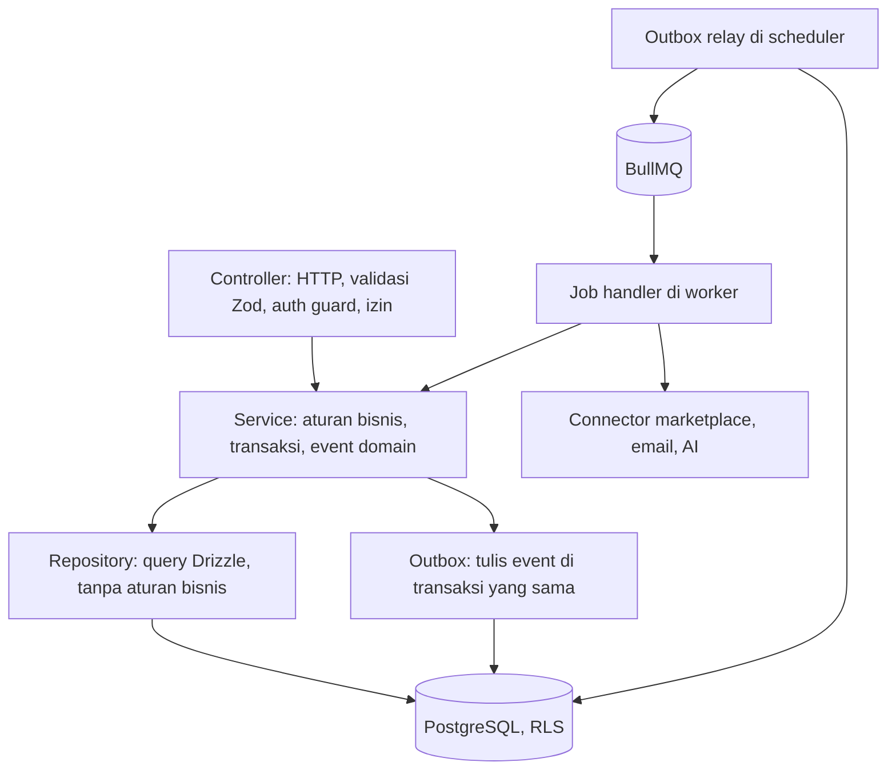
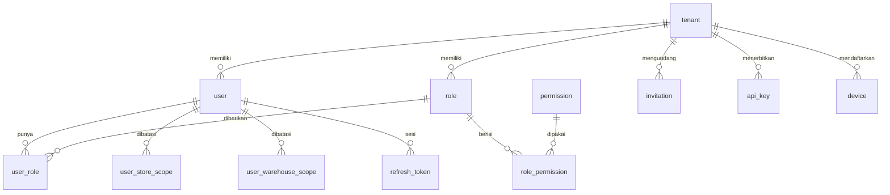
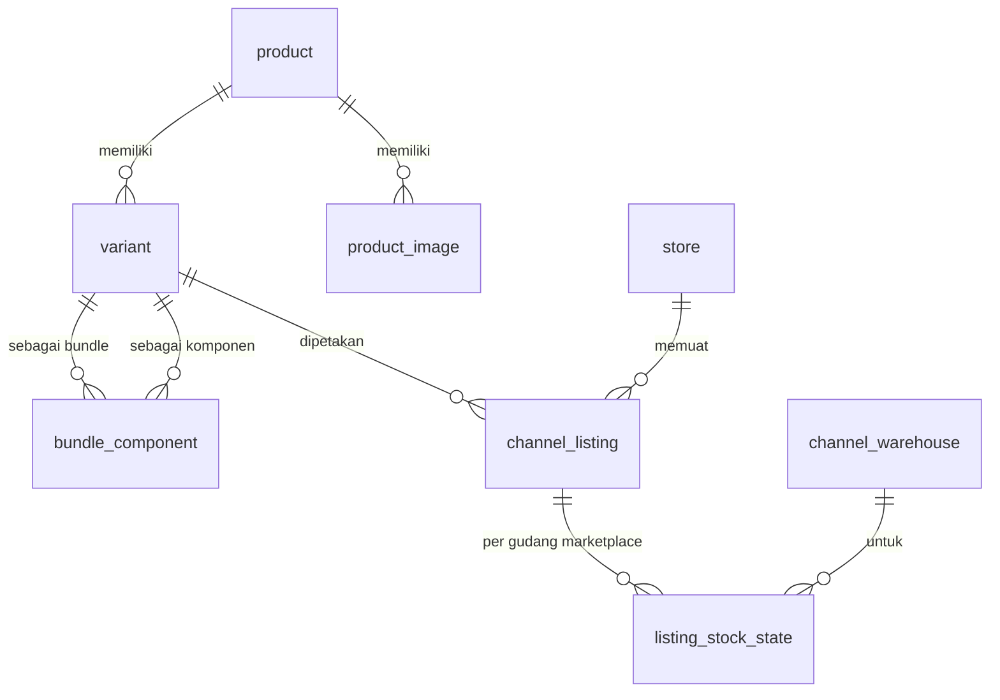
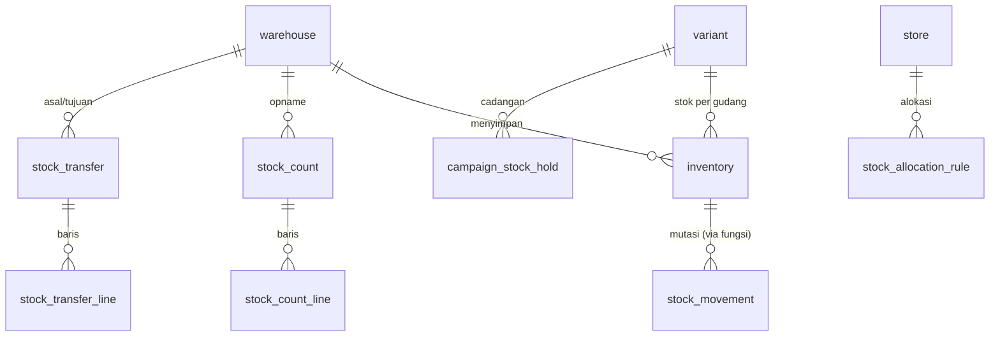
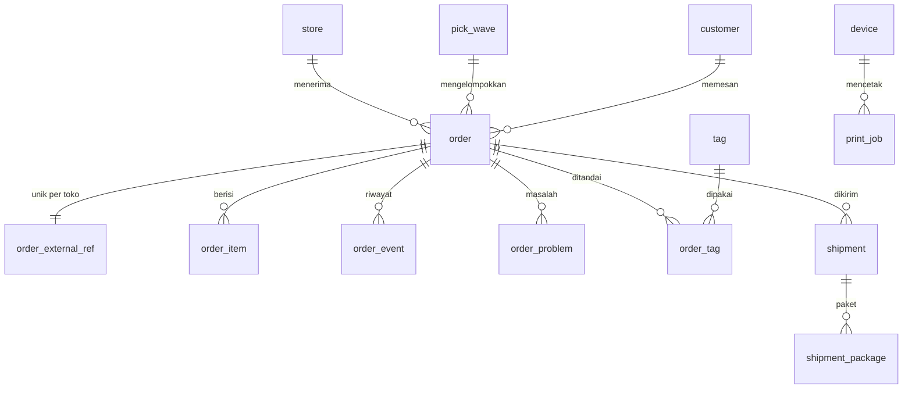

# OmniSeller — Dokumen Arsitektur dan Pengembangan Backend

| Item | Keterangan |
|---|---|
| Versi dokumen | 1.11 |
| Tanggal | 4 Oktober 2026 |
| Status | Keputusan final untuk implementasi; fondasi (bagian 4 sampai 9, 12, 13), identitas, autentikasi, dan audit (8.1, 8.10), koneksi toko Shopee dan Tokopedia & Shop (8.6, 8.11), katalog, listing, dan pemetaan SKU (7.8.3, 8.12), stok, penyesuaian, dan push stok ke marketplace (7.8.4, 8.13, 9.4), pesanan dari Shopee dan Tokopedia & Shop (7.8.6, 7.9, 8.14, 10.6), pengiriman, label, pick list, dan peringatan batas kirim (8.15), dasbor, notifikasi in-app, ekspor data penuh, dan audit aksi sensitif (8.16 sampai 8.18), migrasi dari aplikasi lain dengan mode paralel dan cutover (8.19), serta laporan penjualan, daftar perlu restock, ringkasan email harian, dan preferensi notifikasi (8.20) sudah diimplementasikan di folder `backend/` |
| Pemilik dokumen | Candra Syahputra |
| Dokumen terkait | DOKUMEN-SPESIFIKASI-APLIKASI.md (PRD) versi 1.11, DOKUMEN-TEKNOLOGI.md versi 1.11 |
| Audiens | Engineer backend, tech lead, QA, dan **agen AI** yang mengerjakan basis kode |

> **Untuk agen AI yang membaca dokumen ini.** Bacalah bagian 2 terlebih dahulu. Bagian itu berisi kontrak kerja: invarian yang tidak boleh dilanggar, tempat setiap hal berada, dan urutan langkah untuk setiap jenis perubahan. Semua nama tabel, kolom, modul, antrean, dan perintah di dokumen ini adalah nama yang sebenarnya dipakai di repositori. Jangan menebak nama; cari di dokumen ini atau di kode.

---

## Daftar Isi

1. [Tujuan dan Cara Membaca](#1-tujuan-dan-cara-membaca)
2. [Kontrak untuk Agen AI dan Engineer](#2-kontrak-untuk-agen-ai-dan-engineer)
3. [Gambaran Arsitektur Backend](#3-gambaran-arsitektur-backend)
4. [Struktur Proyek Backend](#4-struktur-proyek-backend)
5. [Lingkungan dan Konfigurasi](#5-lingkungan-dan-konfigurasi)
6. [Identitas Rekaman: ULID](#6-identitas-rekaman-ulid)
7. [Desain Basis Data](#7-desain-basis-data)
8. [Lapisan Aplikasi](#8-lapisan-aplikasi)
9. [Pekerjaan Latar dan Penjadwalan](#9-pekerjaan-latar-dan-penjadwalan)
10. [Aturan API](#10-aturan-api)
11. [Peta Modul dan Kepemilikan Tabel](#11-peta-modul-dan-kepemilikan-tabel)
12. [Migrasi Basis Data](#12-migrasi-basis-data)
13. [Pengujian Backend](#13-pengujian-backend)
14. [Observabilitas dan Keamanan di Kode](#14-observabilitas-dan-keamanan-di-kode)
15. [Panduan Pengembangan Langkah demi Langkah](#15-panduan-pengembangan-langkah-demi-langkah)
16. [Runbook Operasional](#16-runbook-operasional)
17. [Lampiran Kode dan Berkas](#17-lampiran-kode-dan-berkas)
18. [Glosarium dan Riwayat](#18-glosarium-dan-riwayat)

---

## 1. Tujuan dan Cara Membaca

Dokumen ini menetapkan **bagaimana backend OmniSeller dibangun**: struktur proyek, lingkungan, skema basis data beserta relasi dan batasannya, lapisan aplikasi, pekerjaan latar, dan langkah pengembangan. Dokumen ini melengkapi PRD (apa yang dibangun) dan Dokumen Teknologi (teknologi apa yang dipakai).

Tiga sasaran yang membentuk setiap keputusan di sini:

1. **Kesalahan data tidak mungkin, bukan sekadar jarang.** Integritas ditegakkan oleh basis data: kunci asing komposit yang menyertakan tenant, batasan CHECK, trigger transisi status, dan fungsi tunggal untuk mengubah stok. Bug di kode aplikasi tidak boleh menghasilkan data yang rusak.
2. **Dapat dikerjakan oleh siapa pun, termasuk agen AI.** Setiap modul memiliki bentuk yang sama, setiap perubahan memiliki urutan langkah yang sama, dan setiap nama mengikuti konvensi yang sama. Tidak ada pengetahuan tersembunyi di kepala satu orang.
3. **Dapat diskalakan tanpa menulis ulang.** Batas modul, antrean, dan partisi sudah dirancang untuk volume sepuluh kali lipat dari target Fase 3.

Urutan baca yang disarankan:

| Pembaca | Urutan |
|---|---|
| Engineer baru | 2, 3, 4, 5, 15.1 sampai 15.3, lalu 7 dan 8 sambil membuka kode |
| Agen AI yang diberi tugas | 2, lalu bagian yang dirujuk tabel 2.3 sesuai jenis tugas |
| Peninjau kode | 2.2 (invarian), 7.1 sampai 7.7, 15.11 (checklist PR) |
| DevOps | 5, 12, 16 |

---

## 2. Kontrak untuk Agen AI dan Engineer

### 2.1 Aturan dasar

1. Jangan menebak. Nama tabel, kolom, modul, antrean, dan perintah ada di dokumen ini dan di kode. Bila tidak ditemukan di keduanya, berarti belum ada dan harus dibuat mengikuti konvensi bagian 4, 7, dan 8.
2. Setiap perubahan mengikuti urutan langkah di bagian 15 untuk jenisnya (modul baru, tabel baru, endpoint baru, job baru, connector baru).
3. Setiap perubahan disertai tes sesuai bagian 13. Perubahan tanpa tes tidak digabung.
4. Setiap keputusan yang menyimpang dari dokumen ini dicatat sebagai ADR di `docs/adr/` dan dokumen ini diperbarui pada PR yang sama.
5. Kode dan komentar dalam bahasa Inggris. Teks yang dilihat pengguna dalam bahasa Indonesia lewat berkas i18n.
6. Gunakan perintah `pnpm` yang terdaftar di 17.9. Jangan memanggil alat secara langsung dengan opsi yang berbeda dari skrip.

### 2.2 Invarian yang tidak boleh dilanggar

| # | Invarian | Cara ditegakkan | Yang harus dilakukan agen |
|---|---|---|---|
| I1 | Tidak ada query data tenant di luar `withTenantTx` | RLS mengembalikan nol baris tanpa `app.tenant_id`; lint Semgrep menolak `db.` di luar helper | Selalu bungkus akses data dengan `withTenantTx(handle, ctx, tx => ...)` |
| I2 | Stok hanya berubah lewat `apply_stock_movement()` | Role `omniseller_api` dan `omniseller_worker` tidak punya hak INSERT, DELETE, atau UPDATE kolom jumlah pada `inventory` dan `stock_movement`; fungsi `SECURITY DEFINER` memeriksa tenant; trigger `inventory_guard` sebagai lapis kedua | Panggil `InventoryService.applyMovement()`; jangan pernah `UPDATE inventory` untuk kolom jumlah |
| I3 | Status hanya berubah sesuai tabel transisi | Trigger `enforce_status_transition('<tabel>')` di `order`, `shipment`, `sync_job` (dan tabel berstatus lain saat dibuat) | Gunakan `<Modul>Service.transition(...)`; fakta dari marketplace di dalam `withStatusSource(tx, 'marketplace', ...)` |
| I4 | Setiap efek samping keluar (marketplace, email, WhatsApp, AI) lewat outbox dan BullMQ | Tidak ada klien HTTP keluar di proses `api`; lint menolak impor connector di `src/modules/*/controller.ts` | Tulis `outbox_event` di transaksi yang sama, biarkan relay dan worker mengeksekusi |
| I5 | Setiap tabel memiliki `id` ULID, `tenant_id`, `created_at`, `updated_at`, `row_version` (kecuali tabel global dan tabel hanya-tambah yang dicatat di `test/schema`) | Uji skema `pnpm test:schema` membaca katalog PostgreSQL | Tulis kolom standar di migrasi SQL; cermin Drizzle memakai `baseColumns()` |
| I6 | Kunci asing ke tabel milik tenant selalu komposit `(tenant_id, x_id)`, dan `ON DELETE SET NULL` selalu menyebut kolomnya: `SET NULL (x_id)` | Uji skema memeriksa setiap FK termasuk daftar kolom `SET NULL` | Tulis FK komposit di migrasi SQL (7.3, 7.4) |
| I7 | Uang selalu `bigint` rupiah utuh | Tipe kolom dan util `Money` | Jangan pernah memakai `numeric` atau `float` untuk uang |
| I8 | Data pribadi pembeli tidak masuk log, tidak masuk skema `research`, tidak dikirim ke AI tanpa disamarkan | Redaksi di logger, tidak ada FK dari `research` ke `order`, `PiiScrubber` sebelum panggilan AI | Gunakan `logger` dari `@omniseller/logging`, bukan `console` |
| I9 | Perubahan skema mengikuti expand and contract | Tinjauan migrasi wajib | Jangan `DROP`, `RENAME`, atau ubah tipe di rilis yang sama dengan perubahan kode yang bergantung |
| I10 | Setiap job BullMQ idempoten dan `jobId` deterministik | Helper `jobKey()` (pemisah `\|`, BullMQ menolak `:`) dan konvensi di 9.2 | Bangun `jobId` dari kunci bisnis; untuk aksi yang boleh berulang pada entitas yang sama, sertakan kunci kejadian (id outbox atau skor debounce) |
| I11 | Webhook receiver hanya verifikasi, simpan, enqueue, balas | Tidak ada modul bisnis dimuat di proses `webhook` | Jangan menambah logika di `src/webhook/` |
| I12 | Token marketplace hanya dapat dibaca dan ditulis proses `worker` dan `scheduler` | `omniseller_api` hanya punya SELECT kolom metadata `store_credential`, tanpa INSERT atau UPDATE; hak KMS hanya untuk worker dan scheduler | Penukaran kode OAuth dan enkripsi token dikerjakan job di worker (8.6); jangan memuat `CredentialService` di proses `api` |

### 2.3 Peta cepat: jenis tugas ke bagian dokumen

| Jenis tugas | Baca | Langkah |
|---|---|---|
| Menambah modul baru | 4, 8, 11 | 15.4 |
| Menambah atau mengubah tabel | 6, 7 | 15.5 |
| Menambah endpoint | 8, 10 | 15.6 |
| Menambah job atau jadwal | 9 | 15.7 |
| Menambah connector marketplace | 8.7, 9, DOKUMEN-TEKNOLOGI 8 | 15.8 |
| Menambah event domain dan consumer | 8.5, 8.6 | 15.9 |
| Memperbaiki bug data | 7, 16 | 16 |
| Menjalankan lokal | 5 | 15.2, 15.3 |

### 2.4 Tempat setiap hal berada

Seluruh kode backend berada di folder `backend/` di root repositori (ADR-032); root hanya berisi dokumen. **Semua path di dokumen ini relatif terhadap `backend/`**, dan semua perintah `pnpm` dijalankan dari sana.

| Hal | Lokasi |
|---|---|
| Migrasi SQL berversi (sumber kebenaran DDL dan batasan) | `drizzle/migrations/NNNN_nama.sql` |
| SQL repeatable: fungsi, trigger, kebijakan RLS, grant, seed | `drizzle/sql/NN_nama.sql` (dijalankan ulang setiap `db:migrate`, harus idempoten) |
| Cermin skema Drizzle (tipe query) | `src/db/schema/<domain>.ts`, dijaga sama dengan SQL oleh `pnpm test:schema` |
| Migrator dan bootstrap role | `src/db/migrate.ts`, `src/db/bootstrap.ts` |
| Modul bisnis | `src/modules/<nama>/` |
| Definisi job dan skema payload | `src/modules/<modul>/<modul>.jobs.ts`, didaftarkan di `src/jobs/registry.ts` |
| Jadwal | `src/scheduler/schedules.ts` |
| Connector | `packages/connectors/<marketplace>/` |
| Tipe domain dan skema Zod bersama | `packages/shared/src/` |
| Konfigurasi lingkungan | `src/config/` |
| Tes | Di samping kode (`*.spec.ts` unit, `*.int.spec.ts` integrasi), `test/` untuk e2e dan isolasi tenant |
| Dokumentasi modul | `src/modules/<nama>/README.md` |
| ADR | `docs/adr/NNNN-judul.md` |
| Runbook | `docs/runbooks/<topik>.md` |
| Kontrak untuk agen | `AGENTS.md` di root |
| Infrastruktur per proses (pool per role, Redis, antrean) | `src/infra/` |
| Runner worker dan scheduler | `src/worker/`, `src/scheduler/` |

---

## 3. Gambaran Arsitektur Backend

### 3.1 Proses

Satu aplikasi NestJS, satu image Docker, lima peran proses yang dipilih oleh `APP_ROLE`:

| Peran | Modul yang dimuat | Role basis data | Tugas |
|---|---|---|---|
| `api` | Semua modul bisnis (controller dan service), auth, realtime | `omniseller_api` (RLS aktif, tidak bisa membaca token) | Melayani REST dan Socket.IO |
| `webhook` | Hanya `webhook` dan `outbox` | `omniseller_api` | Verifikasi, simpan ke `webhook_inbox`, enqueue |
| `worker` | Modul bisnis (service saja), connectors, jobs | `omniseller_worker` (RLS aktif, bisa membaca token) | Menjalankan job BullMQ |
| `scheduler` | `scheduler`, `outbox-relay`, `partition-maintenance`, `retention` | `omniseller_system` untuk job lintas tenant (BYPASSRLS), `omniseller_worker` untuk job per tenant | Jadwal berulang, relay outbox, pemeliharaan |
| `research-collector` | `research` | `omniseller_worker` | Pengumpulan riset |

Setiap proses hanya menerima URL basis data untuk role yang boleh dipakainya (5.2): proses `api` dan `webhook` tidak pernah memegang koneksi `omniseller_worker` atau `omniseller_system`.

### 3.2 Lapisan dalam satu proses



Aturan lapisan:

- Controller tidak memanggil repository dan tidak berisi aturan bisnis.
- Service adalah satu-satunya tempat aturan bisnis dan satu-satunya yang membuka transaksi.
- Repository tidak membuka transaksi sendiri; menerima `tx` dari service.
- Job handler memanggil service, bukan repository, agar aturan bisnis tidak diduplikasi.
- Connector tidak tahu tentang basis data; menerima dan mengembalikan tipe ternormalisasi dari `packages/connectors/core`.

### 3.3 Aliran data tulis (contoh: batalkan pesanan)

1. `POST /v1/orders/:id/cancel {reason}` masuk ke `OrdersController.cancel`.
2. Guard memverifikasi sesi dan izin `order:cancel` (8.1); pipe memvalidasi parameter dan body.
3. `OrdersService.requestCancel(ctx, id, reason)` membuka `withTenantTx`, memuat pesanan dengan `FOR UPDATE`, memeriksa toko dan gudang pesanan terhadap cakupan pengguna, memeriksa alasan terhadap daftar marketplace, menulis `outbox_event{type:'order.cancel_requested'}` dan `order_event{type:'cancel_requested'}`, commit, lalu menjawab 202.
4. Relay outbox memindahkan event ke antrean `mp.outbound` dengan `jobId = order.cancel|<order_id>|<outbox_event_id>`.
5. Job di worker memanggil marketplace lewat `MarketplaceGateway` (`orders.cancelOrder`), lalu membaca ulang pesanan; `OrderIntakeService` memindahkan status ke `cancelled` dan melepas reservasi stok di transaksi yang sama (8.14). Pelepasan stok menulis `inventory.changed`, yang mendorong stok baru ke semua toko (9.4).
6. Socket.IO mengirim `order.updated` ke room tenant dari event yang sama (menyusul bersama frontend).

---

## 4. Struktur Proyek Backend

```
backend/
├── src/
│   ├── main.ts                     # bootstrap; memilih modul berdasarkan APP_ROLE
│   ├── app.module.ts
│   ├── config/
│   │   ├── env.schema.ts           # skema Zod semua variabel lingkungan, per peran
│   │   ├── config.module.ts
│   │   └── config.service.ts       # AppConfig bertipe, tidak ada process.env di luar sini
│   ├── db/
│   │   ├── client.ts               # pool Drizzle per role basis data (api, worker, system)
│   │   ├── tenant-tx.ts            # withTenantTx, withSystemTx, withStatusSource
│   │   ├── columns.ts              # ulid, baseColumns(), money() untuk cermin Drizzle
│   │   ├── migrate.ts              # migrator (12.1), dipanggil migrate.cli.ts
│   │   ├── bootstrap.ts            # role dan database lokal/uji, dipanggil bootstrap.cli.ts
│   │   └── schema/
│   │       ├── index.ts
│   │       ├── identity.ts
│   │       ├── channel.ts
│   │       ├── catalog.ts
│   │       ├── inventory.ts
│   │       ├── purchasing.ts
│   │       ├── orders.ts
│   │       ├── returns.ts
│   │       ├── sync.ts
│   │       ├── finance.ts
│   │       ├── chat.ts
│   │       ├── promo.ts
│   │       ├── health.ts
│   │       ├── crm.ts
│   │       ├── research.ts
│   │       ├── migration.ts
│   │       ├── campaign.ts
│   │       ├── notification.ts
│   │       ├── billing.ts
│   │       ├── platform.ts         # feature_flag, ai_*, file_object
│   │       └── audit.ts
│   ├── common/
│   │   ├── context/                # RequestContext, RequestIdMiddleware, AsyncLocalStorage
│   │   ├── errors/                 # DomainError dan turunannya, ProblemDetailsFilter
│   │   ├── http/                   # dekorator (@Isolation, @RequirePermission, @Ctx), pipe validasi, paginasi, If-Match
│   │   ├── security/               # sandi, token rahasia, sesi Redis, rate limiter, KeyProvider dan TokenVault (8.6)
│   │   └── logging/
│   ├── modules/
│   │   ├── identity/               # tenant, user, role, invitation, api_key, device
│   │   ├── auth/                   # login, sesi, 2FA, refresh token
│   │   ├── channel/                # store, credential, store_authorization, channel_warehouse, connector registry
│   │   ├── catalog/                # product, variant, listing, mapping, bundle
│   │   ├── inventory/              # warehouse, inventory, movement, count, transfer, allocation
│   │   ├── purchasing/
│   │   ├── orders/
│   │   ├── fulfillment/            # shipment, label, pick list, print job
│   │   ├── returns/
│   │   ├── sync/                   # sync_job (log sinkron), webhook_inbox, penerima dan pemroses webhook
│   │   ├── finance/
│   │   ├── chat/
│   │   ├── promo/
│   │   ├── health/
│   │   ├── affiliate/
│   │   ├── crm/
│   │   ├── research/
│   │   ├── migration/
│   │   ├── campaign/
│   │   ├── notification/
│   │   ├── billing/
│   │   ├── reporting/
│   │   ├── ai/
│   │   ├── files/
│   │   ├── audit/
│   │   └── platform/               # feature flag, health check, admin internal
│   ├── jobs/
│   │   ├── define.ts               # defineEvent, defineJob, JobDeps
│   │   ├── job-id.ts               # jobKey (pemisah |)
│   │   ├── queues.ts               # nama antrean, QueueRegistry
│   │   ├── registry.ts             # JOB_DEFINITIONS dari <modul>.jobs.ts
│   │   ├── webhook-consumers.ts    # konsumen event webhook per modul (8.11)
│   │   └── stock-dirty.ts
│   ├── scheduler/
│   │   ├── scheduler.runner.ts     # loop in-process: relay, stock flush, partisi, pemindaian toko
│   │   ├── outbox-relay.ts
│   │   ├── stock-flush.ts
│   │   ├── channel-scans.ts        # webhook.inbox_sweep, token.refresh_scan, mp.poll.warehouses
│   │   └── retention.ts            # (menyusul)
│   ├── infra/                      # InfraModule: pool per role, Redis, antrean, outbox
│   ├── outbox/                     # Outbox.enqueue
│   ├── worker/                     # WorkerRunner: BullMQ Worker per antrean
│   ├── webhook/
│   │   └── webhook-app.ts          # body mentah untuk proses webhook (controller ada di modules/sync)
│   └── realtime/
│       └── realtime.gateway.ts     # (menyusul)
├── drizzle/
│   ├── migrations/                 # 0001_core.sql, 0002_...sql (berversi, sekali jalan)
│   └── sql/                        # 10_functions, 15_views, 20_triggers, 30_policies, 40_grants, 90_seeds (repeatable)
├── test/
│   ├── setup/                      # global-setup (Testcontainers atau URL lokal), handles, factories
│   ├── db/                         # invarian basis data: RLS, stok, status, audit, FK, migrator
│   ├── jobs/                       # outbox, relay, debounce stok, lookup pra-tenant
│   ├── schema/                     # pnpm test:schema
│   ├── tenant-isolation/           # generator uji isolasi dari OpenAPI
│   └── e2e/
├── packages/
│   ├── shared/                     # @omniseller/shared: ULID, uang, izin, status
│   ├── logging/                    # @omniseller/logging: logger JSON dengan redaksi
│   └── connectors/
│       ├── core/                   # @omniseller/connector-core: tipe, error, HTTP, redaksi
│       ├── shopee/                 # @omniseller/connector-shopee
│       └── tiktokshop/             # @omniseller/connector-tiktokshop (Tokopedia & Shop)
├── infra/docker/                   # compose.local.yml
├── tools/                          # dev.mjs (runner dev), scripts/native-infra.sh
├── .env.example
├── package.json                    # root workspace pnpm sekaligus paket aplikasi
├── pnpm-workspace.yaml             # anggota: packages/*, packages/connectors/*
├── biome.json, tsconfig.base.json, tsconfig.json, tsconfig.build.json, vitest.config.ts
└── .gitignore
```

Bentuk satu modul (wajib sama untuk semua modul):

```
modules/orders/
├── README.md                # tanggung jawab, tabel yang dimiliki, event, endpoint, job
├── orders.module.ts
├── orders.controller.ts     # hanya di proses api
├── orders.service.ts        # aturan bisnis
├── orders.repository.ts     # query
├── orders.events.ts         # konstanta nama event dan skema payload
├── orders.errors.ts         # kelas error domain
├── dto/
│   ├── accept-order.dto.ts  # skema Zod request dan response
│   └── ...
├── orders.service.spec.ts   # unit
├── orders.int.spec.ts       # integrasi dengan Testcontainers
└── orders.controller.e2e.spec.ts
```

---

## 5. Lingkungan dan Konfigurasi

### 5.1 Empat lingkungan

| Lingkungan | Tujuan | Basis data | Marketplace | Rahasia | Cara jalan |
|---|---|---|---|---|---|
| `local` | Pengembangan di mesin engineer | PostgreSQL di Docker Compose atau terpasang langsung (`pnpm infra:native`) | Server tiruan (Hono) di Compose, opsional sandbox nyata | `.env.local` (tidak di-commit) | `pnpm dev` |
| `test` | Uji otomatis di mesin dan CI | Database baru per run, di Testcontainers atau server dari `TEST_PG_ADMIN_URL` | Server tiruan | Diatur `test/setup/global-setup.ts`, tanpa berkas env | `pnpm test`, `pnpm test:int` |
| `staging` | Verifikasi sebelum produksi, UAT | RDS staging | Sandbox nyata dan toko uji | AWS Secrets Manager | Deploy otomatis dari `main` |
| `production` | Layanan nyata | RDS produksi | Produksi | AWS Secrets Manager | Deploy dari tag dengan persetujuan |

Aturan:

- Tidak ada berkas `.env` di staging dan produksi. Semua nilai disuntik ECS dari Secrets Manager dan parameter tugas.
- `.env.example` selalu lengkap dan diperbarui pada PR yang menambah variabel. CI gagal bila `env.schema.ts` memiliki kunci yang tidak ada di `.env.example`.
- Nilai yang sama di semua lingkungan (misalnya nama antrean) bukan variabel lingkungan; ditulis sebagai konstanta.

### 5.2 Skema konfigurasi

Semua konfigurasi dibaca sekali saat proses mulai lewat `src/config/env.schema.ts` (Zod, `parseEnv`) dan disuntikkan sebagai token `ENV`. `process.env` hanya dibaca di `main.ts`. Proses gagal cepat dengan pesan jelas bila ada nilai yang kurang atau salah tipe.

Skema dibagi per peran, dan setiap peran hanya mendeklarasikan kunci yang dipakainya:

| Peran | Basis data | Kunci khusus |
|---|---|---|
| `api` | `DATABASE_URL` (`omniseller_api`) | `PORT` (bawaan 3000), `PUBLIC_WEB_URL` (satu-satunya origin CORS yang diizinkan, dengan cookie), id publik marketplace untuk membangun tautan otorisasi (`SHOPEE_PARTNER_ID`, `SHOPEE_AUTH_BASE_URL`, `TIKTOKSHOP_SERVICE_ID`, `TIKTOKSHOP_AUTHORIZE_URL`). Tidak pernah menerima kunci KMS token, rahasia marketplace, atau kredensial email |
| `webhook` | `DATABASE_URL` (`omniseller_api`) | `PORT` (bawaan 3001), `PUBLIC_WEBHOOK_URL` (Shopee menandatangani URL lengkapnya), rahasia verifikasi: `SHOPEE_PARTNER_ID` + `SHOPEE_PARTNER_KEY`, `TIKTOKSHOP_APP_KEY` + `TIKTOKSHOP_APP_SECRET` |
| `worker` | `DATABASE_URL_WORKER` (`omniseller_worker`) | `PUBLIC_WEB_URL` (tautan di email), `EMAIL_TRANSPORT` (`smtp`; `log` hanya boleh di `local`, `memory` hanya di `test`), `SMTP_URL` (wajib bila `smtp`: Mailpit lokal, SMTP Amazon SES di staging dan produksi), `EMAIL_FROM`; `PUBLIC_WEBHOOK_URL`; semua kunci marketplace di atas ditambah base URL API (`SHOPEE_API_BASE_URL`, `TIKTOKSHOP_API_BASE_URL`, `TIKTOKSHOP_AUTH_BASE_URL`); enkripsi token: `TOKEN_KEY_PROVIDER` (`aws_kms`, atau `local` yang hanya boleh di `local` dan `test`), `KMS_KEY_ID_TOKENS` + `AWS_REGION`, atau `TOKEN_LOCAL_MASTER_KEY` (32 byte base64). AI menyusul bersama modulnya |
| `scheduler` | `DATABASE_URL_WORKER` dan `DATABASE_URL_SYSTEM` (`omniseller_system`) | |
| `research-collector` | `DATABASE_URL_WORKER` | Kunci riset saat modulnya dibuat |

Kunci ditambahkan ke skema bersama kode yang memakainya, bukan lebih dulu; `.env.example` diperbarui pada PR yang sama (5.1). Kunci marketplace berpasangan (id dengan rahasianya) dan boleh kosong: marketplace tanpa kunci berstatus "belum dikonfigurasi", tampil tidak tersedia di `GET /v1/channels`, dan permintaan menghubungkan toko ditolak 422 `channel.not_configured`. Nilai kosong di berkas env dibaca sebagai tidak diisi.

### 5.3 Berkas lingkungan

| Berkas | Di-commit | Isi |
|---|---|---|
| `.env.example` | Ya | Semua kunci dengan nilai contoh atau kosong, dikelompokkan per peran, dengan komentar |
| `.env.local` | Tidak | Nilai lokal engineer, dimuat oleh `pnpm dev` dan `pnpm db:*` |
| `infra/docker/compose.local.yml` | Ya | Layanan lokal dengan Docker |
| `tools/scripts/native-infra.sh` | Ya | Layanan lokal tanpa Docker (PostgreSQL 15+ dan Redis terpasang), port sama dengan Compose |

### 5.4 Layanan lokal (Docker Compose)

| Layanan | Image | Port | Keterangan |
|---|---|---|---|
| `postgres` | `pgvector/pgvector:pg17` | 5433 | Superuser `postgres`; role dan database `omniseller` dibuat `pnpm db:bootstrap`. Port 5433 agar tidak bentrok dengan PostgreSQL lain di 5432 |
| `redis-queue` | `redis:7.2` | 6379 | AOF aktif |
| `redis-cache` | `redis:7.2` | 6380 | Tanpa persistensi |
| `meilisearch` | `getmeili/meilisearch` | 7700 | Menyusul bersama pencarian |
| `minio` (+ `minio-init`) | `minio/minio` | 9000, 9001 (konsol) | Pengganti R2 dengan API S3 untuk label dan dokumen: `FILE_STORAGE=r2`, `R2_ENDPOINT=http://127.0.0.1:9000`; `minio-init` membuat bucket `omniseller-documents`. Tanpa Docker pakai `FILE_STORAGE=local` (direktori `.local/files`) |
| `mailpit` | `axllent/mailpit` | 1025 (SMTP), 8025 (UI) | Menangkap semua email lokal (`SMTP_URL=smtp://127.0.0.1:1025`). Tanpa Docker, pakai `EMAIL_TRANSPORT=log`: isi email, termasuk tautan undangan, ditulis ke log worker |
| `mock-marketplace` | build lokal (Hono) | 4000 | Meniru Shopee, TikTok Shop, Lazada, Blibli, memutar ulang fixture webhook; menyusul bersama connector |

Layanan yang belum dipakai kode tidak dimasukkan ke Compose sampai kodenya ada.

### 5.5 Perbedaan perilaku per lingkungan

| Perilaku | local | test | staging | production |
|---|---|---|---|---|
| Migrasi otomatis saat mulai | Ya | Ya (basis data segar) | Tidak, tugas terpisah | Tidak, tugas terpisah |
| Seed data contoh | Ya (`pnpm db:seed`) | Fixture per tes | Data teranonimkan | Tidak |
| Connector nyata | Opsional lewat `MP_MODE=sandbox` | Tidak | Sandbox | Produksi |
| Kirim email dan WhatsApp | Mailpit, WhatsApp dimatikan | Dimatikan | Domain uji | Nyata |
| Panggilan AI | Dimatikan kecuali `AI_MODE=live` | Direkam (fixture) | Nyata dengan anggaran kecil | Nyata |
| Rate limit API | Longgar | Dimatikan | Sama dengan produksi | Produksi |
| Log | Pretty | Ringkas | JSON | JSON |

---

## 6. Identitas Rekaman: ULID

### 6.1 Keputusan

Semua kunci primer adalah **ULID**: 26 karakter Crockford base32 huruf besar, 48 bit waktu milidetik diikuti 80 bit acak, dibuat di aplikasi dengan generator monotonik.

| Aspek | Keputusan |
|---|---|
| Tipe kolom | Domain `ulid`: `CREATE DOMAIN ulid AS text COLLATE "C" CHECK (VALUE ~ '^[0-9A-HJKMNP-TV-Z]{26}$')`. Semua id dan kunci asing memakai domain ini, sehingga format diperiksa di satu tempat. `text`, bukan `char(26)`: panjang sudah dijamin regex, dan perbandingan dengan `current_setting()` (bertipe `text`) di predikat RLS tetap memakai indeks (terbukti oleh uji `tenant-isolation`) |
| Pembuatan | Di aplikasi lewat `newId()` dari `packages/shared/src/ulid.ts` (pustaka `ulid`, `monotonicFactory`). Tidak ada `DEFAULT` di basis data. Pengecualian yang dibuat di basis data dengan `gen_ulid()`: id seed tabel referensi global dan id baris `audit_log` (7.7) |
| Kolase | `"C"` wajib agar pengurutan byte sama dengan urutan waktu, sehingga `ORDER BY id` dan partisi range pada `id` benar |
| Di API | Dikirim apa adanya sebagai string 26 karakter. Skema Zod `ulidSchema` memvalidasi format di setiap batas |
| Di log | Boleh dicatat; ULID tidak mengandung data pribadi |

### 6.2 Alasan

- **Terurut waktu**: sisipan ke indeks B-tree selalu di ujung kanan, tanpa fragmentasi seperti UUID v4.
- **Dapat dibaca dan dibandingkan manusia**: mudah disalin dari log, disortir di spreadsheet, dan dibaca agen AI.
- **Memungkinkan partisi range pada `id`**: tabel besar dipartisi per bulan berdasarkan prefiks waktu ULID tanpa menambah kolom partisi ke kunci primer (bagian 7.6).
- **Tidak bocor informasi**: tidak mengungkap jumlah baris seperti serial.

### 6.3 Aturan pemakaian

- Kunci asing bertipe sama: domain `ulid`.
- Tidak ada kunci primer komposit. Tabel penghubung tetap memiliki `id` ULID ditambah batasan `UNIQUE` pada pasangan kolomnya.
- Jangan membuat ULID di SQL selain dua pengecualian di atas. Bila migrasi backfill membutuhkan id, tulis skrip TypeScript di `tools/scripts/`.
- `ulidSchema` (Zod) dipakai di semua DTO untuk parameter `:id`.
- Rekaman yang waktunya berasal dari luar memakai `newIdAt(waktu)`: id pesanan dibuat dari waktu pesanan dibuat di marketplace, sehingga urutan id sama dengan urutan waktu pesanan (daftar pesanan cukup diurutkan per id) dan pesanan hasil impor 90 hari masuk partisi bulan pesanannya. Rekaman lain tetap `newId()`.

---

## 7. Desain Basis Data

### 7.1 Prinsip

1. **Basis data adalah penjaga terakhir.** Setiap aturan yang dapat dinyatakan sebagai batasan dinyatakan sebagai batasan: `NOT NULL`, `CHECK`, `UNIQUE`, kunci asing, trigger transisi.
2. **Tenant ada di setiap baris dan setiap kunci asing.** Baris anak tidak mungkin merujuk induk milik tenant lain (7.3).
3. **Tidak ada penghapusan diam-diam.** Setiap `ON DELETE` dipilih sadar (7.4). Data historis tidak pernah dihapus, hanya diarsipkan.
4. **Nilai turunan dihitung, bukan disimpan ganda**, kecuali bila dibutuhkan untuk indeks; saat itu memakai generated column `STORED`.
5. **Satu jalur untuk setiap perubahan berbahaya.** Stok lewat satu fungsi, status lewat trigger transisi, token lewat satu service.
6. **Skema terbaca tanpa dokumentasi tambahan.** Nama tabel tunggal (`order`, bukan `orders`), kolom `snake_case`, kunci asing `<tabel>_id`, waktu `<peristiwa>_at`, boolean `is_<sifat>`, jumlah `<apa>_count`, uang `<apa>_amount` atau nama jelas seperti `unit_price`.

### 7.2 Konvensi kolom standar

Setiap tabel milik tenant memiliki kolom berikut, ditulis di migrasi SQL dan dicerminkan di Drizzle lewat `baseColumns()`:

| Kolom | Tipe | Batasan |
|---|---|---|
| `id` | `ulid` | `PRIMARY KEY` (format diperiksa domain) |
| `tenant_id` | `ulid` | `NOT NULL`, `REFERENCES tenant(id) ON DELETE RESTRICT` |
| `created_at` | `timestamptz` | `NOT NULL DEFAULT now()` |
| `updated_at` | `timestamptz` | `NOT NULL DEFAULT now()`, diperbarui trigger `touch_row` |
| `row_version` | `integer` | `NOT NULL DEFAULT 1`, dinaikkan trigger `touch_row`, dipakai optimistic locking |

Ditambah `UNIQUE (tenant_id, id)` pada setiap tabel yang menjadi induk kunci asing, agar 7.3 mungkin.

Kolom opsional yang dipakai bila relevan:

| Kolom | Tipe | Kapan |
|---|---|---|
| `deleted_at` | `timestamptz NULL` | Hanya tabel master yang boleh disembunyikan: `product`, `variant`, `warehouse`, `supplier`, `customer`, `chat_template`, `tag` |
| `created_by`, `updated_by` | `ulid NULL` | Tabel yang diubah pengguna langsung |
| `external_*` | `text` | Semua id dari marketplace disimpan sebagai `text`, tidak pernah `bigint`, karena format tiap marketplace berbeda |
| `*_snapshot` | `jsonb` | Salinan data pada saat kejadian (nama produk saat dipesan), tidak dijadikan sumber kebenaran |

Tabel global (tanpa `tenant_id`): `tenant`, `permission`, `plan`, `feature_flag`, `campaign` (baris sistem), `ai_route_config`, `research_source`, `order_status_transition` dan tabel transisi lain, `courier`.

### 7.3 Relasi lintas tenant yang mustahil

Setiap kunci asing ke tabel milik tenant adalah **komposit** dan menyertakan `tenant_id`:

```sql
-- pada tabel anak
tenant_id  ulid NOT NULL,
product_id ulid NOT NULL,
CONSTRAINT variant_product_fk
  FOREIGN KEY (tenant_id, product_id)
  REFERENCES product (tenant_id, id)
  ON DELETE RESTRICT
```

Akibatnya, bahkan bila kode aplikasi salah memasang `product_id`, basis data menolak baris yang merujuk produk tenant lain, termasuk untuk role `BYPASSRLS`. Batasan ditulis di migrasi SQL (ADR-027). Uji skema di CI (`pnpm test:schema`) membaca `pg_constraint` dan gagal bila ada kunci asing ke tabel milik tenant yang tidak diawali `tenant_id`.

Pengecualian yang dicatat: kunci asing ke tabel global (`tenant`, `permission`, `plan`, `research_source`) adalah kolom tunggal.

### 7.4 Kebijakan ON DELETE dan soft delete

| Jenis relasi | ON DELETE | Contoh |
|---|---|---|
| Komposisi: anak tidak bermakna tanpa induk | `CASCADE` | `order_item` ke `order`, `product_image` ke `product`, `purchase_order_line` ke `purchase_order`, `stock_count_line` ke `stock_count`, `role_permission` ke `role` |
| Referensi ke master yang mungkin masih dipakai | `RESTRICT` | `variant` ke `product`, `order_item` ke `variant`, `inventory` ke `warehouse`, `store` ke `tenant` |
| Referensi opsional ke konfigurasi | `SET NULL (x_id)` | `store.default_warehouse_id`, `order.warehouse_id`, `chat_thread.assigned_user_id`, `shipment.label_file_id` |
| Pemetaan yang menentukan ke mana stok didorong | `RESTRICT` | `channel_warehouse.warehouse_id`: gudang yang masih dipetakan harus dilepas pemetaannya lebih dulu (batasan `CHECK` memaksa `mapping_status` dan `warehouse_id` berubah bersama) |
| Ledger dan riwayat | `RESTRICT` dan tidak pernah dihapus | `stock_movement`, `order_event`, `audit_log`, `settlement_line`, `sync_job` |

**`SET NULL` pada FK komposit wajib menyebut kolomnya**: `ON DELETE SET NULL (warehouse_id)` (PostgreSQL 15+). Tanpa daftar kolom, PostgreSQL ikut meng-NULL-kan `tenant_id` yang `NOT NULL`, sehingga penghapusan induk gagal. Contoh nyata: job `files.cleanup_expired` menghapus `file_object` label yang kedaluwarsa, dan `shipment.label_file_id` harus menjadi NULL tanpa menyentuh `tenant_id`. Uji skema memeriksa daftar kolom setiap FK `SET NULL`.

Soft delete (`deleted_at`) hanya pada tabel master di 7.2. Aturan:

- Baris dengan `deleted_at` tidak muncul di daftar dan tidak boleh dipilih di formulir baru, tetapi tetap dapat dirujuk oleh data historis.
- Batasan unik pada tabel master memakai indeks parsial `WHERE deleted_at IS NULL` sehingga SKU yang dihapus dapat dipakai ulang.
- Hard delete tabel master hanya lewat job penghapusan tenant (16.6) dengan role `omniseller_system`, dalam urutan dependensi yang dihasilkan dari `information_schema`.

### 7.5 Row-Level Security

- Setiap tabel milik tenant: `ENABLE ROW LEVEL SECURITY` dan `FORCE ROW LEVEL SECURITY`, kebijakan `tenant_isolation` untuk `SELECT`, `INSERT`, `UPDATE`, `DELETE` dengan predikat `tenant_id = current_setting('app.tenant_id', true)`.
- Empat role basis data:

| Role | RLS | Hak | Dipakai oleh |
|---|---|---|---|
| `omniseller_api` | Ditegakkan | CRUD tabel tenant, dengan pengecualian di bawah. Pada `store_credential` hanya SELECT kolom metadata (kedaluwarsa, jumlah gagal), tanpa kolom token dan tanpa INSERT atau UPDATE | `api`, `webhook` |
| `omniseller_worker` | Ditegakkan | CRUD tabel tenant termasuk membaca dan menulis token, dengan pengecualian di bawah | `worker`, `research-collector`, job per tenant di `scheduler` |
| `omniseller_system` | `BYPASSRLS` | Hanya untuk job lintas tenant yang terdaftar: outbox relay, pemeliharaan partisi, retensi, penghapusan tenant, statistik platform | `scheduler` |
| `omniseller_migrator` | `BYPASSRLS` | Pemilik skema: DDL, fungsi, grant | Tugas migrasi |

Pengecualian hak yang berlaku untuk `omniseller_api` dan `omniseller_worker` (`drizzle/sql/40_grants.sql`):

| Tabel | Hak | Alasan |
|---|---|---|
| Tabel referensi global (`plan`, `permission`, `feature_flag`, `*_status_transition`) | SELECT saja | Diubah oleh seed dan migrasi |
| `inventory` | SELECT, dan UPDATE hanya kolom `bin_location` dan `min_stock` | Jumlah stok hanya lewat `apply_stock_movement()` (I2) |
| `stock_movement`, `audit_log` | SELECT saja | Ditulis fungsi `SECURITY DEFINER` dan trigger; tidak dapat dipalsukan dari aplikasi |
| `order_event`, `order_external_ref` | SELECT dan INSERT | Hanya tambah |
| `outbox_event` | INSERT saja | Relay (`omniseller_system`) yang membaca, menandai, dan menghapus |
| `webhook_inbox` | api: INSERT dan SELECT kolom `id`, `source`, `event_id`; worker: SELECT dan UPDATE | Tabel global tanpa RLS; proses webhook tidak perlu membaca payload tenant mana pun |
| Partisi (`order_p202609` dan seterusnya) | Tidak ada | Hanya terjangkau lewat tabel induk, tempat kebijakan RLS berlaku |

- `withTenantTx(handle, ctx, fn)` memanggil `set_config('app.tenant_id', $1, true)` (setara `SET LOCAL`, aman untuk parameter terikat), juga `app.actor_type`, `app.actor_id`, dan `app.request_id` untuk trigger audit, dalam satu pernyataan.
- `withSystemTx(handle, fn)` menolak dipanggil bila pool bukan milik role `omniseller_system`, dan hanya proses `scheduler` yang menerima URL role itu.
- Setelah transaksi selesai, `current_setting('app.tenant_id', true)` pada sesi yang sama bernilai string kosong, bukan NULL. Predikat `tenant_id = current_setting(...)` tetap mengembalikan nol baris untuk keduanya (diuji).

**Pembacaan sebelum tenant diketahui.** Beberapa alur harus menemukan tenant dari data yang tidak membawa tenant: webhook (`channel` dan id toko marketplace), login (email), refresh token, token perangkat, API key, dan tautan undangan. Di bawah RLS query biasa mengembalikan nol baris, sehingga alur ini memakai fungsi `SECURITY DEFINER` yang sempit, masing-masing mengembalikan `tenant_id` untuk dilanjutkan di dalam `withTenantTx`:

| Fungsi | Dipakai oleh | Boleh dieksekusi |
|---|---|---|
| `resolve_store(channel, external_shop_id)` | Proses webhook (merutekan notifikasi ke tenant), worker saat menghubungkan toko (mendeteksi toko yang sudah milik tenant lain, karena UNIQUE `(channel, external_shop_id)` berlaku lintas tenant) | api, worker |
| `auth_login_candidates(email)` | Login; email yang sama boleh ada di beberapa tenant, pengguna memilih | api |
| `auth_resolve_invitation(hash)`, `auth_resolve_password_reset(hash)` | Pratinjau dan penerimaan undangan, konfirmasi atur ulang sandi. Mengembalikan status token (`expires_at`, `accepted_at` atau `used_at`, `revoked_at`) agar service menolak dengan error yang tepat | api |
| `auth_resolve_refresh_token(hash)`, `auth_resolve_device(hash)`, `auth_resolve_api_key(hash)` | Guard token mobile, perangkat, dan API key; menyusul bersama klien itu | api |

Fungsi `SECURITY DEFINER` selalu menetapkan `search_path`, dicabut dari `PUBLIC`, dan hanya diberikan ke role yang disebut di atas. Di kode, fungsi ini hanya dipanggil lewat kelas `PreTenantLookup` (`modules/identity/identity.repository.ts`) dan `resolve_store` di modul `channel`; tidak ada jalur lain yang membaca data tenant sebelum `app.tenant_id` ditetapkan.

### 7.6 Partisi pada ULID

Tabel bervolume tinggi dipartisi **range pada kolom `id`**. Karena 10 karakter pertama ULID adalah waktu, batas partisi bulanan adalah ULID dari milidetik pertama bulan itu diikuti 16 karakter `0`.

| Tabel | Interval | Batas partisi dibuat di depan | Retensi |
|---|---|---|---|
| `order`, `order_item`, `order_event` | Bulanan | 3 bulan | 24 bulan aktif, lalu arsip |
| `stock_movement` | Bulanan | 3 bulan | 24 bulan |
| `sync_job` | Bulanan | 3 bulan | 3 bulan |
| `audit_log` | Bulanan | 3 bulan | 12 bulan aktif, ekspor ke R2 |
| `ai_call_log` | Bulanan | 3 bulan | 12 bulan |
| `research.research_snapshot` | Bulanan | 3 bulan | 90 hari mentah, ringkasan 24 bulan |

`webhook_inbox` dan `outbox_event` sengaja tidak dipartisi: batasan unik `(source, event_id)` dan indeks parsial relay harus berfungsi lintas waktu, sedangkan PostgreSQL menuntut kunci partisi ada di setiap batasan unik. Retensinya ditangani hapus batch harian (9.5).

Aturan:

- Kunci primer tabel terpartisi tetap `(id)`. Batasan unik lain harus menyertakan `id`; untuk `order` batasan unik bisnis `(tenant_id, store_id, external_order_id)` ditegakkan lewat tabel pembantu `order_external_ref` yang tidak dipartisi (7.8.6), karena PostgreSQL menuntut kunci partisi ada di setiap batasan unik.
- Kunci asing dari tabel lain ke tabel terpartisi merujuk `(tenant_id, id)`, yang valid karena `id` adalah kunci partisi.
- Daftar tabel terpartisi dan retensinya ada di fungsi SQL `partition_targets()`. Fungsi `maintain_partitions(now)` (`SECURITY DEFINER`, karena membuat partisi butuh hak pemilik tabel) membuat partisi bulan berjalan dan tiga bulan ke depan dengan nama `<tabel>_pYYYYMM`. Dijalankan setiap `db:migrate` dan setiap 6 jam oleh scheduler; idempoten. Uji skema memastikan setiap tabel terpartisi terdaftar di `partition_targets()`.
- Pelepasan (`DETACH`) partisi yang melewati retensi dan ekspor ke R2 menyusul bersama job arsip; partisi pertama baru kedaluwarsa tiga bulan setelah rilis (`sync_job`).
- Partisi `DEFAULT` selalu ada agar sisipan tidak pernah gagal; alarm bila partisi default berisi baris.
- `id` dibuat saat baris disisipkan, bukan saat pesanan terjadi. Impor 90 hari pesanan saat onboarding masuk ke partisi bulan impor. Query daftar berdasarkan `ordered_at` tidak dapat memangkas partisi; untuk layar yang hanya melihat pesanan aktif, tambahkan batas bawah `id >= ulid_lower_bound(...)`.

### 7.7 Trigger dan fungsi standar

| Nama | Jenis | Tabel | Tugas |
|---|---|---|---|
| `touch_row()` | `BEFORE UPDATE` | Semua tabel yang punya `updated_at` dan `row_version` | Mengisi `updated_at = now()` dan `row_version = OLD.row_version + 1` |
| `enforce_status_transition('<tabel>')` | `BEFORE UPDATE OF status` | `order`, `shipment`, `sync_job`; nanti `return_request`, `purchase_order`, `stock_count`, `stock_transfer`, `migration_job` | Menolak transisi yang tidak ada di `<tabel>_status_transition`; mengisi `status_changed_at`. Nama tabel diberikan sebagai argumen trigger, karena pada tabel terpartisi `TG_TABLE_NAME` berisi nama partisi (`order_p202609`), bukan `order` |
| `inventory_guard()` | `BEFORE INSERT OR UPDATE OR DELETE` | `inventory` | Menolak perubahan kolom jumlah (`on_hand`, `reserved`, `buffer`, `damaged`) dan penghapusan bila `app.stock_write` bukan `'on'`; kolom lain (`bin_location`, `min_stock`) boleh diubah |
| `ensure_inventory(...)`, `apply_stock_movement(...)`, `confirm_stock(...)` | Fungsi `SECURITY DEFINER` | `inventory`, `stock_movement` | Satu-satunya jalur mengubah stok. Memeriksa bahwa tenant parameter sama dengan `app.tenant_id` (`TENANT_MISMATCH` bila tidak), mengunci baris, menolak hasil di bawah nol, dan mencatat saldo sesudahnya termasuk `buffer` (cadangan kampanye). Mutasi yang menetapkan jumlah (`adjustment`, `count_apply`, `migration_initial`) mengisi `inventory.stock_set_at`; `confirm_stock` mengisinya tanpa mutasi saat jumlah hasil hitung sama dengan catatan (9.4) |
| `audit_row()` | `AFTER INSERT OR UPDATE OR DELETE`, `SECURITY DEFINER` | `variant` (harga, HPP, status), `channel_listing` (harga, status, pemetaan), `store` (status, mode sinkron, gudang default, nama), `role`, `role_permission`, `user_role`, `user_store_scope`, `user_warehouse_scope`, `channel_warehouse`, `stock_allocation_rule`; aksi sensitif PRD FR-USR-04 (migrasi 0008): `stock_movement` jenis `adjustment`, `count_apply`, `migration_initial` (stok yang ditetapkan orang), `order_event` jenis `cancel_requested` (permintaan batal oleh penjual), `data_export` (permintaan dan setiap unduhan, 8.18); `migration_job` (unggahan) dan `store_cutover` (cutover dan pembatalannya, 8.19); nanti `fee_schedule` | Menulis `audit_log` dengan `before`, `after`, `app.actor_type`, `app.actor_id`, `app.request_id`. Id baris dibuat `gen_ulid()` di basis data karena satu pernyataan dapat menyentuh banyak baris. Tabel yang sering disinkronkan memakai `WHEN` agar hanya perubahan kolom penting yang diaudit. Pada tabel terpartisi `TG_TABLE_NAME` adalah partisinya (`stock_movement_p202610`), jadi trigger-nya memberi nama tabel sebagai argumen (`audit_row('stock_movement')`) yang menjadi `entity_type` |
| `audit_log_immutable()` | `BEFORE UPDATE OR DELETE` | `audit_log` | Menolak semua perubahan |
| `outbox_notify()` | `AFTER INSERT FOR EACH STATEMENT` | `outbox_event` | `pg_notify('outbox', '')` agar relay bangun tanpa menunggu interval |
| `resolve_store`, `auth_*` | Fungsi `SECURITY DEFINER` | | Pembacaan sebelum tenant diketahui (7.5) |
| `gen_ulid()`, `ulid_lower_bound(ts)` | Fungsi | | Id seed dan audit; batas partisi |
| `partition_targets()`, `maintain_partitions(now)` | Fungsi | | Partisi (7.6) |

Fungsi, trigger, kebijakan, grant, dan seed ada di `drizzle/sql/` sebagai file repeatable yang dijalankan ulang setiap `db:migrate` (12.1). Fungsi memakai `CREATE OR REPLACE`. Trigger dan kebijakan dibuat hanya bila belum ada (`ensure_trigger`), karena membuat ulang trigger mengunci tabel; mengubah definisi trigger atau kebijakan yang sudah ada dilakukan di migrasi berversi.

### 7.8 Skema per domain

Notasi: setiap tabel memiliki kolom standar (7.2) kecuali ditandai **global** (tanpa `tenant_id`) atau **tanpa base**. Kunci asing ditulis `→ tabel` dan selalu komposit `(tenant_id, x_id)` bila tabel tujuan milik tenant; `SET NULL` berarti `SET NULL (x_id)` (7.4). Definisi yang berlaku ada di `drizzle/migrations/`; tabel di bawah yang belum ada di migrasi dibuat bersama modulnya. Nilai `CHECK` untuk kolom status merujuk mesin status di 7.9.

#### 7.8.1 Identitas dan akses



**tenant** (global)

| Kolom | Tipe | Batasan |
|---|---|---|
| `id` | `ulid` | PK ULID |
| `name` | `text` | NOT NULL |
| `slug` | `text` | NOT NULL, UNIQUE, `CHECK (slug ~ '^[a-z0-9-]{3,40}$')` |
| `timezone` | `text` | NOT NULL DEFAULT `'Asia/Jakarta'` |
| `status` | `text` | NOT NULL, CHECK IN (`active`, `suspended`, `closing`, `closed`) |
| `plan_id` | `ulid` | NOT NULL → `plan(id)` RESTRICT |
| `legal` | `jsonb` | NOT NULL DEFAULT `{}`; bentuk: `{nib, npwp, pkp: bool, documents: []}` |
| `settings` | `jsonb` | NOT NULL DEFAULT `{}` |
| `created_at`, `updated_at`, `row_version` | | Standar |

**user**

| Kolom | Tipe | Batasan |
|---|---|---|
| `email` | `citext` | NOT NULL; UNIQUE `(tenant_id, email)` |
| `password_hash` | `text` | NOT NULL |
| `name` | `text` | NOT NULL |
| `status` | `text` | NOT NULL, CHECK IN (`invited`, `active`, `disabled`) |
| `totp_secret_enc` | `bytea` | NULL; terenkripsi DEK tenant |
| `totp_enabled` | `boolean` | NOT NULL DEFAULT false |
| `locale` | `text` | NOT NULL DEFAULT `'id'` |
| `last_login_at` | `timestamptz` | NULL |
| `failed_login_count` | `integer` | NOT NULL DEFAULT 0 |
| `locked_until` | `timestamptz` | NULL |

**role**: `name text NOT NULL`, `is_system boolean NOT NULL DEFAULT false`, `description text`; UNIQUE `(tenant_id, name)`. Peran bawaan (Owner, Admin, Gudang, CS, Finance, Viewer) disalin ke setiap tenant saat tenant dibuat, sehingga `tenant_id` selalu terisi dan RLS seragam.

**permission** (global): `id`, `code text NOT NULL UNIQUE` (bentuk `modul:aksi`, contoh `order:accept`), `module text NOT NULL`, `description text`. Diisi seed dan diperbarui migrasi.

**role_permission**: `role_id → role` CASCADE, `permission_id → permission(id)` RESTRICT; UNIQUE `(role_id, permission_id)`.

**user_role**: `user_id → user` CASCADE, `role_id → role` RESTRICT; UNIQUE `(user_id, role_id)`.

**user_store_scope**: `user_id → user` CASCADE, `store_id → store` CASCADE; UNIQUE `(user_id, store_id)`. Tidak ada baris berarti semua toko.

**user_warehouse_scope**: `user_id → user` CASCADE, `warehouse_id → warehouse` CASCADE; UNIQUE `(user_id, warehouse_id)`.

**invitation**: `email citext NOT NULL`, `role_id → role` RESTRICT, `invited_by → user` SET NULL, `token_hash text UNIQUE`, `expires_at timestamptz NOT NULL`, `sent_at timestamptz`, `revoked_at timestamptz`, `accepted_at timestamptz`, `accepted_user_id → user` SET NULL. Indeks unik parsial `(tenant_id, email) WHERE accepted_at IS NULL AND revoked_at IS NULL`: satu undangan terbuka per email. `token_hash` NULL sampai job pengiriman membuat token; token mentah tidak pernah masuk basis data atau outbox, dan setiap kirim ulang membuat token baru sehingga tautan lama langsung tidak berlaku.

**password_reset_token**: `user_id → user` CASCADE, `token_hash text UNIQUE`, `expires_at timestamptz NOT NULL` (60 menit), `used_at timestamptz`. Dibuat oleh job `auth.password_reset_email`, bukan oleh request. Pemakaian menandai semua token pengguna itu terpakai dan mencabut semua sesinya.

**refresh_token** (untuk aplikasi mobile dan ekstensi; sesi web tidak memakai tabel ini, lihat 8.10): `user_id → user` CASCADE, `device_id → device` SET NULL, `token_hash text NOT NULL UNIQUE`, `expires_at NOT NULL`, `revoked_at`, `rotated_from_id → refresh_token` SET NULL, `user_agent text`, `ip inet`.

**api_key**: `name text NOT NULL`, `prefix text NOT NULL` (8 karakter pertama untuk identifikasi), `key_hash text NOT NULL UNIQUE`, `scopes text[] NOT NULL DEFAULT '{}'`, `last_used_at`, `revoked_at`, `created_by → user` SET NULL.

**device**: `kind text NOT NULL CHECK IN ('print_agent','mobile')`, `name text NOT NULL`, `token_hash text NOT NULL UNIQUE`, `warehouse_id → warehouse` SET NULL, `app_version text`, `last_seen_at`, `revoked_at`.

#### 7.8.2 Kanal dan toko

**store**

| Kolom | Tipe | Batasan |
|---|---|---|
| `channel` | `text` | NOT NULL, CHECK IN (`shopee`, `tiktokshop`, `lazada`, `blibli`, `shopify`, `woocommerce`, `manual`) |
| `external_shop_id` | `text` | NOT NULL; UNIQUE `(channel, external_shop_id)` **global lintas tenant**, satu toko tidak bisa terhubung ke dua tenant |
| `name` | `text` | NOT NULL |
| `region` | `text` | NOT NULL DEFAULT `'ID'` |
| `status` | `text` | NOT NULL, CHECK IN (`connecting`, `active`, `token_expiring`, `reauth_required`, `disconnected`) |
| `sync_mode` | `text` | NOT NULL DEFAULT `'read_only'`, CHECK IN (`read_only`, `live`); `read_only` adalah mode paralel migrasi, push stok dan proses pesanan dimatikan |
| `sync_mode_changed_at` | `timestamptz` | NULL; terakhir `sync_mode` berubah, NULL bila belum berubah sejak terhubung. Mode paralel berjalan sejak itu (FR-MIG-05, migrasi 0009) |
| `default_warehouse_id` | `ulid` | → `warehouse` SET NULL |
| `connected_at`, `disconnected_at`, `last_order_sync_at`, `last_product_sync_at` | `timestamptz` | NULL |
| `settings` | `jsonb` | NOT NULL DEFAULT `{}`; bentuk terdokumentasi di `modules/channel/README.md` |
| `authorization_expires_at` | `timestamptz` | NULL; akhir izin seller untuk OmniSeller (Shopee maksimal 365 hari, TikTok Shop sesuai masa refresh token) |
| `status_reason` | `text` | NULL; kode alasan status (`authorization_revoked`, `authorization_expired`, `authorization_expiring`, `refresh_failed`, `shop_banned`, `disconnected_by_user`) |
| `status_changed_at` | `timestamptz` | NOT NULL DEFAULT `now()` |
| `marketplace_info` | `jsonb` | NOT NULL DEFAULT `{}`; metadata non-rahasia dari marketplace (jenis seller, kode toko, logo, flag fulfillment) |

Status toko: `active`; `token_expiring` bila izin seller berakhir dalam 14 hari (atau marketplace mengirim pemberitahuan kedaluwarsa); `reauth_required` bila izin dicabut, habis, toko dibekukan, atau refresh gagal tiga kali berturut (token dihapus saat itu juga); `disconnected` setelah diputus pengguna. `connecting` tidak dipakai: baris toko baru dibuat setelah kode otorisasi ditukar, karena id toko eksternal baru diketahui saat itu (TikTok Shop) atau saat callback (Shopee).

**store_credential**

| Kolom | Tipe | Batasan |
|---|---|---|
| `store_id` | `ulid` | NOT NULL, UNIQUE, → `store` CASCADE |
| `access_token_enc` | `bytea` | NOT NULL; AES-256-GCM dengan DEK tenant, format gabungan `version(1)` + `nonce(12)` + `ciphertext` + `tag(16)` |
| `refresh_token_enc` | `bytea` | NULL |
| `dek_version` | `integer` | NOT NULL |
| `access_expires_at`, `refresh_expires_at` | `timestamptz` | NULL |
| `scopes` | `text[]` | NOT NULL DEFAULT `'{}'` |
| `last_refreshed_at` | `timestamptz` | NULL |
| `refresh_fail_count` | `integer` | NOT NULL DEFAULT 0 |
| `shop_cipher` | `text` | NULL; `shop_cipher` TikTok Shop, wajib di setiap panggilan level toko. Disimpan bersama token agar ikut terhapus saat toko diputus dan hanya terbaca worker |

Grant: `omniseller_api` hanya mendapat `SELECT` pada kolom metadata (`id`, `tenant_id`, `created_at`, `updated_at`, `row_version`, `store_id`, `dek_version`, `access_expires_at`, `refresh_expires_at`, `scopes`, `last_refreshed_at`, `refresh_fail_count`) dan `DELETE` (memutus toko menghapus token seketika tanpa perlu bisa membacanya). Tidak ada `INSERT` atau `UPDATE`: token hanya ditulis worker setelah menukar kode (ADR-029). `omniseller_worker` mendapat `SELECT`, `INSERT`, `UPDATE` penuh.

Token dienkripsi AES-256-GCM dengan DEK tenant dan data tambahan (AAD) `<tenant_id>:store:<store_id>:access` atau `:refresh`, sehingga ciphertext yang disalin ke baris toko lain gagal didekripsi.

**tenant_key** (DEK per tenant, DOKUMEN-TEKNOLOGI 19.3)

| Kolom | Tipe | Batasan |
|---|---|---|
| `version` | `integer` | NOT NULL, > 0; UNIQUE `(tenant_id, version)` |
| `provider` | `text` | NOT NULL, CHECK IN (`local`, `aws_kms`) |
| `key_ref` | `text` | NOT NULL; id kunci KMS, atau sidik jari kunci induk lokal |
| `wrapped_dek` | `bytea` | NOT NULL; DEK terbungkus KMS (encryption context `tenant_id`) atau kunci induk lokal (AAD `tenant_key:<tenant_id>`) |
| `retired_at` | `timestamptz` | NULL; indeks unik parsial: satu kunci aktif per tenant |

Dibuat otomatis oleh worker saat rahasia pertama tenant disimpan. `omniseller_api` tidak punya hak apa pun atas tabel ini; `omniseller_worker` tanpa `DELETE`.

**store_authorization** (satu baris per percobaan menghubungkan atau menghubungkan ulang toko)

| Kolom | Tipe | Batasan |
|---|---|---|
| `channel` | `text` | NOT NULL, CHECK sama dengan `store.channel` tanpa `manual` |
| `store_id` | `ulid` | → `store` SET NULL; diisi untuk hubungkan ulang, toko yang diotorisasi wajib toko ini |
| `requested_by` | `ulid` | → `user` SET NULL; job pertukaran kode berjalan sebagai aktor ini agar audit mencatat pengguna |
| `state_hash` | `text` | NOT NULL UNIQUE; SHA-256 dari `state` acak 256 bit, `state` mentah hanya ada di tautan |
| `status` | `text` | NOT NULL, CHECK IN (`pending`, `exchanging`, `succeeded`, `failed`, `expired`); `completed_at` terisi tepat saat status final |
| `expires_at` | `timestamptz` | NOT NULL; 30 menit (kode TikTok Shop berlaku 30 menit, Shopee 10 menit) |
| `callback_at`, `completed_at` | `timestamptz` | NULL |
| `result` | `jsonb` | NOT NULL DEFAULT `{}`; `stores`, `skipped` (region lain), `failed` per toko |
| `error_code`, `error_message` | `text` | NULL; kode kegagalan (`denied`, `expired`, `exchange_failed`, `no_supported_shop`, `shop_connected_elsewhere`, `store_mismatch`, `marketplace_error`) dan pesan untuk seller |

**channel_warehouse**

| Kolom | Tipe | Batasan |
|---|---|---|
| `store_id` | `ulid` | NOT NULL → `store` CASCADE |
| `external_warehouse_id` | `text` | NOT NULL; UNIQUE `(store_id, external_warehouse_id)` |
| `name` | `text` | NOT NULL |
| `address` | `jsonb` | NULL |
| `kind` | `text` | NOT NULL, CHECK IN (`seller`, `fulfillment`) |
| `warehouse_id` | `ulid` | → `warehouse` RESTRICT (7.4) |
| `mapping_status` | `text` | NOT NULL DEFAULT `'unmapped'`, CHECK IN (`unmapped`, `mapped`, `marketplace_managed`) |
| `is_default` | `boolean` | NOT NULL DEFAULT false |
| `active` | `boolean` | NOT NULL DEFAULT true |
| `last_seen_at` | `timestamptz` | NOT NULL |
| Batasan tabel | | `CHECK ((kind = 'fulfillment' AND warehouse_id IS NULL AND mapping_status = 'marketplace_managed') OR (kind = 'seller' AND (mapping_status = 'unmapped') = (warehouse_id IS NULL)))` |

`external_warehouse_id` per marketplace: Shopee multi-gudang memakai `location_id` (stok dikelola per lokasi; alamat berbagi lokasi digabung), toko Shopee di luar program multi-gudang memakai `default`, stok Dikelola Shopee memakai `shopee_fbs`; TikTok Shop memakai `id` gudang penjualan (`SALES_WAREHOUSE`; gudang retur tidak diimpor) dan `fbt_warehouse_id` untuk gudang Fulfilled by TikTok yang dilanggan. Gudang yang tidak lagi tercantum ditandai `active = false`, tidak pernah dihapus.

#### 7.8.3 Katalog



**product**: `name text NOT NULL`, `sku text NOT NULL`, `description text`, `brand text`, `category_path text`, `status text NOT NULL CHECK IN ('active','archived')`, `attribute_names text[] NOT NULL DEFAULT '{}'` (nama atribut varian, misalnya `{Warna,Ukuran}`, maksimal tiga, diuji di service), `deleted_at`. UNIQUE parsial `(tenant_id, sku) WHERE deleted_at IS NULL` dan `(tenant_id, lower(btrim(sku))) WHERE deleted_at IS NULL` (`product_tenant_sku_norm_uq`); INDEX GIN trigram pada `name` untuk saran pemetaan. Perubahan `name`, `sku`, `status`, dan `deleted_at` dicatat trigger audit.

**variant**

| Kolom | Tipe | Batasan |
|---|---|---|
| `product_id` | `ulid` | NOT NULL → `product` RESTRICT |
| `sku` | `text` | NOT NULL; UNIQUE parsial `(tenant_id, sku)` dan `(tenant_id, lower(btrim(sku)))` `WHERE deleted_at IS NULL`: SKU yang hanya beda huruf besar atau spasi tepi dianggap sama, karena pemetaan listing memakai aturan itu |
| `barcode` | `text` | NULL; UNIQUE parsial `(tenant_id, barcode) WHERE barcode IS NOT NULL AND deleted_at IS NULL` |
| `name` | `text` | NOT NULL (contoh `Hitam, L`) |
| `attributes` | `jsonb` | NOT NULL DEFAULT `{}`; kunci harus tepat sama dengan `product.attribute_names`, nilai tidak kosong, kombinasi unik per produk (diuji di service) |
| `cost_price` | `bigint` | NOT NULL DEFAULT 0, CHECK `>= 0`; HPP rata-rata tertimbang |
| `base_price` | `bigint` | NOT NULL, CHECK `>= 0` |
| `weight_g` | `integer` | NOT NULL, CHECK `> 0` |
| `length_mm`, `width_mm`, `height_mm` | `integer` | NULL, CHECK `> 0` |
| `is_bundle` | `boolean` | NOT NULL DEFAULT false |
| `status` | `text` | NOT NULL CHECK IN (`active`, `archived`) |
| `deleted_at` | `timestamptz` | NULL |

**product_image**: `product_id → product` CASCADE, `variant_id → variant` CASCADE (NULL berarti gambar produk), `file_object_id → file_object` RESTRICT (NULL selama gambar masih berupa URL), `source_url text` (URL asal, misalnya CDN marketplace), CHECK salah satunya terisi, `position smallint NOT NULL`; UNIQUE `(product_id, variant_id, position) NULLS NOT DISTINCT`. Pipeline berkas yang menyalin URL ke `file_object` menyusul bersama modul `files`.

**bundle_component**: `bundle_variant_id → variant` CASCADE, `component_variant_id → variant` RESTRICT, `qty integer NOT NULL CHECK (qty > 0)`; UNIQUE `(bundle_variant_id, component_variant_id)`; CHECK `bundle_variant_id <> component_variant_id`. Service memastikan `bundle_variant.is_bundle = true` dan komponen bukan bundle (tidak ada bundle bersarang).

**channel_listing**

| Kolom | Tipe | Batasan |
|---|---|---|
| `store_id` | `ulid` | NOT NULL → `store` CASCADE |
| `external_item_id` | `text` | NOT NULL |
| `external_variant_id` | `text` | NOT NULL DEFAULT `''` (listing tanpa varian memakai string kosong agar UNIQUE berlaku) |
| `external_sku` | `text` | NULL |
| `variant_id` | `ulid` | → `variant` RESTRICT; NULL berarti belum terpetakan |
| `mapping_source` | `text` | NULL; CHECK IN (`auto_sku`, `manual`, `created`): cocok SKU, dipilih orang, atau dibuat dari listing |
| `mapped_at` | `timestamptz` | NULL |
| `title` | `text` | NOT NULL |
| `price`, `original_price` | `bigint` | NULL, CHECK `>= 0` |
| `status` | `text` | NOT NULL CHECK IN (`active`, `inactive`, `banned`, `reviewing`, `deleted`, `unknown`) (8.12) |
| `stock_at_channel` | `bigint` | NULL; nilai terakhir yang dibaca dari marketplace |
| `link_fields` | `jsonb` | NOT NULL DEFAULT `{"title":false,"description":false,"price":true,"images":false,"weight":true}` |
| `overrides` | `jsonb` | NOT NULL DEFAULT `{}` |
| `channel_data` | `jsonb` | NOT NULL DEFAULT `{}`; data ternormalisasi terakhir dari connector |
| `last_pulled_at` | `timestamptz` | NULL |
| Batasan tabel | | UNIQUE `(store_id, external_item_id, external_variant_id)`; CHECK `variant_id`, `mapping_source`, dan `mapped_at` terisi bersama atau kosong bersama; INDEX `(tenant_id, variant_id)`, `(tenant_id, store_id, status)`, `(tenant_id, store_id, external_item_id)`, `(tenant_id, lower(btrim(external_sku)))`, GIN trigram pada `title` |

**listing_stock_state**: milik modul `inventory` sejak versi 1.6 dokumen ini; lihat 7.8.4.

#### 7.8.4 Gudang dan stok



**warehouse**: `code text NOT NULL`, `name text NOT NULL`, `address jsonb NOT NULL`, `is_default boolean NOT NULL DEFAULT false`, `active boolean NOT NULL DEFAULT true`, `deleted_at`; UNIQUE `(tenant_id, code)`; UNIQUE parsial `(tenant_id) WHERE is_default AND deleted_at IS NULL` (tepat satu gudang default).

**inventory** (dijaga trigger `inventory_guard`)

| Kolom | Tipe | Batasan |
|---|---|---|
| `variant_id` | `ulid` | NOT NULL → `variant` RESTRICT |
| `warehouse_id` | `ulid` | NOT NULL → `warehouse` RESTRICT |
| `on_hand` | `bigint` | NOT NULL DEFAULT 0, CHECK `>= 0` |
| `reserved` | `bigint` | NOT NULL DEFAULT 0, CHECK `>= 0` |
| `buffer` | `bigint` | NOT NULL DEFAULT 0, CHECK `>= 0` |
| `damaged` | `bigint` | NOT NULL DEFAULT 0, CHECK `>= 0` |
| `available` | `bigint` | `GENERATED ALWAYS AS (on_hand - reserved - buffer) STORED`; boleh negatif sebagai sinyal overselling, push ke marketplace memakai `GREATEST(available, 0)` |
| `bin_location` | `text` | NULL |
| `min_stock` | `bigint` | NULL, CHECK `>= 0` |
| `stock_set_at` | `timestamptz` | NULL; terakhir jumlahnya ditetapkan orang (penyesuaian, opname, stok awal, atau konfirmasi). Hanya ditulis fungsi stok; stok yang belum pernah ditetapkan tidak didorong ke marketplace (9.4) |
| `stock_alert` | `text` | NULL CHECK IN (`low`, `out`); peringatan stok kritis yang sudah dikirim untuk varian di gudang ini (FR-NTF-01, 8.17, migrasi 0008). Dikosongkan saat stok pulih, sehingga penurunan berikutnya diumumkan lagi. Role aplikasi boleh mengubah kolom ini, `bin_location`, dan `min_stock`, tidak jumlahnya |
| Batasan tabel | | UNIQUE `(tenant_id, variant_id, warehouse_id)` |

**stock_movement** (partisi bulanan pada `id`)

| Kolom | Tipe | Batasan |
|---|---|---|
| `variant_id`, `warehouse_id` | `ulid` | NOT NULL, komposit → `variant`, `warehouse` RESTRICT |
| `type` | `text` | NOT NULL, CHECK IN (`order_reserve`, `order_release`, `order_ship`, `return_restock`, `return_quarantine`, `adjustment`, `count_apply`, `transfer_out`, `transfer_in`, `purchase_receipt`, `quarantine_in`, `quarantine_out`, `campaign_hold`, `campaign_release`, `migration_initial`) |
| `on_hand_delta`, `reserved_delta`, `damaged_delta`, `buffer_delta` | `bigint` | NOT NULL DEFAULT 0; CHECK setidaknya satu tidak nol |
| `on_hand_after`, `reserved_after`, `damaged_after`, `buffer_after` | `bigint` | NOT NULL; nilai setelah mutasi, diisi fungsi. `buffer` ikut dicatat karena cadangan kampanye (`campaign_hold`, `campaign_release`) diwujudkan sebagai buffer |
| `reference_type` | `text` | NULL, CHECK IN (`order_item`, `return_item`, `stock_count_line`, `stock_transfer_line`, `goods_receipt_line`, `campaign_stock_hold`, `migration_job`, `manual`) |
| `reference_id` | `ulid` | NULL; tanpa FK karena polimorfik, tetapi dipasangkan dengan `reference_type` dan diuji di integrasi |
| `reason` | `text` | NULL; wajib untuk `adjustment` (ditegakkan fungsi) |
| `note` | `text` | NULL |
| `actor_user_id` | `ulid` | NULL |
| Indeks | | `(tenant_id, variant_id, warehouse_id, id DESC)`; `(tenant_id, reference_type, reference_id)` |

Tabel ini hanya ditulis oleh `apply_stock_movement()`. Role aplikasi hanya punya SELECT; `omniseller_system` punya DELETE untuk arsip dan penghapusan tenant.

**stock_allocation_rule**: `store_id → store` CASCADE, `channel_warehouse_id → channel_warehouse` CASCADE (NULL berarti semua), `variant_id → variant` CASCADE (NULL berarti semua), `mode text NOT NULL CHECK IN ('all','percent','fixed')`, `value bigint NOT NULL CHECK (value >= 0)`, `buffer bigint NOT NULL DEFAULT 0`, `priority integer NOT NULL DEFAULT 100`, `active boolean NOT NULL DEFAULT true`; UNIQUE `(store_id, channel_warehouse_id, variant_id) NULLS NOT DISTINCT`; CHECK `value <= 100` untuk `percent`. Aturan paling spesifik menang (gudang dan varian, lalu salah satunya, lalu seluruh toko); kesetaraan ditentukan `priority` terkecil, lalu aturan varian. `buffer` dikurangi dari stok siap jual sebelum mode diterapkan (9.4).

**listing_stock_state** (milik `inventory`): `listing_id → channel_listing` CASCADE, `channel_warehouse_id → channel_warehouse` CASCADE, `last_pushed_qty bigint` (nilai terakhir yang diterima marketplace; NULL berarti dorong lagi), `last_pushed_at`, `last_attempt_at timestamptz`, `last_error text`, `push_fail_count integer NOT NULL DEFAULT 0`; UNIQUE `(listing_id, channel_warehouse_id)`; INDEX parsial `(tenant_id, listing_id) WHERE last_error IS NOT NULL`. Dipakai stock pusher untuk melewati nilai yang tidak berubah, dan daftar stok untuk status push per toko.

**stock_count**: `warehouse_id → warehouse` RESTRICT, `mode text CHECK IN ('full','partial')`, `status text` (7.9), `status_changed_at`, `started_by → user` SET NULL, `applied_at`, `applied_by → user` SET NULL, `note text`.

**stock_count_line**: `stock_count_id → stock_count` CASCADE, `variant_id → variant` RESTRICT, `expected_qty bigint NOT NULL`, `counted_qty bigint` NULL sampai dihitung, `diff bigint GENERATED ALWAYS AS (counted_qty - expected_qty) STORED`, `movement_id → stock_movement` SET NULL; UNIQUE `(stock_count_id, variant_id)`.

**stock_transfer**: `from_warehouse_id`, `to_warehouse_id` → `warehouse` RESTRICT, CHECK `from_warehouse_id <> to_warehouse_id`, `status`, `status_changed_at`, `sent_at`, `received_at`, `note`.

**stock_transfer_line**: `stock_transfer_id → stock_transfer` CASCADE, `variant_id → variant` RESTRICT, `qty bigint CHECK (qty > 0)`, `received_qty bigint NOT NULL DEFAULT 0 CHECK (received_qty BETWEEN 0 AND qty)`, `out_movement_id`, `in_movement_id → stock_movement` SET NULL; UNIQUE `(stock_transfer_id, variant_id)`.

**campaign_stock_hold**: `variant_id`, `warehouse_id` RESTRICT, `campaign_id → campaign(id)` RESTRICT (NULL untuk cadangan manual), `qty bigint CHECK (qty > 0)`, `starts_at`, `ends_at` NOT NULL, CHECK `ends_at > starts_at`, `status text CHECK IN ('scheduled','active','released','cancelled')`, `hold_movement_id`, `release_movement_id → stock_movement` SET NULL. Cadangan diwujudkan sebagai `buffer` di `inventory` melalui `campaign_hold` dan `campaign_release`.

#### 7.8.5 Pembelian

| Tabel | Kolom penting | Batasan dan relasi |
|---|---|---|
| `supplier` | `name`, `contact jsonb`, `payment_terms_days integer`, `notes`, `deleted_at` | UNIQUE parsial `(tenant_id, name) WHERE deleted_at IS NULL` |
| `purchase_order` | `number text`, `supplier_id`, `warehouse_id`, `status`, `status_changed_at`, `expected_at`, `subtotal bigint`, `payment_status CHECK IN ('unpaid','partial','paid')`, `notes` | `supplier_id → supplier` RESTRICT; `warehouse_id → warehouse` RESTRICT; UNIQUE `(tenant_id, number)`; nomor dibuat `PO-YYYYMM-NNNN` dari sequence per tenant di tabel `document_sequence` |
| `purchase_order_line` | `purchase_order_id`, `variant_id`, `qty_ordered`, `qty_received`, `unit_cost bigint` | → `purchase_order` CASCADE; → `variant` RESTRICT; CHECK `qty_ordered > 0`, `qty_received BETWEEN 0 AND qty_ordered`, `unit_cost >= 0`; UNIQUE `(purchase_order_id, variant_id)` |
| `goods_receipt` | `purchase_order_id`, `received_at`, `received_by`, `note` | → `purchase_order` RESTRICT |
| `goods_receipt_line` | `goods_receipt_id`, `purchase_order_line_id`, `qty`, `unit_cost`, `movement_id` | → `goods_receipt` CASCADE; → `purchase_order_line` RESTRICT; CHECK `qty > 0`; `movement_id → stock_movement` SET NULL; penerimaan memperbarui `variant.cost_price` rata-rata tertimbang di service |
| `document_sequence` | `kind text`, `period text`, `next_value bigint` | UNIQUE `(tenant_id, kind, period)`; diambil dengan `SELECT ... FOR UPDATE` |

#### 7.8.6 Pesanan dan pengiriman



**order** (partisi bulanan pada `id`)

| Kolom | Tipe | Batasan |
|---|---|---|
| `store_id` | `ulid` | NOT NULL → `store` RESTRICT |
| `channel` | `text` | NOT NULL; disalin dari `store.channel` untuk filter tanpa join |
| `external_order_id` | `text` | NOT NULL; keunikan ditegakkan `order_external_ref` |
| `external_status` | `text` | NULL |
| `status` | `text` | NOT NULL; nilai di 7.9; dijaga trigger |
| `status_changed_at` | `timestamptz` | NOT NULL |
| `fulfillment_mode` | `text` | NOT NULL CHECK IN (`seller`, `marketplace`) |
| `channel_warehouse_id` | `ulid` | → `channel_warehouse` SET NULL |
| `warehouse_id` | `ulid` | → `warehouse` SET NULL; wajib terisi sebelum `ready_to_pack` (ditegakkan service) |
| `pick_wave_id` | `ulid` | → `pick_wave` SET NULL |
| `customer_id` | `ulid` | → `customer` SET NULL |
| `is_cod`, `is_dropship` | `boolean` | NOT NULL DEFAULT false |
| `dropship_sender` | `jsonb` | NULL; `{name, phone}` |
| `buyer_username`, `buyer_name`, `buyer_phone` | `text` | NULL; data pribadi, dianonimkan oleh job retensi |
| `shipping_address` | `jsonb` | NULL; data pribadi |
| `shipping_provider`, `shipping_service` | `text` | NULL |
| `shipping_service_type` | `text` | NULL CHECK IN (`regular`, `next_day`, `same_day`, `instant`) |
| `tracking_number` | `text` | NULL |
| `ship_by_at` | `timestamptz` | NULL; batas marketplace |
| `internal_ship_by_at` | `timestamptz` | NULL; batas internal dari cut-off kurir (PRD FR-CMP-05) |
| `ordered_at` | `timestamptz` | NOT NULL |
| `paid_at`, `shipped_at`, `delivered_at`, `completed_at`, `cancelled_at` | `timestamptz` | NULL |
| `cancel_reason` | `text` | NULL |
| `cancelled_by` | `text` | NULL CHECK IN (`buyer`, `seller`, `marketplace`, `system`) |
| `subtotal`, `discount_total`, `shipping_fee_buyer`, `voucher_seller`, `total` | `bigint` | NOT NULL DEFAULT 0, CHECK `>= 0`; `total` NOT NULL tanpa default |
| `currency` | `char(3)` | NOT NULL DEFAULT `'IDR'` |
| `buyer_note`, `internal_note` | `text` | NULL |
| `source` | `text` | NOT NULL CHECK IN (`webhook`, `poll`, `manual`, `link`, `distribution`, `migration`) |
| `risk_score` | `smallint` | NULL, CHECK `BETWEEN 0 AND 100` |
| `problem_count` | `integer` | NOT NULL DEFAULT 0; dipelihara service |
| `raw_payload_ref` | `text` | NULL; id `sync_job` atau `webhook_inbox` sebagai teks, tanpa FK karena retensinya lebih pendek |
| `external_updated_at` | `timestamptz` | NULL; waktu ubah marketplace dari snapshot yang tersimpan. Snapshot yang lebih tua (webhook terlambat, polling lambat) diabaikan (migrasi 0006) |
| `platform` | `text` | NULL; asal pesanan pada toko multi-platform: TikTok Shop `commerce_platform` (`TIKTOK_SHOP`, `TOKOPEDIA`) |
| `cancel_requested` | `boolean` | NOT NULL DEFAULT false; pembeli mengajukan pembatalan dan penjual harus menjawab (Shopee `IN_CANCEL`, TikTok Shop `is_buyer_request_cancel`) |
| `external_buyer_id` | `text` | NULL; id pembeli di marketplace untuk pemeriksaan pesanan ganda; data pribadi, dianonimkan bersama kolom pembeli lain |
| `sla_alert_level` | `text` | NULL CHECK IN (`warning`, `overdue`); peringatan batas kirim yang sudah dikirim untuk pesanan ini (FR-SHP-10, migrasi 0007) |
| `notify_new` | `boolean` | NOT NULL DEFAULT false; pesanan menunggu ringkasan notifikasi pesanan baru berikutnya (FR-NTF-01, 8.17, migrasi 0008) |
| Indeks | | `(tenant_id, status, ship_by_at)`; `(tenant_id, store_id, ordered_at DESC)`; `(tenant_id, tracking_number)`; `(tenant_id, warehouse_id, status)`; `(tenant_id, customer_id)`; `(tenant_id, id DESC)`; `(tenant_id, status, id DESC)`; `(tenant_id, store_id, external_buyer_id)` parsial; `(tenant_id, ship_by_at)` parsial untuk status yang masih harus dikirim; `(tenant_id)` parsial `WHERE notify_new` |

Id pesanan dibuat dengan `newIdAt(ordered_at)` (6.3).

**order_external_ref** (tidak dipartisi, tanpa `updated_at` dan `row_version`): `store_id → store` RESTRICT, `external_order_id text NOT NULL`, `order_id → order` CASCADE; UNIQUE `(store_id, external_order_id)` dan UNIQUE `(order_id)`. Ditulis dalam transaksi yang sama dengan `INSERT order`. Inilah yang membuat webhook duplikat tidak pernah menghasilkan pesanan ganda.

**order_item** (partisi bulanan pada `id`)

| Kolom | Tipe | Batasan |
|---|---|---|
| `order_id` | `ulid` | NOT NULL → `order` CASCADE |
| `external_item_id` | `text` | NOT NULL; keunikan `(order_id, external_item_id)` dijamin service dengan kunci baris `order` (`FOR UPDATE`) saat upsert, ditambah INDEX `(order_id, external_item_id)` |
| `listing_id` | `ulid` | → `channel_listing` SET NULL |
| `variant_id` | `ulid` | → `variant` RESTRICT; NULL berarti SKU belum terpetakan dan pesanan bermasalah |
| `sku_snapshot`, `title_snapshot` | `text` | NOT NULL |
| `variant_snapshot` | `jsonb` | NOT NULL DEFAULT `{}` |
| `qty` | `integer` | NOT NULL CHECK `> 0` |
| `unit_price`, `discount`, `line_total` | `bigint` | NOT NULL DEFAULT 0 CHECK `>= 0` |
| `warehouse_id` | `ulid` | → `warehouse` SET NULL |
| `reserved_qty` | `integer` | NOT NULL DEFAULT 0, CHECK `reserved_qty BETWEEN 0 AND qty` |
| `shipped_qty` | `integer` | NOT NULL DEFAULT 0, CHECK `shipped_qty BETWEEN 0 AND qty` |
| `returned_qty` | `integer` | NOT NULL DEFAULT 0, CHECK `returned_qty BETWEEN 0 AND shipped_qty` |
| `cancelled_qty` | `integer` | NOT NULL DEFAULT 0, CHECK `BETWEEN 0 AND qty`; unit yang dibatalkan sebagian di marketplace. CHECK `reserved_qty <= qty - cancelled_qty` |
| `external_product_id`, `external_sku_id` | `text` | NULL; listing yang terjual (Shopee item dan model, TikTok Shop product dan SKU), untuk memasang varian setelah listing dipetakan |
| Indeks | | `(tenant_id, variant_id, id DESC)`; `(tenant_id, external_product_id, external_sku_id)`; `(tenant_id, listing_id) WHERE variant_id IS NULL` |

`external_item_id` adalah id baris pesanan yang stabil: Shopee `line_item_id` (atau item, model, dan grup promosi), TikTok Shop `sku_id` (satu baris TikTok Shop per unit dikelompokkan per SKU).

**order_event** (partisi bulanan pada `id`, tanpa `updated_at` dan `row_version`): `order_id → order` CASCADE, `type text NOT NULL` (contoh `status_changed`, `problem_added`, `note_added`, `label_printed`, `packed`, `handed_over`), `from_status`, `to_status`, `actor_type text NOT NULL CHECK IN ('user','system','marketplace','device')`, `actor_id ulid`, `payload jsonb NOT NULL DEFAULT '{}'`; INDEX `(order_id, id)`.

**order_problem**: `order_id → order` CASCADE, `code text NOT NULL CHECK IN ('unmapped_sku','insufficient_stock','unmapped_warehouse','address_incomplete','duplicate','watchlist','high_value','fulfillment_conflict')`, `detail jsonb`, `resolved_at`, `resolved_by → user` SET NULL, `resolution text`; UNIQUE parsial `(order_id, code) WHERE resolved_at IS NULL`.

**tag**: `name text NOT NULL`, `color text`, `deleted_at`; UNIQUE parsial `(tenant_id, name) WHERE deleted_at IS NULL`. **order_tag**: `order_id → order` CASCADE, `tag_id → tag` RESTRICT; UNIQUE `(order_id, tag_id)`.

**pick_wave**: `warehouse_id → warehouse` RESTRICT, `status text CHECK IN ('open','picking','done','cancelled')`, `created_by → user` SET NULL, `order_count integer NOT NULL DEFAULT 0`, `note`.

**shipment**

| Kolom | Tipe | Batasan |
|---|---|---|
| `order_id` | `ulid` | NOT NULL → `order` RESTRICT; satu pesanan boleh punya beberapa pengiriman bila dipecah |
| `status` | `text` | NOT NULL; nilai di 7.9 |
| `status_changed_at` | `timestamptz` | NOT NULL |
| `provider`, `service` | `text` | NULL |
| `external_shipment_id` | `text` | NULL |
| `tracking_number` | `text` | NULL; INDEX `(tenant_id, tracking_number)` |
| `label_file_id` | `ulid` | → `file_object` SET NULL |
| `pickup_type` | `text` | NULL CHECK IN (`pickup`, `dropoff`) |
| `pickup_at`, `packed_at`, `handed_over_at`, `delivered_at`, `failed_at`, `rto_at`, `rto_received_at` | `timestamptz` | NULL |
| `packed_by`, `handed_over_by` | `ulid` | → `user` SET NULL |
| `failed_reason` | `text` | NULL; alasan gagal kirim dari kurir |
| `arranged_at` | `timestamptz` | NULL; marketplace menerima pickup atau drop-off (migrasi 0007) |
| `last_error` | `text` | NULL; kendala atur kirim atau label terakhir dalam bahasa penjual; pengiriman `pending` dengan kendala boleh diatur lagi |
| `insured` | `boolean` | NOT NULL DEFAULT false |
| `insured_value`, `shipping_cost_actual` | `bigint` | NULL CHECK `>= 0` |
| `weight_g` | `integer` | NULL CHECK `> 0` |
| `dims` | `jsonb` | NULL |
| `package_count` | `integer` | NOT NULL DEFAULT 1 CHECK `> 0` |
| Indeks | | `(tenant_id, order_id)`; `(tenant_id, tracking_number)`; `(tenant_id, status)`; UNIQUE parsial `(tenant_id, order_id) WHERE status <> 'cancelled'`: satu pengiriman hidup per pesanan |

**shipment_package**: `shipment_id → shipment` CASCADE, `external_package_id text` (Shopee `package_number`, TikTok Shop package id; NULL untuk pesanan Shopee tanpa nomor paket), `tracking_number text`, `items jsonb NOT NULL` (daftar `{orderItemId, qty}`), `label_file_id → file_object` SET NULL (label PDF paket ini, 8.15); UNIQUE parsial `(shipment_id, external_package_id) WHERE external_package_id IS NOT NULL`. `shipment.label_file_id` dipakai pengiriman tanpa paket marketplace (pesanan manual, menyusul).

**print_job**: `device_id → device` RESTRICT, `kind text CHECK IN ('label','pick_list','packing_list','invoice','barcode','manifest')`, `file_object_id → file_object` RESTRICT, `printer_name text`, `copies smallint NOT NULL DEFAULT 1 CHECK (copies BETWEEN 1 AND 10)`, `status text CHECK IN ('queued','sent','printed','failed','cancelled')`, `attempts integer NOT NULL DEFAULT 0`, `error text`, `requested_by → user` SET NULL, `printed_at`; INDEX `(device_id, status, id)`.

**document_job** (migrasi 0007, milik `fulfillment`): dokumen cetak yang dibuat worker atas permintaan.

| Kolom | Tipe | Batasan |
|---|---|---|
| `kind` | `text` | NOT NULL CHECK IN (`labels`, `pick_list`) |
| `status` | `text` | NOT NULL DEFAULT `queued`; mesin status 7.9, dijaga trigger |
| `status_changed_at` | `timestamptz` | NOT NULL |
| `params` | `jsonb` | NOT NULL; `{orderIds, format}` (`thermal` atau `a4`, hanya label) |
| `result` | `jsonb` | NOT NULL DEFAULT `{}`; `{orders, labels, missing: [{orderId, code, message}]}` |
| `file_object_id` | `ulid` | → `file_object` SET NULL; PDF hasil, kedaluwarsa 7 hari |
| `page_count` | `integer` | NULL CHECK `>= 0` |
| `error` | `text` | NULL; alasan gagal dalam bahasa penjual |
| `requested_by` | `ulid` | → `user` SET NULL |
| `finished_at` | `timestamptz` | NULL |
| Indeks | | `(tenant_id, id DESC)` |

#### 7.8.7 Retur

**return_request**: `order_id → order` RESTRICT, `store_id → store` RESTRICT, `external_return_id text`, `kind text NOT NULL CHECK IN ('return_refund','refund_only','rto','cancellation')`, `status text` (7.9), `status_changed_at`, `reason_code text`, `buyer_reason text`, `evidence jsonb`, `respond_by_at timestamptz`, `refund_amount bigint CHECK (>= 0)`, `decided_at`, `decided_by → user` SET NULL, `decision_note text`; UNIQUE parsial `(store_id, external_return_id) WHERE external_return_id IS NOT NULL`.

**return_item**: `return_request_id → return_request` CASCADE, `order_item_id → order_item` RESTRICT, `qty integer CHECK (qty > 0)`, `condition text CHECK IN ('sellable','damaged','missing')` NULL sampai diterima, `received_at`, `received_by → user` SET NULL, `restock_movement_id`, `quarantine_movement_id → stock_movement` SET NULL; UNIQUE `(return_request_id, order_item_id)`. Service memastikan jumlah `qty` per `order_item` tidak melebihi `shipped_qty`.

#### 7.8.8 Sinkronisasi, outbox, dan webhook

**webhook_inbox** (global, tidak dipartisi, retensi 30 hari dengan hapus batch)

| Kolom | Tipe | Batasan |
|---|---|---|
| `id` | `ulid` | PK |
| `source` | `text` | NOT NULL CHECK IN nilai `store.channel` selain `manual`, ditambah `xendit` (webhook penagihan) |
| `event_id` | `text` | NOT NULL; UNIQUE `(source, event_id)`, inilah idempotensi webhook |
| `event_type` | `text` | NULL |
| `external_shop_id` | `text` | NULL |
| `tenant_id`, `store_id` | `ulid` | NULL; diisi setelah dipetakan, tanpa FK agar baris tetap tersimpan walau toko belum dikenal |
| `received_at` | `timestamptz` | NOT NULL DEFAULT now() |
| `signature_valid` | `boolean` | NOT NULL |
| `headers` | `jsonb` | NOT NULL; tanpa header otorisasi |
| `payload` | `jsonb` | NOT NULL |
| `processed_at` | `timestamptz` | NULL |
| `attempts` | `integer` | NOT NULL DEFAULT 0 |
| `last_error` | `text` | NULL |
| Indeks | | Parsial `(id) WHERE processed_at IS NULL`; `(received_at)` untuk retensi |

Kebijakan RLS pada tabel ini: `omniseller_api` boleh `INSERT` dan `SELECT`; `omniseller_worker` boleh `UPDATE` kolom pemrosesan. Tidak ada predikat tenant.

**sync_job** (partisi bulanan pada `id`): `store_id → store` RESTRICT (NULL untuk job tanpa toko), `kind text NOT NULL` (contoh `orders.list`, `stock.update`, `label.get`), `direction text CHECK IN ('pull','push')`, `status text` (7.9), `status_changed_at`, `attempts integer`, `request_summary jsonb`, `response_summary jsonb` (keduanya sudah disamarkan), `error_code text`, `error_message text`, `started_at`, `finished_at`, `duration_ms integer`, `queue_job_id text`, `trace_id text`; INDEX `(tenant_id, store_id, kind, id DESC)`.

**sync_cursor**: `store_id → store` CASCADE, `resource text NOT NULL`, `cursor text NOT NULL`, `advanced_at timestamptz NOT NULL`; UNIQUE `(store_id, resource)`.

**outbox_event** (tanpa `updated_at` dan `row_version`)

| Kolom | Tipe | Batasan |
|---|---|---|
| `aggregate_type` | `text` | NOT NULL (contoh `order`, `inventory`, `listing`) |
| `aggregate_id` | `ulid` | NOT NULL |
| `event_type` | `text` | NOT NULL (contoh `order.accept_requested`, `inventory.changed`) |
| `payload` | `jsonb` | NOT NULL; divalidasi skema Zod event sebelum ditulis |
| `queue` | `text` | NOT NULL; nama antrean BullMQ tujuan |
| `job_name` | `text` | NOT NULL; nama job di antrean itu |
| `job_id` | `text` | NOT NULL; kunci idempoten BullMQ (9.2) |
| `job_options` | `jsonb` | NOT NULL DEFAULT `{}` (delay, priority) |
| `published_at` | `timestamptz` | NULL |
| `attempts` | `integer` | NOT NULL DEFAULT 0 |
| `last_error` | `text` | NULL |
| Indeks | | Parsial `(id) WHERE published_at IS NULL`; retensi 7 hari setelah `published_at` |

Satu event menghasilkan satu baris per job konsumen (`Outbox.enqueue`), masing-masing dengan `job_id` sendiri. Relay (scheduler) mengambil batch 500 dengan `FOR UPDATE SKIP LOCKED`, menambahkan ke BullMQ, lalu menandai `published_at`. Relay mendengarkan `NOTIFY outbox` lewat koneksi langsung ke PostgreSQL, bukan lewat RDS Proxy (sesi `LISTEN` tidak cocok dengan pooling transaksi). Konsumen tetap idempoten karena pengiriman minimal sekali.

#### 7.8.9 Keuangan

| Tabel | Kolom penting | Batasan dan relasi |
|---|---|---|
| `fee_schedule` | `channel`, `category_key text`, `admin_pct numeric(6,4)`, `service_pct`, `program_pct`, `fixed_fee bigint`, `effective_from date`, `effective_to date` | UNIQUE `(tenant_id, channel, category_key, effective_from)`; persentase memakai `numeric` karena bukan uang; CHECK `effective_to IS NULL OR effective_to > effective_from` |
| `settlement` | `store_id`, `external_batch_id text`, `period_start`, `period_end`, `total_amount bigint`, `source CHECK IN ('api','file')`, `file_object_id`, `imported_at`, `imported_by` | → `store` RESTRICT; UNIQUE parsial `(store_id, external_batch_id) WHERE external_batch_id IS NOT NULL` |
| `settlement_line` | `settlement_id`, `order_id`, `external_order_id text`, `expected_amount bigint`, `paid_amount bigint`, `fees jsonb`, `tax_withheld bigint`, `status CHECK IN ('pending','matched','mismatch','unmatched')`, `diff bigint GENERATED (paid_amount - expected_amount) STORED`, `reviewed_at`, `reviewed_by`, `note` | → `settlement` CASCADE; `order_id → order` SET NULL; INDEX `(tenant_id, status)` |
| `order_cost` | `order_id`, `cogs`, `packing_cost`, `shipping_cost_seller`, `marketplace_fees`, `affiliate_commission`, `rto_cost`, `claim_compensation` (nilai negatif mengurangi biaya), `tax_withheld`, `net_profit`, `computed_at`, `basis CHECK IN ('estimated','settled')` | `order_id → order` CASCADE, UNIQUE `(order_id)`; semua `bigint`; `net_profit` dihitung service dari kolom lain dan diverifikasi uji |
| `tax_document` | `store_id`, `kind CHECK IN ('omzet_statement','skb','withholding_proof','other')`, `period text`, `file_object_id`, `status CHECK IN ('missing','uploaded','expired')`, `valid_until date` | → `store` CASCADE; UNIQUE `(store_id, kind, period)` |
| `expense` | `category text`, `amount bigint`, `incurred_on date`, `allocation CHECK IN ('none','per_order','per_item')`, `note`, `created_by` | CHECK `amount > 0` |
| `receivable` | `customer_id`, `credit_limit bigint`, `terms_days integer`, `balance bigint` (dipelihara service, diverifikasi uji), `deposit bigint` | `customer_id → customer` RESTRICT, UNIQUE `(customer_id)` |
| `receivable_entry` | `receivable_id`, `type CHECK IN ('order','payment','refund','adjustment','deposit')`, `amount bigint`, `reference_type`, `reference_id`, `due_at`, `note` | → `receivable` CASCADE; INDEX `(receivable_id, id)` |

#### 7.8.10 Chat, promosi, kesehatan toko, affiliate, dan pelanggan

| Tabel | Kolom penting | Batasan dan relasi |
|---|---|---|
| `chat_thread` | `store_id`, `external_thread_id text`, `buyer_username text`, `status CHECK IN ('open','assigned','resolved')`, `assigned_user_id`, `last_message_at`, `unread_count integer` | → `store` CASCADE; UNIQUE `(store_id, external_thread_id)`; `assigned_user_id → user` SET NULL |
| `chat_message` | `thread_id`, `external_message_id text`, `direction CHECK IN ('in','out')`, `kind CHECK IN ('text','image','product','order','sticker','other')`, `body text`, `attachments jsonb`, `sent_at`, `sent_by`, `ai_generated boolean`, `ai_call_log_id` | → `chat_thread` CASCADE; UNIQUE parsial `(thread_id, external_message_id) WHERE external_message_id IS NOT NULL`; INDEX `(thread_id, id)` |
| `chat_template` | `name`, `body`, `variables text[]`, `category`, `deleted_at` | UNIQUE parsial `(tenant_id, name) WHERE deleted_at IS NULL` |
| `promotion` | `store_id`, `external_promo_id text`, `kind CHECK IN ('discount','voucher','flash_sale','bundle','addon','free_shipping','other')`, `name`, `starts_at`, `ends_at`, `status CHECK IN ('draft','scheduled','active','ended','cancelled','failed')`, `auto_renew boolean`, `renew_count integer`, `max_renew integer`, `params jsonb` | → `store` CASCADE; UNIQUE parsial `(store_id, external_promo_id) WHERE external_promo_id IS NOT NULL`; CHECK `ends_at > starts_at` |
| `promotion_item` | `promotion_id`, `listing_id`, `promo_price bigint`, `stock_limit bigint`, `margin_check jsonb` | → `promotion` CASCADE; `listing_id → channel_listing` CASCADE; UNIQUE `(promotion_id, listing_id)` |
| `boost_schedule` | `store_id`, `active boolean`, `batch_size smallint`, `interval_minutes integer` | → `store` CASCADE; UNIQUE `(store_id)` |
| `boost_schedule_item` | `boost_schedule_id`, `listing_id`, `position integer`, `last_boosted_at` | → `boost_schedule` CASCADE; → `channel_listing` CASCADE; UNIQUE `(boost_schedule_id, listing_id)` |
| `shop_health_snapshot` | `store_id`, `captured_at`, `late_shipment_rate numeric(6,4)`, `non_fulfillment_rate`, `cancel_rate`, `return_rate`, `chat_response_rate`, `penalty_points integer`, `source CHECK IN ('api','computed')`, `raw jsonb` | → `store` CASCADE; UNIQUE `(store_id, captured_at, source)` |
| `affiliate_order` | `order_id`, `creator_external_id text`, `creator_name text`, `commission_amount bigint`, `content_type text`, `source_data jsonb` | → `order` CASCADE; UNIQUE `(order_id)` |
| `customer` | `channel`, `external_buyer_id text`, `display_name text`, `phone_masked text`, `total_orders integer`, `total_spent bigint`, `first_order_at`, `last_order_at`, `watchlist boolean`, `watchlist_reason text`, `watchlist_until timestamptz`, `deleted_at` | UNIQUE `(tenant_id, channel, external_buyer_id)`; CHECK `watchlist = false OR watchlist_until IS NOT NULL` (retensi daftar pantau wajib berbatas waktu) |

#### 7.8.11 Riset (skema `research`)

Semua tabel di skema `research`. `research_source` global. Tidak ada kunci asing ke `order`, `order_item`, `customer`, atau kolom pembeli mana pun (invarian I8). Satu-satunya hubungan ke data operasional adalah `tracked_competitor.variant_id`.

| Tabel | Kolom penting | Batasan dan relasi |
|---|---|---|
| `research_source` (global) | `code text UNIQUE`, `kind CHECK IN ('marketplace','supplier')`, `domain text`, `parser_version text`, `status CHECK IN ('healthy','degraded','paused')`, `last_check_at`, `robots_cached jsonb` | |
| `research_item` | `source_id`, `url text`, `external_id text`, `title`, `shop_name`, `shop_location`, `category_path`, `thumbnail_url`, `first_seen_at`, `last_captured_at` | `source_id → research_source(id)` RESTRICT; UNIQUE `(tenant_id, source_id, url)` |
| `research_snapshot` (partisi bulanan, tanpa `updated_at` dan `row_version`, tidak pernah diubah) | `research_item_id`, `captured_at`, `price bigint`, `price_before bigint`, `sold_count bigint`, `rating numeric(3,2)`, `review_count integer`, `stock_status CHECK IN ('in_stock','out_of_stock','unknown')`, `position_keyword text`, `position_rank integer`, `method CHECK IN ('extension','link','collector')`, `parser_version text` | → `research_item` CASCADE; INDEX `(research_item_id, id DESC)` |
| `research_daily` | `research_item_id`, `day date`, `price_min`, `price_median`, `price_max`, `sold_delta bigint`, `snapshot_count integer` | UNIQUE `(research_item_id, day)` |
| `tracked_competitor` | `research_item_id`, `variant_id`, `channel`, `active boolean`, `alert_rules jsonb` | → `research_item` CASCADE; `variant_id → public.variant` RESTRICT (satu-satunya FK ke skema operasional); UNIQUE `(research_item_id, variant_id)` |
| `research_alert` | `tracked_competitor_id`, `kind CHECK IN ('price_below','out_of_stock','promo_started','we_are_highest')`, `payload jsonb`, `read_at` | → `tracked_competitor` CASCADE |
| `keyword_insight` | `keyword text`, `source_id`, `period_start date`, `estimated_sales bigint`, `estimated_revenue bigint`, `avg_price bigint`, `seller_count integer`, `competition_score numeric(5,2)`, `method text` | UNIQUE `(tenant_id, source_id, keyword, period_start)` |
| `review_insight` | `research_item_id`, `period_start date`, `star_distribution jsonb`, `complaint_themes jsonb`, `praise_themes jsonb`, `sample_size integer` | → `research_item` CASCADE; UNIQUE `(research_item_id, period_start)` |
| `research_consent` | `user_id`, `text_version text`, `accepted_at` | `user_id → public.user` RESTRICT; UNIQUE `(tenant_id, user_id, text_version)` |

#### 7.8.12 Migrasi, kampanye, notifikasi, billing, platform, berkas, dan audit

| Tabel | Kolom penting | Batasan dan relasi |
|---|---|---|
| `migration_job` | `source_app CHECK IN ('omniseller','bigseller','ginee','jubelio','spreadsheet','other')`, `kind CHECK IN ('products','costs','mappings','stock')` (sekarang `products`), `status` (7.9), `status_changed_at`, `file_object_id`, `file_name`, `file_type CHECK IN ('xlsx','csv')`, `columns jsonb` (judul kolom berkas), `preview jsonb` (lima baris pertama), `column_mapping jsonb` (`{headerRow, fields: {field: indeks kolom}, weightUnit, dimensionUnit}`), `stats jsonb`, `error`, `started_at`, `finished_at`, `created_by` | `file_object_id → file_object` SET NULL (`file_object_id`): berkas dihapus setelah 30 hari, hasil job tetap; `created_by → user` SET NULL; INDEX `(tenant_id, id DESC)`; audit saat dibuat; migrasi 0009 (8.19) |
| `migration_row_error` (hanya tambah, tanpa `updated_at` dan `row_version`) | `migration_job_id`, `row_number integer` (baris spreadsheet), `field text` (field OmniSeller, NULL untuk seluruh baris), `message text`, `raw jsonb` (sel baris seperti di berkas) | → `migration_job` CASCADE; INDEX `(tenant_id, migration_job_id, row_number)`; diganti setiap validasi |
| `migration_preset` | `name`, `source_app`, `mapping jsonb` (`{fields: {field: judul kolom}, weightUnit, dimensionUnit}`), `created_by` | UNIQUE `(tenant_id, lower(btrim(name)))`; `created_by → user` SET NULL (8.19) |
| `store_cutover` | `store_id`, `status` (7.9), `status_changed_at`, `checklist jsonb` (pemeriksaan saat lolos, konfirmasi, angka stok), `undo_until`, `performed_by`, `undone_at`, `undone_by` | `store_id → store` CASCADE; `performed_by`, `undone_by → user` SET NULL; CHECK `(status = 'undone') = (undone_at IS NOT NULL)`; INDEX `(tenant_id, store_id, id DESC)`, `(tenant_id, id DESC)`; audit saat dibuat dan dibatalkan; migrasi 0009 (8.19) |
| `campaign` (global untuk baris sistem, atau milik tenant) | `tenant_id` NULL untuk sistem, `name`, `kind CHECK IN ('double_date','harbolnas','payday','ramadan','lebaran','holiday','custom','marketplace')`, `channel text` NULL, `starts_at`, `ends_at`, `is_system boolean` | CHECK `ends_at > starts_at`; CHECK `(is_system AND tenant_id IS NULL) OR (NOT is_system AND tenant_id IS NOT NULL)`; kebijakan RLS: baris sistem terbaca semua tenant |
| `campaign_plan` | `campaign_id`, `forecast jsonb`, `buffer_plan jsonb`, `staffing jsonb`, `status CHECK IN ('draft','ready','running','evaluated')`, `evaluation jsonb` | `campaign_id → campaign(id)` RESTRICT; UNIQUE `(tenant_id, campaign_id)` |
| `courier_cutoff` | `warehouse_id`, `courier_code text`, `cutoff_time time`, `days_of_week smallint[]`, `active boolean` | → `warehouse` CASCADE; UNIQUE `(warehouse_id, courier_code)`; CHECK setiap elemen `days_of_week BETWEEN 0 AND 6` (fungsi) |
| `operating_hours` | `name`, `schedule jsonb`, `valid_from date`, `valid_to date`, `is_default boolean` | UNIQUE parsial `(tenant_id) WHERE is_default` |
| `notification` | `user_id` (satu baris per penerima; NULL berarti semua pengguna, belum dipakai), `kind text` (`order.new`, `order.sla`, `stock.critical`, `store.reauth_required`, `store.authorization_expiring`, `sync.stock_push_failed`, `export.ready`, `export.failed`, `migration.validated`, `migration.invalid`, `migration.imported`, `migration.failed`; 8.17), `severity CHECK IN ('info','warning','critical')`, `title`, `body`, `data jsonb`, `channels_sent jsonb` (`{in_app: true}`), `read_at` | `user_id → user` CASCADE; INDEX `(tenant_id, user_id, read_at, id DESC)`; migrasi 0007. Hanya penerimanya yang membaca dan menandai (8.15) |
| `notification_preference` | `user_id`, `kind text CHECK (kind ~ '^[a-z_]+(\.[a-z_]+)+$')` (sekarang `digest.daily`), `in_app boolean DEFAULT true`, `email boolean DEFAULT false`, `whatsapp boolean DEFAULT false`. Tanpa baris berarti bawaan jenis itu (`PREFERENCE_KINDS`) | `user_id → user` CASCADE; UNIQUE `(tenant_id, user_id, kind)`; migrasi 0010. Hanya pemiliknya yang membaca dan mengubah (8.20) |
| `daily_digest` | `digest_date date` (tanggal lokal bisnis saat email dikirim), `recipients integer CHECK (>= 0)` | UNIQUE `(tenant_id, digest_date)`: klaim satu putaran ringkasan harian per bisnis dan tanggal, sehingga job yang diulang tidak mengirim dua kali; migrasi 0010 (8.20) |
| `plan` (global) | `code text UNIQUE`, `name`, `limits jsonb` (toko, gudang, pesanan per bulan, pengguna, tautan riset, token AI), `features text[]`, `price_monthly bigint`, `active boolean` | |
| `subscription` | `plan_id`, `status CHECK IN ('trialing','active','past_due','cancelled','expired')`, `current_period_start`, `current_period_end`, `xendit_customer_id text`, `xendit_plan_id text`, `cancel_at` | `plan_id → plan(id)` RESTRICT; UNIQUE parsial `(tenant_id) WHERE status IN ('trialing','active','past_due')` |
| `invoice` | `subscription_id`, `xendit_invoice_id text`, `amount bigint`, `status CHECK IN ('pending','paid','expired','void')`, `due_at`, `paid_at`, `pdf_file_id` | → `subscription` RESTRICT; UNIQUE parsial `(xendit_invoice_id) WHERE xendit_invoice_id IS NOT NULL` |
| `usage_counter` | `metric text`, `period text` (`YYYY-MM`), `value bigint` | UNIQUE `(tenant_id, metric, period)`; dinaikkan dengan `UPDATE ... SET value = value + $1` atomik |
| `feature_flag` (global) | `key text UNIQUE`, `description`, `enabled_default boolean`, `rollout_pct smallint CHECK (BETWEEN 0 AND 100)` | |
| `feature_flag_override` | `flag_id`, `enabled boolean` | `flag_id → feature_flag(id)` CASCADE; UNIQUE `(tenant_id, flag_id)` |
| `ai_route_config` (global) | `route text UNIQUE`, `model text`, `effort text`, `prompt_version text`, `max_tokens integer`, `enabled boolean` | |
| `ai_call_log` (partisi bulanan, tanpa `updated_at` dan `row_version`) | `route`, `model`, `prompt_version`, `input_tokens`, `output_tokens`, `cache_read_tokens`, `cost_micro_usd bigint`, `stop_reason text`, `latency_ms integer`, `reference_type`, `reference_id` | INDEX `(tenant_id, route, id DESC)` |
| `ai_budget` | `period text`, `token_limit bigint`, `tokens_used bigint` | UNIQUE `(tenant_id, period)` |
| `data_export` | `status` (7.9), `status_changed_at`, `file_object_id`, `size_bytes bigint CHECK (>= 0)`, `result jsonb` (`{files: [{name, rows}]}`), `error text`, `requested_by`, `finished_at`, `expires_at`, `download_count integer NOT NULL DEFAULT 0 CHECK (>= 0)`, `last_downloaded_at` | `file_object_id → file_object` SET NULL (`file_object_id`), `requested_by → user` SET NULL (`requested_by`); INDEX `(tenant_id, id DESC)`; UNIQUE parsial `(tenant_id) WHERE status IN ('queued','running')` (satu ekspor berjalan per bisnis); audit saat dibuat dan setiap `download_count` berubah; migrasi 0008 (8.18) |
| `file_object` | `tenant_id` NULL untuk berkas sistem, `bucket text`, `object_key text`, `mime text`, `size_bytes bigint`, `sha256 text`, `purpose CHECK IN ('product_image','label','pick_list','export','import','settlement','tax_document','evidence','other')`, `expires_at`, `created_by` | UNIQUE `(bucket, object_key)`; CHECK `size_bytes > 0` |
| `audit_log` (partisi bulanan, hanya tambah, tanpa `updated_at` dan `row_version`) | `actor_type CHECK IN ('user','system','api_key','device')`, `actor_id text`, `request_id text`, `action text`, `entity_type text`, `entity_id ulid`, `before jsonb`, `after jsonb`, `ip inet` | INDEX `(tenant_id, entity_type, entity_id, id DESC)`; trigger `audit_log_immutable`; id dari `gen_ulid()` (7.7); hanya ditulis trigger `audit_row` |

### 7.9 Mesin status

Setiap tabel berstatus memiliki tabel transisi `<tabel>_status_transition (from_status, to_status)` yang diisi seed dan dijaga trigger `enforce_status_transition`. Perubahan ke status yang sama diabaikan trigger. Mengubah daftar transisi adalah migrasi data yang ditinjau.

**order**

| Dari | Ke yang diizinkan | Efek stok (dilakukan service dalam transaksi yang sama) |
|---|---|---|
| `unpaid` | `new`, `cancelled` | Masuk `unpaid`: `order_reserve` per item dengan `variant_id` dan `warehouse_id` terisi. Marketplace sudah menahan stok untuk pesanan yang belum dibayar, jadi OmniSeller ikut menahan agar kanal lain tidak menjual unit yang sama |
| `new` | `problem`, `ready_to_pack`, `cancelled`, `marketplace_fulfilled` | Masuk `new`: reservasi item yang belum direservasi |
| `problem` | `new`, `ready_to_pack`, `cancelled` | Masuk `new` kembali: reservasi item yang belum direservasi |
| `ready_to_pack` | `packed`, `problem`, `cancelled` | Tidak ada |
| `packed` | `ready_to_ship`, `ready_to_pack`, `cancelled` | Tidak ada |
| `ready_to_ship` | `shipped`, `cancelled` | Masuk `shipped`: `order_ship` (`on_hand -qty`, `reserved -qty`), `shipped_qty` diisi |
| `shipped` | `delivered`, `return_in_progress`, `cancelled` | Tidak ada |
| `delivered` | `completed`, `return_in_progress` | Tidak ada |
| `completed` | `return_in_progress` | Tidak ada |
| `return_in_progress` | `returned`, `completed` | Masuk `returned`: `return_restock` atau `return_quarantine` per `return_item` sesuai kondisi |
| `marketplace_fulfilled` | `completed`, `cancelled`, `return_in_progress` | Tidak ada; stok dikelola marketplace |
| `cancelled` | Tidak ada | Masuk `cancelled` dari status dengan reservasi: `order_release` untuk `reserved_qty` yang tersisa |

`order.status` awal ditentukan dari status marketplace lewat pemetaan connector (8.14). Pesanan dengan `fulfillment_mode = 'marketplace'` masuk sebagai `marketplace_fulfilled` dan tidak pernah menyentuh stok.

Efek stok dihitung ulang dari status setiap kali pesanan berubah (`itemStockPlan`): status tertahan (`unpaid` sampai `ready_to_ship`) mereservasi unit yang belum dibatalkan, dan pembatalan sebagian melepas sisanya; status terkirim mengeluarkan **hanya unit yang direservasi** (`order_ship`); `cancelled` melepas reservasi. Unit yang tidak pernah direservasi tidak menyentuh stok, termasuk pesanan yang pertama kali terlihat sudah dikirim (impor 90 hari): penjualan itu sudah tercermin di stok yang dihitung kemudian. Pengiriman yang lebih besar dari stok fisik tercatat mengeluarkan yang ada saja dan mencatat kekurangannya (`order_event` `stock_shortfall`, catatan mutasi).

**Transisi yang dilaporkan marketplace.** Tabel transisi punya kolom `via`: `any` untuk langkah di sisi penjual, `marketplace` untuk fakta yang dilaporkan marketplace dan boleh melompati langkah penjual. Baris `marketplace` hanya berlaku bila transaksi berada di dalam `withStatusSource(tx, 'marketplace', ...)`. Ini diperlukan karena status internal tidak selalu berjalan lewat langkah kemas dan serah terima: di mode paralel migrasi (`store.sync_mode = 'read_only'`) semua pesanan diproses di aplikasi lama, dan pedagang solo boleh mencetak label tanpa scan (DOKUMEN-UI-UX 15.2). Tanpa lompatan ini, kabar "sudah dikirim" dari marketplace ditolak trigger dan `order_ship` tidak pernah terjadi, sehingga stok tertahan sebagai reservasi.

| Dari | Boleh ke (via `marketplace`) |
|---|---|
| `new`, `problem`, `ready_to_pack`, `packed` | `shipped`, `delivered`, `completed` |
| `ready_to_ship` | `delivered`, `completed` |
| `shipped` | `completed` |

Aturan pemetaan status marketplace ke status internal:

- Status yang menggambarkan kemajuan di sisi penjual (Shopee `PROCESSED`, TikTok Shop `AWAITING_COLLECTION`) hanya memperbarui `external_status`, tidak mengubah `status` internal.
- Fakta (dikirim atau dalam perjalanan, diterima, selesai, dibatalkan, retur) mengubah `status` internal, bila perlu dengan lompatan `marketplace`.
- Efek stok lompatan ke `shipped` sama dengan jalur biasa: `order_ship` untuk `reserved_qty` setiap item. Item yang belum pernah direservasi (SKU belum terpetakan) tidak menyentuh stok dan masalahnya tetap terbuka di `order_problem`.

**shipment**: `pending → arranged → label_ready → packed → handed_over → in_transit → delivered`; dari `in_transit` boleh ke `failed`; `failed → rto_in_transit → rto_received`; `cancelled` dari `pending`, `arranged`, `label_ready`, `packed`. Via `marketplace`: `pending → label_ready`; `arranged`, `label_ready`, `packed` ke `in_transit` atau `delivered`; `handed_over` ke `delivered` atau `failed`; `in_transit → rto_in_transit`; `failed` ke `in_transit` atau `delivered` (pengiriman ulang); `pending` ke `in_transit` atau `delivered` (diatur di Seller Center, atau atur kirim yang belum terkonfirmasi di sini). Masuk `rto_received` memicu `return_request` berjenis `rto`. Pengiriman mengikuti pesanannya lewat `shipmentStepFor` (8.15).

**document_job**: `queued → running → ready | failed`; `queued → failed`; `running → queued` (worker berhenti di tengah); `failed → queued`.

**data_export**: `queued → running → ready | failed`; `queued → failed`. Tidak pernah diantrekan ulang: permintaan berikutnya membuat ekspor baru. Ekspor `queued` atau `running` yang tidak bergerak lebih dari 1 jam ditandai `failed` saat ada permintaan baru (8.18); job yang diserahkan BullMQ ke worker lain setelah worker pertama berhenti melanjutkan ekspor yang masih `running`.

**return_request**: `requested → seller_review → accepted | rejected`; `accepted → in_transit → received → completed`; `rejected → disputed → accepted | completed`; `cancelled` dari `requested`, `seller_review`; `rto`: `requested → in_transit → received → completed`.

**purchase_order**: `draft → sent → partially_received → received`; `sent → received`; `cancelled` dari `draft`, `sent`.

**stock_count**: `draft → counting → review → applied`; `cancelled` dari `draft`, `counting`, `review`. Masuk `applied`: satu `count_apply` per baris dengan `diff <> 0`.

**stock_transfer**: `draft → sent → received`; `cancelled` dari `draft`, `sent`. Masuk `sent`: `transfer_out` di gudang asal; masuk `received`: `transfer_in` di gudang tujuan sebesar `received_qty`, selisih dicatat sebagai `adjustment` dengan alasan `transfer_shortage`.

**sync_job**: `queued → running → succeeded | failed | skipped`; `queued → skipped`; `failed → queued` (ulang).

**migration_job**: `uploaded → validating → validated | invalid | failed`; `validated → importing → imported | failed`; validasi bisa diulang dari `validated`, `invalid`, dan `failed`; pemetaan baru mengembalikan `validated`, `invalid`, dan `failed` ke `uploaded`. `imported` final: impor berikutnya memakai unggahan baru.

**store_cutover**: `done → undone` (dalam 24 jam, sekali).

**store.status** dan **store.sync_mode** tidak memakai trigger transisi; diubah service dengan aturan di `modules/channel/README.md`.

### 7.10 Indeks dan aturan query

- Setiap indeks pada tabel milik tenant diawali `tenant_id`, kecuali indeks unik global yang disebut eksplisit (`store(channel, external_shop_id)`, `webhook_inbox(source, event_id)`).
- Paginasi cursor memakai `id` (ULID) sebagai kursor: `WHERE id < $cursor ORDER BY id DESC LIMIT $n`. Untuk urutan lain (misalnya `ship_by_at`), kursor gabungan `(ship_by_at, id)`.
- Tidak ada `SELECT *` di repository. Kolom dipilih eksplisit; kolom pribadi pembeli hanya dipilih oleh endpoint yang memerlukannya.
- Kunci baris untuk perubahan status: `SELECT ... FOR UPDATE` pada baris `order` sebelum mengubah item, reservasi, atau status. Urutan kunci tetap: `order` lalu `inventory` (urut `variant_id`, `warehouse_id`) untuk mencegah deadlock.
- `EXPLAIN ANALYZE` wajib dilampirkan di PR untuk query baru pada tabel terpartisi.

---

## 8. Lapisan Aplikasi

### 8.1 Siklus satu permintaan HTTP

Urutan komponen NestJS di proses `api`. NestJS selalu menjalankan middleware, lalu guard, lalu interceptor, lalu pipe, sehingga semua pemeriksaan identitas dan izin terjadi sebelum body divalidasi:

1. `RequestIdMiddleware` (`common/context`): membaca `X-Request-Id` dari Cloudflare atau membuat ULID baru, menaruhnya di `AsyncLocalStorage` bersama `trace_id`. Setiap log di permintaan ini membawa `request_id`, lalu `tenant_id` dan aktor setelah langkah 2.
2. `AuthGuard` (`modules/auth/auth.guard.ts`, guard global): route `@Public()` dilewati. Selain itu: membaca cookie `os_session`, memuat sesi dari Redis, memuat ulang pengguna, izin, dan cakupan dari basis data (perubahan peran berlaku di permintaan berikutnya, tanpa menunggu sesi habis), mencabut sesi bila pengguna tidak lagi `active`, menolak tenant `suspended` atau `closed` (403 `tenant.inactive`), menolak metode tulis pada tenant `closing` (403 `tenant.read_only`), mengambil token dari bucket per tenant (600 per menit, header `X-RateLimit-Remaining`), lalu membentuk `RequestContext`. `Authorization: Bearer` untuk mobile, API key, dan perangkat menyusul di guard yang sama.
3. `PermissionGuard` (guard global): memeriksa `@RequirePermission('order:accept')` terhadap izin di `RequestContext`. Cakupan toko dan gudang diperiksa di service terhadap `ctx.storeScope` dan `ctx.warehouseScope` saat sumber daya dimuat, karena id toko atau gudang sering baru diketahui dari baris itu; `ScopeGuard` generik ditambahkan bila pola ini berulang di modul pesanan dan stok.
4. `AppValidationPipe` (`common/http/validation.ts`, pipe global): memvalidasi `params`, `query`, dan `body` dengan DTO `createZodDto`. Setiap parameter tervalidasi wajib bertipe DTO Zod (`strictSchemaDeclaration`); gagal validasi berarti 422 `validation.failed` dengan `errors[]`. Parameter dekorator kustom seperti `@Ctx()` dilewati karena isinya dibangun server.
5. Controller memanggil service dengan `ctx` sebagai argumen pertama.
6. `ZodSerializerInterceptor` (nestjs-zod): memvalidasi dan memangkas keluaran terhadap `@ZodResponse`, sehingga kolom yang tidak dideklarasikan (misalnya `password_hash`) tidak pernah terkirim. Saat ini gagal keras (500) di semua lingkungan; mode catat-saja untuk produksi diputuskan sebelum rilis.
7. `ProblemDetailsFilter`: mengubah setiap error menjadi RFC 9457 (8.7), termasuk `Retry-After` untuk `rate.limited`.

### 8.2 Konteks permintaan

```ts
export interface RequestContext {
  requestId: string;          // ULID
  traceId: string;            // dari OpenTelemetry
  tenantId: string;           // ULID
  actor: { type: "user" | "api_key" | "device" | "system"; id: string };
  permissions: ReadonlySet<string>;
  storeScope: ReadonlySet<string> | null;      // null berarti semua toko
  warehouseScope: ReadonlySet<string> | null;
  locale: "id" | "en";
}
```

Diakses lewat `ctx()` dari `common/context`. Service menerima `ctx` sebagai parameter pertama secara eksplisit, tidak membaca `AsyncLocalStorage` sendiri, agar mudah diuji dan dipakai dari job.

### 8.3 Transaksi tenant

- `withTenantTx(handle, ctx, async (tx) => { ... })` adalah satu-satunya cara membaca dan menulis data tenant. `handle` adalah pool role `api` atau `worker` (pool `system` ditolak). Ia membuka transaksi, menetapkan `app.tenant_id`, `app.actor_type`, `app.actor_id`, dan `app.request_id` dalam satu pernyataan, lalu menjalankan fungsi.
- Transaksi bersarang untuk tenant yang sama memakai savepoint dari transaksi luar (dilacak dengan `AsyncLocalStorage`), walaupun pemanggil dalam mengoper pool, bukan `tx`. Transaksi untuk tenant berbeda dalam satu alur dilarang dan dideteksi helper (melempar `CrossTenantTxError`).
- `statement_timeout` 5 detik dan `idle_in_transaction_session_timeout` 10 detik ditetapkan pada role `omniseller_api` dan `omniseller_worker` (60 detik untuk `omniseller_system`). Pekerjaan panjang (impor, laporan) memecah pekerjaan menjadi banyak transaksi kecil.
- `withSystemTx(handle, fn)` menolak pool selain `omniseller_system` dan menolak dipanggil di dalam transaksi tenant.
- `withStatusSource(tx, 'marketplace', fn)` menandai perubahan status di dalam `fn` sebagai fakta dari marketplace (7.9) dan mengembalikannya ke `'app'` sesudahnya.
- `tx.execute(sql...)` mentah mengembalikan `timestamptz` sebagai string (Drizzle menyerahkan tanggal ke pemeta kolomnya). Repository memakai query builder Drizzle agar tanggal menjadi `Date`; `int8` (uang, jumlah) selalu menjadi `number` lewat parser global yang menolak nilai di luar batas aman.

### 8.4 Repository

- Satu kelas repository per agregat, menerima `tx` di setiap metode: `findById(tx, id)`, `lockById(tx, id)` (`FOR UPDATE`), `insert(tx, row)`, `update(tx, id, patch, expectedRowVersion)`, `list(tx, filter, cursor)`.
- Tidak ada aturan bisnis, tidak ada pemanggilan service lain, tidak ada transaksi sendiri.
- Kolom dipilih eksplisit. Metode yang mengembalikan data pribadi pembeli diberi akhiran `WithBuyer` agar terlihat di tinjauan.
- Hasil selalu dipetakan ke tipe domain dari `packages/shared`, bukan tipe baris Drizzle mentah, agar perubahan skema tidak merembet ke service.

### 8.5 Event domain dan outbox

| Jenis | Pola nama | Contoh | Tujuan |
|---|---|---|---|
| Fakta (sudah terjadi) | `<agregat>.<kata_kerja_lampau>` | `order.created`, `order.status_changed`, `inventory.changed`, `listing.mapped` | Konsumen dalam sistem: pusher stok, notifikasi, indeks pencarian, laporan |
| Permintaan ke luar | `<agregat>.<aksi>_requested` | `order.accept_requested`, `shipment.arrange_requested`, `listing.price_push_requested` | Job yang memanggil connector |

Aturan:

- Skema payload setiap event didefinisikan Zod di `<modul>.events.ts` dan diekspor ke `packages/shared` bila dikonsumsi modul lain.
- Event ditulis dengan `outbox.enqueue(tx, event)` dalam transaksi yang sama dengan perubahan data. Tidak ada `queue.add()` langsung dari service.
- Payload berisi id dan data minimum yang diperlukan konsumen. Konsumen memuat ulang keadaan terkini dari basis data; tidak pernah mengandalkan payload sebagai kebenaran.
- Konsumen idempoten: memeriksa keadaan sebelum bertindak (misalnya tidak memanggil `accept` bila `order.status` sudah melewati `ready_to_pack`).
- Pemanggilan lintas modul yang sinkron dilakukan lewat service publik modul pemilik (`InventoryService.reserve`), bukan lewat repository modul lain dan bukan lewat event.

### 8.6 Connector dan kredensial

- **Paket connector** (`packages/connectors/<marketplace>`) tidak tahu tentang basis data. Masing-masing mengekspor `create<Marketplace>Connector(config)` yang mengimplementasikan `MarketplaceConnector` dari `@omniseller/connector-core` (DOKUMEN-TEKNOLOGI 26.4): `auth` (tautan otorisasi, tautan pencabutan, tukar kode, refresh), `shops.describe`, `warehouses.list`, `catalog` (8.12: `listListings`, `getListings`, `setListingStatus`), `inventory` (9.4: `updateStock`), `webhooks` (verifikasi, parse, dan `subscribe` bila marketplace berlangganan per toko). Bagian lain (pesanan, stok, harga) ditambahkan bersama modulnya. Respons JSON diurai dengan `parseJsonSafe`, yang mempertahankan bilangan bulat di luar `Number.MAX_SAFE_INTEGER` sebagai string persis (id produk TikTok Shop 19 digit); jangan memakai `JSON.parse` biasa untuk data marketplace.
- **`ConnectorRegistry`** (`modules/channel/connector-registry.ts`) dibangun per proses dari env-nya: `api` hanya bisa membangun tautan (id publik), `webhook` hanya memverifikasi tanda tangan, `worker` memanggil API. Marketplace tanpa kunci tidak terdaftar ("belum dikonfigurasi").
- **`MarketplaceGateway.call(ctx, storeId, entri log, fn)`** adalah satu-satunya jalan worker memanggil marketplace untuk sebuah toko: membatasi **setiap permintaan HTTP** connector dengan bucket per toko (`manifest.shopRateLimit`, Redis; `sync/connector-calls.ts`: `withRequestGate` dan `HttpConfig.beforeRequest`), karena satu operasi bisa ratusan panggilan (tarik katalog); permintaan menunggu token maksimal 30 detik total lalu gagal `transient` agar BullMQ mengulang nanti. Gateway juga mencatat operasi ke log sinkron, me-refresh lalu mengulang sekali bila marketplace menjawab token kedaluwarsa, dan memindahkan toko ke `reauth_required` bila izinnya hilang.
- **`CredentialService`** (hanya worker): `save` menyegel token dengan `TokenVault`; `forShop` mengembalikan kredensial toko dan me-refresh lebih dulu bila sisa masa hidup token akses kurang dari 20%; `refresh` menukar refresh token.
- **Refresh dikunci per toko dengan advisory lock PostgreSQL**, bukan `SELECT ... FOR UPDATE`. Kunci baris akan menahan transaksi terbuka selama panggilan HTTP ke marketplace, sedangkan role worker memutus sesi yang diam di dalam transaksi lebih dari 10 detik. `withAdvisoryLock` (`db/advisory-lock.ts`) memegang kunci sesi pada koneksi khusus di luar transaksi, lalu memeriksa ulang masa berlaku sesudah kunci didapat (refresh token Shopee hanya bisa dipakai sekali per toko; job dan `token.refresh_scan` bisa bertemu di toko yang sama). Diuji: tiga refresh bersamaan menghasilkan satu panggilan ke marketplace.
- **Kegagalan refresh**: refresh token yang ditolak marketplace (`auth_revoked`) langsung membuat toko `reauth_required` dan menghapus token; kegagalan lain dihitung di `refresh_fail_count`, dan yang ketiga berturut melakukan hal yang sama (`refresh_failed`).
- **Otorisasi toko (OAuth) selesai di worker** (8.11). Proses `api` tidak pernah melakukan panggilan keluar (I4), tidak memegang hak KMS, dan tidak dapat menulis maupun membaca token (I12). Kode otorisasi tidak berguna setelah ditukar.
- **Enkripsi** (`common/security`): `KeyProvider` membungkus DEK per tenant (`AwsKmsKeyProvider` dengan encryption context `tenant_id`; `LocalKeyProvider` untuk local dan test). `TokenVault` menyegel dan membuka token dengan DEK aktif tenant, menyimpan cache DEK 10 menit, dan membuat DEK pertama tenant secara otomatis (balapan dua worker aman lewat indeks unik).
- **Log sinkron** (FR-INT-06): `SyncLogService.run` menulis satu baris `sync_job` per operasi (`auth.refresh`, `warehouses.pull`, `webhooks.subscribe`, ...) di transaksi pendek sebelum dan sesudahnya, beserta panggilan HTTP yang sudah disamarkan connector (token, tanda tangan, kode, dan data pribadi diganti `[redacted]`), durasi, dan pesan galat berbahasa Indonesia yang bisa ditindaklanjuti seller.
- **Error connector** punya empat jenis: `transient` (jaringan, 5xx, batas laju; diulang BullMQ, dengan `retryAfterMs` bila ada), `auth_expired` (refresh lalu ulang sekali), `auth_revoked` (izin habis atau dicabut; toko ke `reauth_required`), `permanent` (permintaan salah; tidak diulang). Kode marketplace dipetakan di paket connector: Shopee memakai `error` dan pesannya (`error_auth` dipakai untuk beberapa hal berbeda), TikTok Shop memakai `code` dan, untuk `36009004`, kata kunci pesannya.

### 8.7 Error

Hierarki di `common/errors`:

| Kelas | HTTP | Kode contoh | Kapan |
|---|---|---|---|
| `ValidationError` | 422 | `validation.failed` | Input tidak lolos Zod atau aturan bisnis bentuk data |
| `UnauthorizedError` | 401 | `auth.required`, `auth.invalid_token` | Tidak ada atau salah identitas |
| `ForbiddenError` | 403 | `auth.permission_denied`, `auth.scope_denied` | Izin atau cakupan kurang |
| `NotFoundError` | 404 | `order.not_found` | Tidak ditemukan, termasuk milik tenant lain (RLS) |
| `ConflictError` | 409 | `row.stale`, `stock.insufficient`, `order.invalid_transition`, `listing.already_mapped` | Keadaan bertentangan |
| `PreconditionError` | 412 | `warehouse.unmapped`, `store.read_only` | Prasyarat belum terpenuhi |
| `RateLimitedError` | 429 | `rate.limited` | Batas laju |
| `ExternalServiceError` | 502 | `marketplace.unavailable` | Marketplace atau layanan luar gagal |
| `InternalError` | 500 | `internal` | Bug; selalu dikirim ke Sentry |

Pemetaan error PostgreSQL ada di `common/errors/problem.ts` (`toDomainError`), dipakai `ProblemDetailsFilter`:

| Sumber | Hasil |
|---|---|
| Pesan dari fungsi SQL (`STOCK_INSUFFICIENT`, `INVALID_STATUS_TRANSITION`, `STOCK_REASON_REQUIRED`, `STOCK_INVENTORY_MISSING`) | Kode khusus: `stock.insufficient` (409), `status.invalid_transition` (409), `validation.failed` (422), `stock.inventory_missing` (404) |
| Pesan pelanggaran invarian (`TENANT_MISMATCH`, `INVENTORY_DIRECT_WRITE_FORBIDDEN`, `AUDIT_LOG_IMMUTABLE`) | 500 `internal.*`, karena itu bug di kode aplikasi |
| `23505` (unik) | 409; batasan yang bermakna bisnis dipetakan ke kode khusus (`store_channel_external_shop_uq` menjadi `store.already_connected`), sisanya `row.duplicate` |
| `23503` (kunci asing) | Saat menyisipkan: 412 `row.reference_missing`. Saat menghapus induk yang masih dirujuk: 409 `row.in_use` |
| `23514`, `23502` | 409 `row.constraint_failed` |
| `40001`, `40P01` | 409 `tx.conflict` |
| Lainnya | 500; rincian hanya ke log dan Sentry, tidak pernah ke respons |

Pesan fungsi dan trigger memakai kode huruf besar dengan garis bawah sebagai `MESSAGE` agar dapat dipetakan. Drizzle membungkus error driver, sehingga pemetaan menelusuri rantai `cause`.

### 8.8 Penguncian optimistik

- Setiap `PATCH` dan `PUT` menerima header `If-Match: "<row_version>"` opsional. Bila ada, `update` memakai `WHERE id = $1 AND row_version = $2`; nol baris berarti `ConflictError('row.stale')`.
- UI selalu mengirim `If-Match` untuk formulir edit. API publik boleh mengabaikannya.
- Untuk pesanan dan stok, penguncian pesimistik (`FOR UPDATE`) tetap dipakai di dalam service karena beberapa proses menulis bersamaan.

### 8.9 Serialisasi

- Tanggal dan waktu dalam ISO 8601 dengan zona UTC (`2026-09-30T04:15:00Z`). Klien mengonversi ke zona tenant.
- Uang sebagai integer rupiah. Tidak ada string berformat.
- Id sebagai string ULID.
- Kolom internal (`*_enc`, `*_hash`, `row_version` kecuali di header `ETag`, `raw_payload_ref`) tidak pernah keluar.
- `ETag: "<row_version>"` disertakan pada respons satu sumber daya.

### 8.10 Sesi, sandi, dan batas laju

Implementasi di `common/security/` dan modul `auth`. Nilai di bawah adalah konstanta di kode, bukan variabel lingkungan.

| Hal | Keputusan |
|---|---|
| Sesi web | Token acak 256 bit di cookie `os_session` (`HttpOnly`, `SameSite=Lax`, `Path=/`, `Secure` di luar `local` dan `test`). Redis `redis-cache` menyimpan `sess:<sha256 token>`, bukan token mentah. Masa berlaku 30 hari bergeser (diperpanjang paling sering sekali per jam), maksimal 10 sesi per pengguna (sesi terlama dicabut) |
| Pencabutan sesi | Semua sesi pengguna dicabut saat dinonaktifkan dan saat sandi diatur ulang. Ganti sandi sendiri mencabut semua sesi lain dan mempertahankan sesi saat ini. Logout mencabut satu sesi |
| Sandi | Argon2id (m=65536 KiB, t=3, p=4), 10 sampai 128 karakter. Hash lama dengan parameter lebih lemah diperbarui saat login berhasil |
| Penguncian | 5 kali gagal berturut-turut mengunci akun 15 menit. Akun terkunci ditolak **sebelum** sandi diperiksa, sehingga respons tidak membocorkan benar atau salahnya sandi selama terkunci. Email yang tidak terdaftar tetap menjalankan verifikasi tiruan agar waktu respons sama |
| Login multi-tenant | Email yang sama di beberapa tenant: bila sandi cocok di lebih dari satu tenant aktif, respons 409 `auth.tenant_choice_required` berisi daftar tenant, lalu klien mengulang dengan `tenant` (slug) |
| Batas laju (token bucket Lua di Redis) | Login 20 per menit per IP dan 10 per 15 menit per email; daftar 5 per jam per IP; permintaan atur ulang sandi 5 per 15 menit per IP dan 3 per jam per email (batas per email diam: tetap 202); API 600 per menit per tenant. IP dibaca dari `CF-Connecting-IP` |
| Token undangan dan atur ulang | 256 bit, hanya hash SHA-256 disimpan, dibuat oleh job di worker (bukan oleh request), sehingga token mentah hanya pernah ada di email. Undangan berlaku 72 jam, atur ulang sandi 60 menit, sekali pakai |
| Permintaan atur ulang sandi | Selalu 202 tanpa membedakan email terdaftar atau tidak |

### 8.11 Menghubungkan toko dan menerima webhook

Alur menghubungkan toko (PRD 6.1, 7.1), diverifikasi terhadap dokumentasi resmi Shopee Open Platform v2 dan TikTok Shop Partner API per Oktober 2026:

1. `POST /v1/store-authorizations {channel, storeId?}` (api) membuat `store_authorization` dengan `state` acak dan mengembalikan `authorizeUrl`. Shopee: `https://open.shopee.com/auth?partner_id&auth_type=seller&redirect_uri&response_type=code&state` (tautan baru tanpa tanda tangan). TikTok Shop: `https://services.tiktokshop.com/open/authorize?service_id&state`; redirect URL ditetapkan di Partner Center.
2. Marketplace mengembalikan seller ke web app di `/integrasi/callback/{channel}` dengan `code` dan `state` (Shopee juga `shop_id` atau `main_account_id`; TikTok Shop `error=auth_denied` bila seller menolak). Web app meneruskannya ke `POST /v1/store-authorizations/callback`. State harus milik tenant pemanggil (RLS), `pending`, dan belum kedaluwarsa; kode masuk outbox sebagai `store.authorization_received`, jawabannya 202 `exchanging`.
3. Job `store.authorize` (worker) menukar kode, mengambil profil toko, lalu per toko di region yang didukung (`ID`) membuat atau menghubungkan ulang `store` dengan kredensial tersegel dalam satu transaksi. Toko yang sudah milik tenant lain gagal `shop_connected_elsewhere`; akun utama Shopee bisa memberi beberapa toko sekaligus, toko region lain dicatat sebagai `skipped`. Kegagalan sementara saat menukar kode diulang BullMQ; setelah kode tertukar, profil toko dicoba ulang di tempat (kode tidak bisa ditukar dua kali).
4. Event `store.connected` memicu `store.warehouses_sync` (impor gudang marketplace, pemetaan otomatis bila toko hanya punya satu gudang penjual atau bisnis hanya punya satu gudang) dan `store.webhooks_subscribe` (TikTok Shop berlangganan per toko lewat `PUT /event/202309/webhooks`; push Shopee diatur sekali per aplikasi di konsol atau `v2.push.set_app_push_config`).
5. Web app memantau `GET /v1/store-authorizations/{id}` sampai `succeeded` atau `failed`.

Toko baru selalu mulai dengan `sync_mode = 'read_only'`. Mengubahnya ke `live` mensyaratkan toko berstatus aktif dan semua gudang penjual aktif sudah dipetakan (FR-WHS-04); melepas pemetaan gudang toko yang `live` ditolak. Web app memindahkan toko ke `live` lewat cutover dengan checklist (8.19); `PATCH /v1/stores/{id} {syncMode}` tetap ada untuk klien API dan untuk kembali ke `read_only`. Setiap perubahan mencatat `sync_mode_changed_at` dan menulis `store.sync_mode_changed` (`StoresService.setSyncModeIn`).

**Tokopedia & Shop.** Di Indonesia toko TikTok Shop dan Tokopedia adalah satu toko dengan satu set API (TikTok Shop API); pesanan membawa atribut platform asalnya. Seller lokal punya satu toko per otorisasi (`seller_type = LOCAL`). Pedoman platform untuk pasar Indonesia melarang merek "TikTok" di antarmuka pihak ketiga, sehingga kanal `tiktokshop` ditampilkan sebagai "Tokopedia & Shop" (`manifest.displayName`).

**Webhook.** `POST /webhooks/{channel}` di proses `webhook` membaca body mentah (`webhook/webhook-app.ts`), memverifikasi tanda tangan (Shopee: `Authorization` = HMAC-SHA256(partner_key, URL callback + "|" + body); TikTok Shop: HMAC-SHA256(app_secret, app_key + body)), lalu menyimpan satu baris `webhook_inbox` per (notifikasi, toko) dengan tenant hasil `resolve_store`, dan menambahkan job `webhook.process`. Jawaban selalu 200 dengan body kosong (Shopee mensyaratkannya dalam 3 detik; penambahan job dibatasi 1,5 detik). Tanda tangan salah dijawab 401 dan tidak disimpan. Id event: `tts_notification_id` untuk TikTok Shop, SHA-256 body untuk Shopee (pengulangan Shopee mengirim body yang sama).

Job `webhook.process` menormalkan notifikasi dengan connector-nya lalu memanggil konsumen per jenis (`jobs/webhook-consumers.ts`): modul `channel` menangani `authorization.revoked` (Shopee kode 2, TikTok Shop `SELLER_DEAUTHORIZATION`) dan `authorization.expiring` (Shopee kode 12, TikTok Shop `UPCOMING_AUTHORIZATION_EXPIRATION`); modul `catalog` menangani `listing.changed` (8.12); modul `orders` menangani `order.status_changed` dan `order.tracking_updated` dengan membaca ulang pesanan (8.14): Shopee kode 3 dan 4, TikTok Shop tipe 1 (status), 3 (alamat diubah), 4 (paket digabung atau dipecah; semua pesanan di `package_list[].order_id_list`), dan 11 (status pembatalan); modul `fulfillment` menangani `order.tracking_updated` dan `shipment.document_ready` (Shopee kode 4 dan 15) dengan meminta label pengiriman yang sudah diatur (8.15). Penerima webhook menyimpan body dengan `parseJsonSafe` agar id 19 digit tidak berubah.

### 8.12 Katalog, listing, dan pemetaan SKU

Implementasi: modul `catalog` (PRD FR-PRD-01 sampai 04, 09, 10, dan bagian produk FR-INT-04), bagian `catalog` connector, diverifikasi terhadap dokumentasi resmi Shopee Open Platform v2 dan TikTok Shop Partner API per Oktober 2026.

**Produk master** (`ProductsService`). Produk punya SKU sendiri, maksimal tiga nama atribut (`attribute_names`), dan satu atau lebih varian. Setiap varian mengisi tepat semua atribut produk dengan nilai tidak kosong; kombinasi nilai unik per produk; nama varian dibentuk dari nilai atribut bila kosong. SKU produk dan SKU varian unik per bisnis tanpa membedakan huruf besar dan spasi tepi (`catalog.sku_taken`, 409); barcode unik persis (`catalog.barcode_taken`). Service memeriksa lebih dulu agar galatnya menunjuk field, dan indeks unik 7.8.3 menutup balapan dua permintaan. Gambar disimpan sebagai URL (`product_image.source_url`). Menghapus produk ditolak selama listing masih terpetakan ke variannya (`product.has_listings`); arsipkan saja.

**Tarik listing** (`ListingSyncService.pull`, job `listing.pull` di antrean `mp.poll`):

| Mode | Pemicu | Perilaku |
|---|---|---|
| Penuh | `store.connected` (impor awal FR-INT-04), `POST /v1/listings/sync {full: true}` | Membaca semua item. Di halaman terakhir, listing toko itu yang tidak terlihat sejak tarikan dimulai ditutup `deleted` |
| Inkremental | Jadwal 6 jam (9.5), `POST /v1/listings/sync` | Membaca item yang berubah sejak awal tarikan terakhir dikurangi 10 menit (`sync_cursor` resource `listings`, milik `channel`, dibaca dan dimajukan lewat `StoresService.syncCursor` dan `recordPull`). Tanpa cursor menjadi penuh |

- Maksimal 10 halaman per job (`PAGES_PER_JOB`). Sisanya dilanjutkan event `listing.pull_requested` yang membawa cursor, mode, dan waktu mulai, sehingga restart hanya mengulang satu batch dan katalog besar tidak memonopoli worker.
- Satu baris `channel_listing` per varian marketplace (`external_variant_id = ''` untuk item tanpa varian). Upsert tidak pernah menyentuh pemetaan. Varian yang hilang dari item dan item yang dihapus ditutup `deleted`. Data ternormalisasi (atribut, gambar, deskripsi, merek, kategori, berat dalam gram, dimensi dalam milimeter, stok per gudang marketplace, status asli) disimpan di `channel_data`.
- Shopee: `v2.product.get_item_list` (100 per halaman dengan offset; `item_status` dikirim berulang per nilai; `update_time_from` dan `update_time_to` untuk inkremental), `get_item_base_info` (50 item per panggilan), `get_model_list` per item bervarian (atribut dari `tier_variation` dan `tier_index`, stok per `location_id`, stok yang dipegang Shopee ke gudang FBS).
- Tokopedia & Shop: Search Products `POST /product/202502/products/search` (`status: ALL`, `update_time_ge`, 100 per halaman, `page_token`), lalu Get Product `GET /product/202309/products/{id}` per produk yang belum terhapus. Produk yang dijawab "tidak ada" dianggap terhapus. Harga dari `tax_exclusive_price`, atau `sale_price` bila kosong.

**Status listing.** `active`, `inactive`, `banned`, `reviewing`, `deleted`, `unknown`; status asli marketplace ada di `channel_data.statusDetail`.

| Marketplace | Pemetaan |
|---|---|
| Shopee | `NORMAL` → `active` (model `MODEL_UNAVAILABLE` → `inactive`); `UNLIST` → `inactive`; `BANNED` → `banned`; `REVIEWING` → `reviewing`; `SELLER_DELETE`, `SHOPEE_DELETE` → `deleted` |
| Tokopedia & Shop | Satu produk bisa dijual di TikTok Shop (`status`), Tokopedia (`integrated_platform_statuses`), atau keduanya. Tiap status dipetakan (`ACTIVATE` → `active`; `PENDING` → `reviewing`; `SELLER_DEACTIVATED`, `DRAFT` → `inactive`; `FAILED`, `PLATFORM_DEACTIVATED`, `FREEZE` → `banned`; `DELETED` → `deleted`) lalu dipilih dengan urutan `active` > `reviewing` > `inactive` > `banned` > `deleted` > `unknown`: listing aktif bila laku di salah satu platform. SKU `DEACTIVATED` menurunkan `active` menjadi `banned` (oleh platform) atau `inactive` (oleh seller) |

**Pemetaan SKU** (`ListingsService`):
- **Otomatis**: listing belum terpetakan yang SKU-nya, tanpa membedakan huruf besar dan spasi tepi, cocok dengan tepat satu varian aktif dipetakan dalam satu `UPDATE` (`mapping_source = 'auto_sku'`). Berjalan sesudah setiap tarikan, sesudah refresh item dari webhook, dan lewat `POST /v1/listings/auto-map`.
- **Manual**: `PUT /v1/listings/{id}/mapping {variantId}` (`manual`); `variantId: null` melepas. Varian arsip atau tidak ada ditolak 422.
- **Saran** (`GET /v1/listings/unmapped`, FR-PRD-03): varian ber-SKU sama lebih dulu, lalu sampai tiga varian yang nama produknya mirip judul listing (`pg_trgm`, `similarity`).
- **Buat dari listing** (`POST /v1/listings/create-products`): satu produk master per item marketplace, satu varian per listing. SKU produk dari SKU induk item, atau `SP-<item_id>` (Shopee) dan `TTS-<item_id>` (Tokopedia & Shop) bila kosong atau sudah dipakai; SKU varian dari SKU listing, atau SKU produk dengan nomor urut. Atribut dipakai bila semua listing item punya kunci yang sama dan kombinasinya unik; berat 100 g bila marketplace tidak mengisinya. Listing yang SKU-nya sudah milik varian aktif dipetakan ke varian itu (`auto_sku`). Tiap item dibuat dalam savepoint sendiri; item yang gagal dilaporkan di `failed` tanpa membatalkan item lain.
- Setiap perubahan pemetaan menerbitkan `listing.mapped` atau `listing.unmapped` di transaksi yang sama, untuk stock push dan pencocokan pesanan.

**Aktif dan nonaktif di marketplace** (FR-PRD-10). `POST /v1/listings/status {listingIds, active}` (202) mensyaratkan toko aktif, mengelompokkan listing per toko dan item, lalu menulis `listing.status_push_requested` per toko (maksimal 500 item per event). Job `listing.status_push` (antrean `mp.outbound`) memanggil Shopee `v2.product.unlist_item` (50 item per panggilan, daftar sukses dan gagal) atau TikTok Shop Activate/Deactivate Products `POST /product/202309/products/activate|deactivate` (20 per panggilan, tanpa `listing_platforms` sehingga berlaku untuk TikTok Shop dan Tokopedia; kegagalan sebagian ada di `data.errors` walaupun `code = 0`). Kegagalan per item dicatat di log sinkron. Item yang berhasil dibaca ulang, sehingga status di OmniSeller selalu jawaban marketplace, bukan asumsi.

**Notifikasi listing.** Webhook `listing.changed` membaca ulang item itu (`listings.refresh`): Shopee kode 6 (item dibanned), 16 (item melanggar), 22 (harga item berubah); TikTok Shop `PRODUCT_STATUS_CHANGE` (tipe 5) dan `PRODUCT_AUDIT_STATUS_CHANGE` (tipe 37). Kode Shopee harus diaktifkan di push aplikasi (`SHOPEE_SUBSCRIBED_PUSH_CODES`); topik TikTok Shop dipasang per toko oleh `store.webhooks_subscribe`, yang juga dijalankan ulang tiap 6 jam agar toko lama mendapat topik baru.

**Impor dan ekspor CSV** (`ProductTransferService`, FR-PRD-04). `GET /v1/products/export` dan `POST /v1/products/import {content, dryRun}` memakai kolom yang sama: `sku_produk`, `nama_produk`, `deskripsi`, `merek`, `kategori`, `sku_varian`, `nama_varian`, `atribut` (`Warna=Hitam; Ukuran=M`), `barcode`, `harga_jual`, `hpp`, `berat_gram`, `panjang_mm`, `lebar_mm`, `tinggi_mm`, `status` (`aktif` atau `arsip`), `gambar` (URL dipisah ` | `). Satu baris per varian; baris ber-`sku_produk` sama menjadi satu produk. Ekspor memakai pemisah `;`, UTF-8 dengan BOM, dan CRLF agar Excel berbahasa Indonesia membukanya per kolom; impor mendeteksi `;` atau `,` dari header. Produk dan varian yang SKU-nya sudah ada diperbarui, sisanya dibuat. Impor bersifat semua atau tidak sama sekali: maksimal 10.000 baris, kesalahan dilaporkan per baris dan kolom (`rows.<baris>.<kolom>`, 422), dan `dryRun` menjalankan semuanya lalu membatalkan transaksi. Body JSON api dibatasi 12 MB (`common/http/api-app.ts`).

### 8.13 Stok dan gudang

Implementasi: modul `inventory` (`InventoryService`, `StockOverviewService`, `InitialStockService`, `AllocationRulesService`; push di 9.4). PRD FR-STK-01, 02, 04, 05, 06, FR-WHS-05, 09.

- **Jumlah.** `available = on_hand - reserved - buffer` (kolom generated; negatif berarti kelebihan jual). Hanya `apply_stock_movement()` dan `confirm_stock()` yang mengubah jumlah dan `stock_set_at` (7.7). Setiap perubahan atau konfirmasi menulis `inventory.changed {pairs}` di transaksi yang sama, yang membawanya ke marketplace (9.4).
- **Penyesuaian** (`POST /v1/inventory/adjustments`, FR-STK-05): 1 sampai 500 baris, semua atau tidak sama sekali. Mode `set` (jumlah hasil hitung) atau `delta` (tambah atau kurang). Alasan wajib dari `STOCK_ADJUSTMENT_REASONS` (`damaged` Rusak, `lost` Hilang, `correction` Koreksi, `sample` Sampel, `other` Lainnya dengan catatan wajib). Baris inventory dikunci dulu (`SELECT ... FOR UPDATE`, diizinkan oleh hak kolom `bin_location`/`min_stock`); stok fisik di bawah nol ditolak 422 dengan path baris yang salah. `set` yang sama dengan catatan tidak membuat mutasi, hanya `confirm_stock`, sehingga stok itu sah didorong. Varian yang tidak ada dan gudang di luar cakupan pengguna ditolak 422 (FR-WHS-09).
- **Kartu stok** (`GET /v1/inventory/movements`, FR-STK-06): mutasi terbaru dulu dengan perubahan, saldo sesudahnya, siap jual sesudahnya, alasan dan labelnya, catatan, referensi, dan pengguna; terbatas pada gudang dalam cakupan pengguna.
- **Daftar stok** (`GET /v1/inventory`, L19): per varian, stok per gudang dalam cakupan pengguna, total siap jual, apakah stok sudah ditetapkan, dan status push per toko: `synced`, `pending` (belum terkirim atau stok belum ditetapkan), `failed` (jumlah gagal, pesan dan waktu percobaan terakhir), `paused` (toko baca saja atau ada gudang belum dipetakan). Filter `q` (SKU, nama, barcode), `warehouseId`, `stock` (`low` di bawah stok minimum dan belum habis, `out` siap jual 0 atau kurang termasuk yang belum pernah berstok, `negative`, `unset`), `includeArchived`. `GET /v1/inventory/summary` memberi angka KPI: varian aktif, menipis, habis, kelebihan jual, belum ditetapkan, dan nilai persediaan (stok fisik × HPP).
- **Stok awal dari toko** (`POST /v1/inventory/initial-stock {storeId, dryRun}`, langkah onboarding "periksa stok awal"): stok penjual yang dilaporkan marketplace pada tarikan listing terakhir menjadi `on_hand` gudang yang dipetakan, sebagai mutasi `migration_initial` dengan catatan "Stok awal dari <toko>". Lokasi satu listing dijumlah; bila beberapa listing menunjuk varian yang sama, diambil yang terbesar. Hanya stok yang belum pernah ditetapkan yang diubah (`already_set` untuk sisanya), jadi menjalankannya lagi tidak menimpa hitungan. `on_hand` diisi stok marketplace + `reserved` + `buffer`, agar siap jual sama dengan yang bisa dibeli di marketplace.
- **Aturan alokasi** (`/v1/stock-allocation-rules`, izin `settings:store`, FR-STK-04, FR-WHS-05): per toko, opsional per gudang marketplace penjual dan per varian; mode `all`, `percent` (0 sampai 100), `fixed`; `buffer` dikurangi lebih dulu. Satu aturan per (toko, gudang marketplace, varian) (409 `stock_rule.duplicate`); ubah dengan `If-Match`. Setiap perubahan menulis `stock.resync_requested` untuk varian yang tercakup.
- **Lokasi rak dan stok minimum** (`PUT /v1/inventory/{variantId}/warehouses/{warehouseId}`, FR-STK-07, 12): dua kolom yang boleh ditulis role aplikasi langsung; baris nol dibuat lebih dulu dengan `ensure_inventory`.
- **Data varian.** Modul `inventory` membaca varian lewat view `catalog_variant_v` (`drizzle/sql/15_views.sql`) yang diekspor modul `catalog`: varian hidup beserta produk, kategori (`category_path`), HPP, dan gambar. View memakai `security_invoker`, sehingga RLS pemanggil berlaku pada tabel di bawahnya; daftar stok bisa difilter dan dipaginasi dalam satu query tanpa menyentuh tabel `variant` dan `product`.

### 8.14 Pesanan

Implementasi: modul `orders` (`OrderIntakeService`, `OrderSyncService`, `OrdersService`; keputusan murni di `order-plan.ts` dengan uji unit) dan bagian `orders` connector, diverifikasi terhadap dokumentasi resmi Shopee (`v2.order.get_order_list`, `get_order_detail`, `cancel_order`) dan TikTok Shop (Get Order List 202309, Get Order Detail 202507, Cancel Order 202602, Cancel reasons) per Oktober 2026. PRD FR-ORD-01, 02, 03, 05, 06, 07, 08, 10, 13, 14, 15, FR-INT-04, 05, FR-WHS-06, 09, 10, FR-RET-04, FR-MFS-03, FR-MIG-04, 05.

**Masuknya pesanan.**

| Jalur | Pemicu | Perilaku |
|---|---|---|
| Webhook | Shopee kode 3 dan 4; TikTok Shop tipe 1, 3, 11 | `webhook.process` membaca ulang pesanan itu (`getOrders`); diukur dengan proses sungguhan: pesanan terlihat 0,3 detik setelah notifikasi |
| Polling | Jadwal `mp.poll.orders` setiap 5 menit, `POST /v1/orders/sync` | `order.pull` inkremental: pesanan yang berubah sejak awal tarikan terakhir dikurangi 10 menit (`sync_cursor` resource `orders`) |
| Impor awal | `store.connected` | `order.pull` awal: pesanan yang dibuat 90 hari terakhir. Toko yang terhubung ulang melanjutkan dari cursor-nya |

Tarikan berjalan paling banyak 5 halaman per job lalu dilanjutkan event `order.pull_requested`; selesai, `store.last_order_sync_at` diisi. Shopee dibaca per jendela 15 hari (batas `get_order_list`) dengan `request_order_status_pending`, detail 50 pesanan per panggilan. TikTok Shop dibaca dengan Search Orders yang langsung mengembalikan pesanan lengkap. Setiap pesanan diterapkan dalam transaksinya sendiri; pesanan baru yang bertabrakan (dua webhook bersamaan) gagal di `order_external_ref` lalu diulang sebagai pembaruan. Item yang belum punya listing (produk baru sejak tarikan listing terakhir) langsung dibaca lewat `ListingSyncService.refreshItems`, agar SKU-nya bisa dipetakan.

**Status.** Connector memetakan status marketplace ke fakta (`OrderState`), lalu `order-plan.ts` menentukan status internal:

| Fakta | Shopee | TikTok Shop | Status internal |
|---|---|---|---|
| `unpaid` | `UNPAID` | `UNPAID` | `unpaid` |
| `to_ship` | `READY_TO_SHIP`, `PENDING`, `RETRY_SHIP`, `IN_CANCEL` | `ON_HOLD`, `AWAITING_SHIPMENT` | `new` (pesanan baru); pesanan lama tidak berubah |
| `seller_processing` | `PROCESSED` | `AWAITING_COLLECTION`, `PARTIALLY_SHIPPING` | hanya `external_status` |
| `shipped` | `SHIPPED` | `IN_TRANSIT` | `shipped` |
| `delivered` | `TO_CONFIRM_RECEIVE` | `DELIVERED` | `delivered` |
| `completed` | `COMPLETED` | `COMPLETED` | `completed` |
| `cancelled` | `CANCELLED` | `CANCELLED` (webhook: `CANCEL`) | `cancelled` |
| `returning` | `TO_RETURN` | (modul retur) | `return_in_progress` |

Status hanya bergerak maju: snapshot yang lebih tua dari `external_updated_at` diabaikan, dan fakta yang tertinggal dari status tersimpan tidak menghasilkan langkah. Fakta yang melompati langkah penjual berjalan di `withStatusSource(tx, 'marketplace')` (7.9). Pesanan Dikelola Shopee, FBT, dan Dilayani Tokopedia (`fulfillment_mode = 'marketplace'`) menjadi `marketplace_fulfilled` tanpa efek stok (FR-MFS-03).

**Gudang** (FR-WHS-06, 10). Gudang tiap baris berasal dari marketplace: Shopee `product_location_id` (toko multi-gudang), TikTok Shop `warehouse_id` pesanan. Gudang marketplace dipetakan ke gudang OmniSeller lewat `channel_warehouse`; toko dengan satu gudang penjual memakai gudang itu. Gudang yang belum dipetakan atau belum dikenal membuat masalah `unmapped_warehouse` dan tidak ada reservasi sampai dipetakan.

**Masalah** (FR-ORD-06): `unmapped_sku` (baris tanpa varian; tetap terbuka setelah dikirim karena penjualannya tidak keluar dari stok), `unmapped_warehouse`, `insufficient_stock` (siap jual negatif setelah reservasi, hanya untuk stok yang sudah ditetapkan), `address_incomplete` (nama, telepon, atau alamat kosong, kecuali saat marketplace menyembunyikannya: TikTok Shop `UNPAID` dan `ON_HOLD`), `duplicate` (pembeli yang sama dengan isi pesanan yang sama dalam 24 jam), `high_value` (total Rp10.000.000 atau lebih). Masalah dibuka dan ditutup otomatis setiap kali pesanan dibaca, listing dipetakan (`order.listing_mapped`), atau stok berubah (`order.stock_recheck`); masalah yang ditutup penjual tidak dibuka lagi. Pesanan `new` dengan masalah terbuka menjadi `problem`, dan kembali `new` saat semuanya selesai.

**Aksi penjual.** `POST /v1/orders/accept` (`new → ready_to_pack`) dan `POST /v1/orders/pack` (`ready_to_pack → packed`) memproses banyak pesanan dengan hasil per pesanan; ditolak untuk toko `read_only` (mode paralel: pesanan diproses di aplikasi lama, FR-MIG-05), pesanan bermasalah, pesanan marketplace, dan pesanan tanpa gudang. Id yang tidak ditemukan menggagalkan seluruh permintaan (404), seperti endpoint massal lain. Shopee dan TikTok Shop tidak punya API "terima pesanan"; mengatur pengiriman dan label menyusul di modul pengiriman. Pembatalan (`POST /v1/orders/{id}/cancel`, FR-ORD-13) memakai alasan yang berlaku untuk status marketplace saat itu (`GET /v1/orders/{id}/cancel-reasons`): Shopee `OUT_OF_STOCK` (dengan daftar item), `CUSTOMER_REQUEST`, `COD_NOT_SUPPORTED`; TikTok Shop Indonesia `seller_cancel_unpaid_reason_*` untuk `UNPAID` serta `seller_cancel_reason_out_of_stock` dan `seller_cancel_reason_wrong_price` untuk `ON_HOLD` dan `AWAITING_SHIPMENT` ("tidak dapat dikirim ke alamat" dicabut untuk Indonesia sejak 31 Agustus 2025, dan "stok habis" dihitung kesalahan penjual). Job `order.cancel` memanggil marketplace lalu membaca ulang pesanan; penolakan marketplace dicatat sebagai `order_event` `cancel_failed`.

**Daftar dan detail.** `GET /v1/orders` menyaring per toko, kanal, status (beberapa sekaligus), tanggal, gudang, masalah, COD, dan batas kirim (`due=overdue|soon`), mencari nomor pesanan, resi, nama pembeli, SKU, atau nama produk, dan mengurutkan terbaru dulu atau `sort=ship_by` (yang paling mendesak dulu, cursor komposit). SLA (FR-ORD-07) dihitung saat dibaca dari `ship_by_at`: `overdue` (lewat), `warning` (6 jam atau kurang), `ok`. `GET /v1/orders/summary` memberi jumlah per status, `overdue`, `dueSoon`, dan COD yang belum diterima (FR-ORD-15). Detail memuat item dengan reservasi dan pengirimannya, jumlah uang, masalah, dan riwayat aktivitas (FR-ORD-14: `created`, `status_changed`, `problem_added`, `problem_resolved`, `cancel_requested`, `cancel_failed`, `note_changed`, `stock_shortfall`, dengan jenis dan id aktor). Telepon dan alamat pembeli hanya tampil untuk peran yang memproses pesanan (`order:accept`, `shipment:print`, atau `order:write`); peran lain melihat `addressHidden`. Pengguna dengan cakupan gudang hanya melihat pesanan gudangnya (FR-WHS-09).

**Stok awal.** `POST /v1/inventory/initial-stock` menunggu impor pesanan toko selesai (`store.orders_importing`, 409), karena pesanan terbuka yang diimpor menahan stok dan `on_hand` dihitung dari stok marketplace ditambah reservasi itu (8.13).

### 8.15 Pengiriman, label, dan dokumen

Implementasi: modul `fulfillment` (`FulfillmentService` di api; `FulfillmentWorkerService` dan `DocumentRenderService` di worker; keputusan murni di `shipping-plan.ts` dengan uji unit, PDF di `pdf.ts`, pick list di `pick-list.builder.ts`), modul `files` (`FilesService`), notifikasi in-app di modul `notification`, dan bagian `fulfillment` connector. Diverifikasi terhadap dokumentasi resmi Shopee (Order Management 8 "Shipment API Call Flow", `v2.logistics.*`, `v2.order.get_package_detail`, Push Mechanism kode 4 dan 15) dan TikTok Shop (Fulfillment API overview "Schedule shipping" untuk SEA, Get Package Handover Time Slots, Ship Package, Get Package Shipping Document 202309, webhook Package update) per Oktober 2026. PRD FR-SHP-01, 02, 06, 10, FR-ORD-08, FR-WHS-08, FR-NTF-01 (peringatan batas kirim).

**Atur pengiriman** (FR-SHP-06). `POST /v1/shipments/arrange {orderIds, method: pickup | dropoff}`:

- pesanan `new` diterima dulu (sama dengan `POST /v1/orders/accept`), sehingga "Proses semua yang baru" cukup satu panggilan;
- setiap pesanan diperiksa `arrangeRefusal`: toko `live` dan bisa dipakai, bukan pesanan marketplace, bukan `problem`, status `new`, `ready_to_pack`, atau `packed`, gudang diketahui, tanpa pengajuan batal pembeli, status marketplace siap (Shopee `READY_TO_SHIP`, `RETRY_SHIP`, `PROCESSED`; TikTok Shop `AWAITING_SHIPMENT`, `AWAITING_COLLECTION`), dan belum ada pengiriman yang sedang atau sudah diatur. Yang ditolak mendapat kode dan alasan per pesanan;
- per toko satu transaksi: baris `shipment` (`pending`, `pickup_type`), `order_event` `shipment_requested`, dan event `shipment.arrange_requested`. Indeks unik pengiriman hidup per pesanan menolak permintaan ganda.

Job `shipment.arrange` (antrean `mp.outbound`) memanggil `connector.fulfillment.arrange`:

| | Shopee | TikTok Shop |
|---|---|---|
| Paket | `get_order_detail` dengan `package_list` | Get Order Detail 202507: `packages`, `package_id` dan `package_status` per baris |
| Pilihan | `get_mass_shipping_parameter` per kanal logistik dan gudang (`logistics_channel_id`, `product_location_id`), paling banyak 50 paket. Pickup ke alamat bertanda `current_address` (multi-gudang; alamat lain bisa lebih mahal), lalu `pickup_address`, lalu `default_address`, pada slot `recommended` atau yang paling awal. Drop-off tanpa isian | Get Package Handover Time Slots: `can_pickup`, `can_drop_off`, slot terbuka paling awal |
| Atur | `mass_ship_order`, hasil per paket. Pesanan tanpa nomor paket lewat `get_shipping_parameter` + `ship_order`; pickup gagal (`LOGISTICS_PICKUP_RETRY`) dipesan ulang dengan `update_shipping_order` | Ship Package `{handover_method: PICKUP, pickup_slot}` atau `{handover_method: DROP_OFF}` per paket |
| Diserahkan ke Seller Center | kanal yang minta cabang drop-off, nama asli pengirim, atau resi dari penjual (non-integrated) | `shipping_type = SELLER` (kurir sendiri, butuh resi penjual) |

Paket yang sudah diatur di Seller Center dihitung diatur (`alreadyArranged`). Sesudahnya pesanan dibaca ulang (paket, item per paket, status `PROCESSED` atau `AWAITING_COLLECTION`), `shipment_package` diisi, dan pengiriman menjadi `arranged` dengan `pickup_at` dari slot yang dipesan. Penolakan marketplace disimpan di `shipment.last_error` dengan `order_event` `shipment_failed`; pengiriman tetap `pending` dan boleh diatur lagi, misalnya dengan metode lain. Shopee menyarankan mengatur kirim satu jam setelah pesanan dibuat (pembeli masih boleh membatalkan tanpa persetujuan); itu pilihan penjual, OmniSeller mengatur saat diminta.

**Label.** Job `label.fetch` (antrean `mp.outbound`), dipicu setelah atur kirim:

- Shopee: `get_mass_tracking_number` (resi dari kurir bisa terlambat), lalu `get_shipping_document_parameter` (memilih `THERMAL_AIR_WAYBILL` bila tersedia), `get_shipping_document_result`, `create_shipping_document` dengan resi bila belum dibuat, dan `download_shipping_document` (PDF). Label hanya bisa dicetak setelah diatur dan sebelum paket dijemput;
- TikTok Shop: Get Package Shipping Document (`SHIPPING_LABEL`, A6, PDF) memberi URL yang berlaku 24 jam beserta resi; berkas diunduh tanpa token toko.

Label disimpan lewat `FilesService` di `shipment_package.label_file_id` (purpose `label`, kedaluwarsa 30 hari karena memuat nama, telepon, dan alamat pembeli). Setelah semua paket berlabel, pengiriman menjadi `label_ready`, resi dan kurir ditulis ke pesanan (`OrderIntakeService.setShippingIn`, sehingga pesanan bisa dicari dengan resi), dan pesanan yang sudah `packed` menjadi `ready_to_ship` (pengiriman `packed`). Label yang belum ada membuat job gagal dengan sengaja (`LabelsPendingError`), sehingga BullMQ mengulang 8 kali dengan backoff mulai 15 detik (sekitar 30 menit); kendalanya terlihat di `last_error` ("Menunggu nomor resi dari kurir."). Push Shopee kode 4 (resi) dan 15 (dokumen siap) langsung meminta label; `POST /v1/shipments/labels` memintanya lagi secara manual.

**Pengiriman mengikuti pesanan.** Setiap langkah status pesanan menulis event `order.status_changed` (`OrderIntakeService.stepIn`), dan job `shipment.follow_order` menerapkan `shipmentStepFor`: batal sebelum serah terima membatalkan pengiriman; `shipped` membuat `in_transit` (lompatan `marketplace` dari `pending` sampai `packed`); `delivered` dan `completed` membuat `delivered`; `packed` dengan label siap membuat pengiriman `packed` dan pesanan `ready_to_ship`.

**Dokumen** (FR-SHP-01, 02). `POST /v1/documents {kind, orderIds, format}` membuat `document_job` (`queued`) dan event `document.requested`; job `document.render` (antrean `pdf`) membuat PDF dan menyimpannya sebagai `file_object` (kedaluwarsa 7 hari). `GET /v1/documents/{id}` memberi status, jumlah halaman, pesanan yang tertinggal beserta alasannya (`missing`), dan `downloadUrl` (`/v1/files/{id}/download`: tautan R2 bertanda tangan 10 menit, atau berkasnya langsung untuk penyimpanan lokal). Pengguna dengan cakupan toko atau gudang hanya melihat dokumen yang dimintanya sendiri. Dokumen yang tidak berisi apa pun gagal dengan alasan, bukan menghasilkan PDF kosong.

- `labels`: label marketplace dari penyimpanan, diurutkan seperti pick list (`labelSequence`: gudang, rak pertama yang dibutuhkan pesanan, SKU, batas kirim), lalu digabung dengan pdf-lib: satu label per halaman thermal 100 x 150 mm, atau empat per lembar A4 dengan garis potong. Isi label tidak diubah, hanya diskalakan dengan proporsi tetap. Pesanan yang labelnya tercetak mendapat `order_event` `label_printed`.
- `pick_list`: tabel per gudang, setiap gudang mulai di halaman baru: kotak centang, rak (`inventory.bin_location`, diisi lewat `PUT /v1/inventory/{variantId}/warehouses/{warehouseId}`), SKU, produk dan varian, jumlah, dan banyaknya pesanan; diurutkan rak dengan angka dibandingkan sebagai angka (A-2 sebelum A-10). Digambar dengan pdf-lib dan Noto Sans yang dibundel (`assets/fonts`, ADR-038 di DOKUMEN-TEKNOLOGI); karakter di luar font, seperti emoji, dibuang.

`POST /v1/pick-lists` memberi pick list yang sama sebagai data untuk layar L05. Pesanan `problem`, terkirim, batal, belum dibayar, dan pesanan marketplace tidak diambil dan tercantum di `missing`. Baris yang SKU-nya belum terpetakan tetap tampil dengan SKU dan judul marketplace, tanpa rak.

**Peringatan batas kirim** (FR-SHP-10). Scheduler `order.sla_scan` setiap 5 menit memilih tenant yang punya pesanan penjual yang masih harus dikirim dengan batas 6 jam lagi atau sudah lewat. Job `order.sla_alert` (antrean `notify`) mengunci pesanan itu (`FOR UPDATE SKIP LOCKED`, 500 per pemindaian), mencatat `order.sla_alert_level` (`warning`, kemudian `overdue`: setiap pesanan diperingatkan sekali per tingkat), dan menulis satu notifikasi in-app per penerima: pengguna aktif dengan izin `shipment:arrange` yang cakupan toko dan gudangnya mencakup pesanan itu (`UsersService.recipientsIn`). Toko mode baca saja tidak diperingatkan karena pesanannya diproses di aplikasi lama. Notifikasi dibaca lewat `GET /v1/notifications`, `GET /v1/notifications/unread-count`, dan `POST /v1/notifications/read`; setiap pengguna hanya melihat dan menandai miliknya.

**Berkas.** `FilesService.save` mengunggah dulu, lalu menulis `file_object` dalam transaksi pendek; transaksi tidak pernah terbuka selama unggahan. Kunci objek `t/<tenant>/<purpose>/<id>.<ext>`, tanpa data pembeli. Penyimpanan: `FILE_STORAGE=r2` (Cloudflare R2; MinIO lokal dengan `R2_ENDPOINT`, `forcePathStyle`), atau `local` (direktori yang dibaca api, hanya `local` dan `test`). `files.cleanup_scan` setiap jam memberi job `files.cleanup_expired` per tenant yang menghapus objek lalu barisnya; baris yang menunjuk berkas itu kehilangan tautannya (`SET NULL`).

Diukur dengan proses sungguhan (api, webhook, worker, scheduler) terhadap Shopee tiruan: label tersimpan 0,24 detik setelah `POST /v1/shipments/arrange`, PDF label A4 siap 0,24 detik setelah diminta, tanpa data pembeli di log.

### 8.16 Dasbor utama

Implementasi: modul `reporting` (`DashboardService`; keputusan murni di `dashboard-plan.ts` dengan uji unit, zona waktu di `common/time-zone.ts`). Modul ini tidak memiliki tabel: semua angka dibaca dalam satu transaksi lewat service modul pemiliknya, di dalam cakupan toko dan gudang pemanggil: `OrdersService` (`summaryIn`, `urgentIn`, `salesIn`, `salesByDayIn`, `topProductsIn`, `grossProfitIn`), `InventoryService` (`criticalIn`, `variantsIn`), `ListingsService.unmappedCountIn`, `StoresService.list`, dan `TenantsService.timezone`.

`GET /v1/dashboard?range=today|7d|30d&storeId=` (`order:read`, layar L01, PRD FR-RPT-01):

- **Periode** dihitung di zona waktu bisnis (`tenant.timezone`, `Asia/Jakarta` bila tidak diubah): `today` adalah hari ini sampai sekarang dibanding kemarin sampai jam yang sama; `7d` dan `30d` mencakup hari ini dan dibanding jumlah hari yang sama sebelumnya. Respons menyebut keempat batasnya (`period`).
- **Penjualan** (`report:read`): pesanan yang bukan `unpaid` dan bukan `cancelled`, menurut `ordered_at`, jumlah `order.total`; perubahan persen satu desimal, `null` bila periode sebelumnya nol.
- **Grafik** (`report:read`): penjualan harian 30 hari terakhir per marketplace (`to_char(ordered_at AT TIME ZONE tz)`; `GROUP BY` memakai posisi kolom karena zona waktu adalah parameter, dan setiap penyebutan parameter menjadi ekspresi lain bagi PostgreSQL).
- **Produk terlaris** (`report:read`): 7 hari terakhir menurut unit (`qty - cancelled_qty`) per varian, baris yang belum terpetakan per SKU marketplace; nama dari `catalog_variant_v`.
- **Laba kotor** (`finance:read`): total baris dikurangi `cost_price × unit` untuk baris yang variannya punya HPP; `costCoveragePct` adalah bagian penjualan yang HPP-nya diketahui. Biaya marketplace dan ongkir menyusul bersama modul keuangan.
- **Pesanan**: jumlah per status (semua status, nol ikut), terlambat, jatuh tempo dalam 6 jam, COD yang belum cair, dan 5 pesanan paling mendesak beserta SLA.
- **Stok kritis** (`inventory:read`): stok yang sudah ditetapkan (`stock_set_at`) dengan `available <= 0` atau `<= min_stock`, varian aktif; jumlah (`count(*) OVER ()`) dan 5 teratas.
- **Toko**: kesehatan setiap toko yang tidak diputus (`storeHealth`): `problem` bila harus dihubungkan ulang; `attention` bila izin segera berakhir, impor 90 hari masih berjalan, pesanan terakhir tersinkron lebih dari 30 menit lalu, ada gudang marketplace yang belum dipetakan, atau mode baca saja; selain itu `healthy`.
- **Perlu tindakan** (`tasksFrom`): pesanan jatuh tempo (kritis bila ada yang terlambat), toko yang harus dihubungkan ulang, pesanan bermasalah, stok kritis, pesanan baru, listing yang belum terpetakan (`catalog:read`), urut dari yang paling mendesak.

Bagian yang izinnya tidak dimiliki pengguna bernilai `null`. `storeId` di luar cakupan pemanggil memberi 404. Belum di-cache; DOKUMEN-TEKNOLOGI 7.2 menyiapkan cache 30 detik per pengguna bila beban menuntut. Diukur dengan proses sungguhan: 26 ms.

### 8.17 Notifikasi in-app

Notifikasi ditulis di transaksi modul yang memutuskan, lewat `NotificationInboxService` (modul `notification`, tabel `notification`, satu baris per penerima; API baca di 8.15). `notifyScopedIn(tx, ctx, izin, items, build)` memilih pengguna aktif yang memegang izin itu (`UsersService.recipientsIn`), lalu membuat satu notifikasi per pengguna dari item yang masuk cakupan toko dan gudangnya (aturan yang sama dengan daftar pesanan, `inScope`). Pengguna yang tidak melihat satu item pun tidak menerima apa-apa.

| Jenis (`kind`) | Kapan | Penerima | Ditulis oleh |
|---|---|---|---|
| `order.new` | Ringkasan setiap 5 menit: pesanan penjual yang baru perlu diproses, per toko | `order:accept` | Scheduler `order.new_scan`, job `order.new_notice` (antrean `notify`, `OrderAlertsService.notifyNewOrders`) |
| `order.sla` | Batas kirim 6 jam lagi, lalu lewat (8.15) | `shipment:arrange` | Job `order.sla_alert` |
| `stock.critical` | Stok varian di sebuah gudang memburuk ke menipis (`available <= min_stock`) atau habis (`available <= 0`), sekali per tingkat | `inventory:adjust`, cakupan gudang | Job `inventory.stock_alert` dari event `inventory.changed` (`StockAlertsService`) |
| `store.reauth_required` | Toko harus dihubungkan ulang | `settings:store`, cakupan toko | Job `store.reauth_notice` dari event `store.reauth_required` (`ChannelAlertsService`) |
| `store.authorization_expiring` | Toko masuk `token_expiring` (izin berakhir dalam 14 hari) | `settings:store`, cakupan toko | Job `store.expiry_notice` dari event `store.authorization_expiring` |
| `sync.stock_push_failed` | Marketplace menolak stok listing dengan galat yang tidak diulang (misalnya stok di bawah cadangan promo), sekali per rangkaian penolakan | `settings:store`, cakupan toko | Job `stock.push` (`StockPushService.announceRefusals`) |
| `export.ready`, `export.failed` | Ekspor data penuh selesai atau gagal (8.18) | Peminta | Job `export.render` |
| `migration.validated`, `migration.invalid`, `migration.imported`, `migration.failed` | Validasi atau impor berkas dari aplikasi lain selesai, bermasalah, atau gagal (8.19) | Peminta | Job `migration.validate`, `migration.import` (`ImportRunnerService`) |

Aturannya:

- **Pesanan baru.** `order.notify_new` diisi saat pesanan pertama kali perlu penjual: pesanan penjual yang masuk berstatus `new` setelah impor 90 hari tokonya selesai (`store.last_order_sync_at` terisi), atau pesanan `unpaid` yang menjadi `new`. Job mengunci pesanan bertanda (`FOR UPDATE SKIP LOCKED`, 500 per job), mengosongkan tandanya, lalu memberi tahu hanya pesanan toko `live` yang masih `new` atau `problem`: di mode paralel penjual masih bekerja di aplikasi lama.
- **Stok kritis.** `inventory.stock_alert` menyimpan tingkat yang sudah diumumkan. Notifikasi hanya saat tingkatnya memburuk (tidak ada, menipis, habis); membaik ke menipis tidak diumumkan, dan pulih di atas minimum mengosongkan tanda sehingga penurunan berikutnya diumumkan lagi. Stok yang belum pernah ditetapkan tidak diumumkan (ADR-036).
- **Penolakan stok.** `recordPush` mengembalikan baris yang baru ditolak (`push_fail_count` menjadi 1, galat tidak diulang); penolakan berikutnya untuk listing yang sama tidak diumumkan lagi sampai pernah berhasil.
- Notifikasi toko tidak dikirim bila toko sudah dihubungkan ulang sebelum job berjalan.

Preferensi per pengguna (`notification_preference`) dimulai dengan email ringkasan harian (8.20). Email dan WhatsApp untuk jenis lain menyusul bersama layar pengaturan notifikasi (L44).

### 8.18 Ekspor data penuh

Implementasi: modul `exports` (`ExportsService` di api, `ExportRenderService` di worker), `common/csv.ts` (penulis CSV), `common/export-sheet.ts` (`ExportSheet`), dan `exportSheets()` di service setiap modul pemilik data. PRD FR-MIG-09: ekspor seluruh data bisnis kapan saja, tanpa biaya.

- `POST /v1/exports` (202) membuat `data_export` (`queued`) dan event `export.requested`. Satu ekspor berjalan per bisnis (indeks unik parsial): permintaan kedua mendapat ekspor yang sama. Ekspor yang tidak bergerak lebih dari 1 jam ditandai `failed` dan diganti ekspor baru. `GET /v1/exports` (20 terakhir), `GET /v1/exports/{id}`, `GET /v1/exports/{id}/download` (`attachment; filename="omniseller-ekspor-<tanggal lokal>.zip"`: redirect ke tautan R2 10 menit, atau berkasnya untuk penyimpanan lokal; 409 `export.not_ready`, 404 `export.expired`).
- Izin `data:export` (Owner; Admin tidak secara bawaan) dan tanpa batasan toko atau gudang (403 `export.scope_limited`), karena ZIP berisi data semua toko dan gudang. Permintaan dan setiap unduhan tercatat di `audit_log` beserta pelakunya (`download_count`).
- Job `export.render` (antrean `export`, satu job per worker) mengambil semua sheet, membacanya dalam **satu transaksi `REPEATABLE READ READ ONLY`** (`withTenantTx(..., { snapshot: true })`) sehingga semua berkas menggambarkan saat yang sama, per halaman 2.000 baris dengan keyset `id` (setiap query pendek, di bawah `statement_timeout` 5 detik), dan menulis setiap sheet ke berkas CSV di direktori sementara (`writeCsvFile`). Berkas digabung menjadi ZIP dengan yazl (streaming, ZIP64), `README.txt` di depan (isi, format, arti kode status), lalu diunggah dengan `FilesService.saveFile` (`FileStorage.putFile` mengalirkan berkas dari disk; tidak ada transaksi terbuka selama unggahan) sebagai `file_object` purpose `export` yang kedaluwarsa 7 hari. Peminta mendapat notifikasi `export.ready`. Tidak ada yang ditahan di memori selain satu halaman baris.

| Berkas | Pemilik sheet | Isi |
|---|---|---|
| `toko.csv` | `channel` (`StoresService`) | Toko, termasuk yang sudah diputus |
| `gudang.csv` | `inventory` (`WarehousesService`) | Gudang, termasuk yang sudah dihapus |
| `produk.csv` | `catalog` (`ProductTransferService`) | Kolom templat impor produk (8.12), jadi bisa diimpor ulang |
| `listing.csv` | `catalog` (`ListingsService`) | Listing marketplace beserta varian yang dipetakan |
| `stok.csv` | `inventory` (`InventoryService`) | Stok per varian dan gudang |
| `mutasi_stok.csv` | `inventory` | Kartu stok, urut waktu, dengan nama pelaku |
| `pesanan.csv` | `orders` (`OrdersService`) | Nilai, pembeli, alamat kirim, kurir, waktu tiap tahap |
| `item_pesanan.csv` | `orders` | Baris barang per pesanan |
| `pengiriman.csv` | `fulfillment` (`FulfillmentService`) | Kurir, resi, cara serah, waktu tiap tahap |

Keuangan (penarikan dana, biaya marketplace) dan pelanggan masuk saat modulnya ada. **Tabel baru yang berisi data bisnis tenant mendapat `ExportSheet` di service pemiliknya dan didaftarkan di `ExportRenderService.sheets()`**; tanpa itu ekspor diam-diam tidak memuatnya. Sheet hanya membaca tabel modulnya sendiri dan view yang diekspor; nama toko, kode gudang, dan nama pengguna datang dari `ExportLookups` yang dibaca sekali.

**Format CSV** (`common/csv.ts`, juga dipakai ekspor produk): pemisah `;`, UTF-8 dengan BOM, CRLF, kutip RFC 4180; waktu ISO 8601 di zona waktu bisnis beserta selisihnya (`2026-10-03T14:15:00+07:00`); uang rupiah bilangan bulat; ya/tidak sebagai `ya` dan `tidak`. Teks yang diawali `=`, `+`, `-`, `@`, tab, atau CR diberi awalan `'` agar spreadsheet tidak menjalankannya sebagai rumus (nama dan catatan pembeli datang dari luar); impor produk membuang awalan itu lagi.

Diukur dengan proses sungguhan (antrean `export` BullMQ): ekspor bisnis kecil siap 0,28 detik setelah diminta.

### 8.19 Migrasi dari aplikasi lain, mode paralel, dan cutover

Implementasi: modul `migration` (`ImportsService`, `ParallelModeService`, `CutoverService` di api; `ImportRunnerService` di worker; keputusan murni di `import-plan.ts`, pembaca berkas di `sheet.ts` dan `xlsx.ts`, semuanya dengan uji unit), `StockComparisonService` (modul `inventory`), `ProductTransferService.importRecordsIn` (modul `catalog`), dan `StoresService.setSyncModeIn` (modul `channel`). PRD 6.20: FR-MIG-01, 05, 06; layar L46.

**Impor produk dari aplikasi lain** (FR-MIG-01, L46 langkah 1 sampai 3):

1. `POST /v1/migration/imports {sourceApp, fileName, content (base64), presetId?}`: berkas Excel (.xlsx) atau CSV, paling besar 8 MB dan 10.000 baris. Jenisnya dikenali dari isi, bukan nama (`.xls` lama ditolak dengan pesan untuk menyimpan ulang). Excel dibaca `readXlsx` di atas fflate: lembar pertama yang terlihat, string bersama dan teks kaya, nilai formula, dan batas keras 96 MB hasil ekstraksi sehingga ZIP kecil yang mengembang besar ditolak. CSV dibaca sebagai UTF-8, atau Windows-1252 seperti CSV dari Excel di banyak PC; baris kosong tetap dihitung agar nomor baris sama dengan spreadsheet. Berkas disimpan privat (`file_object` purpose `import`, 30 hari) sebelum barisnya ditulis.
2. Server menebak baris judul (baris di antara sepuluh baris pertama yang paling banyak menyebut field) dan pemetaannya: sinonim judul kolom per aplikasi (BigSeller, Ginee, Jubelio, templat OmniSeller PRD 18.2, CSV produk 8.12) lalu sinonim umum, dibandingkan setelah huruf dan angka saja (`*Berat (gram)` menjadi `beratgram`), lalu tanpa catatan dalam kurung. Satuan berat (`g`, `kg`) dan ukuran (`cm`, `mm`) dibaca dari judulnya. Sinonim aplikasi lain berasal dari pusat bantuan masing-masing per Oktober 2026 dan hanya tebakan awal: penjual memeriksanya di layar, dan pemetaan yang benar disimpan sebagai preset per bisnis (`migration_preset`, menurut nama judul kolom sehingga cocok untuk berkas berikutnya meski urutannya berbeda). `GET /v1/migration/fields` memberi daftar field dan yang wajib: nama produk, SKU varian, harga jual, berat.
3. `PUT /v1/migration/imports/{id}/mapping {headerRow, fields, weightUnit, dimensionUnit, savePresetAs?}` mengganti pemetaan (baris judul lain membaca berkas lagi); job kembali `uploaded`.
4. `POST .../validate` (202): job `migration.validate` (antrean `import`) membaca berkas, mengubah setiap baris (`convertRow`) menjadi baris templat produk 8.12 dan stok awal, lalu menjalankan impor sungguhan di transaksi yang di-rollback. Hasilnya `validated` beserta perkiraan (produk dan varian baru atau diperbarui, stok awal), atau `invalid` dengan masalah per baris dan field di `migration_row_error` (`GET .../errors`; `GET .../errors/export` memberi CSV berisi masalah dan baris aslinya). Penjual memperbaiki berkas dan mengunggah ulang, atau mengganti pemetaan.
5. `POST .../import` (202, hanya dari `validated`): job `migration.import` menjalankan hal yang sama dan commit, bersama status `imported`, hanya bila tidak ada satu baris pun bermasalah (semua atau tidak sama sekali). Perubahan dicatat atas nama peminta (audit, kartu stok), dan peminta mendapat notifikasi `migration.validated`, `migration.invalid`, `migration.imported`, atau `migration.failed`.

Aturan konversi: harga dan HPP rupiah bulat dari `65000`, `65.000`, `Rp 65.000,00`; desimal selain nol ditolak. Berat dan ukuran menerima koma atau titik desimal, lalu diubah ke gram dan milimeter. Tanpa SKU induk, setiap varian menjadi produk sendiri. Pasangan atribut (`atribut_1_nama`, `atribut_1_nilai`, sampai 3) atau satu kolom `Warna=Hitam; Ukuran=L`; varian-varian satu produk tanpa kolom atribut mendapat atribut `Varian` dari nama variannya agar tetap berbeda (aturan atribut 7.8.3). Status aplikasi lain (`On Sale`, `Nonaktif`) menjadi `aktif` atau `arsip`. Gambar dari satu kolom (dipisah `|`, `;`, baris baru) atau `url_gambar_1` sampai 8, paling banyak 9. Produk dan varian yang SKU-nya sudah ada diperbarui (HPP, harga, berat), seperti impor CSV 8.12.

Stok awal (`stok_awal`, `gudang` berupa kode atau nama gudang, kosong berarti gudang utama) hanya mengisi stok yang belum pernah ditetapkan (`InventoryService.importInitialIn`, mutasi `migration_initial` dengan referensi `migration_job`), aturan yang sama dengan stok awal dari toko: impor tidak pernah menimpa hitungan. Butuh `inventory:adjust`; impor produk butuh `catalog:write`; layar migrasi butuh `settings:store`.

**Mode paralel** (FR-MIG-05, L46 langkah 4). Toko baru selalu `read_only`: OmniSeller membaca pesanan dan menahan stok, tetapi tidak mengirim stok dan tidak memproses pesanan, sementara penjual masih memakai aplikasi lama. `GET /v1/migration/parallel` memberi per toko: sejak kapan mode paralel (`sync_mode_changed_at` atau waktu terhubung), pesanan yang diterima per status sejak itu (untuk dibandingkan dengan aplikasi lama), perbandingan stok, dan checklist. `GET /v1/migration/stores/{id}/stock-comparison?status=` memberi per listing stok di marketplace (tarikan listing terakhir, per lokasi) dan stok yang akan dikirim OmniSeller begitu toko `live`, dihitung oleh rencana pusher sendiri (`planStockPush`, toko dianggap `live`, belum ada yang pernah dikirim), tanpa mengirim apa pun: `match`, `differ`, `unset` (stok OmniSeller belum ditetapkan, tidak akan dikirim), `unknown` (lokasi tanpa angka marketplace atau belum dikenal), `managed` (gudang marketplace), `inactive`.

**Cutover** (FR-MIG-06, L46 langkah 5). `GET /v1/migration/cutover-check?storeId=` dan `POST /v1/migration/cutover {storeIds?, oldAppRevoked}`. Checklist per toko, yang wajib:

| Kunci | Lolos bila |
|---|---|
| `store_connected` | Toko `active` atau `token_expiring` |
| `orders_imported` | Impor pesanan 90 hari selesai (`last_order_sync_at`) |
| `warehouses_mapped` | Semua gudang penjual aktif dipetakan |
| `listings_mapped` | Tidak ada listing (selain yang dihapus) tanpa varian |
| `stock_fresh` | Listing toko ditarik dalam 1 jam terakhir (`POST /v1/listings/sync {full: true}`) |
| `stock_match` | Tidak ada listing `differ`, dan tidak ada listing yang akan dikirim tanpa angka marketplace untuk dibandingkan |
| `old_app_revoked` | Penjual mengonfirmasi otorisasi aplikasi lama sudah dicabut di setiap Seller Center (`oldAppRevoked: true`); marketplace tidak menyediakan API untuk memeriksanya |

Saran yang tidak menghalangi: mode paralel minimal 3 hari (PRD 18.3) dan listing dengan stok yang belum ditetapkan. Semua toko yang diminta (atau semua toko `read_only`) dipindahkan dalam satu transaksi dengan baris toko terkunci; satu toko gagal berarti tidak ada yang pindah (409 `cutover.checklist_failed` dengan daftar per toko). Toko yang pindah menjadi `live` (push ulang semua stok yang sudah ditetapkan, pesanan bisa diproses) dan mendapat `store_cutover` dengan `undo_until` 24 jam. `POST /v1/migration/cutovers/{id}/undo` mengembalikannya ke `read_only` dalam 24 jam, sekali (`cutover.undo_expired`, `cutover.already_undone`). Cutover dan pembatalannya masuk `audit_log`.

Kriteria penerimaan PRD 13.2 diuji di `test/e2e/migration.e2e.int.spec.ts`: selama mode paralel tidak ada satu pun permintaan `update_stock` ke Shopee tiruan, dan cutover ditolak selama ada listing belum terpetakan. Diukur dengan proses sungguhan (antrean `import`): berkas BigSeller 2.000 baris divalidasi dalam 5,3 detik dan diimpor dalam 5,1 detik; cutover 18 ms.

### 8.20 Laporan penjualan, perlu restock, dan ringkasan email harian

Implementasi: modul `reporting` (`SalesReportService` di api; `DigestService` dan `DigestRepository` di worker lewat `ReportingWorkerModule`; keputusan murni di `sales-report-plan.ts` dengan uji unit; pemindaian di `scheduler/digest-scan.ts`), `RestockService` di modul `inventory` (keputusan murni di `restock-plan.ts` dengan uji unit), `NotificationPreferencesService` di modul `notification`, dan fungsi penjualan di `OrdersService` (`salesBucketsIn`, `salesByIn`, `salesByHourIn`, `itemSalesIn`, `unitsSoldIn`, `cancellationsIn`, `shippedIn`, `unitsByStockIn`). PRD FR-RPT-02, FR-STK-07, FR-NTF-02; layar L30, L24, L44.

**Laporan penjualan** (FR-RPT-02, L30). `GET /v1/reports/sales?from=&to=&granularity=day|week|month&storeId=&channel=&compare=` (`report:read`):

- **Penjualan** dihitung sama dengan dasbor dan PRD 13.2. Yang dihitung adalah pesanan yang bukan `unpaid` dan bukan `cancelled`, menurut `ordered_at` di zona waktu bisnis, dengan nilai `order.total`. Pesanan yang diserahkan ke kurir pada periode itu (`shipped_at`, tidak dibatalkan) tampil sebagai angka terpisah (`shippedOrders`, `shippedRevenue`).
- **Periode.** `from` dan `to` adalah tanggal lokal: keduanya diisi atau keduanya kosong, paling panjang 366 hari. Tanpa keduanya, periodenya bulan ini sampai sekarang.
- **Pembanding** (`compare`, bawaan `true`):
  - Bila periode tepat bulan kalender penuh (tanggal 1 sampai akhir bulan), pembandingnya bulan kalender yang sama banyaknya, misalnya Maret dibanding Februari. Selain itu, pembandingnya jumlah hari yang sama tepat sebelumnya.
  - Periode yang masih berjalan berhenti di saat ini, dan pembandingnya berhenti di titik yang sama dari awal periodenya. Contoh: bulan ini sampai tanggal 4 pukul 10.00 dibanding bulan lalu sampai tanggal 4 pukul 10.00.
  - Respons menyebut tanggal dan batas waktu keduanya (`range`, `period`, `previousRange`, `previousPeriod`).
- **Ringkasan** berisi omzet, pesanan, unit (`qty - cancelled_qty`), dan nilai rata-rata pesanan (dibulatkan ke rupiah). Perubahan dibanding pembanding ditulis dalam persen, dan bernilai `null` bila pembandingnya nol.
- **Tingkat pembatalan** adalah pesanan yang dibayar pada periode itu (`paid_at` terisi, menurut `ordered_at`) lalu dibatalkan, dibagi semua pesanan yang dibayar. Nilainya persen satu desimal, dan perubahannya ditulis dalam poin persen. Pesanan yang batal sebelum dibayar tidak dihitung.
- **Grafik** (`series`) berisi setiap hari, minggu (mulai Senin), atau bulan dalam periode, termasuk yang nol. Angka pembanding dijajarkan menurut urutan: hari pertama dengan hari pertama.
- **Rincian:**
  - per marketplace dan per toko, dengan porsi omzet;
  - per produk (per varian; baris yang belum terpetakan per SKU marketplace): 50 teratas menurut unit, sedangkan CSV memuat semuanya;
  - per kategori (`product.category_path` lewat `catalog_variant_v`);
  - per provinsi pembeli (`shipping_address->>'province'`, tanpa membedakan huruf besar dan kecil);
  - per hari dalam minggu dan jam, sebagai peta waktu ramai.
- Semua angka dihitung dalam satu transaksi, di dalam cakupan toko dan gudang pemanggil. `storeId` di luar cakupan pemanggil memberi 404.
- `GET /v1/reports/sales/export?section=series|channels|stores|products|categories|regions|hours` memberi satu bagian sebagai CSV (`common/csv.ts`, 8.18) dengan nama `penjualan-<bagian>-<dari>-<sampai>.csv`.

Kriteria PRD 13.2 diuji di `test/e2e/reports.e2e.int.spec.ts`. Diukur dengan proses sungguhan: laporan bulan berjalan atas 300 pesanan selesai dalam 37 ms.

**Perlu restock** (FR-STK-07, L24). `GET /v1/inventory/restock?window=7|14|30&coverDays=&targetDays=&warehouseId=&q=&all=&limit=` (`inventory:read`):

- **Baris** adalah stok yang sudah ditetapkan (ADR-036) dari varian dan produk aktif, per gudang dalam cakupan pemanggil.
- **Terjual** adalah unit pesanan yang dipenuhi penjual sendiri (bukan gudang marketplace) dalam `window` hari terakhir (N × 24 jam, bawaan 30). Unit dihitung per gudang baris pesanan (`coalesce(order_item.warehouse_id, order.warehouse_id)`).
- **Angka per baris:**
  - `dailyRate`: terjual dibagi jumlah hari.
  - `daysOfCover`: stok tersedia (paling kecil 0) dibagi `dailyRate`, satu desimal; `null` bila barang tidak terjual.
  - `suggested`: target dikurangi stok tersedia, dengan target `max(ceil(dailyRate × targetDays), min_stock + 1)` (`targetDays` bawaan 30).
- **Alasan** (`reason`):
  - `out`: tersedia ≤ 0, dan barangnya terjual atau punya stok minimum.
  - `below_min`: tersedia ≤ `min_stock`.
  - `low_cover`: stok cukup untuk kurang dari `coverDays` hari (bawaan 14).
- **Urutan:** alasan, lalu yang paling cepat habis, lalu yang paling laku, lalu SKU.
- **Hasil:** secara bawaan hanya baris yang perlu restock (`all=true` untuk semua), paling banyak `limit` baris (bawaan 200, maksimal 1.000). `total` dan `needed` dihitung dari semua baris. `GET /v1/inventory/restock/export` memberi semua baris sebagai CSV.

Purchase order dari daftar ini menyusul bersama modul pembelian (FR-STK-16).

**Ringkasan operasional harian** (FR-NTF-02, L44):

- **Penjadwalan.** Scheduler `digest.scan` (setiap 15 menit) memberi job `digest.daily` kepada bisnis yang memenuhi semua syarat ini:
  - aktif dan berumur lebih dari sehari;
  - waktu lokalnya sudah pukul 07.00 atau lebih;
  - belum punya `daily_digest` untuk tanggal lokalnya.

  Akibatnya bisnis di WIB, WITA, dan WIT menerima email pukul 07.00 waktunya sendiri, dan scheduler yang sempat mati mengejar saat hidup lagi.
- **Tidak terkirim dua kali.** Job `digest.daily` mengklaim baris `daily_digest (tenant_id, digest_date)` dengan `INSERT ... ON CONFLICT DO NOTHING`; klaim kedua tidak melakukan apa-apa. Dalam transaksi yang sama, job menulis satu event `digest.email_requested` per penerima. Setiap email dikirim job `digest.email` sendiri dan diulang sendiri, sehingga satu kegagalan SMTP tidak mengulang email yang lain.
- **Penerima** adalah pengguna aktif dengan `order:read` yang memilih email untuk `digest.daily`. Pengguna yang belum memilih menerimanya bila memegang `report:read` (Owner, Admin, dan peran lain yang melihat penjualan). Pilihan dan status pengguna diperiksa lagi saat mengirim.
- **Isi** dihitung per penerima saat direncanakan, dengan izin dan cakupan toko dan gudang penerima itu:
  - penjualan kemarin dibanding hari sebelumnya, dan 3 varian terlaris (`report:read`);
  - pesanan yang harus dikirim, yang lewat batas kirim, yang jatuh tempo dalam 6 jam, yang baru, dan yang bermasalah (`order:read`);
  - stok habis atau menipis, 5 teratas (`inventory:read`);
  - toko yang perlu perhatian, menurut aturan `storeHealth` 8.16 (`settings:store`).

  Bagian tanpa izin tidak tampil. Email berupa teks dan HTML (`dailyDigestEmail`) dengan tautan ke dasbor.
- **Preferensi.** `GET /v1/notifications/preferences` dan `PUT /v1/notifications/preferences/{kind} {email}` membaca dan menyimpan pilihan pengguna sendiri di `notification_preference`. Tanpa baris berarti bawaan jenis itu. Jenis yang tidak dikenal memberi 404 `notification_preference.unknown_kind`.

---

## 9. Pekerjaan Latar dan Penjadwalan

### 9.1 Definisi job

Job milik modul didefinisikan di `modules/<modul>/<modul>.jobs.ts` dengan `defineJob`, diekspor sebagai larik (misalnya `IDENTITY_JOBS`), dan didaftarkan di `jobs/registry.ts`:

```ts
export const orderAcceptRequested = defineEvent({
  type: "order.accept_requested",
  aggregate: "order",
  schema: z.object({ orderId: ulidSchema }),
});

export const acceptOrderJob = defineJob({
  queue: "mp.outbound",
  name: "order.accept",
  schema: z.object({ orderId: ulidSchema }),          // tenantId ditambahkan kerangka
  triggeredBy: [orderAcceptRequested],
  options: { attempts: 5, backoff: { type: "exponential", delay: 2_000 } },
  jobId: (p) => jobKey("order.accept", p.orderId),    // sekali per pesanan
  handler: async (p, run) => {
    await run.deps.resolve(OrdersService).processAccept(run.ctx, p.orderId);   // run.ctx: aktor system di tenant p.tenantId
  },
});
```

Service menulis event dengan `outbox.enqueue(tx, ctx, orderAcceptRequested, { orderId }, orderId)`; setiap job yang mencantumkan event itu di `triggeredBy` mendapat baris outbox sendiri. `jobs/registry.ts` (`JOB_DEFINITIONS`) memuat semua job. Worker membuat satu BullMQ Worker per antrean yang punya job terdaftar; payload divalidasi skema job sebelum handler dipanggil. Handler mengambil service lewat `run.deps.resolve(KelasService)`, yang meminta instance dari container NestJS proses worker; modul pemilik service cukup diimpor di peran `worker` pada `app.module.ts`.

### 9.2 Kunci idempoten

Id dibuat dengan `jobKey(...bagian)` yang menggabungkan bagian dengan `|`. BullMQ 5 menolak id kustom yang mengandung `:` (kecuali tepat tiga bagian, format lama untuk repeatable job), sehingga format `order.accept:<order_id>` di versi 1.0 dokumen ini akan gagal saat runtime.

BullMQ menolak job dengan `jobId` yang masih ada di antrean **atau yang sudah selesai tetapi masih disimpan** (`removeOnComplete: { age: 3600 }`). Karena itu ada dua jenis id:

- **Sekali per entitas**: aksi yang paling banyak terjadi sekali, cukup kunci bisnis. Permintaan ganda (klik dua kali, relay ulang) otomatis diabaikan.
- **Per kejadian**: aksi yang sah berulang untuk entitas yang sama dalam satu jam. Id menyertakan kunci kejadian (id baris outbox atau skor debounce). Dengan kunci bisnis saja, dorongan kedua dalam satu jam akan dibuang diam-diam oleh BullMQ.

| Job | Jenis | `jobId` |
|---|---|---|
| `order.pull` | Per kejadian | `order.pull\|<store_id>\|<outbox_event_id>` (impor awal, lanjutan, permintaan) atau `...\|o<slot 5 menit>` (jadwal) |
| `order.cancel` | Per kejadian | `order.cancel\|<order_id>\|<outbox_event_id>` |
| `order.listing_mapped` | Per kejadian | `order.listing_mapped\|<listing_id>\|<outbox_event_id>` |
| `order.stock_recheck` | Per kejadian | `order.stock_recheck\|<tenant_id>\|<outbox_event_id>` |
| `order.sla_alert` | Per slot | `order.sla_alert\|<tenant_id>\|a<slot 5 menit>` |
| `order.new_notice` | Per slot | `order.new_notice\|<tenant_id>\|n<slot 5 menit>` |
| `inventory.stock_alert` | Per kejadian | `inventory.stock_alert\|<tenant_id>\|<outbox_event_id>` |
| `store.reauth_notice`, `store.expiry_notice` | Per kejadian | `store.reauth_notice\|<store_id>\|<outbox_event_id>` |
| `export.render` | Sekali per ekspor | `export.render\|<data_export_id>` |
| `digest.daily` | Sekali per tanggal lokal | `digest.daily\|<tenant_id>\|<YYYY-MM-DD>`; klaim `daily_digest` menjaga setelah id dilepas (8.20) |
| `digest.email` | Per kejadian | `digest.email\|<user_id>\|<outbox_event_id>` |
| `migration.validate`, `migration.import` | Per kejadian | `migration.validate\|<migration_job_id>\|<outbox_event_id>` (validasi boleh diulang) |
| `shipment.arrange` | Per kejadian | `shipment.arrange\|<store_id>\|<outbox_event_id>` |
| `label.fetch` | Per kejadian | `label.fetch\|<shipment_id pertama>\|<outbox_event_id>` |
| `document.render` | Sekali per dokumen | `document.render\|<document_job_id>` |
| `shipment.follow_order` | Per kejadian | `shipment.follow_order\|<order_id>\|<outbox_event_id>` |
| `files.cleanup_expired` | Per slot | `files.cleanup_expired\|<tenant_id>\|f<slot 1 jam>` |
| `stock.push` | Per batch kejadian | `stock.push\|<tenant_id>\|<24 hex SHA-256 dari pasangan dan skor debounce batch>` (9.4) |
| `stock.mark_dirty` | Sekali per event | `stock.mark_dirty\|<tenant_id>\|<outbox_event_id>` |
| `stock.listing_mapped`, `stock.listing_unmapped` | Per kejadian | `stock.listing_mapped\|<listing_id>\|<outbox_event_id>` |
| `stock.store_resync` | Per kejadian | `stock.store_resync\|<store_id>\|<outbox_event_id>` |
| `listing.price_push` | Per kejadian | `listing.price_push\|<listing_id>\|<outbox_event_id>` |
| `settlement.import` | Sekali per periode | `settlement.import\|<store_id>\|<period_start>` |
| `store.authorize` | Sekali per percobaan | `store.authorize\|<store_authorization_id>` |
| `store.warehouses_sync` | Per kejadian | `store.warehouses_sync\|<store_id>\|<outbox_event_id>` (event) atau `...\|p<slot 6 jam>` (jadwal) |
| `store.webhooks_subscribe` | Per kejadian | `store.webhooks_subscribe\|<store_id>\|<outbox_event_id>` (event) atau `...\|p<slot 6 jam>` (jadwal) |
| `store.token_refresh` | Per slot | `store.token_refresh\|<store_id>\|s<slot 15 menit>` |
| `listing.pull` | Per kejadian | `listing.pull\|<store_id>\|<outbox_event_id>` (event, termasuk lanjutan halaman) atau `...\|p<slot 6 jam>` (jadwal) |
| `listing.status_push` | Per kejadian | `listing.status_push\|<store_id>\|<outbox_event_id>` |
| `webhook.process` | Sekali per baris inbox | `webhook.process\|<webhook_inbox_id>` |
| `notify.send` | Sekali per notifikasi dan kanal | `notify.send\|<notification_id>\|<channel>` |
| `ai.chat_suggest` | Sekali per pesan | `ai.chat_suggest\|<message_id>` |
| `research.capture` | Sekali per jam | `research.capture\|<research_item_id>\|<yyyy-mm-dd-hh>` |

Handler tetap memeriksa keadaan bisnis sebelum bertindak dan memuat ulang nilai terkini dari basis data, sehingga dua job untuk entitas yang sama selalu mengirim nilai terbaru.

### 9.3 Payload dan handler

- Payload hanya berisi id dan parameter, tidak pernah objek lengkap.
- Handler memanggil service dengan `helpers.systemCtx(tenantId)` yang membuat `RequestContext` bertipe aktor `system` dan izin penuh dalam tenant itu.
- Handler menulis `sync_job` untuk setiap panggilan connector lewat interceptor, bukan manual.
- Handler memanggil marketplace hanya lewat `MarketplaceGateway.call` (8.6), yang membatasi setiap permintaan HTTP dengan bucket per toko. Permintaan yang menunggu lebih dari 30 detik gagal `transient`, sehingga job diulang BullMQ dengan backoff, bukan dianggap gagal permanen.

### 9.4 Pusher stok

Implementasi: `jobs/stock-dirty.ts` (`StockDirtySet`), `scheduler/stock-flush.ts`, dan modul `inventory`: `stock-plan.ts` (keputusan, fungsi murni yang diuji unit), `stock-push.service.ts`, `stock-triggers.service.ts`. PRD FR-STK-02, 03, 04, FR-WHS-04, 05, FR-MFS-02, FR-MIG-05.

1. **Tandai.** Setiap perubahan atau konfirmasi stok menulis `inventory.changed {pairs}` di transaksinya. Job `stock.mark_dirty` menulis kunci `tenant_id:variant_id:warehouse_id` ke sorted set Redis `stock:dirty` dengan skor waktu (ms). Menandai ulang memajukan skor, sehingga kunci baru siap setelah diam 5 detik.
2. **Flush.** Scheduler setiap 2 detik membaca kunci yang diam paling sedikit 5 detik, mengelompokkannya per tenant dalam batch 50 kunci (diurutkan, sehingga varian satu produk biasanya satu batch dan satu panggilan per item), menambahkan job `stock.push` dengan id dari isi batch beserta skornya, lalu **mengakui** tiap kunci dengan skrip Lua yang menghapusnya hanya bila skornya belum berubah. Perubahan yang datang di antara baca dan akui tidak hilang (kunci tetap ada dengan skor baru), dan scheduler yang mati sebelum mengakui menambahkan id yang sama lagi, yang dibuang BullMQ.
3. **Kunci per varian.** Job mengambil kunci Redis per varian (`SET NX PX`, 10 menit, dilepas hanya oleh pemiliknya). Varian yang kuncinya sedang dipegang job lain ditandai ulang lalu dilewati, sehingga dua dorongan untuk varian yang sama tidak pernah berjalan bersamaan dan nilai lama tidak menimpa nilai baru.
4. **Hitung** dalam satu transaksi pendek (`planStockPush`), untuk setiap listing terpetakan dari varian-varian itu di semua toko:
   - toko dilewati bila tidak aktif, `read_only` (mode paralel: tidak ada satu pun permintaan ke marketplace), atau masih punya gudang penjual aktif yang belum dipetakan (FR-WHS-04);
   - listing `banned`, `deleted`, dan `unknown` dilewati;
   - lokasi stok listing diambil dari tarikan terakhir (`channel_data.stockByWarehouse`) dan dipetakan ke gudang marketplace lewat id-nya, atau ke satu-satunya gudang penjual toko. Lokasi milik gudang yang dikelola marketplace (Dikelola Shopee, FBT, Dilayani Tokopedia) tidak pernah dikirim (FR-MFS-02); listing yang seluruh stoknya di sana dilewati. Lokasi yang belum dikenal menunda listing sampai sinkron gudang menambahkannya;
   - stok yang **belum pernah ditetapkan** (`inventory.stock_set_at` kosong) tidak didorong, agar marketplace tidak menerima 0 yang hanya berarti "belum diisi" (ADR-036 di DOKUMEN-TEKNOLOGI);
   - jumlah = `allocate(available, aturan)`: tidak pernah negatif; aturan alokasi paling spesifik (7.8.4) mengurangi buffer lebih dulu, lalu persentase dibulatkan ke bawah atau jumlah tetap dibatasi stok; dibatasi `manifest.maxStockQuantity` (TikTok Shop 99.999);
   - beberapa lokasi satu listing yang mengambil dari gudang fisik yang sama: lokasi utama (default marketplace, lalu id tertua) mendapat jumlahnya dan lainnya 0, agar pembeli tidak melihat stok yang sama dua kali. Toko yang berbeda masing-masing mendapat jumlah penuh, seperti aplikasi multikanal lain; latensi push menjaga risikonya;
   - listing yang semua nilainya sama dengan `listing_stock_state.last_pushed_qty` dan tanpa galat tidak dikirim.
5. **Kirim.** Satu `MarketplaceGateway.call` per toko (antar toko paralel), di luar transaksi, nilai absolut. Setiap listing dikirim utuh dengan semua lokasinya: Shopee `v2.product.update_stock` per item (1 sampai 50 model; `location_id` mengikuti struktur stok item, stok tanpa lokasi dikirim tanpa `location_id`), TikTok Shop `POST /product/202309/products/{product_id}/inventory/update` per produk dengan semua gudang setiap SKU.
6. **Catat.** `listing_stock_state` per (listing, gudang marketplace): sukses mengisi `last_pushed_qty` dan `last_pushed_at` serta menghapus galat; gagal menyimpan `last_error`, menaikkan `push_fail_count`, dan mempertahankan nilai terakhir yang diterima. Kegagalan sementara (marketplace sibuk, batas laju, jaringan) membuat job gagal sehingga BullMQ mengulang (8 kali, backoff eksponensial mulai 5 detik); pada ulangan hanya listing yang gagal yang dikirim lagi. Penolakan (stok di bawah cadangan promosi, item terhapus, gudang tidak lengkap) dicatat dan baru dicoba lagi saat stoknya berubah. Galat yang bukan dari marketplace (bug) menggagalkan job apa adanya.

**Pemicu selain perubahan stok** (antrean `stock.push`):

| Event | Job | Efek |
|---|---|---|
| `listing.mapped` | `stock.listing_mapped` | Nilai yang pernah didorong untuk listing itu dilupakan (`last_pushed_qty = NULL`); varian ditandai bila toko `live` |
| `listing.unmapped` | `stock.listing_unmapped` | `listing_stock_state` listing itu dihapus |
| `store.sync_mode_changed` ke `live`, `channel_warehouse.changed`, `channel_warehouse.mapping_changed`, `stock.resync_requested {force: true}` (`POST /v1/inventory/resync`) | `stock.store_resync` | Semua nilai toko dilupakan lalu didorong lagi |
| `stock.resync_requested {force: false}` (aturan alokasi berubah) | `stock.store_resync` | Varian yang tercakup dihitung ulang; hanya nilai yang berubah yang dikirim |

Diukur dengan proses sungguhan (api, worker, scheduler) terhadap Shopee tiruan: dorongan pertama 6,8 detik setelah toko diubah ke `live` dan 6,0 detik setelah penyesuaian stok (sasaran PRD di bawah 60 detik); selama mode baca saja tidak ada permintaan ke marketplace.

### 9.5 Jadwal berulang

| Nama | Jadwal | Role basis data | Tugas |
|---|---|---|---|
| `outbox.relay` | Setiap 1 detik dan saat `NOTIFY outbox` | `system` | Relay `outbox_event` ke BullMQ |
| `stock.dirty_flush` | Setiap 2 detik | tidak ada (hanya Redis) | Enqueue `stock.push` per batch (maksimal 50 kunci satu tenant) untuk kunci yang diam 5 detik (9.4) |
| `webhook.inbox_sweep` | Setiap 30 detik | `system` | Enqueue ulang baris `webhook_inbox` yang belum diproses (maksimal 3 kali, 24 jam terakhir) untuk webhook yang diterima saat Redis mati; merutekan notifikasi yang tiba sebelum tokonya terhubung; menutup notifikasi toko tak dikenal setelah 15 menit (`unknown_shop`) |
| `token.refresh_scan` | Setiap 15 menit | `system` untuk memilih, `worker` per toko | Job `store.token_refresh` untuk toko yang token aksesnya melewati 80% masa hidup atau izinnya berakhir dalam 14 hari |
| `mp.poll.orders` | Setiap 5 menit | `system` untuk memilih, `worker` per toko | Job `order.pull` inkremental untuk setiap toko aktif, termasuk toko baca saja (mode paralel tetap menerima pesanan dan menahan stok); menangkap pesanan yang webhook-nya terlewat (FR-INT-05) |
| `mp.poll.products` | Setiap 6 jam, bersama `mp.poll.warehouses` | `system` untuk memilih, `worker` per toko | Job `listing.pull` inkremental untuk setiap toko aktif (8.12) |
| `mp.poll.warehouses` | Setiap 6 jam | `system` untuk memilih, `worker` per toko | Job `store.warehouses_sync` untuk setiap toko aktif: gudang baru, gudang hilang (FR-WHS-10); juga `store.webhooks_subscribe` (topik baru untuk toko lama) dan `listing.pull` inkremental. Satu pemindaian (`scheduler/channel-scans.ts`), id job per slot 6 jam |
| `settlement.pull` | Harian 03.00 WIB | `worker` | Tarik settlement |
| `health.snapshot` | Harian 05.00 WIB | `worker` | Metrik performa toko |
| `boost.tick` | Setiap 5 menit | `worker` | Naikkan produk sesuai jadwal |
| `promo.auto_renew` | Setiap jam | `worker` | Perpanjang promo yang berakhir |
| `campaign.tick` | Setiap 10 menit | `system` | Aktifkan mode kampanye, cadangan stok |
| `order.sla_scan` | Setiap 5 menit | `system` untuk memilih, `worker` per tenant | Job `order.sla_alert` untuk tenant yang punya pesanan dengan batas kirim 6 jam lagi atau lewat dan belum diperingatkan pada tingkat itu (FR-SHP-10, 8.15; `scheduler/order-scans.ts`). Status SLA di layar dihitung saat dibaca dari `ship_by_at`, tidak disimpan |
| `order.new_scan` | Setiap 5 menit | `system` untuk memilih, `worker` per tenant | Job `order.new_notice` untuk tenant yang punya pesanan menunggu notifikasi pesanan baru (`order.notify_new`, 8.17) |
| `digest.scan` | Setiap 15 menit | `system` untuk memilih, `worker` per tenant | Job `digest.daily` untuk bisnis aktif berumur lebih dari sehari yang waktu lokalnya sudah lewat 07.00 dan belum punya `daily_digest` untuk tanggal lokalnya (FR-NTF-02, 8.20; `scheduler/digest-scan.ts`) |
| `files.cleanup_scan` | Setiap jam | `system` untuk memilih, `worker` per tenant | Job `files.cleanup_expired` untuk tenant dengan label, dokumen, atau ekspor kedaluwarsa (8.15, 8.18) |
| `partition.maintain` | Saat scheduler mulai dan setiap 6 jam | `system` | `maintain_partitions(now())`; pelepasan partisi kedaluwarsa menyusul bersama job arsip |
| `retention.run` | Harian 02.00 WIB | `system` | Hapus `webhook_inbox` lebih dari 30 hari, `outbox_event` terkirim lebih dari 7 hari, anonimkan pembeli sesuai kebijakan, ringkas `research_snapshot` |
| `research.collect` | Setiap 6 jam per tautan pantauan | `worker` | Pengumpulan riset |
| `billing.usage_close` | Bulanan tanggal 1 pukul 00.10 WIB | `system` | Tutup `usage_counter`, reset `ai_budget` |
| `dlq.alert` | Setiap 5 menit | `system` (hanya Redis) | Alarm bila DLQ melewati ambang |

Semua jadwal memakai zona `Asia/Jakarta` secara eksplisit di definisi cron. Loop cepat (`outbox.relay`, `stock.dirty_flush`, `partition.maintain`) berjalan di dalam proses scheduler (`scheduler/scheduler.runner.ts`); jadwal per toko dan jadwal harian memakai BullMQ job scheduler dan ditambahkan bersama modulnya. Semua loop idempoten, sehingga dua scheduler yang tumpang tindih sebentar saat deploy blue/green tetap aman.

### 9.6 Dead letter queue

- Job yang habis percobaan dipindahkan ke antrean `<nama>.dlq` dengan payload asli dan error terakhir.
- UI admin internal menampilkan DLQ per antrean dengan tombol ulang dan buang. Perintah `pnpm jobs:retry --queue mp.outbound --id <jobId>` untuk operasional.
- Job di DLQ yang menyangkut pesanan menambahkan `order_problem` berkode `fulfillment_conflict` agar terlihat pengguna.

---

## 10. Aturan API

### 10.1 Bentuk endpoint

| Aturan | Contoh |
|---|---|
| Prefix versi | `/v1/...` |
| Kata benda jamak, kebab-case | `/v1/orders`, `/v1/channel-listings`, `/v1/stock-counts` |
| Satu sumber daya | `GET /v1/orders/{id}` |
| Aksi pada sumber daya | `POST /v1/orders/{id}/accept`, `POST /v1/orders/{id}/cancel` |
| Aksi massal | `POST /v1/orders/batch/accept` dengan `{ ids: [...] }`, mengembalikan `202` dan `{ job_id }`; progres di `GET /v1/jobs/{job_id}` |
| Sub-sumber daya | `GET /v1/orders/{id}/events` |
| Filter | `?status=new,problem&store_id=...&ship_by_before=2026-10-01T00:00:00Z` |
| Urutan | `?sort=-ship_by_at,id` (awalan `-` untuk menurun); default `-id` |
| Paginasi | `?cursor=...&limit=50`; respons `{ items: [], next_cursor }` dengan `next_cursor` berupa string atau null |
| Pencarian teks | `?q=` diteruskan ke Meilisearch, hasil id lalu dimuat dari basis data |
| Webhook masuk | `POST /webhooks/{channel}` tanpa prefix versi, ditangani proses `webhook` |
| Kesehatan | `GET /healthz` (proses hidup), `GET /readyz` (basis data dan Redis terjangkau) |

### 10.2 Header

| Header | Arah | Keterangan |
|---|---|---|
| `Authorization: Bearer` | Masuk | Token mobile, ekstensi, API key, perangkat (menyusul) |
| Cookie `os_session` | Masuk | Sesi web (8.10). CORS hanya untuk origin `PUBLIC_WEB_URL` dengan `credentials` |
| `Idempotency-Key` | Masuk | Wajib untuk `POST` yang memicu efek luar; disimpan 24 jam di Redis bersama hash body; body berbeda dengan kunci sama berarti 422 |
| `If-Match` | Masuk | Penguncian optimistik (8.8); versi basi berarti 409 `row.stale` |
| `X-Request-Id` | Keduanya | Diteruskan dan dikembalikan |
| `ETag` | Keluar | `row_version` |
| `X-RateLimit-Remaining`, `Retry-After` | Keluar | Batas laju |

### 10.3 Kontrak respons

- Satu sumber daya: objek langsung, tanpa pembungkus.
- Daftar: `{ items, next_cursor }`.
- Aksi asinkron: `202 Accepted` dengan `{ job_id, status_url }`.
- Error: `application/problem+json` dengan `type` (URL dokumentasi kode), `title`, `status`, `detail`, `instance` (request id), `code`, `errors[]` opsional berisi `{ path, message }`.

### 10.4 OpenAPI dan klien

- `pnpm openapi:emit` membangun aplikasi lalu menulis `openapi.json` (OpenAPI 3.1) dari dekorator dan skema Zod (`nestjs-zod` mengubah skema menjadi JSON Schema, `@ZodResponse` mendeklarasikan respons). Berkas ini di-commit. Di luar produksi, Swagger UI tersedia di `/docs`.
- Setiap operasi membawa ekstensi `x-isolation` (dari `@Isolation(...)` atau `@Public()`), yang dibaca uji isolasi tenant (13.3).
- `pnpm openapi:client` menghasilkan `packages/api-client` (openapi-typescript dan openapi-fetch).
- CI membandingkan `openapi.json` dengan cabang utama memakai `oasdiff`; perubahan yang memutus kompatibilitas pada `/v1` menggagalkan CI kecuali PR diberi label `api-breaking` dan menaikkan versi.

### 10.5 Izin

Kode izin berbentuk `modul:aksi`. Daftar lengkap ada di `permission` (seed) dan `packages/shared/src/permissions.ts`. Contoh:

| Izin | Endpoint |
|---|---|
| `order:read` | `GET /v1/orders*` |
| `order:accept`, `order:cancel`, `order:tag` | Aksi pesanan |
| `shipment:arrange`, `shipment:print`, `shipment:handover` | Pengiriman |
| `inventory:read`, `inventory:adjust`, `inventory:count`, `inventory:transfer` | Stok |
| `catalog:write`, `catalog:publish`, `catalog:map` | Katalog |
| `price:write`, `promo:write` | Harga dan promosi |
| `finance:read`, `finance:reconcile`, `finance:export` | Keuangan; `finance:read` juga membuka laba kotor di dasbor (8.16) |
| `report:read` | Penjualan, grafik, dan produk terlaris di `GET /v1/dashboard` (8.16); laporan penjualan `GET /v1/reports/sales*` (8.20); menerima ringkasan email harian secara bawaan |
| `data:export` | `/v1/exports*`: ekspor seluruh data bisnis (8.18). Hanya Owner secara bawaan; peran bawaan Owner selalu memegang semua izin, termasuk yang ditambahkan kemudian (seed) |
| `audit:read` | `GET /v1/audit-logs` |
| `chat:read`, `chat:write`, `chat:assign` | Chat |
| `settings:store`, `settings:warehouse`, `settings:user`, `settings:billing` | Pengaturan |
| `research:read`, `research:write` | Riset |
| `admin:internal` | UI admin internal OmniSeller (bukan tenant) |

### 10.6 Endpoint yang sudah ada

| Endpoint | Izin | Keterangan |
|---|---|---|
| `POST /v1/auth/signup` | Publik | Membuat tenant (paket starter, slug unik), enam peran bawaan, Owner, dan gudang `UTAMA`; 201 dengan sesi |
| `POST /v1/auth/login`, `POST /v1/auth/logout` | Publik; sesi | 8.10. Logout 204 |
| `POST /v1/auth/password-reset`, `POST /v1/auth/password-reset/confirm` | Publik | 202 lalu email; konfirmasi 204 dan mencabut semua sesi |
| `POST /v1/auth/invitations/inspect`, `POST /v1/auth/invitations/accept` | Publik | Token di body, bukan di URL, agar tidak tercatat di log akses. Terima membuat pengguna dengan peran undangan dan langsung masuk (201) |
| `GET /v1/me`, `POST /v1/me/password` | Sesi | Profil, tenant, izin, cakupan; ganti sandi sendiri |
| `GET /v1/users`, `GET/PATCH /v1/users/{id}`, `PUT /v1/users/{id}/roles`, `PUT /v1/users/{id}/scopes` | `settings:user` | `GET` satu pengguna mengembalikan `ETag`, `PATCH` menerima `If-Match` (8.8). Ditolak: menonaktifkan diri sendiri, menghapus Owner aktif terakhir, memberi peran yang izinnya tidak dimiliki pemberi (403 `role.privilege_escalation`). Menonaktifkan pengguna mencabut semua sesinya |
| `GET /v1/roles`, `GET /v1/permissions` | `settings:user` | |
| `GET/POST /v1/invitations`, `POST /v1/invitations/{id}/resend`, `DELETE /v1/invitations/{id}` | `settings:user` | Satu undangan terbuka per email; kirim ulang membatalkan tautan lama |
| `GET /v1/audit-logs` | `audit:read` | Filter `entity_type`, `entity_id` |
| `GET /v1/warehouses` | `inventory:read` | Gudang OmniSeller dalam cakupan gudang pengguna |
| `GET /v1/channels` | `settings:store` | Marketplace yang didukung, nama tampilannya, dan apakah sudah dikonfigurasi |
| `POST /v1/store-authorizations`, `POST /v1/store-authorizations/callback`, `GET /v1/store-authorizations/{id}` | `settings:store` | 8.11. Mulai (201 dengan `authorizeUrl`), callback (202), status |
| `GET /v1/stores`, `GET /v1/stores/{id}` | Sesi | Toko dalam cakupan toko pengguna; status, alasan dan pesannya, masa izin, masa token, jumlah gudang belum terpetakan, waktu tarikan listing dan pesanan terakhir (`lastOrderSyncAt` kosong selama impor 90 hari berjalan) |
| `PATCH /v1/stores/{id}` | `settings:store` | Nama, gudang default, `syncMode`; `If-Match` |
| `POST /v1/stores/{id}/disconnect` | `settings:store` | Hapus token, `read_only`, `disconnected`; mengembalikan `revokeUrl` (Shopee `cancel_auth`) |
| `POST /v1/stores/{id}/warehouses/sync`, `GET /v1/stores/{id}/channel-warehouses`, `PUT /v1/stores/{id}/channel-warehouses/{channelWarehouseId}` | `settings:store` | Impor ulang gudang marketplace (202), daftar, pemetaan ke gudang OmniSeller (FR-WHS-02) |
| `GET /v1/stores/{id}/sync-jobs` | `settings:store` | Log sinkron toko (FR-INT-06) dengan panggilan HTTP tersamarkan |
| `GET /v1/products`, `GET /v1/products/{id}` | `catalog:read` | Filter `q` (nama, SKU produk, SKU varian) dan `status`; satu produk mengembalikan `ETag` dan jumlah listing per varian |
| `POST /v1/products`, `PATCH /v1/products/{id}`, `DELETE /v1/products/{id}` | `catalog:write` | 8.12. `PATCH` dengan `If-Match`; `DELETE` ditolak 409 bila masih ada listing terpetakan |
| `POST /v1/products/{id}/variants`, `PATCH /v1/products/{id}/variants/{variantId}` | `catalog:write` | Tambah dan ubah varian; atribut dan SKU diuji seperti saat membuat produk |
| `GET /v1/products/export`, `POST /v1/products/import` | `catalog:read`; `catalog:write` | CSV `;` (8.12); impor semua atau tidak sama sekali, `dryRun` untuk pratinjau |
| `GET /v1/listings`, `GET /v1/listings/{id}` | `catalog:read` | Filter `storeId`, `status`, `mapped`, `variantId`, `q`; toko di luar cakupan pengguna tidak tampil |
| `GET /v1/listings/unmapped`, `POST /v1/listings/auto-map`, `PUT /v1/listings/{id}/mapping` | `catalog:map` | Listing belum terpetakan dengan saran; pemetaan otomatis per SKU; pemetaan manual atau lepas |
| `POST /v1/listings/create-products` | `catalog:write` | Produk master dari listing (8.12); hasil `created`, `mappedToExisting`, `failed` |
| `POST /v1/listings/status` | `catalog:publish` | Aktifkan atau nonaktifkan di marketplace (202) |
| `POST /v1/listings/sync` | `catalog:write` | Tarik ulang listing toko (202); `full` untuk tarikan penuh |
| `GET /v1/inventory`, `GET /v1/inventory/summary` | `inventory:read` | 8.13. Stok per varian dan gudang dengan status push per toko; angka KPI |
| `GET /v1/inventory/movements` | `inventory:read` | Kartu stok; filter `variantId`, `warehouseId`, `type` |
| `POST /v1/inventory/adjustments` | `inventory:adjust` | Penyesuaian dengan alasan, semua baris atau tidak sama sekali |
| `PUT /v1/inventory/{variantId}/warehouses/{warehouseId}` | `inventory:adjust` | Stok minimum dan lokasi rak |
| `GET /v1/inventory/restock`, `GET /v1/inventory/restock/export` | `inventory:read` | 8.20. Perlu restock: kecepatan jual 7, 14, atau 30 hari, cukup untuk berapa hari, saran jumlah pesan, alasan; CSV semua baris |
| `POST /v1/inventory/initial-stock` | `inventory:adjust` | Stok awal dari tarikan listing toko; `dryRun` untuk pratinjau |
| `POST /v1/inventory/resync` | `settings:store` | Dorong ulang semua stok toko `live` (202); toko baca saja 409 `store.not_live` |
| `GET/POST /v1/stock-allocation-rules`, `GET/PATCH/DELETE /v1/stock-allocation-rules/{id}` | `settings:store` | Aturan alokasi stok per toko (8.13); `PATCH` dengan `If-Match` |
| `GET /v1/orders`, `GET /v1/orders/summary`, `GET /v1/orders/{id}` | `order:read` | 8.14. Antrean dengan filter, SLA, dan COD; penghitung tab; detail dengan riwayat |
| `POST /v1/orders/accept` | `order:accept` | Terima banyak pesanan; hasil per pesanan |
| `POST /v1/orders/pack` | `shipment:pack` | Tandai dikemas; hasil per pesanan |
| `GET /v1/orders/{id}/cancel-reasons`, `POST /v1/orders/{id}/cancel` | `order:cancel` | Alasan dari marketplace; pembatalan lewat worker (202) |
| `PUT /v1/orders/{id}/note` | `order:tag` | Catatan internal (204) |
| `POST /v1/orders/{id}/problems/{problemId}/resolve` | `order:accept` | Tutup masalah; tidak dibuka lagi untuk pesanan itu |
| `POST /v1/orders/sync` | `settings:store` | Baca ulang pesanan toko (202) |
| `POST /v1/shipments/arrange` | `shipment:arrange` | 8.15. Pickup atau drop-off untuk banyak pesanan (pesanan Baru diterima sekalian); hasil per pesanan |
| `POST /v1/shipments/labels` | `shipment:print` | Ambil ulang label pengiriman yang sudah diatur (202) |
| `GET /v1/orders/{id}/shipments` | `order:read` | Pengiriman pesanan: status, metode, slot pickup, resi, paket, label |
| `POST /v1/documents`, `GET /v1/documents/{id}` | `shipment:print` | Label dalam satu PDF (thermal atau A4) atau pick list, dibuat worker (202); status dan `downloadUrl` |
| `POST /v1/pick-lists` | `shipment:print` | Pick list sebagai data: per gudang, urut rak |
| `GET /v1/files/{id}/download` | `shipment:print` | PDF label atau dokumen: redirect ke tautan R2 10 menit, atau berkasnya (penyimpanan lokal) |
| `GET /v1/notifications`, `GET /v1/notifications/unread-count`, `POST /v1/notifications/read` | Masuk saja (milik sendiri) | Notifikasi in-app pengguna (FR-NTF-01, 8.17) |
| `GET /v1/notifications/preferences`, `PUT /v1/notifications/preferences/{kind}` | Masuk saja (milik sendiri) | Preferensi notifikasi; sekarang email ringkasan harian `digest.daily` (8.20) |
| `GET /v1/dashboard` | `order:read` | 8.16. `range` `today`, `7d`, `30d`; `storeId`; bagian tanpa izin bernilai `null` |
| `GET /v1/reports/sales`, `GET /v1/reports/sales/export` | `report:read` | 8.20. Penjualan per periode, marketplace, toko, produk, kategori, provinsi, dan jam, dengan pembanding; CSV per bagian (`section`) |
| `POST /v1/exports`, `GET /v1/exports`, `GET /v1/exports/{id}` | `data:export`, tanpa batasan toko atau gudang | 8.18. Ekspor seluruh data ke ZIP berisi CSV, dibuat worker (202); satu yang berjalan per bisnis |
| `GET /v1/exports/{id}/download` | `data:export` | ZIP: redirect ke tautan R2 10 menit, atau berkasnya (penyimpanan lokal); setiap unduhan diaudit |
| `GET /v1/migration/fields`, `POST/GET /v1/migration/imports`, `GET /v1/migration/imports/{id}`, `PUT .../mapping`, `POST .../validate`, `POST .../import`, `GET .../errors`, `GET .../errors/export` | `settings:store`; impor juga `catalog:write`, dan `inventory:adjust` bila memuat stok awal | 8.19. Unggah Excel atau CSV (base64, 8 MB), pemetaan kolom, validasi dan impor oleh worker (202), masalah per baris dan CSV-nya |
| `GET/POST /v1/migration/presets`, `DELETE /v1/migration/presets/{id}` | `settings:store` | Pemetaan tersimpan per bisnis, menurut judul kolom |
| `GET /v1/migration/parallel`, `GET /v1/migration/stores/{id}/stock-comparison`, `GET /v1/migration/cutover-check` | `settings:store` | Mode paralel: pesanan sejak awal, stok kedua sistem per listing, checklist |
| `POST /v1/migration/cutover`, `GET /v1/migration/cutovers`, `POST /v1/migration/cutovers/{id}/undo` | `settings:store` | Cutover semua atau tidak sama sekali (409 dengan alasan per toko); batal dalam 24 jam |
| `POST /webhooks/shopee`, `POST /webhooks/tiktokshop` | Tanda tangan marketplace | Proses `webhook`, di luar OpenAPI (8.11) |

---

## 11. Peta Modul dan Kepemilikan Tabel

| Modul | Tabel yang dimiliki (hanya modul ini yang menulis) | Event diterbitkan | Event dikonsumsi | Job utama |
|---|---|---|---|---|
| `identity` | `tenant`, `user`, `role`, `permission`, `role_permission`, `user_role`, `user_store_scope`, `user_warehouse_scope`, `invitation`, `api_key`, `device`; membuat gudang `UTAMA` saat daftar lewat repository-nya sendiri sampai modul `inventory` ada | `invitation.send_requested`; menyusul `tenant.created`, `user.role_changed` | `subscription.changed` (menyusul) | `identity.invite_email` (antrean `notify`) |
| `auth` | `password_reset_token`, `refresh_token` (menyusul bersama mobile), sesi di Redis | `password_reset.requested` | | `auth.password_reset_email` (antrean `notify`) |
| `channel` | `store`, `store_credential`, `store_authorization`, `channel_warehouse`, `sync_cursor`; `tenant_key` lewat `TokenVault` (dipakai bersama rahasia tenant lain) | `store.authorization_received`, `store.connected`, `store.disconnected`, `store.reauth_required`, `store.warehouses_sync_requested`, `channel_warehouse.changed`, `channel_warehouse.mapping_changed`, `store.sync_mode_changed` | Notifikasi otorisasi dari webhook | `store.authorize`, `store.warehouses_sync`, `store.webhooks_subscribe`, `store.token_refresh`. Impor awal produk dijalankan `catalog` dari `store.connected`; impor pesanan 90 hari menyusul bersama `orders` |
| `catalog` | `product`, `variant`, `product_image`, `bundle_component`, `channel_listing`; mengekspor view `catalog_variant_v`. Membaca toko dan `sync_cursor` lewat `StoresService` (milik `channel`) | `listing.pull_requested`, `listing.status_push_requested`, `listing.mapped`, `listing.unmapped`; menyusul `variant.price_changed`, `variant.cost_changed`, `listing.price_push_requested` | `store.connected`; webhook `listing.changed` | `listing.pull`, `listing.status_push`; menyusul `listing.price_push`, `listing.copy` |
| `inventory` | `warehouse`, `inventory`, `stock_movement`, `stock_allocation_rule`, `listing_stock_state`, `stock_count`, `stock_count_line`, `stock_transfer`, `stock_transfer_line`, `campaign_stock_hold`. Membaca listing lewat `ListingsService`, toko dan gudang marketplace lewat `StoresService`, varian lewat view `catalog_variant_v`, penjualan per varian dan gudang untuk perlu restock lewat `OrdersService.unitsByStockIn` (`InventoryStockModule`, 8.20). `InventoryModule` (berkas `inventory-core.module.ts`) tidak mengimpor modul lain, karena `channel` bergantung padanya | `inventory.changed`, `stock.resync_requested`; menyusul `inventory.low_stock` | `listing.mapped`, `listing.unmapped`, `store.sync_mode_changed`, `channel_warehouse.changed`, `channel_warehouse.mapping_changed`; menyusul `order.status_changed`, `return.received`, `goods.received`, `campaign.started`, `campaign.ended` | `stock.mark_dirty`, `stock.push`, `stock.listing_mapped`, `stock.listing_unmapped`, `stock.store_resync` |
| `purchasing` | `supplier`, `purchase_order`, `purchase_order_line`, `goods_receipt`, `goods_receipt_line`, `document_sequence` | `goods.received`, `purchase_order.status_changed` | `inventory.low_stock` | |
| `orders` | `order`, `order_external_ref`, `order_item`, `order_event`, `order_problem`, `tag`, `order_tag`, `pick_wave`. Stok lewat `InventoryService.orderMovementsIn`, listing lewat `ListingsService`, toko lewat `StoresService`, penerima peringatan lewat `UsersService`, notifikasi lewat `NotificationInboxService` | `order.pull_requested`, `order.cancel_requested`, `order.status_changed`; menyusul `order.created` | `store.connected`, `listing.mapped`, `inventory.changed`; webhook `order.status_changed`, `order.tracking_updated`; menyusul `return.status_changed` | `order.pull`, `order.cancel`, `order.listing_mapped`, `order.stock_recheck`, `order.sla_alert`; menyusul `order.auto_process` |
| `fulfillment` | `shipment`, `shipment_package`, `document_job`, `print_job`. Pesanan lewat `OrdersService` dan `OrderIntakeService` (langkah status, riwayat, resi), lokasi rak lewat `InventoryService.pickInfoIn`, berkas lewat `FilesService` | `shipment.arrange_requested`, `shipment.label_requested`, `document.requested`; menyusul `shipment.status_changed`, `print.requested` | `order.status_changed`; webhook `order.tracking_updated`, `shipment.document_ready` | `shipment.arrange`, `label.fetch`, `document.render`, `shipment.follow_order` |
| `returns` | `return_request`, `return_item` | `return.status_changed`, `return.received` | `webhook.received`, `shipment.status_changed` | `return.pull`, `return.respond` |
| `sync` | `webhook_inbox`, `sync_job`, `outbox_event` | | | `webhook.process` (antrean `webhook`); di scheduler: `outbox.relay`, `webhook.inbox_sweep` |
| `finance` | `fee_schedule`, `settlement`, `settlement_line`, `order_cost`, `tax_document`, `expense`, `receivable`, `receivable_entry` | `settlement.imported`, `order_cost.computed`, `tax.threshold_reached` | `order.status_changed`, `return.status_changed`, `affiliate.recorded` | `settlement.pull`, `settlement.import`, `order_cost.compute` |
| `chat` | `chat_thread`, `chat_message`, `chat_template` | `chat.message_received` | `webhook.received` | `chat.pull`, `chat.send`, `ai.chat_suggest` |
| `promo` | `promotion`, `promotion_item`, `boost_schedule`, `boost_schedule_item` | `promo.created`, `promo.renewed` | | `promo.push`, `promo.auto_renew`, `boost.tick` |
| `health` | `shop_health_snapshot` | `health.threshold_crossed` | | `health.snapshot` |
| `affiliate` | `affiliate_order` | `affiliate.recorded` | `order.created` | `affiliate.pull` |
| `crm` | `customer` | `customer.watchlisted` | `order.created`, `return.status_changed`, `shipment.status_changed` | |
| `research` | Semua tabel skema `research` | `research.alert` | | `research.capture`, `research.summarize`, `research.parser_check` |
| `migration` | `migration_job`, `migration_row_error`, `migration_preset`, `store_cutover`. Produk lewat `ProductTransferService.importRecordsIn`, stok awal lewat `InventoryService.importInitialIn`, perbandingan stok lewat `StockComparisonService`, mode toko lewat `StoresService.setSyncModeIn`, pesanan lewat `OrdersService.statusCountsIn` (8.19) | `migration.validate_requested`, `migration.import_requested` | | `migration.validate`, `migration.import` (antrean `import`) |
| `campaign` | `campaign`, `campaign_plan`, `courier_cutoff`, `operating_hours` | `campaign.started`, `campaign.ended` | | `campaign.tick`, `campaign.evaluate` |
| `notification` | `notification`, `notification_preference`. `NotificationInboxService` (`notifyIn`, `notifyScopedIn`; api dan worker) menulis notifikasi in-app di transaksi modul yang memutuskan (8.17); `NotificationPreferencesService` (`list`, `set`, `emailChoicesIn`) menyimpan pilihan pengguna (8.20); `EmailSender` (`smtp`, `log`, `memory`) dan templat email hanya di worker | | Tidak langsung: job modul pemilik keputusan (`order.new_notice`, `order.sla_alert`, `inventory.stock_alert`, `store.reauth_notice`, `store.expiry_notice`, `export.render`) | Menyusul `notify.send` |
| `billing` | `plan`, `subscription`, `invoice`, `usage_counter` | `subscription.changed`, `usage.limit_reached` | `order.created` (meter) | `billing.usage_close`, `billing.xendit_webhook` |
| `reporting` | `daily_digest`. `DashboardService` (8.16) dan `SalesReportService` (8.20) tidak menulis apa pun: angkanya dibaca lewat service modul pemilik dan view yang diekspornya. `DigestService` (worker) mengklaim `daily_digest` dan mengirim email lewat `EmailSender` | `digest.email_requested` | `digest.email_requested` | `digest.daily`, `digest.email` (antrean `notify`); menyusul `report.scheduled_email` |
| `exports` | `data_export`. `ExportsService` (api) dan `ExportRenderService` (worker) membaca data lewat `exportSheets()` setiap modul pemilik dan menyimpan ZIP lewat `FilesService` (8.18) | `export.requested` | `export.requested` | `export.render` (antrean `export`) |
| `ai` | `ai_route_config`, `ai_call_log`, `ai_budget` | `ai.budget_exhausted` | | `ai.*` |
| `files` | `file_object`. `FilesService` (simpan, baca, unduh, hapus kedaluwarsa) di atas `FileStorage` (`r2` atau `local`) | | | `files.cleanup_expired` |
| `audit` | `audit_log` (ditulis trigger `audit_row()`, dibaca `GET /v1/audit-logs`) | | | `audit.export_monthly` |
| `platform` | `feature_flag`, `feature_flag_override` | | | |

Aturan: modul lain membaca tabel modul pemilik hanya lewat service publik atau view yang diekspor pemilik. Uji lint `no-cross-module-table-write` memeriksa impor skema Drizzle: `orders.repository.ts` boleh mengimpor `schema/orders.ts` dan tabel referensi, tidak boleh mengimpor `schema/inventory.ts` untuk menulis.

---

## 12. Migrasi Basis Data

### 12.1 Alur

Migrasi ditulis sebagai SQL dan dijalankan migrator sendiri (`src/db/migrate.ts`, ADR-027). Alasannya: sebagian besar DDL yang menjaga integritas di sini (partisi range pada ULID, FK komposit dengan `SET NULL (kolom)`, RLS, grant per role, trigger, fungsi `SECURITY DEFINER`) tidak dapat dinyatakan di skema Drizzle, sehingga SQL yang ditinjau di PR adalah sumber kebenaran dan skema Drizzle menjadi cerminnya.

`pnpm db:migrate` (sebagai `omniseller_migrator`, dengan advisory lock agar dua deploy tidak bermigrasi bersamaan):

1. **Berversi**: setiap `drizzle/migrations/NNNN_nama.sql` yang belum tercatat di `schema_migration` dijalankan sekali, satu transaksi per file, dicatat bersama checksum. File yang sudah diterapkan lalu diubah membuat migrasi berhenti dengan pesan jelas.
2. **Repeatable**: semua `drizzle/sql/*.sql` dijalankan ulang, urut nama file, dalam satu transaksi: `10_functions` (`CREATE OR REPLACE`), `15_views` (view yang diekspor modul, dibuat ulang setiap kali, selalu `security_invoker`), `20_triggers` (buat bila belum ada), `30_policies` (RLS), `40_grants` (hak persis per role), `90_seeds`. Harus idempoten.
3. **Partisi**: `maintain_partitions(now())`.

Alur mengubah skema:

1. Tulis migrasi berversi baru `drizzle/migrations/NNNN_<kata_kerja>_<objek>.sql` (nomor berikutnya). Bila perlu fungsi, trigger, kebijakan, atau grant baru, tambahkan ke file repeatable yang sesuai.
2. Perbarui cermin Drizzle di `src/db/schema/<domain>.ts`.
3. `pnpm db:migrate` di lokal, lalu `pnpm test:schema` (kolom Drizzle sama dengan SQL, kolom standar, FK komposit dan daftar kolom `SET NULL`, RLS aktif dan dipaksa, trigger status, tabel terpartisi terdaftar, izin seed sama dengan `packages/shared`).
4. Jalankan uji integrasi.
5. PR dengan checklist 15.11 bagian migrasi.
6. Staging menjalankan migrasi otomatis sebelum deploy. Produksi menjalankan migrasi sebagai tugas ECS satu kali; gagal berarti deploy dibatalkan.

Role dan database dibuat di luar migrasi, karena role berlaku untuk seluruh klaster dan atribut `BYPASSRLS` butuh hak admin: Terraform di AWS, `pnpm db:bootstrap` di lokal dan uji (`src/db/bootstrap.ts`).

### 12.2 Aturan

- Pola expand and contract. Kolom baru selalu `NULL` atau punya `DEFAULT` yang murah; `NOT NULL` ditambahkan di migrasi berikutnya setelah backfill.
- Backfill lewat skrip `tools/scripts/backfill-<nama>.ts` dalam batch 5.000 baris per transaksi, bukan di dalam migrasi.
- Indeks pada tabel besar dibuat `CONCURRENTLY` lewat `tools/scripts/create-index.ts` di luar migrasi (karena tidak bisa dalam transaksi), dan dicatat di tabel `schema_manual_change` agar lingkungan lain tahu.
- Tidak ada `DROP COLUMN` sebelum dua rilis setelah kode berhenti membacanya.
- Migrasi tidak pernah diubah setelah digabung ke `main`. Perbaikan adalah migrasi baru.
- Seed idempoten (`INSERT ... ON CONFLICT`) di `drizzle/sql/90_seeds.sql` untuk `permission`, tabel transisi status, `plan`, dan nanti `research_source`, `ai_route_config`, `campaign` sistem, `feature_flag`. Dijalankan setiap `db:migrate`. Menghapus baris dari daftar seed tidak menghapus barisnya; penghapusan adalah migrasi berversi.

### 12.3 Checklist tinjauan migrasi

- [ ] Setiap tabel baru punya kolom standar 7.2 (atau dicatat sebagai pengecualian di `test/schema`) dan cermin Drizzle-nya.
- [ ] Setiap FK ke tabel tenant komposit `(tenant_id, x_id)` dengan `ON DELETE` yang dipilih sadar; `SET NULL` selalu dengan daftar kolom.
- [ ] RLS dan kebijakan `tenant_isolation` terpasang otomatis oleh `30_policies.sql` untuk tabel yang punya `tenant_id`; pengecualian ditulis eksplisit.
- [ ] Hak baku (CRUD untuk api dan worker) dipasang otomatis oleh `40_grants.sql`; tabel yang butuh hak lebih sempit ditambahkan ke daftar pengecualian di file itu.
- [ ] Trigger `touch_row` terpasang otomatis; trigger status dan audit ditambahkan di `20_triggers.sql` bila perlu.
- [ ] Indeks diawali `tenant_id`.
- [ ] Untuk tabel terpartisi: `PARTITION BY RANGE (id)`, partisi `DEFAULT` di migrasi, dan tabelnya ditambahkan ke `partition_targets()`.
- [ ] Tidak ada operasi destruktif pada rilis yang sama dengan kode yang bergantung.

---

## 13. Pengujian Backend

### 13.1 Jenis dan letak

| Jenis | Berkas | Basis data | Menjalankan |
|---|---|---|---|
| Unit | `*.spec.ts` di samping kode | Tidak ada (repository di-mock) | `pnpm test` |
| Integrasi | `*.int.spec.ts` (di samping kode atau di `test/`) | Database baru per run (Testcontainers atau `TEST_PG_ADMIN_URL`), role `omniseller_api`, `omniseller_worker`, atau `omniseller_system` sesuai proses yang diuji, **bukan superuser**, agar RLS dan grant ikut teruji | `pnpm test:int` |
| Skema | `test/schema/*.int.spec.ts` | Sama dengan integrasi | `pnpm test:schema` |
| Isolasi tenant | `test/tenant-isolation/isolation.int.spec.ts`, digerakkan dokumen OpenAPI yang dibangun dari aplikasi | Sama dengan integrasi | `pnpm test:isolation` |
| E2E API | `test/e2e/*.e2e.int.spec.ts` | Sama dengan integrasi, ditambah server tiruan saat connector ada | `pnpm test:int` (skrip `test:e2e` terpisah menyusul) |
| Kontrak connector | `packages/connectors/<mp>/test/` | Tidak ada; fixture | `pnpm test:contract` dan job harian sandbox |
| Beban | `tools/load/*.js` (k6) | Staging | `pnpm load:run` |

### 13.2 Perlengkapan uji

- `test/setup/global-setup.ts`: memakai server dari `TEST_PG_ADMIN_URL` dan `TEST_REDIS_URL` bila diset (mesin tanpa Docker), atau Testcontainers `postgres:17` dan `redis:7.2` bila tidak. Setiap run membuat database baru `omniseller_test_<run>`, membuat role, menjalankan migrator sebagai `omniseller_migrator`, dan menghapus database di akhir (`KEEP_TEST_DB=1` untuk menyimpan). File uji integrasi berjalan berurutan dalam satu proses.
- `test/setup/handles.ts`: `testHandles()` membuka pool `api`, `worker`, `system`, koneksi Redis, dan `raw(role)` untuk memeriksa hak akses di luar `withTenantTx`; semuanya ditutup otomatis di akhir file.
- `test/setup/factories.ts`: `userCtx()`, `createTenant()`, `createWarehouse()`, `createProductWithVariant()`, `createStore()`, `createOrder()`, `applyMovement()`. Semua berjalan sebagai `omniseller_api` di dalam `withTenantTx`, sehingga factory sendiri membuktikan jalur normal lolos RLS. Factory lain (`createUser`, `createListing`) ditambahkan bersama modulnya.
- `test/setup/app.ts`: `startApi(infra)` menjalankan aplikasi api penuh (guard, pipe, filter) di port acak; `startWorker(infra, system)` membangun container worker dengan email `memory`, dan `runOutbox(tenantId)` menjalankan handler job untuk baris outbox tenant itu secara langsung, tanpa relay dan tanpa menunggu. `client(app, ip)` memberi agen supertest dengan cookie dan IP sendiri; `signup()`, `uniqueEmail()`, `tokenFrom()` membantu alur e2e.
- `test/setup/mock-marketplace.ts`: server `node:http` yang meniru Shopee Open Platform dan TikTok Shop Partner API sesuai dokumentasinya: memeriksa tanda tangan, jendela cap waktu, kode sekali pakai, refresh token Shopee sekali pakai per toko, refresh token TikTok Shop yang berotasi, dan `shop_cipher`. Katalog ikut ditiru: Shopee `get_item_list` (filter status berulang, jendela waktu), `get_item_base_info`, `get_model_list`, `unlist_item` (item terkunci menghasilkan kegagalan sebagian), dan TikTok Shop search 202502 (token halaman), detail produk, aktifkan dan nonaktifkan (mengubah status TikTok Shop dan Tokopedia). Stok juga ditiru sesuai aturan resminya: Shopee `update_stock` menjaga struktur lokasi item (`stockByLocation`, `""` untuk stok tanpa lokasi) dan menolak stok di bawah `reservedStock`; TikTok Shop Update Inventory mensyaratkan semua gudang SKU (12019028), membatasi 0 sampai 99.999, dan menolak gudang FBT per SKU. `startWorker` menyediakan `flushStock(tenantId)` yang menjalankan flush scheduler dan job `stock.push` di tempat tanpa masa tenang. Pesanan ditiru juga: Shopee `get_order_list` (jendela 15 hari ditegakkan, cursor), `get_order_detail` (paling banyak 50), `cancel_order` (status dan alasan diperiksa); TikTok Shop Search Orders 202309, Get Order Detail 202507, dan Cancel Order 202602 dengan alasan yang harus cocok dengan status (25001021). Uji menambah pesanan ke `orders` toko tiruan dan mengubah statusnya, lalu mengirim notifikasi bertanda tangan. Pengiriman ditiru (8.15): Shopee satu paket `OFG<order_sn>` per pesanan di `get_order_detail`, `get_mass_shipping_parameter` dan `mass_ship_order` (paling banyak 50, kanal dan gudang diperiksa, alamat dan slot pickup harus dari daftar), `get_shipping_parameter`, `ship_order`, `update_shipping_order`, resi yang terlambat sebanyak `shopeeTrackingDelay` panggilan, dokumen (parameter, buat dengan resi yang cocok, hasil, unduh PDF), dan penolakan paket lewat `shopeeRefuse`; TikTok Shop paket `PKG<id>` di Get Order Detail, slot serah terima, Ship Package (slot harus terbuka, `SELLER` butuh resi), dan URL label `/tts-docs/<id>.pdf` tanpa tanda tangan. Uji membangun toko lewat `addShopeeShop`/`addTiktokSeller` (dengan `items`/`products`), mendapatkan kode dari `shopeeCode`/`tiktokCode`, memaksa galat dengan `failNext`, dan menandatangani push dengan `signShopeePush`/`signTiktokWebhook`. `test/setup/app.ts` menyediakan `startApi`, `startWorker` (dengan `runOutbox` dan `runJob`), dan `startWebhook` yang diarahkan ke server ini, dengan prefix antrean BullMQ per run (`infra.keyPrefix`) agar job uji tidak pernah terlihat proses lain. Api dan worker uji memakai `FILE_STORAGE=local` di `.local/test-files/<prefix>`. Server uji mendengarkan di `127.0.0.1` (`listenOnLoopback`) sebelum supertest memakainya: bila dibiarkan, server terikat ke `::` di port acak, dan di macOS program lain (misalnya helper editor) bisa memegang port yang sama di `127.0.0.1`, sehingga permintaan uji sesekali sampai ke program itu. `runOutbox(tenantId, { failures })` mengumpulkan job yang gagal dengan sengaja (label belum siap) dan melanjutkan, seperti BullMQ yang mengulangnya nanti. Rentang id toko marketplace per file uji tidak boleh tumpang tindih, karena `store (channel, external_shop_id)` unik global.
- Fixture webhook nyata teranonimkan di `packages/connectors/<mp>/test/fixtures/webhooks/*.json`.
- Berkas ZIP (ekspor data) dibaca di uji dengan `fflate` (dependensi dev); `TextDecoder` membuang BOM kecuali diberi `ignoreBOM: true`.

### 13.3 Aturan menulis tes

- Setiap service publik memiliki uji integrasi untuk jalur sukses dan setiap error domain yang dapat dilemparnya.
- Setiap transisi status di 7.9 memiliki uji: transisi sah lulus, transisi tidak sah ditolak trigger, efek stok benar.
- Setiap job memiliki uji handler yang memanggil `handler(payload, helpers)` langsung, dengan connector di-mock.
- Uji isolasi tenant dibuat otomatis dari dokumen OpenAPI. Setiap operasi wajib membawa `x-isolation`: `public` (tanpa sesi), `self` (hanya data pemanggil), `global` (katalog bersama seperti daftar izin), atau `{ fixture: <jenis> }`. Untuk jenis fixture, uji membuat sumber daya di tenant A lalu memanggil sebagai Owner tenant B: operasi dengan `{id}` harus 404, daftar tidak boleh memuat id milik A, pembuatan tidak boleh menyentuh A (404, 412, atau 422), dan data A diperiksa utuh di akhir. Operasi tanpa `x-isolation`, jenis fixture tanpa pembuat, atau operasi tulis tanpa contoh body di `BODIES` menggagalkan uji.
- Uji tidak memakai `sleep`. Pekerjaan asinkron diuji dengan memanggil relay dan handler secara eksplisit.
- Data pribadi di fixture selalu palsu (nama dan nomor telepon buatan).

---

## 14. Observabilitas dan Keamanan di Kode

### 14.1 Logging

- `import { logger } from "@omniseller/logging"`; `console.*` dilarang lint.
- Field wajib otomatis: `ts`, `level`, `msg`, `request_id`, `trace_id`, `tenant_id`, `actor`, `module`.
- Redaksi otomatis untuk kunci `buyer_name`, `buyer_phone`, `shipping_address`, `email`, `password`, `token`, `authorization`, `*_enc`, `*_hash`.
- Tingkat: `info` untuk peristiwa bisnis (`order.created`), `warn` untuk kondisi yang pulih sendiri (retry), `error` untuk yang butuh tindakan.

### 14.2 Trace dan metrik

- Setiap handler job membuka span `job.<antrean>.<nama>` dengan atribut `tenant_id`, `store_id`, `job_id`.
- Setiap panggilan connector membuka span `mp.<channel>.<metode>` dengan atribut `store_id`, `http.status_code`, `mp.error_code`.
- Metrik bernama `omniseller_<subjek>_<satuan>`: `omniseller_webhook_to_order_seconds` (histogram), `omniseller_stock_push_seconds`, `omniseller_stock_push_total{result}`, `omniseller_mp_call_total{channel,method,result}`, `omniseller_queue_depth{queue}`, `omniseller_outbox_unpublished`, `omniseller_partition_default_rows{table}`, `omniseller_ai_tokens_total{route,kind}`.

### 14.3 Keamanan di kode

- Semua input melewati Zod di controller dan di batas job (payload).
- Tidak ada SQL dari string. `sql` tag Drizzle hanya dengan parameter terikat; lint menolak interpolasi template di dalam `sql`.
- `CredentialService`, `KmsService`, dan `PiiScrubber` berada di `common/security`. Modul lain tidak memanggil KMS langsung.
- Unggahan diperiksa `file-type` dari isi, dibatasi ukuran, disimpan dengan nama acak di R2, dan dicatat di `file_object`.
- Endpoint admin internal (`/internal/*`) hanya dapat diakses dari jaringan internal (SG) dan izin `admin:internal`.

---

## 15. Panduan Pengembangan Langkah demi Langkah

### 15.1 Prasyarat

| Alat | Versi | Cek |
|---|---|---|
| Node.js | 24 LTS | `node -v` |
| pnpm | 10 | `corepack enable && pnpm -v` |
| Docker dan Docker Compose | Terbaru | `docker compose version` |
| Git | Terbaru | |
| AWS CLI dan SSM plugin | Untuk staging dan produksi saja | |

### 15.2 Menyiapkan lingkungan lokal

```bash
git clone git@github.com:<org>/omniseller.git && cd omniseller
pnpm install --frozen-lockfile
cd backend
cp .env.example .env.local                        # isi nilai lokal seperlunya
pnpm infra:up                                     # docker compose: postgres (5433), redis x2
# atau tanpa Docker: pnpm infra:native start      # PostgreSQL 15+ dan Redis terpasang, port yang sama
pnpm db:bootstrap                                 # role basis data dan database omniseller
pnpm db:migrate                                   # migrasi, fungsi, trigger, RLS, grant, seed, partisi
pnpm test:schema                                  # memastikan skema sesuai konvensi
```

`pnpm db:seed:demo` (tenant demo, 2 toko, 300 SKU, 500 pesanan) menyusul bersama modul katalog dan pesanan.

### 15.3 Menjalankan proses

```bash
pnpm dev:api          # http://localhost:3000, dokumentasi di /docs
pnpm dev:webhook      # http://localhost:3001/webhooks/*
pnpm dev:worker
pnpm dev:scheduler
pnpm dev              # keempatnya sekaligus lewat tools/dev.mjs, log berwarna per proses
pnpm mock:webhook shopee order_created --store <store_id>   # kirim fixture webhook ke proses webhook lokal
```

### 15.4 Menambah modul baru

1. Buat folder `src/modules/<nama>/` dengan bentuk di bagian 4.
2. Tulis `README.md` modul dari templat 17.11: tanggung jawab, tabel yang dimiliki, event, endpoint, job. README ditulis sebelum kode.
3. Tambahkan skema tabel di `src/db/schema/<domain>.ts` mengikuti 7.2 sampai 7.7 dan langkah 15.5.
4. Tambahkan izin baru ke `packages/shared/src/permissions.ts` dan seed `permission`.
5. Tulis `<nama>.errors.ts` untuk error domain yang dapat dilempar modul.
6. Tulis `<nama>.events.ts`: nama event dan skema payload Zod.
7. Tulis repository: hanya query, menerima `tx`.
8. Tulis service: aturan bisnis, `withTenantTx`, `outbox.enqueue`, uji unit dan integrasi.
9. Tulis DTO Zod di `dto/` dan controller dengan `@RequirePermission`. Tambahkan dekorator OpenAPI.
10. Tambahkan job di `<nama>.jobs.ts` bila ada pekerjaan asinkron dan daftarkan di `jobs/registry.ts`.
11. Daftarkan modul di `app.module.ts` pada peran proses yang tepat (`api`, `worker`, atau keduanya).
12. Beri setiap endpoint `@Isolation(...)` atau `@Public()`, tambahkan fixture dan contoh body di `test/tenant-isolation` bila perlu, jalankan `pnpm test:isolation` lalu `pnpm openapi:emit`. Tambahkan controller baru ke `src/common/http/dto-metadata.spec.ts`.
13. Perbarui bagian 11 dokumen ini (peta modul) di PR yang sama.

### 15.5 Menambah tabel atau kolom

1. Tulis tabel di migrasi berversi baru (`drizzle/migrations/NNNN_add_<tabel>.sql`) dengan kolom standar 7.2, domain `ulid`, dan FK komposit 7.3.
2. Tentukan `ON DELETE` setiap FK menurut 7.4 dan tulis alasannya di komentar SQL; `SET NULL` selalu dengan daftar kolom.
3. Tambahkan `CHECK` untuk setiap domain nilai (status, jumlah, rentang) dan `UNIQUE` untuk setiap identitas bisnis.
4. Bila tabel berstatus: buat tabel `<tabel>_status_transition` (dengan kolom `via`) di migrasi, seed transisinya di `90_seeds.sql`, pasang trigger `enforce_status_transition('<tabel>')` di `20_triggers.sql`, dan tambahkan ke 7.9.
5. Bila tabel besar: `PARTITION BY RANGE (id)` dengan partisi `DEFAULT`, dan tambahkan ke `partition_targets()` (7.6).
6. Bila tabel sensitif: pasang trigger `audit_row` di `20_triggers.sql` (pada tabel terpartisi dengan nama tabel sebagai argumen, `audit_row('<tabel>')`). Bila butuh hak lebih sempit dari CRUD baku: tambahkan pengecualian di `40_grants.sql`.
7. Bila tabel berisi data bisnis tenant: tambahkan `ExportSheet` di service pemiliknya dan daftarkan di `ExportRenderService.sheets()` (8.18).
8. Tulis cermin Drizzle di `src/db/schema/<domain>.ts` dengan `baseColumns()`, `ulid()`, `money()`.
9. `pnpm db:migrate && pnpm test:schema`.
10. Tambahkan factory di `test/setup/factories.ts`.
11. Perbarui 7.8 dokumen ini.

### 15.6 Menambah endpoint

1. Tentukan izin dan cakupan (toko atau gudang) yang diperlukan.
2. Tulis skema DTO request dan response di `dto/`.
3. Tambahkan metode controller dengan `@RequirePermission`, `@ApiOperation`, dan `Idempotency-Key` bila memicu efek luar.
4. Implementasikan di service; controller hanya memetakan DTO ke pemanggilan service.
5. Tambahkan uji e2e untuk 200, 401, 403, 404 lintas tenant, 422.
6. `@Isolation(...)`, `@ZodResponse(...)`, `pnpm test:isolation`, `pnpm openapi:emit`, lalu `pnpm openapi:client` bila klien sudah ada. DTO diimpor sebagai nilai, bukan `import type` (lihat `AGENTS.md`).
7. Bila mengubah kontrak yang sudah ada: pastikan `oasdiff` tidak melaporkan perubahan yang memutus, atau naikkan versi.

### 15.7 Menambah job atau jadwal

1. Tambahkan definisi di `src/modules/<modul>/<modul>.jobs.ts` dengan `defineJob` (9.1): antrean, skema payload, `jobId` deterministik dari `jobKey()` (sekali per entitas atau per kejadian, 9.2), opsi retry.
2. Handler memanggil service, bukan repository. Pastikan idempoten dengan memeriksa keadaan.
3. Daftarkan di `jobs/registry.ts`. Bila berulang, tambahkan ke `scheduler/schedules.ts` dengan zona `Asia/Jakarta` dan role basis data yang benar.
4. Tulis uji handler dengan connector di-mock dan uji `jobId` untuk payload yang sama menghasilkan kunci sama.
5. Tambahkan metrik dan span sesuai 14.2.
6. Perbarui 9.2 dan 9.5 dokumen ini.

### 15.8 Menambah connector marketplace

1. Buat paket `packages/connectors/<marketplace>/` dengan bentuk yang sama dengan `shopee` dan `tiktokshop`: `client.ts` (transport, tanda tangan, klasifikasi error ke empat jenis 8.6), `connector.ts` (`create<Marketplace>Connector`, manifest), `webhooks.ts` (verifikasi tanda tangan dan parser ke `NormalizedWebhookEvent`), dan uji unit. Uji tanda tangan memakai contoh resmi dari dokumentasi marketplace bila tersedia.
2. Implementasikan `MarketplaceConnector` dari `@omniseller/connector-core`, termasuk `catalog` (8.12: status listing dipetakan ke enam nilai, satu `NormalizedListing` per varian, id item yang hilang dikembalikan sebagai `deletedItemIds`). Uraikan JSON dengan `parseJsonSafe`. Implementasikan `inventory.updateStock` (9.4: hasil per listing, `retryable` untuk kegagalan sementara, galat otorisasi dilempar) dan isi `maxStockQuantity` di manifest. Implementasikan `orders` (8.14): status dipetakan ke `OrderState`, kuantitas per baris (unit dipesan dan yang dibatalkan), gudang per baris atau pesanan, alasan batal per status, dan paket per pesanan (`packages`, status paket ke `PackageState`). Implementasikan `fulfillment` (8.15): `arrange` (pickup atau drop-off per paket, hasil per pesanan dan paket, paket yang sudah diatur dihitung diatur) dan `labels` (PDF per paket, `pending` selama resi atau label belum ada). Unduhan berkas memakai `requestFile` (isi berkas tidak pernah masuk log). Bagian yang belum dipakai modul mana pun tidak ditulis.
3. Isi manifest: nama tampilan untuk seller Indonesia, batas laju per toko, masa hidup token akses, region yang didukung.
4. Daftarkan di `ConnectorRegistry.fromEnv` dan `MANIFESTS`, tambahkan kunci env per peran (5.2) dan `.env.example`, dan nilai `channel` ke CHECK lewat migrasi bila belum ada.
5. Perluas `test/setup/mock-marketplace.ts` untuk marketplace baru dan tambahkan skenario e2e koneksi (tukar kode, refresh, webhook).
6. Pemetaan status pesanan (`status-map.ts`, seed `connector_status_map`) dan uji kontrak terhadap fixture sandbox menyusul bersama modul pesanan.
7. Perbarui DOKUMEN-TEKNOLOGI 8.1 dan PRD 11.1.

### 15.9 Menambah event dan consumer

1. Definisikan nama dan skema payload di `<modul>.events.ts` pemilik agregat.
2. Terbitkan lewat `outbox.enqueue(tx, ...)` di service pemilik, dalam transaksi yang sama dengan perubahan data.
3. Buat job consumer di modul yang berkepentingan (15.7). Satu event boleh punya banyak consumer; masing-masing job terpisah dengan `jobId` sendiri.
4. Uji: terbitkan event di uji integrasi, jalankan relay, pastikan job masuk antrean dengan `jobId` yang diharapkan.
5. Perbarui kolom event di bagian 11.

### 15.10 Menulis dan menjalankan tes

```bash
pnpm test                 # unit, cepat
pnpm test:int             # integrasi (Testcontainers)
pnpm test:schema          # konvensi skema
pnpm test:isolation       # isolasi tenant dari OpenAPI
pnpm test:e2e             # API end-to-end
pnpm test:contract        # connector terhadap fixture
pnpm test:all             # semuanya, sama dengan CI
```

### 15.11 Checklist pull request

- [ ] Judul mengikuti Conventional Commits, deskripsi menyebut bagian PRD yang dipenuhi.
- [ ] Semua invarian di 2.2 dipatuhi.
- [ ] Tes ditambahkan sesuai 13.3; `pnpm test:all` hijau.
- [ ] Migrasi (bila ada) memenuhi checklist 12.3 dan `EXPLAIN ANALYZE` dilampirkan untuk query baru pada tabel besar.
- [ ] `openapi.json` diperbarui dan `oasdiff` tidak melaporkan perubahan yang memutus.
- [ ] README modul dan bagian terkait dokumen ini diperbarui.
- [ ] Tidak ada rahasia, tidak ada `console.*`, tidak ada data pribadi di fixture.
- [ ] Fitur berisiko di balik feature flag.
- [ ] Satu peninjau menyetujui; tech lead untuk perubahan skema, auth, stok, atau connector.

### 15.12 Rilis

1. Merge ke `main` memicu build dan deploy staging otomatis, lalu e2e dan uji kontrak sandbox.
2. Buat tag `vX.Y.Z` dengan `pnpm release` (menghasilkan catatan rilis dari commit).
3. Persetujuan manual di GitHub Actions; migrasi produksi berjalan sebagai tugas ECS; CodeDeploy blue/green 10% selama 10 menit lalu 100%.
4. Aktifkan feature flag bertahap dari UI admin internal: 5% tenant, 25%, 100%, dengan jeda minimal 24 jam.
5. Pantau dasbor rilis (error rate, p95, DLQ, `outbox_unpublished`) selama 1 jam.

---

## 16. Runbook Operasional

| Gejala | Langkah |
|---|---|
| Pesanan tidak masuk dari satu marketplace | 1) Cek halaman status dan `omniseller_mp_call_total{result=error}` untuk marketplace itu. 2) Cek `webhook_inbox` 15 menit terakhir: bila ada baris `processed_at IS NULL` dengan `last_error`, lihat error. 3) Bila tidak ada baris masuk sama sekali, verifikasi URL webhook di partner center dan `signature_valid`. 4) Polling cadangan seharusnya menutup celah dalam 5 menit; cek `sync_job kind='orders.list'`. 5) Untuk memutar ulang: `pnpm ops:webhook:replay --source shopee --since 2026-09-30T00:00Z` |
| Stok di marketplace tidak sesuai OmniSeller | 1) Cek `store.sync_mode` (harus `live`) dan `channel_warehouse.mapping_status`. 2) Cek `listing_stock_state` untuk listing itu: `last_error`, `push_fail_count`. 3) Cek `stock:dirty` di Redis dan panjang antrean `stock.push`. 4) Paksa push: `pnpm ops:stock:push --variant <id> --warehouse <id>`. 5) Bila marketplace menampilkan nilai yang tidak pernah dikirim OmniSeller, curigai aplikasi lain masih terotorisasi (FR-MIG-07) |
| DLQ membesar | 1) `pnpm jobs:dlq --queue <nama>` untuk melihat error terbanyak. 2) Bila penyebabnya marketplace (5xx, 429), tunggu pulih lalu `pnpm jobs:retry --queue <nama> --all`. 3) Bila bug, perbaiki, deploy, lalu ulang. 4) Jangan buang job pesanan tanpa membuat `order_problem` |
| Toko `reauth_required` | 1) Cek `store_credential.refresh_fail_count` dan `sync_job kind='auth.refresh'`. 2) Bila token dicabut seller, pengguna harus otorisasi ulang dari UI; tidak ada jalan pintas. 3) Setelah otorisasi ulang, `store.initial_import` tidak dijalankan ulang; polling menutup celah |
| Partisi `DEFAULT` berisi baris | 1) Alarm `omniseller_partition_default_rows`. 2) Jalankan `pnpm ops:partition:maintain` untuk membuat partisi yang hilang. 3) Pindahkan baris: skrip `tools/scripts/repartition.ts` memindahkan dari `DEFAULT` ke partisi benar dalam batch |
| Perlu memutar ulang satu webhook | `pnpm ops:webhook:replay --id <webhook_inbox.id>` mengenqueue ulang `webhook.process` dengan `jobId` yang sama (pesanan dibaca ulang dari marketplace, jadi pemutaran ulang aman); bila job lama masih tercatat selesai, tambahkan `--force` yang menambahkan suffix waktu |
| Rollback rilis | 1) CodeDeploy: pilih revisi sebelumnya, atau otomatis oleh alarm. 2) Matikan feature flag terkait. 3) Migrasi tidak dibalik (expand and contract); bila migrasi menyebabkan masalah, tulis migrasi perbaikan |
| Rotasi DEK tenant | `pnpm ops:crypto:rotate-dek --tenant <id>` mendekripsi dan mengenkripsi ulang semua `*_enc` tenant itu dalam batch, menaikkan `dek_version`; hanya dari proses `worker` |
| Hapus tenant (permintaan resmi) | 1) `tenant.status = 'closing'` (baca saja 30 hari). 2) Ekspor penuh dan kirim ke owner. 3) `pnpm ops:tenant:purge --tenant <id> --confirm <slug>` dengan role `omniseller_system`, urutan dependensi dari `information_schema`, `app.stock_write` diaktifkan, `audit_log` diekspor sebelum dihapus |
| Basis data lambat | 1) `pg_stat_statements` 10 query teratas. 2) Cek partisi: query tanpa filter `id` pada tabel terpartisi memindai semua partisi. 3) Cek `idle in transaction`. 4) Bila laporan, pindahkan ke read replica |

---

## 17. Lampiran Kode dan Berkas

Versi 1.0 dokumen ini memuat cuplikan kode sebagai rancangan. Sejak fondasi diimplementasikan, kode di repositori adalah sumber kebenaran; cuplikan yang diduplikasi di dokumen pasti melenceng. Tabel berikut menunjuk ke berkasnya.

| Bagian lama | Berkas | Isi |
|---|---|---|
| 17.1 | `packages/shared/src/ulid.ts` | `newId()`, `ulidSchema`, `assertUlid`, `ulidTime`, `ulidLowerBound` |
| 17.2 | `src/db/columns.ts`, `drizzle/migrations/0001_core.sql` | Kolom standar dan tipe `ulid` untuk cermin Drizzle; DDL dengan FK komposit (menggantikan helper `tenantFk()`, ADR-027) |
| 17.3 | `src/db/tenant-tx.ts` | `withTenantTx`, `withSystemTx`, `withStatusSource` |
| 17.4 | `drizzle/sql/10_functions.sql` | `touch_row`, `enforce_status_transition`, `inventory_guard`, `ensure_inventory`, `apply_stock_movement`, `confirm_stock`, `audit_row`, `audit_log_immutable`, `outbox_notify`, lookup pra-tenant, `gen_ulid`, fungsi partisi |
| 17.4 (lanjutan) | `drizzle/sql/15_views.sql`, `20_triggers.sql`, `30_policies.sql`, `40_grants.sql`, `90_seeds.sql` | View yang diekspor modul, pemasangan trigger, kebijakan RLS, hak per role, seed |
| 17.5 | `partition_targets()` dan `maintain_partitions()` di `10_functions.sql`; `src/scheduler/scheduler.runner.ts` | Partisi dibuat di SQL (butuh hak pemilik tabel); scheduler memanggilnya |
| 17.6 | `src/scheduler/outbox-relay.ts`, `src/outbox/outbox.ts` | Relay dan penulisan outbox |
| 17.7 | `infra/docker/compose.local.yml`, `tools/scripts/native-infra.sh` | Layanan lokal dengan dan tanpa Docker |
| 17.8 | `src/common/errors/` | Hierarki error, `toProblem`, `ProblemDetailsFilter` |
| (baru) | `src/jobs/` | `defineEvent`, `defineJob`, `jobKey`, `JobRegistry`, `QueueRegistry`, `StockDirtySet` |
| (baru) | `src/db/migrate.ts`, `src/db/bootstrap.ts` | Migrator (12.1) dan pembuatan role |
| (baru) | `test/` | Uji integrasi invarian (13) |

### 17.9 Skrip pnpm (root `package.json`)

| Skrip | Fungsi | Status |
|---|---|---|
| `pnpm dev`, `pnpm dev:api`, `pnpm dev:webhook`, `pnpm dev:worker`, `pnpm dev:scheduler` | Menjalankan proses lokal (`tsc --watch` dan `node --watch` per peran, `tools/dev.mjs`) | Ada |
| `pnpm infra:up`, `pnpm infra:down`, `pnpm infra:reset` | Docker Compose lokal | Ada |
| `pnpm infra:native start\|stop\|status` | Layanan lokal tanpa Docker | Ada |
| `pnpm db:bootstrap`, `pnpm db:migrate` | Role dan database; migrasi (12.1) | Ada |
| `pnpm db:seed:demo`, `pnpm db:reset` | Data demo; reset basis data lokal | Menyusul |
| `pnpm test`, `test:int`, `test:schema`, `test:all` | Pengujian | Ada |
| `pnpm test:isolation` | Isolasi tenant dari OpenAPI | Ada |
| `pnpm test:e2e`, `test:contract` | e2e API (saat ini bagian dari `test:int`), kontrak connector | Menyusul bersama connector |
| `pnpm lint`, `pnpm typecheck`, `pnpm format` | Biome dan tsc | Ada |
| `pnpm openapi:emit` | Menulis `openapi.json` | Ada |
| `pnpm openapi:client`, `pnpm openapi:diff` | Klien TypeScript untuk frontend, pemeriksaan perubahan pemutus | Menyusul bersama frontend dan CI |
| `pnpm jobs:dlq --queue`, `pnpm jobs:retry --queue --id <id>` atau `--all` | Antrean | Menyusul |
| `pnpm ops:webhook:replay`, `ops:stock:push`, `ops:partition:maintain`, `ops:crypto:rotate-dek`, `ops:tenant:purge` | Operasional (memerlukan `OPS_CONFIRM=1` di produksi) | Menyusul |
| `pnpm mock:webhook <channel> <event> --store <id>` | Kirim fixture ke proses webhook lokal | Menyusul |
| `pnpm release` | Tag dan catatan rilis | Menyusul |

### 17.10 `AGENTS.md` (root repositori)

Berkas `AGENTS.md` di root repositori adalah versi yang berlaku (invarian, perintah, tempat berkas, cara menambah, definisi selesai).

### 17.11 Templat README modul

```markdown
# Modul <nama>

## Tanggung jawab
Satu paragraf.

## Tabel yang dimiliki
- `<tabel>`: ...

## Service publik
- `<Nama>Service.<metode>(ctx, ...)`: kapan dipakai, error yang dilempar.

## Event
- Diterbitkan: `<agregat>.<...>` (skema di `<nama>.events.ts`)
- Dikonsumsi: ...

## Endpoint
| Metode | Path | Izin |

## Job
| Antrean | Nama | jobId |

## Keputusan khusus modul
Tautan ke ADR bila ada.
```

### 17.12 `.env.example`

Berkas `.env.example` adalah versi yang berlaku. Kunci dikelompokkan per peran proses (5.2); URL basis data per role memakai port lokal 5433.

---

## 18. Glosarium dan Riwayat

| Istilah | Arti |
|---|---|
| ULID | Universally Unique Lexicographically Sortable Identifier, id 26 karakter terurut waktu |
| RLS | Row-Level Security, kebijakan baris di PostgreSQL |
| FK komposit tenant | Kunci asing `(tenant_id, x_id)` yang mencegah relasi lintas tenant |
| Outbox | Tabel event yang ditulis dalam transaksi bisnis dan dipublikasikan relay ke antrean |
| Expand and contract | Pola migrasi: tambah dulu, pindahkan pembaca, hapus kemudian |
| Partisi range ULID | Partisi tabel berdasarkan rentang `id` yang mewakili rentang waktu |
| `withTenantTx` | Helper transaksi yang menetapkan tenant untuk RLS |
| `apply_stock_movement` | Fungsi SQL tunggal untuk mengubah stok |
| Mesin status | Daftar transisi sah yang dijaga trigger |
| DLQ | Dead letter queue, antrean job yang gagal setelah semua percobaan |

| Versi | Tanggal | Perubahan | Penulis |
|---|---|---|---|
| 1.0 | 30 September 2026 | Dokumen awal: kontrak agen, struktur proyek, lingkungan, ULID, skema lengkap dengan relasi dan batasan, mesin status, lapisan aplikasi, job, API, peta modul, migrasi, pengujian, langkah pengembangan, runbook, lampiran kode | Candra Syahputra |
| 1.1 | 30 September 2026 | Implementasi fondasi dan perbaikan desain yang ditemukan saat implementasi, masing-masing dengan uji: (1) `jobId` memakai pemisah `\|` karena BullMQ menolak `:`, dan aksi berulang memakai id per kejadian agar dorongan stok atau harga kedua tidak dibuang (9.2, 9.4); (2) trigger status menerima nama tabel sebagai argumen karena `TG_TABLE_NAME` berisi nama partisi (7.7); (3) `ON DELETE SET NULL (kolom)` pada FK komposit (7.4); (4) fungsi `SECURITY DEFINER` untuk menemukan tenant dari webhook, login, token, dan undangan (7.5); (5) transisi status via `marketplace` untuk mode paralel dan alur tanpa scan (7.9); (6) id audit dibuat di basis data (7.7); (7) penukaran kode OAuth dan enkripsi token di worker, `api` tanpa akses token dan KMS (8.6); (8) refresh token dikunci per toko (8.6); (9) jumlah stok hanya lewat fungsi karena role aplikasi tidak punya hak tulis, `buffer` masuk ledger (7.8.4). Perubahan lain: domain `ulid` di atas `text`, migrasi SQL tulisan tangan dengan migrator sendiri (12, ADR-027), partisi `sync_job` bulanan, env per peran, layanan lokal tanpa Docker, lampiran kode diganti penunjuk ke berkas | Candra Syahputra |
| 1.2 | 30 September 2026 | Kode backend dipindah ke folder `backend/` (ADR-032): semua path di dokumen ini relatif terhadap `backend/`; struktur bagian 4 dan langkah 15.2 disesuaikan; runner dev tanpa Turborepo | Candra Syahputra |
| 1.3 | 1 Oktober 2026 | Identitas, autentikasi, dan audit diimplementasikan: urutan 8.1 disesuaikan dengan urutan NestJS (guard sebelum pipe; `AuthGuard` menggabungkan sesi, status tenant, dan batas laju; cakupan diperiksa di service); 8.10 baru (sesi Redis, Argon2id, penguncian tanpa oracle, batas laju, token dibuat di worker); `invitation` mendapat `sent_at`, `revoked_at`, token nullable, dan satu undangan terbuka per email; tabel `password_reset_token` dan fungsi `auth_resolve_password_reset` (migrasi 0002); env email dan `PUBLIC_WEB_URL` (5.2), Mailpit (5.4); daftar endpoint 10.6; uji isolasi tenant memakai `x-isolation` (13.3); job didefinisikan di modul (9.1) | Candra Syahputra |
| 1.4 | 1 Oktober 2026 | Koneksi toko Shopee dan Tokopedia & Shop (TikTok Shop API) diimplementasikan sesuai dokumentasi resmi per Oktober 2026: paket `packages/connectors` (core, shopee, tiktokshop); alur 8.11 (state, callback lewat web app, penukaran kode di worker, akun utama Shopee, toko milik tenant lain, hubungkan ulang); `tenant_key`, `store_authorization`, kolom baru `store` dan `store_credential.shop_cipher` (migrasi 0003); grant `store_credential` dikoreksi (api tanpa INSERT/UPDATE, dengan DELETE); 8.6 ditulis ulang (gateway, advisory lock menggantikan kunci baris karena batas idle transaksi, empat jenis error, log sinkron); proses webhook dengan body mentah; job dan jadwal 9.2 dan 9.5; endpoint 10.6; peta modul 11; perlengkapan uji 13.2; langkah 15.8 | Candra Syahputra |
| 1.5 | 1 Oktober 2026 | Katalog dan pemetaan SKU diimplementasikan sesuai dokumentasi resmi Shopee dan TikTok Shop per Oktober 2026 (8.12 baru): produk master dengan atribut, tarik listing penuh dan inkremental dengan lanjutan per 10 halaman, status `reviewing`, pemetaan otomatis per SKU, saran trigram, produk dari listing, aktif dan nonaktif di marketplace, impor dan ekspor CSV. Migrasi 0004: `pg_trgm`, `channel_listing.mapping_source` dan `mapped_at`, `product_image.source_url`, SKU unik tanpa membedakan huruf besar, indeks katalog, audit `product` (7.8.3). Batas laju per toko kini per permintaan HTTP, bukan per operasi; `parseJsonSafe` untuk id 19 digit (8.6, 8.11); job dan jadwal 9.2, 9.3, 9.5; endpoint 10.6; peta modul 11; mock katalog 13.2; langkah 15.8 | Candra Syahputra |
| 1.6 | 3 Oktober 2026 | Stok dan push stok diimplementasikan sesuai dokumentasi resmi Shopee (`v2.product.update_stock`) dan TikTok Shop (Update Inventory 202309) per Oktober 2026: 8.13 baru (penyesuaian dengan alasan, kartu stok, daftar dan ringkasan stok dengan status push per toko, stok awal dari toko, aturan alokasi, lokasi rak); 9.4 ditulis ulang (batch per tenant, kunci per varian, stok yang belum ditetapkan tidak didorong, lokasi dari tarikan listing, satu gudang fisik tidak ditampilkan dua kali dalam satu listing, ulangan hanya untuk kegagalan sementara, pemicu pemetaan dan mode `live`). Migrasi 0005: `inventory.stock_set_at`, `listing_stock_state.last_attempt_at`; fungsi `confirm_stock`; view `catalog_variant_v` (`drizzle/sql/15_views.sql`). `listing_stock_state` pindah ke modul `inventory`; event `channel_warehouse.mapping_changed`. Job 9.2, jadwal 9.5, endpoint 10.6, peta modul 11, mock stok 13.2, langkah 15.8 | Candra Syahputra |
| 1.7 | 3 Oktober 2026 | Pesanan diimplementasikan sesuai dokumentasi resmi Shopee dan TikTok Shop per Oktober 2026 (8.14 baru): webhook, polling 5 menit, impor 90 hari dengan lanjutan per 5 halaman, pemetaan status per marketplace, status hanya maju (snapshot lama diabaikan), gudang per baris dari marketplace (FR-WHS-06), masalah otomatis, terima dan kemas massal, pembatalan dengan alasan marketplace, catatan internal, riwayat aktivitas, SLA, ringkasan COD, alamat pembeli hanya untuk peran yang memproses pesanan. 7.9: pesanan `unpaid` ikut mereservasi stok; pengiriman hanya mengeluarkan unit yang direservasi; pembatalan sebagian melepas sisanya. Migrasi 0006: kolom `external_updated_at`, `platform`, `cancel_requested`, `external_buyer_id` di `order` dan `cancelled_qty`, `external_product_id`, `external_sku_id` di `order_item`. Id pesanan dari waktu pesanan (`newIdAt`, 6.3). Contoh 3.3 diganti pembatalan pesanan. Stok awal menunggu impor pesanan. Job 9.2, jadwal 9.5, endpoint 10.6, peta modul 11, mock pesanan 13.2, langkah 15.8 | Candra Syahputra |
| 1.8 | 3 Oktober 2026 | Pengiriman diimplementasikan sesuai dokumentasi resmi Shopee dan TikTok Shop per Oktober 2026 (8.15 baru): atur pickup atau drop-off massal (Shopee `mass_ship_order` per kanal dan gudang, TikTok Shop Ship Package dengan slot), label per paket disimpan privat 30 hari, label dalam satu PDF thermal 100 x 150 mm atau A4 isi empat mengikuti urutan pick list, pick list per gudang urut rak, pengiriman mengikuti status pesanan (`order.status_changed`), peringatan batas kirim sebagai notifikasi in-app. Migrasi 0007: kolom `shipment.arranged_at`, `last_error`, indeks unik pengiriman hidup per pesanan, `order.sla_alert_level`, tabel `document_job` (mesin status baru) dan `notification`. Transisi pengiriman `pending → in_transit, delivered` via marketplace. Modul `files` (R2, MinIO, atau direktori lokal), endpoint 10.6, job 9.2, jadwal 9.5 (`order.sla_scan` menggantikan `sla.refresh`), peta modul 11, perlengkapan uji 13.2 (server uji di 127.0.0.1), 5.4 MinIO |
| 1.9 | 4 Oktober 2026 | Sisa MVP-1 diimplementasikan: dasbor utama (8.16 baru, `GET /v1/dashboard`: penjualan hari ini, 7, atau 30 hari dibanding periode sebelumnya di zona waktu bisnis, pesanan per status dan yang mendesak, grafik 30 hari per marketplace, produk terlaris, laba kotor dari HPP, stok kritis, kesehatan toko, daftar "Perlu tindakan"; bagian mengikuti izin); notifikasi in-app (8.17 baru: pesanan baru per ringkasan 5 menit, stok kritis sekali per tingkat, toko perlu dihubungkan ulang atau izin segera berakhir, stok ditolak marketplace, ekspor selesai; penerima per izin dan cakupan toko dan gudang lewat `notifyScopedIn`); ekspor data penuh (8.18 baru: sembilan CSV dalam ZIP dari satu snapshot `REPEATABLE READ READ ONLY`, sheet milik modul pemilik data, yazl, unggahan berkas dari disk, kedaluwarsa 7 hari, izin `data:export` untuk Owner); audit aksi sensitif PRD FR-USR-04 (penyesuaian stok, permintaan batal, ekspor dan unduhannya). Migrasi 0008: `inventory.stock_alert`, `order.notify_new`, tabel `data_export` dengan mesin status (7.9). `audit_row()` menerima nama tabel untuk tabel terpartisi; penulis CSV bersama dengan pengaman rumus (`common/csv.ts`); `withTenantTx` dengan opsi snapshot; antrean `export` dan konkurensi per antrean; job dan jadwal 9.2, 9.5; izin 10.5; endpoint 10.6; peta modul 11; langkah 15.5 | Candra Syahputra |
| 1.10 | 4 Oktober 2026 | Migrasi dari aplikasi lain diimplementasikan (8.19 baru, PRD FR-MIG-01, 05, 06): unggah Excel atau CSV dengan pembaca XLSX sendiri (batas ekstraksi melawan ZIP bomb), tebakan baris judul dan pemetaan kolom dengan sinonim per aplikasi (BigSeller, Ginee, Jubelio, templat OmniSeller), preset tersimpan, validasi sebagai impor yang di-rollback dan impor semua atau tidak sama sekali di antrean `import`, masalah per baris dengan CSV-nya, stok awal hanya untuk stok yang belum ditetapkan; mode paralel dengan perbandingan stok kedua sistem dari rencana pusher sendiri; cutover dengan checklist (listing terpetakan, stok sama, data stok segar, aplikasi lama dicabut) dan pembatalan dalam 24 jam. Migrasi 0009: `store.sync_mode_changed_at`, `migration_job` (kolom berkas, pratinjau, pemetaan, `file_object_id` kini `SET NULL`), `migration_row_error`, `migration_preset`, `store_cutover`, mesin status 7.9; job 9.2; endpoint 10.6; peta modul 11 | Candra Syahputra |
| 1.11 | 4 Oktober 2026 | Laporan penjualan, perlu restock, dan ringkasan email harian diimplementasikan (8.20 baru, PRD FR-RPT-02, FR-STK-07, FR-NTF-02). Laporan penjualan: periode bebas sampai 366 hari, grafik per hari, minggu, atau bulan, pembanding bulan kalender atau hari yang sama dan dipotong di titik yang sama bila periode masih berjalan, rincian per marketplace, toko, produk, kategori, provinsi, dan jam, tingkat pembatalan, pesanan yang diserahkan ke kurir, CSV per bagian. Perlu restock: kecepatan jual 7, 14, atau 30 hari per varian dan gudang, cukup untuk berapa hari, saran jumlah pesan, CSV. Ringkasan email pukul 07.00 waktu lokal bisnis, satu putaran per tanggal (`daily_digest`) dan satu job per penerima, isi mengikuti izin dan cakupan penerima. Preferensi notifikasi per pengguna. Migrasi 0010: `notification_preference` (bentuk final), `daily_digest`; view `catalog_variant_v` mendapat `category_path`; job 9.2; jadwal `digest.scan` 9.5; izin 10.5; endpoint 10.6; peta modul 11. Angka penjualan PRD 13.2 diselaraskan: dibayar dan tidak dibatalkan, menurut waktu pesan. Jenis notifikasi `migration.*` (sejak 1.10) dicatat di 7.8.12 dan 8.17 | Candra Syahputra |
