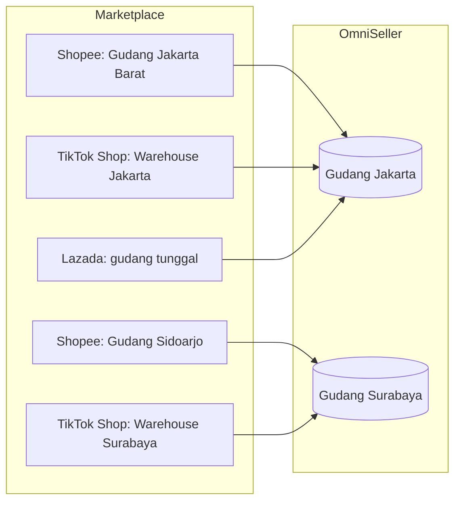
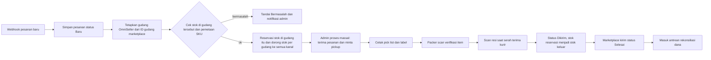
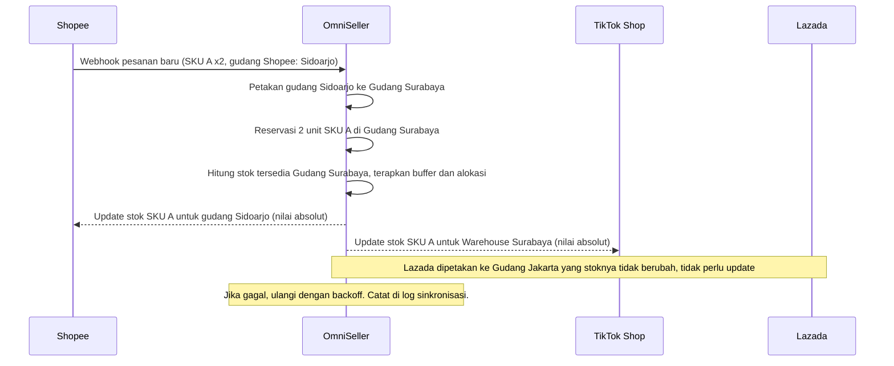
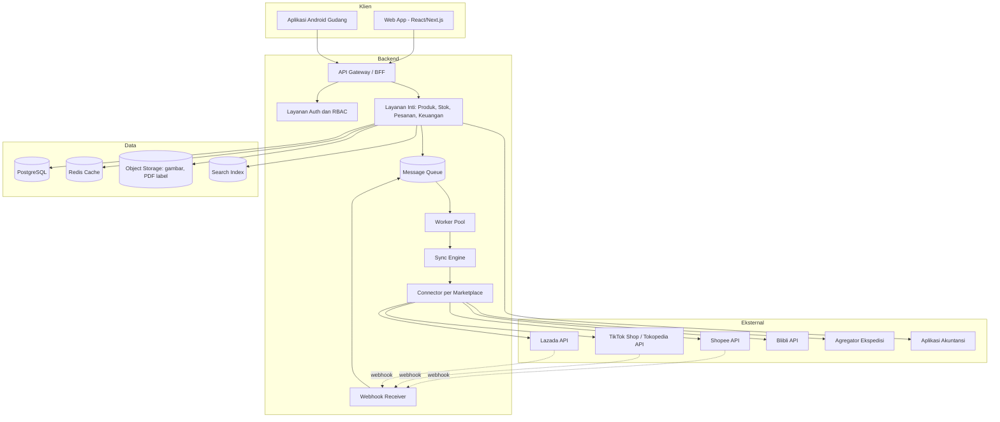
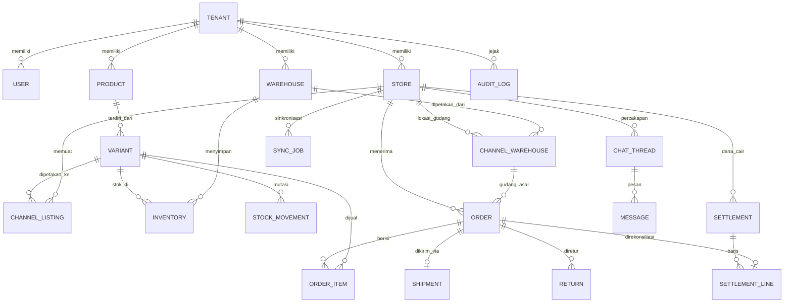

# OmniSeller — Aplikasi Manajemen Penjualan Multi-Marketplace

## Dokumen Spesifikasi Produk (Product Requirements Document)

| Item | Keterangan |
|---|---|
| Versi dokumen | 1.12 |
| Tanggal | 17 Oktober 2026 |
| Status | Draft untuk review |
| Pemilik dokumen | Candra Syahputra |
| Nama produk | OmniSeller (nama sementara, dapat diganti) |
| Audiens dokumen | Pemilik bisnis, product manager, tim engineering, tim QA, investor/mitra |

---

## Daftar Isi

1. [Ringkasan Eksekutif](#1-ringkasan-eksekutif)
2. [Latar Belakang dan Masalah](#2-latar-belakang-dan-masalah)
3. [Tujuan, Sasaran, dan Batasan](#3-tujuan-sasaran-dan-batasan)
4. [Pengguna Sasaran dan Persona](#4-pengguna-sasaran-dan-persona)
5. [Cakupan Kanal yang Didukung](#5-cakupan-kanal-yang-didukung)
6. [Kebutuhan Fungsional per Modul](#6-kebutuhan-fungsional-per-modul)
7. [Alur Kerja Utama](#7-alur-kerja-utama)
8. [Kebutuhan Non-Fungsional](#8-kebutuhan-non-fungsional)
9. [Arsitektur Teknis](#9-arsitektur-teknis)
10. [Model Data](#10-model-data)
11. [Integrasi API Marketplace](#11-integrasi-api-marketplace)
12. [Keamanan, Privasi, dan Kepatuhan](#12-keamanan-privasi-dan-kepatuhan)
13. [Kriteria Penerimaan dan Strategi Pengujian](#13-kriteria-penerimaan-dan-strategi-pengujian)
14. [Peta Jalan Pengembangan](#14-peta-jalan-pengembangan)
15. [Go-to-Market, Dukungan, dan Tingkat Layanan](#15-go-to-market-dukungan-dan-tingkat-layanan)
16. [Metrik Keberhasilan](#16-metrik-keberhasilan)
17. [Risiko dan Mitigasi](#17-risiko-dan-mitigasi)
18. [Lampiran](#18-lampiran)

---

## 1. Ringkasan Eksekutif

OmniSeller adalah aplikasi berbasis web (dengan aplikasi pendamping Android untuk gudang) yang memungkinkan pedagang mengelola seluruh aktivitas penjualan di banyak marketplace dari **satu dasbor terpusat**. Aplikasi ini menyatukan produk, stok, pesanan, pengiriman, chat pembeli, retur, dan keuangan lintas kanal seperti Shopee, Tokopedia, TikTok Shop, Lazada, dan Blibli.

**Nilai utama yang ditawarkan:**

| Nilai | Penjelasan singkat |
|---|---|
| Satu stok untuk semua kanal | Setiap perubahan stok otomatis didorong ke semua marketplace. Overselling dan pembatalan karena stok kosong turun drastis. |
| Satu antrean pesanan | Semua pesanan dari semua toko masuk dalam satu daftar dengan status seragam, bisa diproses massal. |
| Pengiriman lebih cepat | Cetak label massal, pick list per gudang, dan verifikasi scan barcode sebelum kirim. |
| Laba bersih terlihat | Rekonsiliasi otomatis antara pesanan dan dana yang cair dari marketplace, lengkap dengan potongan biaya. |
| Skalabel untuk tim | Hak akses per peran, per toko, dan per gudang. Cocok dari pedagang solo hingga tim puluhan orang. |

### 1.1 Positioning dan keunggulan pembeda

Pasar aplikasi omnichannel di Indonesia sudah diisi pemain matang: BigSeller (gratis dengan paket VIP), Ginee, Jubelio, dan Forstok. OmniSeller tidak bersaing dengan menambah fitur sebanyak mungkin, melainkan dengan dua strategi:

1. **Paritas pada fitur inti yang sudah dianggap standar** oleh pedagang (lihat bagian 2.4): sinkron stok, proses pesanan massal dan otomatis, cetak label kustom, salin produk antar toko, promosi massal, chat terpadu, WMS dasar, laporan laba, dan aplikasi mobile. Tanpa paritas ini, pedagang tidak akan pindah.
2. **Keunggulan pembeda yang jarang digarap pesaing** dan menyentuh kerugian nyata pedagang Indonesia:

| Pembeda | Masalah yang diselesaikan | Bagian |
|---|---|---|
| Gudang daerah marketplace sebagai dimensi utama | Pesanan jatuh ke gudang yang salah, stok per wilayah tidak akurat | 5.4, 6.3.1 |
| COD, RTO, dan klaim paket dihitung sampai ke laba | Ongkir balik dan kompensasi kurir yang selama ini tidak tercatat | 6.4, 6.5, 6.7 |
| Kesehatan toko lintas marketplace | Penalti baru disadari setelah toko dibatasi | 6.14 |
| Kepatuhan pajak dan legalitas lokal (PMK 37/2025, Permendag 19/2026) | Selisih dana cair karena PPh 22, dokumen legalitas terlewat | 5.6, 6.7, 12 |
| Laba bersih per pesanan yang benar-benar bersih | Semua potongan, biaya, komisi affiliate, dan pajak masuk hitungan | 6.7 |
| Riset pasar yang tahu biaya Anda sendiri | Perkakas riset lain hanya menebak margin dari harga pasar. OmniSeller sudah memegang HPP, biaya marketplace, ongkir, dan tingkat retur nyata milik pedagang, sehingga skor peluang dan saran harga dihitung dari margin sebenarnya | 6.19 |

Pesan utama ke pasar: **"Fitur selengkap yang Anda pakai sekarang, ditambah angka laba yang bisa dipercaya."**

Dokumen ini menjadi acuan tunggal (single source of truth) untuk kebutuhan produk, prioritas fitur, arsitektur, dan rencana rilis.

---

## 2. Latar Belakang dan Masalah

### 2.1 Kondisi saat ini

Pedagang yang berjualan di lebih dari satu marketplace umumnya bekerja dengan cara berikut:

- Membuka 3 sampai 6 seller center secara bergantian setiap hari.
- Mencatat stok di spreadsheet atau bahkan hanya mengandalkan ingatan.
- Mengunggah produk yang sama berulang kali di setiap marketplace.
- Mencetak label pengiriman satu per satu di masing-masing platform.
- Membalas chat pembeli di banyak aplikasi berbeda.
- Tidak tahu laba bersih sebenarnya karena potongan biaya tiap marketplace berbeda dan dana cair bertahap.

### 2.2 Daftar masalah dan dampaknya

| # | Masalah | Dampak bisnis | Frekuensi |
|---|---|---|---|
| P1 | Stok tidak sinkron antar marketplace | Overselling, pesanan dibatalkan, penalti performa toko, ulasan buruk | Harian |
| P2 | Proses pesanan tersebar di banyak seller center | Waktu proses lama, risiko terlambat kirim, SLA marketplace terlewat | Harian |
| P3 | Input produk berulang di tiap kanal | Waktu terbuang, data produk tidak konsisten antar kanal | Setiap ada produk baru |
| P4 | Cetak label per platform | Antrean packing lambat, salah tempel label | Harian |
| P5 | Chat pembeli tersebar | Respons lambat, skor chat turun, penjualan hilang | Harian |
| P6 | Tidak tahu laba bersih per pesanan | Salah menetapkan harga, promo yang justru merugi | Bulanan saat tutup buku |
| P7 | Rekonsiliasi dana cair manual | Selisih dana tidak terdeteksi, potensi kehilangan uang | Mingguan |
| P8 | Tidak ada pembagian akses tim | Semua staf pakai akun owner, tidak ada jejak audit | Terus-menerus |
| P9 | Retur dan pembatalan tidak tercatat rapi | Stok tidak kembali, barang rusak tercampur barang layak jual | Mingguan |
| P10 | Marketplace dengan fitur gudang daerah (multi-lokasi) menuntut stok per gudang, sedangkan pencatatan pedagang masih satu angka stok | Pesanan jatuh ke gudang yang stoknya kosong, kirim dari gudang jauh, ongkir dan waktu kirim membengkak | Harian |
| P11 | Pesanan COD gagal diterima pembeli lalu paket kembali (RTO), tanpa pencatatan yang rapi | Ongkir kirim dan ongkir balik hangus, stok paket RTO tidak kembali ke sistem, laba tampak lebih besar dari kenyataan | Harian |
| P12 | Kewajiban baru: pemungutan PPh 22 oleh marketplace (PMK 37/2025), NIB wajib dan transparansi biaya (Permendag 19/2026) | Selisih dana cair tidak terjelaskan, dokumen legalitas terlewat, risiko toko dibekukan | Bulanan |
| P13 | Performa toko (poin penalti, tingkat keterlambatan, pesanan tidak terselesaikan) hanya terlihat di masing-masing seller center | Penalti baru disadari setelah toko dibatasi, kehilangan program promosi marketplace | Mingguan |

### 2.3 Mengapa sekarang

- Jumlah kanal penjualan terus bertambah (marketplace, live commerce, web store, WhatsApp).
- Marketplace memperketat SLA pengiriman dan skor performa toko.
- Semua marketplace besar sudah menyediakan API resmi untuk seller dan mitra aplikasi.
- Pedagang menengah mulai memiliki tim dan gudang lebih dari satu sehingga butuh kontrol akses dan visibilitas.

### 2.4 Lanskap pesaing

Ringkasan hasil riset per 30 September 2026 terhadap tiga pemain utama. "Tidak diverifikasi" berarti fitur tidak ditemukan dalam dokumentasi publik yang ditinjau, bukan berarti tidak ada.

| Kapabilitas | BigSeller | Ginee | Jubelio | OmniSeller (target) |
|---|---|---|---|---|
| Marketplace terintegrasi | 20+ (termasuk Shopify, WooCommerce) | Shopee, Tokopedia, Lazada, Blibli, Zalora, TikTok Shop, dan lainnya | 100+ kanal termasuk POS | 5 Tier 1 di MVP, Tier 2 bertahap |
| Model harga | Gratis + paket VIP berbayar (Basic sekitar Rp450 ribu sampai Platinum sekitar Rp4,5 juta per bulan, sumber pihak ketiga) | Berbayar, kisaran Rp300 ribu sampai Rp2 juta lebih per bulan | Berbayar | 3 paket, fitur otomasi dan distribusi di paket menengah ke atas |
| Scrape produk dari sumber eksternal | Ya, 18 sumber via ekstensi Chrome dan tautan | Ya (salin produk massal) | Tidak diverifikasi | Terbatas: toko sendiri dan sumber supplier berizin |
| Salin toko penuh antar toko sendiri | Ya | Ya | Tidak diverifikasi | Ya |
| Template produk, watermark massal, jadwal publikasi | Ya | Sebagian | Tidak diverifikasi | Ya |
| Aturan proses pesanan otomatis | Ya (paket berbayar, eksekusi sekitar 1 menit) | Tidak diverifikasi | Ya (WMS) | Ya |
| Gelombang (wave) picking, scan untuk cetak, label kustom | Ya | Sebagian | Ya | Ya |
| Pesanan tautan untuk pembeli WhatsApp/IG | Ya | Tidak diverifikasi | Tidak diverifikasi | Ya |
| Distribusi reseller/dropship dan rekonsiliasi piutang | Ya (paket V2 ke atas) | Tidak diverifikasi | Tidak diverifikasi | Ya (Fase 4) |
| WMS: rak, batch dan kedaluwarsa, nomor seri, karantina, transfer, opname | Ya | Sebagian | Ya | Ya |
| Promosi massal, salin promo, perpanjang otomatis | Ya (Shopee, Lazada, TikTok) | Ya | Tidak diverifikasi | Ya |
| Naikkan produk otomatis | Ya (30 produk, 5 produk tiap 4 jam) | Tidak diverifikasi | Tidak diverifikasi | Ya |
| Pengelolaan iklan | Ya (Shopee dan TikTok) | Tidak diverifikasi | Tidak diverifikasi | Hanya-baca di v1, dasar di Fase 4 |
| Chat terpadu dan AI | Ya (auto-reply, AI CS) | Ya | Ya (AI Chat Assistant, Visual Matching) | Ya |
| Laba per pesanan dan rekonsiliasi marketplace | Ya (hanya pesanan selesai) | Sebagian | Ya (Jubelio Finance) | Ya, termasuk RTO, klaim, affiliate, PPh 22 |
| Laporan kinerja staf gudang | Ya (Laporan Aksi) | Tidak diverifikasi | Tidak diverifikasi | Ya |
| POS toko fisik | Ya | Tidak diverifikasi | Ya | Fase 4 |
| Live commerce | BigSeller Live (Facebook) | Tidak diverifikasi | Tidak diverifikasi | Mode live dan affiliate |
| Aplikasi mobile | Ya | Ya | Ya | Ya |
| Riset produk dan kompetitor (scraping untuk analisa) | Ya (scrape 18 sumber, seleksi produk 1688, bocoran peluang Lazada) | Ya | Tidak diverifikasi | Ya, dan dihubungkan ke HPP serta biaya nyata pedagang |
| Pemantauan harga kompetitor dengan riwayat dan peringatan | Tidak diverifikasi | Tidak diverifikasi | Tidak diverifikasi | Ya |
| Riset kata kunci dan analisis ulasan | Tidak diverifikasi | Tidak diverifikasi | Tidak diverifikasi | Ya |
| Gudang daerah marketplace sebagai dimensi utama | Tidak diverifikasi | Tidak diverifikasi | Tidak diverifikasi | Ya (inti) |
| COD, RTO, klaim paket sampai ke laba | Sebagian (kompensasi kurir, manajemen ongkir) | Tidak diverifikasi | Tidak diverifikasi | Ya (inti) |
| Kesehatan toko lintas marketplace | Tidak diverifikasi | Tidak diverifikasi | Tidak diverifikasi | Ya (inti) |
| Kepatuhan PPh 22 dan NIB | Tidak diverifikasi | Tidak diverifikasi | Tidak diverifikasi | Ya (inti) |

Kesimpulan: BigSeller adalah tolok ukur paritas fitur karena paling lengkap dan gratis di tingkat dasar. Kebutuhan bertanda "paritas BigSeller" di bagian 6 berasal dari tabel ini.

---

## 3. Tujuan, Sasaran, dan Batasan

### 3.1 Tujuan produk

Menjadi pusat kendali operasional harian pedagang multi-kanal, sehingga pedagang **tidak perlu lagi membuka seller center** untuk pekerjaan rutin.

### 3.2 Sasaran terukur (12 bulan setelah rilis)

| ID | Sasaran | Target |
|---|---|---|
| G1 | Mengurangi waktu proses satu pesanan (dari masuk sampai label tercetak) | Turun minimal 60% dibanding proses manual |
| G2 | Menekan tingkat overselling | Di bawah 0,5% dari total pesanan |
| G3 | Visibilitas laba bersih per pesanan | Tersedia maksimal H+1 setelah dana cair |
| G4 | Waktu onboarding satu toko baru | Di bawah 15 menit sampai produk dan pesanan tersinkron |
| G5 | Keterlambatan sinkronisasi stok ke marketplace | Di bawah 60 detik pada kondisi normal |
| G6 | Retensi pengguna berbayar bulanan | Di atas 90% |

### 3.3 Di luar cakupan versi 1 (non-goals)

- Bukan marketplace atau toko online sendiri. OmniSeller adalah alat manajemen, bukan tempat jualan.
- Tidak mengelola iklan berbayar (Shopee Ads, TikTok Ads, dan sejenisnya).
- Tidak menggantikan aplikasi akuntansi penuh (jurnal umum, neraca, laporan pajak resmi). Disediakan integrasi dan ekspor.
- Tidak menyediakan Point of Sale (POS) kasir toko fisik pada versi 1.
- Tidak menangani impor barang, bea cukai, atau penjualan lintas negara pada versi 1.

### 3.4 Asumsi

- Pedagang memiliki akses admin ke akun seller di setiap marketplace untuk memberikan otorisasi.
- Setiap marketplace menyediakan API resmi dengan cakupan minimal: produk, stok, pesanan, dan label pengiriman.
- Pedagang bersedia memakai kode SKU yang konsisten atau bersedia melakukan pemetaan SKU di awal.
- Pedagang memiliki NIB (Nomor Induk Berusaha) atau sedang mengurusnya, karena Permendag 19/2026 mewajibkan marketplace menolak seller domestik tanpa legalitas usaha.

---

## 4. Pengguna Sasaran dan Persona

### 4.1 Segmen pengguna

| Segmen | Ciri | Kebutuhan utama |
|---|---|---|
| Pedagang solo / UMKM | 1 sampai 2 toko, di bawah 300 SKU, di bawah 50 pesanan/hari, dikerjakan sendiri | Mudah, cepat, murah. Fokus pada sinkron stok dan cetak label. |
| Toko menengah dengan tim | 3 sampai 6 toko, 300 sampai 5.000 SKU, 50 sampai 1.000 pesanan/hari, ada admin, packer, CS | Pembagian tugas, proses massal, chat terpadu, laporan harian. |
| Brand / distributor | Banyak toko dan gudang, di atas 5.000 SKU, di atas 1.000 pesanan/hari | Multi-gudang, alokasi stok per kanal, integrasi ERP/akuntansi, API, audit. |

### 4.2 Persona

**Persona A — Rina, pedagang solo fashion**
- Berjualan di Shopee dan TikTok Shop. Sekitar 150 SKU dengan varian ukuran dan warna.
- Sering kena pembatalan karena stok di TikTok tidak sempat diupdate setelah laris di Shopee.
- Ingin: satu tempat untuk lihat pesanan, cetak label sekali, stok otomatis sinkron.

**Persona B — Dimas, pemilik toko elektronik aksesoris**
- Lima toko di lima marketplace. Tiga admin, dua packer, satu orang keuangan.
- Masalah: staf saling tumpang tindih, label salah tempel, tidak tahu toko mana yang paling untung.
- Ingin: peran dan tugas jelas, verifikasi scan sebelum kirim, laporan laba per toko.

**Persona C — Maya, manajer operasional brand skincare**
- Tiga gudang (Jakarta, Surabaya, Medan). Stok harus dialokasikan per kanal dan per wilayah.
- Sudah mengaktifkan multi-gudang di Shopee dan TikTok Shop, sehingga pesanan dari Jawa Timur otomatis dilayani gudang Surabaya oleh marketplace.
- Ingin: alokasi stok otomatis, integrasi ke Accurate, log audit untuk setiap perubahan harga dan stok.

### 4.3 Peran pengguna dalam aplikasi

| Peran | Hak utama |
|---|---|
| Owner | Semua akses, termasuk tagihan, hapus toko, kelola pengguna |
| Admin | Produk, stok, pesanan, pengaturan operasional, laporan |
| Staf Gudang / Packer | Pick, pack, scan, cetak label, stock opname pada gudang yang ditugaskan |
| Customer Service | Chat, ulasan, retur, catatan pesanan. Tidak bisa ubah harga dan stok |
| Finance | Rekonsiliasi, laporan keuangan, ekspor. Hanya baca untuk modul lain |
| Viewer | Hanya baca dasbor dan laporan |

---

## 5. Cakupan Kanal yang Didukung

### 5.1 Marketplace

| Prioritas | Kanal | Cakupan integrasi | Catatan |
|---|---|---|---|
| Tier 1 (MVP) | Shopee | Produk, stok, pesanan, label, chat, settlement, retur | Volume tertinggi di Indonesia |
| Tier 1 (MVP) | Tokopedia | Produk, stok, pesanan, label, chat, settlement | Tokopedia Open API lama telah dihentikan per 30 September 2025. Toko Tokopedia kini diintegrasikan melalui TikTok Shop Partner Center ("Tokopedia & Shop"), sehingga satu connector melayani keduanya |
| Tier 1 (MVP) | TikTok Shop | Produk, stok, pesanan, label, chat, settlement, retur | Pertumbuhan tercepat, live commerce. Di pasar Indonesia toko TikTok Shop dan Tokopedia adalah satu toko "Tokopedia & Shop"; antarmuka OmniSeller menampilkan kanal ini dengan nama dan logo "Tokopedia & Shop", tidak memakai merek TikTok (lihat 5.6) |
| Tier 1 | Lazada | Produk, stok, pesanan, label, chat, settlement | |
| Tier 1 | Blibli | Produk, stok, pesanan, label, promo seller, webhook | Blibli Seller API resmi tersedia di seller-api.blibli.com. Chat dan settlement diverifikasi saat implementasi |
| Tier 2 | Zalora | Produk, stok, pesanan | Segmen fashion |
| Tier 2 | Web store (Shopify, WooCommerce) | Produk, stok, pesanan | Untuk pedagang yang punya situs sendiri |
| Tier 2 | Pesanan manual (WhatsApp, Instagram, offline) | Input pesanan manual, potong stok, cetak label via agregator ekspedisi | |
| Tier 3 | Kanal regional dan B2B | Ditentukan berdasarkan permintaan pengguna | |

### 5.2 Ekspedisi

- **Ekspedisi marketplace**: label dan resi diambil langsung dari API marketplace (Shopee Express, kurir rekomendasi Tokopedia/TikTok, Lazada Express, JNE, J&T, SiCepat, Anteraja, Ninja Xpress, GoSend, GrabExpress, dan lainnya sesuai pilihan pembeli).
- **Ekspedisi untuk pesanan manual**: integrasi ke agregator ekspedisi (misalnya Biteship, KiriminAja, atau RajaOngkir) untuk cek ongkir, buat order, dan cetak resi.

### 5.3 Integrasi pendukung

| Kategori | Contoh | Fase |
|---|---|---|
| Akuntansi | Accurate Online, Jurnal by Mekari | Fase 3 |
| Notifikasi | Email, WhatsApp Business API, Telegram | Fase 2 sampai 3 |
| Printer | Printer thermal (100 x 150 mm), printer laser A4 | MVP |
| Barcode scanner | Scanner USB/Bluetooth, kamera HP via aplikasi Android | Fase 2 |
| Penyimpanan file | Ekspor ke Google Drive / unduh langsung | Fase 2 |

### 5.4 Gudang daerah (multi-lokasi) di marketplace

Shopee, Tokopedia, TikTok Shop, dan Lazada menyediakan fitur agar seller mendaftarkan lebih dari satu lokasi gudang. Pada fitur ini:

- Marketplace menentukan gudang mana yang melayani pembeli berdasarkan wilayah pembeli. Seller tidak memilih gudang saat pesanan masuk.
- Stok setiap listing ditampilkan dan dikelola per gudang, bukan satu angka total.
- Setiap pesanan datang dengan identitas gudang asal, dan label pengiriman harus berasal dari gudang tersebut.
- Ongkir dan estimasi tiba yang dilihat pembeli mengikuti gudang yang dipilih marketplace.

OmniSeller wajib mendukung pola ini sejak MVP. Kebutuhan rincinya ada di bagian [6.3.1](#631-gudang-daerah-dan-pemetaan-gudang-marketplace).

### 5.5 Stok yang dikelola gudang marketplace

Selain gudang milik sendiri, marketplace menawarkan layanan fulfillment: Dikelola Shopee (Fulfilled by Shopee), Fulfilled by Lazada, dan Fulfilled by TikTok (FBT). Pada layanan ini seller mengirim stok ke gudang marketplace, lalu marketplace yang melakukan pick, pack, kirim, dan proses retur. Konsekuensinya bagi OmniSeller:

- Stok di gudang marketplace **tidak boleh didorong** oleh OmniSeller, karena marketplace yang menjadi sumber kebenarannya.
- Pesanan yang dilayani gudang marketplace tetap harus terlihat di OmniSeller untuk laporan dan rekonsiliasi, tetapi tidak masuk antrean packing.
- Pengiriman stok masuk (inbound) ke gudang marketplace dan biaya penyimpanan serta fulfillment perlu dicatat agar laba per pesanan akurat.

Kebutuhan rincinya ada di bagian 6.3.2.

### 5.6 Konteks regulasi 2025 sampai 2026

| Regulasi | Isi pokok | Dampak pada OmniSeller |
|---|---|---|
| Penghentian Tokopedia Open API (30 September 2025) | Semua integrasi Tokopedia berpindah ke TikTok Shop Partner Center | Satu connector untuk Tokopedia dan TikTok Shop. Tidak ada connector Tokopedia terpisah |
| PMK 37/2025 (berlaku efektif 1 Agustus 2026) | Shopee, Tokopedia, Lazada, dan Blibli ditunjuk memungut PPh Pasal 22 sebesar 0,5% dari omzet seller. Seller orang pribadi dengan omzet sampai Rp500 juta setahun dikecualikan bila mengunggah surat pernyataan omzet. Seller dengan SKB (Surat Keterangan Bebas) juga dikecualikan. Bukti pemungutan per transaksi disalurkan melalui Coretax | Modul keuangan mencatat PPh 22 per pesanan, memantau omzet kumulatif mendekati ambang Rp500 juta, mengingatkan unggah surat pernyataan atau SKB di tiap marketplace, dan merekap bukti pemungutan untuk SPT |
| Permendag 19/2026 (Juni 2026, menggantikan Permendag 31/2023) | Seller domestik wajib punya NIB (status "dalam proses legalisasi" maksimal 6 bulan). Marketplace wajib transparan soal biaya dan memberi tahu perubahan biaya. Label toko (official store, star seller, dan sejenisnya) diatur. Konten yang dibuat dengan AI wajib diberi keterangan. Perlindungan konsumen diperketat | Onboarding menyimpan NIB dan dokumen legalitas dengan pengingat. Tabel biaya marketplace bisa diperbarui dari pengumuman resmi. Setiap fitur AI yang menghasilkan konten menampilkan penanda "dibuat dengan bantuan AI" dan pengguna meninjau sebelum publikasi |
| Pedoman merek "Tokopedia & Shop" (TikTok Shop Partner Center, pasar Indonesia) | Sesuai peraturan Indonesia, merek atau logo "TikTok" tidak boleh dipakai di layanan dan fitur pihak ketiga (antarmuka, label kirim kustom, invoice kustom); gantinya "Tokopedia & Shop". Label kirim kustom sebaiknya tanpa logo tambahan | Nama kanal, ikon, filter, laporan, label, dan invoice memakai "Tokopedia & Shop". Nama internal teknis tetap `tiktokshop` |
| UU 27/2022 tentang Pelindungan Data Pribadi | Data pembeli adalah data pribadi | Retensi terbatas, akses berbasis peran, log audit (lihat bagian 12) |
| Kewajiban PKP (omzet di atas Rp4,8 miliar) | Wajib menerbitkan e-Faktur melalui Coretax | Ekspor data penjualan dalam format siap unggah e-Faktur (fase lanjutan) |

Detail regulasi wajib diverifikasi ulang oleh konsultan pajak dan hukum sebelum rilis, karena ketentuan pelaksanaan dapat berubah.

---

## 6. Kebutuhan Fungsional per Modul

Prioritas menggunakan skema **MoSCoW**:
- **M (Must)**: wajib ada di MVP.
- **S (Should)**: penting, dijadwalkan di fase berikutnya.
- **C (Could)**: nilai tambah jika waktu tersedia.

### 6.1 Modul Koneksi Toko dan Integrasi

Tujuan: menghubungkan akun seller di tiap marketplace secara aman dan menjaga koneksi tetap hidup.

| ID | Kebutuhan | Prioritas |
|---|---|---|
| FR-INT-01 | Pengguna dapat menghubungkan toko melalui otorisasi resmi marketplace (OAuth atau mekanisme setara) tanpa memasukkan kata sandi seller center ke OmniSeller | M |
| FR-INT-02 | Satu tenant dapat menghubungkan banyak toko pada marketplace yang sama | M |
| FR-INT-03 | Sistem menampilkan status koneksi tiap toko (aktif, token hampir kedaluwarsa, terputus) dan memperbarui token secara otomatis | M |
| FR-INT-04 | Saat toko pertama kali terhubung, sistem mengimpor produk aktif dan pesanan 90 hari terakhir | M |
| FR-INT-05 | Sistem menerima notifikasi push (webhook) dari marketplace dan memiliki polling terjadwal sebagai cadangan | M |
| FR-INT-06 | Tersedia log sinkronisasi per toko: waktu, jenis data, jumlah berhasil/gagal, pesan error yang mudah dipahami | M |
| FR-INT-07 | Pengguna dapat memutus koneksi toko dan memilih apakah data historis dipertahankan | S |
| FR-INT-08 | Sistem memberi peringatan (in-app dan email) jika koneksi terputus lebih dari 15 menit | S |

**Kriteria penerimaan utama**: toko baru terhubung dan produk pertama muncul di daftar produk dalam waktu kurang dari 15 menit untuk katalog hingga 2.000 SKU.

### 6.2 Modul Manajemen Produk

Tujuan: satu data produk induk (master) yang dipetakan ke listing di setiap marketplace.

| ID | Kebutuhan | Prioritas |
|---|---|---|
| FR-PRD-01 | Produk induk memiliki: nama, SKU induk, deskripsi, kategori internal, merek, berat, dimensi, HPP (harga pokok), harga jual dasar, gambar, dan varian (misalnya warna dan ukuran) dengan SKU varian masing-masing | M |
| FR-PRD-02 | Sistem memetakan listing marketplace ke produk induk secara otomatis berdasarkan kode SKU yang sama, dan menyediakan pemetaan manual untuk sisanya | M |
| FR-PRD-03 | Halaman "belum terpetakan" menampilkan listing marketplace yang belum punya produk induk, dengan saran pemetaan berdasar kemiripan nama | M |
| FR-PRD-04 | Impor dan ekspor produk massal melalui template Excel/CSV dengan validasi baris dan laporan error per baris | M |
| FR-PRD-05 | Publikasi produk induk ke satu atau banyak marketplace sekaligus (cross-listing), dengan pemetaan kategori dan atribut wajib per marketplace | S |
| FR-PRD-06 | Override per kanal: judul, deskripsi, harga, dan gambar dapat dibedakan per marketplace tanpa mengubah produk induk | S |
| FR-PRD-07 | Produk bundle/paket: satu SKU bundle terdiri dari beberapa SKU komponen. Penjualan bundle mengurangi stok komponen | S |
| FR-PRD-08 | Pustaka media terpusat untuk gambar dan video produk | S |
| FR-PRD-09 | Status listing per kanal terlihat jelas: aktif, nonaktif, ditolak/diblokir marketplace, stok habis | M |
| FR-PRD-10 | Aktifkan atau nonaktifkan listing di marketplace langsung dari OmniSeller, secara satuan maupun massal | M |
| FR-PRD-11 | Riwayat perubahan produk (siapa mengubah apa dan kapan) | S |
| FR-PRD-12 | Barcode/EAN per SKU untuk kebutuhan scan gudang; cetak label barcode internal | S |
| FR-PRD-13 | Salin listing massal antar toko milik sendiri (misalnya dari toko Shopee ke toko TikTok Shop) lengkap dengan gambar, varian, dan pemetaan kategori. Termasuk salin toko penuh sekali klik ke folder draf untuk ditinjau sebelum publikasi (paritas BigSeller) | S |
| FR-PRD-14 | Video produk: unggah sekali di pustaka media, didorong ke marketplace yang mendukung (Shopee Media Space, Lazada Media Center, TikTok Shop) | C |
| FR-PRD-15 | Penulisan deskripsi dan judul produk berbantuan AI secara massal, dengan penanda "dibuat dengan bantuan AI" dan wajib ditinjau pengguna sebelum publikasi (sesuai Permendag 19/2026) | C |
| FR-PRD-16 | Template produk per marketplace: atribut wajib, deskripsi standar, garansi, dan pengaturan pengiriman yang dapat dipakai ulang saat publikasi (paritas BigSeller) | S |
| FR-PRD-17 | Template watermark: logo atau teks diterapkan massal ke gambar produk sebelum publikasi, dengan pratinjau dan posisi yang dapat diatur (paritas BigSeller) | S |
| FR-PRD-18 | Jadwal publikasi dan penonaktifan listing pada waktu tertentu | C |
| FR-PRD-19 | Pre-order per varian untuk marketplace yang mendukung, termasuk lama waktu proses yang dijanjikan | S |
| FR-PRD-20 | Etalase atau kategori toko di marketplace (misalnya etalase Shopee) dikelola massal dari OmniSeller | C |
| FR-PRD-21 | Tabel ukuran (size chart) untuk kategori fashion pada marketplace yang mendukung | C |
| FR-PRD-22 | Grup tautan informasi: per listing, pengguna memilih field mana yang otomatis mengikuti produk induk (judul, deskripsi, harga, gambar, berat) dan mana yang di-override. Perubahan pada produk induk hanya menyentuh field yang tertaut (melengkapi FR-PRD-06) | S |
| FR-PRD-23 | Sumber produk dari supplier: impor produk dari katalog supplier atau tautan produk (maksimal 20 tautan per sesi) ke folder draf, lengkap dengan judul, deskripsi, gambar, harga, dan spesifikasi. Hanya untuk sumber yang pengguna punya hak atas kontennya. Menyalin listing toko lain tanpa izin tidak difasilitasi | C |
| FR-PRD-24 | Terjemahan otomatis judul dan deskripsi untuk ekspansi ke marketplace regional, dengan penanda konten AI | C |

### 6.3 Modul Stok dan Gudang

Tujuan: satu sumber kebenaran stok yang otomatis disebarkan ke semua kanal.

| ID | Kebutuhan | Prioritas |
|---|---|---|
| FR-STK-01 | Mendukung banyak gudang. Setiap gudang memiliki stok per SKU, dan setiap gudang dapat dipetakan ke lokasi gudang di marketplace (lihat 6.3.1) | M |
| FR-STK-02 | Stok tersedia = stok fisik − stok reservasi (pesanan yang belum dikirim) − buffer pengaman | M |
| FR-STK-03 | Setiap perubahan stok (pesanan masuk, batal, retur, penyesuaian, opname) otomatis memicu pembaruan stok ke semua listing terkait dalam 60 detik | M |
| FR-STK-04 | Aturan alokasi stok per kanal per gudang: seluruh stok, persentase, jumlah tetap, atau buffer | S |
| FR-STK-05 | Penyesuaian stok manual wajib menyertakan alasan (rusak, hilang, koreksi, sampel, dan lainnya) | M |
| FR-STK-06 | Kartu stok: riwayat mutasi per SKU dengan referensi dokumen (nomor pesanan, nomor opname, nomor retur) | M |
| FR-STK-07 | Peringatan stok minimum per SKU dan daftar "perlu restock" berdasarkan kecepatan penjualan 7/14/30 hari terakhir | S |
| FR-STK-08 | Stock opname (perhitungan fisik) dengan mode penuh atau parsial, dukungan scan barcode, dan persetujuan sebelum stok diperbarui | S |
| FR-STK-09 | Transfer stok antar gudang dengan status dikirim/diterima | S |
| FR-STK-10 | Pembelian dari supplier (purchase order): data supplier dan kontak, katalog harga beli per SKU dengan riwayat harga, status PO (draf, dikirim, diterima sebagian, selesai), penerimaan barang menambah stok, HPP diperbarui dengan metode rata-rata tertimbang, status pembayaran ke supplier | S |
| FR-STK-11 | Nomor batch dan tanggal kedaluwarsa untuk kategori produk tertentu (makanan, kosmetik) | C |
| FR-STK-12 | Lokasi rak (bin location) per SKU per gudang untuk mempercepat picking, dengan cetak label rak | S |
| FR-STK-13 | Stok cadangan kampanye: kunci sejumlah stok untuk kampanye tertentu (flash sale, live, affiliate) agar kanal lain tidak menghabiskannya, dengan jadwal mulai dan selesai otomatis | S |
| FR-STK-14 | Nomor seri (SN) per unit untuk produk bergaransi (elektronik, gawai): dicatat saat masuk, dipindai saat keluar, dicari saat klaim garansi | C |
| FR-STK-15 | Status stok rusak atau karantina terpisah dari stok layak jual, dengan alur lanjutan: perbaiki dan kembalikan, jual sebagai barang cacat, atau musnahkan. Tidak pernah didorong ke marketplace | S |
| FR-STK-16 | Rencana pembelian: saran restock (FR-STK-07) dapat diubah menjadi draf PO per supplier dalam satu klik, dengan perhitungan jumlah berdasarkan target hari persediaan | S |
| FR-STK-17 | Integrasi gudang pihak ketiga (3PL): dorong PO atau pesanan ke gudang fulfillment mitra dan terima hasil penerimaan barang serta stok secara otomatis | C |

**Aturan penting**: pembaruan stok ke marketplace menggunakan nilai absolut hasil perhitungan terakhir, bukan selisih, agar tahan terhadap pesan yang datang tidak berurutan.

#### 6.3.1 Gudang daerah dan pemetaan gudang marketplace

Tujuan: pesanan yang oleh marketplace sudah ditetapkan dilayani gudang tertentu diproses dari gudang yang benar, dan stok yang dilihat pembeli di setiap wilayah sesuai stok fisik gudang tersebut.

| ID | Kebutuhan | Prioritas |
|---|---|---|
| FR-WHS-01 | Saat toko terhubung, sistem mengimpor daftar lokasi gudang yang terdaftar di marketplace (ID, nama, alamat) dan menampilkannya di halaman pemetaan gudang | M |
| FR-WHS-02 | Pengguna memetakan setiap gudang marketplace ke tepat satu gudang OmniSeller. Beberapa gudang marketplace (dari toko atau marketplace berbeda) boleh mengarah ke gudang fisik yang sama. Satu gudang marketplace tidak boleh mengarah ke lebih dari satu gudang OmniSeller | M |
| FR-WHS-03 | Toko yang tidak memakai multi-gudang otomatis dipetakan ke gudang default toko tersebut | M |
| FR-WHS-04 | Sinkronisasi stok tidak aktif untuk toko yang masih memiliki gudang marketplace belum terpetakan. Sistem menampilkan peringatan dan langkah yang harus dilakukan | M |
| FR-WHS-05 | Stok didorong per pasangan listing dan gudang marketplace, dihitung dari stok tersedia di gudang OmniSeller yang terpetakan. Buffer dan aturan alokasi dapat diatur per gudang per kanal | M |
| FR-WHS-06 | Pesanan yang masuk membawa ID gudang marketplace. Sistem otomatis menetapkan gudang OmniSeller sesuai pemetaan dan mereservasi stok di gudang itu, bukan gudang lain | M |
| FR-WHS-07 | Pesanan tidak dapat dipindahkan ke gudang lain kecuali marketplace mengizinkan perubahan gudang asal melalui API. Jika tidak diizinkan dan stok di gudang tersebut kosong, pengguna diberi pilihan: transfer stok ke gudang itu, tandai bermasalah dan tunda, atau batalkan dengan alasan stok | M |
| FR-WHS-08 | Pick list, label, manifest, dan permintaan pickup dikelompokkan per gudang. Alamat pengirim pada label mengikuti gudang asal | M |
| FR-WHS-09 | Staf gudang hanya melihat pesanan, pick list, dan stok gudang yang ditugaskan kepadanya | M |
| FR-WHS-10 | Gudang marketplace yang baru ditambahkan atau dihapus terdeteksi saat sinkronisasi, dan pengguna diberi tahu untuk memperbarui pemetaan. Pesanan dari gudang marketplace yang belum terpetakan masuk daftar bermasalah, tidak pernah hilang | M |
| FR-WHS-11 | Dasbor dan laporan dapat difilter per gudang: penjualan, stok, SLA, tingkat pembatalan, dan wilayah pembeli yang dilayani | S |
| FR-WHS-12 | Saran distribusi stok antar gudang berdasarkan riwayat penjualan per wilayah, misalnya sebagian besar pesanan Jawa Timur dilayani gudang Surabaya | C |
| FR-WHS-13 | Gudang gabungan (pool): satu gudang marketplace dilayani oleh gabungan stok beberapa gudang fisik dengan urutan prioritas pengambilan | C |

Contoh pemetaan untuk pedagang dengan dua gudang fisik:

| Marketplace / toko | Gudang di marketplace | Gudang OmniSeller |
|---|---|---|
| Shopee - Toko Utama | Gudang Jakarta Barat | Gudang Jakarta |
| Shopee - Toko Utama | Gudang Sidoarjo | Gudang Surabaya |
| TikTok Shop - Toko Utama | Warehouse Surabaya | Gudang Surabaya |
| TikTok Shop - Toko Utama | Warehouse Jakarta | Gudang Jakarta |
| Lazada - Toko Utama | (satu gudang) | Gudang Jakarta |
| Blibli - Toko Utama | (satu gudang) | Gudang Jakarta |

Dengan pemetaan ini, pesanan Shopee yang jatuh ke Gudang Sidoarjo otomatis masuk antrean Gudang Surabaya, dan stok yang didorong ke Gudang Sidoarjo dan Warehouse Surabaya selalu sama karena bersumber dari satu gudang fisik.

#### 6.3.2 Stok yang dikelola gudang marketplace (Dikelola Shopee, FBL, FBT)

| ID | Kebutuhan | Prioritas |
|---|---|---|
| FR-MFS-01 | Gudang marketplace bertipe fulfillment (Dikelola Shopee, Fulfilled by Lazada, Fulfilled by TikTok) dikenali otomatis dan ditandai sebagai "dikelola marketplace", bukan dipetakan ke gudang fisik pengguna | S |
| FR-MFS-02 | Stok di gudang fulfillment marketplace hanya dibaca (tarik berkala), tidak pernah didorong dari OmniSeller | S |
| FR-MFS-03 | Pesanan yang dilayani gudang fulfillment marketplace masuk OmniSeller dengan status "Dipenuhi marketplace", terlihat di laporan dan rekonsiliasi, tetapi tidak masuk antrean pick dan pack | S |
| FR-MFS-04 | Pencatatan pengiriman stok masuk (inbound) ke gudang marketplace: dokumen pengiriman, jumlah dikirim, jumlah diterima, selisih | C |
| FR-MFS-05 | Biaya penyimpanan dan biaya fulfillment marketplace dialokasikan ke laba per pesanan dari laporan settlement | C |
| FR-MFS-06 | Dasbor stok gabungan: stok di gudang sendiri dan di gudang marketplace ditampilkan berdampingan per SKU, dengan saran pengisian ulang ke gudang marketplace | C |

### 6.4 Modul Pesanan

Tujuan: semua pesanan dari semua toko berada dalam satu antrean dengan status seragam.

| ID | Kebutuhan | Prioritas |
|---|---|---|
| FR-ORD-01 | Semua pesanan dari semua toko masuk otomatis dalam hitungan detik setelah marketplace mengirim notifikasi | M |
| FR-ORD-02 | Status terpadu: **Baru → Siap Dikemas → Dikemas → Siap Kirim → Dikirim → Selesai**, dengan cabang **Dibatalkan** dan **Retur**. Status asli marketplace tetap ditampilkan sebagai referensi | M |
| FR-ORD-03 | Filter dan pencarian: toko, kanal, status, tanggal, ekspedisi, SKU, nama pembeli, nomor pesanan, nomor resi, gudang, dan label/tag | M |
| FR-ORD-04 | Tag pesanan kustom (misalnya "prioritas", "fragile", "COD") | S |
| FR-ORD-05 | Detail pesanan: item, harga, diskon, voucher, ongkir, biaya marketplace (jika tersedia), catatan pembeli, alamat, kurir, batas waktu kirim | M |
| FR-ORD-06 | Deteksi pesanan bermasalah secara otomatis: stok tidak cukup, SKU belum terpetakan, alamat tidak lengkap, pesanan duplikat, nilai tidak wajar | M |
| FR-ORD-07 | Penghitung SLA: waktu tersisa sebelum batas kirim marketplace, dengan pewarnaan (hijau/kuning/merah) dan urutan prioritas. Batas dibedakan per jenis layanan kirim (reguler, next day, same day, instant) sesuai aturan tiap marketplace | M |
| FR-ORD-08 | Proses massal: pilih banyak pesanan lalu terima pesanan, atur pengiriman/minta pickup, cetak label, cetak pick list, tandai dikemas | M |
| FR-ORD-09 | Pesanan manual untuk penjualan di luar marketplace (WhatsApp, offline): input pembeli, item, ongkir, metode bayar. Stok ikut terpotong | S |
| FR-ORD-10 | Catatan internal per pesanan yang tidak terlihat pembeli | M |
| FR-ORD-11 | Gabung pesanan dari pembeli yang sama dan alamat sama (jika marketplace mengizinkan) | C |
| FR-ORD-12 | Untuk pesanan dari toko tanpa multi-gudang dan pesanan manual: alokasi otomatis ke gudang terdekat atau gudang dengan stok tersedia. Pesanan yang gudangnya sudah ditetapkan marketplace mengikuti FR-WHS-06 | S |
| FR-ORD-13 | Pembatalan dari sisi seller dengan alasan yang sesuai daftar marketplace, dan stok otomatis kembali | M |
| FR-ORD-14 | Riwayat aktivitas pesanan: siapa mengubah status, kapan, dari perangkat apa | M |
| FR-ORD-15 | Pesanan COD ditandai otomatis dan dapat difilter. Ringkasan nilai COD yang belum diterima ditampilkan di dasbor | M |
| FR-ORD-16 | Skor risiko COD per pesanan berdasarkan riwayat gagal COD pada wilayah, kurir, dan nilai pesanan, ditampilkan sebagai peringatan untuk keputusan verifikasi sebelum kirim | S |
| FR-ORD-16a | Daftar pantau pembeli: berdasarkan ID pembeli dari marketplace dan riwayat transaksi di toko sendiri (gagal COD berulang, retur bermasalah), dengan dasar kepentingan sah pencegahan penipuan sesuai UU PDP. Retensi maksimal 12 bulan, tidak dibagikan antar tenant, dan pesanan dari daftar pantau dikecualikan dari proses otomatis untuk ditinjau manual | S |
| FR-ORD-17 | Pesanan yang dilayani gudang fulfillment marketplace dan pesanan affiliate (dari kreator) diberi penanda sumber agar dapat dianalisis terpisah | S |
| FR-ORD-18 | Mode lonjakan (live commerce, flash sale): antrean pesanan diprioritaskan berdasarkan SLA, sinkronisasi stok dipercepat, dan notifikasi stok kritis dipersingkat jendelanya | S |
| FR-ORD-19 | Aturan proses pesanan otomatis (paritas BigSeller): kondisi berupa toko, kurir, gudang asal, jenis paket, SKU tertentu, jam operasional, dan nilai pesanan; aksi berupa terima pesanan, atur pengiriman atau minta pickup pada waktu yang ditentukan, pilih gudang, beri tag, dan cetak otomatis. Banyak aturan dapat aktif bersamaan dengan urutan prioritas. Pesanan bermasalah dan pesanan dari daftar pantau selalu dikecualikan. Target eksekusi di bawah 1 menit setelah pesanan masuk | S |
| FR-ORD-20 | Gelombang (wave) picking: kelompokkan pesanan siap proses menjadi gelombang berdasarkan gudang, kurir, jenis produk, atau jumlah pesanan. Pick list, urutan cetak label, dan scan packing mengikuti gelombang | S |
| FR-ORD-21 | Pesanan tautan: buat pesanan untuk pembeli dari WhatsApp, Instagram, atau Telegram lalu kirim tautan. Pembeli melengkapi alamat dan mengonfirmasi. Metode bayar (transfer, e-wallet, COD via kurir) dan ongkir dari agregator ekspedisi dikonfigurasi lebih dulu. Pesanan masuk antrean yang sama dengan pesanan marketplace | S |
| FR-ORD-22 | Manajemen ongkir: bandingkan ongkir yang dibayar pembeli atau disubsidi marketplace dengan ongkir aktual yang ditagih kurir per pesanan. Selisih masuk perhitungan laba | S |
| FR-ORD-23 | Foto bukti packing per pesanan dari aplikasi gudang, tersimpan 90 hari untuk sengketa dan klaim | C |

### 6.5 Modul Pengiriman dan Fulfillment

Tujuan: mempercepat pick, pack, dan ship dengan kesalahan mendekati nol.

| ID | Kebutuhan | Prioritas |
|---|---|---|
| FR-SHP-01 | Cetak label pengiriman massal dalam satu file PDF, format thermal 100 x 150 mm dan A4 (4 label per halaman), urutan mengikuti pick list | M |
| FR-SHP-02 | Pick list per gudang: daftar SKU, jumlah, lokasi rak, diurutkan berdasarkan rak | M |
| FR-SHP-03 | Packing list per pesanan yang dapat dicetak bersama label | S |
| FR-SHP-04 | Verifikasi packing dengan scan: scan nomor pesanan/resi lalu scan setiap SKU. Sistem menolak jika SKU atau jumlah tidak cocok | S |
| FR-SHP-05 | Tandai "Dikirim" dengan scan resi saat serah terima ke kurir, sekaligus mencetak manifest serah terima | S |
| FR-SHP-06 | Minta pickup atau pilih drop-off melalui API marketplace, satuan maupun massal | M |
| FR-SHP-07 | Status pelacakan pengiriman ditarik dari marketplace atau ekspedisi dan ditampilkan di detail pesanan | S |
| FR-SHP-08 | Aplikasi Android untuk staf gudang: pick list, scan verifikasi, tandai dikirim, stock opname | S |
| FR-SHP-09 | Template label kustom untuk pesanan manual: logo toko, pesan terima kasih | C |
| FR-SHP-10 | Deteksi pesanan yang belum dikirim mendekati batas SLA dan kirim peringatan ke admin | M |
| FR-SHP-11 | Profil pengirim dropship: nama dan nomor telepon pengirim alternatif per toko atau per pesanan, dipakai pada label untuk pesanan yang ditandai "kirim sebagai dropshipper" | S |
| FR-SHP-12 | Asuransi pengiriman: aturan otomatis (misalnya nilai pesanan di atas Rp500.000 wajib asuransi) dan penanda asuransi pada pesanan | S |
| FR-SHP-13 | Pelacakan paket gagal kirim dan RTO (return to origin): status "kembali ke pengirim", penerimaan paket RTO di gudang dengan pemeriksaan kondisi, stok kembali, dan biaya ongkir balik tercatat | S |
| FR-SHP-14 | Klaim paket hilang atau rusak: daftar klaim per pesanan, tenggat pengajuan sesuai kurir (contoh: 7 hari untuk hilang, 14 hari untuk rusak), unggah bukti, status klaim, nilai kompensasi yang diterima dibanding nilai barang | S |
| FR-SHP-15 | Pecah pesanan menjadi beberapa paket pada marketplace yang mendukung, dengan batasan masing-masing (contoh: Shopee maksimal 5 paket dan butuh aktivasi seller, TikTok Shop maksimal 50 paket dan bukan COD, Lazada tidak untuk ambil di tempat). Pemisahan hanya dari status Baru dan hanya sekali per pesanan. Gabung pesanan mengikuti FR-ORD-11 | S |
| FR-SHP-16 | Template label kustom untuk label marketplace: tambahkan informasi item (SKU, jumlah, lokasi rak), catatan pembeli, dan tag di area yang diizinkan format marketplace, tanpa mengubah bagian wajib label (paritas BigSeller) | S |
| FR-SHP-17 | Scan untuk cetak: pindai nomor pesanan atau resi, label langsung tercetak ke printer yang ditentukan tanpa dialog cetak, melalui agen cetak lokal | S |
| FR-SHP-18 | Cetak otomatis: pesanan yang lolos aturan proses otomatis (FR-ORD-19) dapat langsung dicetak ke printer gudang yang ditentukan | C |

### 6.6 Modul Harga dan Promosi

| ID | Kebutuhan | Prioritas |
|---|---|---|
| FR-PRC-01 | Harga dasar di produk induk, dengan aturan harga per kanal: sama, markup persentase, markup nominal, atau harga tetap per kanal | S |
| FR-PRC-02 | Kalkulator harga: HPP + biaya admin marketplace + biaya layanan + biaya packing + target margin → harga jual yang disarankan per kanal | S |
| FR-PRC-03 | Ubah harga massal melalui filter atau impor Excel, lalu didorong ke marketplace | S |
| FR-PRC-04 | Tabel biaya marketplace (persentase admin per kategori, biaya layanan, biaya program gratis ongkir) yang dapat diperbarui oleh pengguna | S |
| FR-PRC-05 | Jadwal perubahan harga (misalnya harga promo mulai dan berakhir otomatis) | S |
| FR-PRC-06 | Kalender promosi terpadu: semua diskon, voucher, flash sale, bundle, dan program gratis ongkir yang aktif di setiap marketplace ditarik via API dan ditampilkan dalam satu kalender | S |
| FR-PRC-07 | Buat dan ubah promosi secara massal dari OmniSeller ke marketplace yang mendukung: diskon produk, voucher toko, flash sale toko, bundle deal dan add-on deal (Shopee), flexi combo dan seller voucher (Lazada), diskon dan flash sale TikTok Shop. Termasuk daftar produk peserta, periode, dan salin promo antar toko satu klik (paritas BigSeller) | S |
| FR-PRC-08 | Simulasi margin sebelum promo disimpan: harga promo dikurangi biaya marketplace dan HPP harus di atas margin minimum, atau sistem memberi peringatan | S |
| FR-PRC-09 | Naikkan produk (boost) otomatis: pengguna memilih daftar produk (misalnya hingga 30 produk), sistem menaikkan sesuai batas marketplace (Shopee: 5 produk per 4 jam) secara bergilir 24 jam tanpa henti, dengan laporan kapan setiap produk terakhir dinaikkan (paritas BigSeller) | S |
| FR-PRC-10 | Laporan iklan hanya-baca (Shopee Ads dan platform lain yang menyediakan API): biaya iklan, klik, konversi, dan ROAS per produk, dialokasikan ke laba per produk. Pengelolaan kampanye iklan di luar cakupan versi 1 | C |
| FR-PRC-11 | Perpanjang otomatis promosi: flash sale atau diskon yang berakhir dibuat ulang otomatis dengan parameter sama, dengan batas jumlah perpanjangan dan pemeriksaan margin (FR-PRC-08) sebelum diperpanjang (paritas BigSeller) | S |
| FR-PRC-12 | Pengelolaan iklan dasar (Fase 4): mulai, jeda, dan hentikan kampanye secara massal, ubah anggaran harian, pilih mode bid otomatis, dan filter kampanye bermasalah (ROAS rendah, klik rendah, anggaran habis, tanpa konversi) | C |

### 6.7 Modul Keuangan dan Rekonsiliasi

Tujuan: pedagang tahu berapa uang yang seharusnya diterima, berapa yang benar-benar cair, dan berapa laba bersihnya.

| ID | Kebutuhan | Prioritas |
|---|---|---|
| FR-FIN-01 | Menarik laporan penghasilan/settlement per pesanan dari marketplace melalui API, atau impor file ekspor marketplace jika API tidak tersedia | S |
| FR-FIN-02 | Rekonsiliasi otomatis: cocokkan setiap pesanan dengan dana yang cair. Tampilkan status: cocok, belum cair, selisih, tidak ditemukan | S |
| FR-FIN-03 | Rincian potongan per pesanan: biaya admin, biaya layanan, biaya program, subsidi ongkir, voucher ditanggung seller, biaya fulfillment marketplace, dan PPh Pasal 22 yang dipungut marketplace | S |
| FR-FIN-04 | Laba bersih per pesanan = nilai jual − potongan marketplace − HPP − biaya packing − biaya lain yang dialokasikan | S |
| FR-FIN-05 | Laporan laba rugi per toko, kanal, produk, dan periode | S |
| FR-FIN-06 | Ekspor Excel/CSV untuk semua laporan keuangan | S |
| FR-FIN-07 | Integrasi ke aplikasi akuntansi (Accurate Online, Jurnal by Mekari) untuk posting penjualan, HPP, dan biaya marketplace | C |
| FR-FIN-08 | Pencatatan biaya operasional sederhana (packing, gaji packer, sewa gudang) untuk laporan laba yang lebih akurat | C |
| FR-FIN-09 | Ringkasan pajak: estimasi omzet untuk pelaporan PPh final UMKM dan catatan pajak yang telah dipotong marketplace | S |
| FR-FIN-10 | Pemantauan omzet kumulatif tahun berjalan per NPWP dengan peringatan saat mendekati ambang Rp500 juta (batas pengecualian pemungutan PPh 22) dan Rp4,8 miliar (batas PKP) | S |
| FR-FIN-11 | Pengingat unggah surat pernyataan omzet atau SKB di setiap marketplace, dengan status per toko (belum, sudah, kedaluwarsa) | S |
| FR-FIN-12 | Rekap PPh Pasal 22 yang dipungut per marketplace per masa pajak, dicocokkan dengan bukti pemungutan dari Coretax, siap dipakai sebagai kredit pajak di SPT | S |
| FR-FIN-13 | Biaya RTO (ongkir kirim dan ongkir balik), kompensasi klaim paket, dan komisi affiliate dialokasikan ke laba per pesanan | S |
| FR-FIN-14 | Ekspor data penjualan dalam format siap unggah e-Faktur Coretax untuk seller berstatus PKP | C |
| FR-FIN-15 | Rekonsiliasi pelanggan (piutang) untuk pesanan manual, pesanan tautan, dan distribusi: limit kredit per pelanggan, periode pembayaran, saldo deposit, pembayaran sebagian dengan bukti, catatan otomatis saat pesanan dibuat, dibatalkan, atau diretur, laporan umur piutang dan pelanggan jatuh tempo (paritas BigSeller) | S |

### 6.8 Modul Chat dan Layanan Pelanggan

| ID | Kebutuhan | Prioritas |
|---|---|---|
| FR-CHT-01 | Inbox terpadu untuk chat dari semua toko dan marketplace yang menyediakan API chat | S |
| FR-CHT-02 | Konteks pembeli di samping percakapan: pesanan terakhir, status pengiriman, riwayat retur | S |
| FR-CHT-03 | Balasan cepat (template) dengan variabel seperti nama pembeli dan nomor resi | S |
| FR-CHT-04 | Balasan otomatis di luar jam operasional dan sapaan pertama | S |
| FR-CHT-05 | Penugasan percakapan ke agen CS dan status percakapan (baru, ditangani, selesai) | S |
| FR-CHT-06 | Kirim gambar, tautan produk, dan tautan pesanan dari dalam OmniSeller | S |
| FR-CHT-07 | Ulasan produk: melihat ulasan baru dan membalas dari satu tempat, dengan balasan otomatis berbasis template per tingkat bintang dan eskalasi ke agen untuk ulasan 1 sampai 2 bintang (paritas BigSeller) | S |
| FR-CHT-08 | Metrik CS: waktu respons pertama, jumlah chat per agen, chat belum dibalas | C |
| FR-CHT-09 | Saran balasan berbantuan AI berdasarkan katalog produk, status pesanan, dan kebijakan toko. Agen meninjau sebelum mengirim | C |
| FR-CHT-10 | Auto-jawab AI untuk pertanyaan rutin (stok, ongkir, estimasi tiba) di luar jam operasional, dengan penanda bahwa balasan dibuat dengan bantuan AI dan eskalasi ke agen manusia bila tidak yakin | C |

### 6.9 Modul Retur, Pembatalan, dan Komplain

| ID | Kebutuhan | Prioritas |
|---|---|---|
| FR-RET-01 | Menarik pengajuan retur/refund dari marketplace beserta alasan, bukti, dan tenggat respons | S |
| FR-RET-02 | Terima atau tolak pengajuan (jika marketplace mengizinkan via API) dan unggah bukti | S |
| FR-RET-03 | Penerimaan barang retur di gudang dengan kondisi: layak jual (stok kembali), rusak (stok karantina), hilang | S |
| FR-RET-04 | Pembatalan dari pembeli atau marketplace otomatis melepaskan reservasi stok | M |
| FR-RET-05 | Laporan tingkat retur dan pembatalan per produk, kanal, dan alasan | S |
| FR-RET-06 | Retur akibat gagal COD diperlakukan sebagai RTO (lihat FR-SHP-13): tidak ada refund ke pembeli, stok kembali setelah pemeriksaan, biaya ongkir dicatat | S |
| FR-RET-07 | Tenggat respons retur dari marketplace ditampilkan dengan penghitung mundur, agar tidak otomatis disetujui karena terlewat | S |

### 6.10 Modul Laporan dan Analitik

| ID | Kebutuhan | Prioritas |
|---|---|---|
| FR-RPT-01 | Dasbor utama: penjualan hari ini vs kemarin, jumlah pesanan per status, pesanan mendekati SLA, produk terlaris, stok kritis, koneksi toko bermasalah | M |
| FR-RPT-02 | Laporan penjualan per kanal, toko, produk, kategori, wilayah pembeli, dan periode (harian, mingguan, bulanan) | M |
| FR-RPT-03 | Laporan stok: nilai persediaan (berdasarkan HPP), umur stok, produk tidak bergerak (dead stock) | S |
| FR-RPT-04 | Laporan operasional: rata-rata waktu proses, persentase kirim tepat waktu, tingkat pembatalan, tingkat retur | S |
| FR-RPT-05 | Semua laporan dapat diekspor ke Excel/CSV dan dijadwalkan dikirim via email | S |
| FR-RPT-06 | Perbandingan periode (bulan ini vs bulan lalu, tahun ini vs tahun lalu) | C |
| FR-RPT-07 | Prakiraan kebutuhan stok berdasarkan tren penjualan | C |
| FR-RPT-08 | Analitik performa produk dari API analitik marketplace (tayangan, klik, konversi) untuk marketplace yang menyediakannya, digabung dengan data penjualan OmniSeller | C |
| FR-RPT-09 | Laporan COD: nilai COD tertagih, gagal COD, RTO per wilayah dan kurir | S |
| FR-RPT-10 | Laporan kinerja staf (paritas BigSeller): per pengguna dan per hari, jumlah pesanan diproses, label dicetak, pick list dicetak, picking via aplikasi, paket dikirim dengan scan, dan invoice dicetak. Perbandingan antar staf dan rata-rata waktu per pesanan. Hanya aksi di dalam sistem yang dihitung | S |
| FR-RPT-11 | Analisis kemasan: pemakaian dan biaya bahan kemasan per jenis paket dan per pesanan | C |
| FR-RPT-12 | Pengumuman dan perubahan kebijakan dari marketplace (jika tersedia via API atau feed resmi) ditampilkan di dasbor | C |

### 6.11 Modul Pengguna, Peran, dan Audit

| ID | Kebutuhan | Prioritas |
|---|---|---|
| FR-USR-01 | Peran bawaan (Owner, Admin, Gudang, CS, Finance, Viewer) dan peran kustom dengan hak akses per fitur | M (bawaan), S (kustom) |
| FR-USR-02 | Pembatasan akses per toko dan per gudang untuk tiap pengguna | S |
| FR-USR-03 | Undang pengguna via email, nonaktifkan pengguna, reset kata sandi | M |
| FR-USR-04 | Log audit untuk aksi sensitif: ubah harga, ubah stok, batalkan pesanan, ubah hak akses, putus koneksi toko | M |
| FR-USR-05 | Autentikasi dua faktor (2FA) untuk Owner dan Admin | S |
| FR-USR-06 | Sesi aktif dan kemampuan logout paksa dari perangkat lain | C |

### 6.12 Modul Notifikasi dan Otomasi

| ID | Kebutuhan | Prioritas |
|---|---|---|
| FR-NTF-01 | Notifikasi in-app untuk pesanan baru, pesanan mendekati SLA, stok kritis, koneksi terputus, sinkronisasi gagal | M |
| FR-NTF-02 | Notifikasi email harian ringkasan operasional | S |
| FR-NTF-03 | Notifikasi WhatsApp/Telegram untuk kejadian kritis | C |
| FR-NTF-04 | Aturan otomasi berbasis "jika-maka", misalnya: jika stok SKU di bawah 3 maka nonaktifkan listing; jika pesanan di atas Rp2.000.000 maka beri tag "verifikasi" | C |

### 6.13 Modul Pengaturan

- Profil bisnis: nama, alamat, logo, NIB, NPWP, status PKP, dan dokumen legalitas dengan tanggal berlaku serta pengingat perpanjangan.
- Gudang: daftar gudang, alamat, gudang default per toko.
- Printer dan label: ukuran default, printer yang dipakai, template, dan agen cetak lokal (aplikasi kecil di komputer gudang) untuk cetak langsung tanpa dialog.
- Jam operasional untuk auto-reply dan perhitungan SLA internal.
- Tabel biaya marketplace dan biaya packing default.
- Preferensi notifikasi per pengguna.
- Langganan dan tagihan (paket, kuota pesanan, riwayat pembayaran).
- Pengaturan AI: aktif atau nonaktif per fitur, dan teks penanda konten AI.

### 6.14 Modul Kesehatan Toko

Tujuan: pedagang tahu kondisi performa setiap toko sebelum marketplace menjatuhkan sanksi.

| ID | Kebutuhan | Prioritas |
|---|---|---|
| FR-HLT-01 | Menarik metrik performa toko dari API marketplace yang menyediakannya: tingkat keterlambatan pengiriman, tingkat pesanan tidak terselesaikan, tingkat pembatalan, tingkat respons chat, poin penalti (contoh: Shopee mengevaluasi mingguan, maksimal 15 poin, reset tiap kuartal) | S |
| FR-HLT-02 | Dasbor kesehatan per toko dengan ambang peringatan yang dapat diatur (misalnya keterlambatan mendekati 10%) dan notifikasi sebelum ambang tercapai | S |
| FR-HLT-03 | Perhitungan internal metrik yang sama dari data OmniSeller sebagai pembanding untuk marketplace yang tidak menyediakan API | S |
| FR-HLT-04 | Daftar tindakan yang disarankan saat metrik memburuk (misalnya prioritaskan pesanan hampir terlambat, aktifkan buffer stok) | C |

### 6.15 Modul Live Commerce dan Affiliate

Tujuan: mendukung kanal penjualan berbasis konten yang kini menjadi mesin pertumbuhan utama di TikTok Shop, Tokopedia, Shopee, dan Lazada.

| ID | Kebutuhan | Prioritas |
|---|---|---|
| FR-AFF-01 | Menarik pesanan affiliate dan komisi kreator dari API (TikTok Shop Affiliate Seller API dan marketplace lain yang menyediakan), ditampilkan per kreator, produk, dan periode | S |
| FR-AFF-02 | Laba per pesanan memperhitungkan komisi affiliate | S |
| FR-AFF-03 | Kelola kolaborasi affiliate dari OmniSeller: kolaborasi terbuka (open collaboration) dan kolaborasi tertarget (target collaboration) beserta persentase komisi per produk, untuk marketplace yang membuka API-nya | C |
| FR-AFF-04 | Stok cadangan untuk kreator atau sesi live tertentu, terhubung dengan FR-STK-13 | S |
| FR-AFF-05 | Mode live: dasbor real-time pesanan masuk per menit, stok tersisa produk yang sedang ditampilkan, dan peringatan stok hampir habis selama sesi | C |
| FR-AFF-06 | Laporan kinerja kreator: pesanan, GMV, tingkat pembatalan, dan retur per kreator | C |
| FR-AFF-07 | Live di media sosial (Facebook, Instagram): tangkap komentar dengan kata kunci menjadi pesanan tautan (FR-ORD-21) yang dikirim ke pembeli untuk dikonfirmasi (paritas BigSeller Live) | C |

### 6.16 Modul Pelanggan

Tujuan: mengenali pembeli yang sama lintas kanal untuk layanan dan analisis, dalam batas yang diizinkan kebijakan marketplace dan UU PDP.

| ID | Kebutuhan | Prioritas |
|---|---|---|
| FR-CRM-01 | Profil pembeli per kanal: riwayat pesanan, total belanja, jumlah pesanan, retur, dan catatan CS | S |
| FR-CRM-02 | Penggabungan profil lintas kanal hanya bila marketplace memberikan pengenal yang sama dan diizinkan. Data yang dimasker marketplace tidak direkonstruksi | S |
| FR-CRM-03 | Segmentasi sederhana: pembeli baru, pembeli berulang, pembeli bernilai tinggi, pembeli dengan tingkat retur tinggi | C |
| FR-CRM-04 | Pesan ke pembeli hanya melalui kanal resmi marketplace (chat) dan tidak pernah menghubungi pembeli di luar platform tanpa persetujuan pembeli | M |

### 6.17 Asisten AI (lintas modul)

Fitur AI tersebar di beberapa modul (FR-PRD-15, FR-CHT-09, FR-CHT-10, FR-RPT-07). Aturan umum yang berlaku untuk semuanya:

- Setiap keluaran AI yang akan dipublikasikan ke pembeli (deskripsi produk, balasan chat) diberi penanda "dibuat dengan bantuan AI" sesuai Permendag 19/2026, dan pengguna dapat mematikannya per fitur.
- Pemetaan SKU visual: saran pemetaan listing ke produk induk berdasarkan kemiripan gambar dan judul, selalu dikonfirmasi pengguna (melengkapi FR-PRD-03).
- Insight penjualan: ringkasan mingguan otomatis tentang produk naik dan turun, stok yang perlu diisi, dan toko yang performanya memburuk.
- Data pembeli tidak dikirim ke penyedia model AI eksternal kecuali sudah dianonimkan, dan penyedia harus memenuhi ketentuan UU PDP.

### 6.18 Modul Distribusi dan Reseller (Fase 4, paritas BigSeller)

Tujuan: pedagang yang berperan sebagai supplier dapat membangun jaringan reseller dan dropshipper tanpa menambah beban gudang, dengan harga bertingkat dan piutang yang terkendali. Budaya reseller dan dropship sangat kuat di Indonesia, sehingga modul ini membuka segmen brand dan distributor.

| ID | Kebutuhan | Prioritas |
|---|---|---|
| FR-DST-01 | Supplier membuat tautan undangan. Calon distributor mengajukan kerja sama melalui tautan, supplier meninjau dan menyetujui. Profil pelanggan dibuat otomatis saat disetujui | C |
| FR-DST-02 | Tingkat distributor (misalnya 1 sampai 10) dengan harga bertingkat: harga dasar per SKU ditambah atau dikurangi persentase atau nominal, dengan aturan pembulatan. Harga khusus per SKU per distributor mengalahkan harga tingkat | C |
| FR-DST-03 | Visibilitas produk per distributor atau per tingkat: hanya terlihat untuk distributor terpilih, atau disembunyikan dari distributor tertentu | C |
| FR-DST-04 | Distributor mendorong pesanan (dari toko marketplace-nya atau input manual) ke supplier. Pesanan masuk antrean supplier, stok supplier terkunci otomatis, dan dilepas bila pesanan dibatalkan atau diretur. Supplier memproses, mencetak label atas nama distributor (dropship), dan mengirim | C |
| FR-DST-05 | Distributor melihat status pemenuhan dan nomor resi pesanannya secara real-time | C |
| FR-DST-06 | Piutang distributor: limit kredit, hutang berjalan, periode pembayaran, saldo deposit. Catatan keuangan dibuat otomatis saat pesanan didorong, dibatalkan, diretur, atau ditagih manual (terhubung FR-FIN-15) | C |
| FR-DST-07 | Katalog distributor berbasis web dengan harga sesuai tingkat, stok tersedia, dan pemesanan langsung | C |
| FR-DST-08 | Batas jumlah produk distribusi per paket langganan | C |

### 6.19 Modul Riset Pasar dan Intelijen Kompetitif

Tujuan: pedagang mengambil keputusan produk, harga, dan promosi berdasarkan data pasar, bukan dugaan. Modul ini mengumpulkan data publik dari marketplace dan sumber supplier untuk **dianalisis**, bukan untuk disalin dan diterbitkan ulang.

Pembeda utama dari perkakas riset yang sudah ada di pasar (BigSeller, Goleki, Shoptik, Tokpee, Compas): perkakas itu hanya melihat data pasar dari luar dan menebak margin. OmniSeller sudah memegang HPP, biaya marketplace, ongkir aktual, dan tingkat retur milik pedagang, sehingga setiap skor peluang dan saran harga dihitung dari **margin yang sebenarnya akan diterima pedagang**.

#### 6.19.1 Batasan yang tidak boleh dilanggar

Bagian ini didahulukan karena menentukan seluruh rancangan. Risiko terbesar bukan hukum, melainkan ketentuan layanan marketplace: Tokopedia melarang penggunaan robot atau spider untuk mengumpulkan informasi tentang pengguna, dan Shopee hanya memberi izin terbatas atas data publik non-pribadi selama ketentuannya dipatuhi. Sanksinya menyentuh akun seller: peringatan, produk dihapus, pembatasan, sampai penghapusan akun.

| ID | Aturan | Prioritas |
|---|---|---|
| FR-RSC-01 | Identitas riset dipisah sepenuhnya dari identitas toko. Pengumpulan data tidak pernah memakai token API toko, cookie sesi seller center, atau kredensial toko apa pun. Ekstensi riset berjalan pada profil browser terpisah dan menolak berjalan bila mendeteksi sesi seller center aktif di profil yang sama | M |
| FR-RSC-02 | Hanya data publik yang dapat dilihat siapa saja tanpa login yang dikumpulkan. Tidak ada upaya melewati login, CAPTCHA, batas permintaan, atau kontrol akses lain | M |
| FR-RSC-03 | Tidak mengumpulkan data pribadi. Nama pengulas, kontak, alamat, dan identitas pembeli tidak pernah disimpan. Nama toko dan tautan toko disimpan sebagai identitas usaha. Teks ulasan disimpan tanpa identitas pengulas | M |
| FR-RSC-04 | Gambar dan deskripsi milik pihak lain tidak disalin ke penyimpanan OmniSeller untuk diterbitkan ulang. Hanya thumbnail kecil untuk referensi visual di antarmuka riset, dengan retensi maksimal 90 hari. Penerbitan produk dari sumber eksternal tetap mengikuti FR-PRD-23 dan tidak boleh memakai data modul ini sebagai jalan pintas | M |
| FR-RSC-05 | Pengumpul terjadwal di sisi server menghormati robots.txt, memakai User-Agent yang jujur dan mengidentifikasi aplikasi beserta kontak, membatasi frekuensi (maksimal satu kali per enam jam per tautan yang dipantau), dan melakukan backoff lalu berhenti bila sumber menolak (HTTP 403, 429, atau CAPTCHA). Penghentian diberitahukan ke pengguna, bukan diakali | M |
| FR-RSC-06 | Pengumpulan hanya berjalan atas tautan, kata kunci, atau kategori yang pengguna daftarkan secara eksplisit. Tidak ada penjelajahan otomatis seluruh marketplace | M |
| FR-RSC-07 | Saat pertama kali mengaktifkan modul, pengguna membaca dan menyetujui penjelasan risiko: ketentuan layanan marketplace dapat melarang pengumpulan otomatis, dan konsekuensinya dapat menyentuh akun toko. Persetujuan dicatat dengan waktu dan pengguna | M |
| FR-RSC-08 | Data riset disimpan pada skema basis data terpisah dari data operasional, tidak pernah dibagikan antar tenant, dan tidak pernah dijual atau diagregasi menjadi produk data | M |
| FR-RSC-09 | API resmi selalu diutamakan. Untuk data toko sendiri dipakai API marketplace (TikTok Shop Analytics, metrik penjual Lazada, laporan performa Shopee). Pengumpulan halaman hanya untuk data pasar dan kompetitor yang tidak tersedia melalui API | M |

#### 6.19.2 Sumber dan metode pengumpulan

| ID | Kebutuhan | Prioritas |
|---|---|---|
| FR-RSC-10 | Tiga metode pengumpulan, dengan urutan prioritas: (1) API resmi marketplace, (2) ekstensi browser yang membaca halaman yang sedang dibuka pengguna, (3) pengumpul terjadwal di server untuk tautan pantauan | S |
| FR-RSC-11 | Ekstensi browser (Chrome dan Edge) mengambil data dari halaman produk, halaman toko, hasil pencarian, dan halaman kategori yang sedang dibuka pengguna, lalu mengirimkannya ke OmniSeller dalam bentuk terstruktur. Beban ke marketplace sama dengan pengguna biasa yang sedang menelusuri | S |
| FR-RSC-12 | Impor massal melalui tautan: pengguna menempel hingga 20 tautan produk per sesi untuk diambil datanya | S |
| FR-RSC-13 | Sumber marketplace Indonesia: Shopee, Tokopedia, TikTok Shop, Lazada, Blibli. Sumber supplier untuk riset harga pokok: 1688, Taobao, Tmall, AliExpress, dan pemasok lokal. Daftar sumber dapat ditambah tanpa mengubah logika inti | S |
| FR-RSC-14 | Data yang dikumpulkan per produk: judul, harga sekarang, harga sebelum diskon, jumlah terjual yang tertera, rating, jumlah ulasan, nama dan lokasi toko, jumlah varian, label (gratis ongkir, COD, pre-order), posisi pada hasil pencarian untuk kata kunci tertentu, dan waktu pengambilan | S |
| FR-RSC-15 | Setiap data menyimpan jejak sumber: tautan asal, metode pengumpulan, versi parser, dan waktu. Pengguna dapat membuka tautan asal dari antarmuka | S |
| FR-RSC-16 | Kesehatan parser: uji harian terhadap halaman contoh per sumber. Bila jumlah field kosong melewati ambang, parser ditandai rusak, pemantauan dijeda, dan pengguna diberi tahu. Sistem tidak pernah menyajikan data yang diduga salah sebagai data valid | S |

#### 6.19.3 Riset produk dan peluang

| ID | Kebutuhan | Prioritas |
|---|---|---|
| FR-RSC-20 | Riset berdasarkan kata kunci atau kategori: daftar produk beserta metrik terkumpul, dapat diurutkan menurut estimasi penjualan, estimasi omzet, harga, rating, dan jumlah ulasan | S |
| FR-RSC-21 | Estimasi penjualan dan omzet per bulan dihitung dari perubahan jumlah terjual antar dua pengambilan data. Antarmuka selalu menandainya sebagai estimasi, menampilkan metode perhitungan, rentang waktu data, dan tingkat keyakinan. Angka tanpa dasar pengukuran tidak pernah ditampilkan sebagai fakta | S |
| FR-RSC-22 | Skor peluang dengan komponen yang terbuka, bukan kotak hitam: permintaan (estimasi penjualan kata kunci atau kategori), persaingan (jumlah penjual aktif dan pangsa sepuluh teratas), dan margin (harga pasar median dikurangi estimasi HPP pedagang serta biaya marketplace dari tabel biaya sendiri). Setiap komponen dapat dilihat dan bobotnya dapat diatur | S |
| FR-RSC-23 | Produk sedang naik: produk dengan pertumbuhan estimasi penjualan tertinggi dalam 7 dan 30 hari pada kategori yang dipantau | S |
| FR-RSC-24 | Analisis sebaran harga kategori: rentang harga dengan penjualan tertinggi, harga median, dan posisi harga produk pedagang sendiri di dalam sebaran itu | S |
| FR-RSC-25 | Celah asortimen: kategori atau kelompok produk yang penjualannya tinggi di pasar tetapi belum ada di katalog pedagang, disajikan sebagai kandidat produk baru yang dapat dikirim ke modul produk | C |
| FR-RSC-26 | Analisis varian: varian (warna, ukuran, kemasan) yang paling laku pada produk sebanding, untuk menentukan varian yang perlu distok | C |

#### 6.19.4 Pemantauan harga kompetitor

| ID | Kebutuhan | Prioritas |
|---|---|---|
| FR-RSC-30 | Daftar pantau: pengguna menautkan produk kompetitor ke SKU sendiri, beberapa kompetitor per SKU, dengan penanda kanal | S |
| FR-RSC-31 | Riwayat harga per produk pantauan dalam grafik, beserta riwayat status stok (tersedia atau habis) dan promo yang terdeteksi. Retensi 24 bulan | S |
| FR-RSC-32 | Peringatan yang dapat diatur: kompetitor menurunkan harga di bawah harga pedagang, kompetitor kehabisan stok (peluang naik harga), kompetitor memulai promo, atau harga pedagang menjadi termahal di antara pantauan | S |
| FR-RSC-33 | Posisi harga per SKU per kanal: termurah, di bawah median, di atas median, atau termahal, ditampilkan di halaman produk dan di kalkulator harga | S |
| FR-RSC-34 | Saran harga menggunakan data pantauan bersama HPP dan tabel biaya milik pedagang, dengan batas margin minimum yang tidak boleh dilewati. Saran selalu perlu persetujuan pengguna | S |
| FR-RSC-35 | Penyesuaian harga otomatis berdasarkan aturan (repricing) dengan pagar pengaman: batas harga terendah dan tertinggi, margin minimum, jeda minimal antar perubahan, dan batas jumlah perubahan per hari. Nonaktif secara bawaan | C |
| FR-RSC-36 | Pemantauan harga jual kembali di bawah harga acuan merek, untuk pedagang yang memegang merek sendiri atau menjadi distributor resmi | C |

#### 6.19.5 Riset kata kunci dan ulasan

| ID | Kebutuhan | Prioritas |
|---|---|---|
| FR-RSC-40 | Riset kata kunci: ukuran pasar per kata kunci (estimasi penjualan dan omzet gabungan produk teratas), rata-rata harga, jumlah penjual, dan tingkat persaingan | S |
| FR-RSC-41 | Kata kunci yang sering muncul pada judul produk terlaris di kategori, dibandingkan dengan judul produk pedagang sendiri, beserta saran kata yang belum dipakai | S |
| FR-RSC-42 | Pelacakan posisi produk sendiri pada hasil pencarian untuk kata kunci pilihan, dengan riwayat harian | C |
| FR-RSC-43 | Analisis ulasan produk sebanding secara agregat: kata kunci keluhan dan pujian yang paling sering muncul, sebaran bintang, dan perubahan sentimen dari waktu ke waktu. Disajikan sebagai ringkasan tema, bukan kumpulan kutipan utuh | C |
| FR-RSC-44 | Perbandingan ulasan produk sendiri dengan produk sebanding, untuk menemukan kelemahan yang perlu diperbaiki pada produk atau deskripsi | C |

#### 6.19.6 Riset sumber supplier dan harga pokok mendarat

| ID | Kebutuhan | Prioritas |
|---|---|---|
| FR-RSC-50 | Bandingkan harga beberapa supplier untuk produk yang sama, termasuk sumber impor, dengan riwayat harga | C |
| FR-RSC-51 | Kalkulator harga pokok mendarat: harga supplier ditambah ongkir domestik atau internasional, biaya jasa impor, bea masuk dan pajak impor, serta biaya lain, menghasilkan estimasi HPP per unit yang dapat langsung dipakai di modul produk | C |
| FR-RSC-52 | Simulasi margin: HPP mendarat dibandingkan harga pasar median di setiap marketplace Indonesia, memakai tabel biaya pedagang sendiri, menghasilkan estimasi laba bersih per unit sebelum memutuskan membeli | C |

#### 6.19.7 Pemantauan toko kompetitor

| ID | Kebutuhan | Prioritas |
|---|---|---|
| FR-RSC-60 | Pantau toko tertentu: produk baru yang ditambahkan, produk yang dihapus, perubahan harga, dan promo yang aktif, disajikan sebagai garis waktu perubahan | C |
| FR-RSC-61 | Estimasi omzet toko kompetitor dari jumlah terjual dan harga, dengan penanda estimasi dan metode yang terlihat | C |
| FR-RSC-62 | Perbandingan diri sendiri terhadap sekelompok kompetitor pilihan: rentang harga, jumlah produk, rating rata-rata, dan kecepatan penambahan produk baru | C |

#### 6.19.8 Hubungan dengan modul lain

| Modul tujuan | Data yang dipakai |
|---|---|
| Harga dan promosi (6.6) | Posisi harga dan riwayat harga kompetitor masuk ke kalkulator harga (FR-PRC-02) dan simulasi margin promo (FR-PRC-08) |
| Produk (6.2) | Celah asortimen dan varian terlaris menjadi kandidat produk baru. Saran kata kunci masuk ke penyuntingan judul |
| Stok (6.3) | Produk sedang naik menjadi pertimbangan tambahan pada saran restock (FR-STK-07) dan rencana pembelian (FR-STK-16) |
| Keuangan (6.7) | Estimasi HPP mendarat menjadi HPP awal produk impor |
| Laporan (6.10) | Pangsa pasar perkiraan pedagang pada kategori yang dipantau |

### 6.20 Modul Migrasi dari Aplikasi Lain

Tujuan: pedagang yang sudah memakai BigSeller, Ginee, Jubelio, atau spreadsheet dapat pindah tanpa kehilangan data dan tanpa stok kacau selama peralihan. Hambatan terbesar berpindah aplikasi bukan fitur, melainkan data lama (HPP, pemetaan SKU) dan ketakutan dua aplikasi mendorong stok bersamaan.

| ID | Kebutuhan | Prioritas |
|---|---|---|
| FR-MIG-01 | Impor produk induk dan varian dari template Excel OmniSeller dan dari format ekspor aplikasi lain (BigSeller, Ginee, Jubelio) melalui pemetaan kolom terpandu. Preset pemetaan per aplikasi asal disediakan dan dapat disimpan | M |
| FR-MIG-02 | Impor HPP, barcode, lokasi rak, supplier, dan stok awal per gudang dari file, dengan validasi per baris dan laporan error | S |
| FR-MIG-03 | Impor pemetaan SKU listing ke produk induk dari ekspor aplikasi lama, sehingga pedagang tidak mengulang pemetaan yang sudah pernah dibuat | S |
| FR-MIG-04 | Riwayat pesanan 90 hari ditarik langsung dari API marketplace (FR-INT-04), bukan dari aplikasi lama, agar sumbernya tunggal | M |
| FR-MIG-05 | Mode paralel: OmniSeller berjalan dalam mode baca saja (menerima pesanan dan menghitung stok, tetapi tidak mendorong stok dan tidak memproses pesanan) selama pedagang masih memakai aplikasi lama. Pengguna membandingkan angka stok dan pesanan kedua sistem sebelum beralih | M |
| FR-MIG-06 | Cutover satu klik: mengaktifkan push stok dan pemrosesan pesanan setelah checklist terpenuhi (semua listing terpetakan, selisih stok nol, otorisasi aplikasi lama dicabut). Dapat dibatalkan kembali ke mode paralel dalam 24 jam | M |
| FR-MIG-07 | Deteksi aplikasi lain yang masih mendorong stok: perubahan stok di marketplace yang tidak berasal dari OmniSeller ditandai sebagai konflik, dengan saran mencabut otorisasi aplikasi lama di seller center | S |
| FR-MIG-08 | Laporan hasil migrasi: baris berhasil dan gagal per jenis data, listing belum terpetakan, selisih stok per SKU, dan daftar tindakan yang tersisa | S |
| FR-MIG-09 | Ekspor penuh data tenant kapan saja dalam CSV (produk, stok, mutasi stok, pesanan, keuangan, pelanggan) tanpa biaya, sebagai jaminan portabilitas data dan bukan hanya saat berhenti berlangganan | M |
| FR-MIG-10 | Layanan migrasi berbantuan: tim OmniSeller mengerjakan impor dan verifikasi untuk paket Business, dengan waktu sasaran di bawah 7 hari kerja (lihat 15.2) | S |

### 6.21 Modul Kalender Kampanye dan Perencanaan Kapasitas

Tujuan: pedagang siap sebelum lonjakan, bukan saat lonjakan. Di Indonesia lonjakan terbesar terjadi pada kampanye tanggal kembar (1.1 sampai 12.12), Harbolnas, periode gajian, dan Ramadan sampai Lebaran, yang menurut laporan pasar dapat menaikkan transaksi hingga belasan kali lipat. Mode lonjakan (FR-ORD-18) menangani saat kejadian. Modul ini menangani persiapannya.

| ID | Kebutuhan | Prioritas |
|---|---|---|
| FR-CMP-01 | Kalender kampanye bawaan: tanggal kembar, Harbolnas, periode gajian (tanggal 25 sampai 5), Ramadan dan Lebaran, hari libur nasional dan cuti bersama, diperbarui tiap tahun. Kampanye per marketplace ditarik dari API bila tersedia. Pengguna menambah kampanye sendiri (live besar, ulang tahun toko) | S |
| FR-CMP-02 | Prakiraan volume pesanan per kampanye per toko dari riwayat kampanye sebelumnya dan tren 30 hari, ditampilkan sebagai rentang (rendah, tengah, tinggi) | S |
| FR-CMP-03 | Rencana kapasitas: kebutuhan packer per jam dari rata-rata waktu per pesanan (FR-RPT-10), kebutuhan bahan kemasan, dan slot pickup kurir. Peringatan bila kapasitas di bawah prakiraan | C |
| FR-CMP-04 | Buffer stok kampanye: saran stok cadangan per SKU sebelum kampanye, terhubung ke stok cadangan (FR-STK-13) dan rencana pembelian (FR-STK-16), dengan tenggat PO agar barang tiba sebelum kampanye dimulai | S |
| FR-CMP-05 | Cut-off kurir per gudang per kurir (jam terakhir pickup atau drop-off) dan hari libur kurir. Penghitung SLA internal menghitung mundur ke cut-off berikutnya, bukan hanya ke batas marketplace, sehingga pesanan yang masuk sore diproses sebelum pickup terakhir | S |
| FR-CMP-06 | Jam operasional khusus per periode (misalnya Ramadan) untuk auto-reply chat, aturan proses otomatis, dan perhitungan SLA internal | S |
| FR-CMP-07 | Mode kampanye otomatis: pada tanggal kampanye, mode lonjakan aktif sendiri, jendela notifikasi stok kritis dipersingkat, dan set aturan proses otomatis bertanda "kampanye" diaktifkan | S |
| FR-CMP-08 | Evaluasi pasca-kampanye: pesanan, ketepatan kirim, pembatalan, SKU yang kehabisan stok, laba, dibandingkan kampanye sebelumnya dan prakiraan | S |
| FR-CMP-09 | Pembekuan perubahan: pengingat kepada admin untuk tidak mengubah harga massal, pemetaan gudang, atau aturan otomatis dalam 24 jam sebelum kampanye besar, dengan konfirmasi ganda bila tetap dilakukan | C |

---

## 7. Alur Kerja Utama

### 7.1 Onboarding toko baru

1. Pengguna mendaftar dan membuat tenant (bisnis).
2. Pengguna memilih marketplace dan mengeklik "Hubungkan Toko".
3. Diarahkan ke halaman otorisasi resmi marketplace, login, dan menyetujui akses.
4. OmniSeller menerima token, menyimpannya terenkripsi, dan menjadwalkan impor awal.
5. Impor produk berjalan di latar belakang. Sistem otomatis memetakan SKU yang cocok.
6. Pengguna meninjau daftar "belum terpetakan" dan melengkapi pemetaan.
7. Impor pesanan 90 hari terakhir selesai. Dasbor siap dipakai.

### 7.2 Pesanan masuk hingga terkirim

### 7.3 Sinkronisasi stok

### 7.4 Rekonsiliasi keuangan

1. Sistem menarik laporan penghasilan dari marketplace setiap hari (atau pengguna mengunggah file).
2. Setiap baris settlement dicocokkan ke pesanan berdasarkan nomor pesanan.
3. Sistem menghitung selisih antara nilai yang diharapkan dan nilai yang cair.
4. Baris yang selisih atau tidak ditemukan masuk daftar "perlu ditinjau".
5. Finance menandai selesai atau menambah catatan.
6. Laba bersih per pesanan diperbarui dan masuk laporan laba rugi.

### 7.5 Retur barang

1. Pengajuan retur masuk dari marketplace dengan alasan dan tenggat.
2. CS meninjau dan menerima/menolak, atau membiarkan marketplace memutuskan.
3. Barang tiba di gudang. Staf gudang mencatat penerimaan dengan kondisi.
4. Jika layak jual, stok kembali dan didorong ke semua kanal. Jika rusak, masuk stok karantina.
5. Refund tercatat di modul keuangan dan mengurangi laba pesanan terkait.

---

## 8. Kebutuhan Non-Fungsional

### 8.1 Performa

| Aspek | Target |
|---|---|
| Waktu muat dasbor dan daftar pesanan | Di bawah 2 detik untuk 10.000 pesanan aktif |
| Pesanan baru muncul di OmniSeller setelah webhook diterima | Di bawah 10 detik |
| Stok terdorong ke semua kanal setelah perubahan | Di bawah 60 detik pada kondisi normal |
| Cetak 500 label sekaligus | Di bawah 30 detik hingga PDF siap unduh |
| Impor 5.000 baris produk via Excel | Di bawah 5 menit dengan progres terlihat |
| Pemantauan harga 1.000 tautan | Selesai dalam satu siklus enam jam, tanpa melewati batas frekuensi per sumber |
| Riset kata kunci menampilkan hasil | Di bawah 5 detik dari data yang sudah terkumpul, bukan pengambilan langsung saat pengguna menunggu |

### 8.2 Skalabilitas

- Mendukung minimal 10.000 pesanan per hari per tenant dan 100.000 SKU per tenant.
- Arsitektur multi-tenant dengan isolasi data per tenant di tingkat basis data (kolom tenant_id dengan row-level security atau skema terpisah).
- Worker sinkronisasi dapat ditambah secara horizontal.

### 8.3 Ketersediaan dan keandalan

- Target uptime 99,5% pada tahun pertama, 99,9% setelahnya.
- Antrean pekerjaan tahan terhadap restart (persisten).
- Pesan webhook diproses secara idempoten: pesan yang sama diterima dua kali tidak menggandakan pesanan.
- Backup basis data harian dengan retensi 30 hari, dan uji pemulihan setiap kuartal.

### 8.4 Keamanan

- Token akses marketplace dienkripsi saat disimpan (AES-256) dan hanya didekripsi di worker.
- Semua lalu lintas melalui TLS 1.2 atau lebih baru.
- Kata sandi disimpan dengan algoritma hashing modern (Argon2id atau bcrypt).
- Rate limiting pada endpoint login dan API publik.
- Pemindaian ketergantungan (dependency) dan uji penetrasi minimal setahun sekali.

### 8.5 Kegunaan (usability)

- Antarmuka Bahasa Indonesia sebagai bahasa utama, Bahasa Inggris opsional.
- Dapat dipakai di browser desktop (Chrome, Edge, Safari, Firefox versi terkini) dan responsif di tablet.
- Aplikasi Android untuk gudang dapat bekerja dengan koneksi lambat dan menyimpan antrean scan sementara saat offline.
- Aplikasi mobile untuk owner dan admin (Android dan iOS) untuk memantau pesanan, membalas chat, menerima notifikasi kritis, dan menyetujui tindakan sensitif. Aplikasi sejenis di pasar sudah menyediakannya, sehingga ini menjadi standar minimum.
- Setiap error menampilkan pesan yang dapat ditindaklanjuti, bukan kode teknis mentah.

### 8.6 Lokalisasi

- Mata uang Rupiah dengan format Indonesia.
- Zona waktu WIB, WITA, WIT dapat diatur per tenant.
- Format tanggal DD/MM/YYYY.

### 8.7 Observabilitas

- Log terstruktur dengan ID korelasi per permintaan dan per pekerjaan sinkronisasi.
- Metrik: jumlah webhook per menit, latensi sinkronisasi, tingkat kegagalan API per marketplace, panjang antrean.
- Peringatan otomatis ke tim teknis jika tingkat kegagalan API suatu marketplace melebihi 5% selama 10 menit.

---

## 9. Arsitektur Teknis

### 9.1 Gambaran umum

### 9.2 Prinsip arsitektur

1. **Connector sebagai adapter**: setiap marketplace diimplementasikan sebagai modul terpisah dengan antarmuka yang sama (`getProducts`, `updateStock`, `getOrders`, `arrangeShipment`, `getShippingLabel`, `getSettlement`, dan seterusnya). Menambah marketplace baru tidak mengubah logika inti.
2. **Event-driven**: perubahan stok, pesanan, dan produk dipublikasikan sebagai event internal. Sync engine berlangganan event dan menjadwalkan pekerjaan ke marketplace.
3. **Idempoten dan dapat diulang**: setiap pekerjaan sinkronisasi memiliki kunci idempoten. Kegagalan diulang dengan exponential backoff, dan setelah batas percobaan masuk dead letter queue untuk ditinjau.
4. **Rate limit per toko**: connector menghormati batas permintaan setiap marketplace dengan token bucket per toko.
5. **Nilai absolut untuk stok**: pembaruan stok ke marketplace selalu mengirim jumlah akhir, bukan delta.
6. **Multi-tenant sejak awal**: semua tabel memiliki tenant_id, semua query difilter di lapisan data.
7. **Gudang sebagai dimensi utama**: stok, reservasi, pesanan, pick list, dan pembaruan ke marketplace selalu membawa identitas gudang. Tidak ada angka stok tanpa gudang.

### 9.3 Sync engine

| Komponen | Tanggung jawab |
|---|---|
| Webhook Receiver | Menerima push dari marketplace, memverifikasi tanda tangan, menyimpan payload mentah, dan menaruh pesan ke antrean. Merespons dalam 1 detik. |
| Scheduler | Polling terjadwal sebagai cadangan (misalnya pesanan setiap 5 menit, produk setiap 6 jam, settlement setiap hari). |
| Job Processor | Mengambil pekerjaan dari antrean, memanggil connector, memperbarui basis data, dan memublikasikan event lanjutan. |
| Stock Pusher | Menggabungkan (debounce) perubahan stok pada pasangan SKU dan gudang yang sama dalam jendela 5 detik agar tidak membanjiri API, lalu mengirim nilai akhir ke setiap gudang marketplace yang terpetakan ke gudang tersebut. |
| Conflict Resolver | Menangani pesan yang datang tidak berurutan menggunakan timestamp marketplace dan versi rekaman. |
| Sync Log | Menyimpan hasil setiap pekerjaan untuk ditampilkan ke pengguna dan dipakai debugging. |
| Research Collector | Menerima data dari ekstensi browser dan menjalankan pengumpul terjadwal untuk tautan pantauan. Terpisah dari connector marketplace, tidak pernah memakai kredensial toko, memakai kolam alamat IP dan antrean sendiri agar masalah di jalur riset tidak menyentuh operasional. |
| Parser Registry | Menyimpan parser per sumber per jenis halaman beserta versinya, menjalankan uji harian terhadap halaman contoh, dan menjeda pemantauan bila parser terdeteksi rusak. |

### 9.4 Teknologi yang dipakai

Keputusan teknologi final ada di dokumen terpisah **DOKUMEN-TEKNOLOGI.md**, satu keputusan per lapisan tanpa alternatif. Ringkasannya:

| Lapisan | Keputusan |
|---|---|
| Bahasa dan runtime | TypeScript di semua permukaan, Node.js 24 LTS, monorepo pnpm dan Turborepo |
| Backend | NestJS 11 modular monolith, dijalankan sebagai proses api, webhook, worker, scheduler, dan research-collector |
| Basis data | PostgreSQL 17 di Amazon RDS Multi-AZ, Row-Level Security per tenant, partisi bulanan, Drizzle ORM |
| Antrean dan cache | BullMQ di Redis 7.2 (ElastiCache), instans cache terpisah, Socket.IO untuk realtime |
| Pencarian dan penyimpanan | Meilisearch, Cloudflare R2 |
| Frontend web | Next.js App Router, React 19, Tailwind CSS 4, shadcn/ui, TanStack Query dan Table, Apache ECharts |
| Mobile | React Native dengan Expo untuk aplikasi gudang dan owner |
| Ekstensi dan agen cetak | WXT (Manifest V3) dan Electron |
| AI | Claude Opus 5 sebagai model utama, Claude Haiku 4.5 untuk ekstraksi massal via Batches API, Voyage AI dan pgvector untuk embedding |
| Infrastruktur | AWS region Jakarta: ECS on Fargate (ARM64), RDS, ElastiCache, KMS, Secrets Manager; Cloudflare sebagai edge; Terraform |
| CI/CD dan observabilitas | GitHub Actions, CodeDeploy blue/green dengan canary, OpenTelemetry ke Grafana Cloud, Sentry, Better Stack |

Alasan, konsekuensi, dan ADR setiap keputusan dicatat di dokumen teknologi. Rancangan backend yang rinci (struktur proyek, lingkungan, skema basis data lengkap dengan relasi dan batasan, mesin status, lapisan aplikasi, job, dan langkah pengembangan) ada di **DOKUMEN-ARSITEKTUR-BACKEND.md**. Sistem desain, struktur navigasi, dan spesifikasi setiap layar ada di **DOKUMEN-UI-UX.md**, dan khusus aplikasi mobile (mode owner dan mode gudang) di **DOKUMEN-UI-UX-MOBILE.md**.

### 9.5 Lingkungan

- **Development**: lokal via Docker Compose, akun sandbox marketplace.
- **Staging**: replika produksi untuk pengujian integrasi dan UAT.
- **Production**: minimal dua replika API, worker terpisah, basis data dengan replika baca.

---

## 10. Model Data

### 10.1 Entitas utama

| Entitas | Deskripsi | Atribut kunci |
|---|---|---|
| Tenant | Satu bisnis/pelanggan OmniSeller | id, nama, paket langganan, zona waktu |
| User | Pengguna di dalam tenant | id, tenant_id, email, peran, status, 2FA |
| Role / Permission | Hak akses | id, nama, daftar izin, pembatasan toko/gudang |
| Store | Akun toko di satu marketplace | id, tenant_id, marketplace, store_id eksternal, nama, status koneksi, token (terenkripsi), gudang default |
| Warehouse | Gudang fisik | id, tenant_id, nama, alamat, aktif |
| Product | Produk induk | id, tenant_id, nama, sku_induk, kategori, merek, deskripsi, berat, dimensi |
| Variant | Varian produk dengan SKU unik | id, product_id, sku, atribut (warna, ukuran), barcode, hpp, harga_dasar |
| ChannelListing | Listing di satu toko yang terpetakan ke Variant | id, store_id, variant_id, item_id eksternal, sku eksternal, harga kanal, status listing, override |
| Inventory | Stok per Variant per Gudang | variant_id, warehouse_id, stok_fisik, stok_reservasi, buffer, lokasi_rak |
| StockMovement | Mutasi stok | id, variant_id, warehouse_id, jenis, jumlah, referensi, alasan, user_id, waktu |
| ChannelWarehouse | Lokasi gudang yang terdaftar di satu toko marketplace, dipetakan ke Warehouse | id, store_id, warehouse_id eksternal, nama, alamat, warehouse_id internal, status pemetaan |
| Order | Pesanan | id, tenant_id, store_id, order_id eksternal, channel_warehouse_id, warehouse_id, status internal, status eksternal, pembeli, alamat, kurir, total, biaya, batas_kirim |
| OrderItem | Item pesanan | id, order_id, variant_id, listing_id, jumlah, harga, diskon |
| Shipment | Pengiriman | id, order_id, kurir, resi, status, label_url, waktu_kirim |
| Return | Retur/refund | id, order_id, alasan, status, kondisi barang, nilai refund |
| Settlement | Dana cair dari marketplace | id, store_id, periode, total, file/sumber |
| SettlementLine | Baris settlement per pesanan | id, settlement_id, order_id, nilai_diharapkan, nilai_cair, rincian potongan, status rekonsiliasi |
| ChatThread / Message | Percakapan dan pesan | thread_id, store_id, pembeli, agen, status; message: isi, arah, waktu |
| SyncJob | Pekerjaan sinkronisasi | id, store_id, jenis, status, percobaan, error, waktu |
| AuditLog | Jejak audit | id, tenant_id, user_id, aksi, entitas, sebelum, sesudah, waktu, ip |
| ResearchSource | Sumber data riset | id, nama, jenis (marketplace atau supplier), domain, status, versi parser aktif |
| ResearchItem | Produk pasar yang diamati (bukan produk milik pedagang) | id, tenant_id, source_id, url, judul, nama_toko, lokasi, kategori, terakhir_diambil |
| ResearchSnapshot | Satu kali pengambilan data atas ResearchItem | id, research_item_id, waktu, harga, harga_sebelum_diskon, jumlah_terjual, rating, jumlah_ulasan, status_stok, metode_pengumpulan, versi_parser |
| TrackedCompetitor | Tautan antara ResearchItem dan Variant milik pedagang | id, tenant_id, research_item_id, variant_id, kanal, aktif |
| KeywordInsight | Hasil riset kata kunci | id, tenant_id, kata_kunci, source_id, periode, estimasi_penjualan, estimasi_omzet, harga_rata2, jumlah_penjual, skor_persaingan |
| ReviewInsight | Ringkasan tema ulasan agregat | id, tenant_id, research_item_id, periode, sebaran_bintang, tema_keluhan, tema_pujian |
| ResearchConsent | Catatan persetujuan risiko modul riset | id, tenant_id, user_id, versi_teks, waktu |

### 10.2 Diagram relasi

### 10.3 Aturan integritas penting

- Satu ChannelListing hanya boleh terpetakan ke satu Variant. Satu Variant boleh punya banyak ChannelListing.
- Stok tersedia tidak boleh negatif. Jika pesanan masuk melebihi stok, pesanan ditandai bermasalah dan stok tersedia dibulatkan ke nol.
- Semua perubahan Inventory harus melalui StockMovement. Tidak ada update langsung ke kolom stok.
- Order dengan kombinasi store_id + order_id eksternal harus unik.
- Satu ChannelWarehouse hanya boleh terpetakan ke satu Warehouse. Pesanan yang memiliki channel_warehouse_id wajib memiliki warehouse_id yang sama dengan hasil pemetaan tersebut.
- Reservasi stok untuk sebuah Order hanya boleh terjadi di Warehouse milik Order itu.
- Entitas riset (ResearchItem, ResearchSnapshot, dan seterusnya) tidak boleh memiliki relasi langsung ke Order, OrderItem, atau data pembeli. Hubungan ke data operasional hanya melalui TrackedCompetitor menuju Variant.
- ResearchSnapshot tidak pernah diubah setelah dibuat. Koreksi dilakukan dengan snapshot baru agar riwayat harga tetap dapat diaudit.
- Semua kunci primer adalah ULID, dan setiap kunci asing ke tabel milik tenant menyertakan `tenant_id` (kunci asing komposit) sehingga relasi lintas tenant mustahil. Rincian skema, batasan, dan mesin status ada di DOKUMEN-ARSITEKTUR-BACKEND.md bagian 6 dan 7.

---

## 11. Integrasi API Marketplace

### 11.1 Ringkasan per marketplace

| Marketplace | Platform pengembang | Autentikasi | Push notifikasi | Gambaran platform dan kebutuhan integrasi |
|---|---|---|---|---|
| Shopee | Shopee Open Platform (OpenAPI v2) | Partner ID + Partner Key, tanda tangan HMAC-SHA256 per permintaan, otorisasi toko oleh seller lewat tautan `open.shopee.com/auth` (akun toko atau akun utama yang memberi beberapa toko sekaligus), access token 4 jam, refresh token 30 hari yang hanya bisa dipakai sekali, izin seller maksimal 365 hari | Ya (webhook push untuk pesanan, chat, dan lainnya) | Modul mencakup shop, product, order, logistics, payment, discount, voucher, bundle deal, add-on deal, flash sale, returns, account health, chat, media space, ads. Butuh pendaftaran partner dan review aplikasi |
| TikTok Shop dan Tokopedia | TikTok Shop Partner Center ("Tokopedia & Shop" untuk pasar Indonesia) | App Key + App Secret, otorisasi seller lewat `services.tiktokshop.com/open/authorize`, access token 7 hari, refresh token berlaku selama izin seller, `shop_cipher` per toko; seller lokal punya satu toko per otorisasi | Ya | Satu connector untuk kedua toko. Modul: seller, product, order, fulfillment, logistics, finance, return & refund, promotion, affiliate seller, analytics, customer service, events. Gateway hanya menerima HTTPS |
| Lazada | Lazada Open Platform (LazOP 2.0) | App Key + App Secret, tanda tangan per permintaan, otorisasi seller | Ya (Lazada Push) | Modul: seller (termasuk metrik performa), product, media center (video), order, fulfillment, logistics, finance, return & refund (reverse order), instant messaging, product review, seller voucher, flexi combo, free shipping |
| Blibli | Blibli Seller API (seller-api.blibli.com) | API key per seller | Ya (webhook) | Modul: product management, order management, seller promo, webhook. Chat, settlement, dan gudang daerah diverifikasi dengan tim Blibli |
| Zalora | Seller Center API (berbasis platform e-commerce yang dipakai Zalora) | API key + user | Tidak / polling | Fase 2 |
| Shopify / WooCommerce | REST/GraphQL API | OAuth / API key | Ya | Fase 2 |

Detail platform di atas adalah acuan rancangan yang harus diverifikasi per operasi, principal, market dan izin aplikasi. Untuk SaaS OmniSeller, kunci aplikasi dikelola pengelola integrator; tenant seller/creator/partner memberikan otorisasi melalui metode resmi masing-masing program. Kunci API per tenant hanya digunakan bila kontrak program mensyaratkannya. Cakupan audit saat ini adalah seller serta creator/affiliate partner Indonesia pada Shopee dan TikTok Shop; status aktual, sumber dan keterbatasan verifikasi tersedia pada [audit integrator](AUDIT-INTEGRATOR-COMMERCE.md). Shopee creator belum diimplementasikan, sedangkan koneksi creator/partner yang tersedia khusus TikTok Shop.

### 11.2 Matriks target kapabilitas platform (status implementasi ada di audit integrator)

| Target kapabilitas; seluruh sel perlu verifikasi API/market/izin | Shopee | TikTok Shop | Lazada | Blibli |
|---|---|---|---|---|
| Baca produk dan varian | Ya | Ya | Ya | Ya |
| Buat/ubah produk | Ya | Ya | Ya | Ya |
| Update stok | Ya | Ya | Ya | Ya |
| Update harga | Ya | Ya | Ya | Ya |
| Baca pesanan | Ya | Ya | Ya | Ya |
| Atur pengiriman / pickup | Ya | Ya | Ya | Ya |
| Unduh label | Ya | Ya | Ya | Ya |
| Chat | Ya | Ya | Ya | Verifikasi |
| Settlement / penghasilan | Ya | Ya | Ya | Verifikasi |
| Retur / refund | Ya | Ya | Ya | Verifikasi |
| Ulasan | Ya | Ya | Ya | Verifikasi |
| Multi-gudang / gudang daerah (daftar gudang, stok per gudang, ID gudang pada pesanan) | Ya | Ya | Ya | Verifikasi |
| Promosi (diskon, voucher, flash sale, bundle) | Ya | Ya | Ya | Ya (seller promo) |
| Metrik performa dan kesehatan toko | Ya (account health) | Verifikasi | Ya (seller metrics) | Verifikasi |
| Affiliate (pesanan, komisi, kolaborasi) | Terbatas | Ya (Affiliate Seller API) | Verifikasi | Tidak |
| Analitik produk dan toko | Terbatas | Ya (Analytics API) | Terbatas | Tidak |
| Iklan (hanya baca laporan) | Ya (Ads API) | Verifikasi | Verifikasi | Tidak |
| Media video produk | Ya (media space) | Ya | Ya (media center) | Verifikasi |
| Stok gudang fulfillment marketplace | Ya (Dikelola Shopee) | Ya (FBT) | Ya (FBL) | Tidak |

### 11.3 Siklus hidup token

1. Seller melakukan otorisasi. Marketplace mengembalikan kode.
2. Connector menukar kode dengan access token dan refresh token.
3. Token disimpan terenkripsi bersama waktu kedaluwarsa.
4. Scheduler memperbarui token pada 80% masa hidup. Untuk Shopee (access token 4 jam) pembaruan berjalan beberapa kali sehari per toko; untuk TikTok Shop (7 hari) sekitar sekali seminggu. Pembaruan harus tahan terhadap kegagalan sesaat dan tidak pernah berjalan dua kali bersamaan untuk toko yang sama, karena refresh token Shopee hanya bisa dipakai sekali.
5. Jika refresh token ditolak marketplace atau refresh gagal tiga kali berturut, toko ditandai "perlu otorisasi ulang", token dihapus, dan pengguna diberi tahu.
6. Izin seller punya masa berlaku (Shopee maksimal 365 hari, TikTok Shop sesuai pilihan seller). Toko tampil "token hampir kedaluwarsa" 14 hari sebelum izin berakhir atau saat marketplace mengirim pemberitahuan, dan pengguna diarahkan untuk otorisasi ulang tanpa memutus toko.

### 11.4 Penanganan batas permintaan dan error

- Setiap connector mendeklarasikan batas permintaan per detik dan per hari.
- Permintaan yang ditolak karena batas (HTTP 429 atau kode setara) diulang dengan jeda yang disarankan marketplace.
- Error dibedakan: sementara (jaringan, batas permintaan, server marketplace) diulang otomatis; permanen (data tidak valid, token dicabut) langsung dilaporkan ke pengguna.
- Payload mentah setiap webhook disimpan selama 30 hari untuk kebutuhan pemutaran ulang (replay) dan debugging.

### 11.5 Pemetaan status pesanan (indikatif)

| Status OmniSeller | Shopee | TikTok Shop | Lazada |
|---|---|---|---|
| Belum Dibayar | UNPAID | UNPAID | unpaid |
| Baru | READY_TO_SHIP | AWAITING_SHIPMENT | pending |
| Siap Kirim | PROCESSED | AWAITING_COLLECTION | ready_to_ship |
| Dikirim | SHIPPED | IN_TRANSIT | shipped |
| Selesai | COMPLETED | DELIVERED / COMPLETED | delivered |
| Dibatalkan | CANCELLED / IN_CANCEL | CANCELLED | canceled |
| Retur | TO_RETURN | (via modul retur) | returned |

Status marketplace lain (termasuk kode numerik Tokopedia dan kode Blibli) dipetakan dalam tabel konfigurasi connector dan diverifikasi saat implementasi.

---

## 12. Keamanan, Privasi, dan Kepatuhan

### 12.1 Perlindungan data pribadi

- Data pembeli (nama, alamat, nomor telepon) diperlakukan sebagai data pribadi sesuai **UU Nomor 27 Tahun 2022 tentang Pelindungan Data Pribadi**.
- Data pembeli hanya disimpan selama diperlukan untuk pemrosesan pesanan, retur, dan kewajiban pencatatan. Setelah itu dianonimkan sesuai kebijakan retensi (default 2 tahun, dapat diatur).
- Akses ke data pembeli dibatasi berdasarkan peran dan dicatat dalam log audit.
- Tersedia mekanisme penghapusan data tenant secara menyeluruh saat berhenti berlangganan.
- Data modul riset pasar (6.19) tidak boleh memuat data pribadi. Ulasan disimpan tanpa identitas pengulas, dan nama toko diperlakukan sebagai identitas usaha. Dasar hukum yang dipakai adalah kepentingan sah untuk riset pasar atas data publik non-pribadi, bukan persetujuan pihak ketiga.
- Data riset tidak pernah diagregasi antar tenant menjadi produk data atau dijual, karena itu akan melampaui dasar hukum pengumpulannya.

### 12.2 Kepatuhan platform

- Mematuhi kebijakan penggunaan API dan perjanjian partner setiap marketplace, termasuk larangan menyimpan data melebihi cakupan yang diizinkan.
- Aplikasi didaftarkan sebagai Penyelenggara Sistem Elektronik (PSE) sesuai ketentuan yang berlaku.

### 12.3 Kontrol keamanan aplikasi

| Area | Kontrol |
|---|---|
| Autentikasi | Kata sandi kuat, 2FA, pembatasan percobaan login, sesi kedaluwarsa |
| Otorisasi | RBAC di sisi server, pembatasan per toko dan gudang, uji akses otomatis |
| Data at rest | Enkripsi token dan rahasia, enkripsi disk basis data |
| Data in transit | TLS 1.2+, HSTS |
| Aplikasi | Validasi input, perlindungan terhadap OWASP Top 10, CSP, rate limit |
| Operasional | Rahasia disimpan di secret manager, akses produksi dengan least privilege, log akses admin |
| Rantai pasok | Pemindaian dependensi otomatis, pembaruan berkala |

### 12.4 Catatan perpajakan

Aplikasi tidak menghitung kewajiban pajak secara resmi, tetapi menyediakan data pendukung:
- Total omzet per periode untuk keperluan PPh final UMKM.
- Nilai pajak yang dipotong atau dipungut oleh marketplace sebagaimana tercantum dalam laporan settlement.
- Ekspor data yang dapat diserahkan ke konsultan pajak atau aplikasi akuntansi.
- PPh Pasal 22 yang dipungut marketplace (PMK 37/2025, efektif 1 Agustus 2026) direkap per masa pajak dan dicocokkan dengan bukti pemungutan dari Coretax, karena nilainya menjadi kredit pajak bagi seller.
- Status pengecualian (surat pernyataan omzet sampai Rp500 juta atau SKB) dilacak per toko, dengan pengingat pembaruan setiap awal tahun pajak.

### 12.5 Kepatuhan Permendag 19/2026

| Ketentuan | Implementasi di OmniSeller |
|---|---|
| Legalitas usaha (NIB) wajib bagi seller domestik | Kolom NIB dan dokumen legalitas di profil bisnis, peringatan bila kosong, dan pengingat sebelum status "dalam proses legalisasi" 6 bulan berakhir |
| Transparansi biaya marketplace | Tabel biaya per marketplace dapat diperbarui dan diberi tanggal berlaku, riwayat perubahan biaya tersimpan untuk membandingkan laba antar periode |
| Label toko yang diatur (official store, star seller, dan sejenisnya) | Status label ditarik dari API bila tersedia dan ditampilkan sebagai informasi, tidak pernah diklaim oleh aplikasi |
| Keterangan konten AI | Penanda otomatis pada konten yang dihasilkan AI, pengaturan per fitur, dan log konten mana yang dibuat AI |
| Perlindungan konsumen | Tenggat respons retur dan komplain ditampilkan, riwayat komunikasi tersimpan sebagai bukti penanganan |

### 12.6 Proses verifikasi regulasi

Ketentuan pajak dan perdagangan berubah cepat, sehingga verifikasi regulasi dijadikan langkah resmi dalam siklus pengembangan, bukan catatan kaki.

| Langkah | Kapan | Pemilik | Keluaran |
|---|---|---|---|
| Tinjauan kepatuhan awal | Fase 0 | Product bersama konsultan pajak dan hukum | Daftar persyaratan kepatuhan terverifikasi (PMK 37/2025, Permendag 19/2026, UU PDP, ketentuan API tiap marketplace) yang menjadi lampiran dokumen ini |
| Gerbang kepatuhan sebelum rilis | Akhir setiap fase, wajib sebelum rilis publik Fase 2 | Product, Engineering, konsultan | Checklist kepatuhan ditandatangani; fitur yang belum lolos tidak dirilis |
| Pemantauan perubahan regulasi | Berkelanjutan, minimal tiap kuartal | Product | Perubahan dicatat dalam riwayat konfigurasi aturan pajak dan ambang (bertanggal), bukan hard-code |
| Tinjauan tahunan | Setiap awal tahun pajak | Konsultan pajak | Pembaruan ambang omzet, tarif, dan teks pengingat surat pernyataan atau SKB |

Aplikasi selalu diposisikan sebagai penyedia data pendukung, bukan penghitung kewajiban pajak resmi. Kalimat ini ditampilkan di modul keuangan.

### 12.7 Dokumen hukum yang harus disiapkan

| Dokumen | Pihak | Isi pokok | Tenggat |
|---|---|---|---|
| Syarat Layanan | OmniSeller dan tenant | Cakupan layanan, tanggung jawab masing-masing pihak, batasan (bukan penghitung pajak resmi, tidak menjamin kebijakan marketplace), penjelasan risiko modul riset, penghentian dan pengembalian data | Sebelum beta tertutup |
| Kebijakan Privasi | Publik dan tenant | Data yang diproses, dasar hukum per jenis data, retensi, hak subjek data, sub-prosesor (cloud, penyedia AI), kontak pelindungan data | Sebelum beta tertutup |
| Kebijakan Penggunaan yang Dapat Diterima | Tenant | Larangan penyalahgunaan: spam chat, menyalin konten pihak lain untuk diterbitkan ulang, pengumpulan data di luar batas 6.19.1, berbagi akun | Sebelum beta tertutup |
| Perjanjian Pemrosesan Data (DPA) | Tenant sebagai pengendali, OmniSeller sebagai prosesor | Peran dan kewajiban sesuai UU PDP, daftar sub-prosesor, langkah keamanan, pelaporan insiden dalam 3 x 24 jam, bantuan pemenuhan hak subjek data, penghapusan saat kontrak berakhir | Sebelum rilis publik |
| Kebijakan retensi dan penghapusan data | Internal dan tenant | Masa simpan per jenis data (pesanan, pembeli, riset, log), prosedur anonimisasi dan penghapusan, ekspor sebelum hapus | Sebelum beta tertutup |
| Perjanjian partner atau developer tiap marketplace | OmniSeller dan Shopee, TikTok Shop, Lazada, Blibli | Kepatuhan penggunaan API, batas penyimpanan data, audit, kewajiban keamanan | Fase 0, sebelum mengajukan aplikasi |
| Pendaftaran PSE lingkup privat | OmniSeller dan Komdigi | Pendaftaran sistem elektronik | Sebelum rilis publik |
| Lampiran SLA untuk paket Business | OmniSeller dan tenant Business | Uptime yang dijanjikan, kredit layanan, pengecualian (gangguan marketplace, pemeliharaan terjadwal), cara klaim | Fase 2 |
| Pemberitahuan konten AI | Pengguna | Teks penanda dan penjelasan cara kerja fitur AI sesuai Permendag 19/2026 | Saat fitur AI pertama rilis |
| Perjanjian kerja sama dan NDA | Konsultan pajak, hukum, dan pedagang pilot | Kerahasiaan data pilot, hak atas umpan balik | Fase 0 |
| Penunjukan pejabat pelindungan data | Internal | Penanggung jawab kepatuhan UU PDP bila ambang kewajiban terpenuhi | Sebelum rilis publik |

Seluruh dokumen ditinjau konsultan hukum sebagai bagian gerbang kepatuhan (12.6) dan diberi versi. Perubahan syarat layanan diberitahukan ke tenant minimal 14 hari sebelum berlaku.

---

## 13. Kriteria Penerimaan dan Strategi Pengujian

### 13.1 Prinsip

- Setiap kebutuhan berprioritas Must memiliki kriteria penerimaan tertulis sebelum dikerjakan. Kebutuhan tanpa kriteria tidak masuk sprint.
- Kriteria ditulis dalam pola "diberikan kondisi awal, ketika terjadi aksi, maka hasil yang diharapkan" agar dapat diotomasi.
- Definisi selesai untuk setiap kebutuhan: kode ditinjau rekan, uji unit dan integrasi lulus, kriteria penerimaan diverifikasi QA di staging, dokumentasi pengguna diperbarui, dan fitur berisiko berada di balik feature flag per tenant.
- Bug diklasifikasikan kritis (kehilangan pesanan, stok salah terkirim, kebocoran data), tinggi (fitur inti tidak bisa dipakai), sedang, dan rendah. Kritis dan tinggi menghalangi rilis.

### 13.2 Kriteria penerimaan modul inti

| Modul | Kriteria penerimaan | Cara verifikasi |
|---|---|---|
| Koneksi toko (6.1) | Diberikan toko Shopee dengan 2.000 SKU aktif, ketika otorisasi selesai, maka seluruh listing muncul dalam waktu kurang dari 15 menit dan status koneksi aktif. Token diperbarui otomatis selama 7 hari tanpa intervensi | Uji terjadwal di staging dengan toko uji, log sinkronisasi |
| Produk dan pemetaan (6.2) | Diberikan 1.000 listing dengan 90% kode SKU cocok, ketika impor awal selesai, maka minimal 90% terpetakan otomatis dan sisanya tampil di daftar belum terpetakan dengan saran. Impor Excel 5.000 baris yang memuat 10 baris salah menyimpan 4.990 baris dan melaporkan 10 error per baris | Dataset uji standar, uji otomatis |
| Stok dan gudang daerah (6.3, 6.3.1) | Diberikan pesanan SKU A dari gudang Shopee Sidoarjo, ketika webhook diterima, maka reservasi terjadi di Gudang Surabaya dan stok SKU A terkirim ke semua listing terkait dalam waktu kurang dari 60 detik dengan nilai absolut yang sama. Sinkron stok tidak aktif selama ada gudang marketplace belum terpetakan | Uji integrasi dengan webhook tiruan dan sandbox, pengukuran latensi p95 |
| Pesanan (6.4) | Webhook yang sama dikirim dua kali tidak menghasilkan pesanan ganda. Pesanan dengan SKU belum terpetakan ditandai bermasalah dan tidak menyentuh stok. 500 pesanan diproses massal tanpa kegagalan akibat batas permintaan | Uji idempotensi, uji beban |
| Pengiriman (6.5) | 500 label menjadi satu PDF dalam waktu kurang dari 30 detik dengan urutan sesuai pick list. Label thermal 100 x 150 mm tercetak utuh pada dua model printer uji. Scan verifikasi menolak SKU yang salah | Uji cetak fisik, uji end-to-end |
| Dasbor dan laporan (6.10) | Angka penjualan hari ini sama persis dengan jumlah dan nilai pesanan yang sudah dibayar dan tidak dibatalkan, menurut waktu pesan pada hari itu di zona waktu bisnis (seperti Shopee dan TikTok Shop menghitung penjualan). Laporan penjualan juga menampilkan pesanan yang diserahkan ke kurir pada periode itu sebagai angka terpisah. Dasbor termuat dalam waktu kurang dari 2 detik pada tenant dengan 10.000 pesanan aktif | Rekonsiliasi query, uji performa |
| Pengguna dan audit (6.11) | Pengguna berperan Gudang tidak dapat membuka halaman harga dan menerima 403 dari API. Setiap perubahan harga, stok, dan pembatalan tercatat dengan nilai sebelum dan sesudah | Uji akses otomatis per matriks peran dan endpoint |
| Migrasi (6.20) | Dalam mode paralel tidak ada satu pun permintaan push stok ke marketplace. Cutover ditolak bila masih ada listing belum terpetakan | Uji negatif terhadap log connector |
| Keuangan (6.7, Fase 3) | Minimal 95% baris settlement Shopee cocok otomatis ke pesanan. Selisih Rp1 atau lebih ditandai | Dataset settlement nyata teranonimkan |
| Riset pasar (6.19) | Ekstensi menolak berjalan pada profil dengan sesi seller center aktif. Pengumpul berhenti setelah HTTP 429 dan tidak mencoba lagi dalam 6 jam. Tidak ada kolom data pribadi dalam skema riset | Uji negatif, audit skema |

### 13.3 Lapisan pengujian

| Lapisan | Cakupan | Pendekatan | Kapan |
|---|---|---|---|
| Unit | Logika stok tersedia, alokasi per kanal, kalkulator harga, laba per pesanan, pemetaan status. Cakupan minimal 80% pada modul stok, harga, dan keuangan | Kerangka uji bawaan bahasa yang dipakai | Setiap commit |
| Kontrak connector | Setiap endpoint marketplace yang dipakai diuji terhadap rekaman respons dan terhadap sandbox nyata, untuk mendeteksi perubahan skema | Fixture tersimpan ditambah sandbox | Harian dan sebelum rilis |
| Integrasi | Webhook masuk, pesanan, reservasi, push stok, log. Polling cadangan mengambil alih saat webhook mati | Staging dengan server tiruan marketplace | Setiap perubahan ke cabang utama |
| End-to-end | Alur 7.1 sampai 7.5 dijalankan otomatis di browser. Alur pick, pack, ship di aplikasi Android | Playwright untuk web, Maestro atau Detox untuk mobile | Harian |
| Beban | 10.000 pesanan per hari per tenant, 500 webhook per menit, 1.000 SKU berubah stok bersamaan, 500 label sekaligus. Diukur p95 latensi dan panjang antrean. Sebelum kampanye besar, target dinaikkan lima kali lipat | k6 atau Locust | Sebelum rilis besar dan sebelum kampanye tanggal kembar |
| Keamanan | OWASP Top 10 otomatis, uji isolasi tenant pada semua endpoint (tenant A tidak dapat membaca data tenant B), pemindaian dependensi, uji penetrasi eksternal tahunan | ZAP, Semgrep, vendor eksternal | Setiap rilis, tahunan untuk penetrasi |
| Kegunaan | Lima pedagang per fase mengerjakan enam tugas inti tanpa bantuan. Lulus bila minimal 80% tugas selesai | Sesi terpandu yang direkam | Setiap fase |
| UAT pilot | 20 pedagang memproses pesanan nyata selama 2 minggu, paralel dengan cara lama. Lulus bila nol overselling akibat OmniSeller dan minimal 90% pesanan diproses tanpa bantuan tim | Staging lalu produksi terbatas | Akhir MVP-1 dan akhir MVP-2 |

### 13.4 Lingkungan dan data uji

- Akun developer dan sandbox di setiap marketplace. Untuk marketplace yang sandbox-nya terbatas, disiapkan toko uji nyata dengan listing nonaktif dan pembelian internal.
- Server tiruan marketplace yang dapat memutar ulang payload webhook nyata yang sudah dianonimkan, termasuk kasus pesan tidak berurutan dan duplikat.
- Dataset uji standar: katalog 2.000 SKU dengan varian, bundle, dan kode SKU tidak konsisten; 90 hari pesanan; satu bulan settlement.
- Data produksi tidak pernah disalin ke staging tanpa anonimisasi, sesuai UU PDP.

### 13.5 Gerbang rilis

Rilis ke produksi hanya dilakukan bila seluruh syarat berikut terpenuhi:

- [ ] Tidak ada bug kritis atau tinggi yang terbuka.
- [ ] Semua kriteria penerimaan Must pada fase tersebut lulus.
- [ ] Uji kontrak connector hijau tujuh hari berturut-turut.
- [ ] Uji beban berada dalam target 8.1.
- [ ] Uji isolasi tenant lulus.
- [ ] Gerbang kepatuhan (12.6) ditandatangani.
- [ ] Rollback teruji di staging dan selesai dalam waktu kurang dari 15 menit.
- [ ] Fitur berisiko berada di balik feature flag dan dirilis bertahap: 5% tenant, lalu 25%, lalu 100%, dengan jeda minimal 24 jam.
- [ ] Catatan rilis untuk pengguna diterbitkan.
- [ ] Tidak ada rilis besar dalam tujuh hari sebelum kampanye tanggal kembar atau Lebaran.

### 13.6 Skenario uji khusus yang wajib

- Webhook yang sama datang dua kali, dan datang dalam urutan terbalik (pembatalan tiba sebelum pesanan).
- API marketplace tidak dapat dihubungi selama 30 menit, lalu pulih. Tidak ada pesanan yang hilang dan stok kembali konsisten.
- Token kedaluwarsa di tengah proses massal 500 pesanan.
- Pesanan masuk melebihi stok tersedia, dan dua pesanan masuk bersamaan untuk unit terakhir.
- Pemetaan gudang diubah saat masih ada reservasi di gudang lama.
- Aplikasi lain masih mendorong stok ke marketplace yang sama (konflik migrasi).
- Parser modul riset mengembalikan field kosong melebihi ambang.
- Koneksi toko yang sama diajukan dari dua tenant berbeda, harus ditolak.
- Lonjakan 5.000 pesanan dalam 10 menit saat live besar.

---

## 14. Peta Jalan Pengembangan

### Fase 0 — Discovery dan persiapan (2 minggu)

- Wawancara 10 sampai 15 pedagang dari tiga segmen.
- Pendaftaran akun developer/partner di Shopee, TikTok Shop, Lazada, dan Blibli.
- Finalisasi desain UX untuk alur pesanan dan produk.
- Penyiapan repositori, CI/CD, dan lingkungan staging.
- Tinjauan kepatuhan awal bersama konsultan pajak dan hukum (lihat 12.6). Keluarannya menjadi persyaratan kepatuhan yang wajib dipenuhi MVP.
- Uji banding (benchmark) langsung terhadap BigSeller, Ginee, dan Jubelio dengan akun uji untuk memvalidasi tabel 2.4.

### Pembagian MVP-1 dan MVP-2 (usulan, perlu konfirmasi Owner, lihat Q11)

Fase 1 memuat 47 kebutuhan Must, terlalu berat untuk 12 minggu bila dikerjakan sekaligus. Usulan pembagian:

- **MVP-1 (minggu 1 sampai 8, beta tertutup)**: cukup agar 20 pedagang pilot memproses seluruh pesanan hariannya di OmniSeller dengan satu gudang fisik.
- **MVP-2 (minggu 9 sampai 12, beta terbuka)**: melengkapi apa yang dibutuhkan sebelum pedagang di luar pilot masuk.

| Modul | MVP-1 | MVP-2 |
|---|---|---|
| Koneksi toko | FR-INT-01 sampai 06 | FR-INT-07, 08 |
| Produk | FR-PRD-01, 02, 03, 04, 09, 10 | FR-PRD-11, 12, 13 (salin listing) |
| Stok dan gudang | FR-STK-01 dengan satu gudang fisik, 02, 03, 05, 06; FR-WHS-01 sampai 09 dengan semua gudang marketplace dipetakan ke gudang fisik tunggal | Lebih dari satu gudang fisik, FR-WHS-10, FR-STK-07 |
| Pesanan | FR-ORD-01, 02, 03, 05, 06, 07, 08, 10, 13, 14, 15 | FR-ORD-04, 09, 12 |
| Pengiriman | FR-SHP-01, 02, 06, 10 | FR-SHP-03, 07, 16 (label kustom), 17 (scan untuk cetak) |
| Retur | FR-RET-04 | |
| Laporan | FR-RPT-01 | FR-RPT-02 |
| Pengguna dan audit | FR-USR-01 peran bawaan, 03, 04 | FR-USR-02 |
| Notifikasi | FR-NTF-01 | FR-NTF-02 |
| Migrasi | FR-MIG-04, 09 | FR-MIG-01, 05, 06 |

Yang dikeluarkan dari Fase 1 sepenuhnya dan pindah ke Fase 2: chat, harga per kanal, promosi, kesehatan toko, aplikasi Android gudang, aplikasi mobile owner. Kriteria lulus MVP-1 adalah UAT pilot pada 13.3.

### Fase 1 — MVP (12 minggu)

| Cakupan | Detail |
|---|---|
| Kanal | Shopee dan TikTok Shop (termasuk Tokopedia sesuai platform yang berlaku) |
| Modul | Mengikuti pembagian MVP-1 dan MVP-2 di atas: koneksi toko, produk induk dan pemetaan SKU, gudang dengan pemetaan ke gudang marketplace, sinkron stok, pesanan terpadu dan proses massal, cetak label dan pick list, dasbor dasar, peran bawaan, log audit dasar, mode paralel dan cutover migrasi, ekspor penuh data |
| Keluaran | Rilis beta tertutup ke 20 pedagang pilot |

### Fase 2 — Perluasan kanal dan layanan pelanggan (8 minggu)

| Cakupan | Detail |
|---|---|
| Kanal | Lazada dan Blibli |
| Modul | Chat terpadu dan balasan ulasan otomatis, retur dan pembatalan, penandaan COD dan RTO, dropship dan asuransi pengiriman, harga per kanal dan kalkulator harga, aturan proses pesanan otomatis, gelombang picking, template produk dan watermark, promosi massal dengan salin promo dan perpanjang otomatis, naikkan produk otomatis, kalender promosi terpadu, kesehatan toko, laporan kinerja staf, aplikasi Android gudang dengan scan verifikasi, aplikasi mobile owner, notifikasi email, ekspor laporan, migrasi lengkap (impor HPP dan pemetaan SKU, deteksi konflik, laporan migrasi), kalender kampanye dengan cut-off kurir dan mode kampanye otomatis |
| Layanan | Pusat bantuan, dukungan sesuai paket, halaman status publik, listing di direktori partner marketplace (lihat 15) |
| Kepatuhan | Gerbang kepatuhan wajib lolos sebelum rilis publik (12.6) |
| Keluaran | Rilis publik dengan paket berlangganan |

### Fase 3 — Keuangan dan operasi lanjutan (8 minggu)

| Cakupan | Detail |
|---|---|
| Modul | Rekonsiliasi settlement, laba per pesanan, laporan laba rugi, multi-gudang lanjutan (alokasi stok per kanal per gudang, transfer stok antar gudang, laporan per gudang, saran distribusi stok), stock opname, purchase order, peran kustom, 2FA |
| Integrasi | Agregator ekspedisi untuk pesanan manual, web store (Shopify/WooCommerce), stok gudang fulfillment marketplace (hanya baca), pesanan dan komisi affiliate |
| Kepatuhan | Rekap PPh Pasal 22 dan pemantauan ambang omzet, pengingat surat pernyataan omzet atau SKB, klaim paket hilang atau rusak, pembuatan promosi ke marketplace |
| Paritas lanjutan | Pesanan tautan, rekonsiliasi pelanggan (piutang), manajemen ongkir, daftar pantau pembeli, stok karantina dan nomor seri, rencana pembelian menjadi PO, pre-order per varian |
| Riset pasar (tahap 1) | Batasan kepatuhan (6.19.1) diterapkan lebih dulu, ekstensi browser, impor tautan, riset produk dan kata kunci dasar, pemantauan harga kompetitor dengan riwayat dan peringatan, posisi harga masuk kalkulator harga |
| Kampanye | Prakiraan volume, buffer stok kampanye dengan tenggat PO, evaluasi pasca-kampanye, migrasi berbantuan untuk paket Business |

### Fase 4 — Skala dan kecerdasan (berkelanjutan)

- Integrasi akuntansi (Accurate, Jurnal).
- Otomasi berbasis aturan dan notifikasi WhatsApp.
- Prakiraan stok dan rekomendasi restock.
- API publik untuk integrasi ERP pelanggan besar.
- Marketplace tambahan berdasarkan permintaan.
- Asisten AI: pemetaan SKU visual, deskripsi produk, saran dan auto-jawab chat, insight mingguan (dengan penanda konten AI).
- Kolaborasi affiliate dan mode live, laporan iklan hanya-baca dan ROAS per produk, analitik produk dari API marketplace.
- Ekspor siap e-Faktur untuk seller PKP, POS ringan dan click-and-collect untuk pedagang yang punya toko fisik.
- Modul distribusi dan reseller (6.18), pengelolaan iklan dasar, integrasi gudang 3PL, terjemahan otomatis, live di media sosial, etalase dan size chart.
- Riset pasar tahap 2: skor peluang, celah asortimen, analisis ulasan, riset sumber supplier dan harga pokok mendarat, pemantauan toko kompetitor, pelacakan posisi pencarian, dan penyesuaian harga otomatis berpagar.
- Rencana kapasitas kampanye (packer, kemasan, slot pickup) dan pembekuan perubahan menjelang kampanye.

### Model paket (usulan awal)

| Paket | Sasaran | Batasan indikatif |
|---|---|---|
| Starter | Pedagang solo | 2 toko, 1 gudang, 1.000 pesanan/bulan, 2 pengguna |
| Growth | Toko menengah | 10 toko, 2 gudang, 10.000 pesanan/bulan, 10 pengguna, chat terpadu |
| Business | Brand/distributor | Toko dan gudang tidak dibatasi, kuota pesanan besar, integrasi akuntansi, API, modul distribusi |

Mengikuti praktik pasar (BigSeller menempatkan proses pesanan otomatis dan rekonsiliasi pelanggan di paket berbayar), fitur berikut hanya tersedia mulai paket Growth: aturan proses otomatis, perpanjang promo otomatis, naikkan produk otomatis, rekonsiliasi pelanggan, dan laporan kinerja staf. Peran kustom beserta CRUD dan pemberian hak akses tersedia bagi semua tenant di setiap paket, termasuk Starter (ADR-043, keputusan 17 Oktober 2026); kuota pengguna paket tetap berlaku. Paket Starter tetap mendapat sinkron stok, pesanan terpadu, cetak label, dan laba per pesanan tanpa batasan fitur inti.

Harga ditentukan setelah validasi dengan pedagang pilot.

---

## 15. Go-to-Market, Dukungan, dan Tingkat Layanan

### 15.1 Strategi go-to-market

**Urutan segmen**

| Tahap | Segmen | Cara masuk | Fase |
|---|---|---|---|
| 1 | 20 pedagang pilot dari tiga segmen persona | Rekrut langsung dari komunitas seller, gratis selama pilot, dengan perjanjian umpan balik | Fase 1 |
| 2 | Pedagang solo dan toko menengah yang sudah memakai aplikasi lain | Migrasi berbantuan, uji coba gratis, komunitas | Fase 2 |
| 3 | Brand dan distributor multi-gudang | Penjualan langsung, demo, migrasi dikerjakan tim, integrasi akuntansi | Fase 3 dan seterusnya |

**Kanal akuisisi**

| Kanal | Cara | Fase | Indikator |
|---|---|---|---|
| Direktori partner dan app store marketplace | Mendaftarkan OmniSeller di TikTok Shop Partner Center dan direktori partner Shopee serta Lazada setelah aplikasi lolos review. Pedagang menemukan aplikasi dari dalam seller center | Fase 2 | Pendaftar dari tautan direktori |
| Komunitas seller | Grup WhatsApp, Telegram, dan Facebook seller; webinar bulanan; kelas gratis tentang gudang daerah, COD, dan pajak marketplace | Fase 1 dan seterusnya | Pendaftar per acara |
| Konten edukasi | Artikel dan video tentang masalah nyata pedagang (PPh 22, poin penalti, RTO), meniru strategi konten yang dipakai pesaing untuk pencarian organik | Fase 2 | Kunjungan organik, konversi ke pendaftar |
| Kreator edukasi seller | Kerja sama dengan kreator yang mengajar jualan online, dengan tautan afiliasi dan kode promo | Fase 2 | Pendaftar per kreator |
| Kemitraan | Agregator ekspedisi, penjual printer thermal, konsultan pajak UMKM, komunitas pelatihan seller | Fase 2 sampai 3 | Rujukan mitra |
| Program referral | Pedagang yang mengajak pedagang lain mendapat satu bulan gratis setelah yang diajak berbayar | Fase 2 | Rasio referral |
| Penjualan langsung | Untuk paket Business: demo, uji coba terpandu, migrasi dikerjakan tim | Fase 3 | Pipeline dan tingkat penutupan |

**Pesan utama per segmen**

- Pedagang solo: "Stok tidak pernah kacau lagi, label sekali cetak, dan Anda tahu untung bersih tiap pesanan."
- Toko menengah: "Tim Anda bekerja dari satu antrean, pesanan diproses otomatis, dan performa toko terpantau sebelum kena penalti."
- Brand dan distributor: "Gudang daerah, reseller, dan pajak marketplace terkendali dari satu sistem yang terhubung ke akuntansi Anda."

**Model konversi**

- Uji coba gratis 14 hari dengan fitur paket Growth, lalu turun otomatis ke Starter bila tidak berlangganan.
- Migrasi berbantuan gratis untuk pedagang yang pindah dari aplikasi lain selama enam bulan pertama setelah rilis publik.
- Corong yang diukur: pendaftar, toko terhubung, pesanan pertama diproses, cutover dari aplikasi lama, berbayar. Target ada di 16.2.

**Retensi dan ekspansi**

- Checklist onboarding di dalam aplikasi dengan progres terlihat.
- Rangkaian email edukasi 30 hari pertama.
- Tinjauan kuartalan untuk tenant Business: performa, fitur yang belum dipakai, rencana kampanye.
- Jalur naik paket yang jelas saat kuota pesanan atau toko hampir habis.

### 15.2 Dukungan pelanggan

| Aspek | Starter | Growth | Business |
|---|---|---|---|
| Kanal | Pusat bantuan, chat dalam aplikasi, email | Ditambah WhatsApp bisnis | Ditambah account manager dan grup khusus |
| Jam layanan | Hari kerja 09.00 sampai 18.00 WIB | Setiap hari 08.00 sampai 21.00 WIB | Setiap hari 08.00 sampai 21.00 WIB, ditambah siaga 24 jam untuk insiden P1 |
| Respons pertama insiden P1 | 4 jam | 1 jam | 30 menit |
| Respons pertama pertanyaan umum | 1 hari kerja | 4 jam | 2 jam |
| Onboarding berbantuan | Panduan dan video | Satu sesi daring 60 menit | Migrasi dan konfigurasi dikerjakan tim, target di bawah 7 hari kerja |

Prioritas insiden: P1 adalah pesanan tidak masuk, stok salah terkirim, atau koneksi semua toko putus; P2 adalah satu fitur inti tidak bisa dipakai; P3 adalah gangguan kecil atau pertanyaan cara pakai. Target penyelesaian P1 di bawah 4 jam, P2 di bawah 1 hari kerja.

Pusat bantuan berisi artikel per modul, video singkat, catatan rilis, dan panduan kepatuhan (surat pernyataan omzet, NIB). Halaman status publik menampilkan kesehatan integrasi per marketplace secara real-time, dan gangguan yang berasal dari marketplace ditandai sebagai gangguan pihak ketiga agar pedagang tahu di mana masalahnya.

Setiap tiket dinilai kepuasannya. Tiket P1 yang berulang pada tenant yang sama dieskalasi ke engineering dengan analisis akar masalah.

### 15.3 Tingkat layanan yang dijanjikan

| Paket | Uptime bulanan | Kredit layanan | Pemeliharaan terjadwal |
|---|---|---|---|
| Starter | Target 99,5%, tanpa jaminan tertulis | Tidak ada | Maksimal 4 jam per bulan, pukul 01.00 sampai 04.00 WIB, diumumkan 3 hari sebelumnya |
| Growth | Target 99,5% | Tidak ada | Sama |
| Business | Dijamin 99,5% tahun pertama, 99,9% setelahnya | 10% biaya bulanan per 0,5% di bawah jaminan, maksimal 50% | Sama, dan tidak pernah dalam 7 hari sebelum kampanye tanggal kembar |

Pengecualian: gangguan API marketplace, gangguan ekspedisi, dan keadaan kahar tidak dihitung sebagai downtime OmniSeller, tetapi tetap ditampilkan di halaman status. Laporan uptime bulanan tersedia untuk semua paket.

---

## 16. Metrik Keberhasilan

### 16.1 Metrik produk

| Metrik | Definisi | Target 12 bulan |
|---|---|---|
| Tenant aktif | Tenant dengan minimal 1 pesanan diproses dalam 7 hari terakhir | 1.000 |
| Pesanan diproses per bulan | Total pesanan melewati status Dikirim melalui OmniSeller | 2.000.000 |
| Waktu proses pesanan | Median waktu dari status Baru ke label tercetak | Di bawah 10 menit untuk batch harian |
| Tingkat overselling | Pesanan dibatalkan karena stok kosong dibagi total pesanan | Di bawah 0,5% |
| Akurasi sinkron stok | Persentase pembaruan stok yang berhasil dalam 60 detik | Di atas 99% |
| Adopsi fitur | Persentase tenant yang memakai cetak label massal, chat, dan rekonsiliasi | 80% / 50% / 40% |
| Adopsi modul riset | Persentase tenant yang memantau minimal lima produk kompetitor | 35% |
| Kesehatan parser riset | Persentase sumber dengan parser sehat pada akhir hari | Di atas 95% |
| Waktu migrasi | Median hari dari impor pertama sampai cutover, untuk tenant yang pindah dari aplikasi lain | Di bawah 3 hari (Starter dan Growth), di bawah 7 hari kerja (Business) |
| Kesiapan kampanye | Persentase tenant aktif yang mengaktifkan rencana kampanye sebelum 11.11 | 50% |

### 16.2 Metrik bisnis

| Metrik | Target |
|---|---|
| Konversi trial ke berbayar | 25% |
| Retensi bulanan | Di atas 90% |
| Net Promoter Score | Di atas 40 |
| Waktu onboarding sampai pesanan pertama diproses | Di bawah 1 hari |
| Corong akuisisi: pendaftar ke toko terhubung ke pesanan pertama ke berbayar | 60% ke 80% ke 25% |
| Kepuasan dukungan (CSAT) | Di atas 4,5 dari 5 |
| Respons pertama dukungan sesuai SLA | Di atas 95% tiket |

### 16.3 Metrik teknis

| Metrik | Target |
|---|---|
| Uptime | 99,5% tahun pertama |
| Tingkat kegagalan pekerjaan sinkronisasi (setelah retry) | Di bawah 0,1% |
| Latensi p95 API | Di bawah 500 ms |
| Waktu pemulihan (RTO) | Di bawah 4 jam |
| Titik pemulihan (RPO) | Di bawah 1 jam |

---

## 17. Risiko dan Mitigasi

| # | Risiko | Kemungkinan | Dampak | Mitigasi |
|---|---|---|---|---|
| R1 | Marketplace mengubah atau membatasi API tanpa pemberitahuan panjang | Tinggi | Tinggi | Arsitektur connector terisolasi, pemantauan changelog resmi, uji integrasi otomatis harian terhadap sandbox, tim siaga |
| R2 | Proses persetujuan aplikasi partner memakan waktu lama | Sedang | Tinggi | Mulai pendaftaran di Fase 0, siapkan dokumen kepatuhan lengkap, jalin komunikasi dengan tim partner marketplace |
| R3 | Batas permintaan API menghambat sinkronisasi untuk tenant besar | Sedang | Sedang | Debounce dan penggabungan pembaruan stok, prioritas antrean, alokasi kuota per toko |
| R4 | Data SKU pedagang tidak konsisten sehingga pemetaan gagal | Tinggi | Sedang | Alat pemetaan dengan saran otomatis, impor Excel, panduan onboarding, layanan bantuan pemetaan untuk paket Business |
| R5 | Overselling akibat keterlambatan webhook | Sedang | Tinggi | Buffer stok per kanal, polling cadangan, peringatan stok kritis, opsi nonaktifkan listing otomatis |
| R6 | Kebocoran data pembeli | Rendah | Sangat tinggi | Enkripsi, RBAC ketat, log audit, uji penetrasi, retensi data terbatas |
| R7 | Ketergantungan pada satu marketplace dominan | Sedang | Sedang | Diversifikasi kanal sejak Fase 2 |
| R8 | Pedagang enggan berpindah dari cara manual | Sedang | Sedang | Onboarding terpandu, impor data lama, masa uji coba, dukungan chat |
| R9 | Biaya infrastruktur membengkak seiring volume webhook | Sedang | Sedang | Autoscaling worker, arsip payload lama ke penyimpanan murah, pemantauan biaya |
| R10 | Pemetaan gudang marketplace salah atau berubah, sehingga stok didorong ke gudang yang keliru dan pesanan direservasi dari gudang yang salah | Sedang | Tinggi | Sinkron stok tidak aktif sebelum semua gudang terpetakan, deteksi perubahan daftar gudang marketplace, pesanan dari gudang belum terpetakan masuk daftar bermasalah, log audit untuk perubahan pemetaan |
| R11 | Regulasi pajak dan perdagangan berubah cepat (PMK 37/2025, Permendag 19/2026, ketentuan Coretax) | Tinggi | Sedang | Aturan pajak dan ambang disimpan sebagai konfigurasi bertanggal, bukan hard-code. Tinjauan berkala dengan konsultan pajak. Aplikasi menyediakan data, bukan penghitungan pajak resmi |
| R12 | Fitur AI menghasilkan konten yang keliru atau melanggar kewajiban penandaan | Sedang | Sedang | Semua keluaran AI ditinjau pengguna sebelum publikasi, penanda otomatis, opsi mematikan per fitur, log konten AI |
| R13 | Pesaing besar (Ginee, Jubelio, BigSeller, Forstok) sudah matang dan sebagian gratis | Tinggi | Tinggi | Strategi dua lapis (1.1): paritas pada fitur inti yang ditandai "paritas BigSeller" di bagian 6, ditambah pembeda yang jarang digarap (gudang daerah, COD dan RTO, kesehatan toko, kepatuhan pajak lokal, laba bersih per pesanan). Uji banding langsung di Fase 0 |
| R14 | Pengumpulan data untuk riset dianggap melanggar ketentuan layanan marketplace, dan sanksinya menyentuh akun toko pedagang | Sedang | Sangat tinggi | Batasan 6.19.1 bersifat wajib: identitas riset dipisah dari identitas toko, tidak ada kredensial toko yang dipakai, hanya data publik tanpa login, robots.txt dihormati, frekuensi dibatasi, berhenti saat sumber menolak. Persetujuan risiko dari pengguna dicatat. Tinjauan hukum atas modul ini menjadi bagian gerbang kepatuhan (12.6) |
| R15 | Struktur halaman sumber berubah sehingga parser mengambil data yang salah, lalu keputusan harga diambil dari angka keliru | Tinggi | Sedang | Uji parser harian terhadap halaman contoh, parser berversi, pemantauan dijeda otomatis saat terdeteksi rusak, dan sistem tidak menyajikan data yang diduga salah. Penyesuaian harga otomatis selalu berpagar margin minimum |
| R16 | Estimasi penjualan dan omzet disalahpahami sebagai angka pasti, lalu dipakai untuk keputusan besar | Tinggi | Sedang | Setiap angka estimasi diberi penanda, metode perhitungan dan rentang waktu data ditampilkan, tingkat keyakinan disertakan, dan skor peluang memecah komponennya secara terbuka |
| R17 | Modul riset menambah beban infrastruktur dan biaya secara signifikan | Sedang | Sedang | Antrean dan kolam alamat IP terpisah, frekuensi pemantauan dibatasi per paket langganan, data snapshot lama diringkas menjadi agregat harian, retensi dibatasi |
| R18 | Saat migrasi, aplikasi lama dan OmniSeller mendorong stok bersamaan sehingga stok di marketplace saling menimpa | Tinggi | Tinggi | Mode paralel baca saja sebagai bawaan, cutover hanya setelah checklist terpenuhi termasuk pencabutan otorisasi aplikasi lama, deteksi perubahan stok yang bukan dari OmniSeller (FR-MIG-07) |
| R19 | Lonjakan kampanye tanggal kembar dan Lebaran melampaui kapasitas sistem | Tinggi | Tinggi | Uji beban lima kali target sebelum kampanye, autoscaling terjadwal, pembekuan rilis tujuh hari sebelum kampanye, siaga tim selama kampanye |
| R20 | Cakupan MVP kembali membengkak selama pengembangan | Tinggi | Sedang | Pembagian MVP-1 dan MVP-2 dikunci setelah konfirmasi Owner, setiap tambahan ke MVP-1 harus menggantikan item lain dengan bobot setara |

---

## 18. Lampiran

### 18.1 Glosarium

| Istilah | Arti |
|---|---|
| SKU | Stock Keeping Unit, kode unik per varian produk |
| Produk induk | Data produk pusat di OmniSeller yang menjadi acuan semua listing |
| Listing | Produk sebagaimana tampil di satu marketplace |
| Pemetaan (mapping) | Menghubungkan listing marketplace ke varian produk induk |
| Reservasi stok | Stok yang sudah dipesan tetapi belum dikirim |
| Buffer | Stok cadangan yang tidak ditampilkan ke marketplace untuk mencegah overselling |
| SLA | Batas waktu yang ditetapkan marketplace untuk memproses atau mengirim pesanan |
| Settlement | Dana hasil penjualan yang dicairkan marketplace ke seller setelah dipotong biaya |
| Rekonsiliasi | Proses mencocokkan pesanan dengan dana yang cair |
| HPP | Harga Pokok Penjualan, biaya perolehan barang |
| Webhook | Notifikasi otomatis yang dikirim marketplace ke OmniSeller saat ada kejadian |
| Polling | Pengecekan berkala ke API marketplace untuk mengambil data terbaru |
| Idempoten | Operasi yang menghasilkan efek sama walau dijalankan berulang |
| Tenant | Satu bisnis pelanggan dalam sistem multi-tenant |
| Gudang daerah / multi-lokasi | Fitur marketplace yang memungkinkan seller mendaftarkan beberapa lokasi gudang. Marketplace memilih gudang yang melayani pembeli berdasarkan wilayah pembeli |
| Gudang marketplace | Lokasi gudang yang terdaftar di sisi marketplace untuk satu toko, dipetakan ke gudang OmniSeller |
| Gudang fulfillment marketplace | Gudang milik marketplace yang menyimpan dan mengirim stok seller: Dikelola Shopee, Fulfilled by Lazada (FBL), Fulfilled by TikTok (FBT) |
| COD | Cash on Delivery, pembeli membayar saat paket diterima |
| RTO | Return to Origin, paket kembali ke pengirim karena gagal diantar atau ditolak pembeli |
| NIB | Nomor Induk Berusaha, identitas legalitas usaha yang diwajibkan bagi seller domestik |
| PKP | Pengusaha Kena Pajak, wajib menerbitkan e-Faktur |
| PPh Pasal 22 | Pajak penghasilan yang dipungut marketplace sebesar 0,5% dari omzet seller sesuai PMK 37/2025 |
| SKB | Surat Keterangan Bebas pemotongan atau pemungutan PPh |
| Affiliate | Kreator konten yang mempromosikan produk seller dan menerima komisi per penjualan |
| Boost (naikkan produk) | Fitur marketplace untuk menampilkan produk lebih tinggi sementara waktu |
| Gelombang (wave) picking | Pengelompokan banyak pesanan menjadi satu batch pengambilan barang agar picking dan cetak label berurutan |
| Pesanan tautan | Pesanan yang dibuat seller lalu dikirim sebagai tautan ke pembeli di luar marketplace untuk dikonfirmasi |
| Distributor / reseller | Pihak yang menjual produk supplier dengan harga bertingkat, sering tanpa memegang stok (dropship) |
| Watermark | Tanda logo atau teks pada gambar produk untuk branding dan mencegah pencurian gambar |
| Nomor seri (SN) | Identitas unik per unit barang, dipakai untuk garansi dan penelusuran |
| 3PL | Third-party logistics, gudang atau fulfillment pihak ketiga |
| Scraping | Pengambilan data dari halaman web secara otomatis. Di modul 6.19 dipakai untuk analisis pasar atas data publik, bukan untuk menyalin konten |
| Snapshot riset | Satu kali pengambilan data atas produk pasar pada waktu tertentu, menjadi dasar perhitungan estimasi penjualan |
| Skor peluang | Nilai gabungan dari permintaan, persaingan, dan margin untuk menilai kelayakan sebuah produk atau kata kunci |
| HPP mendarat (landed cost) | Harga pokok per unit setelah ditambah ongkir, bea masuk, pajak impor, dan biaya jasa |
| Repricing | Penyesuaian harga otomatis berdasarkan aturan dan data harga kompetitor |
| robots.txt | Berkas di sebuah situs yang menyatakan bagian mana yang boleh diambil oleh program otomatis |
| Parser | Program yang membaca struktur halaman sebuah sumber dan mengubahnya menjadi data terstruktur |
| Kriteria penerimaan | Syarat terukur yang harus dipenuhi sebuah kebutuhan agar dinyatakan selesai |
| Uji kontrak | Pengujian bahwa respons API pihak luar masih sesuai dengan yang diharapkan aplikasi |
| UAT | User Acceptance Testing, pengujian oleh pengguna nyata sebelum rilis |
| Feature flag | Sakelar untuk mengaktifkan fitur bagi sebagian tenant tanpa rilis ulang |
| Canary | Rilis bertahap ke sebagian kecil pengguna sebelum ke semua |
| Mode paralel | OmniSeller berjalan berdampingan dengan aplikasi lama tanpa mendorong stok, untuk verifikasi sebelum beralih |
| Cutover | Saat OmniSeller resmi mengambil alih push stok dan pemrosesan pesanan dari aplikasi lama |
| Tanggal kembar | Kampanye belanja tanggal dan bulan sama (9.9, 10.10, 11.11, 12.12) dengan lonjakan pesanan besar |
| Cut-off kurir | Jam terakhir kurir mengambil paket pada hari itu |
| DPA | Data Processing Agreement, perjanjian pemrosesan data antara pengendali dan prosesor |
| CSAT | Skor kepuasan pelanggan atas layanan dukungan |
| Agen cetak lokal | Aplikasi kecil di komputer gudang yang menerima perintah cetak dari OmniSeller dan mengirimkannya ke printer tanpa dialog |

### 18.2 Kolom template impor produk (Excel/CSV)

| Kolom | Wajib | Contoh |
|---|---|---|
| sku_induk | Ya | KAOS-POLOS |
| nama_produk | Ya | Kaos Polos Cotton Combed 30s |
| kategori | Ya | Fashion > Pria > Kaos |
| merek | Tidak | OmniWear |
| deskripsi | Tidak | Bahan cotton combed 30s, nyaman dipakai |
| sku_varian | Ya | KAOS-POLOS-HTM-L |
| nama_varian | Ya | Hitam, L |
| atribut_1_nama / atribut_1_nilai | Tidak | Warna / Hitam |
| atribut_2_nama / atribut_2_nilai | Tidak | Ukuran / L |
| barcode | Tidak | 8991234567890 |
| hpp | Ya | 35000 |
| harga_dasar | Ya | 65000 |
| berat_gram | Ya | 200 |
| panjang_cm / lebar_cm / tinggi_cm | Tidak | 25 / 20 / 3 |
| stok_awal | Tidak | 120 |
| gudang | Tidak | Gudang Jakarta |
| url_gambar_1 sampai url_gambar_8 | Tidak | https://... |

### 18.3 Checklist onboarding pedagang

- [ ] Akun OmniSeller dibuat dan profil bisnis dilengkapi.
- [ ] Gudang utama dibuat dan ditetapkan sebagai default.
- [ ] Semua lokasi gudang di setiap marketplace dipetakan ke gudang OmniSeller.
- [ ] Gudang fulfillment marketplace (jika ada) ditandai sebagai dikelola marketplace.
- [ ] NIB, NPWP, dan status PKP diisi di profil bisnis.
- [ ] Surat pernyataan omzet atau SKB sudah diunggah di setiap marketplace dan statusnya dicatat.
- [ ] Profil pengirim dropship diisi bila pedagang berjualan sebagai dropshipper.
- [ ] Template label kustom dipilih dan agen cetak lokal terpasang di komputer gudang.
- [ ] Aturan proses pesanan otomatis dikonfigurasi dan diuji dengan beberapa pesanan (paket Growth ke atas).
- [ ] Template produk dan watermark dibuat bila akan memublikasikan produk baru secara massal.
- [ ] Bila modul riset dipakai: penjelasan risiko dibaca dan disetujui, ekstensi riset dipasang pada profil browser terpisah dari seller center, dan produk kompetitor yang dipantau sudah ditautkan ke SKU sendiri.
- [ ] Bila pindah dari aplikasi lain: data diimpor, mode paralel dijalankan minimal 3 hari dengan selisih stok nol, otorisasi aplikasi lama dicabut, lalu cutover.
- [ ] Kalender kampanye ditinjau, cut-off kurir per gudang diisi, dan jam operasional khusus ditetapkan.
- [ ] Semua toko dihubungkan dan berstatus aktif.
- [ ] Impor awal produk selesai tanpa error.
- [ ] Seluruh listing terpetakan ke produk induk (daftar "belum terpetakan" kosong).
- [ ] Stok awal diverifikasi per SKU dan buffer ditetapkan.
- [ ] Printer label diuji dengan cetak percobaan.
- [ ] Pengguna tim diundang dan peran ditetapkan.
- [ ] Template balasan chat dibuat.
- [ ] Notifikasi kritis diaktifkan.

### 18.4 Pertanyaan terbuka

| # | Pertanyaan | Pemilik | Tenggat |
|---|---|---|---|
| Q1 | Apakah MVP mencakup TikTok Shop dan Tokopedia sekaligus, atau salah satu dulu sesuai kesiapan API? | Product | Fase 0 |
| Q2 | Apakah chat masuk ke Fase 2 atau ditunda ke Fase 3 demi mempercepat rekonsiliasi keuangan? | Product + Pilot | Akhir Fase 1 |
| Q3 | Skema harga per paket dan apakah ada biaya per pesanan di atas kuota? | Bisnis | Akhir Fase 1 |
| Q4 | Diputuskan: AWS region Jakarta dengan ECS on Fargate dan layanan terkelola, lihat DOKUMEN-TEKNOLOGI.md | Engineering | Selesai |
| Q5 | Siapa konsultan pajak dan hukum yang akan melakukan tinjauan kepatuhan awal dan menandatangani gerbang kepatuhan (12.6)? | Owner | Fase 0 |
| Q6 | Apakah modul distribusi dan reseller (6.18) perlu dimajukan ke Fase 3 bila pedagang pilot banyak yang berperan sebagai supplier? | Product + Pilot | Akhir Fase 1 |
| Q7 | Apakah sumber produk dari supplier (FR-PRD-23) cukup dengan impor tautan, atau perlu ekstensi browser seperti pesaing? Pertimbangkan risiko pelanggaran ketentuan marketplace | Product + Legal | Fase 2 |
| Q8 | Apakah modul riset (6.19) dijual sebagai bagian paket Growth, sebagai tambahan berbayar terpisah, atau dibatasi kuota tautan pantauan? | Bisnis | Fase 2 |
| Q9 | Sejauh mana pengumpul terjadwal di server dipakai, dibanding mengandalkan sepenuhnya ekstensi browser? Keputusan ini menentukan besar risiko R14 dan biaya infrastruktur | Engineering + Legal | Fase 2 |
| Q10 | Apakah penyesuaian harga otomatis (FR-RSC-35) layak dirilis, mengingat risiko perang harga dan kesalahan data? | Product + Pilot | Fase 4 |
| Q11 | Konfirmasi pembagian MVP-1 dan MVP-2 di bagian 14. Apakah ada item MVP-2 yang wajib naik ke MVP-1 untuk pedagang pilot? | Owner | Fase 0 |
| Q12 | Apakah jaminan uptime dan kredit layanan untuk paket Business (15.3) realistis dengan infrastruktur di DOKUMEN-TEKNOLOGI.md bagian 16? | Engineering + Bisnis | Fase 1 |
| Q13 | Apakah pendaftaran di direktori partner marketplace mensyaratkan badan hukum tertentu, dan kapan badan hukum itu perlu ada? | Owner + Legal | Fase 0 |

### 18.5 Riwayat perubahan dokumen

| Versi | Tanggal | Perubahan | Penulis |
|---|---|---|---|
| 1.0 | 30 September 2026 | Draft awal lengkap | Candra Syahputra |
| 1.1 | 30 September 2026 | Menambahkan dukungan gudang daerah / multi-lokasi marketplace (bagian 5.4, 6.3.1, model data, roadmap, risiko) | Candra Syahputra |
| 1.2 | 30 September 2026 | Hasil riset pasar dan regulasi: migrasi API Tokopedia, PMK 37/2025, Permendag 19/2026, stok gudang fulfillment marketplace, COD dan RTO, klaim paket, dropship, kesehatan toko, promosi dan boost, live commerce dan affiliate, pelanggan, asisten AI, aplikasi mobile owner, pembaruan tabel API, risiko, glosarium, referensi | Candra Syahputra |
| 1.3 | 30 September 2026 | Positioning di ringkasan eksekutif (1.1), lanskap pesaing (2.4), paritas fitur matang BigSeller di modul produk, stok, pesanan, pengiriman, promosi, keuangan, chat, laporan; modul distribusi dan reseller (6.18); proses verifikasi regulasi (12.6); penyesuaian roadmap, model paket, risiko, glosarium, checklist, pertanyaan terbuka, referensi | Candra Syahputra |
| 1.4 | 30 September 2026 | Modul riset pasar dan intelijen kompetitif (6.19) dengan batasan kepatuhan, pengumpulan data, riset produk dan peluang, pemantauan harga, riset kata kunci dan ulasan, riset supplier, pemantauan toko kompetitor; entitas data riset; komponen arsitektur pengumpul; risiko R14 sampai R17; penyesuaian positioning, lanskap pesaing, roadmap, metrik, privasi, glosarium, checklist, pertanyaan terbuka, referensi | Candra Syahputra |
| 1.5 | 30 September 2026 | Bagian baru 13 (kriteria penerimaan dan strategi pengujian) dan 15 (go-to-market, dukungan, tingkat layanan), bagian 13 sampai 16 lama menjadi 14, 16, 17, 18; usulan pembagian MVP-1 dan MVP-2; modul migrasi dari aplikasi lain (6.20); modul kalender kampanye dan perencanaan kapasitas (6.21); dokumen hukum yang harus disiapkan (12.7); risiko R18 sampai R20; metrik, glosarium, checklist, dan pertanyaan terbuka Q11 sampai Q13 | Candra Syahputra |
| 1.6 | 30 September 2026 | Bagian 9.4 diganti dengan keputusan teknologi final yang merujuk DOKUMEN-TEKNOLOGI.md; Q4 ditandai selesai; Q12 dirujuk ke dokumen teknologi | Candra Syahputra |
| 1.7 | 30 September 2026 | Rujukan ke DOKUMEN-ARSITEKTUR-BACKEND.md di 9.4 dan aturan integritas 10.3 (ULID, kunci asing komposit) | Candra Syahputra |
| 1.8 | 30 September 2026 | Rujukan ke DOKUMEN-UI-UX.md di 9.4 | Candra Syahputra |
| 1.9 | 30 September 2026 | Rujukan ke DOKUMEN-UI-UX-MOBILE.md di 9.4 | Candra Syahputra |
| 1.10 | 1 Oktober 2026 | Hasil verifikasi dokumentasi resmi saat implementasi koneksi toko: pedoman merek "Tokopedia & Shop" (5.1, 5.6), rincian otorisasi dan token Shopee serta TikTok Shop (11.1), siklus token dan masa izin seller (11.3) | Candra Syahputra |
| 1.11 | 4 Oktober 2026 | Definisi penjualan di kriteria penerimaan 13.2 diputuskan Owner: pesanan yang sudah dibayar dan tidak dibatalkan, menurut waktu pesan di zona waktu bisnis; pesanan yang diserahkan ke kurir menjadi angka terpisah di laporan penjualan | Candra Syahputra |

### 18.6 Referensi riset (diakses 30 September 2026)

Regulasi dan pajak:

- DDTC News, "Pajak Marketplace Segera Berlaku, Merchant Perlu Pastikan Upload SKB": https://news.ddtc.co.id/berita/nasional/1821248/pajak-marketplace-segera-berlaku-merchant-perlu-pastikan-upload-skb
- DJP, "PMK-37/2025: Bisnis Makin Praktis Bebas Ribet": https://www.pajak.go.id/en/node/120342
- DJP, "Pemerintah Implementasi PMK 37/2025 Melalui Penunjukan Empat PMSE": https://www.pajak.go.id/en/node/120146
- Pajakku, "Benarkah Pajak Marketplace Berlaku Mulai 1 Oktober 2026?": https://pajakku.com/artikel/benarkah-pajak-marketplace-berlaku-mulai-1-oktober-2026
- CNN Indonesia, "Permendag Baru E-Commerce Terbit, Ini 10 Poin Pentingnya": https://www.cnnindonesia.com/ekonomi/20260609133130-92-1367064/permendag-baru-e-commerce-terbit-ini-10-poin-pentingnya
- MUC Consulting, "Permendag 19/2026 Perluas Pengaturan PMSE dan Kewajiban Marketplace": https://muc.co.id/id/article/permendag-192026-perluas-pengaturan-pmse-dan-kewajiban-marketplace
- Erzap, "Faktur Pajak Elektronik (e-Faktur) dan Coretax DJP": https://www.erzap.com/artikels/463-faktur-pajak-elektronik--e-faktur--dan-coretax-djp--panduan-lengkap-pkp

API marketplace:

- TikTok Shop Partner Center, "Tokopedia & Shop Open API Integration One Pager": https://partner.tiktokshop.com/docv2/page/id-market-tokopedia-shop-open-api-integration-one-pager
- TikTok Shop Partner Center, "Affiliate Seller API overview": https://partner.tiktokshop.com/docv2/page/6697960798b0a502f89e3d00
- Tokopedia Seller Education, "Panduan Integrasi bagi Seller Pengguna Layanan Pihak Ketiga": https://seller-id.tokopedia.com/university/essay?knowledge_id=7080056628725505&lang=en
- API2Cart, "Shopee API Guide: Open Platform, Seller API, Auth & Docs": https://api2cart.com/api-technology/shopee-api/
- congminh1254/shopee-sdk, dokumentasi modul Returns dan Ads: https://github.com/congminh1254/shopee-sdk
- hsib19/tiktok-shop-sdk, daftar modul TikTok Shop API: https://github.com/hsib19/tiktok-shop-sdk
- Lazada Open Platform: https://open.lazada.com/
- Blibli Seller API: https://seller-api.blibli.com/

Operasional dan pasar:

- Shopee Inspirasi, "Cara Ganti Rugi Jasa Ekspedisi yang Didukung Shopee jika Paket Rusak atau Hilang": https://shopee.co.id/inspirasi-shopee/cara-ganti-rugi-jasa-ekspedisi-yang-didukung-shopee-jika-paket-rusak-atau-hilang/
- BigSeller, "Kebijakan Terbaru Sistem Poin Penalti Shopee": https://www.bigseller.com/blog/articleDetails/4163/sistem-poin-penalti-shopee.htm
- Bisnis.com, "Seller E-Commerce Keluhkan Sistem COD Shopee - TikTok Shop Cs": https://teknologi.bisnis.com/read/20260415/84/1966710/seller-e-commerce-keluhkan-sistem-cod-shopee-tiktok-shop-cs-yang-berantakan
- Kompas, "Live Streaming dan Affiliate Jadi Mesin Pertumbuhan Penjual E-Commerce": https://money.kompas.com/read/2026/04/11/213246026/live-streaming-dan-affiliate-jadi-mesin-pertumbuhan-penjual-e-commerce
- Ginee, "Cara Mengisi Kolom Dropship di Shopee": https://ginee.com/id/insights/cara-mengisi-kolom-dropship-di-shopee/
- iSeller Help, "Pantau dan Integrasi Gudang pada Toko yang Dikelola oleh Shopee": https://help.iseller.id/id/articles/9684644-pantau-dan-integrasi-gudang-pada-toko-yang-dikelola-oleh-shopee
- Golocad, "Understanding Fulfilled by Shopee for Sellers": https://golocad.com/blog/sellers-guide-to-fulfilled-by-shopee/

Riset pasar, analitik, dan legalitas pengumpulan data:

- YAP Legal, "Web Scraping dalam Perspektif UU Pelindungan Data Pribadi di Indonesia": https://yaplegal.id/blog/web-scraping-dalam-perspektif-uu-pelindungan-data-pribadi-di-indonesia
- YAP Legal, "Apakah Data Scraping Mengancam Bisnis Anda? Analisis Kasus Hukum LinkedIn dan Implikasinya di Indonesia": https://yaplegal.id/blog/apakah-data-scraping-mengancam-bisnis-anda-analisis-kasus-hukum-linkedin-dan-implikasinya-di-indonesia
- Anak Teknik, "Legalitas Web Scraping: Apa yang Diperbolehkan?": https://www.anakteknik.co.id/tatabicara12/articles/legalitas-web-scraping-apa-yang-diperbolehkan
- Tokopedia, "Shop Seller Terms of Service (ID)": https://seller-id.tokopedia.com/university/essay?knowledge_id=5833735817053953
- ScrapeOps, catatan robots.txt dan ketentuan layanan Shopee: https://scrapeops.io/websites/shopee/
- Compas, "Market Insight Report" (intelijen pasar FMCG e-commerce Indonesia): https://compas.co.id/market-insight-report/
- Goleki, perkakas riset produk Shopee: https://chromewebstore.google.com/detail/goleki-%E2%80%94-tool-riset-produ/oaghaljnegkeijkkgccnbmdbofphjpag
- Shoptik, perkakas riset produk terlaris Shopee: https://shoptik.id/
- Tokpee, perkakas riset produk Shopee dan Tokopedia: https://tokpee.co/
- BigSeller Help, "Cara Melakukan Riset Produk Yang Sedang Laris di Marketplace": https://help.bigseller.com/in/detailPage/5/1/92/content
- Echotik, "TikTok Shop API Metrics & Analytics 2026": https://www.echotik.live/blog/tiktok-shop-api-guide-2026/
- Price2Spy, acuan fitur pemantauan harga dan repricing: https://www.price2spy.com/
- Prisync, acuan peringatan perubahan harga dan stok kompetitor: https://prisync.com/competitor-price-monitoring/

Pembanding produk sejenis:

- Ginee: https://ginee.com/id/lp/02/
- Jubelio (termasuk fitur AI Chat Assistant, Visual Matching, AI Analytics): https://jubelio.com/en/
- BigSeller: https://www.bigseller.com/in/index.htm
- BigSeller Help, "Pengenalan Sistem BigSeller": https://help.bigseller.com/id/detailPage/22/1/3372/content
- BigSeller Help, "Fitur Proses Pesanan Otomatis": https://help.bigseller.com/in/detailPage/3/1/4073/content
- BigSeller Help, "Pengenalan Fitur Pesanan Dipisah": https://help.bigseller.com/in/detailPage/3/1/3523/content
- BigSeller Help, "Fitur Pesanan Tautan": https://help.bigseller.com/in/detailPage/3/1/4201/content
- BigSeller Help, "Fitur Rekonsiliasi Pelanggan": https://help.bigseller.com/id/detailPage/10/1/8678/content
- BigSeller Help, "Fitur Analisa Keuntungan": https://help.bigseller.com/in/detailPage/10/1/2776/content
- BigSeller Help, "Fitur Laporan Aksi": https://help.bigseller.com/in/detailPage/10/1/5532/content
- BigSeller Help, "Fitur Pergudangan": https://help.bigseller.com/in/detailPage/4/1/4997/content
- BigSeller Help, "BigSeller Product" (alat produk per marketplace): https://help.bigseller.com/en_US/detailPage/2/1/3828/content
- BigSeller Help, "Scrape products": https://help.bigseller.com/en_US/detailPage/2/1/227/content
- BigSeller Help, "Fitur Distribusi (Versi Saya Adalah Pemasok)": https://help.bigseller.com/in/detailPage/4/1/8922/content
- BigSeller Help, "Fitur Pengelolaan Iklan Shopee": https://help.bigseller.com/in/detailPage/2/1/7768/content
- BigSeller Help, "Fitur Menaikkan Produk Shopee Secara Otomatis": https://help.bigseller.com/in/detailPage/2/1/53/content
- BigSeller Help, "Cara Push Pesanan Pembelian ke Pihak Gudang Online": https://help.bigseller.com/in/detailPage/18/1/3986/content
- BigSeller, halaman produk omnichannel: https://www.bigseller.com/id/omnichannel/product.htm
- Komerce, "Alternatif BigSeller yang Lebih Murah" (kisaran harga paket): https://komerce.id/blog/blog/2025/11/20/alternatif-bigseller-yang-lebih-murah-tapi-fitur-lengkap/
- Forstok: https://www.linkedin.com/company/forstok
- HIGO, "8 Fitur Wajib Omnichannel Marketplace Terbaik": https://blog.higo.id/en/8-fitur-wajib-omnichannel-marketplace-terbaik-

---

*Dokumen ini bersifat hidup dan akan diperbarui seiring hasil validasi dengan pengguna dan temuan teknis selama implementasi.*
