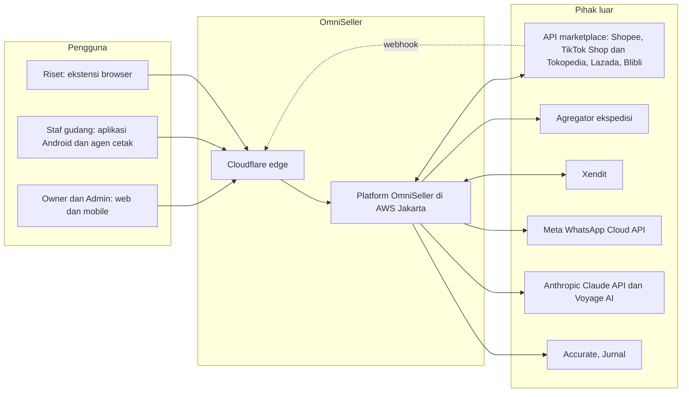
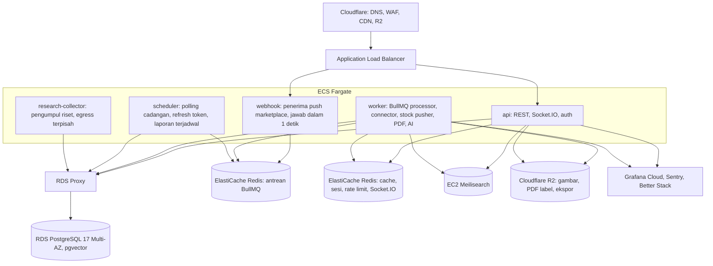
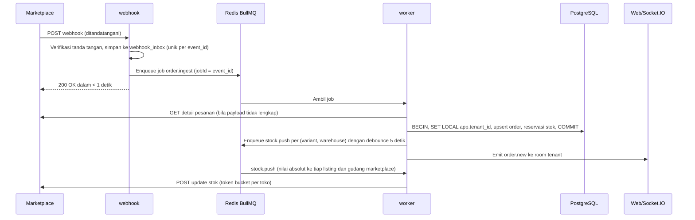

# OmniSeller — Dokumen Teknologi dan Arsitektur Teknis

| Item | Keterangan |
|---|---|
| Versi dokumen | 1.28 |
| Tanggal | 16 Oktober 2026 |
| Status | Keputusan final untuk implementasi |
| Pemilik dokumen | Candra Syahputra |
| Dokumen induk | DOKUMEN-SPESIFIKASI-APLIKASI.md versi 1.11 (PRD); rincian backend di DOKUMEN-ARSITEKTUR-BACKEND.md versi 1.42 |
| Audiens | Tech lead, engineer backend, frontend, mobile, DevOps, QA |

Dokumen ini menetapkan teknologi yang dipakai OmniSeller. Setiap lapisan memiliki **satu keputusan**, bukan daftar pilihan. Alasan dan konsekuensinya dicatat agar keputusan dapat ditinjau ulang dengan dasar yang jelas, bukan diganti karena selera. Perubahan keputusan hanya melalui ADR baru (bagian 25).

---

## Daftar Isi

1. [Ringkasan Keputusan](#1-ringkasan-keputusan)
2. [Prinsip yang Menentukan Pilihan](#2-prinsip-yang-menentukan-pilihan)
3. [Arsitektur Sistem](#3-arsitektur-sistem)
4. [Bahasa, Runtime, dan Monorepo](#4-bahasa-runtime-dan-monorepo)
5. [Backend](#5-backend)
6. [Basis Data](#6-basis-data)
7. [Antrean, Cache, dan Realtime](#7-antrean-cache-dan-realtime)
8. [Sync Engine dan Connector Marketplace](#8-sync-engine-dan-connector-marketplace)
9. [Frontend Web](#9-frontend-web)
10. [Aplikasi Mobile](#10-aplikasi-mobile)
11. [Ekstensi Browser](#11-ekstensi-browser)
12. [Agen Cetak Lokal](#12-agen-cetak-lokal)
13. [Layanan Pendukung](#13-layanan-pendukung)
14. [Kecerdasan Buatan](#14-kecerdasan-buatan)
15. [Pengumpul Data Riset](#15-pengumpul-data-riset)
16. [Infrastruktur](#16-infrastruktur)
17. [CI/CD dan Manajemen Rilis](#17-cicd-dan-manajemen-rilis)
18. [Observabilitas](#18-observabilitas)
19. [Keamanan](#19-keamanan)
20. [Perkakas Pengujian](#20-perkakas-pengujian)
21. [Standar Kode dan Konvensi](#21-standar-kode-dan-konvensi)
22. [Kapasitas, Performa, dan Skala](#22-kapasitas-performa-dan-skala)
23. [Estimasi Biaya](#23-estimasi-biaya)
24. [Tim dan Alat Kerja](#24-tim-dan-alat-kerja)
25. [Catatan Keputusan Arsitektur (ADR)](#25-catatan-keputusan-arsitektur-adr)
26. [Lampiran](#26-lampiran)

---

## 1. Ringkasan Keputusan

| Lapisan | Keputusan |
|---|---|
| Bahasa | TypeScript di seluruh sistem (backend, web, mobile, ekstensi, agen cetak) |
| Runtime backend | Node.js 24 LTS |
| Kerangka backend | NestJS 11, modular monolith, satu basis kode dijalankan sebagai lima peran proses: api, webhook, worker, scheduler, research-collector |
| API | REST versi `/v1`, OpenAPI 3.1 dihasilkan dari kode, validasi Zod |
| Basis data | PostgreSQL 17 di Amazon RDS Multi-AZ, kunci primer ULID (domain `ulid` di atas `text`), Row-Level Security per tenant, kunci asing komposit yang menyertakan tenant, partisi range bulanan pada ULID untuk tabel besar |
| ORM dan migrasi | Drizzle ORM untuk query bertipe; migrasi SQL tulisan tangan (berversi dan repeatable) dengan migrator sendiri (ADR-027) |
| Antrean pekerjaan | BullMQ 5 di atas Redis 7.2 (Amazon ElastiCache), instans terpisah dari cache |
| Cache dan rate limit | Redis 7.2 (instans kedua) |
| Realtime | Socket.IO dengan adapter Redis |
| Pencarian | Meilisearch |
| Penyimpanan objek | Cloudflare R2 |
| Frontend web | Next.js 16 (App Router), React 19, Tailwind CSS 4, shadcn/ui, TanStack Query, openapi-fetch dengan tipe dari OpenAPI backend, react-hook-form, Zod, Apache ECharts, next-intl; api di origin yang sama dengan cookie sesi (ADR-039) |
| Mobile | React Native dengan Expo, satu basis kode untuk aplikasi gudang (Android) dan aplikasi owner (Android dan iOS) |
| Ekstensi browser | WXT, Manifest V3, React, untuk Chrome dan Edge |
| Agen cetak lokal | Electron, Windows utama dan macOS sekunder, pembaruan otomatis |
| PDF | pdf-lib dengan Noto Sans untuk semua dokumen sekarang: gabung dan imposisi label marketplace, pick list, daftar kemas, strip template label kustom, label pesanan manual, label barcode, dan tagihan langganan; Playwright (Chromium headless) baru bila ada dokumen bertemplat HTML yang tata letaknya diatur penjual (ADR-038) |
| Email | Amazon SES lewat antarmuka SMTP (Nodemailer), dikirim hanya dari proses worker; templat transaksional berupa HTML dan teks di kode, React Email dipakai bila templat bertambah kompleks; Mailpit di lokal |
| WhatsApp | Meta WhatsApp Business Platform (Cloud API) langsung |
| Pembayaran langganan | Xendit Invoice API, satu tagihan per periode (virtual account, QRIS, e-wallet, kartu); pembayaran berulang otomatis menyusul (ADR-040) |
| Feature flag | Tabel internal dengan penargetan per tenant dan persentase, cache di Redis |
| AI generatif | Claude Opus 5 (`claude-opus-5`) untuk semua fitur yang dibaca pengguna; Claude Haiku 4.5 (`claude-haiku-4-5`) untuk ekstraksi massal via Message Batches API; SDK `@anthropic-ai/sdk` |
| Embedding dan pencarian vektor | Voyage AI (multimodal untuk gambar produk, teks untuk judul) disimpan di pgvector |
| Pengumpul riset | undici fetch dan Playwright, parser berversi, egress IP terpisah dari operasional |
| Cloud | AWS region Jakarta (ap-southeast-3): ECS on Fargate (ARM64 Graviton), RDS, ElastiCache, EC2 untuk Meilisearch, RDS Proxy, ALB, KMS, Secrets Manager |
| Edge | Cloudflare: DNS, CDN, WAF, rate limit, Turnstile, R2 |
| Infrastructure as Code | Terraform |
| CI/CD | GitHub Actions, Amazon ECR, deploy blue/green ECS melalui CodeDeploy dengan canary dan rollback otomatis |
| Observabilitas | OpenTelemetry ke Grafana Cloud (metrik, log, trace), Sentry untuk error, Better Stack untuk uptime, status page, dan on-call |
| Lint dan format | Biome |
| Pengujian | Vitest, Supertest, Testcontainers, Playwright, Maestro, k6, OWASP ZAP, Semgrep, Trivy |
| Manajemen paket dan repositori | pnpm 10 workspaces per komponen (`backend/`, `frontend/`, nanti `mobile/`); Turborepo tidak dipakai (ADR-032). Situs publik `website/` tanpa dependensi (ADR-041) |

---

## 2. Prinsip yang Menentukan Pilihan

1. **Satu bahasa, satu tim.** TypeScript di semua permukaan agar tipe data (produk, pesanan, stok) dibagikan antar backend, web, mobile, dan ekstensi. Tim kecil tidak perlu ahli di tiga bahasa.
2. **Modular monolith sebelum microservices.** Satu basis kode dengan batas modul yang tegas, dijalankan sebagai beberapa proses. Pemecahan menjadi layanan terpisah hanya bila ambang di bagian 22 tercapai.
3. **Layanan terkelola untuk yang bukan inti.** Basis data, antrean, cache, observabilitas, dan email memakai layanan terkelola. Waktu tim dihabiskan untuk connector dan logika stok, bukan mengurus server.
4. **Data residency di Indonesia.** Semua data tenant dan pembeli disimpan di region Jakarta. Layanan yang belum tersedia di Jakarta (dicatat eksplisit) hanya menerima data non-pribadi.
5. **Tahan terhadap marketplace.** Setiap panggilan keluar idempoten, dibatasi lajunya per toko, dapat diulang, dan dicatat. Kegagalan satu marketplace tidak menyentuh marketplace lain.
6. **Keamanan sejak skema.** Isolasi tenant ditegakkan oleh basis data (RLS), bukan hanya oleh kode aplikasi.
7. **Murah untuk memulai, jelas untuk membesar.** Biaya awal di bawah Rp20 juta per bulan dengan jalur skala yang sudah ditentukan.
8. **Tidak ada keputusan tanpa alasan tertulis.** Setiap keputusan penting dicatat sebagai ADR.

---

## 3. Arsitektur Sistem

### 3.1 Konteks sistem



### 3.2 Kontainer dan proses



Kelima proses dibangun dari satu image Docker dengan entrypoint berbeda. Modul NestJS yang dimuat per proses diatur lewat variabel lingkungan `APP_ROLE`.

### 3.3 Aliran utama: webhook pesanan ke label



---

## 4. Bahasa, Runtime, dan Monorepo

| Aspek | Keputusan |
|---|---|
| Bahasa | TypeScript 5.x, `strict: true`, `noUncheckedIndexedAccess: true` |
| Runtime | Node.js 24 LTS. Versi dikunci di `.nvmrc` dan `engines` |
| Manajemen paket | pnpm 10 dengan workspaces |
| Orkestrasi build | Skrip pnpm (`pnpm -r` dalam urutan dependensi). Turborepo tidak dipakai: workspace backend hanya berisi aplikasi dan paket kecil, sehingga cache lintas paket tidak sepadan dengan konfigurasinya (ADR-032) |
| Struktur | Satu repositori, satu folder per komponen: `backend/` dan `frontend/` sekarang, `mobile/`, `extension/`, `print-agent/` menyusul (lihat 26.1) |

**Alasan.** Tipe domain (Order, Variant, Inventory) didefinisikan sekali di `packages/shared` dan dipakai backend, web, mobile, ekstensi, dan agen cetak. Skema Zod yang sama memvalidasi input API dan formulir web. Perubahan kontrak API langsung terdeteksi oleh compiler di semua klien.

`packages/shared` berada di `backend/packages/shared` dan hanya dipakai backend. Web app (`frontend/`) memakai backend lewat kontraknya, dokumen OpenAPI `backend/openapi.json`: `pnpm api:types` menghasilkan tipe semua path, parameter, dan respons, sehingga perubahan kontrak terdeteksi `tsc` di web app (ADR-039). Mobile akan memakai cara yang sama.

**Konsekuensi.** Pekerjaan CPU-berat (render PDF ratusan halaman, parsing gambar) dipindahkan ke proses worker terpisah agar event loop proses api tidak terblokir.

---

## 5. Backend

### 5.1 Kerangka dan struktur

- **NestJS 11** sebagai kerangka. Alasan: struktur modul, dependency injection, dekorator untuk OpenAPI, ekosistem BullMQ dan Socket.IO yang matang, dan pola yang mudah dipelajari engineer baru.
- **Modular monolith.** Setiap modul PRD (produk, stok, pesanan, pengiriman, keuangan, chat, riset, dan seterusnya) menjadi modul NestJS dengan antarmuka publik yang sempit. Modul lain hanya memanggil service publik, tidak menyentuh tabel modul lain secara langsung.
- **Lima peran proses** dari satu image: `api`, `webhook`, `worker`, `scheduler`, dan `research-collector` yang memuat hanya modul riset. Setiap peran hanya menerima URL basis data untuk role yang boleh dipakainya.
- **Event internal** memakai pola transactional outbox: service menulis `outbox_event` dalam transaksi yang sama dengan perubahan data, relay di proses `scheduler` memindahkannya ke BullMQ. Aturan: setiap efek samping ke sistem luar (marketplace, email, WhatsApp, AI) selalu lewat outbox dan BullMQ, tidak pernah langsung dari request handler. Rincian di DOKUMEN-ARSITEKTUR-BACKEND.md bagian 8.5.

### 5.2 API

| Aspek | Keputusan |
|---|---|
| Gaya | REST, prefix `/v1`. Versi baru hanya saat perubahan yang memutus kompatibilitas |
| Dokumentasi | OpenAPI 3.1 dihasilkan dari dekorator `@nestjs/swagger`, dipublikasikan di `/docs` untuk staging dan API publik |
| Validasi | Zod melalui `nestjs-zod`. Skema yang sama dipakai frontend |
| Format error | RFC 9457 Problem Details: `type`, `title`, `status`, `detail`, `instance`, ditambah `code` internal dan `errors[]` per field |
| Paginasi | Cursor-based (`cursor`, `limit` maksimal 200). Tidak ada offset untuk tabel besar |
| Filter dan urutan | Query string dengan whitelist field per endpoint |
| Idempotensi tulis | Header `Idempotency-Key` wajib untuk POST yang memicu efek luar (proses pesanan, cetak, ubah harga). Kunci disimpan 24 jam di Redis |
| Rate limit | Per tenant dan per pengguna di Redis (token bucket): 600 permintaan per menit per tenant untuk UI, 120 untuk API publik |
| Realtime | Socket.IO di proses api, room per tenant, adapter Redis |
| API publik (Fase 4) | Endpoint yang sama dengan autentikasi API key dan webhook keluar bertanda tangan HMAC |

### 5.3 Autentikasi dan otorisasi

| Aspek | Keputusan |
|---|---|
| Kata sandi | Argon2id (memori 64 MB, iterasi 3, paralelisme 4) |
| Sesi web | Token sesi acak 256 bit disimpan di Redis, cookie `HttpOnly; Secure; SameSite=Lax`, masa hidup 30 hari geser, batas 10 sesi per pengguna |
| Mobile dan ekstensi | Access token opaque 1 jam dan refresh token 90 hari dengan rotasi, disimpan di secure storage perangkat |
| 2FA | TOTP (`otplib` 13: SHA-1, 6 angka, 30 detik) sebagai langkah kedua login, tersedia untuk semua pengguna dan dianjurkan untuk Owner dan Admin; wajib untuk Owner dan Admin mulai Fase 2. Kode cadangan 10 buah, sekali pakai, disimpan sebagai HMAC. Rahasia TOTP disegel dengan `TOTP_ENCRYPTION_KEY` milik api (bukan DEK tenant: api tidak memegang KMS). Kode tidak bisa dipakai ulang, dan kode salah ikut penguncian akun. Passkey WebAuthn di Fase 4 (DOKUMEN-ARSITEKTUR-BACKEND 8.30) |
| Agen cetak | Token perangkat yang dibuat dari UI, dapat dicabut per perangkat |
| API publik | API key dengan prefix `os_live_`, hash disimpan, scope per key |
| RBAC | Izin berbentuk string `modul:aksi` (misalnya `order:ship`), peran adalah kumpulan izin. Guard NestJS memeriksa izin; izin dan cakupan toko dan gudang dimuat ulang dari basis data setiap permintaan, bukan disimpan di sesi (ADR-033) |
| Undangan dan atur ulang sandi | Token acak 256 bit, hanya hash yang disimpan, dibuat oleh worker saat email dikirim sehingga token mentah tidak pernah ada di basis data atau outbox. Undangan 72 jam (kirim ulang membatalkan tautan lama), atur ulang sandi 60 menit, sekali pakai |
| Penguncian dan batas laju | 5 kali gagal mengunci akun 15 menit; akun terkunci ditolak sebelum sandi diperiksa. Token bucket di Redis per IP, per email, dan per tenant (rincian di DOKUMEN-ARSITEKTUR-BACKEND 8.10) |

Autentikasi ditulis sendiri di NestJS. Alasan: kebutuhan (organisasi, peran per toko dan gudang, token perangkat, API key) spesifik dan sederhana, dan ketergantungan pada penyedia identitas luar menambah biaya dan risiko vendor tanpa manfaat yang sebanding.

### 5.4 Multi-tenant

- Setiap tabel memiliki kolom `tenant_id ulid NOT NULL` (domain di atas `text COLLATE "C"`, ADR-023), dan setiap kunci asing ke tabel milik tenant adalah komposit `(tenant_id, x_id)` sehingga relasi lintas tenant mustahil di tingkat basis data.
- Guard autentikasi membentuk konteks tenant dari sesi, lalu setiap transaksi memanggil `set_config('app.tenant_id', $1, true)` (setara `SET LOCAL` dengan parameter terikat).
- Empat role basis data: `omniseller_api` (RLS, tidak dapat membaca token), `omniseller_worker` (RLS, dapat membaca token), `omniseller_system` (`BYPASSRLS`, hanya job lintas tenant di scheduler), `omniseller_migrator` (DDL). Tidak ada proses yang memakai superuser.
- Kebijakan RLS pada semua tabel (contoh di 26.3). Query tanpa tenant di sesi mengembalikan nol baris, bukan semua baris.
- Uji otomatis isolasi tenant dijalankan di CI untuk setiap endpoint (lihat PRD 13.3).

### 5.5 Konfigurasi

- Semua konfigurasi dari variabel lingkungan, divalidasi Zod saat proses mulai. Proses gagal cepat bila ada yang kurang.
- Rahasia diambil dari AWS Secrets Manager saat mulai dan disuntik sebagai variabel lingkungan oleh ECS.
- Daftar variabel di 26.2.

---

## 6. Basis Data

### 6.1 Mesin dan penyimpanan

| Aspek | Keputusan |
|---|---|
| Mesin | PostgreSQL 17 di Amazon RDS, Multi-AZ, instance Graviton (`db.m7g`) |
| Koneksi | RDS Proxy dengan pooling transaksi. Aman karena tenant ditetapkan dengan `SET LOCAL` dalam transaksi |
| Ekstensi | `pgvector` (embedding), `pg_stat_statements`, `pgcrypto`, `citext`, `pg_trgm` (saran pemetaan listing ke produk berdasarkan kemiripan nama) |
| Kunci primer | ULID (26 karakter Crockford base32) sebagai domain `ulid` di atas `text COLLATE "C"` dengan pemeriksaan format, dibuat di aplikasi dengan generator monotonik. Terurut waktu, dapat dibaca manusia, ramah indeks B-tree, dan memungkinkan partisi range pada `id`. `text`, bukan `char(26)`, agar perbandingan dengan `current_setting()` di predikat RLS tetap memakai indeks |
| Uang | `bigint` dalam rupiah utuh. Tidak ada `numeric` dengan desimal dan tidak ada `float` |
| Waktu | `timestamptz`, selalu UTC di basis data, dikonversi ke zona waktu tenant di lapisan tampilan |
| Teks bebas | `text` dengan batas panjang di Zod, bukan `varchar(n)` |
| Enum | Tabel referensi atau `text` dengan constraint `CHECK`, bukan tipe enum PostgreSQL, agar penambahan nilai tidak butuh migrasi berat |

### 6.2 Partisi

Tabel bervolume tinggi dipartisi **range pada kolom `id`** (ULID terurut waktu) dengan batas bulanan yang dihitung dari prefiks waktu ULID. Kunci primer tetap `(id)` dan kunci asing ke tabel terpartisi merujuk `(tenant_id, id)`. Partisi dibuat dan dilepas oleh job `partition-maintenance` di proses scheduler (rincian di DOKUMEN-ARSITEKTUR-BACKEND.md 7.6 dan 17.5):

| Tabel | Kunci partisi | Interval | Retensi aktif |
|---|---|---|---|
| `order`, `order_item`, `order_event` | `id` | Bulanan | 24 bulan aktif, lalu diarsipkan ke R2 (Parquet) |
| `stock_movement` | `id` | Bulanan | 24 bulan |
| `sync_job` | `id` | Bulanan | 90 hari |
| `audit_log` | `id` | Bulanan | 12 bulan aktif, ekspor bulanan ke R2 dengan object lock |
| `ai_call_log` | `id` | Bulanan | 12 bulan |
| `research.research_snapshot` | `id` | Bulanan | 90 hari mentah, diringkas ke `research_daily` selama 24 bulan |

`webhook_inbox` (retensi 30 hari) dan `outbox_event` (7 hari setelah terkirim) tidak dipartisi karena batasan uniknya harus berlaku lintas waktu; retensinya lewat hapus batch harian.

### 6.3 ORM dan migrasi

- **Drizzle ORM.** Alasan: dekat dengan SQL sehingga query rumit (rekonsiliasi, laporan) tidak dipaksa lewat abstraksi, mendukung definisi kebijakan RLS di skema, ringan, dan tipe hasil query mengikuti skema.
- **Migrasi SQL tulisan tangan** (ADR-027). Partisi range pada ULID, FK komposit dengan `SET NULL (kolom)`, RLS, grant per role, trigger, dan fungsi `SECURITY DEFINER` tidak dapat dinyatakan di skema Drizzle, sehingga SQL yang ditinjau di PR menjadi sumber kebenaran dan skema Drizzle menjadi cerminnya; uji skema menjaga keduanya sama. Migrator sendiri menjalankan file berversi sekali (dengan checksum) dan file repeatable (fungsi, trigger, kebijakan, grant, seed) setiap kali. Rincian di DOKUMEN-ARSITEKTUR-BACKEND.md bagian 12.
- Pola **expand and contract**: rilis N menambah kolom atau tabel, aplikasi menulis ke keduanya, rilis N+1 menghapus yang lama. Tidak pernah ada `DROP` atau `ALTER TYPE` destruktif dalam rilis yang sama dengan perubahan kode.
- Migrasi dijalankan sebagai tugas ECS satu kali sebelum deploy aplikasi, dan gagal berarti deploy berhenti.

### 6.4 Indeks dan performa

- Setiap tabel: indeks komposit yang diawali `tenant_id` untuk pola akses utama.
- `order`: `(tenant_id, status, deadline_ship_at)`, `(tenant_id, store_id, external_order_id)` unik, `(tenant_id, tracking_number)`.
- `inventory`: kunci primer `id` ULID dengan UNIQUE `(tenant_id, variant_id, warehouse_id)`.
- `research_snapshot`: `(research_item_id, captured_at DESC)`.
- Pencarian teks bebas produk dan pesanan tidak memakai `LIKE`, melainkan Meilisearch (bagian 13).
- Read replica ditambahkan saat ambang di bagian 22 tercapai. Laporan berat membaca dari replika.

### 6.5 Backup dan pemulihan

- Snapshot otomatis RDS harian, retensi 30 hari, point-in-time recovery aktif (granularitas 5 menit).
- Salinan snapshot mingguan ke ap-southeast-1 (Singapura) terenkripsi, untuk pemulihan bencana region.
- Uji pemulihan penuh ke lingkungan sementara setiap kuartal, dicatat waktunya. Target RTO 4 jam, RPO 1 jam (aktual PITR jauh lebih baik).

---

## 7. Antrean, Cache, dan Realtime

### 7.1 Antrean pekerjaan

- **BullMQ** di atas **Redis 7.2** (ElastiCache) instans khusus antrean dengan persistensi AOF.
- Antrean dipisah per jenis dan prioritas:

| Antrean | Isi | Konkurensi per worker | Percobaan ulang |
|---|---|---|---|
| `webhook` | Notifikasi marketplace yang sudah tersimpan di `webhook_inbox`, satu job per baris | 20 | 5 kali, backoff eksponensial mulai 2 detik |
| `order.ingest` | Pekerjaan pesanan yang dipicu event: listing baru dipetakan, stok berubah (pesanan dari webhook dibaca di antrean `webhook`, polling dan impor di `mp.poll`) | 20 | 5 kali, backoff eksponensial mulai 2 detik |
| `stock.push` | Dorong stok per batch (paling banyak 50 pasangan variant dan gudang satu tenant), penanda dirty, dan pemicu push ulang | 10 per worker; batas laju per toko diambil per permintaan HTTP | 8 kali, backoff eksponensial mulai 5 detik (sampai sekitar 10 menit) |
| `mp.outbound` | Panggilan tulis ke marketplace (terima pesanan, atur kirim, ubah harga) | Dibatasi per toko | 5 kali |
| `mp.poll` | Polling cadangan | 5 | 3 kali |
| `mp.track` | Pelacakan paket dari marketplace: bacaan latar yang memakai paling banyak 30% batas laju toko dan boleh menunggu lebih lama, terpisah agar tidak menahan tarik pesanan | 2 | 3 kali, backoff eksponensial mulai 30 detik |
| `pdf` | Gabung dan render PDF | 4 (CPU-berat) | 3 kali |
| `notify` | Email, WhatsApp, in-app | 20 | 5 kali |
| `ai` | Panggilan Claude dan embedding | 5 | 3 kali |
| `research` | Pengumpulan dan parsing riset | 5 per domain | 2 kali |
| `settlement` | Tarik dan rekonsiliasi settlement | 2 | 3 kali |
| `export` | Ekspor data penuh tenant: CSV dari satu snapshot basis data, digabung ZIP, diunggah ke R2 | 1 (satu transaksi snapshot dan direktori sementara per job) | 1 kali; permintaan berikutnya membuat ekspor baru |
| `billing` | Langganan: baris uji coba, membuat dan menutup halaman bayar di Xendit, callback Xendit, perpanjangan per jam (backend 8.32) | 2 | Buat tagihan 8 kali, backoff eksponensial mulai 10 detik (penolakan 4xx langsung `failed`, diminta lagi job perpanjangan setelah 6 jam); callback 5 kali |
| `import` | Validasi dan impor berkas migrasi dari aplikasi lain (sampai 10.000 baris dalam satu transaksi); penghapusan data toko yang diputus tanpa menyimpan data (transaksi pendek per batch, 20 detik per job lalu dilanjutkan); penerapan stok opname yang disetujui (500 baris per transaksi, 10.000 baris per job lalu dilanjutkan) | 2 | Impor 1 kali, penjual memvalidasi atau mengimpor ulang; penghapusan dan penerapan opname 5 kali dengan backoff (baris yang sudah diterapkan dilewati) |

- Konkurensi di tabel ini berlaku per proses worker (`QUEUE_CONCURRENCY` di `backend/src/jobs/queues.ts`).
- `jobId` selalu berupa kunci idempoten dengan pemisah `|` (misalnya `order.ingest|{store_id}|{event_id}`), sehingga pekerjaan ganda ditolak oleh BullMQ. BullMQ 5 menolak id kustom yang mengandung `:`. Aksi yang sah berulang untuk entitas yang sama (dorongan stok, dorongan harga) menyertakan kunci kejadian di id-nya, karena BullMQ juga menolak id milik job yang sudah selesai tetapi masih disimpan (`removeOnComplete` satu jam).
- Job gagal disimpan di daftar `failed` antrean asal BullMQ selama tujuh hari (ADR-042). CLI `jobs:dlq` menampilkan metadata, `jobs:retry` mengulang di antrean yang sama tanpa menyalin atau menghapus payload. UI admin internal dan alarm kegagalan masih menyusul.
- **Token bucket per toko** diimplementasikan dengan skrip Lua di Redis (atomik), kapasitas dan laju isi ulang dibaca dari konfigurasi connector. Token diambil untuk **setiap permintaan HTTP** connector, bukan per job, karena satu job bisa ratusan panggilan (tarik katalog). Permintaan yang menunggu lebih dari 30 detik gagal sementara dan job diulang dengan backoff. **Pekerjaan latar** (pelacakan paket) juga mengambil token dari bucket kedua per toko sebesar 30% laju toko, sehingga push stok dan pekerjaan pesanan selalu punya sisa; pekerjaan latar boleh menunggu sampai 2 menit.
- **Debounce stok**: perubahan stok dicatat ke sorted set Redis dengan skor waktu; scheduler memicu `stock.push` untuk kunci yang sudah diam 5 detik dengan id job yang menyertakan skor, lalu menghapus kunci hanya bila skornya belum berubah (skrip Lua). Nilai yang dikirim selalu hasil hitung ulang saat job berjalan, bukan nilai saat event.

### 7.2 Cache

- Redis 7.2 instans kedua (tanpa persistensi) untuk: sesi, rate limit, kunci idempotensi, cache konfigurasi tenant, cache feature flag, hasil hitung dasbor (TTL 30 detik), adapter Socket.IO.
- Pemisahan dari instans antrean agar kegagalan atau evict cache tidak pernah menghilangkan pekerjaan.

### 7.3 Realtime

- Socket.IO di proses api dengan `@socket.io/redis-adapter`. Room per tenant dan per pengguna.
- Event yang dikirim: `order.new`, `order.updated`, `sync.status`, `print.job`, `campaign.live_stats`, `notification`.
- Agen cetak dan aplikasi gudang berlangganan lewat WebSocket yang sama dengan token perangkat.
- Implementasi (backend 8.24):
  - **Server.** `socket.io` 4.8.4 dipasang ke server HTTP Nest oleh provider di proses api (path `/socket.io`), tanpa `@nestjs/websockets`. Proyek memakai NestJS 11, sedangkan rilis terbaru paket itu untuk Nest 12, dan sejauh ini server hanya mendorong.
  - **Mendorong dari proses lain.** Adapter `@socket.io/redis-adapter` 8.3.0 di Redis cache. Worker dan proses lain mendorong lewat `@socket.io/redis-emitter` 5.1.0 di kanal yang sama, dengan publish yang kegagalannya dicatat, tidak menjatuhkan proses.
  - **Agen cetak.** Room `device:<id>`; event `print.job` dan `print.cancelled`. Agen tersambung dengan transport WebSocket saja, karena polling HTTP butuh sticky session di ALB.
  - **Pengiriman tidak dijamin.** Agen membaca daftar pekerjaannya lewat REST setelah tersambung dan setiap menit.

---

## 8. Sync Engine dan Connector Marketplace

### 8.1 Antarmuka connector

Perubahan harga reguler kini mempunyai alur aplikasi per listing untuk kedua marketplace (ADR-045): outbox/worker, pemeriksaan harga sebelum tulis, konfirmasi ulang, modal Rupiah, riwayat, audit/ekspor dan isolasi tenant. Backoff harga memperhitungkan retry hint/lease; harga yang telah diterima tidak dapat dibatalkan sebagai antrean yang belum terkirim. Sebelum membuat listing baru, worker juga membaca aturan kategori terkini dan memvalidasi atribut wajib, termasuk Imported Goods Indonesia; draf lama tidak mengandalkan cache tujuh hari saat publish. Validasi live masih membutuhkan kredensial/scope.

Cakupan Tokopedia & Shop dijelaskan dalam [audit integrasi resmi](AUDIT-INTEGRASI-TIKTOKSHOP.md) dan [inventaris method/path per versi](AUDIT-TIKTOKSHOP-ENDPOINTS.csv), diambil 16 Oktober 2026 UTC. Katalog publik mempunyai 317 operasi API Reference; referensi connector dan alur aplikasi belum mencakup seluruh operasi. Dua endpoint token ada di panduan otorisasi. Scope, market, principal, versi dan sandbox harus dinilai terpisah. Audit mencatat celah App Store, Finance/Promotion/Analytics/Customer Service/Affiliate, serta perubahan Imported Goods dan Horizon+ Indonesia; ini bukan penambahan kemampuan aplikasi.

Cakupan Shopee dipetakan dalam [audit integrasi](AUDIT-INTEGRASI-SHOPEE.md) dan [inventaris endpoint](AUDIT-SHOPEE-ENDPOINTS.csv). Snapshot sekunder 15 Mei 2026 memuat 428 endpoint/28 modul dan 48 panduan; 46 endpoint memiliki referensi kode. Angka ini bukan persentase fitur lengkap atau bukti sandbox, dan snapshot bukan katalog resmi terkini. Portal resmi belum dapat diakses dari lingkungan audit (HTTP 403). Alur baca AMS kini memiliki service/job/API/cache/UI `/affiliate`, izin `affiliate:read`, pagination dan modal komisi/periode (ADR-044/046, backend 8.38). Izin aplikasi AMS, aktivasi toko, kontrak terbaru dan sandbox tetap perlu diverifikasi; koneksi creator/partner Indonesia ditambahkan melalui principal terpisah (ADR-047), tanpa mengklaim seluruh operasi affiliate.

Setiap marketplace adalah paket di `packages/connectors/<nama>` yang mengimplementasikan satu antarmuka yang sama (26.4). Logika inti tidak pernah mengimpor detail marketplace. Menambah marketplace berarti menambah paket, bukan mengubah inti.

| Connector | Paket | Catatan implementasi |
|---|---|---|
| Shopee | `@omniseller/connector-shopee` (ada: otorisasi, info toko, gudang, push, katalog, stok, pesanan, logistik, salin produk, retur) | Open Platform v2. Tanda tangan HMAC-SHA256 dengan partner key atas `partner_id + path + timestamp [+ access_token + shop_id]`, cap waktu berlaku 5 menit. Tautan otorisasi baru `open.shopee.com/auth` dengan `state`. Access token 4 jam; refresh token 30 hari, sekali pakai per toko; izin seller maksimal 365 hari; akun utama bisa memberi beberapa toko sekaligus. Push diatur per aplikasi, ditandatangani HMAC atas `URL callback + "|" + body`; kode 6, 16, 22 untuk perubahan item. Katalog: `get_item_list` (100 per halaman, `item_status` dikirim berulang per nilai), `get_item_base_info` (50 item), `get_model_list`, `unlist_item` (50 item, hasil per item). Stok: `update_stock` satu item per panggilan dengan 1 sampai 50 model, hanya `seller_stock`; `location_id` harus mengikuti struktur stok item yang sudah ada (dengan atau tanpa lokasi); `failure_list` per model bisa datang bersama `error` tingkat atas; stok di bawah cadangan promosi dan item terhapus ditolak per model. Pesanan: `get_order_list` paling lama 15 hari per permintaan dan 100 per halaman dengan cursor, `request_order_status_pending` untuk status PENDING; `get_order_detail` 50 pesanan, gudang per baris dari `product_location_id` (toko multi-gudang), jumlah aktif dan batal per baris; `cancel_order` sebelum dikirim dengan alasan `OUT_OF_STOCK` (menyebut item), `CUSTOMER_REQUEST`, `COD_NOT_SUPPORTED`. Logistik (berbasis paket, `package_list` di detail pesanan): `get_mass_shipping_parameter` dan `mass_ship_order` paling banyak 50 paket satu kanal logistik dan satu gudang (`product_location_id`), pickup dengan `address_id` dan `pickup_time_id` (slot bertanda `recommended`, alamat `current_address` untuk multi-gudang) atau drop-off tanpa isian; `ship_order` untuk pesanan tanpa nomor paket; `update_shipping_order` untuk pickup ulang (`LOGISTICS_PICKUP_RETRY`); `batch_ship_order` hanya untuk satu kanal Brasil. Resi dari `get_mass_tracking_number` bisa kosong beberapa menit (push kode 4 memberi tahu); label lewat `get_shipping_document_parameter`, `create_shipping_document` (butuh resi), `get_shipping_document_result`, `download_shipping_document` (PDF, satu kurir per unduhan; push kode 15 saat siap), hanya setelah diatur dan sebelum dijemput. Status paket mengikuti PackageFulfillmentStatus (`LOGISTICS_READY`, `LOGISTICS_REQUEST_CREATED`, `LOGISTICS_PICKUP_DONE`, ...). Modul yang belum lengkap: aturan harga otomatis/massal, pembayaran, promosi, account health, chat, media dan ads. Retur: `v2.returns.get_return_list` per jendela 15 hari (100 per halaman, tanpa push; pesanan TO_RETURN memicu tarikan), `get_return_detail`, `confirm`, `dispute` dengan `dispute_reason_id` dari `get_return_dispute_reason`, gambar per modul bukti dari `convert_image`, dan email kontak; permintaan batal pembeli adalah pesanan IN_CANCEL, dijawab `v2.order.handle_buyer_cancellation`. Email dan alamat penjemputan pembeli dalam jawaban retur tidak dibaca. |
| TikTok Shop dan Tokopedia | `@omniseller/connector-tiktokshop` (ada: otorisasi, toko, gudang termasuk FBT, webhook, katalog, stok, pesanan, fulfillment, salin produk, retur) | Satu connector untuk kedua toko: di Indonesia keduanya satu toko "Tokopedia & Shop" dengan TikTok Shop API, dan merek "TikTok" tidak boleh tampil di antarmuka pihak ketiga. API versi 202309: token di header `x-tts-access-token`, tanda tangan HMAC-SHA256 atas `secret + path + parameter terurut + body + secret`, `shop_cipher` untuk panggilan toko. Access token 7 hari; masa refresh token sama dengan masa izin seller. Webhook berlangganan per toko lewat Event API, ditandatangani HMAC atas `app_key + body`. Katalog: Search Products 202502 lalu Get Product 202309 per produk; satu produk bisa dijual di TikTok Shop dan Tokopedia dengan status masing-masing (`integrated_platform_statuses`); Activate/Deactivate 20 per panggilan berlaku untuk kedua platform. Id produk 19 digit melebihi presisi `number` JavaScript, sehingga JSON diurai dengan `parseJsonSafe` yang menyimpan bilangan bulat besar sebagai string. Stok: Update Inventory 202309 satu produk per panggilan; semua gudang setiap SKU wajib disertakan (12019028 bila kurang); kuantitas paling banyak 99.999 (dokumentasi menulis rentang 1 sampai 99.999, tetapi 0 tetap dikirim untuk stok habis seperti di Seller Center, dan penolakannya tercatat per SKU); gudang FBT dan Dilayani Tokopedia tidak bisa diubah; galat per SKU dan gudang ada di `data.errors` walaupun `code` 0. Webhook Inventory Changed By Shop (tipe 71) tersedia untuk mendeteksi perubahan stok di luar OmniSeller (FR-MIG-07, menyusul). Pesanan: Search Orders 202309 mengembalikan pesanan lengkap, Get Order Detail kini versi 202507 (50 pesanan), satu baris per unit sehingga dikelompokkan per SKU, `commerce_platform` membedakan TikTok Shop dan Tokopedia, `fulfillment_type` FBT dan Dilayani Tokopedia, alamat disembunyikan saat UNPAID dan ON_HOLD; Cancel Order versi 202602 dengan alasan per status (daftar Indonesia); webhook tipe 1, 3, 4 (paket digabung atau dipecah, semua pesanan di paket), dan 11 membuat pesanan dibaca ulang. Fulfillment untuk Asia Tenggara memakai "schedule shipping": paket per baris pesanan (`package_id`, `package_status` TO_FULFILL, PROCESSING, FULFILLING, COMPLETED, CANCELLED), Get Package Handover Time Slots (`can_pickup`, `can_drop_off`, slot), Ship Package 202309 dengan `PICKUP` beserta slot atau `DROP_OFF`; `shipping_type = SELLER` (kurir sendiri) butuh resi penjual. Label lewat Get Package Shipping Document 202309 (`SHIPPING_LABEL`, A6 atau A5, PDF): URL berlaku 24 jam. Dokumen Batch Ship Packages tidak bisa dibaca dari portal saat implementasi, sehingga paket dikirim satu per satu. Modul berikutnya: harga produk, keuangan, retur, promosi, affiliate, analytics, layanan pelanggan Retur: Search Returns dan Search Cancellations (202602, page_size 10 sampai 50), Get Return Records (foto dan video pembeli), Get Decision Eligibility (202601; keputusan yang boleh dan alasan tolak, wajib untuk SEA), Approve Return (202309), Reject Return (202606), Approve dan Reject Cancellation (202309), semuanya dengan `idempotency_key`; foto bukti lewat Upload Product Image (`DESCRIPTION_IMAGE`); webhook tipe 12 status retur. Permintaan yang tidak dijawab diputuskan TikTok Shop. |
| Lazada | `@omniseller/connector-lazada` | LazOP 2.0, Lazada Push |
| Blibli | `@omniseller/connector-blibli` | Seller API dan webhook |
| Shopify, WooCommerce | `@omniseller/connector-shopify`, `-woocommerce` | Fase 2 |
| Agregator ekspedisi | `@omniseller/connector-shipping-*` | Untuk pesanan manual dan tautan |

### 8.2 Aturan yang berlaku untuk semua connector

- Semua respons API disimpan mentah (payload) ke `sync_job` untuk debugging, dengan retensi 90 hari dan penyamaran field pribadi pembeli sebelum disimpan.
- Setiap connector mendeklarasikan batas laju per toko dan per partner. Nilai dibaca dari konfigurasi, bukan ditulis mati.
- Error diklasifikasikan: `Transient` (jaringan, 429, 5xx) diulang; `AuthExpired` memicu refresh token lalu ulang sekali; `AuthRevoked` (izin dicabut atau habis, toko dibekukan) membuat toko perlu diotorisasi ulang; `Permanent` (400, data tidak valid) dilaporkan ke pengguna tanpa ulang.
- Pemetaan status pesanan per marketplace berada di tabel konfigurasi connector, bukan di kode inti.
- Uji kontrak: setiap metode memiliki fixture respons nyata (teranonimkan) dan dijalankan terhadap sandbox setiap hari (PRD 13.3).

### 8.3 Webhook receiver

- Proses `webhook` hanya melakukan: verifikasi tanda tangan atas body mentah, tulis ke `webhook_inbox` dengan constraint unik `(source, event_id)`, enqueue, balas 200 dengan body kosong. Tidak ada logika bisnis, tidak ada panggilan keluar. Target p95 di bawah 200 milidetik; Shopee menghitung gagal bila tidak dijawab dalam 3 detik.
- Satu baris inbox per (notifikasi, toko), dirutekan ke tenant lewat fungsi `resolve_store`. Notifikasi untuk toko yang belum terhubung disimpan tanpa tenant dan dirutekan ulang oleh scheduler bila tokonya terhubung dalam 15 menit. Tanda tangan salah dijawab 401 tanpa disimpan.
- Bila Redis tidak tersedia, receiver tetap menulis ke `webhook_inbox` dan membalas 200. Scheduler mengambil baris yang belum diproses setiap 30 detik. Tidak ada webhook yang hilang karena antrean mati.

### 8.4 Siklus token

- Token disimpan terenkripsi (bagian 19.3). Hanya proses worker dan scheduler yang memiliki hak dekripsi.
- Scheduler memeriksa setiap 15 menit dan memperbarui token yang melewati 80% masa hidupnya. Untuk Shopee (4 jam) berarti sekitar setiap 3 jam per toko; untuk TikTok Shop (7 hari) sekitar setiap 5,6 hari.
- Refresh dikunci per toko dengan advisory lock PostgreSQL yang dipegang di luar transaksi, lalu masa berlaku diperiksa ulang sesudah kunci didapat (ADR-034). Refresh token Shopee hanya bisa dipakai sekali per toko dan TikTok Shop merotasinya, jadi dua refresh bersamaan akan mematikan koneksi.
- Toko berstatus "token hampir kedaluwarsa" 14 hari sebelum izin seller berakhir, atau saat marketplace mengirim pemberitahuan (Shopee 7 hari sebelumnya, TikTok Shop 30 hari sebelumnya lalu setiap hari).
- Kegagalan refresh tiga kali berturut menandai toko `reauth_required` dan mengirim notifikasi.

### 8.5 Polling cadangan

- Scheduler memakai BullMQ repeatable jobs: pesanan setiap 5 menit per toko, produk setiap 6 jam, settlement harian pukul 03.00 WIB, gudang marketplace setiap 6 jam.
- Polling memakai cursor `updated_since` per toko yang disimpan di basis data (`sync_cursor`), sehingga tidak ada jendela yang terlewat saat proses mati. Cursor dimajukan ke waktu mulai tarikan hanya setelah tarikan selesai, dan tarikan berikutnya mundur 10 menit untuk menutup selisih jam.
- Tarikan besar dipecah: maksimal 10 halaman listing atau 5 halaman pesanan per job, sisanya dilanjutkan job baru lewat outbox, sehingga restart hanya mengulang satu batch.
- Toko baru mengimpor pesanan 90 hari terakhir; polling pesanan setiap 5 menit membaca pesanan yang berubah sejak tarikan terakhir dan menangkap webhook yang terlewat.

---

## 9. Frontend Web

| Aspek | Keputusan |
|---|---|
| Kerangka | Next.js 16 (App Router, Turbopack, `proxy.ts`) dengan React 19, di folder `frontend/` sebagai workspace pnpm sendiri (ADR-039) |
| Rendering | Kerangka halaman dirender statis; data penjual diambil di browser dengan TanStack Query dari api di origin yang sama. Server Next tidak memegang data tenant dan tidak meneruskan cookie ke api, jadi tidak ada SSR data (ADR-039). Ringkasan pesanan dan notifikasi dipolling setiap 60 detik; Socket.IO ditambahkan bersama layar realtime pertama |
| Sesi | Cookie `os_session` (HttpOnly, SameSite=Lax) dari api. Web app memanggil `/v1/*` di origin-nya sendiri (ALB di produksi, rewrites Next ke `API_ORIGIN` di lokal), tanpa CORS dan tanpa token di JavaScript. `proxy.ts` mengalihkan halaman aplikasi tanpa cookie ke `/masuk?next=`; jawaban 401 api juga |
| Styling | Tailwind CSS 4 dengan token DOKUMEN-UI-UX di `globals.css` (terang dan gelap; gelap pilihan pengguna lewat next-themes). Komponen shadcn/ui (Radix) disalin ke `frontend/src/components/ui` dan disesuaikan (ADR-039) |
| Data | TanStack Query 5 untuk semua akses API lewat openapi-fetch; tipe dihasilkan dari `backend/openapi.json` (`pnpm api:types`, openapi-typescript). `unwrap` mengubah Problem Details menjadi `ApiError`, sehingga layar hanya menangani bentuk sukses |
| Tabel | Tabel shadcn dengan pagination kursor 50 baris ("Muat lebih banyak"), menjadi kartu di ponsel. TanStack Table dan virtualisasi (`@tanstack/react-virtual`) dipasang saat sebuah layar butuh ribuan baris sekaligus atau kolom yang diatur pengguna |
| Formulir | react-hook-form dan Zod 4. Skema formulir ditulis di web app dengan pesan Bahasa Indonesia; kesalahan 422 api (`errors[].path`) ditempatkan di bawah field-nya. Validasi api tetap penentu |
| State lokal | Filter daftar di URL (bisa dibagikan dan ditautkan dari notifikasi), pilihan massal di state komponen. Zustand belum dipakai dan hanya untuk state UI lintas komponen; tidak ada state server di luar TanStack Query |
| Grafik | Apache ECharts 6 melalui `echarts-for-react` dengan impor `echarts/core` per bagian. Alasan: render canvas untuk riwayat harga ribuan titik dan dasbor padat. Warna dari token CSS; setiap kanal memegang slot warnanya |
| i18n | `next-intl` tanpa rute per bahasa; teks di `messages/id.json`, kuncinya dicek tipe. `en` menyusul bila dibutuhkan |
| Waktu | `Intl.DateTimeFormat` dengan zona waktu bisnis (`tenant.timezone` dari `GET /v1/me`), tidak pernah zona browser. Luxon ditambahkan bila perlu aritmetika tanggal per zona |
| Cetak dari browser | Tidak ada. Semua cetak lewat PDF dari server atau agen cetak lokal; label dibuka dari `GET /v1/files/{id}/download` |
| Hosting | Container Node (`next start`) di ECS, bukan platform Vercel, agar data dan log tetap di Jakarta dan satu jalur deploy. ALB meneruskan `/v1/*` ke api dan sisanya ke web |
| Pengujian | Vitest, Testing Library, dan jsdom untuk unit dan komponen; api dijawab di level `fetch` dan `next/navigation` diganti tiruan di memori. End-to-end di bagian 20 |
| Aksesibilitas | Komponen Radix memberi dasar keyboard dan ARIA; status selalu ikon, teks, dan warna; kontras diuji otomatis dengan axe di Playwright |

---

## 10. Aplikasi Mobile

| Aspek | Keputusan |
|---|---|
| Kerangka | React Native dengan Expo (SDK stabil terbaru), EAS Build dan EAS Update untuk pembaruan over-the-air |
| Basis kode | Satu aplikasi dengan dua mode: mode gudang (Android, layar besar, fokus scan) dan mode owner (Android dan iOS). Modul dimuat sesuai peran pengguna |
| Navigasi | Expo Router |
| Scan barcode | `react-native-vision-camera` dengan frame processor ML Kit, mendukung scanner Bluetooth (mode HID keyboard) |
| Offline gudang | `expo-sqlite` dengan pola outbox: setiap aksi scan disimpan lokal lalu dikirim berurutan saat koneksi kembali. Konflik diselesaikan server (versi rekaman) dan ditampilkan ke staf |
| Data | TanStack Query dengan persist ke SQLite |
| Notifikasi push | Expo Notifications (FCM dan APNs) |
| Cetak dari mobile | Tidak langsung. Aplikasi mengirim perintah ke agen cetak lokal lewat backend |
| Distribusi | Google Play dan App Store, ditambah APK internal untuk perangkat gudang yang dikelola |
| Perangkat gudang | Rekomendasi resmi: Android 12 ke atas dengan pemindai Bluetooth, atau PDA Android dengan pemindai bawaan. Aplikasi memakai ML Kit sebagai cadangan |

---

## 11. Ekstensi Browser

| Aspek | Keputusan |
|---|---|
| Kerangka | WXT dengan React dan TypeScript, Manifest V3, target Chrome dan Edge |
| Fungsi | Modul riset (PRD 6.19): membaca halaman marketplace dan sumber supplier yang sedang dibuka pengguna, mengirim data terstruktur ke API. Mode kedua: mengambil data listing toko sendiri untuk pemetaan cepat |
| Content script | Satu per domain sumber, parser berversi yang sama dengan pengumpul server (`packages/research-parsers`) agar hasil identik |
| Pengiriman data | Batch ke `/v1/research/ingest` dengan access token pengguna, maksimal 200 item per batch |
| Pengaman identitas | Ekstensi memeriksa apakah ada tab seller center yang terbuka di profil yang sama (izin `tabs`) dan menolak berjalan bila ada, sesuai FR-RSC-01. Onboarding ekstensi memandu membuat profil browser terpisah |
| Batas laju | Ekstensi tidak pernah memuat halaman sendiri. Hanya membaca DOM halaman yang dibuka pengguna |
| Publikasi | Chrome Web Store dan Edge Add-ons, pembaruan otomatis |

---

## 12. Agen Cetak Lokal

| Aspek | Keputusan |
|---|---|
| Kerangka | Implementasi M51 di `print-agent/` (workspace pnpm sendiri), Electron 44 dengan `electron-builder` dan `electron-updater` untuk pembaruan otomatis |
| Platform | Windows 10 dan 11 sebagai utama (mayoritas komputer gudang), macOS sekunder |
| Cetak | Windows: `pdf-to-printer` dengan SumatraPDF 3.6.1 portable x64 yang dibundel terpisah (unduhan SHA-256 terkunci, lisensi disertakan; arsip source terkunci dibuat di sebelah installer), cetak langsung tanpa dialog. macOS: `lp` |
| Koneksi | WebSocket ke backend dengan token perangkat (`auth.token` saat handshake; `Authorization: Bearer` untuk REST). Menerima `print.job` berisi id pekerjaan, nomor percobaan `attempt`, jenis, judul, nama printer tujuan (kosong: printer bawaan komputer), dan jumlah salinan. PDF-nya diunduh dari `GET /v1/agent/print-jobs/{id}/file`, yang mengalihkan ke URL bertanda tangan R2 (kedaluwarsa 10 menit) dan menandai pekerjaan terkirim. Status cetak dilaporkan lewat REST. Daftar pekerjaan tertunda dibaca lagi setelah tersambung dan setiap menit, karena push bisa terlewat (backend 8.24) |
| Antrean lokal | `node:sqlite` bawaan Electron (tanpa addon native terpisah), WAL dan synchronous FULL; kunci origin/perangkat/id/attempt. Retry sebelum spooler dengan backoff, hasil yang hilang dikirim ulang tanpa cetak ulang. Crash di tengah panggilan OS menjadi perlu diperiksa, tidak dicetak ulang otomatis |
| Keamanan | Token terenkripsi OS safeStorage, renderer sandbox/contextIsolation/IPC tervalidasi/CSP lokal; tidak menyimpan judul atau data pembeli di SQLite/log. PDF streaming maks. 50 MB, dihapus setelah hasil dan saat start; Bearer tidak ikut redirect R2. Rilis publik wajib code signing, notarization macOS, feed HTTPS; paket internal tanpa feed |
| Ukuran | Paket internal M51 sekitar 116 MiB NSIS Windows x64 dan 124 MiB DMG macOS arm64; dipasang sekali per komputer gudang |

---

## 13. Layanan Pendukung

| Layanan | Keputusan | Alasan |
|---|---|---|
| Pencarian | Meilisearch versi stabil terbaru di EC2 `t4g.medium` dengan EBS gp3, satu indeks per jenis data dengan filter `tenant_id` wajib. Indeks diperbarui oleh worker dari event | Pencarian produk dan pesanan yang cepat dan toleran salah ketik, ringan dioperasikan, tanpa JVM |
| Penyimpanan objek | Cloudflare R2, bucket terpisah untuk gambar produk (publik lewat CDN), PDF label (privat, URL bertanda tangan), ekspor dan arsip (privat). Klien S3 (`@aws-sdk/client-s3`) dengan `requestChecksumCalculation` dan `responseChecksumValidation` `WHEN_REQUIRED`: bawaan SDK terbaru (CRC32 di trailer `aws-chunked`) bukan yang didokumentasikan R2, dan berkas besar (ekspor) diunggah sebagai stream dari disk | Tanpa biaya egress, terintegrasi dengan CDN Cloudflare yang sudah dipakai di edge |
| PDF | `pdf-lib` untuk menggabungkan PDF label dari marketplace (satu label per halaman thermal 100 x 150 mm, atau imposisi 4 label per A4) dan menggambar dokumen tabel seperti pick list, dengan Noto Sans yang dibundel (`backend/assets/fonts`, SIL OFL) lewat `@pdf-lib/fontkit`. Label pesanan manual, daftar kemas, strip template label kustom, dan label barcode (EAN-13, EAN-8, Code 128 digambar sebagai persegi panjang selebar kelipatan titik printer 203 dpi) juga digambar dengan pdf-lib. Playwright Chromium headless di proses worker baru ditambahkan bila ada dokumen bertemplat HTML yang tata letaknya diatur penjual (ADR-038) | Label marketplace sudah PDF sehingga cukup digabung. Pick list adalah tabel sederhana yang tidak butuh browser. Template HTML mudah diubah desainer untuk dokumen yang tata letaknya diatur penjual |
| ZIP, Excel, dan CSV | `yazl` 3.3.1 (MIT) menulis ZIP secara streaming dari berkas di disk (ZIP64 otomatis), sehingga ekspor data penuh tidak pernah dimuat utuh ke memori. Berkas .xlsx laporan (unduhan dan lampiran email terjadwal) ditulis penulis kecil sendiri (`backend/src/common/xlsx.ts`): bagian OOXML minimum (buku kerja, lembar dengan teks sebaris `inlineStr` yang tidak pernah menjadi rumus, angka, gaya tebal untuk baris judul yang dibekukan, lebar kolom) di-zip di memori dengan `fflate`, tanpa SheetJS atau exceljs, karena laporan kecil dan pembacanya hanya butuh nilai sel; uji unit membacanya kembali dengan pembaca migrasi. `fflate` 0.8.3 (MIT, tanpa dependensi) membuka berkas .xlsx unggahan migrasi dengan inflate streaming dan batas keras 96 MB hasil ekstraksi (melawan ZIP bomb); XML lembar kerjanya dibaca pembaca kecil sendiri (`backend/src/modules/migration/xlsx.ts`), bukan SheetJS: paket `xlsx` di npm berhenti di versi dengan kerentanan yang diketahui, dan impor hanya butuh nilai sel. CSV ditulis penulis internal (`backend/src/common/csv.ts`: pemisah `;`, BOM, CRLF, pengaman rumus spreadsheet) | Dependensi kecil tanpa kode native; ukuran dan isi berkas unggahan dikendalikan sendiri |
| Email | Amazon SES dengan template React Email, domain terverifikasi, DKIM dan DMARC. Region ap-southeast-1 karena SES belum tersedia di Jakarta saat penulisan; email hanya memuat data tenant, tidak memuat data pembeli | Murah, andal, terintegrasi IAM |
| WhatsApp | Meta WhatsApp Business Platform (Cloud API) langsung, template pesan disetujui Meta, hanya untuk notifikasi ke pengguna OmniSeller, bukan ke pembeli | Tanpa biaya perantara, kontrol penuh atas template |
| Pembayaran langganan | Xendit Invoice API (`POST /v2/invoices`, `POST /invoices/{id}/expire!`) dipanggil dari worker dengan klien `fetch` sendiri, satu tagihan per periode; callback ke proses webhook dengan Callback Verification Token. Logika paket, uji coba, potongan naik paket, kuota, dan meteran pesanan ditulis di modul `billing` internal (ADR-040) | Metode bayar lokal lengkap, API dan webhook matang |
| Feature flag | Tabel `feature_flag` dan `feature_flag_override` dengan penargetan per tenant dan persentase, dievaluasi di server dan di-cache di Redis 30 detik, UI admin internal | Kebutuhan hanya penargetan tenant; layanan luar menambah komponen tanpa manfaat |
| Notifikasi push | Expo Notifications | Bagian dari Expo |
| Bot dan spam | Cloudflare Turnstile pada pendaftaran dan login | Tanpa CAPTCHA yang mengganggu |
| Integrasi akuntansi | Modul `accounting-export` dengan adapter Accurate Online dan Jurnal by Mekari (Fase 4) | Sesuai PRD |

---

## 14. Kecerdasan Buatan

### 14.1 Model dan SDK

| Aspek | Keputusan |
|---|---|
| Penyedia | Anthropic Claude API, SDK resmi `@anthropic-ai/sdk` |
| Model utama | **Claude Opus 5** (`claude-opus-5`) untuk semua keluaran yang dibaca pengguna atau pembeli: saran balasan chat, auto-jawab, deskripsi dan judul produk, insight mingguan, ringkasan tema ulasan yang ditampilkan |
| Model ekstraksi massal | **Claude Haiku 4.5** (`claude-haiku-4-5`) untuk klasifikasi dan ekstraksi bervolume tinggi yang hasilnya dikonsumsi mesin: penandaan tema per ulasan, ekstraksi kata kunci per judul, klasifikasi alasan retur. Dijalankan lewat **Message Batches API** (biaya 50%) karena tidak sensitif latensi |
| Thinking | Adaptive thinking (`thinking: {type: "adaptive"}`) pada Opus 5. Tingkat effort per rute: `low` untuk saran chat dan klasifikasi, `medium` untuk deskripsi produk, `high` untuk insight mingguan. Haiku 4.5 tanpa thinking |
| Keluaran terstruktur | `output_config.format` dengan skema Zod untuk semua hasil yang dikonsumsi mesin. Tidak ada parsing teks bebas |
| Prompt caching | `cache_control` pada system prompt dan konteks katalog per tenant. System prompt dibekukan per versi, konten yang berubah (pertanyaan pembeli, pesanan) diletakkan setelah breakpoint cache |
| Fallback penolakan | Parameter `fallbacks: "default"` dengan header beta `server-side-fallback-2026-07-01` diaktifkan pada semua panggilan Opus 5, agar penolakan pengaman diarahkan otomatis ke model lain |
| Streaming | Untuk saran chat di UI agar agen melihat teks muncul; permintaan lain non-streaming dengan `max_tokens` yang cukup |
| Embedding | Voyage AI: model multimodal untuk gambar dan judul produk (pemetaan SKU visual), model teks untuk pencarian kemiripan judul. Vektor disimpan di pgvector dengan indeks HNSW, dimensi mengikuti model |
| Evaluasi | Setiap rute AI memiliki set evaluasi minimal 50 contoh nyata teranonimkan, dijalankan di CI saat prompt atau model berubah. Perubahan prompt tanpa evaluasi tidak digabung |

### 14.2 Aturan operasional

- Semua panggilan AI lewat antrean `ai` dengan batas konkurensi dan anggaran token per tenant per bulan sesuai paket. Melewati anggaran berarti fitur AI dijeda untuk tenant itu, bukan tagihan membengkak.
- Data pembeli disamarkan sebelum dikirim (nama, nomor telepon, alamat diganti placeholder), sesuai PRD 6.17 dan 12.1.
- Setiap keluaran yang ditampilkan ke pembeli diberi penanda konten AI (Permendag 19/2026) dan menunggu persetujuan pengguna kecuali auto-jawab yang diaktifkan eksplisit.
- Log panggilan AI menyimpan versi prompt, model, token masuk dan keluar, biaya, dan hasil `stop_reason`. Penolakan (`stop_reason: refusal`) dicatat dan ditangani sebagai hasil kosong, bukan error.
- Model dan versi prompt dikonfigurasi per rute di basis data, bukan ditulis mati, sehingga migrasi model tidak butuh deploy.

---

## 15. Pengumpul Data Riset

| Aspek | Keputusan |
|---|---|
| Proses | `research-collector`, layanan ECS terpisah di subnet privat sendiri dengan NAT gateway dan Elastic IP sendiri. Alamat IP operasional (connector marketplace) tidak pernah dipakai untuk riset |
| HTTP | `undici` fetch dengan User-Agent jujur `OmniSellerResearch/1.0 (+https://omniseller.id/bot)` dan halaman penjelasan bot publik |
| Halaman berat JavaScript | Playwright Chromium hanya bila halaman tidak dapat dibaca tanpa JS, dengan batas 2 browser per instans |
| Kepatuhan | `robots-parser` untuk robots.txt (cache 24 jam), batas laju per domain di Redis (bawaan 1 permintaan per 3 detik per domain, dan maksimal 1 kali per 6 jam per tautan pantauan), berhenti 6 jam setelah 403 atau 429, tidak ada penyelesaian CAPTCHA, tidak ada login, tidak ada proxy rotasi |
| Parser | `packages/research-parsers`: satu modul per sumber per jenis halaman dengan nomor versi, fixture HTML nyata, uji harian. Field kosong melebihi 20% menandai parser rusak dan menjeda sumber |
| Penyimpanan | Skema PostgreSQL terpisah `research`, tabel `research_snapshot` terpartisi, tidak ada foreign key ke skema operasional kecuali `tracked_competitor.variant_id` |
| Ringkasan | Job harian meringkas snapshot menjadi `research_daily` (harga min, median, maks, terjual delta) dan menghapus snapshot mentah lebih dari 90 hari |
| Ekstensi | Memakai parser yang sama sehingga hasil dari browser pengguna dan dari server identik |

---

## 16. Infrastruktur

### 16.1 Penyedia dan region

- **AWS, region ap-southeast-3 (Jakarta)** untuk semua komputasi dan data. Alasan: data residency di Indonesia, layanan terkelola lengkap (RDS, ElastiCache, ECS, KMS), latensi rendah ke marketplace lokal.
- **Cloudflare** sebagai edge global: DNS, CDN, WAF, rate limiting, Turnstile, dan R2.
- Layanan yang dipakai di luar Jakarta hanya SES (ap-southeast-1) untuk email tanpa data pembeli, dan salinan backup terenkripsi.

### 16.2 Komponen

| Komponen | Spesifikasi awal (Fase 1) | Catatan |
|---|---|---|
| ECS on Fargate | ARM64 Graviton. `api` 2 tugas 0,5 vCPU 1 GB; `webhook` 2 tugas 0,25 vCPU 0,5 GB; `worker` 2 tugas 1 vCPU 2 GB; `scheduler` 1 tugas 0,25 vCPU 0,5 GB; `research-collector` 1 tugas 1 vCPU 2 GB; `web` 2 tugas 0,5 vCPU 1 GB | Autoscaling berdasarkan CPU dan panjang antrean (worker) |
| RDS PostgreSQL 17 | `db.m7g.large` Multi-AZ, 100 GB gp3, autoscaling storage | Read replica di Fase 3 |
| RDS Proxy | Aktif | Pooling untuk Fargate yang sering scale |
| ElastiCache Redis 7.2 | 2 klaster `cache.t4g.small`: antrean (AOF) dan cache | Naik ke `r7g` saat panjang antrean menuntut |
| EC2 Meilisearch | `t4g.medium`, EBS gp3 50 GB, snapshot harian | Satu node cukup sampai Fase 3 |
| ALB | Satu, dengan target group per layanan, health check `/healthz` | |
| NAT Gateway | Dua: operasional dan riset, masing-masing dengan Elastic IP tetap | IP operasional didaftarkan ke marketplace bila mereka mensyaratkan whitelist |
| VPC | Subnet publik (ALB, NAT), privat aplikasi, privat data, privat riset. Tidak ada IP publik pada tugas ECS dan basis data | |
| KMS | CMK terpisah untuk basis data, R2 tidak berlaku, dan envelope encryption token | |
| Secrets Manager | Semua rahasia, rotasi kata sandi basis data otomatis 90 hari | |
| ECR | Registry image, pemindaian Trivy saat push | |

### 16.3 Lingkungan

| Lingkungan | Bentuk | Data |
|---|---|---|
| Lokal | Docker Compose: PostgreSQL, Redis x2, Meilisearch, MinIO (pengganti R2), server tiruan marketplace (Hono) | Dataset uji standar |
| Staging | Salinan produksi dengan ukuran lebih kecil, akun sandbox marketplace, Xendit test mode | Data teranonimkan |
| Produksi | Sesuai 16.2 | Data nyata |

Semua lingkungan didefinisikan dengan **Terraform** (modul per komponen, state di S3 dengan lock DynamoDB, satu workspace per lingkungan). Tidak ada perubahan infrastruktur lewat konsol.

---

## 17. CI/CD dan Manajemen Rilis

### 17.1 Pipeline

| Tahap | Isi | Pemicu |
|---|---|---|
| Verifikasi | `.github/workflows/ci.yml`. Backend: Biome, `tsc --noEmit`, Vitest unit, uji integrasi (termasuk isolasi tenant) pada service PostgreSQL 17 dan Redis 7.2 dengan role aplikasi, dan `openapi.json` harus sama dengan hasil emit. Web app: Biome, `tsc`, Vitest, tipe API harus sama dengan `backend/openapi.json`, `next build`. End-to-end: backend hasil build (api, webhook, worker, scheduler) dengan Xendit tiruan (`pnpm mock:xendit`, pembayaran disimulasikan di halaman bayarnya) dan web app hasil build, lalu Playwright di Chromium, termasuk pemeriksaan axe. Semgrep menyusul | Setiap push ke `main` dan pull request |
| Build | Image Docker multi-stage ARM64, push ke ECR, pemindaian Trivy (gagal bila ada kerentanan kritis) | Merge ke `main` |
| Deploy staging | Migrasi DB sebagai tugas ECS satu kali, lalu deploy semua layanan, lalu Playwright end-to-end dan uji kontrak connector | Setiap merge ke `main` |
| Deploy produksi | Tag `v*` dengan persetujuan manual satu orang. Migrasi, lalu CodeDeploy blue/green per layanan: 10% lalu lintas selama 10 menit, alarm (error rate, p95 latensi, DLQ) memicu rollback otomatis, lalu 100% | Tag rilis |
| Mobile | EAS Build untuk rilis toko aplikasi; EAS Update untuk perubahan JavaScript tanpa rilis toko | Tag `mobile-v*` |
| Ekstensi dan agen cetak | Build terpisah, unggah ke store dan rilis GitHub bertanda tangan | Tag masing-masing |

### 17.2 Aturan rilis

- Rilis produksi hanya Selasa sampai Kamis pukul 09.00 sampai 15.00 WIB, kecuali perbaikan darurat.
- Tidak ada rilis besar tujuh hari sebelum kampanye tanggal kembar dan Lebaran (PRD 13.5).
- Fitur baru selalu di balik feature flag; aktivasi bertahap per tenant terpisah dari deploy kode.
- Setiap rilis memiliki catatan rilis untuk pengguna dan tag Sentry release untuk melacak regresi.
- Rollback: CodeDeploy mengembalikan versi sebelumnya; migrasi DB tidak perlu dibalik karena pola expand and contract.

---

## 18. Observabilitas

| Aspek | Keputusan |
|---|---|
| Instrumentasi | OpenTelemetry SDK untuk Node (trace, metrik) di semua proses, dengan auto-instrumentation HTTP, PostgreSQL, Redis, dan BullMQ. Log lewat `pino` dalam JSON dengan `trace_id` |
| Pengumpul | Grafana Alloy sebagai sidecar di setiap tugas ECS, meneruskan ke Grafana Cloud |
| Backend observabilitas | Grafana Cloud: Mimir (metrik), Loki (log), Tempo (trace), dasbor dan alert |
| Error tracking | Sentry untuk backend, web, mobile, ekstensi, agen cetak, dengan source map dan release tagging |
| Uptime dan status | Better Stack: pemeriksaan eksternal setiap 30 detik, halaman status publik per komponen dan per integrasi marketplace, jadwal on-call dan eskalasi |
| ID korelasi | `request_id` dari Cloudflare diteruskan ke semua log dan job; setiap job BullMQ membawa `trace_id` asal |

### 18.1 SLO dan alarm

| SLO | Target | Alarm |
|---|---|---|
| Ketersediaan API | 99,9% per bulan (diukur di ALB) | Error rate 5xx di atas 1% selama 5 menit |
| Webhook ke pesanan tersimpan | p95 di bawah 10 detik | p95 di atas 30 detik selama 10 menit |
| Perubahan stok ke marketplace | p95 di bawah 60 detik | p95 di atas 120 detik selama 10 menit |
| Kegagalan API marketplace | Di bawah 5% per marketplace | Di atas 5% selama 10 menit, alarm per marketplace |
| Dead letter queue | Kosong | Lebih dari 50 job dalam 10 menit |
| Kesegaran token | Semua toko aktif punya token valid | Toko `reauth_required` lebih dari 10 dalam 1 jam |
| Parser riset | 95% sumber sehat | Sumber rusak lebih dari 2 |
| Basis data | CPU di bawah 70%, koneksi di bawah 80% kapasitas proxy | Ambang dilewati 10 menit |

Alarm P1 masuk ke Better Stack on-call (telepon dan WhatsApp), alarm lain ke saluran Slack tim.

---

## 19. Keamanan

### 19.1 Perimeter dan jaringan

- Cloudflare WAF dengan managed ruleset, rate limiting per IP, Turnstile di pendaftaran dan login, dan hanya IP Cloudflare yang diizinkan mencapai ALB.
- Basis data, Redis, dan Meilisearch tidak memiliki IP publik dan hanya menerima koneksi dari security group aplikasi.
- Akses operasional ke lingkungan produksi lewat AWS SSM Session Manager, tanpa SSH terbuka, dengan MFA dan log sesi.

### 19.2 Aplikasi

- Header keamanan: HSTS, CSP ketat dengan nonce, `X-Content-Type-Options`, `Referrer-Policy`.
- Semua input divalidasi Zod di batas sistem. Query lewat Drizzle dengan parameter, tidak ada SQL yang disusun dari string.
- Unggahan file diperiksa tipe MIME dari isi, dibatasi 10 MB per gambar, dipindai, dan disimpan di R2 dengan nama acak.
- Kebijakan sesi, 2FA, dan RBAC sesuai 5.3.

### 19.3 Enkripsi

- Data at rest: RDS, EBS, dan ElastiCache terenkripsi dengan KMS.
- Data in transit: TLS 1.2 minimum di edge, TLS antar layanan internal ke basis data dan Redis.
- **Token marketplace dan rahasia tenant** (sudah diimplementasikan, ADR-035): envelope encryption. Setiap tenant memiliki data encryption key (DEK) yang dienkripsi oleh KMS CMK. Token dienkripsi AES-256-GCM dengan DEK tenant, disimpan bersama nonce dan versi kunci. Rotasi CMK tahunan otomatis, rotasi DEK saat tenant meminta atau saat insiden.
- Hanya proses `worker` dan `scheduler` yang memegang izin KMS. Proses `api` tidak memegang izin KMS sama sekali: redirect OAuth diterima `api`, kodenya diteruskan lewat outbox, dan job di worker yang menukarnya dengan token, mengenkripsi dengan DEK tenant, dan menyimpannya (ADR-029). Dengan envelope encryption, `api` memang tidak dapat mengenkripsi tanpa DEK plaintext, dan mendapatkan DEK berarti bisa mendekripsi.

### 19.4 Rantai pasok dan kode

- Dependabot untuk pembaruan dependensi mingguan, `pnpm audit` di CI, Semgrep dengan aturan OWASP dan aturan khusus (misalnya larangan query tanpa tenant), Trivy untuk image.
- Lockfile wajib, dependensi dipasang dengan `--frozen-lockfile`.
- Rahasia tidak pernah di repositori: `gitleaks` di pre-commit dan CI.
- Uji penetrasi eksternal tahunan dan sebelum rilis paket Business.

### 19.5 Audit dan retensi

- `audit_log` hanya bisa ditambah (trigger menolak UPDATE dan DELETE), diekspor bulanan ke R2 dengan object lock 1 tahun.
- Retensi data mengikuti PRD 12.1 dan 6.2 dokumen ini, dijalankan oleh job terjadwal yang mencatat jumlah baris yang dihapus atau dianonimkan.

---

## 20. Perkakas Pengujian

Memetakan lapisan pengujian di PRD bagian 13 ke perkakas:

| Lapisan | Perkakas | Tempat |
|---|---|---|
| Unit | Vitest, cakupan dengan `@vitest/coverage-v8`, ambang 80% pada modul stok, harga, keuangan | Setiap paket |
| API dan integrasi | Vitest, Supertest, Testcontainers (PostgreSQL 17, Redis 7.2), server tiruan marketplace berbasis Hono yang memutar ulang fixture webhook | `backend` |
| Kontrak connector | Vitest dengan fixture respons nyata teranonimkan, ditambah job harian terhadap sandbox nyata yang melaporkan ke Grafana | `packages/connectors/*` |
| Isolasi tenant | Generator uji otomatis yang memanggil setiap endpoint OpenAPI sebagai tenant A dengan sumber daya tenant B dan mengharapkan 404 | `backend/test/tenant-isolation` |
| Komponen web | Vitest, Testing Library, jsdom; api dijawab di level `fetch` (`mockApi`), memeriksa permintaan yang dikirim | `frontend/src` |
| End-to-end web | Playwright dengan axe untuk aksesibilitas (WCAG 2 A dan AA, pelanggaran serius dan kritis gagal), terhadap stack hasil build di CI dan nanti terhadap staging (`E2E_BASE_URL`); setiap tes membuat bisnisnya sendiri lewat API | `frontend/e2e` |
| End-to-end mobile | Maestro terhadap build EAS internal | `mobile/.maestro` |
| Beban | k6 dengan skenario 10.000 pesanan per hari, 500 webhook per menit, 5.000 pesanan dalam 10 menit (live), dijalankan terhadap staging berukuran produksi sebelum rilis besar | `tools/load` |
| Keamanan | OWASP ZAP baseline terhadap staging, Semgrep, Trivy, gitleaks | CI |
| Evaluasi AI | Skrip evaluasi per rute dengan set contoh teranonimkan, skor dicatat ke Grafana | `backend/src/ai/evals` |
| Cetak | Uji manual terjadwal pada dua printer thermal referensi dan satu printer laser, checklist di setiap rilis agen cetak | Ruang uji |

---

## 21. Standar Kode dan Konvensi

| Aspek | Keputusan |
|---|---|
| Lint dan format | Biome, satu konfigurasi per komponen (`backend/biome.json`, `frontend/biome.json`) dengan aturan yang sama, dijalankan di pre-commit (lefthook) dan CI |
| Commit | Conventional Commits, PR kecil, minimal satu peninjau, squash merge |
| Penamaan | File `kebab-case.ts`, kelas `PascalCase`, fungsi dan variabel `camelCase`, tabel dan kolom `snake_case`, kunci Redis `namespace:tenant:objek` |
| Struktur modul backend | `modules/<nama>/{controller,service,repository,events,dto,schema}.ts`, tidak ada impor lintas modul selain melalui `index.ts` publik |
| Error | Kelas error domain (`InsufficientStockError`) dipetakan ke Problem Details di satu filter global. Tidak ada `throw new Error('string')` di kode domain |
| Logging | `pino`, tingkat `info` untuk peristiwa bisnis, `warn` untuk kondisi yang pulih sendiri, `error` hanya untuk yang butuh tindakan. Tidak ada data pribadi pembeli di log |
| Transaksi | Setiap unit kerja tulis dalam satu transaksi dengan `SET LOCAL app.tenant_id`. Helper `withTenantTx(tenantId, fn)` wajib dipakai |
| Waktu | Simpan UTC, hitung SLA dalam UTC, tampilkan di zona tenant (`Intl` di web app) |
| Uang | `bigint` di basis data, `number` aman sampai 9 x 10^15 di aplikasi dengan util `Money` yang menolak desimal |
| Dokumentasi | README per paket, ADR di `docs/adr`, runbook operasional di `docs/runbooks` |
| Bahasa kode | Identifier dan komentar dalam bahasa Inggris, teks UI dalam bahasa Indonesia melalui i18n |
| Definisi selesai | Sesuai PRD 13.1 |

---

## 22. Kapasitas, Performa, dan Skala

### 22.1 Anggaran performa

| Ukuran | Target | Cara menjaga |
|---|---|---|
| Latensi API p95 | Di bawah 500 ms | Indeks komposit tenant, cache dasbor 30 detik, paginasi cursor |
| Webhook receiver p95 | Di bawah 200 ms | Tanpa logika bisnis, tulis lalu enqueue |
| Push stok p95 | Di bawah 60 detik | Debounce 5 detik, token bucket per toko, worker autoscale pada panjang antrean |
| Render 500 label | Di bawah 30 detik | Gabung PDF di worker, paralel 4, hasil ke R2 |
| Muat dasbor | Di bawah 2 detik pada 10.000 pesanan aktif | Agregat di Redis, tabel virtual |
| Impor 5.000 baris | Di bawah 5 menit | Job bertahap 500 baris dengan progres |

### 22.2 Jalur skala dan ambang pemecahan

| Ambang yang tercapai | Tindakan |
|---|---|
| Panjang antrean `stock.push` di atas 5.000 selama 15 menit | Tambah tugas worker (autoscale sudah menangani), naikkan ElastiCache ke `r7g.large` |
| CPU RDS di atas 60% rata-rata harian | Naik ke `db.m7g.xlarge`, lalu tambah read replica untuk laporan |
| Lebih dari 500 tenant aktif | Pisahkan proses `worker` menjadi worker per kelompok antrean (mp, pdf, ai, research) dengan autoscale masing-masing |
| Lebih dari 2.000 tenant atau 1 juta pesanan per hari | Pisahkan modul connector menjadi layanan tersendiri per marketplace, dan pertimbangkan antrean berbasis Kafka untuk `order.ingest` (keputusan lewat ADR baru) |
| Indeks Meilisearch di atas 50 GB | Naik ke instans memori besar, lalu Meilisearch Cloud |
| Tabel `order` di atas 200 juta baris | Arsip partisi lebih dari 24 bulan ke R2 Parquet, query arsip lewat DuckDB di worker |

---

## 23. Estimasi Biaya

Asumsi kurs Rp16.500 per USD. Angka adalah estimasi untuk perencanaan, bukan penawaran vendor.

### 23.1 Fase 1 (pilot, sampai 50 tenant)

| Komponen | USD per bulan |
|---|---|
| ECS Fargate (semua layanan, ARM64) | 180 |
| RDS PostgreSQL `db.m7g.large` Multi-AZ, 100 GB, RDS Proxy | 370 |
| ElastiCache Redis 2 x `cache.t4g.small` | 50 |
| EC2 Meilisearch `t4g.medium` dan EBS | 30 |
| NAT Gateway 2 unit dan transfer data | 90 |
| ALB | 25 |
| Cloudflare Pro dan R2 | 25 |
| Grafana Cloud, Sentry, Better Stack | 110 |
| Amazon SES, Secrets Manager, KMS, ECR | 15 |
| GitHub Team 8 kursi | 32 |
| Anthropic Claude API (pilot) | 100 |
| Voyage AI | 10 |
| Expo EAS | 20 |
| **Total** | **sekitar 1.060 USD, sekitar Rp17,5 juta** |

### 23.2 Fase 3 (sekitar 500 tenant, 200.000 pesanan per hari gabungan)

| Komponen | USD per bulan |
|---|---|
| ECS Fargate | 700 |
| RDS `db.m7g.xlarge` Multi-AZ, 500 GB, read replica, Proxy | 1.000 |
| ElastiCache 2 x `cache.r7g.large` | 250 |
| Meilisearch `r7g.large` | 90 |
| NAT dan transfer data | 200 |
| ALB | 40 |
| Cloudflare Business dan R2 | 250 |
| Observabilitas | 300 |
| Anthropic Claude API | 800 |
| Voyage AI | 50 |
| Lainnya (SES, KMS, EAS, GitHub 12 kursi) | 120 |
| **Total** | **sekitar 3.800 USD, sekitar Rp63 juta** |

Biaya AI dibatasi oleh anggaran token per paket (14.2), sehingga menjadi biaya variabel yang mengikuti pendapatan.

---

## 24. Tim dan Alat Kerja

### 24.1 Komposisi tim Fase 1

| Peran | Jumlah | Tanggung jawab utama |
|---|---|---|
| Tech lead | 1 | Arsitektur, tinjauan kode, connector Shopee, keputusan teknis |
| Engineer backend | 2 | Connector TikTok Shop, sync engine, stok dan pesanan, keuangan |
| Engineer frontend web | 1 | Next.js, komponen UI, dasbor, tabel pesanan |
| Engineer mobile dan ekstensi | 1 | Expo, agen cetak, ekstensi riset |
| Engineer QA otomasi | 1 | Kerangka uji, uji kontrak, beban, isolasi tenant |
| DevOps | 0,5 | Terraform, CI/CD, observabilitas, on-call bersama tech lead |
| Product designer | 1 | Alur, desain sistem komponen, uji kegunaan |
| Product manager | 1 | PRD, prioritas, pilot, kepatuhan bersama konsultan |

Fase 2 menambah satu engineer backend (promosi, chat, kesehatan toko) dan satu engineer support engineering. Fase 3 menambah satu engineer data (rekonsiliasi, riset, AI).

### 24.2 Alat kerja

| Kebutuhan | Alat |
|---|---|
| Kode dan tinjauan | GitHub |
| Perencanaan | Linear |
| Komunikasi | Slack, saluran per modul dan per alarm |
| Dokumentasi | Markdown di repositori (`docs/`), ADR dan runbook ikut ditinjau di PR |
| Desain | Figma |
| Rahasia lokal | 1Password dengan integrasi CLI |
| On-call | Better Stack |

---

## 25. Catatan Keputusan Arsitektur (ADR)

| ID | Keputusan | Alasan utama | Konsekuensi yang diterima |
|---|---|---|---|
| ADR-001 | TypeScript di semua permukaan | Tipe dan skema dibagikan, satu kolam talenta | Pekerjaan CPU-berat dipindah ke worker; tidak memakai Go untuk connector |
| ADR-002 | NestJS modular monolith dengan empat peran proses | Batas modul jelas tanpa biaya operasional microservices | Disiplin batas modul harus ditegakkan lewat lint dan tinjauan |
| ADR-003 | PostgreSQL 17 dengan RLS sebagai penegak isolasi tenant | Isolasi tidak bergantung pada kebenaran setiap query aplikasi | Setiap transaksi wajib menetapkan tenant; kesalahan menghasilkan nol baris, bukan kebocoran |
| ADR-004 | Drizzle ORM | Dekat SQL, ringan, tipe hasil query mengikuti skema | Lebih sedikit abstraksi otomatis dibanding ORM berat; tim menulis SQL untuk laporan. Migrasi tidak memakai drizzle-kit (ADR-027) |
| ADR-005 | BullMQ di Redis, terpisah dari Redis cache | Idempotensi lewat jobId, rate limit, retry, DLQ, matang di Node | Bukan streaming log seperti Kafka; ambang pemecahan ditetapkan di 22.2 |
| ADR-006 | Nilai stok absolut, debounce 5 detik, token bucket per toko | Tahan pesan tidak berurutan dan batas laju marketplace | Latensi push minimal 5 detik yang diterima |
| ADR-007 | Webhook receiver tanpa logika bisnis dan tulis dulu ke inbox | Tidak ada webhook hilang walau antrean mati | Duplikasi ditangani di hilir lewat constraint unik |
| ADR-008 | AWS Jakarta, ECS Fargate ARM64, bukan Kubernetes | Data residency, layanan terkelola, tim kecil, biaya Graviton | Fitur orkestrasi lanjutan Kubernetes tidak tersedia; dianggap tidak dibutuhkan sampai ambang 22.2 |
| ADR-009 | Cloudflare sebagai edge dan R2 sebagai penyimpanan objek | WAF dan CDN global, tanpa biaya egress untuk PDF dan gambar | Dua penyedia (AWS dan Cloudflare) yang harus dikelola |
| ADR-010 | Next.js di ECS, bukan Vercel | Data dan log tetap di Jakarta, satu jalur deploy | Tim mengelola container web sendiri |
| ADR-011 | React Native Expo untuk gudang dan owner | Satu basis kode, EAS Update untuk perbaikan cepat | Performa kamera bergantung pada vision-camera; PDA dengan pemindai bawaan tetap disarankan |
| ADR-012 | Electron untuk agen cetak | Cetak thermal tanpa dialog di Windows, pembaruan otomatis, satu bahasa | Ukuran instalasi sekitar 80 MB |
| ADR-013 | Autentikasi ditulis sendiri di NestJS | Kebutuhan spesifik (toko, gudang, token perangkat, API key), tanpa ketergantungan vendor | Tim bertanggung jawab penuh atas keamanan auth, diimbangi uji dan pentest |
| ADR-014 | Envelope encryption dengan DEK per tenant dan KMS | Token marketplace adalah aset paling sensitif; api tidak bisa mendekripsi | Kompleksitas kunci per tenant, rotasi harus diotomasi |
| ADR-015 | Claude Opus 5 sebagai model utama, Haiku 4.5 hanya untuk ekstraksi massal via Batches | Kualitas keluaran yang dibaca pengguna menentukan kepercayaan; ekstraksi mesin bervolume tinggi cukup dengan model kecil dan setengah harga | Biaya AI dikendalikan lewat anggaran per paket, caching, dan effort per rute |
| ADR-016 | Voyage AI dan pgvector untuk embedding | Multimodal untuk pemetaan SKU visual, tanpa basis data vektor terpisah | Dimensi vektor mengikat ke model; migrasi model berarti re-embed katalog |
| ADR-017 | Pengumpul riset di egress terpisah, tanpa proxy rotasi, tanpa bypass | Melindungi IP operasional dan akun toko, sesuai PRD 6.19.1 | Sumber yang memblokir tidak dipaksa; fitur bergantung pada ekstensi browser untuk sumber itu |
| ADR-018 | Feature flag internal, bukan layanan luar | Kebutuhan hanya penargetan tenant dan persentase | UI admin flag harus dibangun sendiri (kecil) |
| ADR-019 | Grafana Cloud, Sentry, Better Stack | Observabilitas terkelola penuh untuk tim kecil | Biaya berlangganan tetap; data telemetri (tanpa data pribadi) berada di luar Jakarta |
| ADR-020 | Xendit untuk penagihan langganan | Metode bayar lokal lengkap dan API matang | Logika paket dan kuota tetap ditulis sendiri; cara pemakaiannya di ADR-040 |
| ADR-021 | Meilisearch di EC2 | Pencarian cepat tanpa JVM, operasional ringan | Satu node adalah titik gagal untuk pencarian; fitur inti tidak bergantung pada pencarian |
| ADR-022 | Rilis blue/green CodeDeploy dengan canary 10% dan feature flag | Rollback otomatis pada alarm, eksposur fitur terpisah dari deploy | Dua kapasitas berjalan sementara saat deploy |
| ADR-023 | ULID sebagai kunci primer semua tabel (menggantikan UUID v7), disimpan sebagai domain `ulid` di atas `text COLLATE "C"` | Terurut waktu, dapat dibaca manusia dan agen AI, memungkinkan partisi range pada `id` tanpa kolom partisi tambahan; domain memeriksa format di satu tempat | 26 byte per id (bukan 16); kolase `"C"` wajib; ULID dibuat di aplikasi, kecuali id seed global dan id audit (`gen_ulid()`) |
| ADR-024 | Transactional outbox untuk semua efek samping keluar | Tidak ada event hilang saat Redis mati; event dan data selalu konsisten karena satu transaksi | Latensi tambahan sampai 1 detik dari relay; konsumen wajib idempoten |
| ADR-025 | Kunci asing komposit `(tenant_id, x_id)` ke semua tabel milik tenant | Relasi lintas tenant mustahil di tingkat basis data, bukan hanya di kode | Setiap tabel induk butuh `UNIQUE (tenant_id, id)`; sedikit ruang indeks tambahan |
| ADR-026 | Empat role basis data dengan hak berbeda (api, worker, system, migrator) | Proses api tidak dapat membaca token marketplace walau disusupi; job lintas tenant eksplisit | Dua string koneksi per proses; uji integrasi harus berjalan dengan role yang benar, bukan superuser |
| ADR-027 | Migrasi SQL tulisan tangan dengan migrator sendiri: file berversi sekali jalan dengan checksum, file repeatable (fungsi, trigger, kebijakan, grant, seed) setiap kali; skema Drizzle hanya cermin bertipe | Sebagian besar DDL penjaga integritas (partisi ULID, FK komposit dengan `SET NULL (kolom)`, RLS, grant, `SECURITY DEFINER`) tidak dapat dinyatakan di Drizzle; mengedit SQL hasil drizzle-kit setiap kali rawan lupa | Engineer menulis SQL dan cermin Drizzle; uji skema wajib menjaga keduanya sama |
| ADR-028 | Pembacaan sebelum tenant diketahui (webhook, login, token, undangan) lewat fungsi `SECURITY DEFINER` yang sempit | Di bawah RLS query biasa mengembalikan nol baris; memberi `BYPASSRLS` ke proses webhook atau api akan membuka semua data | Setiap alur pra-tenant baru butuh fungsi dan grant eksplisit |
| ADR-029 | Penukaran kode OAuth dan enkripsi token di worker; api tanpa hak token dan tanpa KMS | Aturan tanpa panggilan keluar dari api (I4) dan envelope encryption membuat api tidak dapat menukar kode maupun mengenkripsi tanpa bisa mendekripsi | Otorisasi toko selesai asinkron (beberapa detik); UI menampilkan progres |
| ADR-030 | Transisi status yang dilaporkan marketplace boleh melompati langkah penjual (`via = 'marketplace'`) | Mode paralel migrasi dan pedagang yang mencetak label tanpa scan: tanpa lompatan, kabar "dikirim" ditolak trigger dan reservasi stok tertahan | Service wajib menandai sumber status dengan `withStatusSource` |
| ADR-031 | Id job BullMQ dengan pemisah `\|` dan kunci kejadian untuk aksi berulang | BullMQ 5 menolak `:` di id kustom; id kunci bisnis saja membuat dorongan stok atau harga kedua dalam satu jam dibuang diam-diam | Id lebih panjang; konvensi dijaga helper `jobKey()` |
| ADR-032 | Satu folder per komponen di root repositori; backend di `backend/` sebagai workspace pnpm sendiri tanpa Turborepo | Root hanya berisi dokumen dan setiap komponen jelas batasnya; tiga paket kecil tidak butuh orkestrasi build | Berbagi `packages/shared` dengan frontend dan mobile belum otomatis; mekanismenya diputuskan saat frontend dimulai (menggeser workspace ke root, atau menerbitkan paket) |
| ADR-033 | Izin dan cakupan pengguna dimuat ulang dari basis data setiap permintaan, bukan dibekukan di sesi | Mencabut peran, mengubah cakupan toko, atau menonaktifkan pengguna berlaku di permintaan berikutnya, tanpa menunggu sesi 30 hari habis dan tanpa daftar pencabutan | Satu query agregat per permintaan (indeks `(tenant_id, user_id)`); cache Redis pendek bisa ditambahkan bila terukur jadi beban |
| ADR-034 | Refresh token marketplace dikunci dengan advisory lock PostgreSQL di luar transaksi, bukan kunci baris | Kunci baris menahan transaksi terbuka selama panggilan HTTP, padahal role worker memutus sesi yang diam di dalam transaksi lebih dari 10 detik; refresh token Shopee sekali pakai dan TikTok Shop berotasi | Satu koneksi pool dipegang selama refresh; kunci per toko lewat `hashtextextended` |
| ADR-035 | DEK per tenant di tabel `tenant_key`, dibungkus KMS dengan encryption context `tenant_id`; token terikat ke toko dan jenisnya lewat AAD AES-GCM | Token yang disalin ke baris lain atau tenant lain tidak bisa dibuka; Hasil unwrap DEK di-cache 10 menit per versi dan sidik jari ciphertext; versi aktif dibaca tiap penyegelan agar rotasi lintas worker langsung berlaku | Rotasi DEK perlu enkripsi ulang semua kredensial tenant; penyedia `local` hanya untuk local dan test |
| ADR-036 | Stok yang belum pernah ditetapkan orang (`inventory.stock_set_at` kosong) tidak didorong ke marketplace | Saat toko baru terhubung stok OmniSeller masih 0; mendorong 0 itu menghentikan penjualan semua listing, padahal artinya hanya "belum diisi". Push per varian dan gudang dimulai setelah penyesuaian, opname, stok awal dari toko, atau konfirmasi jumlah | Varian yang lupa diisi tetap memakai angka marketplace sampai diisi; daftar stok menandainya "belum ditetapkan" dan ringkasan menghitungnya |
| ADR-037 | `stock.push` per batch (paling banyak 50 kunci satu tenant) dengan kunci Redis per varian, menggantikan satu job per (variant, gudang) | Shopee `update_stock` dan TikTok Update Inventory bekerja per item; 1.000 SKU yang berubah bersamaan dengan satu panggilan per varian butuh sekitar 100 detik per toko pada 10 panggilan per detik, melewati sasaran 60 detik. Batch menyatukan varian satu item dalam satu panggilan; kunci per varian mencegah nilai lama menimpa nilai baru | Id job dari isi batch dan skor debounce; flush ganda setelah scheduler mati bisa mengirim nilai yang sama dua kali, tidak berbahaya karena nilai absolut dan nilai yang sudah diterima dilewati |
| ADR-038 | Label dan dokumen tabel (pick list) dibuat dengan pdf-lib dan Noto Sans di worker, bukan Playwright; Playwright ditambahkan saat dokumen bertemplat HTML pertama dibangun | Label marketplace sudah PDF dan cukup digabung; pick list adalah tabel. Tanpa Chromium, image worker lebih kecil, dokumen terbentuk dalam hitungan milidetik, dan uji tidak bergantung pada browser | Tata letak pick list ditulis dalam kode, bukan template; karakter di luar Noto Sans (emoji, aksara CJK) dibuang dari teks dokumen. Dokumen satu halaman tanpa data dari luar (contoh template label, PDF tagihan langganan) digambar api saat diminta, tanpa job dan berkas; font dan penyesuaian teks bersama di `common/pdf-text.ts` |
| ADR-039 | Web app di `frontend/` sebagai workspace pnpm sendiri yang memakai backend hanya lewat kontrak OpenAPI (`backend/openapi.json`, tipe dari openapi-typescript); api dipanggil di origin yang sama (`/v1/*` lewat ALB, rewrites Next di lokal) dengan cookie sesi; data penjual diambil di browser, tanpa SSR data tenant; komponen shadcn di `frontend/src/components/ui` | Menutup pertanyaan terbuka ADR-032. Kontrak yang diterbitkan adalah OpenAPI, jadi build web tidak bergantung pada perkakas backend dan perubahan kontrak terdeteksi `tsc` setelah `api:types`. Origin yang sama berarti tanpa CORS dan tanpa token di JavaScript. Server Next yang tidak memegang data tenant tidak bisa membocorkannya lewat cache atau log | Skema formulir ditulis ulang di web app (validasi api tetap penentu); enum yang dibutuhkan klien harus dinyatakan di skema respons (misalnya `permissions` di `GET /v1/me`); halaman tidak punya data saat render pertama (kerangka statis dan skeleton); `API_ORIGIN` dibaca saat build |
| ADR-040 | Langganan ditagih dengan Xendit Invoice API, satu tagihan per periode, dibuat worker 7 hari sebelum periode berakhir; bukan Recurring API atau SDK `xendit-node` | Penjual membayar dengan cara yang biasa dipakainya (virtual account, QRIS, e-wallet) tanpa menyimpan kartu; uji coba, potongan naik paket, turun paket di akhir periode, dan tenggang 7 hari tetap di kode sendiri, sehingga aturan yang sama berlaku apa pun cara bayarnya. Klien `fetch` kecil cukup untuk tiga panggilan dan mudah dipalsukan di uji | Setiap periode perlu dibayar sendiri (pengingat dan tugas dasbor menutupinya); pembayaran otomatis dengan kartu atau e-wallet tersimpan menunggu Recurring API; tagihan yang dibatalkan harus ditutup juga di Xendit (`expire!`), dan uang yang tetap tiba dicatat untuk ditangani dukungan |
| ADR-041 | Situs publik di `website/` sebagai HTML statis yang dibangun skrip Node tanpa dependensi dari `site.json` (data bisnis) dan modul halaman, di-host di Cloudflare Pages atau layanan statis lain; bukan rute di web app | Situs harus terbit sebelum web app berjalan (pendaftaran Xendit, review partner marketplace) dan tidak butuh backend. Tanpa skrip, cookie, atau font dari luar: tidak ada data pengunjung yang diproses, dan halaman tetap cepat. Data bisnis di satu berkas; `--strict` menolak terbit selama masih ada `[ISI: ...]` | Isi dan tampilan ditulis sendiri, bukan komponen web app; harga ditulis ulang di `site.json` dan uji mencocokkannya dengan seed `plan`; setiap perubahan butuh build dan unggah ulang |
| ADR-042 | CLI daftar/retry memakai daftar `failed` BullMQ di antrean asal, bukan menyalin job ke `.dlq` (`backend/docs/adr/0042-failed-jobs-ops.md`) | Job gagal lama langsung dapat ditangani; id dan payload tetap, retry atomik dari state failed; output metadata saja | Retensi tujuh hari dan batch terbatas; UI admin serta masalah pesanan otomatis saat percobaan habis menyusul |

| ADR-043 | Peran kustom tersedia pada semua paket | Izin tenant mengikuti kebutuhan operasional | Batas jumlah pengguna tetap mengikuti paket |
| ADR-044 | Inventaris Shopee dan adapter AMS baca memakai sumber sekunder yang dipin | Portal resmi menolak akses cloud | Kontrak terbaru, entitlement dan sandbox tetap perlu verifikasi |
| ADR-045 | Permintaan harga terpisah dari harga terkonfirmasi | Hindari menimpa perubahan Seller Center dan ulang tulis setelah diterima | Outbox, lease, harga awal, konfirmasi dan riwayat; sandbox pending |
| ADR-047 | Principal creator/partner terpisah dengan staged grant | Token seller tidak memberi otorisasi akun lain; kode/refresh sekali pakai tidak boleh hilang saat retry | Worker, scope/region ID, DEK, audit/ekspor metadata dan UI; akses nyata belum tersedia |
| ADR-046 | Hasil AMS diminta satu halaman melalui worker | API tidak memegang token dan tidak membaca seluruh katalog dalam satu job | Cache 24 jam, cursor opak, izin dinamis dan retensi; kontrak terbaru/sandbox pending |

---

## 26. Lampiran

### 26.1 Struktur repositori

Repositori dibagi per komponen (ADR-032). Root hanya berisi dokumen; setiap komponen berdiri di foldernya sendiri dengan workspace pnpm sendiri.

```
marketplace/
├── DOKUMEN-*.md             # PRD, teknologi, arsitektur backend, UI/UX
├── AGENTS.md, README.md
├── backend/                 # sudah ada; rincian di DOKUMEN-ARSITEKTUR-BACKEND.md bagian 4
│   ├── src/                 # NestJS: api, webhook, worker, scheduler, research-collector (APP_ROLE)
│   ├── drizzle/             # migrasi SQL berversi dan repeatable
│   ├── test/
│   ├── packages/
│   │   ├── shared/          # tipe domain, skema Zod, konstanta, util Money dan waktu
│   │   ├── logging/         # logger JSON dengan redaksi data pribadi
│   │   ├── api-client/      # klien TS dari OpenAPI (menyusul bersama endpoint pertama)
│   │   ├── connectors/      # core, shopee, tiktokshop, lazada, blibli, shipping-* (menyusul)
│   │   └── research-parsers/ # parser per sumber, dipakai ekstensi dan collector (menyusul)
│   ├── infra/
│   │   ├── docker/          # compose lokal
│   │   └── terraform/       # modul dan workspace per lingkungan (menyusul)
│   ├── tools/               # dev.mjs, scripts/, load/ (k6)
│   ├── package.json         # root workspace sekaligus paket aplikasi
│   └── pnpm-workspace.yaml
├── frontend/                # Next.js 16: web app penjual (ADR-039); rincian di frontend/README.md
│   ├── src/app/             # rute (auth) dan (app); proxy.ts
│   ├── src/features/        # layar per area: auth, dashboard, orders, stock, stores
│   ├── src/components/      # ui (shadcn/ui), common, shell
│   ├── src/lib/             # klien API bertipe dari backend/openapi.json, sesi, format
│   ├── messages/id.json     # teks antarmuka
│   └── package.json
├── mobile/                  # Expo, mode gudang dan owner (menyusul)
├── extension/               # WXT (menyusul)
└── print-agent/             # Electron (menyusul)
```

### 26.2 Variabel lingkungan utama

| Variabel | Proses | Keterangan |
|---|---|---|
| `APP_ROLE` | semua | `api`, `webhook`, `worker`, `scheduler`, `research-collector` |
| `API_ORIGIN` | web (build dan dev) | Alamat api untuk rewrites `/v1/*` di lokal; dibaca saat build. Di produksi ALB yang meneruskan `/v1/*`, jadi tidak dipakai |
| `NEXT_PUBLIC_SITE_URL` | web (build) | Alamat situs publik (`website/`, ADR-041). Bila diisi, persetujuan di halaman daftar menautkan Syarat Layanan dan Kebijakan Privasi di sana; kosong: dokumennya hanya disebut |
| `DATABASE_URL` | api, webhook | Melalui RDS Proxy, role `omniseller_api` |
| `DATABASE_URL_WORKER` | worker, scheduler, research-collector | Melalui RDS Proxy, role `omniseller_worker` |
| `DATABASE_URL_SYSTEM` | scheduler | Role `omniseller_system`. Relay outbox memakai koneksi langsung (bukan RDS Proxy) untuk `LISTEN` |
| `DATABASE_MIGRATOR_URL` | tugas migrasi | Role `omniseller_migrator` |
| `REDIS_QUEUE_URL`, `REDIS_CACHE_URL` | semua | Dua instans |
| `MEILISEARCH_URL`, `MEILISEARCH_KEY` | api, worker | |
| `FILE_STORAGE`, `R2_ACCOUNT_ID`, `R2_ACCESS_KEY_ID`, `R2_SECRET_ACCESS_KEY`, `R2_ENDPOINT`, `R2_BUCKET_DOCUMENTS` | api, worker | `FILE_STORAGE=r2` (default) memakai R2, atau MinIO lokal lewat `R2_ENDPOINT`; `local` dengan `FILE_STORAGE_LOCAL_DIR` hanya untuk local dan test |
| `TOKEN_KEY_PROVIDER`, `KMS_KEY_ID_TOKENS`, `AWS_REGION` | worker | Envelope encryption; tidak pernah diberikan ke api. `TOKEN_LOCAL_MASTER_KEY` hanya untuk local dan test |
| `PUBLIC_WEBHOOK_URL` | webhook, worker | Origin publik proses webhook; Shopee menandatangani URL callback lengkap |
| `SHOPEE_PARTNER_ID` (api, webhook, worker), `SHOPEE_PARTNER_KEY` (webhook, worker), `SHOPEE_API_BASE_URL`, `SHOPEE_AUTH_BASE_URL` | lihat kolom kiri | Kosong berarti marketplace belum dikonfigurasi |
| `TIKTOKSHOP_SERVICE_ID` (api), `TIKTOKSHOP_APP_KEY`, `TIKTOKSHOP_APP_SECRET` (webhook, worker), `TIKTOKSHOP_AUTHORIZE_URL`, `TIKTOKSHOP_API_BASE_URL`, `TIKTOKSHOP_AUTH_BASE_URL` | lihat kolom kiri | Sama |
| `SHOPEE_VARIANT_DELAY_MS`, `PRODUCT_IMAGE_HOSTS` | worker | Salin listing: jeda Shopee antara membuat item dan variasinya (bawaan 5000 ms), dan host gambar tambahan selain host gambar marketplace |
| `LAZADA_*`, `BLIBLI_*` | webhook, worker | Per marketplace, pola yang sama untuk TikTok Shop, Lazada, Blibli |
| `ANTHROPIC_API_KEY`, `VOYAGE_API_KEY` | worker | |
| `BILLING_PAYMENTS` (api), `XENDIT_SECRET_KEY`, `XENDIT_API_BASE_URL` (worker), `XENDIT_WEBHOOK_TOKEN` (webhook) | lihat kolom kiri | `BILLING_PAYMENTS=xendit` membuka paket berbayar (bawaan `off`); kunci rahasia Xendit hanya di worker, yang membuat dan menutup tagihan; Callback Verification Token hanya di proses webhook. URL callback: `${PUBLIC_WEBHOOK_URL}/webhooks/xendit`. Kunci uji Xendit berawalan `xnd_development_` |
| `BILLING_ISSUER_NAME`, `BILLING_ISSUER_ADDRESS`, `BILLING_ISSUER_NPWP`, `BILLING_ISSUER_EMAIL` | api, worker | Penerbit yang dicetak di PDF tagihan langganan (diunduh, dan dilampirkan ke email pembayaran): nama badan usaha (bawaan "OmniSeller"), alamat satu baris, NPWP 15 atau 16 digit (titik dan strip boleh), email untuk pertanyaan tagihan. Yang kosong tidak dicetak |
| `SES_REGION`, `EMAIL_FROM` | worker | |
| `WHATSAPP_TOKEN`, `WHATSAPP_PHONE_ID` | worker | |
| `TOTP_ENCRYPTION_KEY`, `TOTP_ISSUER` | api | 32 byte acak dari secret manager: menyegel rahasia TOTP dan kunci HMAC kode cadangan; tidak diberikan ke proses lain. `TOTP_ISSUER` adalah nama di aplikasi autentikator. Sesi web adalah token acak di Redis, jadi tidak ada `SESSION_SECRET` |
| `OTEL_EXPORTER_OTLP_ENDPOINT`, `SENTRY_DSN` | semua | |
| `RESEARCH_USER_AGENT`, `RESEARCH_MAX_RPS_PER_DOMAIN` | research-collector | |

### 26.3 Contoh kebijakan RLS

```sql
ALTER TABLE "order" ENABLE ROW LEVEL SECURITY;
ALTER TABLE "order" FORCE ROW LEVEL SECURITY;

CREATE POLICY tenant_isolation ON "order"
  USING (tenant_id = current_setting('app.tenant_id', true))
  WITH CHECK (tenant_id = current_setting('app.tenant_id', true));

-- Role aplikasi tidak pernah melewati RLS
CREATE ROLE omniseller_api LOGIN NOBYPASSRLS;
CREATE ROLE omniseller_worker LOGIN NOBYPASSRLS;

-- Hak tingkat kolom hanya bekerja bila hak tingkat tabel TIDAK diberikan: REVOKE SELECT (kolom)
-- setelah GRANT SELECT pada tabel tidak berpengaruh apa pun. Karena itu token dilindungi dengan
-- memberi omniseller_api SELECT hanya pada kolom metadata, bukan dengan mencabut kolom token.
REVOKE ALL ON store_credential FROM omniseller_api;
GRANT SELECT (id, tenant_id, store_id, dek_version, access_expires_at, refresh_expires_at,
              scopes, last_refreshed_at, refresh_fail_count) ON store_credential TO omniseller_api;
```

Versi 1.1 dokumen ini memakai `GRANT SELECT ... ON ALL TABLES` lalu `REVOKE SELECT (access_token_enc, refresh_token_enc)`, yang tidak mencabut apa pun. Hak lengkap per tabel dan role ada di `backend/drizzle/sql/40_grants.sql` dan diuji di `backend/test/db/tenant-isolation.int.spec.ts`.

Di aplikasi, helper `withTenantTx` membuka transaksi, menjalankan `set_config('app.tenant_id', $1, true)`, menjalankan fungsi, lalu commit. Tidak ada jalur lain untuk menulis data tenant. Kode lengkap di DOKUMEN-ARSITEKTUR-BACKEND.md 17.3.

### 26.4 Antarmuka connector (ringkas)

Bagian yang sudah ada di `@omniseller/connector-core` (bagian lain ditambahkan bersama modul yang memakainya):

```ts
export interface MarketplaceConnector {
  readonly manifest: ConnectorManifest; // id, displayName, shopRateLimit, accessTokenLifetimeSeconds, supportedRegions, maxStockQuantity

  auth: {
    authorizeUrl(input: { state: string; redirectUri: string }): string;
    revokeUrl(input: { redirectUri: string }): string | null; // Shopee cancel_auth; TikTok Shop tidak punya
    exchangeCode(input: { code: string; shopId?: string; mainAccountId?: string }): Promise<AuthorizationGrant>;
    refresh(input: { refreshToken: string; externalShopId: string }): Promise<TokenSet>;
  };
  shops: { describe(grant: AuthorizationGrant): Promise<ShopProfile[]> };
  warehouses: { list(shop: ShopCredentials): Promise<MarketplaceWarehouse[]> };
  orders: {
    // status dipetakan ke OrderState: unpaid | to_ship | seller_processing | shipped | delivered | completed | cancelled | returning
    listOrders(shop: ShopCredentials, input: { by: "create_time" | "update_time"; from: Date; to: Date; cursor?: string | null }): Promise<OrderPage>;
    getOrders(shop: ShopCredentials, externalOrderIds: string[]): Promise<NormalizedOrder[]>;
    cancelReasons(externalStatus: string): CancelReason[]; // tanpa panggilan HTTP
    cancelOrder(shop: ShopCredentials, input: { externalOrderId: string; externalStatus: string; reason: string; items?: StockLine[] }): Promise<void>;
  };
  fulfillment: {
    // pickup (slot yang direkomendasikan atau paling awal) atau drop-off; hasil per pesanan dan paket
    arrange(shop: ShopCredentials, input: { externalOrderIds: string[]; method: "pickup" | "dropoff" }): Promise<ArrangeResult[]>;
    // PDF label per paket: ready (berkas, resi), pending (resi atau label belum ada), failed
    labels(shop: ShopCredentials, refs: PackageRef[]): Promise<LabelResult[]>;
  };
  inventory: {
    // nilai absolut; setiap listing membawa semua lokasi stok penjualnya; hasil per listing (ok, error, retryable)
    updateStock(shop: ShopCredentials, updates: StockUpdate[]): Promise<StockUpdateResult[]>;
  };
  catalog: {
    // satu NormalizedListing per varian; status: active | inactive | banned | reviewing | deleted | unknown
    listListings(shop: ShopCredentials, input: { cursor?: string | null; updatedSince?: Date | null }): Promise<ListingPage>;
    getListings(shop: ShopCredentials, externalItemIds: string[]): Promise<ListingPage>; // yang hilang masuk deletedItemIds
    setListingStatus(shop: ShopCredentials, externalItemIds: string[], active: boolean): Promise<ListingStatusResult[]>;
  };
  products: {
    // salin listing (DOKUMEN-ARSITEKTUR-BACKEND 8.25); data rujukan dibaca dalam bahasa Indonesia
    get(shop: ShopCredentials, externalItemId: string): Promise<SourceProduct | null>;
    categories(shop: ShopCredentials): Promise<MarketplaceCategory[]>;
    recommendCategory(shop: ShopCredentials, input: { title: string; description: string; source?: SourceCategory }): Promise<string[]>;
    categoryRules(shop: ShopCredentials, categoryIds: string[]): Promise<CategoryRules[]>; // atribut, batas, merek, tabel ukuran
    brands(shop: ShopCredentials, input: { categoryId: string; name?: string }): Promise<MarketplaceBrand[]>;
    uploadImage(shop: ShopCredentials, image: { bytes: Uint8Array; contentType: string; use: ImageUse }): Promise<{ ref: string; url: string | null }>;
    prerequisites(shop: ShopCredentials): Promise<string[]>; // alasan toko belum bisa menambah produk
    create(shop: ShopCredentials, product: ProductToCreate, resume?: { externalItemId: string }, hooks?: { itemCreated?(id: string): Promise<void> }): Promise<CreatedProduct>;
  };
  returns: {
    // retur, refund, dan permintaan batal pembeli (DOKUMEN-ARSITEKTUR-BACKEND 8.26); email dan alamat pembeli tidak dibaca
    listReturns(shop: ShopCredentials, input: { from: Date; to: Date; cursor?: string | null }): Promise<ReturnPage>;
    getReturns(shop: ShopCredentials, externalReturnIds: string[]): Promise<NormalizedReturn[]>;
    cancellations(shop: ShopCredentials, externalOrderIds: string[]): Promise<NormalizedReturn[]>; // kind "cancellation"
    details(shop: ShopCredentials, request: ReturnRef): Promise<{ decisions: ReturnDecision[]; evidence: ReturnEvidence[] | null }>;
    uploadEvidence(shop: ShopCredentials, input: { externalReturnId: string; kind: ReturnKind; bytes: Uint8Array; contentType: string }): Promise<UploadedEvidence>;
    respond(shop: ShopCredentials, response: ReturnResponse): Promise<void>; // keputusan, alasan, komentar, foto, email; kunci idempoten
  };
  webhooks: {
    verify(req: { url: string; headers: Record<string, string | undefined>; rawBody: Buffer }): boolean;
    parse(rawBody: Buffer): NormalizedWebhookEvent[];
    subscribe?(shop: ShopCredentials, address: string): Promise<string[]>; // hanya bila langganan per toko
  };
}
```

`NormalizedOrder.packages` membawa paket pesanan (`externalPackageId`, `PackageState`, resi, baris per paket). Unggah gambar dikirim multipart (`fileForm`): Shopee menandatangani URL saja, TikTok Shop menandatangani tanpa body multipart, dan log sinkron hanya mencatat ukuran dan jenis berkas. Bagian `returns` memetakan status retur kedua marketplace ke satu `ReturnState` dan membaca pilihan keputusan dari marketplace (TikTok Shop Get Decision Eligibility, Shopee alasan sanggahan dengan modul buktinya); Shopee tidak punya push retur, jadi pengajuannya ditarik berkala. Bagian berikutnya mengikuti modulnya: `catalog` diperluas dengan ubah harga, lalu `finance`, `chat`, `promotions`, `health` sebagai bagian opsional. Bagian opsional yang tidak didukung marketplace dibiarkan `undefined`, dan UI menyembunyikan fitur terkait untuk toko itu.

Bagian opsional `affiliate.listOpenCampaignProducts(shop, query)` kini tersedia pada connector Shopee untuk GET `v2.ams.get_open_campaign_added_product`. Query mencakup `pageSize`, cursor, sorting komisi dan pencarian nama/item ID; hasil mempertahankan ID sebagai string, komisi sebagai basis point, status dan periode perlindungan. Consumer aplikasi kini berada di modul affiliate: worker/outbox, API/cache satu halaman dan UI `/affiliate`; ini belum seluruh modul AMS. Baca [kontrak dan gerbang rilis](backend/packages/connectors/shopee/README.md) serta [ADR-044](backend/docs/adr/0044-shopee-coverage-and-ams-read-adapter.md).


### 26.4.1 Principal creator/partner Indonesia — ADR-047

Connector opsional `accounts` menyediakan authorizeUrl/exchangeCode/refresh/describe untuk principal
creator (user_type 1) dan affiliate_partner (3). Creator memakai app_key publik di proses API; secret
hanya webhook/worker. URL bawaan: `TIKTOKSHOP_CREATOR_AUTHORIZE_URL=https://shop.tiktok.com/alliance/creator/auth`
dan `TIKTOKSHOP_PARTNER_AUTHORIZE_URL=https://partner.tiktokshop.com/open/authorize`.
Profil dibaca dari GET `/affiliate_creator/202508/profiles` dengan scope `creator.affiliate.info`;
aset partner dari GET `/authorization/202405/category_assets` dengan `partner.authorization.info`.
Token seller tidak dipakai. Scope/identitas diperiksa ulang setelah refresh, dan wilayah harus ID.

Modul/API/UI `/affiliate/akun`, staged grant, rotasi DEK, izin dinamis, audit/ekspor metadata, cleanup
serta scan refresh dijelaskan di backend 8.39 dan ADR-047. Official guides dibaca 17 Oktober 2026;
pengguna mengonfirmasi belum memiliki akses Creator API/TAP dan meminta pengembangan lokal.
Approval aplikasi, akun uji/beta dan sandbox nyata tetap prasyarat verifikasi rilis.

### 26.5 Referensi

- PRD OmniSeller versi 1.9, bagian 8 (kebutuhan non-fungsional), 9 (arsitektur), 10 (model data), 11 (integrasi API), 12 (keamanan), 13 (pengujian).
- Dokumentasi resmi masing-masing teknologi pada versi yang dikunci di lockfile repositori.
- Referensi API Claude yang dipakai saat penulisan: model `claude-opus-5` (input 5 USD dan output 25 USD per juta token, konteks 1 juta token) dan `claude-haiku-4-5` (input 1 USD dan output 5 USD per juta token), Message Batches API dengan potongan 50%, adaptive thinking, `output_config.format`, prompt caching, dan parameter `fallbacks`.

### 26.6 Riwayat perubahan

| Versi | Tanggal | Perubahan | Penulis |
|---|---|---|---|
| 1.0 | 30 September 2026 | Keputusan final seluruh lapisan teknologi | Candra Syahputra |
| 1.1 | 30 September 2026 | Kunci primer diubah ke ULID; partisi range pada `id` tanpa pg_partman; kunci asing komposit tenant; empat role basis data; transactional outbox; ADR-023 sampai ADR-026; rujukan ke DOKUMEN-ARSITEKTUR-BACKEND.md | Candra Syahputra |
| 1.2 | 30 September 2026 | Hasil implementasi fondasi backend: ADR-027 sampai ADR-031; ADR-004 dan ADR-023 disesuaikan; contoh grant kolom di 26.3 diperbaiki (versi lama tidak mencabut akses token); api tanpa KMS (19.3); kunci per toko saat refresh token (8.4); format `jobId` (7.1); variabel basis data per role (26.2); lima peran proses; sisa rujukan pg_partman dihapus; kunci `inventory` | Candra Syahputra |
| 1.3 | 30 September 2026 | Struktur repositori per komponen: kode backend di `backend/`, root hanya dokumen; Turborepo tidak dipakai; ADR-032; struktur 26.1 dan lokasi pengujian disesuaikan | Candra Syahputra |
| 1.4 | 1 Oktober 2026 | Hasil implementasi identitas dan autentikasi: email lewat SMTP SES dengan Nodemailer dari worker; token undangan dan atur ulang sandi acak dengan hash (bukan tautan bertanda tangan); penguncian dan batas laju di 5.3; ADR-033 (izin dimuat ulang per permintaan); tipe `tenant_id` di 5.4 disamakan dengan ADR-023 | Candra Syahputra |
| 1.5 | 1 Oktober 2026 | Hasil implementasi koneksi toko: fakta API Shopee dan TikTok Shop diverifikasi terhadap dokumentasi resmi per Oktober 2026 (8.1); nama tampilan "Tokopedia & Shop"; antrean `webhook` (7.1); webhook receiver dan siklus token diperinci (8.3, 8.4); ADR-034 (advisory lock), ADR-035 (DEK per tenant dan AAD); variabel lingkungan marketplace dan enkripsi (26.2); antarmuka connector sesuai kode (26.4) | Candra Syahputra |
| 1.6 | 1 Oktober 2026 | Hasil implementasi katalog: API produk Shopee dan TikTok Shop per Oktober 2026 (8.1); token bucket per permintaan HTTP, bukan per job (7.1); cursor dan pemecahan tarikan (8.5); ekstensi `pg_trgm` (6.1); bagian `catalog` antarmuka connector (26.4) | Candra Syahputra |
| 1.7 | 3 Oktober 2026 | Hasil implementasi push stok: fakta API stok Shopee dan TikTok Shop per Oktober 2026 (8.1); antrean `stock.push` per batch (7.1); ADR-036 (stok yang belum ditetapkan tidak didorong) dan ADR-037 (batch per tenant, kunci per varian); bagian `inventory` dan `maxStockQuantity` di antarmuka connector (26.4) | Candra Syahputra |
| 1.8 | 3 Oktober 2026 | Hasil implementasi pesanan: fakta API pesanan Shopee dan TikTok Shop per Oktober 2026 (8.1); impor 90 hari dan polling 5 menit (8.5); isi antrean `order.ingest` (7.1); bagian `orders` antarmuka connector (26.4) | Candra Syahputra |
| 1.9 | 3 Oktober 2026 | Hasil implementasi pengiriman: fakta logistik Shopee (atur kirim berbasis paket, `mass_ship_order` per kanal dan gudang, resi yang bisa terlambat, alur dokumen label, push kode 4 dan 15) dan fulfillment TikTok Shop untuk Asia Tenggara (slot serah terima, Ship Package, label A6 lewat URL 24 jam, webhook tipe 4) di 8.1; bagian `fulfillment` connector di 26.4; ADR-038 (pdf-lib untuk label dan pick list, Playwright menyusul untuk template HTML); variabel penyimpanan berkas di 26.2 |
| 1.10 | 4 Oktober 2026 | Hasil implementasi dasbor, notifikasi, dan ekspor data: antrean `export` dan konkurensi per antrean per proses worker (7.1); ZIP dengan yazl dan penulis CSV internal dengan pengaman rumus (13); klien S3 dengan checksum hanya bila diwajibkan dan unggahan stream untuk berkas besar (13) | Candra Syahputra |
| 1.11 | 4 Oktober 2026 | Hasil implementasi migrasi dari aplikasi lain: antrean `import` (7.1); pembaca .xlsx sendiri di atas fflate dengan batas ekstraksi, tanpa SheetJS (13) | Candra Syahputra |
| 1.12 | 4 Oktober 2026 | Hasil implementasi pelacakan paket: antrean `mp.track` dan bucket pekerjaan latar per toko, 30% laju toko dengan waktu tunggu sampai 2 menit (7.1) | Candra Syahputra |
| 1.13 | 4 Oktober 2026 | Hasil implementasi putus toko dan barcode: antrean `import` juga menjalankan penghapusan data toko yang diputus (7.1); barcode digambar sendiri dengan pdf-lib (EAN-13, EAN-8, Code 128), tanpa pustaka barcode tambahan | Candra Syahputra |
| 1.14 | 4 Oktober 2026 | Hasil implementasi agen cetak: Socket.IO 4.8 di proses api tanpa `@nestjs/websockets`, dengan adapter dan emitter Redis; event `print.job` dan `print.cancelled` ke room `device:<id>`; agen hanya memakai transport WebSocket (7.3). Protokol agen dirinci: token perangkat, PDF lewat redirect ke URL R2 bertanda tangan, laporan status lewat REST, dan daftar pekerjaan tertunda sebagai jaring pengaman (12) | Candra Syahputra |
| 1.15 | 4 Oktober 2026 | Hasil implementasi salin listing antar toko: bagian connector `products` (26.4) untuk Shopee (`add_item` dengan `init_tier_variation` standar, unggah `media_space`) dan TikTok Shop (Create Product dengan kunci idempoten, Upload Product Image); unggah multipart di core; variabel `SHOPEE_VARIANT_DELAY_MS` dan `PRODUCT_IMAGE_HOSTS` (26.2) | Candra Syahputra |
| 1.16 | 4 Oktober 2026 | Hasil implementasi retur: bagian connector `returns` (26.4) untuk Shopee (`v2.returns` daftar, detail, alasan sanggahan, `convert_image`, `confirm`, `dispute`; `handle_buyer_cancellation`) dan TikTok Shop (Search Returns dan Search Cancellations 202602, Get Decision Eligibility 202601, Get Return Records, Approve 202309, Reject Return 202606 dengan kunci idempoten, foto lewat Upload Product Image); webhook tipe 12 `return.changed`; Shopee tanpa push retur ditarik setiap 10 menit (antrean `mp.poll`) | Candra Syahputra |
| 1.17 | 4 Oktober 2026 | Hasil implementasi stok opname dan transfer stok: antrean `import` juga menerapkan stok opname yang disetujui (7.1); tidak ada pustaka atau layanan baru | Candra Syahputra |
| 1.18 | 5 Oktober 2026 | Web app dimulai di `frontend/` (ADR-039, menutup pertanyaan terbuka ADR-032): Next.js 16 dengan React 19, Tailwind CSS 4, shadcn/ui yang disalin ke `frontend/src/components/ui`, TanStack Query, openapi-fetch dengan tipe dari `backend/openapi.json`, react-hook-form dan Zod 4, ECharts 6, next-intl tanpa rute bahasa, Vitest dengan Testing Library. Bagian 9 ditulis ulang sesuai yang dibangun: api di origin yang sama dengan cookie sesi, tanpa SSR data tenant, filter di URL, `Intl` dengan zona waktu bisnis menggantikan Luxon; 1, 4, 20, 21, 26.1, dan 26.2 (`API_ORIGIN`) disesuaikan | Candra Syahputra |
| 1.19 | 5 Oktober 2026 | CI pertama (`.github/workflows/ci.yml`): backend, web app, dan end-to-end Playwright terhadap stack hasil build dengan PostgreSQL dan Redis sebagai service (17.1); uji end-to-end web dengan axe (20). Pemeriksaan axe menemukan kontras `text-500` di bawah AA pada `canvas` dan `surface-2`, sehingga token itu menjadi `#5F6B78` (DOKUMEN-UI-UX 1.3) | Candra Syahputra |
| 1.20 | 7 Oktober 2026 | Verifikasi dua langkah diimplementasikan (5.3): otplib 13, kode cadangan sebagai HMAC, rahasia disegel dengan kunci api `TOTP_ENCRYPTION_KEY` (26.2) karena login berjalan di api yang tidak memegang KMS. `SESSION_SECRET` dihapus dari daftar variabel: sesi web tidak memakainya |
| 1.21 | 8 Oktober 2026 | Langganan dan tagihan diimplementasikan (backend 8.32): Xendit Invoice API per periode dari worker dengan klien sendiri (ADR-040 baru), antrean `billing` (7.1), variabel `BILLING_PAYMENTS`, `XENDIT_SECRET_KEY`, `XENDIT_API_BASE_URL`, dan `XENDIT_WEBHOOK_TOKEN` per proses (26.2; sebelumnya ditulis untuk api dan webhook). Pembayaran berulang otomatis ditunda | Candra Syahputra |
| 1.22 | 8 Oktober 2026 | PDF tagihan langganan dengan NPWP (backend 8.32): pdf-lib di api saat diminta (ADR-038 diperluas untuk dokumen satu halaman tanpa data dari luar), font bersama di `common/pdf-text.ts`, variabel api `BILLING_ISSUER_NAME`, `BILLING_ISSUER_ADDRESS`, `BILLING_ISSUER_NPWP`, dan `BILLING_ISSUER_EMAIL` (26.2) | Candra Syahputra |
| 1.23 | 8 Oktober 2026 | End-to-end di CI juga menjalankan proses webhook dan Xendit tiruan, sehingga alur bayar langganan diuji di browser (bagian verifikasi CI) | Candra Syahputra |
| 1.24 | 8 Oktober 2026 | Email pembayaran langganan membawa PDF tagihan sebagai lampiran (nodemailer `attachments`); variabel penerbit tagihan kini juga untuk worker (26.2) | Candra Syahputra |
| 1.25 | 8 Oktober 2026 | Situs publik `website/` (ADR-041 baru): beranda, harga, kontak dan pengaduan, Syarat Layanan, Kebijakan Privasi, dan Kebijakan Pengembalian Dana sebagai HTML statis; variabel web `NEXT_PUBLIC_SITE_URL` (26.2) untuk menautkan dokumen itu dari halaman daftar | Candra Syahputra |
| 1.26 | 13 Oktober 2026 | Penulis .xlsx sendiri di atas `fflate` untuk unduhan laporan dan lampiran email terjadwal, tanpa SheetJS atau exceljs (13) | Candra Syahputra |
| 1.27 | 16 Oktober 2026 | M50: CLI operasional dan failed set BullMQ (7.1, ADR-042); rotasi DEK worker yang bisa dilanjutkan, versi aktif dibaca tiap penyegelan dan cache per ciphertext untuk transaksi rollback (ADR-035); tidak ada akses KMS di CLI | Candra Syahputra |

| 1.28 | 16 Oktober 2026 | M51 agen cetak desktop (12): Electron, SQLite bawaan, driver OS, protokol attempt, pemulihan crash tanpa cetak otomatis yang ambigu, penyimpanan token OS, paket NSIS/DMG dan alur rilis bertanda tangan; tipe API dan CI workspace sendiri | Candra Syahputra |
