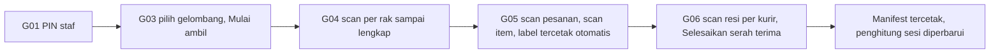

# OmniSeller — Dokumen Desain UI/UX Aplikasi Mobile

| Item | Keterangan |
|---|---|
| Versi dokumen | 1.0 |
| Tanggal | 30 September 2026 |
| Status | Siap dipakai sebagai brief untuk alat desain AI dan desainer |
| Pemilik dokumen | Candra Syahputra |
| Dokumen terkait | DOKUMEN-UI-UX.md versi 1.1 (sistem desain web, sumber token), DOKUMEN-SPESIFIKASI-APLIKASI.md versi 1.9, DOKUMEN-TEKNOLOGI.md versi 1.1 (React Native dengan Expo) |
| Audiens | Alat desain AI, product designer, engineer mobile |

> **Cara memakai dokumen ini di alat desain AI.** Tempel bagian 1 (brief induk mobile) sebagai konteks, lalu tempel blok "Prompt untuk AI" dari bagian 11 (aplikasi owner) atau bagian 12 (aplikasi gudang) per layar. Warna, tipografi, dan nama komponen mengikuti DOKUMEN-UI-UX.md; nilai yang paling sering dipakai diulang di bagian 5 agar dokumen ini cukup berdiri sendiri saat ditempel.

---

## Daftar Isi

1. [Brief Induk untuk Alat Desain AI](#1-brief-induk-untuk-alat-desain-ai)
2. [Prinsip Desain Mobile](#2-prinsip-desain-mobile)
3. [Pengguna, Perangkat, dan Konteks](#3-pengguna-perangkat-dan-konteks)
4. [Dua Mode Aplikasi: Owner dan Gudang](#4-dua-mode-aplikasi-owner-dan-gudang)
5. [Sistem Visual Mobile](#5-sistem-visual-mobile)
6. [Navigasi](#6-navigasi)
7. [Komponen Mobile](#7-komponen-mobile)
8. [Pola Interaksi Mobile](#8-pola-interaksi-mobile)
9. [Notifikasi Push dan Tautan Dalam](#9-notifikasi-push-dan-tautan-dalam)
10. [Aksesibilitas dan Kenyamanan](#10-aksesibilitas-dan-kenyamanan)
11. [Spesifikasi Layar Aplikasi Owner](#11-spesifikasi-layar-aplikasi-owner)
12. [Spesifikasi Layar Aplikasi Gudang](#12-spesifikasi-layar-aplikasi-gudang)
13. [Tata Letak Tablet](#13-tata-letak-tablet)
14. [Alur Kunci](#14-alur-kunci)
15. [Kinerja dan Perilaku Teknis yang Terlihat Pengguna](#15-kinerja-dan-perilaku-teknis-yang-terlihat-pengguna)
16. [Checklist Kualitas Desain Mobile](#16-checklist-kualitas-desain-mobile)
17. [Lampiran](#17-lampiran)

---

## 1. Brief Induk untuk Alat Desain AI

### 1.1 Versi Bahasa Indonesia

OmniSeller Mobile adalah satu aplikasi Android dan iOS dengan dua mode. **Mode Owner** untuk pemilik dan admin toko: memantau penjualan, memproses pesanan mendesak, membalas chat pembeli, dan mengecek stok dari ponsel, sering sambil bepergian dan dengan satu tangan. **Mode Gudang** untuk staf gudang di ponsel Android, PDA dengan pemindai bawaan, atau tablet: mengambil barang, mengemas dengan scan, menyerahkan paket ke kurir, dan menghitung stok, sambil berdiri, tangan sibuk, dan kadang tanpa sinyal. Tampilan tenang dan terang dengan warna utama biru laut, latar abu sangat muda, dan kartu putih, sama dengan aplikasi web. Teks dasar 16 piksel (18 piksel di mode gudang), semua target sentuh minimal 48 piksel, aksi utama selalu di bar bawah dalam jangkauan ibu jari. Navigasi bawah lima tombol: Owner memakai Beranda, Pesanan, Chat, Stok, Menu; Gudang memakai Ambil, Kemas, Kirim, Opname, Menu. Status selalu berupa pil dengan ikon dan teks. Istilah teknis diganti kata sehari-hari. Hasil scan ditampilkan besar dengan warna hijau untuk cocok dan merah untuk salah, disertai bunyi dan getar. Saat offline, aplikasi gudang tetap bekerja dan mengirim data otomatis saat sinyal kembali, dengan penanda jelas di atas layar. Tipografi Plus Jakarta Sans untuk judul dan Inter untuk teks dan angka. Ikon Lucide 24 piksel di navigasi, 20 piksel di konten.

### 1.2 English master prompt

> Design a native-feeling mobile app (Android and iOS, React Native) for Indonesian online sellers, with two modes in one app. Owner mode: a calm, glanceable dashboard for shop owners on the go, with a 5-tab bottom navigation (Home, Orders, Chat, Stock, Menu), KPI cards in two columns, order cards instead of tables, filters in bottom sheets, and one primary action in a sticky bottom bar. Warehouse mode: a high-contrast, large-type task app for warehouse staff on Android phones, rugged PDAs with hardware scanners, and tablets, with a 5-tab bottom navigation (Pick, Pack, Ship, Count, Menu), a dominant scan input on every task screen, full-screen green or red scan feedback with sound and haptics, 56px buttons, and an offline queue that syncs automatically. Visual system: light gray canvas (#F4F6F8), white cards (#FFFFFF) with 1px border (#E1E5EA), primary sea-blue (#1E6B8C), semantic green (#1F7A4D), amber (#8A5A00 on #FBF1DA), red (#B3261E), purple accent (#6D3FA8) only for campaigns and AI. Typography: Plus Jakarta Sans headings, Inter body and numbers with tabular figures, 16px base (18px in warehouse mode). Corner radius 10px cards, 8px controls, 999px pills. Icons Lucide 24px in navigation. Safe areas respected, minimum 48px touch targets, primary actions within thumb reach. Status pills always combine color, icon, and text. Use realistic Indonesian sample data: "Rp 245.000", "SP-2609-88123", "Kaos Polos Cotton 30s Hitam L", "J&T Express", "Gudang Jakarta". Copy in Bahasa Indonesia, plain and warm.

---

## 2. Prinsip Desain Mobile

| # | Prinsip | Artinya dalam praktik |
|---|---|---|
| 1 | **Jangkauan ibu jari** | Aksi utama, tab, dan tombol kembali di sepertiga bawah layar; tidak ada aksi penting di pojok kanan atas |
| 2 | **Satu layar, satu pekerjaan** | Owner: satu keputusan per layar. Gudang: satu jenis tugas per tab, satu kotak scan yang selalu fokus |
| 3 | **Bisa dibaca sekilas** | Angka besar, pil status, dan kalimat pendek; detail di balik ketukan |
| 4 | **Bekerja tanpa sinyal** | Mode gudang menyimpan setiap scan secara lokal dan mengirim otomatis; pengguna selalu tahu berapa yang belum terkirim |
| 5 | **Umpan balik yang tidak perlu dilihat** | Bunyi dan getar berbeda untuk cocok, salah, dan selesai, karena mata staf sedang di barang |
| 6 | **Aman dari salah sentuh** | Tidak ada gesek untuk menghapus atau membatalkan; aksi destruktif lewat konfirmasi; ketuk lama untuk memilih |
| 7 | **Sama dengan web, tidak identik** | Nama, warna, dan istilah sama dengan web; tata letak mengikuti kebiasaan ponsel, bukan tabel yang dikecilkan |
| 8 | **Hemat perhatian** | Notifikasi hanya untuk yang butuh tindakan; jam tenang; pengelompokan |
| 9 | **Cepat di ponsel murah** | Daftar virtual, gambar kecil, animasi singkat; target ponsel Android kelas menengah tahun 2022 |
| 10 | **Perangkat bersama di gudang** | Ganti staf dengan PIN 4 digit tanpa keluar aplikasi, agar catatan kinerja per orang tetap benar |

---

## 3. Pengguna, Perangkat, dan Konteks

### 3.1 Pengguna

| Pengguna | Mode | Situasi khas | Kebutuhan |
|---|---|---|---|
| Pemilik toko | Owner | Di perjalanan, mengecek pagi dan malam, membalas chat saat antre | Ringkas, notifikasi tepat, satu tangan |
| Admin toko | Owner | Memantau saat jauh dari laptop, menyetujui hal mendesak | Daftar pesanan cepat, aksi massal terbatas, cari nomor pesanan |
| Staf gudang (picker, packer) | Gudang | Berdiri, bergerak, memegang barang, sarung tangan tipis | Tombol besar, scan cepat, umpan balik bunyi, offline |
| Kepala gudang | Gudang dan Owner | Membagi gelombang, memantau antrean, menyerahkan ke kurir | Ringkasan gudang, ganti mode cepat |
| Layanan pelanggan | Owner | Membalas chat dari ponsel di luar jam kerja | Inbox dan balasan cepat |

### 3.2 Perangkat yang wajib didukung

| Kelas | Contoh | Ukuran | Catatan |
|---|---|---|---|
| Ponsel Android kelas menengah | Layar 6,1 sampai 6,7 inci, Android 12 ke atas | 360 x 800 sampai 412 x 915 dp | Target utama owner dan gudang |
| Ponsel kecil | 360 x 640 dp | | Semua layar tetap berfungsi tanpa gulir mendatar |
| iPhone | iOS 16 ke atas | 390 x 844 sampai 430 x 932 pt | Owner saja; gudang boleh berjalan tetapi tidak dioptimalkan |
| PDA gudang | Android dengan pemindai laser bawaan dan tombol scan fisik, layar 5 sampai 6 inci | 360 x 640 sampai 412 x 892 dp | Tombol scan fisik mengisi kotak scan; kamera sebagai cadangan |
| Tablet | 8 sampai 11 inci Android, iPad | 768 x 1024 ke atas | Mode gudang dua kolom (bagian 13) |

Orientasi: ponsel selalu tegak; tablet mendukung tegak dan mendatar. Area aman (notch, bar gestur) dihormati; bar bawah menambah padding area aman.

---

## 4. Dua Mode Aplikasi: Owner dan Gudang

- Satu aplikasi, satu akun. Mode ditentukan dari peran pengguna saat masuk: peran Gudang langsung masuk Mode Gudang; peran lain masuk Mode Owner. Pengguna dengan kedua izin dapat berganti mode dari Menu, dengan pilihan "Ingat mode ini di perangkat ini".
- Mode Gudang mengunci navigasi pada tugas gudang, menaikkan ukuran teks dasar ke 18 px, menaikkan kontras (tanpa `text-500` untuk informasi penting), dan mengaktifkan bunyi serta getar secara bawaan.
- Mode Owner memakai skala teks 16 px dan tampilan yang sama dengan web mobile.
- Ikon aplikasi dan nama sama; layar pembuka menampilkan mode yang sedang aktif di bawah logo.

---

## 5. Sistem Visual Mobile

### 5.1 Warna (ringkasan token, nilai lengkap di DOKUMEN-UI-UX.md bagian 4)

| Token | Terang | Gelap | Pemakaian |
|---|---|---|---|
| `canvas` | `#F4F6F8` | `#0F141A` | Latar layar |
| `surface` | `#FFFFFF` | `#161C24` | Kartu, bar bawah, lembar |
| `border` | `#E1E5EA` | `#263039` | Garis pemisah |
| `text-900` | `#1B2430` | `#E6EAEE` | Teks utama |
| `text-500` | `#6B7683` | `#98A2AE` | Keterangan (tidak dipakai untuk info penting di mode gudang) |
| `primary-600` | `#1E6B8C` | `#5FB0CF` | Tombol utama, tab aktif, tautan |
| `primary-100` | `#E3F0F5` | `#12303C` | Latar tab aktif, pil info |
| `success-600` / `success-100` | `#1F7A4D` / `#E3F4EA` | `#4CC38A` / 16% | Cocok, selesai |
| `warning-700` / `warning-100` | `#8A5A00` / `#FBF1DA` | `#E8B54A` / 16% | Hampir terlambat, offline |
| `danger-600` / `danger-100` | `#B3261E` / `#FBE7E5` | `#F07A72` / 16% | Salah scan, terlambat, gagal |
| `accent-700` / `accent-100` | `#6D3FA8` / `#EFE8F8` | `#B79BE8` / 16% | Kampanye, AI |
| Layar penuh scan cocok | `#1F7A4D` dengan teks putih | sama | Umpan balik 1,2 detik |
| Layar penuh scan salah | `#B3261E` dengan teks putih | sama | Umpan balik sampai diketuk atau 2 detik |

Mode gelap adalah pilihan manual di Menu, sama dengan web. Bar status sistem mengikuti latar layar (ikon gelap di mode terang).

### 5.2 Tipografi

| Peran | Keluarga | Owner | Gudang | Berat |
|---|---|---|---|---|
| Judul layar | Plus Jakarta Sans | 20 px | 22 px | 700 |
| Judul kartu | Plus Jakarta Sans | 17 px | 18 px | 600 |
| Teks isi | Inter | 16 px | 18 px | 400 |
| Keterangan | Inter | 14 px | 15 px | 400 |
| Angka KPI | Inter | 26 px | 32 px | 700, `tabular-nums` |
| Angka hasil scan | Inter | | 40 px | 700 |
| Label navigasi bawah | Inter | 11 px | 12 px | 500 |
| Tombol | Inter | 16 px | 18 px | 600 |
| Kode SKU dan resi | JetBrains Mono | 15 px | 17 px | 500 |

Mendukung ukuran teks sistem (Dynamic Type dan skala font Android) sampai 130% tanpa memotong teks; di atas itu tata letak boleh menumpuk.

### 5.3 Ukuran, spasi, dan sentuhan

| Token | Owner | Gudang |
|---|---|---|
| Tinggi bar atas | 56 px | 56 px |
| Tinggi navigasi bawah | 64 px ditambah area aman | 72 px ditambah area aman |
| Tinggi bar aksi lengket | 64 px | 80 px |
| Tinggi tombol utama | 48 px | 56 px |
| Tinggi baris daftar | 72 px | 88 px |
| Target sentuh minimal | 48 x 48 px | 56 x 56 px |
| Padding tepi layar | 16 px | 16 px |
| Jarak antar kartu | 12 px | 12 px |
| Radius kartu | 10 px | 12 px |
| Radius tombol dan input | 8 px | 10 px |
| Ikon navigasi | 24 px | 28 px |

### 5.4 Bunyi dan getar (mode gudang, dapat diatur)

| Peristiwa | Bunyi | Getar |
|---|---|---|
| Scan cocok | Satu nada pendek tinggi | Ringan 30 ms |
| Scan salah atau tidak dikenal | Dua nada rendah | Kuat 2 x 80 ms |
| Pesanan lengkap terkemas | Nada naik dua langkah | Sedang 60 ms |
| Peringatan (stok tidak cukup, offline) | Satu nada rendah panjang | Sedang |
| Data offline terkirim semua | Nada lembut | Tidak ada |

Mode Owner tidak memakai bunyi kecuali notifikasi sistem.

---

## 6. Navigasi

### 6.1 Navigasi bawah Mode Owner

| Tab | Ikon Lucide | Isi | Badge |
|---|---|---|---|
| Beranda | `home` | Ringkasan dan Tugas Hari Ini (dua segmen di atas) | Jumlah tugas mendesak |
| Pesanan | `shopping-bag` | Daftar pesanan dengan tab status bergulir | Pesanan baru |
| Chat | `message-square` | Inbox semua marketplace | Belum dibalas |
| Stok | `boxes` | Cari SKU, peringatan stok, sesuaikan | SKU menipis |
| Menu | `menu` | Semua kelompok fitur, pengaturan, ganti mode, profil | Titik bila ada peringatan akun |

### 6.2 Navigasi bawah Mode Gudang

| Tab | Ikon Lucide | Isi | Badge |
|---|---|---|---|
| Ambil | `clipboard-list` | Gelombang terbuka dan daftar ambil | Gelombang belum selesai |
| Kemas | `scan-line` | Stasiun kemas dengan scan | Pesanan siap dikemas |
| Kirim | `truck` | Serah terima kurir dengan scan resi | Paket belum diserahkan |
| Opname | `clipboard-check` | Opname, terima retur, terima barang, transfer (segmen) | Tugas hitung terbuka |
| Menu | `menu` | Ganti staf (PIN), ganti gudang, antrean offline, printer, bunyi, ukuran teks, keluar | Jumlah data belum terkirim |

### 6.3 Aturan navigasi

- Tab adalah akar; setiap tab punya tumpukan sendiri sehingga kembali dari detail tidak melompat tab.
- Bar atas: judul di tengah (Android) atau kiri (iOS mengikuti kebiasaan platform), tombol kembali di kiri, maksimal dua ikon di kanan (cari, notifikasi).
- Gestur kembali sistem selalu berfungsi; tidak ada gestur kustom yang bertabrakan dengan gestur sistem.
- Lembar bawah untuk filter, urutan, pilihan, dan konfirmasi ringan; modal layar penuh hanya untuk formulir panjang dan scan.
- Tautan dalam dari notifikasi membuka objek langsung dengan tumpukan yang benar (kembali dari detail pesanan menuju daftar pesanan).
- Pencarian global di Mode Owner: ikon di bar atas Beranda dan Pesanan; mencari nomor pesanan, resi, SKU, nama produk, nama pembeli.

---

## 7. Komponen Mobile

| Komponen | Spesifikasi |
|---|---|
| Kartu pesanan | Tinggi minimal 96 px: baris 1 nomor pesanan (mono, dapat disalin dengan ketuk lama) dan pil status di kanan; baris 2 nama produk pertama plus "+2 lainnya" dan ikon kanal; baris 3 total di kiri tebal, batas kirim di kanan dengan pil warna; area ketuk seluruh kartu; kotak centang muncul di kiri saat mode pilih |
| Kartu SKU | Gambar 56 px, nama, SKU mono, angka stok siap jual besar di kanan (hijau normal, kuning menipis, merah habis atau negatif), baris gudang di bawah bila multi-gudang |
| Kartu KPI | Dua kolom, label 14 px, angka 26 px, perubahan dengan panah dan warna semantik; ketuk membuka laporan |
| Kartu tugas | Ikon di kiri, kalimat tugas, tombol kecil di kanan; tugas selesai dicoret |
| Tab status bergulir | Chip tinggi 36 px dengan angka, chip aktif `primary-100`; gulir mendatar dengan gradasi tepi sebagai petunjuk |
| Bar aksi lengket | Di atas navigasi bawah: satu tombol utama lebar penuh, atau dua tombol (sekunder kiri 40%, utama kanan 60%) |
| Lembar bawah filter | Pegangan, judul, kelompok filter sebagai chip yang dapat dipilih banyak, rentang tanggal preset, tombol "Terapkan (86 pesanan)" lebar penuh dan "Bersihkan" teks |
| Kotak scan | Tinggi 64 px, ikon barcode, placeholder, selalu fokus tanpa membuka keyboard (keyboard muncul hanya bila diketuk); ikon kamera di kanan membuka pemindai kamera; di PDA tombol fisik langsung mengisi |
| Pemindai kamera | Layar penuh dengan bingkai, senter, tombol tutup, hasil terdeteksi menutup otomatis dengan getar |
| Layar umpan balik scan | Layar penuh hijau atau merah 1,2 sampai 2 detik dengan ikon 64 px, teks 24 px, dan angka 40 px ("2 dari 3") |
| Input jumlah | Tombol minus dan plus 56 px mengapit angka 32 px; ketuk angka membuka keypad numerik |
| Keypad numerik gudang | Keypad khusus dalam aplikasi 3 x 4 dengan tombol 64 px untuk hitung opname, tanpa keyboard sistem |
| Pil status | Sama dengan web, tinggi 28 px di mobile, 32 px di gudang |
| Banner offline | Kuning di bawah bar atas: "Tidak ada koneksi. 14 scan tersimpan, dikirim otomatis nanti." dengan ikon awan |
| Indikator sinkron | Ikon awan di bar atas Mode Gudang: hijau tersinkron, kuning dengan angka menunggu, merah gagal dengan ketuk untuk detail |
| Toast (snackbar) | Di atas navigasi bawah, satu baris, tombol "Urungkan" bila ada, 5 detik |
| Keadaan kosong | Ilustrasi kecil 120 px, satu kalimat, satu tombol |
| Kerangka pemuatan | Bentuk kartu abu bergerak lembut; tarik untuk menyegarkan |
| Dialog konfirmasi | Lembar bawah dengan judul kalimat lengkap, penjelasan akibat, tombol utama (merah bila destruktif) dan "Batal" |
| Permintaan izin | Layar penjelasan sebelum dialog sistem: mengapa kamera atau notifikasi dibutuhkan, dengan tombol "Izinkan" dan "Nanti" |
| Pemilih toko | Lembar bawah dengan daftar toko dan kotak centang, ikon kanal, "Semua toko" |

---

## 8. Pola Interaksi Mobile

| Pola | Aturan |
|---|---|
| Pilih banyak | Ketuk lama kartu masuk mode pilih; bar atas berubah menjadi "12 dipilih" dengan tombol aksi; ketuk kartu lain menambah pilihan; "Pilih semua di tab ini" di menu |
| Gesek | Hanya untuk navigasi antar tab status (opsional) dan menutup lembar. Tidak ada gesek untuk aksi pada kartu, agar tidak ada aksi tak sengaja |
| Tarik untuk menyegarkan | Semua daftar; indikator kecil di atas |
| Ketuk lama pada kode | Menyalin nomor pesanan, resi, atau SKU dengan toast "Disalin" |
| Alur scan | Kotak scan selalu siap; hasil ditampilkan besar; layar tidak berpindah kecuali tugas selesai; salah scan tidak menghentikan alur, hanya memberi umpan balik |
| Offline (gudang) | Setiap aksi disimpan di antrean lokal dengan waktu; dikirim berurutan saat sinyal kembali; konflik (misalnya pesanan sudah dibatalkan) ditampilkan di "Antrean offline" dengan penjelasan dan tombol "Abaikan" atau "Coba lagi" |
| Ganti staf | Di Mode Gudang, tombol "Ganti staf" di Menu dan di bar atas (avatar) membuka keypad PIN 4 digit; pergantian dalam 2 detik tanpa keluar akun perangkat |
| Masuk biometrik | Setelah masuk pertama, tawarkan sidik jari atau Face ID; Mode Gudang memakai PIN staf di atas akun perangkat |
| Penyimpanan otomatis | Catatan dan pengaturan tersimpan saat mengetik berhenti 1 detik |
| Batas waktu sesi | Owner: 30 hari geser; Gudang: perangkat tetap masuk, staf otomatis "keluar" setelah 15 menit tidak aktif dan diminta PIN lagi |
| Pintasan aplikasi | Ketuk lama ikon aplikasi: Owner "Pesanan baru", "Chat"; Gudang "Kemas", "Kirim" |

---

## 9. Notifikasi Push dan Tautan Dalam

| Jenis | Mode | Prioritas | Membuka | Dapat dimatikan |
|---|---|---|---|---|
| Pesanan baru (dikelompokkan per 15 menit: "12 pesanan baru dari 3 toko") | Owner | Normal | Pesanan tab Baru | Ya |
| Pesanan hampir terlambat (1 jam sebelum batas) | Owner, Gudang | Tinggi | Daftar pesanan filter hampir terlambat | Tidak untuk Owner |
| Toko terputus atau perlu hubungkan ulang | Owner | Kritis | Toko terhubung | Tidak |
| Chat baru | Owner | Normal | Percakapan | Ya, per toko |
| Stok kritis (dikelompokkan harian) | Owner | Normal | Stok filter menipis | Ya |
| Dana cair masuk dan selisih | Owner | Normal | Dana cair | Ya |
| Dokumen pajak mendekati tenggat | Owner | Tinggi | Pajak dan dokumen | Tidak |
| Gelombang baru ditugaskan ke saya | Gudang | Tinggi | Daftar ambil gelombang itu | Tidak |
| Printer terputus | Gudang | Tinggi | Menu printer | Tidak |
| Kampanye mulai besok | Owner | Normal | Kalender kampanye | Ya |
| Data offline gagal terkirim | Gudang | Tinggi | Antrean offline | Tidak |

Aturan: jam tenang default 22.00 sampai 06.00 kecuali kritis; setiap notifikasi punya aksi cepat bila memungkinkan (Android: "Terima", "Balas"); badge ikon aplikasi menampilkan jumlah tugas mendesak; halaman pengaturan notifikasi menampilkan matriks jenis versus kanal (aplikasi, email, WhatsApp) yang sama dengan web.

---

## 10. Aksesibilitas dan Kenyamanan

- Semua target 48 px (56 px gudang), jarak antar target 8 px.
- Mendukung TalkBack dan VoiceOver: setiap kartu dibacakan sebagai satu kalimat ("Pesanan SP-2609-88123, Baru, Rp 245.000, batas kirim 2 jam 15 menit"); pil status memiliki label teks; tombol ikon memiliki label.
- Skala teks sistem dihormati sampai 130%; pengaturan "Teks lebih besar" di Menu untuk Mode Gudang menaikkan 15% lagi.
- Kontras: semua token di atas 4,5:1; Mode Gudang tidak memakai `text-500` untuk informasi yang harus dibaca.
- Bunyi selalu berpasangan dengan getar dan warna; pengguna tuna rungu tetap mendapat umpan balik lewat getar dan layar.
- "Kurangi gerakan" mematikan animasi layar penuh; umpan balik scan tetap tampil tanpa animasi.
- Mode satu tangan: semua aksi utama di bar bawah; tidak ada tombol penting di 20% atas layar selain kembali dan cari.
- Kenyamanan mata: latar bukan putih murni, mode gelap manual, kecerahan otomatis diserahkan ke sistem.

---

## 11. Spesifikasi Layar Aplikasi Owner

Format: **Tujuan**, **Isi**, **Aksi utama**, **Keadaan khusus**, **Prompt untuk AI**.

#### M01 Layar Pembuka, Masuk, Biometrik, Pilih Mode

- **Tujuan**: masuk dalam sekali ketuk setelah kali pertama.
- **Isi**: layar pembuka dengan logo dan mode aktif; masuk dengan email dan kata sandi (input 48 px, tombol lebar penuh), tautan lupa kata sandi; layar 2FA enam digit; tawaran biometrik; pemilih mode bila pengguna punya kedua izin (dua kartu besar "Saya mengelola toko" dan "Saya bekerja di gudang").
- **Aksi utama**: "Masuk".
- **Prompt untuk AI**: "Layar masuk aplikasi mobile: latar abu muda, logo OmniSeller di atas, kartu putih berisi input email dan kata sandi tinggi 48 px, tombol biru laut lebar penuh 'Masuk', tautan 'Lupa kata sandi'. Layar berikut: dua kartu besar bertumpuk 'Saya mengelola toko' dengan ikon toko dan 'Saya bekerja di gudang' dengan ikon kotak, kotak centang 'Ingat pilihan di perangkat ini'."

#### M02 Beranda (Ringkasan)

- **Tujuan**: kondisi hari ini dalam satu gulir pendek.
- **Isi**: bar atas dengan pemilih toko "Semua toko (5)" dan ikon cari serta lonceng; segmen "Ringkasan" dan "Tugas"; KPI dua kolom (Penjualan hari ini, Pesanan baru, Hampir terlambat, Laba perkiraan); kartu "Perlu tindakan" bertumpuk maksimal lima; grafik garis satu seri 7 hari dengan sakelar kanal sebagai chip; daftar "Status toko" dengan ikon kanal dan pil.
- **Aksi utama**: bar bawah "Proses 86 pesanan baru".
- **Keadaan khusus**: banner kuning "Mode uji berdampingan" atau merah "Toko Shopee perlu dihubungkan ulang" dengan tombol.
- **Prompt untuk AI**: "Beranda aplikasi mobile owner, lebar 390. Bar atas: 'Semua toko (5)' dengan ikon panah, ikon cari dan lonceng berbadge. Segmen 'Ringkasan | Tugas (9)'. Empat kartu KPI dua kolom: 'Penjualan hari ini Rp 18.450.000, naik 12%', 'Pesanan baru 86', 'Hampir terlambat 7' pil kuning, 'Laba perkiraan Rp 4.120.000'. Kartu 'Perlu tindakan' berisi tiga baris dengan ikon dan tombol kecil. Grafik garis tipis 7 hari satu seri dengan chip 'Semua, Shopee, TikTok'. Daftar status toko. Bar bawah lengket tombol 'Proses 86 pesanan baru'. Navigasi bawah lima tab dengan Beranda aktif."

#### M03 Tugas Hari Ini

- **Isi**: daftar dikelompokkan Mendesak, Hari ini, Bisa nanti; setiap baris ikon, kalimat, tombol kecil.
- **Prompt untuk AI**: "Daftar tugas dikelompokkan dengan judul kecil 'Mendesak (3)'. Baris: ikon truk merah, 'Kirim 7 pesanan sebelum 15.00', tombol kecil 'Buka'. Baris lain 'Balas 12 chat Shopee', 'Unggah surat pernyataan omzet Lazada'. Tugas selesai dicoret abu di bawah."

#### M04 Daftar Pesanan

- **Tujuan**: menemukan dan memproses pesanan mendesak dari ponsel.
- **Isi**: bar atas judul "Pesanan", ikon cari dan filter (dengan titik bila filter aktif); chip status bergulir dengan angka; daftar kartu pesanan; mode pilih dengan ketuk lama.
- **Aksi utama**: bar bawah "Proses 86 baru" pada tab Baru; pada mode pilih menjadi "Terima 12", "Cetak 12" (cetak mengirim ke agen cetak gudang).
- **Keadaan khusus**: kartu bermasalah berlatar merah muda tipis dengan kalimat masalah; kartu COD berpil abu "COD"; kartu "Dikirim marketplace" tanpa aksi.
- **Prompt untuk AI**: "Daftar pesanan mobile. Chip bergulir 'Baru 86 | Bermasalah 4 | Siap dikemas 120 | Dikirim'. Kartu pesanan: baris pertama 'SP-2609-88123' mono dan pil biru 'Baru' di kanan; baris kedua 'Kaos Polos Cotton 30s Hitam L, +2 lainnya' dengan ikon Shopee kecil; baris ketiga 'Rp 245.000' tebal kiri dan 'Batas 2 jam 15 menit' pil kuning kanan. Satu kartu berlatar merah muda dengan 'SKU belum terhubung'. Bar bawah 'Proses 86 pesanan baru'. Mode pilih: bar atas '12 dipilih' dengan tombol 'Terima' dan 'Cetak'."

#### M05 Detail Pesanan

- **Tujuan**: menangani satu pesanan sampai selesai dari ponsel.
- **Isi**: bar atas nomor pesanan dan menu titik tiga; pil status dan stepper mendatar kecil; kartu Item dengan gambar 56 px; kartu Pengiriman (kurir, resi dengan tombol salin dan lacak, batas kirim, alamat dapat disembunyikan); kartu Pembayaran dengan perkiraan laba; kartu Masalah dengan tombol penyelesaian; catatan; riwayat dilipat.
- **Aksi utama**: bar bawah sesuai status: "Terima pesanan", "Cetak label", "Tandai dikirim"; menu titik tiga: Batalkan, Beri tag, Buka di marketplace.
- **Prompt untuk AI**: "Detail pesanan mobile: bar atas 'SP-2609-88123' dengan titik tiga; pil 'Baru' dan stepper empat titik. Kartu 'Item (3)' dengan gambar, nama, 'Hitam, L', 'x2', harga. Kartu 'Pengiriman' J&T Express, batas kirim pil kuning, alamat. Kartu 'Pembayaran' dengan total tebal dan 'Perkiraan laba Rp 62.000' hijau. Kartu 'Masalah' merah muda dengan tombol 'Pindahkan dari gudang lain'. Bar bawah 'Terima pesanan'."

#### M06 Filter Pesanan (lembar bawah)

- **Prompt untuk AI**: "Lembar bawah filter: pegangan, judul 'Filter', kelompok chip 'Kanal: Shopee, TikTok Shop, Lazada, Blibli', 'Toko', 'Gudang', 'Kurir', sakelar 'Hanya COD' dan 'Hampir terlambat', preset tanggal 'Hari ini, 7 hari, 30 hari, Kustom', tombol lebar penuh 'Terapkan (86 pesanan)' dan teks 'Bersihkan'."

#### M07 Chat: Daftar Percakapan

- **Isi**: chip "Belum dibalas 12 | Saya | Semua"; baris percakapan 72 px: avatar inisial dengan ikon kanal kecil di pojok, nama, cuplikan satu baris, waktu, titik biru belum dibaca; pencarian di bar atas.
- **Prompt untuk AI**: "Daftar chat mobile: chip filter di atas, baris percakapan dengan avatar inisial 'DA' berikon Shopee kecil, nama 'Dewi A.', cuplikan 'Kak, ukuran L masih ada?', waktu '5 mnt', titik biru. Navigasi bawah tab Chat aktif dengan badge 12."

#### M08 Chat: Percakapan

- **Isi**: bar atas nama pembeli, ikon kanal, tombol info yang membuka lembar bawah konteks (pesanan terakhir, status, resi, retur); gelembung; kartu produk dan pesanan di dalam percakapan; kotak balas dengan chip balasan cepat yang bergulir di atas keyboard, ikon lampiran, tombol "Saran AI" ungu; saran AI muncul sebagai draf di kotak balas dengan badge "Periksa sebelum kirim".
- **Aksi utama**: "Kirim".
- **Prompt untuk AI**: "Percakapan chat mobile dengan pembeli 'Dewi A.' dari Shopee. Gelembung pembeli abu muda kiri, gelembung penjual biru laut muda kanan, kartu produk kecil di dalam gelembung. Di atas kotak balas, chip bergulir 'Ready kak', 'Dikirim hari ini', 'Cek resi'. Kotak balas dengan ikon lampiran, tombol ungu kecil 'Saran AI', tombol kirim biru. Lembar bawah 'Pembeli ini' menampilkan pesanan 'SP-2609-88123, Dikirim, resi JT123456' dengan tombol salin."

#### M09 Stok: Daftar dan Cari

- **Isi**: kotak cari besar dengan ikon kamera (scan barcode untuk mencari SKU); chip "Menipis 9 | Habis 3 | Semua"; kartu SKU dengan angka siap jual besar; pemilih gudang sebagai chip.
- **Aksi utama**: per kartu tombol "Sesuaikan".
- **Prompt untuk AI**: "Halaman stok mobile: kotak cari 'Cari SKU atau nama' dengan ikon kamera di kanan, chip 'Menipis 9' aktif kuning, kartu SKU: gambar 56 px, 'Kaos Polos Cotton 30s Hitam L', SKU mono, angka besar '92' hijau bertuliskan 'siap jual' di bawahnya, baris kecil 'Jakarta 92, Surabaya 40'. Satu kartu dengan angka '-2' merah dan ikon peringatan."

#### M10 Stok: Sesuaikan (lembar bawah)

- **Prompt untuk AI**: "Lembar bawah 'Sesuaikan stok': nama SKU, pemilih gudang chip, segmen 'Jumlah baru | Tambah/kurang', input jumlah besar dengan tombol minus dan plus 56 px, dropdown 'Alasan' wajib (Rusak, Hilang, Koreksi, Sampel), catatan, tombol 'Simpan' lebar penuh."

#### M11 Menu

- **Isi**: kartu profil (nama, peran, toko aktif); kelompok fitur yang sama dengan sidebar web sebagai daftar bagian (Penjualan, Katalog, Stok & Gudang, Keuangan, Analitik, Kampanye & Pelanggan, Pengaturan) dengan ikon; item fase lanjutan tersembunyi; "Ganti ke Mode Gudang" bila berizin; mode gelap; ukuran teks; bantuan dan status; keluar.
- **Prompt untuk AI**: "Halaman menu mobile: kartu profil 'Rina, Owner, Toko Utama' dengan avatar. Daftar bagian dengan judul kecil 'Penjualan' berisi baris 'Retur & Batal', 'Ulasan'; 'Keuangan' berisi 'Dana cair', 'Laba per pesanan', 'Pajak & dokumen'; bagian 'Pengaturan' berisi 'Toko terhubung', 'Notifikasi', 'Mode gelap' dengan sakelar. Baris 'Ganti ke Mode Gudang' dengan ikon kotak. Tombol teks merah 'Keluar' di bawah."

#### M12 Produk (lihat cepat dan ubah harga)

- **Isi**: daftar produk dengan gambar dan stok; detail ringkas dengan varian; ubah harga dasar dan HPP lewat lembar bawah dengan simulasi margin; penerbitan ke toko tidak tersedia di mobile (diarahkan ke web).
- **Prompt untuk AI**: "Detail produk mobile: galeri gambar, nama, SKU, tab 'Varian | Listing'. Tab Varian daftar 'Hitam S, stok 40, Rp 65.000' dengan tombol 'Ubah harga'. Lembar bawah ubah harga dengan input 'Rp' dan teks 'Margin 28% setelah biaya Shopee 10,5%'."

#### M13 Laporan Ringkas, M14 Kesehatan Toko, M15 Dana Cair

- **M13**: KPI periode dengan pembanding, grafik garis satu seri, bar mendatar per kanal, tabel produk teratas sebagai daftar; tombol "Kirim laporan lengkap ke email". Prompt: "Laporan mobile: pemilih 'Bulan ini', KPI dua kolom, grafik garis tipis, daftar 'Per kanal' dengan bar mendatar ramping dan angka 'Rp 210 jt' di kanan."
- **M14**: kartu per toko dengan meter tipis dan pil, daftar tindakan. Prompt: "Kartu kesehatan toko mobile: 'Shopee Toko Utama' pil hijau 'Sehat', meter 'Keterlambatan 6,2% dari batas 10%', 'Poin penalti 2/15', daftar 'Yang bisa dilakukan'."
- **M15**: KPI selisih, daftar baris dana cair dengan pil, detail potongan di lembar bawah; tombol "Tandai selesai". Prompt: "Daftar dana cair mobile: KPI 'Selisih Rp 3.250.000' merah, kartu 'SP-2609-88123, cair Rp 231.000, selisih -Rp 14.000' pil 'Selisih'."

#### M16 Notifikasi, M17 Pengaturan Notifikasi, M18 Toko Terhubung

- **M16**: daftar dikelompokkan Hari ini dan Sebelumnya, ikon semantik, ketuk membuka objek, gesek tidak dipakai; "Tandai semua dibaca". Prompt: "Halaman notifikasi mobile: baris 'Toko Lazada perlu dihubungkan ulang' ikon merah, '12 pesanan baru dari 3 toko' ikon biru, '3 produk stok menipis' ikon kuning, waktu relatif."
- **M17**: matriks jenis versus aplikasi, email, WhatsApp dengan sakelar; jam tenang. Prompt: "Daftar jenis notifikasi dengan tiga sakelar kecil per baris berlabel ikon; baris 'Toko terputus' terkunci dengan keterangan 'Selalu dikirim'."
- **M18**: kartu toko dengan pil status dan tombol "Hubungkan ulang" yang membuka browser dalam aplikasi ke halaman izin marketplace; setelah kembali, progres sinkron. Prompt: "Daftar toko mobile: kartu 'Shopee Toko Utama' pil hijau 'Aktif, sinkron 2 mnt lalu'; kartu 'Lazada Store' pil merah 'Perlu hubungkan ulang' dengan tombol biru 'Hubungkan ulang'."

#### M19 Kalender Kampanye (ringkas), M20 Riset Pasar (baca saja)

- **M19**: daftar kampanye mendatang dengan hitung mundur, checklist persiapan yang dapat dicentang, sakelar mode kampanye. Prompt: "Kartu '11.11 Tanggal Kembar, 42 hari lagi' dengan checklist empat poin dan sakelar 'Mode kampanye otomatis'."
- **M20**: peringatan harga kompetitor dan daftar pantauan; tanpa pengumpulan data dari ponsel (ekstensi hanya di desktop). Prompt: "Daftar peringatan 'Toko Kaos Murah turun harga ke Rp 59.000 untuk produk sebanding KAOS-POLOS-HTM-L' dengan tombol 'Lihat riwayat'."

---

## 12. Spesifikasi Layar Aplikasi Gudang

Semua layar Mode Gudang: teks dasar 18 px, tombol 56 px, kotak scan selalu ada di tab tugas, indikator sinkron di bar atas, avatar staf aktif di kanan atas untuk ganti staf.

#### G01 Masuk Perangkat dan PIN Staf

- **Tujuan**: perangkat bersama masuk sekali, staf berganti dengan PIN.
- **Isi**: masuk akun perangkat oleh kepala gudang (sekali); pilih gudang; layar PIN staf: daftar avatar staf gudang ini sebagai kartu besar, ketuk lalu keypad 4 digit 64 px.
- **Prompt untuk AI**: "Layar PIN staf gudang: judul 'Siapa yang bekerja?', grid kartu besar dengan avatar inisial dan nama 'Budi', 'Andi', 'Sari', keypad numerik 3 x 4 dengan tombol 64 px, empat titik PIN. Latar abu muda, kontras tinggi, teks 18 px."

#### G02 Beranda Gudang (di tab Ambil sebagai header)

- **Isi**: sapaan staf, tiga angka besar (Pesanan siap dikemas, Gelombang terbuka, Paket belum diserahkan), indikator sinkron; di bawahnya daftar gelombang.
- **Prompt untuk AI**: "Bagian atas tab Ambil: 'Halo Budi, Gudang Jakarta', tiga angka besar 32 px '120 siap dikemas', '2 gelombang', '48 belum diserahkan', ikon awan hijau 'Tersinkron'."

#### G03 Ambil: Daftar Gelombang

- **Isi**: kartu gelombang: nama, jumlah pesanan dan item, kurir, penanggung jawab, pil status, tombol "Mulai ambil" atau "Lanjutkan"; filter "Ditugaskan ke saya".
- **Aksi utama**: "Mulai ambil" per kartu.
- **Prompt untuk AI**: "Daftar gelombang di tablet atau ponsel gudang: kartu 'Gelombang 3, 10.15, 120 pesanan, 214 item, J&T dan JNE' pil kuning 'Sedang diambil, 60%' dengan bar progres, tombol besar 'Lanjutkan'. Kartu lain 'Gelombang 4' pil abu 'Terbuka' tombol 'Mulai ambil'."

#### G04 Ambil: Daftar Ambil per Rak

- **Tujuan**: mengambil semua item gelombang dengan jalan tersingkat.
- **Isi**: header gelombang dan progres "38 dari 214 item"; daftar diurutkan lokasi rak: kartu 88 px dengan lokasi rak besar di kiri ("A-01-03"), gambar 56 px, nama, SKU mono, jumlah besar "12" di kanan; kotak scan di atas daftar: scan SKU menandai item dan bunyi; bila scan tidak tersedia, ketuk kartu menandai; item yang kurang ("hanya 10 dari 12") dicatat lewat tombol "Kurang" yang membuka input jumlah dan alasan.
- **Aksi utama**: bar bawah "Selesai mengambil (38/214)" aktif penuh saat lengkap; tombol sekunder "Jeda".
- **Keadaan khusus**: offline tetap berjalan; item kurang menandai pesanan terkait bermasalah.
- **Prompt untuk AI**: "Daftar ambil gudang: bar atas 'Gelombang 3' dengan avatar staf dan ikon awan; kotak scan 64 px 'Pindai SKU'; progres '38 dari 214 item'. Kartu: kotak lokasi rak 'A-01-03' besar abu di kiri, gambar produk, nama, SKU mono, angka '12' 32 px di kanan, kartu tercentang berlatar hijau muda. Bar bawah 'Selesai mengambil' nonaktif dan 'Jeda'."

#### G05 Kemas: Stasiun Scan

- **Tujuan**: memastikan isi paket benar dan mencetak label tanpa menyentuh layar bila memungkinkan.
- **Isi**: kotak scan besar "Pindai nomor pesanan atau resi"; setelah pesanan dikenali: kartu pesanan dengan kurir dan batas kirim, daftar item bergambar besar dengan penghitung "0/2"; setiap scan SKU menaikkan penghitung dengan layar hijau singkat; salah SKU layar merah "Bukan bagian pesanan ini"; saat lengkap: layar hijau "Lengkap" dan otomatis "Cetak label" ke printer yang dipilih (atau tombol bila otomatis dimatikan), lalu kembali ke kotak scan untuk pesanan berikutnya; penghitung sesi "Dikemas hari ini 46".
- **Aksi utama**: "Cetak label dan lanjut" (56 px), otomatis bila diatur.
- **Keadaan khusus**: pesanan belum diambil, dibatalkan, atau dari gudang lain menampilkan layar merah dengan kalimat jelas; printer terputus menampilkan banner merah dan tombol "Cetak nanti" (label masuk antrean).
- **Prompt untuk AI**: "Stasiun kemas di ponsel gudang, tegak. Bar atas 'Kemas' dengan avatar dan ikon printer hijau. Kotak scan 64 px di atas. Kartu pesanan 'SP-2609-88123, J&T Express, batas 15.00' pil kuning. Tiga item bergambar 72 px dengan penghitung besar '2/2' hijau bercentang, '0/1' abu. Bar bawah tombol 56 px 'Cetak label dan lanjut' nonaktif. Layar terpisah: umpan balik hijau penuh dengan ikon centang 64 px, teks 'Cocok', angka '2 dari 3'. Layar terpisah: merah penuh 'Bukan bagian pesanan ini' dengan tombol 'Oke'."

#### G06 Kirim: Serah Terima Kurir

- **Isi**: pemilih kurir sebagai chip besar (J&T, JNE, SiCepat, SPX); kotak scan resi; angka besar "48 dipindai" per kurir; daftar resi mono terbaru; tombol "Selesaikan serah terima J&T" yang mengirim manifest ke agen cetak; riwayat hari ini.
- **Keadaan khusus**: resi yang belum dikemas atau milik kurir lain memberi layar merah.
- **Prompt untuk AI**: "Halaman serah terima kurir: chip besar 'J&T Express' aktif, 'JNE', 'SiCepat'; kotak scan 'Pindai resi'; angka 40 px '48' dengan teks 'paket J&T dipindai'; daftar resi mono 'JT123456789, 10.42'. Bar bawah 'Selesaikan serah terima J&T (48)'."

#### G07 Opname: Hitung

- **Isi**: segmen di atas tab: Opname | Terima retur | Terima barang | Transfer; daftar opname terbuka; layar hitung: kartu SKU dengan gambar, nama, lokasi rak, tanpa stok sistem (mode buta), input angka besar dengan keypad dalam aplikasi, scan untuk melompat ke SKU; progres; tombol "Kirim hasil" saat semua terisi; tinjauan selisih dilakukan di web oleh admin.
- **Prompt untuk AI**: "Layar hitung opname: bar atas 'Opname #12, Gudang Jakarta', progres '80 dari 300 SKU'. Kartu SKU: gambar, 'Kaos Polos Hitam L', lokasi 'A-01-03', input angka besar 32 px kosong dengan keypad numerik 3 x 4 tombol 64 px di bawah layar. Tombol 'Berikutnya' dan bar bawah 'Kirim hasil (80/300)'."

#### G08 Terima Retur dan Paket Kembali

- **Isi**: scan resi atau nomor pesanan; menampilkan item yang diharapkan; per item pilih kondisi dengan tiga tombol besar berwarna: "Layak jual" hijau, "Rusak" kuning, "Tidak ada" abu; foto bukti opsional; "Selesai" mengembalikan stok sesuai kondisi.
- **Prompt untuk AI**: "Layar terima retur: kotak scan 'Pindai resi retur', kartu 'SP-2609-77001, Retur dari pembeli', item dengan tiga tombol besar berdampingan 'Layak jual' hijau, 'Rusak' kuning, 'Tidak ada' abu, tombol kamera 'Foto bukti', bar bawah 'Selesai'."

#### G09 Terima Barang dari Supplier dan Transfer

- **Isi**: daftar PO atau transfer masuk untuk gudang ini; scan SKU menaikkan jumlah diterima; input jumlah bila tanpa barcode; selisih ditandai; "Selesaikan penerimaan".
- **Prompt untuk AI**: "Layar terima barang: header 'PO-202609-0012, PT Kain Jaya', daftar SKU dengan 'Dipesan 50, Diterima 48' dan tombol plus, baris selisih berwarna kuning, bar bawah 'Selesaikan penerimaan'."

#### G10 Cari SKU dan Lokasi

- **Isi**: kotak cari dan scan; hasil kartu SKU dengan lokasi rak besar, stok fisik, dipesan, siap jual per gudang; tombol "Ubah lokasi rak" (bila izin).
- **Prompt untuk AI**: "Hasil cari SKU: kartu besar dengan lokasi 'A-01-03' 32 px, gambar, nama, 'Fisik 120, Dipesan 18, Siap jual 92', tombol 'Ubah lokasi rak'."

#### G11 Antrean Offline

- **Isi**: daftar aksi belum terkirim dengan waktu dan jenis (Scan kemas, Serah terima, Hitung); status Menunggu, Gagal dengan alasan; tombol "Kirim sekarang", "Coba lagi", "Abaikan" (dengan konfirmasi); banner status koneksi.
- **Prompt untuk AI**: "Halaman antrean offline: banner kuning 'Tidak ada koneksi', daftar '14 aksi menunggu' dengan baris 'Kemas SP-2609-88123, 10.42, Menunggu' dan satu baris merah 'Serah terima JT123, Gagal: pesanan sudah dibatalkan' dengan tombol 'Abaikan'. Tombol 'Kirim sekarang' nonaktif."

#### G12 Menu Gudang

- **Isi**: kartu staf aktif dengan tombol "Ganti staf"; gudang aktif dengan tombol ganti (bila izin); printer (daftar dari agen cetak, pilih default, cetak percobaan); bunyi dan getar (sakelar); ukuran teks; cetak otomatis setelah kemas (sakelar); antrean offline; mode gelap; keluar perangkat (butuh PIN kepala gudang).
- **Prompt untuk AI**: "Menu gudang: kartu 'Budi, Packer' dengan tombol 'Ganti staf'; baris 'Gudang Jakarta'; bagian 'Printer' dengan 'Zebra GK420, terhubung' hijau dan tombol 'Cetak percobaan'; sakelar 'Bunyi', 'Getar', 'Cetak otomatis setelah kemas'; pilihan 'Ukuran teks: Besar'; baris 'Antrean offline (0)'."

---

## 13. Tata Letak Tablet

- Mode Gudang di tablet memakai dua kolom pada layar tugas: kolom kiri 40% berisi kotak scan, hasil, dan progres; kolom kanan 60% berisi daftar item. Navigasi bawah tetap, atau berubah menjadi rel kiri 88 px pada orientasi mendatar.
- Daftar ambil di tablet menampilkan dua kartu per baris dengan lokasi rak yang tetap menonjol.
- Mode Owner di tablet memakai tata letak web `md`: rel ikon kiri dan konten dua kolom; navigasi bawah tidak dipakai.
- Semua ukuran sentuh dan teks Mode Gudang tetap sama di tablet; jangan mengecilkan karena layar lebih luas.

---

## 14. Alur Kunci

### 14.1 Pagi pemilik toko (Mode Owner, 3 menit)

1. Notifikasi "12 pesanan baru dari 3 toko" diketuk, membuka Pesanan tab Baru.
2. Tab Bermasalah diperiksa; satu pesanan diselesaikan lewat tombol "Pindahkan stok".
3. Bar bawah "Proses 86 pesanan baru" ditekan; progres tampil; hasil "84 diproses, 2 bermasalah".
4. Kembali ke Beranda, KPI dan status toko dilihat sekilas; chat belum dibalas dibuka dari kartu tindakan.

### 14.2 Gudang: dari gelombang sampai serah terima (Mode Gudang)

### 14.3 Sinyal hilang di tengah kemas

1. Banner kuning muncul; scan tetap diproses dari data pesanan yang sudah dimuat.
2. Label tidak bisa dicetak bila agen cetak juga tidak terjangkau; tombol "Cetak nanti" memasukkan label ke antrean.
3. Sinyal kembali; antrean terkirim otomatis; bunyi lembut; label yang tertunda dicetak dari antrean cetak.

### 14.4 Notifikasi kritis toko terputus

1. Notifikasi kritis menembus jam tenang; membuka M18.
2. Tombol "Hubungkan ulang" membuka browser dalam aplikasi ke halaman izin marketplace.
3. Setelah kembali, kartu berubah hijau dan toast "Toko terhubung kembali, menyinkronkan pesanan".

---

## 15. Kinerja dan Perilaku Teknis yang Terlihat Pengguna

| Aspek | Target |
|---|---|
| Waktu buka aplikasi sampai layar berguna | Di bawah 2 detik pada ponsel kelas menengah; data terakhir ditampilkan dulu, lalu diperbarui |
| Gulir daftar 1.000 pesanan | 60 fps dengan daftar virtual, gambar thumbnail 56 px dari cache |
| Respons scan ke umpan balik | Di bawah 150 ms (validasi lokal dari data pesanan yang sudah dimuat) |
| Pembaruan aplikasi | Perbaikan JavaScript lewat pembaruan over-the-air saat aplikasi dibuka berikutnya, tanpa mengganggu sesi; pembaruan besar lewat toko aplikasi |
| Baterai gudang | Kamera hanya aktif saat pemindai kamera dibuka; PDA memakai pemindai laser bawaan |
| Penyimpanan lokal | Data pesanan gelombang aktif dan antrean offline tersimpan; dibersihkan setelah terkirim dan 7 hari |
| Keamanan | Token di secure storage; tangkapan layar diblokir pada layar alamat pembeli di Mode Gudang; sesi staf berakhir 15 menit tidak aktif |

---

## 16. Checklist Kualitas Desain Mobile

- [ ] Aksi utama di bar bawah, dalam jangkauan ibu jari; tidak ada aksi penting di kanan atas selain cari dan notifikasi.
- [ ] Target sentuh 48 px (Owner) dan 56 px (Gudang); jarak 8 px.
- [ ] Teks dasar 16 px (Owner) dan 18 px (Gudang); mendukung skala sistem sampai 130%.
- [ ] Tidak ada gesek untuk aksi destruktif; ketuk lama untuk memilih.
- [ ] Setiap layar tugas gudang punya kotak scan yang selalu fokus dan umpan balik hijau atau merah dengan bunyi dan getar.
- [ ] Offline: banner, indikator awan, antrean terlihat, konflik dijelaskan.
- [ ] Status berupa pil ikon dan teks; warna sesuai token; kontras 4,5:1.
- [ ] Layar diuji pada 360 x 640, 390 x 844, dan tablet 768 x 1024.
- [ ] Area aman dihormati; bar bawah tidak tertutup bar gestur.
- [ ] Notifikasi membuka objek yang tepat dengan tumpukan yang benar.
- [ ] Ganti staf dengan PIN tersedia di setiap layar Mode Gudang.
- [ ] Istilah mengikuti padanan DOKUMEN-UI-UX.md bagian 12.2.

---

## 17. Lampiran

### 17.1 Ikon navigasi dan aksi (Lucide)

| Fungsi | Ikon |
|---|---|
| Beranda, Pesanan, Chat, Stok, Menu | `home`, `shopping-bag`, `message-square`, `boxes`, `menu` |
| Ambil, Kemas, Kirim, Opname | `clipboard-list`, `scan-line`, `truck`, `clipboard-check` |
| Scan kamera, senter | `camera`, `flashlight` |
| Sinkron: tersinkron, menunggu, gagal | `cloud-check`, `cloud-upload`, `cloud-off` |
| Ganti staf | `user-round-cog` |
| Printer terhubung, terputus | `printer`, `printer-off` |
| Bunyi aktif, mati | `volume-2`, `volume-x` |
| Cari, filter, notifikasi | `search`, `sliders-horizontal`, `bell` |

### 17.2 Data contoh

Sama dengan DOKUMEN-UI-UX.md bagian 18.3, ditambah: lokasi rak `A-01-03`, `B-04-12`; resi `JT1234567890`, `JNE0987654321`; gelombang `Gelombang 3, 10.15`; staf `Budi (Packer)`, `Andi (Picker)`; angka sesi `Dikemas hari ini 46`, `48 paket J&T`.

### 17.3 Prompt Bahasa Inggris per aplikasi

- **Owner app**: "Mobile app screens for an Indonesian multi-marketplace seller: Home with two-column KPI cards, an action list, and a sticky bottom button; Orders as a card list with scrollable status chips and long-press multi-select; Chat inbox and thread with quick-reply chips and a purple AI suggestion button; Stock search with camera barcode lookup and large available-stock numbers; a Menu page listing all feature groups. Bottom navigation with five tabs. Light gray canvas, white cards, sea-blue primary, status pills with icons and text, Inter and Plus Jakarta Sans, 16px base text, 48px touch targets, Bahasa Indonesia copy."
- **Warehouse app**: "High-contrast warehouse task app for Android phones and rugged PDAs: staff PIN screen with large avatar cards and a 64px numeric keypad; Pick list sorted by bin location with big rack codes and quantities; Pack station with a dominant scan input, large product images with counters, full-screen green success and red error feedback; Courier handover with big courier chips and a large scanned count; blind stock count with an in-app numeric keypad; offline queue page with a yellow banner. 18px base text, 56px buttons, 72px bottom navigation (Pick, Pack, Ship, Count, Menu), cloud sync indicator in the top bar, Bahasa Indonesia copy."

### 17.4 Riwayat perubahan

| Versi | Tanggal | Perubahan | Penulis |
|---|---|---|---|
| 1.0 | 30 September 2026 | Dokumen awal: brief mobile, prinsip, perangkat, dua mode, sistem visual mobile, navigasi, komponen, pola interaksi, notifikasi, aksesibilitas, 20 layar owner dan 12 layar gudang dengan prompt, tablet, alur, kinerja, checklist | Candra Syahputra |
