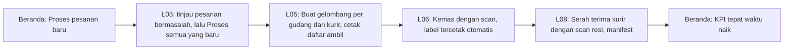

# OmniSeller — Dokumen Desain UI/UX

| Item | Keterangan |
|---|---|
| Versi dokumen | 1.17 |
| Tanggal | 7 Oktober 2026 |
| Status | Siap dipakai sebagai brief untuk alat desain AI dan desainer |
| Pemilik dokumen | Candra Syahputra |
| Dokumen terkait | DOKUMEN-SPESIFIKASI-APLIKASI.md (PRD) versi 1.10, DOKUMEN-UI-UX-MOBILE.md versi 1.0 (aplikasi mobile), DOKUMEN-TEKNOLOGI.md versi 1.1, DOKUMEN-ARSITEKTUR-BACKEND.md versi 1.0 |
| Audiens | Alat desain AI (Canva AI, Figma AI, dan sejenisnya), product designer, engineer frontend |

> **Cara memakai dokumen ini di alat desain AI.** Tempel bagian 1 (brief induk) lebih dulu sebagai konteks. Lalu tempel satu blok "Prompt untuk AI" dari bagian 14 untuk setiap layar yang ingin dibuat. Setiap prompt sudah memuat tata letak, komponen, contoh data, dan perilaku mobile, sehingga tidak perlu mengarang. Nilai warna, ukuran, dan nama komponen di bagian 4 sampai 8 adalah sumber kebenaran; bila alat desain menghasilkan sesuatu yang berbeda, dokumen ini yang benar.

---

## Daftar Isi

1. [Brief Induk untuk Alat Desain AI](#1-brief-induk-untuk-alat-desain-ai)
2. [Prinsip Desain](#2-prinsip-desain)
3. [Pengguna dan Konteks Pemakaian](#3-pengguna-dan-konteks-pemakaian)
4. [Sistem Warna](#4-sistem-warna)
5. [Tipografi](#5-tipografi)
6. [Tata Letak, Grid, dan Responsivitas](#6-tata-letak-grid-dan-responsivitas)
7. [Navigasi dan Struktur Sidebar](#7-navigasi-dan-struktur-sidebar)
8. [Komponen](#8-komponen)
9. [Pola Interaksi](#9-pola-interaksi)
10. [Ikon, Ilustrasi, dan Gerak](#10-ikon-ilustrasi-dan-gerak)
11. [Aksesibilitas dan Kenyamanan Mata](#11-aksesibilitas-dan-kenyamanan-mata)
12. [Bahasa dan Micro-copy](#12-bahasa-dan-micro-copy)
13. [Visualisasi Data](#13-visualisasi-data)
14. [Spesifikasi Layar](#14-spesifikasi-layar)
15. [Alur Kunci](#15-alur-kunci)
16. [Aplikasi Mobile, Agen Cetak, dan Ekstensi](#16-aplikasi-mobile-agen-cetak-dan-ekstensi)
17. [Checklist Kualitas Desain](#17-checklist-kualitas-desain)
18. [Lampiran](#18-lampiran)

---

## 1. Brief Induk untuk Alat Desain AI

### 1.1 Versi Bahasa Indonesia

OmniSeller adalah aplikasi web dan mobile untuk pedagang Indonesia yang berjualan di banyak marketplace (Shopee, Tokopedia & Shop, Lazada, Blibli). Pengguna utama: pemilik toko dan admin yang belum tentu mahir teknologi, staf gudang yang bekerja cepat dengan pemindai barcode, dan tim layanan pelanggan. Aplikasi dipakai berjam-jam setiap hari, sehingga tampilan harus tenang, terang tetapi tidak menyilaukan, dengan satu warna utama biru laut yang tidak menjemukan, latar abu sangat muda, dan kartu putih dengan bayangan lembut. Gaya: modern, bersih, ramah, dan langsung dimengerti orang yang gagap teknologi. Setiap layar punya satu tujuan dan satu tombol utama yang jelas. Istilah teknis diganti kata sehari-hari (misalnya "Dana cair" bukan "settlement"). Status selalu ditampilkan sebagai pil berwarna dengan ikon dan teks, tidak pernah warna saja. Angka uang ditulis "Rp 1.250.000". Sidebar kiri dikelompokkan: Beranda, Penjualan, Katalog, Stok & Gudang, Keuangan, Analitik, Kampanye & Pelanggan, Pengaturan. Semua halaman responsif: di desktop memakai sidebar dan tabel, di tablet sidebar menjadi ikon, di ponsel memakai navigasi bawah lima tombol dan daftar kartu sebagai pengganti tabel. Tipografi Plus Jakarta Sans untuk judul dan Inter untuk teks serta angka. Sudut membulat 10 piksel untuk kartu dan 8 piksel untuk tombol. Ikon garis tipis (Lucide) ukuran 20 piksel. Grafik memakai garis tipis, bar ramping berujung membulat, satu sumbu, legenda selalu ada, dan warna kategori yang aman untuk buta warna.

### 1.2 English master prompt (untuk alat yang lebih baik memahami bahasa Inggris)

> Design a calm, modern, easy-to-understand SaaS dashboard for Indonesian online sellers who manage orders, stock, and finances across several marketplaces. Users are often non-technical shop owners and busy warehouse staff, so every screen has one clear purpose and one primary action. Visual style: clean and friendly, light gray canvas (#F4F6F8), white cards (#FFFFFF) with a soft 1px border (#E1E5EA) and subtle shadow, one primary sea-blue (#1E6B8C) used for primary buttons, links, and active navigation, and reserved semantic colors for success (#1F7A4D), warning (#8A5A00 text on #FBF1DA), and danger (#B3261E). Never rely on color alone: status pills always combine a color, an icon, and a text label. Typography: Plus Jakarta Sans for headings, Inter for body text and numbers with tabular figures; base size 15px desktop, 16px mobile. Corner radius 10px for cards, 8px for buttons and inputs. Icons: Lucide, 20px, 1.75px stroke. Layout: 264px left sidebar with grouped sections (Home, Sales, Catalog, Stock & Warehouse, Finance, Analytics, Campaigns & Customers, Settings), 56px top bar with global search, store switcher, notifications, help, and profile. Fully responsive: on tablets the sidebar collapses to a 72px icon rail; on phones it becomes a 5-item bottom navigation (Home, Orders, Chat, Stock, Menu) and data tables become card lists with a sticky bottom action bar. Charts: thin lines, slim rounded bars, one axis, always a legend, direct labels for up to four series, colorblind-safe categorical palette. Use realistic Indonesian sample data (product names, Rupiah amounts like "Rp 1.250.000", city names, courier names like JNE and J&T). Copy in Bahasa Indonesia, plain and warm, no technical jargon.

---

## 2. Prinsip Desain

| # | Prinsip | Artinya dalam praktik |
|---|---|---|
| 1 | **Satu layar, satu tujuan, satu tombol utama** | Setiap halaman punya satu tombol berwarna utama di kanan atas atau di bar bawah. Tombol lain berwarna netral |
| 2 | **Bahasa sehari-hari** | Tidak ada istilah asing bila ada padanan Indonesia yang umum. Daftar padanan di bagian 12 |
| 3 | **Status tidak pernah hanya warna** | Pil status selalu ikon + teks + warna. Ramah buta warna dan mudah dipindai |
| 4 | **Tenang untuk dipandang lama** | Latar abu sangat muda, bukan putih murni; satu warna utama; warna cerah hanya untuk status dan grafik; tidak ada gradien mencolok |
| 5 | **Yang penting terlihat dulu** | Angka besar dan tugas hari ini di atas; detail teknis disembunyikan di balik "Lihat detail" |
| 6 | **Konsisten di semua layar** | Posisi tombol, filter, dan pencarian selalu sama; pola daftar, detail, dan formulir selalu sama |
| 7 | **Aman dari salah klik** | Aksi yang merusak (batalkan pesanan, hapus produk) meminta konfirmasi dengan kalimat jelas; aksi lain bisa dibatalkan lewat toast "Urungkan" |
| 8 | **Bekerja di ponsel sungguhan** | Target sentuh minimal 44 piksel, aksi utama di jangkauan ibu jari, tabel menjadi kartu, filter menjadi lembar bawah |
| 9 | **Cepat bagi yang mahir** | Pintasan keyboard, aksi massal, mode scan tanpa mouse; tidak mengorbankan kemudahan pemula |
| 10 | **Membimbing, bukan menyalahkan** | Keadaan kosong menjelaskan langkah berikutnya; pesan error menyebut apa yang terjadi dan apa yang bisa dilakukan |

---

## 3. Pengguna dan Konteks Pemakaian

| Pengguna | Perangkat utama | Situasi | Kebutuhan tampilan |
|---|---|---|---|
| Pemilik toko (Rina, pedagang solo) | Laptop 13 inci dan ponsel Android | Pagi memproses pesanan, siang membalas chat dari ponsel | Ringkas, angka besar, alur pesanan tiga langkah |
| Admin toko (tim Dimas) | Monitor 24 inci, kadang dua tab | Memproses ratusan pesanan, memantau SLA | Tabel padat dengan aksi massal, filter cepat, pintasan |
| Staf gudang | PC gudang Windows dengan printer thermal, PDA Android, tablet | Berdiri, tangan sibuk, cahaya gudang bervariasi | Teks besar, kontras tinggi, tombol besar, mode scan tanpa mouse |
| Layanan pelanggan | Laptop | Banyak percakapan sekaligus | Inbox tiga kolom, balasan cepat, konteks pesanan di samping |
| Finance | Laptop | Tutup buku bulanan | Tabel rekonsiliasi, ekspor, filter periode |
| Manajer brand (Maya) | Laptop dan ponsel | Meninjau laporan, menyetujui | Dasbor per gudang, grafik jelas, notifikasi kritis |

Ukuran layar yang wajib didukung: 360 x 640 (ponsel kecil), 390 x 844 (ponsel umum), 768 x 1024 (tablet), 1280 x 800 (laptop kecil), 1440 x 900 (laptop), 1920 x 1080 (monitor).

---

## 4. Sistem Warna

### 4.1 Filosofi

Satu warna utama biru laut yang teduh (bukan biru terang khas media sosial), latar abu sangat muda dengan sedikit hangat, dan warna semantik yang gelap untuk teks agar terbaca di atas latar muda. Saturasi rendah di area luas, saturasi lebih tinggi hanya di elemen kecil (pil, ikon status, titik grafik). Semua pasangan teks dan latar di bawah ini telah dihitung dan berada di atas rasio kontras 4,5:1 (WCAG AA).

### 4.2 Token mode terang

| Token | Hex | Pemakaian | Kontras terhadap latar |
|---|---|---|---|
| `canvas` | `#F4F6F8` | Latar halaman | |
| `surface` | `#FFFFFF` | Kartu, tabel, panel | |
| `surface-2` | `#F8FAFB` | Header tabel, baris hover, area sekunder | |
| `border` | `#E1E5EA` | Garis pemisah, tepi kartu, tepi input | |
| `border-strong` | `#C9D0D8` | Tepi input saat hover, pemisah kuat | |
| `text-900` | `#1B2430` | Judul, angka utama, teks isi | 14,5:1 pada canvas |
| `text-700` | `#3D4754` | Teks isi sekunder, label | 9,4:1 |
| `text-500` | `#5F6B78` | Keterangan, placeholder, waktu | 5,0:1 pada canvas, 5,2:1 pada `surface-2` |
| `text-disabled` | `#9AA3AD` | Teks nonaktif (bukan untuk informasi penting) | |
| `primary-700` | `#175570` | Tombol utama saat hover, teks tautan saat hover | 8,2:1 |
| `primary-600` | `#1E6B8C` | Tombol utama, tautan, ikon aktif, fokus | 5,9:1; teks putih di atasnya 5,9:1 |
| `primary-100` | `#E3F0F5` | Latar item navigasi aktif, latar pil info, sorotan lembut | teks primary-600 di atasnya 5,1:1 |
| `primary-50` | `#F1F7FA` | Latar baris terpilih | |
| `success-600` | `#1F7A4D` | Teks dan ikon sukses | 5,3:1 |
| `success-100` | `#E3F4EA` | Latar pil sukses | |
| `warning-700` | `#8A5A00` | Teks dan ikon peringatan | 5,9:1 |
| `warning-100` | `#FBF1DA` | Latar pil peringatan | |
| `danger-600` | `#B3261E` | Teks dan ikon bahaya, tombol destruktif | 6,5:1 |
| `danger-100` | `#FBE7E5` | Latar pil bahaya | |
| `accent-700` | `#6D3FA8` | Teks badge kampanye dan promo | 7,2:1; pada `accent-100` 6,0:1 |
| `accent-100` | `#EFE8F8` | Latar badge kampanye dan promo | |
| `focus-ring` | `#1E6B8C` dengan lebar 2 px dan offset 2 px | Fokus keyboard pada semua elemen interaktif | |
| `overlay` | `rgba(27,36,48,0.45)` | Latar modal dan lembar bawah | |

### 4.3 Token mode gelap

Mode gelap adalah pilihan pengguna (bukan otomatis mengikuti sistem) karena staf gudang sering bekerja di ruang terang dan memilih mode terang. Nilai dipilih ulang, bukan dibalik.

| Token | Hex | Kontras terhadap `surface` gelap |
|---|---|---|
| `canvas` | `#0F141A` | |
| `surface` | `#161C24` | |
| `surface-2` | `#1C242E` | |
| `border` | `#263039` | |
| `border-strong` | `#34404C` | |
| `text-900` | `#E6EAEE` | 14,2:1 |
| `text-700` | `#C2CAD2` | |
| `text-500` | `#98A2AE` | 6,6:1 |
| `primary-400` (pengganti primary-600) | `#5FB0CF` | 7,0:1 |
| `primary-900` (latar aktif) | `#12303C` | |
| `success` | `#4CC38A` | 7,8:1 |
| `warning` | `#E8B54A` | 9,1:1 |
| `danger` | `#F07A72` | 6,3:1 |
| `accent` | `#B79BE8` | |

Pil status di mode gelap memakai latar transparan 16% dari warna semantiknya dengan teks warna semantik itu sendiri.

### 4.4 Aturan pemakaian warna

- Warna utama dipakai untuk: tombol utama, tautan, item navigasi aktif, sakelar aktif, indikator langkah aktif, fokus. Tidak dipakai untuk latar area luas.
- Warna semantik hanya untuk makna: hijau berarti selesai atau sehat, kuning berarti perlu perhatian, merah berarti terlambat, gagal, atau bahaya. Tidak pernah dipakai sebagai dekorasi.
- Warna aksen ungu hanya untuk badge kampanye, promo, dan fitur AI. Ini membedakannya dari status.
- Logo dan warna marketplace (oranye Shopee, logo "Tokopedia & Shop" untuk toko TikTok Shop dan Tokopedia, biru Lazada, biru Blibli) hanya muncul sebagai ikon kanal 16 sampai 20 piksel di samping nama toko, tidak pernah mewarnai komponen OmniSeller. Merek dan logo TikTok tidak dipakai di mana pun untuk pasar Indonesia, termasuk label dan invoice kustom; kanal itu selalu bernama "Tokopedia & Shop" (PRD 5.6).
- Tidak ada gradien pada latar dan tombol. Gradien hanya boleh di ilustrasi keadaan kosong.
- Tidak ada teks berwarna di atas latar berwarna cerah kecuali pasangan yang tercantum di 4.2.

---

## 5. Tipografi

| Peran | Keluarga | Ukuran desktop | Ukuran mobile | Berat | Catatan |
|---|---|---|---|---|---|
| Judul halaman (H1) | Plus Jakarta Sans | 24 px | 22 px | 700 | Satu per halaman |
| Judul bagian (H2) | Plus Jakarta Sans | 18 px | 18 px | 600 | Judul kartu |
| Subjudul (H3) | Plus Jakarta Sans | 16 px | 16 px | 600 | |
| Teks isi | Inter | 15 px | 16 px | 400 | Tinggi baris 1,5 |
| Teks kecil | Inter | 13 px | 14 px | 400 | Keterangan, waktu; tidak lebih kecil dari ini |
| Label formulir dan tabel | Inter | 13 px | 14 px | 500 | Huruf biasa, bukan kapital semua |
| Angka besar KPI | Inter | 28 px | 26 px | 700 | `tabular-nums` |
| Angka di tabel | Inter | 15 px | 16 px | 400 | `tabular-nums`, rata kanan |
| Tombol | Inter | 15 px | 16 px | 600 | |
| Kode (SKU, resi) | JetBrains Mono | 14 px | 14 px | 500 | Hanya untuk SKU, nomor resi, dan ID |

Aturan: maksimal tiga ukuran teks dalam satu kartu; uang selalu `Rp 1.250.000` (spasi setelah Rp, titik ribuan, tanpa desimal); tanggal `30 Sep 2026, 14.05` dan relatif untuk yang baru ("5 menit lalu"); jangan memotong nama produk di tengah, potong di akhir dengan elipsis dan tampilkan lengkap saat hover atau ketuk.

---

## 6. Tata Letak, Grid, dan Responsivitas

### 6.1 Titik henti (breakpoint)

| Nama | Lebar | Navigasi | Konten |
|---|---|---|---|
| `xs` | di bawah 480 px | Navigasi bawah 5 tombol, menu lengkap di lembar bawah | Satu kolom, kartu, bar aksi lengket di bawah |
| `sm` | 480 sampai 767 px | Navigasi bawah | Satu kolom, kartu; KPI dua kolom |
| `md` | 768 sampai 1023 px | Sidebar menjadi rel ikon 72 px, membuka sebagai laci saat diketuk | Dua kolom; tabel dengan kolom penting saja dan gulir mendatar |
| `lg` | 1024 sampai 1279 px | Rel ikon 72 px, dapat dibuka menjadi 264 px | Tabel penuh |
| `xl` | 1280 px ke atas | Sidebar 264 px terbuka, dapat dilipat | Konten maksimal 1440 px dipusatkan; panel detail samping 420 px |

### 6.2 Kerangka halaman desktop

- Sidebar kiri 264 px, latar `surface`, batas kanan `border`. Logo di atas, pemilih toko di bawah logo, kelompok menu, dan profil pengguna di bawah.
- Bar atas 56 px, latar `surface`: tombol lipat sidebar, remah roti (breadcrumb), pencarian global (lebar 360 px, pintasan `/`), tombol Tugas Hari Ini dengan penghitung, lonceng notifikasi dengan titik, tombol bantuan, avatar.
- Area konten dengan padding 24 px, judul halaman H1 di kiri dan tombol utama di kanan pada baris yang sama, lalu bar filter, lalu isi.
- Panel detail samping (side panel) 420 px muncul dari kanan untuk melihat detail tanpa meninggalkan daftar; halaman detail penuh untuk pekerjaan panjang.

### 6.3 Kerangka halaman mobile

- Bar atas 56 px: judul halaman di tengah, tombol kembali di kiri, ikon pencarian dan notifikasi di kanan.
- Navigasi bawah 64 px dengan lima tombol: Beranda, Pesanan, Chat, Stok, Menu. Ikon 24 px dengan label 11 px di bawahnya. Item aktif berwarna `primary-600` dengan latar `primary-100` berbentuk pil.
- Bar aksi lengket di bawah konten (di atas navigasi) untuk tombol utama halaman, tinggi 64 px.
- Filter dan urutan dibuka lewat tombol "Filter" yang memunculkan lembar bawah (bottom sheet) dengan tombol "Terapkan" lebar penuh.
- Tabel menjadi daftar kartu: baris pertama nama dan status, baris kedua dua angka penting, baris ketiga waktu dan kanal. Ketuk membuka detail.
- Aksi massal di mobile: ketuk lama memilih kartu, bar atas berubah menjadi mode pilih dengan jumlah terpilih dan tombol aksi.
- **Di web app**: kartu dipilih dengan kotak centang (ketuk lama menyusul). Bar aksi untuk yang dipilih melayang di atas navigasi bawah, sehingga tetap terjangkau saat memilih kartu jauh di bawah, dan halaman memberi ruang di bawah setinggi bar agar kartu terakhir tetap bisa digulir ke atasnya. Satu komponen untuk semua daftar (pesanan, listing, draf salinan).

### 6.4 Spasi, radius, dan bayangan

| Token | Nilai |
|---|---|
| Satuan spasi | 4 px; skala 4, 8, 12, 16, 20, 24, 32, 40, 48 |
| Padding kartu | 20 px desktop, 16 px mobile |
| Jarak antar kartu | 16 px |
| Radius kartu dan panel | 10 px |
| Radius tombol, input, pil kecil | 8 px |
| Radius pil status dan avatar | 999 px |
| Bayangan kartu | `0 1px 2px rgba(27,36,48,0.06)` |
| Bayangan panel melayang (menu, popover) | `0 8px 24px rgba(27,36,48,0.12)` |
| Bayangan modal | `0 16px 48px rgba(27,36,48,0.18)` |

---

## 7. Navigasi dan Struktur Sidebar

### 7.1 Kelompok sidebar

Item diberi nama sehari-hari. Kolom "Fase" mengikuti roadmap PRD; item fase lanjutan disembunyikan sampai fiturnya aktif (feature flag), bukan ditampilkan nonaktif.

| Kelompok | Item | Ikon Lucide | Izin minimal | Fase |
|---|---|---|---|---|
| **Beranda** | Ringkasan | `layout-dashboard` | semua | 1 |
| | Tugas Hari Ini | `list-checks` | semua | 1 |
| **Penjualan** | Pesanan | `shopping-bag` | `order:read` | 1 |
| | Pengiriman (Ambil & Kemas, Cetak Label, Serah Terima, Lacak) | `truck` | `shipment:*` | 1 |
| | Retur & Batal | `rotate-ccw` | `order:read` | 2 |
| | Chat Pembeli | `message-square` | `chat:read` | 2 |
| | Ulasan | `star` | `chat:read` | 2 |
| | Pesanan Tautan | `link` | `order:read` | 3 |
| **Katalog** | Produk | `package` | `catalog:*` | 1 |
| | Listing Toko (pemetaan SKU) | `store` | `catalog:map` | 1 |
| | Salin Listing | `copy` | `catalog:write` | 2 |
| | Harga | `tag` | `price:write` | 2 |
| | Promosi | `percent` | `promo:write` | 2 |
| | Naikkan Produk | `arrow-up-circle` | `promo:write` | 2 |
| **Stok & Gudang** | Stok | `boxes` | `inventory:read` | 1 |
| | Gudang | `warehouse` | `inventory:read` | 1 |
| | Riwayat Stok | `history` | `inventory:read` | 1 |
| | Stock Opname | `clipboard-check` | `inventory:count` | 3 |
| | Transfer Stok | `arrow-left-right` | `inventory:transfer` | 3 |
| | Pembelian & Supplier | `shopping-cart` | `inventory:adjust` | 3 |
| | Perlu Restock | `package-plus` | `inventory:read` | 2 |
| **Keuangan** | Dana Cair & Rekonsiliasi | `banknote` | `finance:read` | 3 |
| | Laba per Pesanan | `trending-up` | `finance:read` | 3 |
| | Biaya Marketplace | `receipt` | `finance:read` | 2 |
| | Pajak & Dokumen | `file-text` | `finance:read` | 3 |
| | Piutang Pelanggan | `hand-coins` | `finance:read` | 3 |
| **Analitik** | Laporan Penjualan | `bar-chart-3` | `report:read` | 1 |
| | Laporan Stok | `pie-chart` | `inventory:read` | 2 |
| | Kesehatan Toko | `heart-pulse` | semua | 2 |
| | Kinerja Tim | `users` | `settings:user` | 2 |
| | Riset Pasar (Riset Produk, Pantau Harga, Kata Kunci, Kompetitor, Supplier) | `search` | `research:read` | 3 |
| **Kampanye & Pelanggan** | Kalender Kampanye | `calendar-days` | semua | 2 |
| | Live & Affiliate | `radio` | `order:read` | 3 |
| | Pelanggan | `user-round` | `chat:read` | 3 |
| **Pengaturan** | Toko Terhubung (dan pemetaan gudang marketplace) | `plug` | `settings:store` | 1 |
| | Tim & Peran | `users-round` | `settings:user` | 1 |
| | Log Audit | `scroll-text` | `audit:read` | 1 |
| | Printer & Label | `printer` | `settings:warehouse` atau `shipment:print` | 1 |
| | Kurir & Jam Operasional | `clock` | `settings:warehouse` | 2 |
| | Notifikasi | `bell` | semua | 1 |
| | Langganan & Tagihan | `credit-card` | `settings:billing` | 2 |
| | Migrasi Data | `database` | `settings:store` | 1 |
| | Ekspor Data | `download` | `data:export` | 1 |
| | Profil Bisnis & Legalitas | `building-2` | `settings:billing` | 1 |
| | Integrasi (Akuntansi, API, Ekstensi) | `puzzle` | `settings:store` | 3 |
| **Bawah sidebar** | Bantuan & Status Sistem | `life-buoy` | semua | 1 |
| | Profil pengguna (nama, peran, Akun saya, mode gelap, keluar) | avatar | semua | 1 |

Perilaku: kelompok dapat dilipat dan ingat keadaannya; item aktif berlatar `primary-100` dengan teks dan ikon `primary-600` serta garis 3 px di kiri; penghitung kecil (badge angka) pada Pesanan, Chat, dan Tugas Hari Ini; saat sidebar dilipat menjadi rel ikon, nama kelompok hilang dan ikon mendapat tooltip.

### 7.2 Pemilih toko dan gudang

Di bawah logo: kotak "Semua toko" dengan ikon kanal kecil berjajar. Klik membuka daftar toko dengan kotak centang, dikelompokkan per marketplace, dan tombol "Semua toko". Pilihan ini memfilter seluruh aplikasi. Untuk pengguna dengan cakupan terbatas, hanya toko yang diizinkan yang tampil. Pemilih gudang muncul di halaman stok dan pengiriman sebagai filter, bukan di sidebar.

### 7.3 Pencarian global

Satu kotak di bar atas mencari nomor pesanan, nomor resi, nama pembeli, SKU, nama produk, dan nama menu. Hasil dikelompokkan (Pesanan, Produk, Menu) dengan ikon. Pintasan `/` memfokuskan kotak; `Esc` menutup.

### 7.4 Navigasi bawah mobile (aplikasi owner dan web mobile)

| Tombol | Ikon | Membuka |
|---|---|---|
| Beranda | `home` | Ringkasan dan Tugas Hari Ini |
| Pesanan | `shopping-bag` | Daftar pesanan dengan tab status |
| Chat | `message-square` | Inbox |
| Stok | `boxes` | Stok dan peringatan |
| Menu | `menu` | Lembar bawah berisi semua kelompok sidebar |

Aplikasi gudang memakai lima tombol berbeda: Ambil, Kemas, Kirim, Opname, Menu (bagian 16).

---

## 8. Komponen

Semua komponen dibangun dari shadcn/ui (Radix) dan disesuaikan dengan token di atas. Nama komponen di sini sama dengan nama di `packages/ui`.

### 8.1 Tombol

| Varian | Tampilan | Pemakaian |
|---|---|---|
| `primary` | Latar `primary-600`, teks putih, hover `primary-700` | Satu per layar: aksi utama |
| `secondary` | Latar `surface`, tepi `border-strong`, teks `text-900` | Aksi pendukung |
| `ghost` | Tanpa latar, teks `text-700`, hover `surface-2` | Aksi ringan di tabel dan kartu |
| `danger` | Latar `danger-600`, teks putih | Hanya di dialog konfirmasi destruktif |
| `link` | Teks `primary-600` bergaris bawah saat hover | Tautan dalam kalimat |

Ukuran: `md` tinggi 40 px (desktop), `lg` tinggi 48 px (mobile dan gudang), `sm` 32 px (di dalam tabel). Ikon di kiri teks, 20 px. Keadaan memuat: spinner menggantikan ikon, teks tetap, tombol nonaktif. Tombol dengan menu (split button) untuk "Cetak" yang punya pilihan format.

### 8.2 Masukan formulir

- Input teks tinggi 40 px (48 px mobile), label di atas, keterangan di bawah, error merah dengan ikon dan kalimat jelas di bawah input.
- Input uang: awalan "Rp" tetap, pemisah ribuan otomatis saat mengetik, rata kanan.
- Input jumlah: tombol minus dan plus di kiri dan kanan untuk gudang.
- Select: combobox dengan pencarian bila pilihan lebih dari 8; menampilkan ikon kanal untuk toko.
- Rentang tanggal: daftar preset (Hari ini, 7 hari, 30 hari, Bulan ini, Bulan lalu, Kustom) di kiri dan kalender di kanan; di mobile menjadi lembar bawah.
- Sakelar (switch) untuk aktif atau nonaktif dengan label yang menyebut keadaan ("Sinkron stok: Aktif").
- Unggah berkas: area seret dan lepas dengan ikon, batas jenis dan ukuran ditulis, progres per berkas, pratinjau gambar.
- Kode SKU dan resi memakai font mono dan tombol salin.

### 8.3 Tabel data (desktop) dan daftar kartu (mobile)

- Header lengket, baris tinggi 52 px, zebra tidak dipakai; pemisah `border` tipis; hover `surface-2`; baris terpilih `primary-50` dengan kotak centang.
- Kolom pertama selalu identitas (nomor pesanan atau nama produk) dan dapat diklik. Kolom angka rata kanan dengan `tabular-nums`. Kolom status berisi pil.
- Kotak centang untuk aksi massal; saat ada yang terpilih, bar aksi massal muncul menggantikan bar filter: "12 pesanan dipilih: Terima, Atur Kirim, Cetak Label, Beri Tag, Batal pilih".
- **Di web app**: bar aksi massal muncul di atas daftar, di bawah bar filter, dan menempel di bawah bilah atas saat daftar digulir, sehingga aksinya tetap terlihat di daftar panjang.
- Kolom dapat disembunyikan dan diurutkan; pengaturan disimpan per pengguna.
- Paginasi "Muat lebih banyak" atau gulir tak terbatas dengan penghitung "Menampilkan 50 dari 1.240".
- Baris dapat diperluas untuk melihat item pesanan tanpa membuka detail.
- Di mobile: kartu dengan struktur tetap (bagian 6.3), tombol aksi cepat di kanan bawah kartu (ikon), ketuk lama untuk memilih.

### 8.4 Kartu KPI (stat tile)

Kartu putih 20 px padding: label kecil `text-500` di atas, angka besar 28 px `text-900`, baris perubahan dengan panah dan persentase dalam warna semantik plus teks "vs kemarin", dan sparkline tipis 40 px opsional di kanan. Klik membuka laporan terkait. Empat kartu sejajar di desktop, dua kolom di mobile. Tidak ada grafik penuh di dalam kartu KPI.

### 8.5 Pil status

Tinggi 24 px, radius penuh, ikon 14 px di kiri, teks 13 px berat 500. Selalu tiga unsur: warna, ikon, teks.

| Status | Warna | Ikon | Contoh teks |
|---|---|---|---|
| Netral atau menunggu | `surface-2` dengan teks `text-700` | `clock` | Belum dibayar, Menunggu |
| Info atau sedang berjalan | `primary-100` dengan teks `primary-600` | `loader` atau `truck` | Baru, Dikirim |
| Sukses | `success-100` dengan teks `success-600` | `check-circle-2` | Selesai, Cocok, Sehat |
| Peringatan | `warning-100` dengan teks `warning-700` | `alert-triangle` | Hampir terlambat, Stok menipis, Perlu ditinjau |
| Bahaya | `danger-100` dengan teks `danger-600` | `alert-octagon` | Terlambat, Gagal, Bermasalah, Terputus |
| Kampanye atau AI | `accent-100` dengan teks `accent-700` | `sparkles` atau `megaphone` | 11.11, Dibuat AI |

### 8.6 Komponen lain

| Komponen | Spesifikasi |
|---|---|
| Tab | Garis bawah 2 px `primary-600` pada tab aktif, penghitung angka di samping label; di mobile dapat digulir mendatar |
| Bar filter | Satu baris: pencarian di kiri, chip filter (Kanal, Toko, Status, Gudang, Tanggal), tombol "Filter lainnya", dan "Bersihkan"; chip aktif berlatar `primary-100` dengan tanda silang |
| Panel samping (side panel) | Lebar 420 px, judul dan tombol tutup, isi bergulir, footer aksi lengket; menutup dengan `Esc` dan klik luar |
| Lembar bawah (bottom sheet) | Mobile: pegangan di atas, judul, isi, tombol utama lebar penuh di bawah |
| Modal | Lebar 480 px (konfirmasi) atau 720 px (formulir), judul, isi, dua tombol di kanan bawah; konfirmasi destruktif menyebut nama objek: "Batalkan pesanan SP-2024-88123?" |
| Toast | Kanan bawah desktop, atas mobile; ikon status, teks satu kalimat, tombol "Urungkan" bila bisa; hilang setelah 6 detik, tidak hilang bila error |
| Keadaan kosong | Ilustrasi kecil, satu kalimat penjelasan, satu tombol tindakan ("Belum ada pesanan hari ini. Pesanan baru akan muncul otomatis.") |
| Kerangka pemuatan (skeleton) | Bentuk abu bergerak lembut mengikuti tata letak akhir; tidak ada spinner di tengah halaman |
| Stepper (wizard) | Langkah bernomor di atas dengan judul pendek; tombol "Kembali" dan "Lanjut"; langkah selesai bercentang hijau |
| Banner halaman | Di atas konten, latar semantik 100 dengan ikon dan tombol tindakan; untuk koneksi toko putus, dokumen pajak belum diunggah, mode paralel aktif |
| Tooltip bantuan | Ikon `help-circle` 16 px `text-500` di samping label; isi satu kalimat bahasa sederhana |
| Avatar dan ikon kanal | Avatar inisial 32 px; ikon kanal 16 px bulat di samping nama toko |
| Progres | Bar 6 px `primary-600` pada latar `primary-100` dengan persentase; untuk impor, cetak massal, migrasi |
| Penghitung mundur SLA | Teks "2 jam 15 menit lagi" dengan pil warna: hijau lebih dari 6 jam, kuning 1 sampai 6 jam, merah kurang dari 1 jam atau lewat |

---

## 9. Pola Interaksi

| Pola | Aturan |
|---|---|
| Aksi massal | Pilih lewat kotak centang atau ketuk lama; bar aksi massal; hasil ditampilkan sebagai progres dengan jumlah sukses dan gagal, gagal dapat dilihat daftarnya |
| Konfirmasi | Hanya untuk aksi yang tidak bisa diurungkan: batalkan pesanan, hapus produk, putus toko, cutover migrasi. Kalimat konfirmasi menyebut objek dan akibatnya |
| Urungkan | Untuk beri tag, ubah status ringan, arsip produk: toast dengan "Urungkan" 6 detik |
| Simpan otomatis | Catatan internal dan pengaturan sederhana tersimpan otomatis dengan indikator "Tersimpan" |
| Formulir panjang | Dibagi bagian dengan judul; tombol simpan lengket di bawah; validasi saat meninggalkan field, bukan saat mengetik |
| Pintasan keyboard | `/` cari, `n` pesanan baru manual, `j` `k` pindah baris, `x` pilih baris, `a` terima, `p` cetak, `?` daftar pintasan |
| Mode scan gudang | Halaman fokus ke kotak scan; setiap hasil scan membunyikan nada dan menampilkan hasil besar hijau (cocok) atau merah (tidak cocok) selama 1,5 detik; tidak butuh mouse |
| Pemuatan | Kerangka untuk daftar; tombol memuat untuk aksi; progres untuk pekerjaan lama |
| Error | Banner merah di atas formulir dengan daftar field bermasalah yang dapat diklik; error sistem menampilkan kode singkat dan tombol "Coba lagi" |
| Offline (aplikasi gudang) | Banner kuning "Tidak ada koneksi, scan disimpan dan akan dikirim otomatis"; antrean terlihat di ikon |
| Notifikasi | Lonceng dengan daftar dikelompokkan Hari ini dan Sebelumnya; kritis berwarna merah; klik membuka objeknya |

---

## 10. Ikon, Ilustrasi, dan Gerak

- Ikon: Lucide, 20 px di UI umum, 24 px di navigasi mobile, 16 px di dalam pil dan teks; tebal garis 1,75 px; warna mengikuti teks di sekitarnya. Tidak ada ikon berwarna-warni kecuali logo kanal marketplace.
- Ilustrasi keadaan kosong dan onboarding: gaya datar sederhana, dua warna (primary dan abu), tanpa karakter manusia yang detail, ukuran maksimal 160 px. Tidak ada ilustrasi di halaman kerja.
- Gerak: 150 ms untuk hover dan fokus, 200 ms untuk panel dan lembar bawah (masuk dari kanan atau bawah), 250 ms untuk modal; kurva `ease-out`. Menghormati pengaturan "kurangi gerakan" dengan meniadakan animasi masuk. Tidak ada animasi berulang selain spinner dan kerangka pemuatan.

---

## 11. Aksesibilitas dan Kenyamanan Mata

- Kontras teks minimal 4,5:1, elemen non-teks 3:1; nilai token di bagian 4 sudah memenuhi.
- Ukuran teks isi tidak pernah di bawah 13 px desktop dan 14 px mobile. Pengaturan "Teks lebih besar" menaikkan skala 12,5% untuk pengguna yang membutuhkan.
- Fokus keyboard terlihat jelas (cincin 2 px `primary-600`) pada semua elemen interaktif; urutan tab mengikuti urutan visual.
- Semua ikon tanpa teks memiliki label aria; semua gambar produk memiliki alt nama produk.
- Status tidak bergantung pada warna saja (pil ikon + teks; grafik dengan legenda dan label langsung).
- Latar `canvas` bukan putih murni dan teks bukan hitam murni, mengurangi silau saat dipandang lama. Mode gelap tersedia sebagai pilihan.
- Jarak baris 1,5 dan panjang baris teks maksimal 75 karakter di halaman bantuan dan deskripsi.
- Target sentuh minimal 44 x 44 px di mobile dan gudang; jarak antar target minimal 8 px.

---

## 12. Bahasa dan Micro-copy

### 12.1 Nada

Ramah, singkat, langsung, dan menghormati. Kalimat aktif, kata kerja di depan tombol ("Terima pesanan", bukan "OK"). Tidak ada tanda seru berlebihan, tidak ada istilah asing bila ada padanan.

### 12.2 Padanan istilah

| Istilah teknis | Label di UI |
|---|---|
| Settlement | Dana cair |
| Reconciliation | Cocokkan dana |
| SKU mapping | Hubungkan produk ke listing |
| Channel listing | Listing toko |
| Warehouse allocation rule | Aturan pembagian stok |
| Buffer stock | Stok cadangan |
| Reserved stock | Stok dipesan |
| Available stock | Stok siap jual |
| SLA | Batas waktu kirim |
| RTO | Paket kembali |
| Webhook / sync | Sinkronisasi otomatis |
| Token expired | Perlu hubungkan ulang |
| Cutover | Pindah sepenuhnya ke OmniSeller |
| Parallel mode | Mode uji berdampingan |
| Feature flag | (tidak ditampilkan ke pengguna) |
| Penalty points | Poin penalti (dipertahankan karena istilah marketplace) |
| Fulfilled by marketplace | Dikirim oleh marketplace |
| Bundle | Paket produk |
| Pre-order | Pesan dulu (pre-order) |
| Cursor pagination | (tidak ditampilkan) |

### 12.3 Contoh micro-copy

| Situasi | Teks |
|---|---|
| Keadaan kosong pesanan | "Belum ada pesanan baru. Pesanan dari semua toko akan muncul di sini secara otomatis." |
| Stok tidak cukup | "Stok Kaos Polos Hitam L di Gudang Jakarta tinggal 2, sedangkan pesanan ini butuh 3. Tambah stok atau pindahkan dari gudang lain." |
| Toko perlu dihubungkan ulang | "Shopee memutus akses OmniSeller ke Toko Utama. Hubungkan ulang agar pesanan dan stok kembali sinkron. Butuh 1 menit." |
| Konfirmasi batal | "Batalkan pesanan SP-88123 senilai Rp 245.000? Pembeli akan diberi tahu oleh Shopee dan stok kembali ke gudang." |
| Sukses cetak | "120 label siap. Printer Gudang Jakarta sedang mencetak." dengan tombol "Lihat antrean cetak" |
| Estimasi riset | "Perkiraan, dihitung dari perubahan jumlah terjual selama 14 hari. Bisa meleset." |
| Konten AI | Badge "Dibuat dengan bantuan AI, periksa sebelum kirim" |

---

## 13. Visualisasi Data

Mengikuti metode yang sama dengan sistem grafik OmniSeller di semua layar. Alat desain AI harus mematuhi aturan ini saat menggambar grafik.

### 13.1 Bentuk

| Pertanyaan | Bentuk |
|---|---|
| Berapa nilainya sekarang | Kartu KPI (angka besar), bukan grafik |
| Perubahan dari waktu ke waktu | Grafik garis 2 px, titik hanya saat hover; area tipis 8% opasitas di bawah garis untuk satu seri |
| Perbandingan antar kategori (toko, kanal, produk) | Bar mendatar ramping berujung membulat 4 px, diurutkan dari terbesar |
| Komposisi | Bar bertumpuk dengan celah 2 px antar segmen; tidak ada diagram lingkaran dengan lebih dari 4 bagian; donat hanya untuk satu proporsi ("78% tepat waktu") |
| Sebaran (riset harga) | Histogram bar ramping atau garis rentang min sampai maks |
| Riwayat harga kompetitor | Garis per kompetitor, maksimal 4, garis kita lebih tebal 3 px |

Satu sumbu Y per grafik. Dua ukuran berbeda skala dibuat sebagai dua grafik kecil berdampingan, bukan dua sumbu.

### 13.2 Warna grafik (kategori, urutan tetap, aman buta warna)

Urutan slot tidak boleh diacak; seri pertama selalu slot 1. Warna mengikuti entitas (misalnya Shopee selalu slot yang sama di semua grafik dalam satu sesi), bukan urutan besar kecil. Delapan slot sudah divalidasi lolos pemisahan buta warna pada latar kartu terang `#FFFFFF` dan gelap `#161C24`.

| Slot | Terang | Gelap |
|---|---|---|
| 1 | `#2A78D6` | `#3987E5` |
| 2 | `#EB6834` | `#D95926` |
| 3 | `#1BAF7A` | `#199E70` |
| 4 | `#EDA100` | `#C98500` |
| 5 | `#E87BA4` | `#D55181` |
| 6 | `#008300` | `#008300` |
| 7 | `#4A3AA7` | `#9085E9` |
| 8 | `#E34948` | `#E66767` |

Aturan tambahan: slot 3, 4, dan 5 pada mode terang berkontras di bawah 3:1 terhadap kartu putih, sehingga grafik yang memakainya wajib memberi label langsung pada seri atau menyediakan tampilan tabel. Untuk grafik sebar (scatter) dan peta, maksimal tiga seri; sisanya digabung "Lainnya". Seri kesembilan tidak pernah dibuat warna baru.

Skala berurutan (magnitudo, misalnya peta panas penjualan per jam): satu hue biru laut dari muda ke tua: `#DCEEF4`, `#B9DCE8`, `#8FC6DA`, `#5FAFCA`, `#3A93B1`, `#1E6B8C`, `#175570`, `#0F3F55`. Di mode gelap urutan yang sama dibalik (nilai kecil `#0F3F55`, nilai besar `#DCEEF4`), agar yang ramai tetap paling menonjol di atas kartu gelap. Sel bernilai nol memakai `surface-2` dengan garis tepi, bukan langkah pertama skala. Skala menyimpang (untung dan rugi): biru `#2A78D6` ke merah `#E34948` dengan abu netral `#EEF0F2` di tengah.

Warna status di grafik (tepat waktu, hampir terlambat, terlambat) memakai token semantik bagian 4 dengan ikon dan label, dan tidak pernah dipakai sebagai warna seri biasa.

### 13.3 Anatomi

- Garis kisi tipis `#E1E5EA` (terang) atau `#263039` (gelap), hanya mendatar; sumbu tanpa garis tebal.
- Legenda selalu ada untuk dua seri atau lebih; seri tunggal cukup judul. Label langsung di ujung garis untuk maksimal empat seri; tidak ada angka di setiap titik.
- Teks di grafik memakai warna teks, bukan warna seri.
- Hover: garis silang vertikal dengan tooltip yang menampilkan semua seri pada titik itu; bar dan sel menampilkan tooltip per tanda. Area sentuh lebih besar dari tanda.
- Filter rentang waktu di satu baris di atas grafik: Hari ini, 7 hari, 30 hari, Bulan ini, Kustom.
- Setiap grafik punya tombol "Lihat tabel" dan "Unduh".
- Grafik tidak memakai animasi masuk yang lama; maksimal 200 ms.

---

## 14. Spesifikasi Layar

Format setiap layar: **Tujuan**, **Isi** (dari atas ke bawah), **Aksi utama** (satu tombol utama), **Keadaan khusus**, **Mobile**, dan **Prompt untuk AI** yang dapat ditempel langsung. Data contoh memakai nama Indonesia yang realistis (bagian 18.3).

### 14.1 Beranda

#### L01 Ringkasan

- **Tujuan**: dalam 10 detik pemilik tahu kondisi hari ini dan apa yang harus dikerjakan.
- **Isi**: sapaan singkat dan pemilih rentang (Hari ini, 7 hari, 30 hari); empat kartu KPI (Penjualan hari ini, Pesanan baru, Hampir terlambat, Laba bersih perkiraan); baris "Perlu tindakan" berisi maksimal lima kartu tugas dengan tombol (pesanan hampir terlambat, stok kritis, chat belum dibalas, toko perlu dihubungkan ulang, dokumen pajak); grafik garis penjualan 30 hari per kanal (maksimal 4 seri, label langsung); dua kolom bawah: "Produk terlaris 7 hari" (bar mendatar) dan "Status toko" (daftar toko dengan pil sehat, perhatian, atau bermasalah).
- **Aksi utama**: "Proses pesanan baru" (membuka L03 dengan filter Baru).
- **Keadaan khusus**: belum ada toko terhubung menampilkan kartu besar "Hubungkan toko pertama Anda" dengan tiga langkah; mode uji berdampingan menampilkan banner kuning.
- **Mobile**: KPI dua kolom, "Perlu tindakan" sebagai daftar vertikal, grafik disederhanakan menjadi satu seri total dengan sakelar kanal.
- **Di web app**: "Perlu tindakan" juga tampil di bawah kartu "Hubungkan toko pertama Anda" bila bisnis baru sudah punya tugas, misalnya NIB yang belum diisi. Bila cut-off kurir diatur (L43), tugas "7 pesanan harus dikirim sebelum pickup 15.00" membuka antrean dengan filter "Pickup hari ini"; merah bila ada yang sudah lewat cut-off. Tugas kritis selalu masuk lima kartu teratas. Setiap tombol "Buka" menyebut tugasnya bagi pembaca layar ("Buka: NIB belum diisi ...").
- **Prompt untuk AI**: "Halaman beranda dasbor penjual multi-marketplace. Bar atas dengan pencarian, pemilih toko 'Semua toko (5)', lonceng. Baris pertama: judul 'Selamat pagi, Rina' dan pemilih rentang 'Hari ini'. Empat kartu KPI putih: 'Penjualan hari ini Rp 18.450.000, naik 12% vs kemarin', 'Pesanan baru 86', 'Hampir terlambat 7' dengan pil kuning, 'Laba bersih perkiraan Rp 4.120.000'. Di bawahnya baris 'Perlu tindakan' berisi kartu-kartu kecil: '7 pesanan harus dikirim sebelum 15.00' dengan tombol 'Proses', '3 produk stok menipis', '12 chat belum dibalas', 'Toko Shopee Utama perlu dihubungkan ulang' dengan pil merah. Grafik garis tipis penjualan 30 hari dengan empat seri Shopee, Tokopedia & Shop, Lazada, Blibli, legenda di atas, label di ujung garis. Dua kartu bawah: bar mendatar 'Produk terlaris' lima produk, dan daftar 'Status toko' dengan ikon kanal dan pil status. Latar abu muda #F4F6F8, kartu putih, aksen biru laut #1E6B8C."

#### L02 Tugas Hari Ini

- **Tujuan**: daftar kerja tunggal untuk pengguna yang tidak ingin menjelajah menu.
- **Isi**: daftar tugas dikelompokkan Mendesak, Hari ini, Bisa nanti; setiap tugas satu baris: ikon, judul kalimat lengkap, jumlah, tombol tindakan; tugas selesai dicoret dan pindah ke bawah.
- **Aksi utama**: tombol pada setiap tugas.
- **Mobile**: tampilan ini menjadi tab kedua di Beranda.
- **Prompt untuk AI**: "Halaman 'Tugas Hari Ini' berupa daftar sederhana dikelompokkan 'Mendesak (3)', 'Hari ini (6)', 'Bisa nanti (2)'. Contoh baris: ikon truk, 'Kirim 7 pesanan sebelum jam 15.00 (cut-off J&T Gudang Jakarta)', tombol 'Proses sekarang'. Baris lain: 'Unggah surat pernyataan omzet untuk Lazada sebelum 31 Juli', 'Balas 12 chat Shopee', 'Tinjau 4 pesanan bermasalah'. Gaya bersih, tanpa tabel, teks 15 px, tombol sekunder di kanan setiap baris."

### 14.2 Penjualan

#### L03 Daftar Pesanan

- **Tujuan**: memproses pesanan dari semua toko dalam satu antrean.
- **Isi**: tab status dengan penghitung (Semua, Baru 86, Bermasalah 4, Siap dikemas 120, Dikemas 40, Siap kirim 15, Dikirim, Selesai, Dibatalkan, Retur); bar filter (pencarian, Kanal, Toko, Gudang, Kurir, Tanggal, Tag, "Hanya COD", "Hampir terlambat"); tabel kolom: kotak centang, Nomor pesanan (dengan ikon kanal dan nama toko di bawah), Pembeli, Produk (thumbnail dan "3 item"), Total, Kurir, Batas kirim (penghitung mundur berwarna), Gudang, Status, aksi cepat (Terima, Cetak, Lihat).
- **Aksi utama**: "Proses semua yang baru" (menerima dan mengatur pengiriman semua pesanan Baru yang tidak bermasalah).
- **Keadaan khusus**: baris bermasalah berlatar `danger-100` tipis dengan ikon dan alasan singkat di bawah nomor; pesanan COD berpil "COD"; pesanan dari gudang fulfillment marketplace berpil "Dikirim marketplace" dan tanpa aksi kemas.
- **Mobile**: tab dapat digulir; kartu: nomor dan pil status, nama produk pertama plus "+2 lainnya", total dan batas kirim, kanal dan kurir; bar bawah "Proses 86 pesanan baru".
- **Prompt untuk AI**: "Halaman daftar pesanan. Tab status di atas dengan angka. Bar filter satu baris. Tabel padat dengan baris 52 px: kolom nomor pesanan 'SP-2609-88123' dengan ikon Shopee kecil dan 'Toko Utama' di bawahnya, pembeli 'Dewi A.', produk thumbnail 'Kaos Polos Cotton 30s Hitam L, +2 item', total 'Rp 245.000' rata kanan, kurir 'J&T Express', batas kirim '2 jam 15 menit' dengan pil kuning, gudang 'Jakarta', status pil biru 'Baru', tombol ikon terima dan cetak. Satu baris berlatar merah muda tipis dengan catatan 'SKU belum terhubung'. Tombol utama kanan atas 'Proses semua yang baru'. Saat 12 baris dicentang, bar aksi massal menggantikan filter: '12 dipilih: Terima, Atur kirim, Cetak label, Beri tag'."
- **Di web app**:
  - Filter Toko, Gudang, dan Tag tersimpan di URL bersama pencarian, "Hampir terlambat", dan "Hanya COD"; "Bersihkan" mengosongkan semuanya. Pilihan gudang dan kolom Gudang hanya tampil bila ada lebih dari satu gudang.
  - Kolom "Batas kirim" memakai batas yang lebih dulu: pil biru "Pickup 15.00 · 2 jam 10 menit lagi" (kuning bila 2 jam atau kurang) bila cut-off kurir di gudangnya datang lebih dulu dari batas marketplace; selain itu pil batas marketplace seperti biasa, dengan catatan kuning "Lewat pickup 6 Okt 23.59" bila pickup kurir terlewat. Chip "Pickup hari ini" menyaring pesanan yang harus dikirim sebelum cut-off hari ini, termasuk yang sudah lewat. Tab Baru dan filter batas mengurutkan menurut batas yang lebih dulu.
  - Tag tampil sebagai pil di bawah nomor pesanan: titik berwarna dan nama dalam warna teks, paling banyak tiga lalu "+n".
  - "Beri tag" di bar aksi massal membuka daftar tag berkotak centang: penuh bila semua pesanan terpilih memakai tag itu, garis bila hanya sebagian. Tag yang semula sebagian berputar penuh, kosong, lalu kembali sebagian. Mengetik menyaring daftar; nama baru langsung bisa dibuat dengan Enter. "Terapkan" hanya mengirim yang berubah.
  - Menu titik tiga di kanan atas berisi "Kelola tag" (nama, warna dari palet kategori, jumlah pesanan, hapus dengan konfirmasi jumlah pesanan yang kehilangan tagnya) dan "Tarik ulang pesanan dari" per toko marketplace yang koneksinya berfungsi (`settings:store`).

#### L04 Detail Pesanan

- **Tujuan**: melihat dan menangani satu pesanan tanpa membuka seller center.
- **Isi**: panel samping 420 px (dari daftar) atau halaman penuh; header nomor pesanan, pil status, tombol salin, tautan buka di marketplace; stepper status mendatar (Baru, Dikemas, Dikirim, Selesai); kartu Item (gambar, nama, varian, SKU mono, jumlah, harga, gudang); kartu Pengiriman (kurir, layanan, resi dengan tombol salin dan lacak, batas kirim, alamat yang dapat disembunyikan untuk peran tanpa izin); kartu Pembayaran (subtotal, diskon, ongkir, total, perkiraan laba dengan tautan rincian); kartu Masalah (bila ada) dengan tombol penyelesaian per masalah; catatan internal (simpan otomatis); riwayat aktivitas (siapa, kapan, dari perangkat apa).
- **Aksi utama**: tergantung status: "Terima pesanan", "Cetak label", "Tandai dikirim". Aksi sekunder di menu titik tiga: Batalkan, Pecah paket, Beri tag.
- **Mobile**: halaman penuh dengan kartu bertumpuk; bar bawah berisi aksi utama.
- **Di web app**:
  - Tag diubah di kartu Tag ("Ubah tag", daftar yang sama dengan bar aksi massal), bukan di menu titik tiga.
  - Kartu Pengiriman menampilkan gudang pengirim dengan tautan "Pindah". "Pindah gudang" juga ada di menu titik tiga dan di kartu Masalah untuk stok yang kurang. Pindah hanya ditawarkan untuk pesanan yang belum dikemas, tidak ditetapkan marketplace, dari toko yang sudah pindah sepenuhnya, dan bila ada gudang lain. Reservasi ikut pindah; stok tercatat yang kurang di gudang tujuan membuat pesanan bermasalah (stok yang belum pernah ditetapkan tidak dihitung, ADR-036).
  - "Perbarui" di samping "Lacak paket" meminta pelacakan dibaca ulang (paling sering sekali per 10 menit per pesanan) untuk pesanan marketplace yang dikirim penjual dan sudah dikirim.
  - Baris "Pickup kurir" dengan waktu cut-off dan pil hitung mundurnya tampil di atas "Batas kirim" marketplace bila pesanan punya batas internal (L43).
- **Prompt untuk AI**: "Panel samping detail pesanan selebar 420 px di kanan daftar. Judul 'SP-2609-88123' dengan pil biru 'Baru' dan ikon Shopee. Stepper mendatar empat langkah dengan langkah pertama aktif. Kartu 'Item (3)' berisi gambar produk 56 px, nama, varian 'Hitam, L', SKU mono 'KAOS-POLOS-HTM-L', 'x2', harga. Kartu 'Pengiriman': J&T Express Reguler, resi belum ada, batas kirim '30 Sep, 15.00 (2 jam lagi)' pil kuning, alamat pembeli. Kartu 'Pembayaran' dengan baris subtotal, voucher penjual, ongkir, total tebal, dan 'Perkiraan laba Rp 62.000' hijau. Kartu 'Masalah' merah muda: 'Stok Kaos Polos Hitam L di Gudang Jakarta tinggal 1, butuh 2' dengan tombol 'Pindahkan dari gudang lain' dan 'Tambah stok'. Footer lengket dengan tombol utama 'Terima pesanan' dan menu titik tiga."

#### L04a Pesanan Manual Baru

- **Tujuan**: mencatat penjualan di luar marketplace (WhatsApp, Instagram, toko) secepat menulis nota, dengan stok yang langsung ditahan.
- **Isi**: halaman dua kolom dari tombol "Pesanan manual" di L03 (izin `order:write`). Kiri: kartu Barang (kotak cari SKU, nama, atau barcode; Enter pada barcode atau SKU lengkap langsung menambah; hasil menampilkan harga dan stok siap jual; baris barang dengan jumlah, tombol tambah dan kurang, harga satuan yang bisa diubah dengan keterangan harga produk, dan peringatan kuning bila jumlah melebihi stok), kartu Pembeli (nama, telepon), kartu Pengiriman (pilihan "Dikirim ke alamat" atau "Diambil pembeli atau di tempat"; penerima, telepon, alamat, kecamatan, kota, provinsi dari daftar, kode pos, kurir dengan saran, layanan), kartu Lainnya (saluran penjualan, gudang otomatis atau pilihan, waktu pesanan sampai 90 hari ke belakang, catatan pembeli yang tercetak di label, catatan internal). Kanan, lengket di desktop: Ringkasan (subtotal, diskon, ongkir, total besar, cara bayar: Transfer, Tunai, E-wallet, COD, Lainnya; sakelar "Sudah dibayar" kecuali COD; kalimat status awal pesanan).
- **Aksi utama**: "Buat pesanan". Satu kunci idempoten per formulir, jadi klik ganda tidak membuat dua pesanan. Setelah berhasil, daftar pesanan terbuka dengan panel detail pesanan baru.
- **Keadaan khusus**: kesalahan tampil di bawah kolomnya dan satu kalimat di atas tombol; stok kurang tidak menolak pesanan (pesanan masuk bermasalah, seperti pesanan marketplace).
- **Mobile**: kolom bertumpuk, ringkasan dan tombol di akhir halaman.
- **Prompt untuk AI**: "Formulir pesanan manual dua kolom. Kiri: kartu 'Barang' dengan kotak cari 'Cari SKU atau nama produk, atau pindai barcode', baris 'Kaos Polos Hitam L, KAOS-HTM-L mono, Stok siap jual 83', jumlah dengan tombol minus dan plus, harga satuan 'Rp 65.000', total baris 'Rp 130.000'; kartu 'Pembeli' dan 'Pengiriman' dengan pilihan 'Dikirim ke alamat' atau 'Diambil pembeli'. Kanan: kartu 'Ringkasan' lengket dengan 'Subtotal (2 barang) Rp 250.000', diskon, ongkir, 'Total Rp 260.000' tebal, pilihan cara bayar berbentuk kotak, sakelar 'Sudah dibayar', tombol utama lebar penuh 'Buat pesanan'."

#### L05 Pengiriman: Ambil dan Kemas

- **Tujuan**: mengelompokkan pesanan siap dikemas menjadi gelombang dan mencetak daftar ambil.
- **Isi**: dua tab: "Gelombang" dan "Daftar ambil". Gelombang: kartu per gelombang (nama otomatis "Gelombang 3, 30 Sep 10.15", gudang, jumlah pesanan, jumlah item, status Terbuka, Diambil, Selesai, penanggung jawab, tombol Cetak daftar ambil dan Mulai kemas). Tombol "Buat gelombang" membuka dialog: pilih gudang, kurir, maksimal pesanan, urutan (batas kirim terdekat dulu). Daftar ambil: tabel SKU, nama, lokasi rak, jumlah, kotak centang selesai, diurutkan rak.
- **Aksi utama**: "Buat gelombang".
- **Mobile dan gudang**: daftar ambil menjadi daftar besar dengan kotak centang 44 px dan tombol "Semua diambil"; dipakai di tablet.
- **Prompt untuk AI**: "Halaman 'Ambil dan Kemas' dengan dua tab. Tab Gelombang menampilkan kartu-kartu: 'Gelombang 3, 30 Sep 10.15, Gudang Jakarta, 120 pesanan, 214 item, J&T dan JNE, penanggung jawab Budi', pil 'Diambil', tombol 'Cetak daftar ambil' dan 'Mulai kemas'. Tombol utama 'Buat gelombang'. Tab Daftar ambil: tabel diurutkan lokasi rak 'A-01-03', SKU mono, nama produk, jumlah besar '12', kotak centang. Gaya kontras tinggi untuk gudang."

#### L06 Pengiriman: Kemas dengan Scan

- **Tujuan**: memastikan isi paket benar sebelum label ditempel, tanpa mouse.
- **Isi**: tata letak dua kolom: kiri kotak scan besar berfokus otomatis dengan teks "Pindai nomor pesanan atau resi", di bawahnya hasil besar; kanan daftar item pesanan yang sedang dikemas dengan jumlah yang harus dipindai dan yang sudah (2 dari 3), gambar produk besar, kotak berubah hijau saat lengkap. Nada dan warna: hijau penuh layar 1,5 detik saat cocok, merah dengan pesan "SKU ini tidak ada di pesanan" saat salah. Setelah semua item cocok: tombol "Cetak label dan lanjut" (atau otomatis bila diatur).
- **Aksi utama**: "Cetak label dan lanjut".
- **Gudang**: teks 18 px ke atas, tombol 56 px; bekerja dengan pemindai USB atau kamera PDA.
- **Prompt untuk AI**: "Layar stasiun packing untuk PC gudang. Kiri: kotak input besar dengan ikon barcode dan placeholder 'Pindai nomor pesanan atau resi', di bawahnya area hasil besar bertuliskan 'Kaos Polos Hitam L, cocok, 2 dari 3' dengan latar hijau. Kanan: kartu pesanan 'SP-2609-88123' dengan tiga item bergambar besar, masing-masing dengan penghitung '2/2' hijau bercentang atau '0/1' abu. Tombol besar 56 px 'Cetak label dan lanjut' nonaktif sampai semua lengkap. Kontras tinggi, teks 18 px, tanpa sidebar (mode fokus) dengan tombol keluar kecil di pojok."

#### L07 Pengiriman: Cetak Label dan Antrean Cetak

- **Tujuan**: mencetak label massal dengan urutan gelombang, memantau printer.
- **Isi**: kiri daftar pesanan yang siap cetak dengan kotak centang dan filter gelombang, kurir; kanan panel "Pengaturan cetak": format (Thermal 100 x 150, A4 4 label), template (Standar marketplace, Kustom dengan SKU dan rak), printer tujuan (daftar dari agen cetak dengan status hijau atau merah), urutan (ikuti daftar ambil), sertakan daftar kemas. Bagian bawah "Antrean cetak" dengan progres per pekerjaan dan tombol cetak ulang.
- **Aksi utama**: "Cetak 120 label".
- **Prompt untuk AI**: "Halaman cetak label. Kiri: daftar pesanan tercentang dengan ikon kurir. Kanan: panel pengaturan cetak berisi pilihan radio 'Thermal 100 x 150 mm' dan 'A4 (4 label)', dropdown template 'Kustom: tambah SKU dan rak', printer 'Zebra GK420 Gudang Jakarta' dengan titik hijau 'Terhubung', sakelar 'Sertakan daftar kemas'. Tombol utama 'Cetak 120 label'. Di bawah: 'Antrean cetak' dengan baris 'Gelombang 3, 120 label, 87 tercetak' dan bar progres biru, tombol 'Cetak ulang yang gagal (2)'."
- **Di web app**: kartu "Pindai untuk cetak" di atas daftar. Nomor pesanan atau resi yang dipindai langsung mencetak labelnya di agen cetak stasiun, dengan format, template, dan daftar kemas dari Pengaturan cetak. Hasil tiap pindaian tampil di bawah kotak, yang terbaru di atas, termasuk alasan bila label belum bisa dicetak. Tanpa agen cetak, kotaknya nonaktif dengan penjelasan.

#### L08 Pengiriman: Serah Terima Kurir

- **Tujuan**: memastikan setiap paket benar-benar diserahkan ke kurir, dengan bukti.
- **Isi**: pilih kurir dan gudang; kotak scan resi; daftar paket dipindai hari ini per kurir dengan jumlah; tombol "Buat manifest" menghasilkan PDF dengan kolom tanda tangan kurir; riwayat manifest.
- **Aksi utama**: "Selesaikan serah terima J&T (48 paket)".
- **Prompt untuk AI**: "Halaman serah terima kurir. Atas: pemilih 'J&T Express' dan 'Gudang Jakarta', kotak scan resi besar. Tengah: angka besar '48 paket dipindai' dengan daftar resi mono dan waktu. Tombol utama 'Selesaikan serah terima dan cetak manifest'. Bawah: riwayat manifest 'Manifest J&T 29 Sep, 52 paket, ditandatangani Andi (kurir)'."
- **Di web app**: manifest yang masih terbuka bisa dibatalkan setelah konfirmasi. Paket di dalamnya bisa dipindai lagi ke manifest lain, lalu layar kembali ke daftar kurir.

#### L09 Retur dan Batal

- **Tujuan**: menangani pengajuan retur dan pembatalan sebelum tenggat marketplace.
- **Isi**: tab Retur, Pembatalan, Paket kembali (RTO); tabel: nomor pesanan, jenis, alasan pembeli, nilai, tenggat respons (penghitung), status; detail di panel samping dengan bukti foto pembeli, tombol Terima dan Tolak (dengan alasan), form penerimaan barang (kondisi: layak jual, rusak, hilang) yang mengembalikan stok.
- **Aksi utama**: "Tinjau" per baris; tidak ada aksi massal untuk keputusan.
- **Prompt untuk AI**: "Halaman retur dengan tabel: 'SP-2609-77001', jenis 'Retur dan refund', alasan 'Ukuran tidak sesuai', nilai 'Rp 120.000', tenggat '1 hari 4 jam' pil kuning, status 'Menunggu tinjauan'. Panel samping menampilkan foto bukti pembeli, tombol 'Terima retur' (utama) dan 'Tolak' (sekunder). Bagian 'Penerimaan barang' dengan pilihan radio 'Layak jual, kembali ke stok', 'Rusak, masuk karantina', 'Tidak diterima'."

#### L10 Chat Pembeli

- **Tujuan**: membalas semua marketplace dari satu inbox, dengan konteks pesanan.
- **Isi**: tiga kolom: daftar percakapan (filter Belum dibalas, Ditugaskan ke saya, Semua; setiap item: avatar inisial, nama, ikon kanal, cuplikan, waktu, titik belum dibaca), percakapan (gelembung, gambar, kartu produk, kartu pesanan), panel konteks kanan (pesanan terakhir pembeli dengan status dan resi, riwayat retur, catatan). Kotak balas dengan tombol balasan cepat, lampiran, kirim tautan produk, saran AI (badge ungu, harus ditinjau).
- **Aksi utama**: "Kirim".
- **Mobile**: dua layar: daftar lalu percakapan; konteks pesanan di lembar bawah.
- **Prompt untuk AI**: "Inbox chat tiga kolom. Kiri daftar percakapan dengan tab 'Belum dibalas (12)'. Tengah percakapan dengan pembeli 'Dewi A.' dari Shopee, gelembung pembeli abu muda di kiri, gelembung penjual biru laut muda di kanan, kartu produk kecil di dalam percakapan. Kotak balas dengan chip 'Balasan cepat', ikon lampiran, dan tombol 'Saran AI' berlatar ungu muda. Kolom kanan 'Pembeli ini': pesanan 'SP-2609-88123, Dikirim, resi JT123456' dan 'Total 3 pesanan, 0 retur'."

#### L11 Ulasan, L12 Pesanan Tautan

- **L11 Ulasan**: daftar ulasan per toko dengan bintang, produk, teks, tombol "Balas" dan "Balas otomatis aktif" per template bintang; ulasan 1 sampai 2 bintang di atas dengan pil merah. Prompt: "Daftar ulasan dengan kartu: bintang 2 dari 5 merah, produk 'Kaos Polos Hitam', teks ulasan, 'Belum dibalas', tombol 'Balas'; sakelar 'Balas otomatis untuk 4 dan 5 bintang'."
- **L12 Pesanan Tautan**: formulir buat pesanan untuk pembeli WhatsApp: pilih produk (pencarian), jumlah, pembeli (nama, telepon, alamat), kurir dan ongkir otomatis, metode bayar; tombol "Buat tautan" menghasilkan tautan dan kode QR, tombol "Salin" dan "Kirim ke WhatsApp". Prompt: "Formulir dua kolom: kiri produk dan jumlah, kanan ringkasan biaya 'Subtotal Rp 130.000, Ongkir JNE Rp 12.000, Total Rp 142.000'. Tombol utama 'Buat tautan pesanan'. Setelah dibuat: kotak tautan dengan tombol salin dan QR."

### 14.3 Katalog

#### L13 Daftar Produk

- **Tujuan**: melihat semua produk induk dan varian beserta stok total dan listing tertaut.
- **Isi**: bar filter (pencarian, Kategori, Status, "Belum ada listing", "Stok menipis"); tabel: gambar, nama produk (jumlah varian di bawah), SKU induk mono, harga dasar, HPP, stok siap jual total, listing (ikon kanal dengan angka), status; baris dapat diperluas menampilkan varian.
- **Aksi utama**: "Tambah produk" dengan menu: Manual, Impor Excel, Salin dari toko.
- **Mobile**: kartu dengan gambar 56 px, nama, SKU, stok, ikon kanal.
- **Prompt untuk AI**: "Halaman produk dengan tabel: gambar 40 px, 'Kaos Polos Cotton Combed 30s (6 varian)', SKU 'KAOS-POLOS', harga 'Rp 65.000', HPP 'Rp 35.000', stok siap jual '412', kolom listing berisi ikon Shopee 2, Tokopedia & Shop 1, Lazada 1, status pil hijau 'Aktif'. Tombol utama 'Tambah produk' dengan panah dropdown. Chip filter 'Stok menipis' aktif berlatar biru muda."

#### L14 Detail dan Edit Produk

- **Tujuan**: satu tempat mengubah produk induk dan melihat listing yang mengikutinya.
- **Isi**: tab: Informasi (nama, deskripsi, kategori, merek, gambar dengan urutan seret), Varian (tabel varian: nama, SKU, barcode, HPP, harga, berat, dimensi, dengan edit sebaris), Paket produk (komponen bundle), Listing tertaut (per toko: judul, harga di kanal, status, sakelar "ikuti produk induk" per field: judul, deskripsi, harga, gambar), Riwayat perubahan.
- **Aksi utama**: "Simpan perubahan" (lengket di bawah, aktif hanya bila ada perubahan) dan "Terbitkan ke toko".
- **Prompt untuk AI**: "Halaman edit produk dengan tab Informasi, Varian, Paket, Listing tertaut. Tab Varian menampilkan tabel enam baris 'Hitam S', 'Hitam M' dengan kolom SKU mono, barcode, HPP 'Rp 35.000', harga 'Rp 65.000', berat '200 g', sel dapat diedit langsung dengan garis bawah saat fokus. Tab Listing tertaut: kartu per toko dengan ikon kanal, judul di kanal, harga 'Rp 69.000 (markup 6%)', dan empat sakelar kecil 'Judul, Deskripsi, Harga, Gambar mengikuti produk induk'. Footer lengket 'Simpan perubahan'."
- **Di web app**: tab Varian punya "Cetak label barcode" (izin `shipment:print`). Dialognya memuat jumlah label per varian (0 untuk melewati), ukuran label 50 x 30 mm, 40 x 30 mm, atau A4 30 label. Hasilnya dikirim ke agen cetak stasiun atau dibuat PDF. Varian tanpa barcode memakai SKU-nya; paling banyak 2.000 label sekali cetak.

#### L15 Listing Toko dan Pemetaan SKU

- **Tujuan**: memastikan setiap listing marketplace terhubung ke produk induk; ini langkah paling penting saat onboarding.
- **Isi**: banner progres "412 dari 430 listing sudah terhubung"; tab "Belum terhubung (18)" dan "Semua"; tabel belum terhubung: gambar dan judul listing, toko, SKU di marketplace, kolom "Saran" berisi produk induk yang mirip dengan tombol "Hubungkan" (saran dari kesamaan SKU atau gambar, badge ungu bila dari AI), tombol "Cari manual", "Buat produk baru dari listing ini".
- **Aksi utama**: "Terapkan semua saran (14)".
- **Prompt untuk AI**: "Halaman pemetaan listing. Banner biru muda dengan bar progres '412 dari 430 listing terhubung (95%)'. Tabel 'Belum terhubung': thumbnail, 'Kaos Polos Premium Hitam L' dari Tokopedia & Shop 'Toko Utama', SKU marketplace 'KP-HTM-L', kolom Saran menampilkan 'KAOS-POLOS-HTM-L, Kaos Polos Cotton 30s Hitam L' dengan badge ungu 'AI 92% mirip' dan tombol 'Hubungkan'. Tombol utama 'Terapkan semua saran (14)'."
- **Di web app**: tab "Semua" bisa memilih listing (izin `catalog:publish`) untuk "Aktifkan di marketplace" atau "Nonaktifkan di marketplace" setelah konfirmasi. Konfirmasi menyebut jumlah produk marketplace, karena marketplace mengubah status per produk sehingga semua variannya ikut. Listing yang sudah dihapus dan listing dari toko yang perlu dihubungkan ulang tidak bisa dipilih.

#### L15a Salin Listing

- **Tujuan**: membuka toko di marketplace lain dari produk yang sudah laris, tanpa mengetik ulang, dengan semua hasil ditinjau sebelum terbit (FR-PRD-13).
- **Isi**: dua tab. **Salinan**: kartu per salinan (toko asal ke toko tujuan dengan ikon kanal, pil status Menyiapkan, Siap ditinjau, Gagal, Dibatalkan; seluruh toko atau jumlah produk; ubah harga; bar progres saat disiapkan; jumlah draf, dilewati, gagal dengan daftar alasan yang bisa dibuka; tombol "Tinjau draf" dan "Hentikan"). **Draf**: antrean Semua, Perlu diperbaiki, Siap terbit, Gagal terbit, Terbit; cari nama, toko tujuan, penanda "Dari satu salinan"; tabel dengan kotak centang, foto, nama (tautan ke editor) dan kategori, toko tujuan, jumlah varian, rentang harga, pil masalah ("2 perlu diperbaiki" merah, "1 catatan" kuning, "Siap" hijau), status; bar aksi massal: Terbitkan (hanya yang siap), Ganti kategori, Isi atribut, Hapus.
- **Dialog Salin listing**: toko asal, "Seluruh toko" atau "Pilih produk" (cari dan centang produk toko asal), toko tujuan berupa kotak centang (paling banyak 10, peringatan bila toko masih mode uji berdampingan), ubah harga dalam persen, sakelar "Lewati yang sudah ada".
- **Editor draf** (halaman penuh): ringkasan masalah di atas (penghalang merah, catatan kuning); kartu Kategori dengan "Ganti kategori" (pemilih kategori: telusuri atau cari, hanya kategori akhir, yang tidak diizinkan tampil nonaktif); Informasi produk dengan penghitung panjang terhadap batas marketplace; Atribut dari aturan kategori (wajib dengan tanda bintang di atas, yang lain disembunyikan sampai diminta, wajib bersyarat muncul saat syaratnya terpenuhi); Foto yang bisa digeser dan dihapus; berat dan ukuran paket; variasi dan varian (nama, SKU, harga, terhubung atau belum ke produk OmniSeller, hapus varian). Bar "Simpan perubahan" lengket; "Terbitkan" aktif bila tidak ada masalah penghalang dan tidak ada perubahan yang belum disimpan.
- **Aksi utama**: "Salin listing" di halaman, "Terbitkan" di draf.
- **Keadaan khusus**: draf yang sedang disiapkan atau diterbitkan diperbarui sendiri; draf yang sudah terbit hanya bisa dilihat.
- **Prompt untuk AI**: "Halaman Salin Listing tab Draf. Deretan tombol antrean 'Semua, Perlu diperbaiki, Siap terbit, Gagal terbit, Terbit'. Tabel draf: foto kecil, 'Kaos Polos Katun Combed 30s' biru dengan kategori 'Pakaian Pria > Kaos' abu di bawahnya, toko tujuan dengan ikon Tokopedia & Shop, '4' varian, 'Rp 60.500 – Rp 62.700', pil merah '1 perlu diperbaiki', pil 'Draf'. Saat dua baris dicentang, bar aksi: 'Terbitkan (1)', 'Ganti kategori', 'Isi atribut', 'Hapus'."

#### L16 Harga, L17 Promosi, L18 Naikkan Produk

- **L16 Harga**: dua bagian: "Kalkulator harga" (input HPP, pilih toko, tabel biaya otomatis, target margin, hasil harga jual per kanal dengan posisi terhadap kompetitor bila riset aktif) dan "Ubah harga massal" (filter produk, aturan: naik atau turun persen atau nominal, pratinjau tabel sebelum dan sesudah, simulasi margin dengan peringatan merah bila di bawah margin minimum). Prompt: "Kalkulator harga: input 'HPP Rp 35.000', pilih 'Shopee Toko Utama', baris biaya 'Admin 4,5%, Layanan 2%, Gratis ongkir 4%', 'Target margin 25%', hasil besar 'Harga jual disarankan Rp 63.900', catatan 'Termurah di antara 4 kompetitor yang dipantau'."
- **L17 Promosi**: kalender bulanan dengan blok promo per toko (warna aksen ungu), daftar promo aktif, tombol "Buat promo" membuka wizard (jenis, toko, produk, harga promo dengan cek margin per produk, periode, perpanjang otomatis). Prompt: "Kalender promosi bulan Oktober dengan blok ungu muda 'Flash sale 10.10 Shopee' dan 'Diskon Tokopedia & Shop 5 sampai 12 Okt'. Panel kanan daftar promo aktif dengan pil 'Berjalan'. Wizard buat promo tiga langkah dengan tabel produk yang menampilkan kolom 'Margin setelah promo' berwarna hijau atau merah."
- **L18 Naikkan Produk**: daftar produk yang dijadwalkan per toko Shopee, sakelar aktif, keterangan "5 produk tiap 4 jam", kolom "Terakhir dinaikkan". Prompt: "Halaman sederhana: sakelar besar 'Naikkan produk otomatis: Aktif', teks 'Shopee mengizinkan 5 produk setiap 4 jam. 30 produk dalam daftar, bergilir 24 jam.' Tabel produk dengan kolom 'Terakhir dinaikkan 10.15' dan 'Giliran berikutnya 14.15'."

### 14.4 Stok dan Gudang

#### L19 Stok

- **Tujuan**: tahu stok siap jual per SKU per gudang dan bertindak sebelum kehabisan.
- **Isi**: KPI kecil (SKU aktif, SKU menipis, SKU habis, Nilai persediaan); filter (gudang, kategori, "Menipis", "Habis", "Ada masalah push"); tabel: SKU, nama, per gudang kolom "Fisik, Dipesan, Cadangan, Siap jual" (siap jual tebal), status push ke marketplace (ikon kanal hijau atau merah dengan tooltip), aksi "Sesuaikan".
- **Aksi utama**: "Sesuaikan stok" (dialog: gudang, jumlah baru atau selisih, alasan wajib dari daftar, catatan).
- **Keadaan khusus**: siap jual negatif ditampilkan merah dengan ikon dan teks "Kelebihan jual 2".
- **Mobile**: kartu SKU dengan angka siap jual besar dan tombol "Sesuaikan".
- **Prompt untuk AI**: "Halaman stok. Empat KPI kecil. Tabel: SKU mono 'KAOS-POLOS-HTM-L', nama, kolom grup 'Gudang Jakarta' berisi 'Fisik 120, Dipesan 18, Cadangan 10, Siap jual 92' dengan siap jual tebal, kolom grup 'Gudang Surabaya', kolom 'Terkirim ke' berisi ikon Shopee hijau, Tokopedia & Shop hijau, Lazada merah dengan tooltip 'Gagal 2 kali, coba lagi 10.20'. Tombol utama 'Sesuaikan stok'. Satu baris dengan 'Siap jual -2' merah dan ikon peringatan."

#### L20 Gudang dan Pemetaan Gudang Marketplace

- **Tujuan**: mengelola gudang fisik dan memastikan setiap gudang marketplace terpetakan.
- **Isi**: kartu per gudang fisik (nama, alamat, default, jumlah SKU, kapasitas cut-off kurir); bagian "Gudang marketplace" berupa tabel: toko, nama gudang di marketplace, jenis (Milik sendiri, Dikelola marketplace), dipetakan ke (dropdown gudang fisik), status pil (Terpetakan, Belum, Dikelola marketplace); banner merah bila ada yang belum terpetakan: "Sinkron stok toko ini dijeda sampai semua gudang dipetakan".
- **Aksi utama**: "Tambah gudang".
- **Prompt untuk AI**: "Halaman gudang. Atas: dua kartu gudang 'Gudang Jakarta (default)' dan 'Gudang Surabaya'. Bawah: tabel 'Gudang marketplace' dengan baris 'Shopee Toko Utama, Gudang Sidoarjo, Milik sendiri, dipetakan ke [Gudang Surabaya], Terpetakan' dan baris 'Shopee Toko Utama, Dikelola Shopee, Dikelola marketplace, tidak perlu dipetakan'. Satu baris 'Tokopedia & Shop, Warehouse Bandung, Belum dipetakan' dengan pil merah dan banner di atas tabel."

#### L21 Riwayat Stok, L22 Stock Opname, L23 Transfer Stok, L24 Pembelian dan Supplier

- **L21 Riwayat Stok**: pilih SKU dan gudang; kartu stok berbentuk tabel kronologis: waktu, jenis (pil: Pesanan, Batal, Kirim, Retur, Penyesuaian, Opname, Transfer, Pembelian), perubahan (+ hijau, - merah), stok setelah, referensi (nomor pesanan yang dapat diklik), oleh siapa. Prompt: "Kartu stok untuk 'KAOS-POLOS-HTM-L, Gudang Jakarta': tabel dengan kolom waktu, jenis pil, perubahan '-2' merah, stok setelah '118', referensi 'SP-2609-88123', oleh 'Sistem'. Grafik garis kecil stok 30 hari di atas tabel."
  - **Di web app**:
    - Dibuka dari menu "Riwayat Stok" dengan kotak cari SKU, atau dari baris halaman Stok ("Lihat riwayat stok") untuk SKU dan gudang filter halaman itu. SKU, gudang, dan jenis tersimpan di URL.
    - Jenis tampil sebagai pil dengan nama yang dikenal penjual (Pesanan masuk, Pesanan dilepas, Dikirim, Retur layak jual, Retur rusak, Penyesuaian, Stok opname, Transfer keluar dan masuk, Pembelian, Stok awal). "Pesanan dilepas" menggantikan "Batal", karena reservasi juga dilepas saat pesanan pindah gudang.
    - Perubahan ditulis per bagian (Fisik, Dipesan, Rusak, Cadangan) dengan + hijau dan - merah. Stok setelah menampilkan fisik dan siap jual, merah bila siap jual di bawah nol.
    - Referensi berupa nomor dokumen asal: pesanan atau retur (nomor pesanan marketplace), `OP-…`, `TF-…`. Nomor menjadi tautan bila pengguna boleh membuka layarnya; catatan otomatis yang hanya mengulang nomor itu tidak ditampilkan.
    - "Oleh" berisi Sistem, Anda, atau nama anggota tim (nama hanya untuk pemegang `settings:user`, selain itu "Anggota tim").
    - Garis kecil siap jual mengikuti gudang dengan mutasi terbanyak di halaman yang dimuat, dengan rentang tanggalnya. Garis tidak dipaksa 30 hari, karena kartu stok dimuat per halaman. Setiap mutasi mendapat satu langkah selebar sama, karena pesanan datang beruntun dan sumbu waktu menumpuknya di satu titik. Arahkan kursor atau ketuk garis untuk membaca satu mutasi beserta waktunya; tabel di bawahnya memuat semua angka.
  - **Di halaman Stok**: baris punya menu "Lihat riwayat stok" dan "Atur minimum & rak". Dialognya berisi stok minimum dan lokasi rak per gudang aktif, dan hanya mengirim yang berubah. Pengguna tanpa `inventory:adjust` mendapat tombol "Riwayat" saja.
- **L22 Stock Opname**: daftar opname (nomor, gudang, mode penuh atau sebagian, status, selisih total); halaman hitung: daftar SKU dengan stok sistem tersembunyi sampai dihitung (mode buta), input jumlah besar, scan; halaman tinjau: tabel selisih dengan warna, tombol "Terapkan selisih" yang butuh konfirmasi. Prompt: "Halaman hitung opname di tablet: baris SKU dengan gambar, nama, lokasi rak, input angka besar, tombol scan. Halaman tinjau: tabel 'Sistem 120, Dihitung 117, Selisih -3' merah, total nilai selisih, tombol utama 'Terapkan 14 penyesuaian'."
- **L23 Transfer Stok**: formulir gudang asal dan tujuan, tabel SKU dan jumlah, status Draf, Dikirim, Diterima; penerimaan dengan jumlah diterima. Prompt: "Formulir transfer 'Gudang Jakarta ke Gudang Surabaya', tabel SKU dengan jumlah, tombol 'Kirim transfer'. Daftar transfer dengan pil status."
- **L24 Pembelian dan Supplier**: daftar supplier; daftar PO dengan status; formulir PO (supplier, gudang, tabel SKU, jumlah, harga beli, total); penerimaan barang per PO dengan jumlah diterima; saran restock menjadi draf PO. Prompt: "Halaman pembelian: tab Supplier dan Pesanan pembelian. Tabel PO 'PO-202609-0012, PT Kain Jaya, Gudang Jakarta, 24 SKU, Rp 18.500.000, Diterima sebagian' dengan bar progres. Banner biru 'Saran restock: 9 SKU akan habis dalam 7 hari' dengan tombol 'Buat draf PO'."

#### L24a Perlu Restock

- **Tujuan**: tahu barang mana yang harus dipesan lagi sebelum habis, sambil menunggu modul pembelian (L24).
- **Isi**: dua KPI kecil (Perlu restock, SKU per gudang yang dipantau); filter: cari SKU atau nama, gudang, penjualan yang dihitung (7, 14, atau 30 hari terakhir), "Tampilkan semua", dan "Atur hitungan" (stok dianggap segera habis bila cukup untuk kurang dari 14 hari; saran pesan untuk 30 hari penjualan); tabel per SKU per gudang: SKU (tautan ke halaman Stok), nama, gudang, tersedia, terjual, per hari, "Cukup untuk 3,5 hari" (merah bila habis, kuning di bawah batas), stok minimum, saran pesan (tebal), alasan sebagai pil (Habis merah, Di bawah minimum dan Segera habis kuning, Aman hijau saat semua ditampilkan).
- **Aksi utama**: "Unduh CSV" (semua baris dengan filter yang sama). Setelah modul pembelian ada: "Buat draf PO" dari baris terpilih.
- **Keadaan khusus**: barang yang belum terjual menulis "Belum terjual", bukan angka hari; stok yang belum ditetapkan tidak dihitung (ADR-036).
- **Mobile**: kartu per SKU dengan saran pesan besar di kanan, pil alasan, gudang, dan sisa hari.
- **Prompt untuk AI**: "Halaman perlu restock. Dua KPI kecil 'Perlu restock 5' kuning dan 'SKU per gudang yang dipantau 16'. Baris filter: kotak cari, 'Semua gudang', pilihan '7 hari, 14 hari, 30 hari', chip 'Tampilkan semua', tombol 'Atur hitungan'. Tabel: 'KAOS-POLOS-HTM-L' biru mono, 'Gudang Surabaya', tersedia '1', terjual 30 hari '64', per hari '2,1', cukup untuk '0,5 hari' kuning tebal, saran pesan '64' tebal, pil kuning 'Segera habis'. Satu baris 'Tersedia 0, Habis' merah dengan pil merah."

### 14.5 Keuangan

#### L25 Dana Cair dan Rekonsiliasi

- **Tujuan**: tahu apakah dana yang cair sesuai dengan yang seharusnya.
- **Isi**: KPI (Seharusnya diterima, Sudah cair, Selisih, Belum cair) untuk periode; tab per toko; tabel baris dana cair: nomor pesanan, tanggal cair, seharusnya, cair, potongan (dapat diperluas: admin, layanan, program, PPh 22), selisih (merah bila bukan nol), status pil (Cocok, Selisih, Belum ditemukan, Belum cair), tombol "Tandai selesai" dan catatan; tombol "Impor laporan" untuk marketplace tanpa API.
- **Aksi utama**: "Cocokkan otomatis" (menjalankan pencocokan untuk periode).
- **Prompt untuk AI**: "Halaman rekonsiliasi dana. Empat KPI: 'Seharusnya diterima Rp 82.400.000', 'Sudah cair Rp 79.150.000', 'Selisih Rp 3.250.000' merah, 'Belum cair 214 pesanan'. Tabel: 'SP-2609-88123, 28 Sep, seharusnya Rp 245.000, cair Rp 231.000, potongan (lihat), selisih -Rp 14.000' merah, pil 'Selisih', tombol 'Tinjau'. Baris diperluas menampilkan rincian 'Admin 4,5% Rp 11.025, Layanan Rp 2.000, PPh 22 0,5% Rp 1.225'."

#### L26 Laba per Pesanan, L27 Biaya Marketplace, L28 Pajak dan Dokumen, L29 Piutang Pelanggan

- **L26 Laba per Pesanan**: tabel pesanan selesai dengan kolom harga jual, HPP, biaya marketplace, ongkir ditanggung, komisi affiliate, RTO dan klaim, PPh 22, laba bersih (hijau atau merah), dasar (Perkiraan atau Sudah cair); grafik bar laba per toko; filter periode. Prompt: "Tabel laba per pesanan dengan kolom angka rata kanan, laba bersih 'Rp 62.000' hijau atau '-Rp 8.500' merah, pil 'Sudah cair' atau 'Perkiraan'. Di atas, bar mendatar 'Laba per toko 30 hari'."
- **L27 Biaya Marketplace**: tabel biaya per kanal dan kategori (admin %, layanan %, program %, berlaku sejak), tombol "Perbarui dari pengumuman", riwayat perubahan. Prompt: "Tabel biaya: 'Shopee, Fashion, Admin 4,5%, Layanan 2%, Gratis ongkir Xtra 4%, berlaku 1 Sep 2026' dengan tombol edit sebaris dan tautan 'Riwayat'."
- **L28 Pajak dan Dokumen**: kartu "Omzet tahun berjalan Rp 412.000.000 dari batas Rp 500.000.000" dengan bar progres dan peringatan saat mendekati; tabel per toko: dokumen (surat pernyataan omzet, SKB), status (Sudah, Belum, Kedaluwarsa), berlaku sampai, tombol unggah; rekap PPh 22 per bulan per marketplace dengan tombol ekspor; catatan "Data pendukung, bukan penghitungan pajak resmi". Prompt: "Halaman pajak: kartu progres omzet dengan bar biru 82% dan teks peringatan kuning 'Rp 88.000.000 lagi menuju batas pengecualian PPh 22'. Tabel dokumen per toko dengan pil hijau 'Sudah diunggah' dan merah 'Belum'. Tabel rekap PPh 22 per bulan."
- **L29 Piutang Pelanggan**: daftar pelanggan reseller dengan limit, saldo, jatuh tempo; detail dengan mutasi dan tombol "Catat pembayaran". Prompt: "Tabel piutang: 'Toko Berkah (reseller), limit Rp 10.000.000, terpakai Rp 6.400.000, jatuh tempo 3 hari' dengan bar dan pil kuning."

### 14.6 Analitik

#### L30 Laporan Penjualan

- **Tujuan**: memahami penjualan per kanal, toko, produk, dan wilayah.
- **Isi**: filter periode dan pembanding (vs periode sebelumnya); KPI (Omzet, Pesanan, Rata-rata nilai pesanan, Tingkat pembatalan); grafik garis omzet harian dengan pembanding garis putus-putus abu; tab: Per kanal (bar mendatar), Per produk (tabel dengan bar kecil), Per wilayah (tabel provinsi, bukan peta, dengan opsi peta bila tersedia), Per jam (peta panas 7 x 24 dengan skala biru).
- **Aksi utama**: "Unduh laporan" (Excel, CSV) dan "Jadwalkan email".
- **Prompt untuk AI**: "Halaman laporan penjualan. Baris filter 'Bulan ini vs bulan lalu'. Empat KPI dengan panah perubahan. Grafik garis omzet harian: garis biru tebal bulan ini, garis abu putus-putus bulan lalu, legenda di atas. Tab 'Per kanal' menampilkan bar mendatar ramping berujung membulat: Shopee Rp 210 juta, Tokopedia & Shop Rp 150 juta, Lazada Rp 40 juta, Blibli Rp 12 juta dengan label angka di ujung bar. Tombol 'Lihat tabel' dan 'Unduh' di setiap grafik."

#### L31 Laporan Stok, L32 Kesehatan Toko, L33 Kinerja Tim

- **L31 Laporan Stok**: nilai persediaan per gudang (bar), umur stok (bar bertumpuk 0 sampai 30, 31 sampai 60, 61 sampai 90, lebih dari 90 hari), produk tidak bergerak (tabel), prakiraan habis (tabel SKU dengan "habis dalam 6 hari"). Prompt: "Laporan stok dengan bar bertumpuk umur stok berwarna slot 1 sampai 4 dengan celah 2 px antar segmen dan legenda, tabel 'Akan habis' dengan pil kuning '6 hari'."
- **L32 Kesehatan Toko**: kartu per toko: skor keseluruhan, metrik (Keterlambatan 6,2% dari batas 10%, Pesanan tidak terselesaikan 1,1%, Pembatalan, Respons chat, Poin penalti 2 dari 15) sebagai meter mendatar dengan garis ambang, tren 8 minggu, dan daftar tindakan yang disarankan. Prompt: "Kartu kesehatan 'Shopee Toko Utama': meter mendatar tipis 'Keterlambatan 6,2%' dengan garis ambang di 10% dan warna kuning saat mendekat, 'Poin penalti 2/15' hijau, sparkline 8 minggu, daftar 'Yang bisa dilakukan: kirim 7 pesanan sebelum 15.00'."
- **L33 Kinerja Tim**: tabel per staf per hari: pesanan diproses, label dicetak, picking, paket dikirim, rata-rata menit per pesanan; grafik bar per staf; catatan "hanya aksi di dalam OmniSeller". Prompt: "Tabel kinerja staf dengan avatar inisial, kolom angka, dan bar kecil rata-rata menit per pesanan."

#### L34 Riset Produk, L35 Pantau Harga, L36 Kata Kunci dan Kompetitor

- **Aturan tampilan riset**: setiap angka estimasi memakai label "perkiraan" dan ikon bantuan yang menjelaskan metode; badge sumber dan waktu pengambilan; tombol "Buka di sumber". Saat pertama kali dibuka: layar persetujuan risiko (bagian 15.5).
- **L34 Riset Produk**: kotak pencarian kata kunci atau kategori dan pilih sumber; hasil tabel: thumbnail, judul, toko, harga, terjual tertera, perkiraan penjualan per bulan (dengan ikon bantuan), rating, skor peluang (tiga komponen tampil saat diperluas: permintaan, persaingan, margin memakai HPP Anda), tombol "Pantau" dan "Jadikan kandidat produk". Prompt: "Halaman riset produk. Kotak cari 'kaos polos' dengan chip sumber 'Shopee, Tokopedia & Shop'. Tabel hasil: thumbnail, judul, 'Toko Kaos Murah, Jakarta Barat', harga 'Rp 45.000', terjual '12 rb', 'Perkiraan 1.200/bulan' dengan ikon tanda tanya, rating 4,8, kolom 'Skor peluang 78' berupa lingkaran kecil biru yang dapat diperluas menjadi tiga bar 'Permintaan tinggi, Persaingan sedang, Margin Anda 31%'. Badge kecil 'Diambil 2 jam lalu'."
- **L35 Pantau Harga**: daftar SKU sendiri dengan kompetitor tertaut; per SKU: harga kita, termurah, median, posisi (pil "Termurah", "Di atas median", "Termahal"); detail: grafik garis riwayat 90 hari dengan garis kita tebal dan maksimal 4 kompetitor, peringatan aktif, aturan peringatan. Prompt: "Halaman pantau harga: tabel SKU dengan 'Harga kami Rp 65.000, termurah Rp 59.000, median Rp 66.500, posisi pil kuning Di atas median'. Panel detail: grafik garis riwayat harga 90 hari, garis biru tebal 'Kami', tiga garis tipis kompetitor dengan label di ujung, tanda peringatan kecil pada tanggal kompetitor turun harga."
- **L36 Kata Kunci dan Kompetitor**: tab Kata kunci (tabel kata kunci: ukuran pasar pil Kecil, Sedang, Besar, rata harga, jumlah penjual, saran kata untuk judul); tab Toko kompetitor (kartu toko dengan garis waktu produk baru, dihapus, harga berubah). Prompt: "Tab kata kunci: tabel 'kaos polos pria, pasar Besar, rata Rp 52.000, 1.240 penjual', 'kaos oversize, pasar Sedang'. Kartu saran 'Tambahkan kata: oversize, cotton combed 30s ke judul 3 produk Anda'."

### 14.7 Kampanye dan Pelanggan

#### L37 Kalender Kampanye dan Rencana

- **Tujuan**: siap sebelum lonjakan tanggal kembar dan Ramadan.
- **Isi**: kalender bulanan dengan blok kampanye (sistem: 10.10, 11.11, 12.12, Ramadan; toko: promo sendiri); panel kampanye terpilih: prakiraan pesanan (rentang rendah, tengah, tinggi), checklist persiapan (stok cadangan per SKU dengan tenggat PO, jadwal packer, cut-off kurir, pembekuan perubahan), tombol "Aktifkan mode kampanye otomatis"; setelah kampanye: evaluasi.
- **Aksi utama**: "Buat rencana" untuk kampanye berikutnya.
- **Prompt untuk AI**: "Kalender Oktober dengan blok ungu muda '10.10 Tanggal Kembar' dan blok biru muda 'Flash sale Shopee'. Panel kanan 'Rencana 10.10': 'Prakiraan 1.800 sampai 2.600 pesanan (biasanya 700 per hari)', checklist 'Stok cadangan 42 SKU (PO harus tiba sebelum 6 Okt), Packer 6 orang shift pagi, Cut-off J&T 15.00, Bekukan perubahan harga 9 Okt' dengan kotak centang, sakelar 'Mode kampanye otomatis'."

#### L38 Live dan Affiliate, L39 Pelanggan

- **L38**: KPI pesanan affiliate dan komisi; tabel kreator (nama, pesanan, GMV, komisi, pembatalan); mode live: dasbor real-time pesanan per menit dan stok produk yang sedang ditampilkan dengan peringatan. Prompt: "Dasbor live: angka besar '38 pesanan dalam 10 menit', daftar produk yang sedang ditayangkan dengan stok tersisa dan bar merah saat di bawah 10, tabel kreator dengan komisi."
- **L39 Pelanggan**: daftar pembeli per kanal dengan total pesanan dan belanja, segmen (Baru, Berulang, Bernilai tinggi, Retur tinggi), daftar pantau dengan alasan dan tanggal berakhir; tanpa data kontak yang dimasker marketplace. Prompt: "Tabel pelanggan: 'Dewi A. (Shopee), 5 pesanan, Rp 1.240.000, segmen Berulang', baris dengan pil kuning 'Daftar pantau sampai 30 Mar 2027: 3 kali gagal COD'."

### 14.8 Pengaturan

#### L40 Toko Terhubung

- **Tujuan**: menghubungkan, memantau, dan memetakan gudang setiap toko.
- **Isi**: kartu per toko: ikon kanal, nama, status koneksi (Aktif hijau, Perlu hubungkan ulang merah, Mode uji berdampingan kuning), terakhir sinkron, jumlah listing dan yang belum terhubung, tombol "Kelola"; halaman kelola dengan tab: Koneksi (hubungkan ulang, putus), Gudang marketplace (pemetaan, sama dengan L20), Pengaturan sinkron (mode: uji berdampingan atau aktif penuh; buffer stok; aturan pembagian stok), Log sinkron (tabel dengan filter dan pesan yang dapat dipahami). Wizard hubungkan toko: pilih marketplace (kartu besar dengan logo), penjelasan singkat yang akan terjadi, tombol "Lanjut ke Shopee", kembali dengan progres impor.
- **Aksi utama**: "Hubungkan toko".
- **Prompt untuk AI**: "Halaman toko terhubung dengan kartu: logo Shopee, 'Toko Utama', pil hijau 'Aktif', 'Sinkron 2 menit lalu', '430 listing, 18 belum terhubung', tombol 'Kelola'. Kartu lain 'Lazada Store' dengan pil merah 'Perlu hubungkan ulang' dan tombol utama 'Hubungkan ulang'. Wizard hubungkan toko langkah 1: grid enam kartu besar marketplace dengan logo, langkah 2: penjelasan 'Anda akan diarahkan ke Shopee untuk memberi izin. Butuh 1 menit.' dan tombol 'Lanjut ke Shopee', langkah 3: progres impor 'Mengambil 430 listing... 62%'."
- **Di web app** (`/integrasi/{id}`, izin `settings:store`; tab di URL):
  - **Koneksi**: terhubung sejak, akhir izin, pesanan dan listing terakhir dibaca, peringatan bila panggilan ke marketplace terus gagal. "Hubungkan ulang" (atau "Hubungkan lagi" untuk toko yang sudah diputus) membuka halaman izin marketplace. "Putuskan toko" menawarkan simpan riwayat atau hapus semua data toko; hapus baru bisa setelah nama toko diketik. Setelah diputus, tautan untuk mencabut izin di Shopee ditampilkan.
  - **Gudang marketplace**: pemetaan yang sama dengan L20, hanya untuk toko ini.
  - **Pengaturan sinkron**: nama toko, gudang utama, mode. Pindah ke aktif penuh selalu lewat Migrasi Data, yang memeriksa stok dan bisa dibatalkan 24 jam. Halaman ini menawarkan kembali ke mode uji (dengan konfirmasi) dan "Kirim ulang semua stok". Ada juga alokasi gudang otomatis dan tabel aturan pembagian stok: cakupan, bagian stok, cadangan, prioritas, aktif. Dialog aturan menampilkan contoh "dari 20 stok siap jual, toko ini menampilkan 7" dengan hitungan yang sama dengan api. Setiap simpan membawa `If-Match`.
  - **Log sinkron**: tabel pekerjaan dengan nama yang dipahami penjual, arah (baca atau kirim), hasil, durasi, alasan dari api, jumlah percobaan, dan rincian panggilan bila diminta. Filter Semua, Gagal, atau Dilewati diminta ke api.
  - Saluran penjualan manual hanya punya nama dan gudang utama.

#### L41 Tim dan Peran, L42 Printer dan Label, L43 Kurir dan Jam Operasional, L44 Notifikasi, L45 Langganan dan Tagihan

- **L41**: tabel pengguna (avatar, nama, email, peran pil, toko dan gudang yang diizinkan, terakhir aktif, status), tombol "Undang anggota"; halaman peran: matriks izin per modul dengan kotak centang dan penjelasan sederhana per izin. Prompt: "Tabel tim dengan pil peran 'Gudang', kolom cakupan 'Gudang Jakarta saja'. Halaman peran: matriks baris modul (Pesanan, Stok, Harga) dan kolom izin (Lihat, Ubah, Hapus) dengan kotak centang, keterangan 'Peran Gudang tidak bisa melihat harga dan laba'." Di web app peran bawaan tampil sebagai matriks baca-saja per modul (peran kustom menyusul); dialog "Ubah peran" hanya mengaktifkan peran yang seluruh izinnya dimiliki pengguna yang mengubah; cakupan toko dan gudang dipilih dengan sakelar "Semua toko" atau daftar centang, tidak pernah daftar kosong; undangan bisa dikirim ulang (tautan lama tidak berlaku) atau dibatalkan.
  - **Di web app**: pil "2FA aktif" di samping status anggota yang memakai verifikasi dua langkah. Menu aksi anggota (Owner, `settings:user`) menambah "Keluarkan dari semua perangkat" (untuk ponsel atau laptop yang hilang) dan, bila 2FA anggota aktif, "Matikan verifikasi dua langkah" (untuk anggota yang kehilangan ponsel dan kode cadangannya; ia juga dikeluarkan dari semua perangkat). Keduanya meminta konfirmasi dan tidak ada untuk akun sendiri.
- **L42**: daftar agen cetak (nama komputer, status terhubung, printer yang terdeteksi, versi), template label (pratinjau thermal dan A4, sakelar tambahkan SKU dan rak, catatan pembeli), tombol "Cetak percobaan". Prompt: "Halaman printer: kartu 'PC Gudang Jakarta, terhubung, printer Zebra GK420' hijau dan 'Laptop Kasir, terputus 2 hari' abu; pratinjau label thermal 100 x 150 di kanan dengan area tambahan SKU dan rak di bawah label resmi." Di web app: "Pasang agen cetak" memberi kode yang tampil sekali dengan tombol salin; tiap agen memilih printer label dan printer dokumen dari printer yang dilaporkannya, bisa diganti nama, dicetak percobaan bila terhubung, dan dicabut; template label berupa lima sakelar (SKU, nama varian, lokasi rak, catatan pembeli, tag) dengan contoh PDF thermal atau A4 yang dimuat ulang setiap kali diubah.
- **L43**: tabel cut-off per gudang per kurir (jam, hari), jam operasional dengan periode khusus (Ramadan), hari libur. Prompt: "Tabel cut-off: 'Gudang Jakarta, J&T, 15.00, Sen sampai Sab', tombol edit. Kartu 'Jam operasional Ramadan 1 sampai 30 Mar 2027: 08.00 sampai 20.00'."
  - **Di web app** (`/kurir-jam`, izin `settings:warehouse`; tiga tab di URL):
    - **Cut-off kurir**: daftar per gudang, setiap baris kurir, "Pickup terakhir 15.00 · Sen–Sab", sakelar Aktif, ubah, dan hapus dengan konfirmasi. Dialog tambah: gudang (langsung terpilih bila cuma satu), kurir dengan saran dari pesanan 90 hari terakhir (`datalist`), jam cut-off (`input type=time`), hari kurir datang (kotak centang Sen sampai Min). Nama kurir yang lebih pendek ikut berlaku untuk yang lebih panjang; gudang yang sudah punya kurir itu ditolak dengan pesan api.
    - **Hari libur kurir**: daftar dari 30 hari lalu, "Jumat, 25 Des 2026 · Semua kurir · Natal"; dialog tanggal, berlaku untuk semua kurir atau satu kurir, catatan.
    - **Jam operasional**: kartu "Minggu biasa" dengan tujuh baris Senin sampai Minggu (sakelar Buka/Tutup, jam buka dan tutup), dimulai dari minggu siap pakai Sen–Jum 08.00–17.00 dan Sab sampai 14.00; jam tutup sebelum jam buka ditolak dengan nama harinya. Kartu "Periode khusus" (Ramadan, Lebaran) dengan nama, tanggal mulai dan sampai, jadwal sendiri; tanggal yang bertabrakan ditolak oleh api.
    - Setiap perubahan menghitung ulang batas internal pesanan lewat worker; antrean L03 dan dasbor L01 mengikutinya. Di ponsel aksi kartu turun ke bawah keterangan, bukan menghimpit judul.
- **L44**: matriks jenis notifikasi (pesanan baru, hampir terlambat, stok kritis, toko terputus, dana cair, pajak) versus kanal (Dalam aplikasi, Email, WhatsApp) dengan sakelar; jam tenang. Prompt: "Matriks sakelar notifikasi, kolom ikon aplikasi, email, WhatsApp; baris 'Toko terputus' semua aktif dan terkunci dengan keterangan 'Selalu dikirim'." Di web app kolom Email bisa diatur per jenis dan langsung tersimpan; jenis yang selalu dikirim tampil terkunci dengan keterangan; kolom WhatsApp menyusul.
- **L45**: kartu paket saat ini dengan pemakaian (pesanan bulan ini 3.200 dari 10.000 sebagai bar, toko 5 dari 10), tombol "Naik paket", riwayat tagihan dengan unduh PDF, metode bayar (virtual account, QRIS, kartu). Prompt: "Kartu 'Paket Growth, Rp 899.000 per bulan' dengan dua bar pemakaian dan tombol 'Naik ke Business'. Tabel tagihan 'Sep 2026, Rp 899.000, Lunas' dengan ikon unduh."

#### L41a Log Audit

- **Tujuan**: menjawab "siapa mengubah ini, dan kapan" untuk aksi sensitif: harga, stok, pembatalan pesanan, hak akses, dan koneksi toko (PRD FR-USR-04). Untuk pemegang izin log audit (Owner dan Admin).
- **Isi**: baris filter (Jenis perubahan: Produk dan harga, Stok, Pesanan, retur, dan kiriman, Tim dan hak akses, Toko, gudang, dan perangkat, Impor, ekspor, dan migrasi; Pelaku; Periode 7, 30, atau 90 hari terakhir atau semua waktu; "Hapus filter"). Di bawahnya daftar terbaru dulu, satu blok per tindakan: avatar dan nama pelaku ("Sistem" atau "Agen cetak PC Gudang" bila bukan orang), waktu, lalu setiap data yang diubah sebagai kalimat ("Mengubah varian **KAOS-HTM-L**", "Menyetujui opname **OP-2610-0001**", "Memberi peran kepada **Sari Dewi**") dengan rinciannya ("Harga dasar: Rp 65.000 → Rp 69.000", "Peran: CS"). Satu tindakan bisa mengubah banyak data (menyimpan produk dengan banyak varian, mendaftar bisnis); blok lebih dari lima baris menampilkan tiga dan tombol "Tampilkan 12 perubahan lain". HPP tertulis "disembunyikan" bagi yang tidak memegang izin keuangan. "Muat lebih banyak" di bawah daftar.
- **Aksi utama**: tidak ada; halaman ini hanya dibaca dan catatannya tidak bisa diubah atau dihapus.
- **Prompt untuk AI**: "Halaman Log Audit: tiga dropdown filter 'Semua jenis', 'Semua orang', 'Semua waktu'. Kartu daftar: blok dengan avatar 'RW', 'Rina Wulandari', waktu '6 Okt 2026, 17.55' di kanan, baris 'Mengubah varian KAOS-HTM-L' dengan SKU tebal, di bawahnya teks kecil abu 'Harga dasar: Rp 65.000 → Rp 69.000'. Blok berikutnya ikon gerigi 'Sistem' dengan tiga baris 'Mengubah listing ... Status: Aktif → Nonaktif' dan tombol teks 'Tampilkan 16 perubahan lain'."

#### L41b Akun Saya

- **Tujuan**: melihat akun yang sedang masuk, mengganti kata sandi (PRD FR-USR-03), verifikasi dua langkah (FR-USR-05), dan perangkat yang sedang masuk (FR-USR-06). Dibuka dari menu profil ("Akun saya"), tidak ada di sidebar.
- **Isi**: kartu Profil (nama, email, bisnis, peran) dan kartu "Ubah kata sandi": kata sandi saat ini, kata sandi baru dengan pengukur kekuatan seperti di halaman Daftar, ulangi kata sandi baru. Penjelasan: setelah diganti, perangkat lain yang masih masuk dengan akun ini dikeluarkan, perangkat ini tetap masuk. Kata sandi saat ini yang salah ditandai di kolomnya; kata sandi baru harus minimal 10 karakter dan berbeda dari yang sekarang. Nanti di sini juga 2FA (FR-USR-05) dan sesi aktif (FR-USR-06).
- **Aksi utama**: "Simpan kata sandi baru".
- **Verifikasi dua langkah** (kartu ketiga): pil "Aktif" atau "Belum aktif", sejak kapan, sisa kode cadangan (peringatan bila tinggal 3 atau kurang), dan anjuran untuk Owner dan Admin bila belum aktif.
  - "Aktifkan" membuka dialog tiga langkah: kata sandi; kode QR di atas latar putih (terbaca kamera di tema gelap) dengan kunci yang bisa diketik dalam kelompok empat huruf dan enam kotak kode; lalu 10 kode cadangan dengan "Salin semua" dan "Unduh .txt".
  - Kode cadangan hanya tampil sekali, jadi dialog hanya bisa ditutup lewat "Selesai" setelah "Saya sudah menyimpan kode ini" dicentang. Setelah aktif, perangkat lain dikeluarkan.
  - "Buat kode cadangan baru" meminta kata sandi. "Matikan" meminta kata sandi dan kode dari aplikasi, atau kode cadangan.
- **Perangkat yang masuk** (kartu keempat): daftar dengan ikon ponsel atau komputer, "Chrome di macOS", pil "Perangkat ini", IP, waktu masuk, dan terakhir aktif. Ada "Keluarkan" per perangkat lain, dan "Keluar dari semua perangkat lain" dengan konfirmasi.
- **Prompt untuk AI**: "Halaman Akun saya dua kolom: kiri kartu 'Profil' berisi pasangan label dan nilai (Nama, Email, Bisnis, Peran); kanan kartu 'Ubah kata sandi' dengan teks penjelas abu, tiga input kata sandi, pengukur kekuatan tiga batang di bawah kata sandi baru, tombol utama 'Simpan kata sandi baru'."

#### L46 Migrasi Data

- **Tujuan**: pindah dari aplikasi lain tanpa stok kacau.
- **Isi**: wizard: 1) pilih asal (BigSeller, Ginee, Jubelio, Spreadsheet) kartu besar; 2) unggah berkas ekspor dengan pemetaan kolom terpandu (kolom asal di kiri, kolom OmniSeller di kanan, saran otomatis, pratinjau lima baris); 3) hasil validasi (berhasil, gagal per baris dengan alasan, unduh daftar gagal); 4) mode uji berdampingan: penjelasan dengan ilustrasi, perbandingan stok dua sistem per SKU dengan selisih, checklist cutover (semua listing terhubung, selisih stok nol, otorisasi aplikasi lama dicabut dengan tautan panduan); 5) tombol besar "Pindah sepenuhnya ke OmniSeller" dengan konfirmasi dan catatan "bisa dibatalkan dalam 24 jam".
- **Aksi utama**: per langkah.
- **Di web app**: langkah 1 sampai 3 dan langkah 4 sampai 5 ada di dua tab, karena impor produk bisa diulang kapan saja dan tidak harus mendahului uji berdampingan. Impor punya stepper sendiri (Unggah, Petakan kolom, Periksa, Impor) dan riwayat impor; pratinjau pemetaan menampilkan semua kolom berkas beserta isian OmniSeller yang membacanya, sehingga baris judul yang salah langsung terlihat. Pemetaan kolom bisa disimpan dengan nama untuk impor berikutnya dari aplikasi yang sama, dan pemetaan tersimpan yang dipilih bisa dihapus setelah konfirmasi tanpa memengaruhi impor yang sudah berjalan. Tab kedua menampilkan kartu per toko mode uji (pesanan masuk sejak mode uji, perbandingan stok per status dengan tabel per listing, syarat pindah dengan detail dari api, "Tarik ulang listing", "Ambil stok awal dari toko" dengan pratinjau), lalu kartu "Pindah sepenuhnya" untuk semua toko yang siap sekaligus, dan kartu pembatalan selama 24 jam.
- **Prompt untuk AI**: "Wizard migrasi lima langkah dengan stepper di atas. Langkah 2: dua kolom pemetaan 'Nama Produk ke Nama produk', 'Harga Modal ke HPP' dengan ikon centang hijau untuk saran otomatis, pratinjau tabel lima baris. Langkah 4: kartu penjelasan 'Mode uji berdampingan: OmniSeller membaca pesanan dan stok tetapi belum mengubah apa pun di marketplace', tabel perbandingan 'SKU, Stok aplikasi lama 120, Stok OmniSeller 120, Selisih 0' hijau, checklist tiga poin dengan dua tercentang, tombol besar nonaktif 'Pindah sepenuhnya ke OmniSeller' dengan keterangan 'Selesaikan checklist dulu'."

#### L46a Ekspor Data

- **Tujuan**: data bisnis selalu milik penjual dan bisa dibawa kapan saja, tanpa biaya (FR-MIG-09).
- **Isi**: penjelasan isi ekspor; daftar ekspor dengan waktu dibuat, pil status (Menunggu, Disiapkan, Siap diunduh, Gagal, Kedaluwarsa), jumlah berkas CSV, ukuran, batas waktu tersedia, jumlah unduhan, isi per berkas beserta jumlah barisnya, dan tombol "Unduh ZIP".
- **Aksi utama**: "Buat ekspor" (nonaktif selama ada ekspor yang sedang disiapkan). Hanya pemilik (`data:export`).

#### L47 Profil Bisnis dan Legalitas, L48 Integrasi

- **L47**: formulir profil (nama, alamat, logo), legalitas (NIB, NPWP, status PKP, unggah dokumen dengan tanggal berlaku dan pengingat), zona waktu, mata uang. Prompt: "Formulir dua kolom dengan bagian 'Legalitas usaha': input NIB, NPWP, sakelar 'Terdaftar PKP', area unggah dokumen dengan tanggal berlaku dan pil 'Berlaku sampai 2028'. Banner kuning 'NIB wajib sesuai Permendag 19/2026' dengan tautan bantuan."
- **Di web app** (`/profil-bisnis`, izin `settings:billing`, Owner secara bawaan; item sidebar Pengaturan):
  - banner NIB di atas: kuning bila NIB belum diisi, hitung mundur bila sedang diurus ("NIB sedang diurus sejak 20 Apr 2026. Batasnya 20 Okt 2026 (13 hari lagi)"), merah bila batas 6 bulan sudah lewat. Banner hilang begitu NIB tersimpan;
  - kartu "Profil usaha": nama bisnis (juga nama di menu profil), alamat dengan provinsi dari daftar, telepon, zona waktu WIB, WITA, atau WIT (menentukan hari di laporan dan pengingat), mata uang Rupiah tetap;
  - kartu "Legalitas usaha": NIB dengan pilihan Sudah punya, Sedang diurus (dengan tanggal mulai diurus), atau Belum punya; NPWP 15 angka tampil dengan titik seperti di kartunya (`12.345.678.9-012.000`), NPWP 16 angka apa adanya; sakelar PKP dengan keterangan batas omzet. Nomor boleh diketik dengan titik atau spasi. Kesalahan disebut di field-nya sebelum dikirim. "Simpan perubahan" aktif hanya bila ada perubahan, dan hanya yang berubah yang dikirim;
  - kartu Logo: unggah, ganti, dan hapus (PNG, JPG, atau WebP, paling besar 1 MB). Mengganti logo tidak menghapus isian formulir yang belum disimpan;
  - kartu "Dokumen legalitas": setiap dokumen dengan jenis, nomor, tanggal terbit, nama berkas, dan pil masa berlaku (Berlaku seterusnya, Berlaku sampai, kuning "Habis dalam 9 hari", merah "Habis berlaku 1 Okt 2026"); "Lihat" membuka berkasnya di tab baru, "Ubah" untuk dokumen yang diperpanjang (tanggal berlaku baru memulai pengingat lagi), "Hapus" setelah konfirmasi. Dialog "Unggah dokumen": jenis, nama (wajib untuk Dokumen lain), nomor, tanggal terbit, berlaku sampai atau "Berlaku seterusnya", dan berkas PDF, JPG, atau PNG paling besar 5 MB;
  - pengingat 30 hari dan 7 hari sebelum habis, lalu setelah lewat, datang di lonceng dan email (selalu dikirim) dan membuka halaman ini. Dasbor L01 menampilkan tugas NIB dan dokumen yang habis. Log Audit L41a punya jenis "Profil dan legalitas usaha"; logo dan berkas tampil sebagai ditambahkan, diganti, atau dihapus.
- **L48**: kartu integrasi (Accurate, Jurnal, agregator ekspedisi, ekstensi riset, API dan webhook keluar) dengan status dan tombol hubungkan; halaman API key dengan pembuatan kunci, cakupan, dan peringatan sekali tampil. Prompt: "Grid kartu integrasi dengan logo, keterangan satu kalimat, pil 'Terhubung' atau tombol 'Hubungkan'. Halaman API: tabel kunci 'os_live_8f2a...' dengan cakupan dan tombol 'Cabut'."

### 14.9 Layar umum

#### L49 Masuk, Daftar, Verifikasi 2FA, Terima Undangan

- **Di web app**: setelah kata sandi benar, akun dengan verifikasi dua langkah melihat "Verifikasi dua langkah" di kartu yang sama.
  - Kode masuk lewat enam kotak besar yang sebenarnya satu input, jadi tempel dan isi otomatis kode dari ponsel tetap jalan. Kode dikirim begitu angka keenam masuk.
  - Kode salah menampilkan pesan di bawah kotak dan mengosongkannya. "Pakai kode cadangan" mengganti kotak dengan satu input kode cadangan, dan setelah masuk muncul toast berisi sisa kode.
  - Bila waktu lima menit habis, terlalu banyak kode salah, atau akun terkunci, layar kembali ke email dan kata sandi dengan pesan dari api; email tetap terisi.

- Tata letak: kartu tunggal di tengah 420 px pada latar `canvas` dengan logo di atas; formulir sederhana; kesalahan ditulis jelas; tautan "Lupa kata sandi"; halaman 2FA meminta enam digit dengan input besar terpisah dan tombol "Pakai kode cadangan". Daftar: nama bisnis, email, kata sandi dengan indikator kekuatan, persetujuan syarat. Undangan: menampilkan nama bisnis dan peran yang diberikan.
- **Prompt untuk AI**: "Halaman masuk: kartu putih di tengah latar abu muda, logo OmniSeller, input email dan kata sandi tinggi 48 px, tombol utama lebar penuh 'Masuk', tautan 'Lupa kata sandi'. Halaman 2FA: enam kotak digit besar, teks 'Masukkan kode dari aplikasi autentikator', tautan 'Pakai kode cadangan'."

#### L50 Onboarding Pertama Kali

- Checklist di halaman beranda dan panel samping: 1) Hubungkan toko, 2) Hubungkan produk ke listing, 3) Periksa stok awal, 4) Pasang agen cetak dan cetak percobaan, 5) Undang tim, 6) Lengkapi legalitas. Progres lingkaran dan kalimat semangat singkat; dapat disembunyikan.
- **Prompt untuk AI**: "Panel onboarding di kanan beranda: lingkaran progres '3 dari 6', daftar enam langkah dengan centang hijau untuk yang selesai dan tombol 'Lanjutkan' pada langkah berikutnya, tautan 'Sembunyikan'."

#### L51 Bantuan dan Status Sistem, L52 Panel Notifikasi

- **L51**: pencarian artikel bantuan, kartu topik populer, tombol "Chat dengan tim OmniSeller" (jam layanan tampil), status integrasi per marketplace (hijau, kuning, merah) dengan gangguan pihak ketiga ditandai, tautan halaman status publik. Prompt: "Halaman bantuan: kotak cari, grid kartu topik, kartu status 'Shopee: normal' hijau, 'Tokopedia & Shop: gangguan dari pihak marketplace sejak 09.40' kuning."
- **L52**: popover dari lonceng 400 px: dikelompokkan Hari ini dan Sebelumnya, item kritis berikon merah, tombol "Tandai semua dibaca", tautan ke pengaturan. Mobile: halaman penuh.

---

## 15. Alur Kunci

### 15.1 Hari pertama (onboarding)

1. Daftar, verifikasi email, masuk. Beranda menampilkan kartu besar "Hubungkan toko pertama Anda".
2. Wizard hubungkan toko: pilih marketplace, diarahkan ke halaman izin marketplace, kembali dengan progres impor.
3. Otomatis diarahkan ke L15 pemetaan listing dengan saran; pengguna menekan "Terapkan semua saran" lalu menangani sisanya.
4. L20 pemetaan gudang marketplace; bila toko memakai satu gudang, otomatis terpetakan ke gudang default.
5. L19 periksa stok awal; sinkron stok masih dalam mode uji berdampingan sampai pengguna menekan "Aktifkan sinkron stok" dengan penjelasan.
6. L42 pasang agen cetak dan cetak percobaan.
7. Checklist onboarding menandai selesai; beranda beralih ke tampilan normal.

### 15.2 Rutinitas pagi memproses pesanan (tiga langkah)



Untuk pedagang solo tanpa gudang terpisah, langkah C dan D digabung: "Proses semua yang baru" langsung mencetak label, dan mode scan bersifat opsional.

### 15.3 Menangani pesanan bermasalah

Pesanan bermasalah tidak pernah menghalangi pesanan lain. Di L03 tab Bermasalah, setiap baris menyebut masalah dalam satu kalimat dan tombol penyelesaian yang paling mungkin: "Hubungkan SKU", "Pindahkan stok", "Petakan gudang", "Lengkapi alamat". Setelah diselesaikan, pesanan otomatis kembali ke antrean Baru.

### 15.4 Pindah dari aplikasi lain

L46 lima langkah. Prinsip tampilan: pengguna selalu tahu di mana posisinya, apa yang sudah aman, dan apa yang belum. Tombol pindah sepenuhnya tidak pernah aktif sebelum checklist lengkap, dan dialog konfirmasinya menjelaskan bahwa aplikasi lama harus dicabut otorisasinya.

### 15.5 Mengaktifkan riset pasar

Layar persetujuan sekali: penjelasan risiko dalam bahasa sederhana (marketplace dapat melarang pengumpulan otomatis; OmniSeller memisahkan identitas riset dari akun toko; pengguna memasang ekstensi di profil browser terpisah), kotak centang "Saya mengerti", tombol "Aktifkan riset". Setelah itu panduan pemasangan ekstensi dengan gambar langkah demi langkah.

### 15.6 Persiapan kampanye besar

Tiga minggu sebelum: notifikasi "Rencanakan 11.11" mengarah ke L37. Pengguna melihat prakiraan, menyetujui saran stok cadangan (menjadi draf PO), mengatur cut-off dan staf, mengaktifkan mode kampanye otomatis. Hari H: beranda menampilkan banner ungu "Mode kampanye aktif" dengan angka real-time. Setelahnya: evaluasi di L37.

---

## 16. Aplikasi Mobile, Agen Cetak, dan Ekstensi

Ringkasan di bawah dipertahankan agar dokumen ini utuh. Spesifikasi lengkap aplikasi mobile (dua mode, navigasi, komponen sentuh dan pemindai, pola offline, notifikasi, dan 32 layar dengan prompt) ada di **DOKUMEN-UI-UX-MOBILE.md**.

### 16.1 Aplikasi owner (Android dan iOS)

| Layar | Isi | Catatan |
|---|---|---|
| Beranda | KPI dua kolom, Perlu tindakan, grafik satu seri, status toko | Tarik untuk menyegarkan |
| Pesanan | Tab status bergulir, kartu pesanan, filter di lembar bawah, ketuk lama untuk pilih, bar bawah aksi | Detail sebagai halaman penuh dengan bar aksi |
| Chat | Daftar percakapan, percakapan penuh, konteks pembeli di lembar bawah | Notifikasi push untuk chat baru |
| Stok | Pencarian SKU besar, kartu SKU, tombol Sesuaikan | Pemindai kamera untuk mencari SKU |
| Menu | Daftar semua kelompok sidebar, pengaturan, profil | Item fase lanjutan tersembunyi |

Ukuran teks dasar 16 px, tombol 48 px, semua aksi utama di bar bawah, notifikasi kritis membuka objeknya langsung.

### 16.2 Aplikasi gudang (Android, tablet dan PDA)

| Tombol bawah | Layar | Spesifikasi |
|---|---|---|
| Ambil | Daftar gelombang terbuka untuk gudang staf, daftar ambil dengan kotak centang 48 px diurutkan rak | Teks 18 px, satu tangan |
| Kemas | Mode scan seperti L06 dalam satu kolom: kotak scan di atas, hasil besar, daftar item bergambar | Nada dan getar; bekerja offline dengan antrean |
| Kirim | Scan resi serah terima, penghitung per kurir, tombol "Selesaikan" | Manifest dikirim ke agen cetak |
| Opname | Daftar SKU untuk dihitung, input angka besar dan scan | Mode buta |
| Menu | Ganti gudang (bila diizinkan), antrean offline, keluar | |

Kontras ditingkatkan: teks `text-900` pada `surface` selalu, tanpa `text-500` untuk informasi penting; ikon 28 px; bar status offline kuning di atas.

### 16.3 Agen cetak (Windows dan macOS)

Jendela kecil 420 x 560 px dari ikon tray: status koneksi (hijau atau merah dengan tombol "Sambungkan ulang"), nama komputer yang dapat diubah, daftar printer terdeteksi dengan pilihan printer default per jenis (label, dokumen), antrean cetak dengan status dan tombol cetak ulang, log 50 baris terakhir, tombol "Cetak halaman percobaan", versi dan pembaruan otomatis. Tanpa data pesanan yang ditampilkan.

### 16.4 Ekstensi riset (popup Chrome dan Edge)

Popup 360 x 480 px: baris status "Profil riset aman" hijau atau "Tab seller center terbuka, ekstensi dijeda" merah dengan penjelasan; tombol besar "Ambil data halaman ini" (aktif hanya di halaman yang dikenali) dengan hasil ringkas (judul, harga, terjual) dan tombol "Pantau produk ini" yang meminta memilih SKU sendiri; penghitung "312 produk diambil hari ini"; tautan ke OmniSeller. Halaman opsi: akun terhubung, sumber yang diaktifkan, penjelasan privasi.

---

## 17. Checklist Kualitas Desain

Sebelum layar dinyatakan selesai:

- [ ] Satu tombol utama per layar, di posisi yang konsisten (kanan atas desktop, bar bawah mobile).
- [ ] Semua teks memakai padanan bahasa Indonesia dari bagian 12.2.
- [ ] Setiap status berupa pil dengan ikon dan teks.
- [ ] Angka uang dengan format `Rp 1.250.000`, rata kanan di tabel, `tabular-nums`.
- [ ] Kontras teks minimal 4,5:1 dan hanya memakai token bagian 4.
- [ ] Layar diperiksa di 390 px dan 1440 px minimal; tabel punya versi kartu.
- [ ] Ada keadaan kosong, keadaan memuat (kerangka), dan keadaan error.
- [ ] Aksi destruktif punya konfirmasi yang menyebut objek; aksi ringan punya "Urungkan".
- [ ] Grafik: satu sumbu, legenda untuk dua seri atau lebih, urutan warna slot tetap, tombol lihat tabel.
- [ ] Estimasi riset diberi label "perkiraan" dan metode.
- [ ] Konten AI diberi badge dan tinjauan sebelum dikirim.
- [ ] Fokus keyboard terlihat dan urutan tab masuk akal.
- [ ] Target sentuh 44 px di mobile dan gudang.
- [ ] Ikon kanal marketplace hanya sebagai penanda, tidak mewarnai komponen.

---

## 18. Lampiran

### 18.1 Token sebagai variabel CSS

```css
:root {
  --canvas: #F4F6F8; --surface: #FFFFFF; --surface-2: #F8FAFB;
  --border: #E1E5EA; --border-strong: #C9D0D8;
  --text-900: #1B2430; --text-700: #3D4754; --text-500: #5F6B78; --text-disabled: #9AA3AD;
  --primary-700: #175570; --primary-600: #1E6B8C; --primary-100: #E3F0F5; --primary-50: #F1F7FA;
  --success-600: #1F7A4D; --success-100: #E3F4EA;
  --warning-700: #8A5A00; --warning-100: #FBF1DA;
  --danger-600: #B3261E; --danger-100: #FBE7E5;
  --accent-700: #6D3FA8; --accent-100: #EFE8F8;
  --overlay: rgba(27,36,48,0.45);
  --radius-card: 10px; --radius-control: 8px; --radius-pill: 999px;
  --shadow-card: 0 1px 2px rgba(27,36,48,0.06);
  --shadow-float: 0 8px 24px rgba(27,36,48,0.12);
  --font-heading: "Plus Jakarta Sans", system-ui, sans-serif;
  --font-body: "Inter", system-ui, sans-serif;
  --font-mono: "JetBrains Mono", ui-monospace, monospace;
  --series-1: #2A78D6; --series-2: #EB6834; --series-3: #1BAF7A; --series-4: #EDA100;
  --series-5: #E87BA4; --series-6: #008300; --series-7: #4A3AA7; --series-8: #E34948;
}
:root[data-theme="dark"] {
  --canvas: #0F141A; --surface: #161C24; --surface-2: #1C242E;
  --border: #263039; --border-strong: #34404C;
  --text-900: #E6EAEE; --text-700: #C2CAD2; --text-500: #98A2AE; --text-disabled: #6B7683;
  --primary-600: #5FB0CF; --primary-700: #7CC3DC; --primary-100: #12303C; --primary-50: #0F2630;
  --success-600: #4CC38A; --success-100: rgba(76,195,138,0.16);
  --warning-700: #E8B54A; --warning-100: rgba(232,181,74,0.16);
  --danger-600: #F07A72; --danger-100: rgba(240,122,114,0.16);
  --accent-700: #B79BE8; --accent-100: rgba(183,155,232,0.16);
  --series-1: #3987E5; --series-2: #D95926; --series-3: #199E70; --series-4: #C98500;
  --series-5: #D55181; --series-6: #008300; --series-7: #9085E9; --series-8: #E66767;
}
```

### 18.2 Ikon status baku (Lucide)

| Makna | Ikon |
|---|---|
| Menunggu, belum dibayar | `clock` |
| Baru, sedang diproses | `loader-circle` |
| Dikemas | `package-check` |
| Dikirim | `truck` |
| Selesai, cocok, sehat | `check-circle-2` |
| Perhatian, hampir terlambat, menipis | `alert-triangle` |
| Terlambat, gagal, bermasalah, terputus | `alert-octagon` |
| Dibatalkan | `x-circle` |
| Retur, paket kembali | `rotate-ccw` |
| Dikirim marketplace | `building-2` |
| Kampanye | `megaphone` |
| Dibuat AI | `sparkles` |
| COD | `banknote` |
| Dropship | `user-round` |

### 18.3 Data contoh untuk alat desain

| Jenis | Contoh |
|---|---|
| Toko | Toko Utama (Shopee), Toko Utama (Tokopedia & Shop), Lazada Store, Blibli Official, Cabang Surabaya (Shopee) |
| Produk | Kaos Polos Cotton Combed 30s Hitam L, Hijab Pashmina Ceruti Mocca, Charger USB-C 20W, Serum Wajah Niacinamide 30 ml, Sepatu Sneakers Putih 42 |
| SKU | KAOS-POLOS-HTM-L, HJB-PSH-MOC, CHG-USBC-20W, SRM-NIA-30, SPT-SNK-PTH-42 |
| Nomor pesanan | SP-2609-88123, TT-2609-40471, LZ-2609-11908 |
| Pembeli | Dewi A., Budi S., Rahmat H., Siti N. |
| Kota | Jakarta Barat, Bandung, Surabaya, Medan, Makassar, Sidoarjo |
| Kurir | J&T Express, JNE Reguler, SiCepat REG, Anteraja, SPX Standard, GoSend Instant |
| Gudang | Gudang Jakarta, Gudang Surabaya, Gudang Medan |
| Staf | Budi (Gudang), Andi (Gudang), Sari (CS), Rina (Owner), Dimas (Admin) |
| Angka | Rp 18.450.000; Rp 245.000; 86 pesanan; 2 jam 15 menit; 4,8 bintang; 6,2% |

### 18.4 Riwayat perubahan

| Versi | Tanggal | Perubahan | Penulis |
|---|---|---|---|
| 1.0 | 30 September 2026 | Dokumen awal: brief induk, prinsip, sistem warna terverifikasi, tipografi, tata letak responsif, struktur sidebar berkelompok, komponen, pola interaksi, aturan visualisasi data, 52 spesifikasi layar dengan prompt, alur kunci, mobile dan agen cetak, checklist | Candra Syahputra |
| 1.1 | 30 September 2026 | Rujukan ke DOKUMEN-UI-UX-MOBILE.md di bagian 16 | Candra Syahputra |
| 1.2 | 1 Oktober 2026 | Kanal TikTok Shop dan Tokopedia tampil sebagai "Tokopedia & Shop" di semua teks dan prompt, sesuai pedoman merek platform untuk pasar Indonesia (PRD 5.6) | Candra Syahputra |
| 1.3 | 5 Oktober 2026 | `text-500` mode terang menjadi `#5F6B78`: `#6B7683` mencapai 4,6:1 pada putih, tetapi hanya 4,3:1 pada `canvas` dan 4,4:1 pada `surface-2`, di bawah WCAG AA (4,5:1) untuk teks keterangan yang memang tampil di sana. Ditemukan pemeriksaan axe pada uji end-to-end web app | Candra Syahputra |
| 1.4 | 6 Oktober 2026 | Layar L24a Perlu Restock (FR-STK-07) dan item sidebarnya; Laporan Penjualan butuh izin `report:read` seperti api; skala berurutan untuk mode gelap dan sel nol (13.2) | Candra Syahputra |
| 1.5 | 6 Oktober 2026 | Layar L04a Pesanan Manual Baru (FR-ORD-09) | Candra Syahputra |
| 1.6 | 6 Oktober 2026 | Layar L15a Salin Listing dengan dialog salin, antrean draf, aksi massal, dan editor draf (FR-PRD-13); item sidebar | Candra Syahputra |
| 1.7 | 6 Oktober 2026 | L46 Migrasi Data: catatan susunan di web app (dua tab, stepper impor, pratinjau semua kolom, kartu per toko, pindah sekaligus, batal 24 jam) | Candra Syahputra |
| 1.8 | 6 Oktober 2026 | Pengaturan di web app: catatan L41, L42, L44; layar L46a Ekspor Data dan item sidebarnya; Printer & Label juga untuk pemegang `shipment:print` | Candra Syahputra |
| 1.9 | 6 Oktober 2026 | L21 Riwayat Stok di web app: nama jenis ("Pesanan dilepas" menggantikan "Batal"), referensi bertaut ke pesanan, retur, opname, dan transfer, garis siap jual atas mutasi yang dimuat dengan satu langkah per mutasi. L19: menu baris "Lihat riwayat stok" dan "Atur minimum & rak" | Candra Syahputra |
| 1.10 | 6 Oktober 2026 | L03 dan L04 di web app: filter Toko, Gudang, dan Tag, kolom Gudang, pil tag, "Beri tag" dengan kotak tiga keadaan, "Kelola tag", tarik ulang pesanan per toko, pindah gudang, perbarui pelacakan; tag di L04 diubah di kartu Tag | Candra Syahputra |
| 1.11 | 6 Oktober 2026 | L40 di web app: tombol "Kelola" per toko dan halaman bertab Koneksi (hubungkan ulang, putuskan dengan pilihan simpan atau hapus data), Gudang marketplace, Pengaturan sinkron (nama, gudang utama, kembali ke mode uji, kirim ulang stok, alokasi otomatis, aturan pembagian stok dengan contoh hitungan), Log sinkron (filter hasil, rincian panggilan); aktif penuh tetap lewat Migrasi Data | Candra Syahputra |
| 1.12 | 6 Oktober 2026 | Di web app: "Pindai untuk cetak" (L07), batalkan manifest terbuka (L08), cetak label barcode varian (L14), aktif dan nonaktif listing di marketplace (L15), hapus pemetaan impor tersimpan (L46) | Candra Syahputra |
| 1.13 | 7 Oktober 2026 | Layar baru L41a Log Audit (filter jenis, pelaku, dan periode; satu blok per tindakan dengan kalimat dan rincian sebelum dan sesudah; HPP disembunyikan tanpa izin keuangan) dan L41b Akun Saya (profil, ubah kata sandi yang mengeluarkan perangkat lain), dibuka dari menu profil. Sidebar Pengaturan mendapat Log Audit setelah Tim & Peran | Candra Syahputra |
| 1.14 | 7 Oktober 2026 | Di web app: bar aksi untuk yang dipilih melayang di atas navigasi bawah di ponsel dan menempel di bawah bilah atas di layar lebar (pesanan, listing, draf salinan). L41a: perubahan yang dijalankan worker atas permintaan penjual (aktif atau nonaktif listing, terbitkan draf, jawaban retur, terapkan opname) tercatat atas nama penjual itu | Candra Syahputra |
| 1.15 | 7 Oktober 2026 | L47 Profil Bisnis & Legalitas di web app: banner NIB (belum diisi, sedang diurus dengan hitung mundur 6 bulan, lewat), profil usaha dengan zona waktu, legalitas (NIB, NPWP dengan titik, PKP), logo, dan dokumen legalitas dengan masa berlaku, perpanjang, dan pengingat di lonceng dan email. L01: "Perlu tindakan" juga untuk bisnis yang belum punya toko, dengan nama tugas pada setiap tombol "Buka" | Candra Syahputra |
| 1.16 | 7 Oktober 2026 | Di web app: L49 langkah verifikasi dua langkah (enam kotak, kode cadangan, kembali ke kata sandi bila habis waktu); L41b kartu Verifikasi dua langkah (QR, kunci yang bisa diketik, kode cadangan sekali tampil, buat baru, matikan) dan Perangkat yang masuk (keluarkan satu atau semua perangkat lain); L41 pil 2FA, keluarkan anggota dari semua perangkat, matikan 2FA anggota | Candra Syahputra |
| 1.17 | 7 Oktober 2026 | L43 Kurir & Jam Operasional di web app (`/kurir-jam`: cut-off per gudang dan kurir, hari libur kurir, minggu biasa dan periode khusus). L03: kolom batas kirim memakai batas yang lebih dulu dengan pil "Pickup 15.00 · 2 jam lagi" dan catatan "Lewat pickup", chip "Pickup hari ini". L04: baris "Pickup kurir". L01: tugas pickup hari ini. Aksi kartu turun ke bawah keterangan di kartu sempit | Candra Syahputra |
